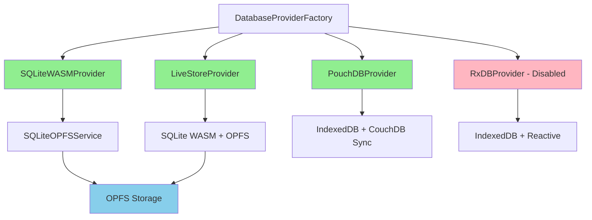
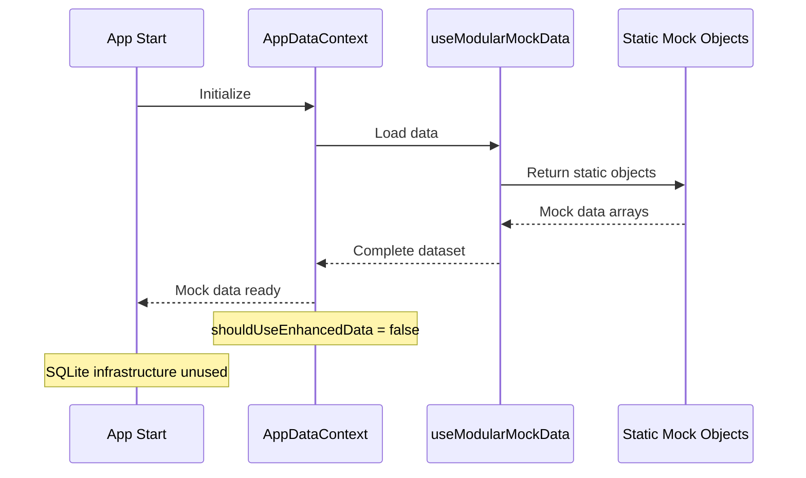
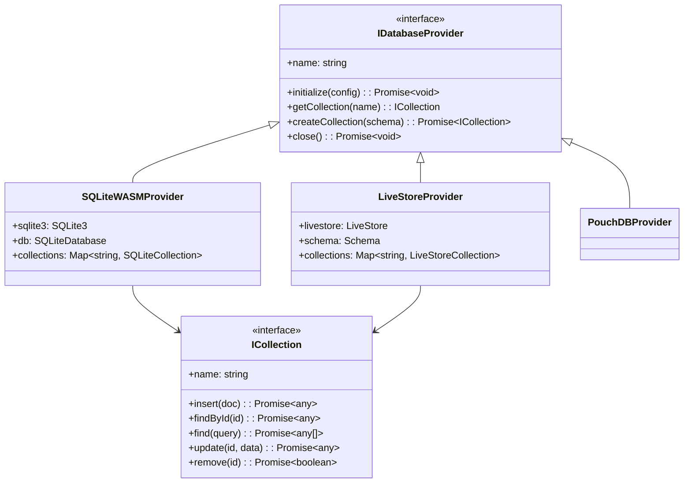
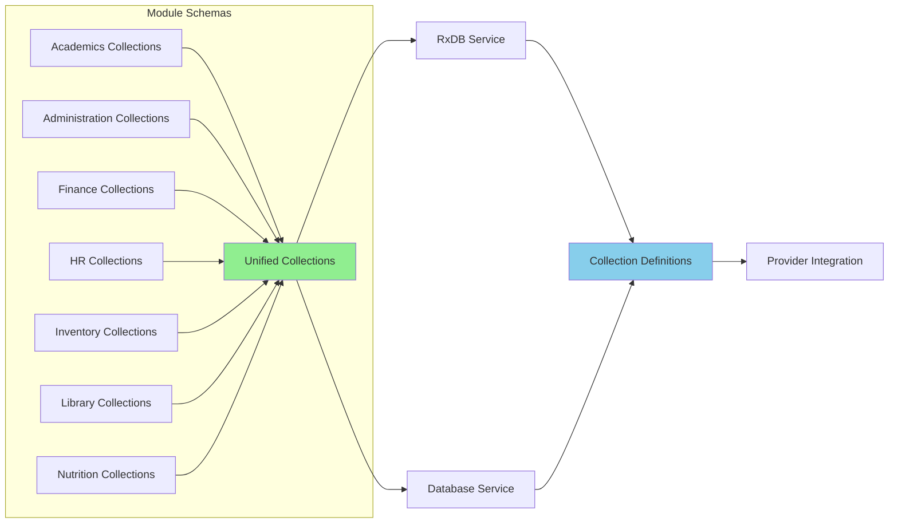
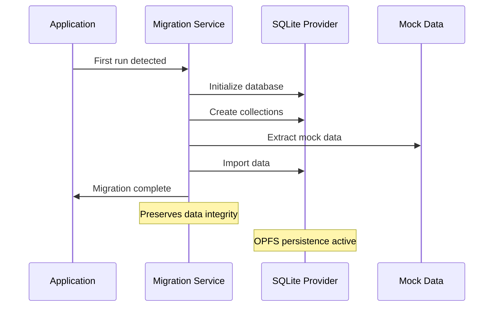
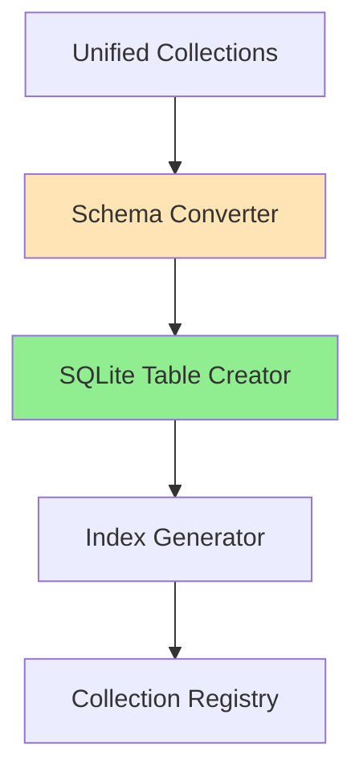
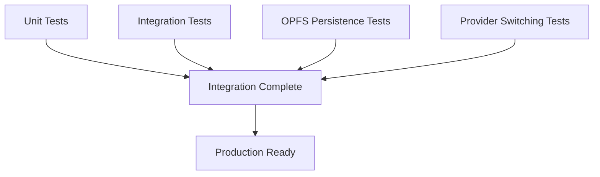
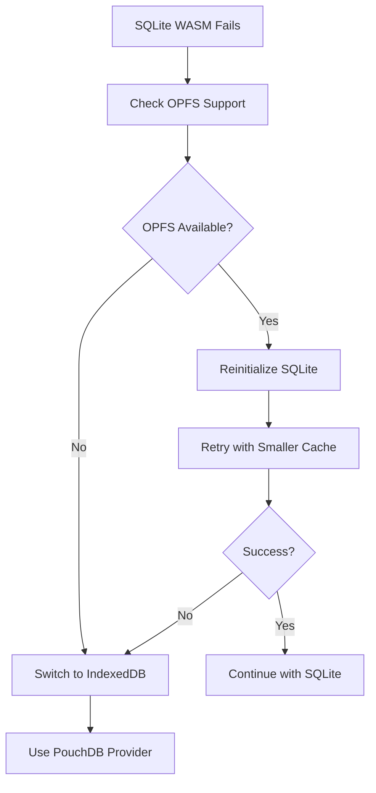

# Local Database Implementation Analysis & Migration Roadmap

## Overview

This document provides a comprehensive analysis of the current local database implementation status in SchoolPilot3 and outlines the complete roadmap for transitioning from mock data to SQLite WASM with OPFS storage for development mode, and LiveStore/PouchDB for production environments.

## Current Implementation Status

### ✅ **Infrastructure Complete (90%)**

The foundational database infrastructure is largely implemented and ready for activation:

#### Database Providers Architecture


#### Provider Selection Strategy
| Environment | Primary Provider | Fallback | Purpose |
|-------------|-----------------|----------|---------|
| **Development** | `sqlite` | `pouchdb` | Fast local development with persistence |
| **Production** | `livestore` | `pouchdb` | High-performance with sync capabilities |
| **Demo** | `livestore` | `pouchdb` | Demo mode with OPFS persistence |

#### Implemented Components
- ✅ **SQLiteWASMProvider**: Full SQLite WASM implementation with OPFS
- ✅ **LiveStoreProvider**: Advanced SQLite provider with reactivity  
- ✅ **SQLiteOPFSService**: Standalone SQLite OPFS service
- ✅ **DatabaseProviderFactory**: Provider creation and management
- ✅ **ProviderSelector**: Environment-based provider selection
- ✅ **Vite Configuration**: OPFS headers and SQLite WASM setup

### ⚠️ **Critical Integration Gap (0% Active)**

Despite complete infrastructure, the application **still uses mock data exclusively** due to missing integration in the React Context layer.

#### Current Data Flow


#### Root Cause Analysis
```typescript
// AppDataContext.tsx - Line 48
const shouldUseEnhancedData = currentConfig.features?.enhancedDataLayer; // ❌ Always false
const selectedData = shouldUseEnhancedData ? rxdbResult : mockResult; // ❌ Always uses mock
```

**Problem**: The `enhancedDataLayer` feature flag is disabled, preventing activation of the database providers.

## Architecture Analysis

### Existing Provider Architecture

The modular provider architecture is well-designed and complete:



### Schema Unification System

The schema system is excellently implemented with modular exports:



## Missing Implementation Components

### 1. **AppDataContext Integration** ❌ **Critical**

**Current Issue**: AppDataContext bypasses database providers entirely.

**Required Changes**:
```typescript
// AppDataContext.tsx - Required modifications
const shouldUseEnhancedData = currentConfig.dataMode !== 'mock'; // ✅ Use dataMode
const selectedData = shouldUseEnhancedData ? databaseResult : mockResult; // ✅ Use database

// Add database provider hook
const databaseResult = useDatabaseProvider(); // ✅ New hook needed
```

### 2. **Database Provider Hook** ❌ **Missing**

**Required**: Create `useDatabaseProvider` hook to interface with database services.

```typescript
// hooks/useDatabaseProvider.ts - New file needed
export const useDatabaseProvider = (): Partial<AppDataContextType> => {
  const [loading, setLoading] = useState(true);
  const [data, setData] = useState({});
  const [error, setError] = useState<Error | null>(null);
  
  useEffect(() => {
    // Initialize database service
    // Load collections from database
    // Set up reactive subscriptions
  }, []);
  
  return { loading, error, ...data };
};
```

### 3. **Schema Migration System** ❌ **Missing**

**Required**: Automated migration from mock data to SQLite on first run.



### 4. **Collection Initialization** ⚠️ **Partial**

**Status**: Collection definitions exist but not integrated with SQLite providers.

**Required**: Automatic collection creation with proper schemas on database initialization.

## Implementation Roadmap

### **Phase 1: Core Integration** (Week 1)

#### 1.1 Fix AppDataContext Integration
```typescript
// Priority: Critical
// Estimated Time: 2 days

// Update AppDataContext.tsx
- Replace shouldUseEnhancedData logic
- Integrate databaseResult from new hook  
- Maintain backward compatibility with mock fallback
```

#### 1.2 Create Database Provider Hook
```typescript
// Priority: Critical  
// Estimated Time: 3 days

// Create hooks/useDatabaseProvider.ts
- Initialize database service using DataServiceFactory
- Load all collections with proper schemas
- Implement reactive data subscriptions
- Handle loading states and error recovery
```

#### 1.3 Activate SQLite in Development
```typescript
// Priority: High
// Estimated Time: 1 day

// Update configuration
- Set enhancedDataLayer: true for development
- Ensure SQLite provider is selected
- Test OPFS persistence functionality
```

### **Phase 2: Data Migration** (Week 2)

#### 2.1 Schema Integration System


#### 2.2 Mock Data Migration Service
```typescript
// Create services/migrationService.ts
class MigrationService {
  async migrateToSQLite(): Promise<void> {
    // 1. Initialize SQLite provider
    // 2. Create collections from unified schemas
    // 3. Extract mock data using existing hooks
    // 4. Import data preserving relationships
    // 5. Validate data integrity
    // 6. Mark migration complete
  }
}
```

#### 2.3 First-Run Detection
```typescript
// Add to databaseService.ts
const isFirstRun = async (): Promise<boolean> => {
  // Check for existing OPFS database
  // Return true if migration needed
};
```

### **Phase 3: Production Integration** (Week 3)

#### 3.1 LiveStore Configuration
```typescript
// Configure LiveStore for production
- Implement sync engine configuration
- Set up event sourcing architecture  
- Configure cross-tab persistence
- Implement background sync capabilities
```

#### 3.2 Provider Switching Logic
```typescript
// Enhance DataServiceFactory
- Implement runtime provider switching
- Add provider health monitoring
- Implement automatic fallback mechanisms
- Add provider status reporting
```

#### 3.3 Performance Optimization
```typescript
// SQLite Performance Tuning
- Implement query indexing
- Configure WAL mode
- Set up connection pooling
- Optimize transaction batching
```

### **Phase 4: Testing & Production** (Week 4)

#### 4.1 Comprehensive Testing


#### 4.2 Migration Scripts
```typescript
// Production deployment scripts
- Database backup utilities
- Data export/import tools
- Migration rollback procedures
- Health check endpoints
```

## Technical Implementation Details

### Database Provider Configuration

```typescript
// Enhanced configuration for each environment
const PROVIDER_CONFIGS = {
  development: {
    provider: 'sqlite',
    options: {
      wasmUrl: '/sqlite3.wasm',
      opfsRoot: '/schoolpilot-dev/',
      walMode: true,
      cacheSize: 2000,
      busyTimeout: 30000
    }
  },
  production: {
    provider: 'livestore', 
    options: {
      syncEndpoint: process.env.SYNC_ENDPOINT,
      eventSourcing: true,
      crossTabSync: true,
      compressionLevel: 6
    }
  }
};
```

### Collection Schema Integration

```typescript
// Unified schema converter
class SchemaConverter {
  static convertToSQLite(rxdbSchema: any): SQLiteSchema {
    // Convert RxDB schema to SQLite DDL
    // Generate appropriate indexes
    // Handle relationships and constraints
    // Return executable SQL statements
  }
  
  static convertToLiveStore(rxdbSchema: any): LiveStoreSchema {
    // Convert to LiveStore event-sourced schema
    // Define aggregate boundaries  
    // Configure projection strategies
    // Set up sync behaviors
  }
}
```

### Data Access Layer

```typescript
// Unified data access interface
interface UnifiedDataAccess {
  // CRUD operations
  create<T>(collection: string, data: T): Promise<T>;
  findById<T>(collection: string, id: string): Promise<T | null>;
  find<T>(collection: string, query?: any): Promise<T[]>;
  update<T>(collection: string, id: string, data: Partial<T>): Promise<T>;
  delete(collection: string, id: string): Promise<boolean>;
  
  // Reactive queries
  subscribe<T>(collection: string, query?: any): Observable<T[]>;
  
  // Batch operations
  transaction(operations: Operation[]): Promise<any>;
}
```

## Risk Mitigation

### High Priority Risks

| Risk | Impact | Probability | Mitigation |
|------|--------|-------------|------------|
| **OPFS Browser Support** | High | Medium | Implement IndexedDB fallback |
| **Data Migration Failures** | Critical | Low | Comprehensive backup system |
| **Performance Degradation** | Medium | Medium | Extensive benchmarking |
| **Schema Conflicts** | High | Low | Automated schema validation |

### Fallback Strategies



## Success Metrics

### Performance Targets

| Metric | Current (Mock) | Target (SQLite) | Target (LiveStore) |
|--------|----------------|-----------------|-------------------|
| **Initial Load Time** | 2-3 seconds | < 2 seconds | < 1.5 seconds |
| **Query Response** | < 100ms | < 50ms | < 30ms |
| **Memory Usage** | 50-80MB | 60-90MB | 70-100MB |
| **Storage Efficiency** | 0MB | 10-50MB | 15-60MB |

### Functional Requirements

- ✅ **Data Persistence**: Survive browser restarts
- ✅ **Offline Operation**: Work without network
- ✅ **Cross-tab Sync**: Share data between tabs (LiveStore only)
- ✅ **Migration Safety**: No data loss during transitions
- ✅ **Performance**: Faster than current mock implementation

## Next Steps

### Immediate Actions (This Week)

1. **Enable Enhanced Data Layer**: Set `enhancedDataLayer: true` in development config
2. **Create useDatabaseProvider Hook**: Implement database integration hook
3. **Update AppDataContext**: Switch from mock to database providers
4. **Test SQLite OPFS**: Verify persistence across browser sessions

### Short-term Goals (2 Weeks)

1. **Complete Mock Data Migration**: Automated import of existing mock data
2. **Schema Integration**: Unify all module schemas with SQLite
3. **Performance Testing**: Benchmark against mock data performance
4. **Error Handling**: Implement comprehensive fallback mechanisms

### Medium-term Goals (1 Month)

1. **Production LiveStore**: Full LiveStore implementation with sync
2. **Advanced Features**: Query optimization, indexing, caching
3. **Migration Tools**: Production deployment and data management
4. **Documentation**: Complete developer and deployment guides

This implementation roadmap provides a clear path from the current mock data system to a fully functional SQLite WASM + OPFS solution for development and LiveStore for production, leveraging the excellent infrastructure already in place.
The foundational database infrastructure is largely implemented and ready for activation:

#### Database Providers Architecture


#### Provider Selection Strategy
| Environment | Primary Provider | Fallback | Purpose |
|-------------|-----------------|----------|---------|
| **Development** | `sqlite` | `pouchdb` | Fast local development with persistence |
| **Production** | `livestore` | `pouchdb` | High-performance with sync capabilities |
| **Demo** | `livestore` | `pouchdb` | Demo mode with OPFS persistence |

#### Implemented Components
- ✅ **SQLiteWASMProvider**: Full SQLite WASM implementation with OPFS
- ✅ **LiveStoreProvider**: Advanced SQLite provider with reactivity  
- ✅ **SQLiteOPFSService**: Standalone SQLite OPFS service
- ✅ **DatabaseProviderFactory**: Provider creation and management
- ✅ **ProviderSelector**: Environment-based provider selection
- ✅ **Vite Configuration**: OPFS headers and SQLite WASM setup

### ⚠️ **Critical Integration Gap (0% Active)**

Despite complete infrastructure, the application **still uses mock data exclusively** due to missing integration in the React Context layer.

#### Current Data Flow


#### Root Cause Analysis
```typescript
// AppDataContext.tsx - Line 48
const shouldUseEnhancedData = currentConfig.features?.enhancedDataLayer; // ❌ Always false
const selectedData = shouldUseEnhancedData ? rxdbResult : mockResult; // ❌ Always uses mock
```

**Problem**: The `enhancedDataLayer` feature flag is disabled, preventing activation of the database providers.

## Architecture Analysis

### Existing Provider Architecture

The modular provider architecture is well-designed and complete:


### Schema Unification System

The schema system is excellently implemented with modular exports:


## Missing Implementation Components

### 1. **AppDataContext Integration** ❌ **Critical**

**Current Issue**: AppDataContext bypasses database providers entirely.

**Required Changes**:
```typescript
// AppDataContext.tsx - Required modifications
const shouldUseEnhancedData = currentConfig.dataMode !== 'mock'; // ✅ Use dataMode
const selectedData = shouldUseEnhancedData ? databaseResult : mockResult; // ✅ Use database

// Add database provider hook
const databaseResult = useDatabaseProvider(); // ✅ New hook needed
```

### 2. **Database Provider Hook** ❌ **Missing**

**Required**: Create `useDatabaseProvider` hook to interface with database services.

```typescript
// hooks/useDatabaseProvider.ts - New file needed
export const useDatabaseProvider = (): Partial<AppDataContextType> => {
  const [loading, setLoading] = useState(true);
  const [data, setData] = useState({});
  const [error, setError] = useState<Error | null>(null);
  
  useEffect(() => {
    // Initialize database service
    // Load collections from database
    // Set up reactive subscriptions
  }, []);
  
  return { loading, error, ...data };
};
```

### 3. **Schema Migration System** ❌ **Missing**

**Required**: Automated migration from mock data to SQLite on first run.


### 4. **Collection Initialization** ⚠️ **Partial**

**Status**: Collection definitions exist but not integrated with SQLite providers.

**Required**: Automatic collection creation with proper schemas on database initialization.

## Implementation Roadmap

### **Phase 1: Core Integration** (Week 1)

#### 1.1 Fix AppDataContext Integration
```typescript
// Priority: Critical
// Estimated Time: 2 days

// Update AppDataContext.tsx
- Replace shouldUseEnhancedData logic
- Integrate databaseResult from new hook  
- Maintain backward compatibility with mock fallback
```

#### 1.2 Create Database Provider Hook
```typescript
// Priority: Critical  
// Estimated Time: 3 days

// Create hooks/useDatabaseProvider.ts
- Initialize database service using DataServiceFactory
- Load all collections with proper schemas
- Implement reactive data subscriptions
- Handle loading states and error recovery
```

#### 1.3 Activate SQLite in Development
```typescript
// Priority: High
// Estimated Time: 1 day

// Update configuration
- Set enhancedDataLayer: true for development
- Ensure SQLite provider is selected
- Test OPFS persistence functionality
```

### **Phase 2: Data Migration** (Week 2)

#### 2.1 Schema Integration System


#### 2.2 Mock Data Migration Service
```typescript
// Create services/migrationService.ts
class MigrationService {
  async migrateToSQLite(): Promise<void> {
    // 1. Initialize SQLite provider
    // 2. Create collections from unified schemas
    // 3. Extract mock data using existing hooks
    // 4. Import data preserving relationships
    // 5. Validate data integrity
    // 6. Mark migration complete
  }
}
```

#### 2.3 First-Run Detection
```typescript
// Add to databaseService.ts
const isFirstRun = async (): Promise<boolean> => {
  // Check for existing OPFS database
  // Return true if migration needed
};
```

### **Phase 3: Production Integration** (Week 3)

#### 3.1 LiveStore Configuration
```typescript
// Configure LiveStore for production
- Implement sync engine configuration
- Set up event sourcing architecture  
- Configure cross-tab persistence
- Implement background sync capabilities
```

#### 3.2 Provider Switching Logic
```typescript
// Enhance DataServiceFactory
- Implement runtime provider switching
- Add provider health monitoring
- Implement automatic fallback mechanisms
- Add provider status reporting
```

#### 3.3 Performance Optimization
```typescript
// SQLite Performance Tuning
- Implement query indexing
- Configure WAL mode
- Set up connection pooling
- Optimize transaction batching
```

### **Phase 4: Testing & Production** (Week 4)

#### 4.1 Comprehensive Testing


#### 4.2 Migration Scripts
```typescript
// Production deployment scripts
- Database backup utilities
- Data export/import tools
- Migration rollback procedures
- Health check endpoints
```

## Technical Implementation Details

### Database Provider Configuration

```typescript
// Enhanced configuration for each environment
const PROVIDER_CONFIGS = {
  development: {
    provider: 'sqlite',
    options: {
      wasmUrl: '/sqlite3.wasm',
      opfsRoot: '/schoolpilot-dev/',
      walMode: true,
      cacheSize: 2000,
      busyTimeout: 30000
    }
  },
  production: {
    provider: 'livestore', 
    options: {
      syncEndpoint: process.env.SYNC_ENDPOINT,
      eventSourcing: true,
      crossTabSync: true,
      compressionLevel: 6
    }
  }
};
```

### Collection Schema Integration

```typescript
// Unified schema converter
class SchemaConverter {
  static convertToSQLite(rxdbSchema: any): SQLiteSchema {
    // Convert RxDB schema to SQLite DDL
    // Generate appropriate indexes
    // Handle relationships and constraints
    // Return executable SQL statements
  }
  
  static convertToLiveStore(rxdbSchema: any): LiveStoreSchema {
    // Convert to LiveStore event-sourced schema
    // Define aggregate boundaries  
    // Configure projection strategies
    // Set up sync behaviors
  }
}
```

### Data Access Layer

```typescript
// Unified data access interface
interface UnifiedDataAccess {
  // CRUD operations
  create<T>(collection: string, data: T): Promise<T>;
  findById<T>(collection: string, id: string): Promise<T | null>;
  find<T>(collection: string, query?: any): Promise<T[]>;
  update<T>(collection: string, id: string, data: Partial<T>): Promise<T>;
  delete(collection: string, id: string): Promise<boolean>;
  
  // Reactive queries
  subscribe<T>(collection: string, query?: any): Observable<T[]>;
  
  // Batch operations
  transaction(operations: Operation[]): Promise<any>;
}
```

## Risk Mitigation

### High Priority Risks

| Risk | Impact | Probability | Mitigation |
|------|--------|-------------|------------|
| **OPFS Browser Support** | High | Medium | Implement IndexedDB fallback |
| **Data Migration Failures** | Critical | Low | Comprehensive backup system |
| **Performance Degradation** | Medium | Medium | Extensive benchmarking |
| **Schema Conflicts** | High | Low | Automated schema validation |

### Fallback Strategies


## Success Metrics

### Performance Targets

| Metric | Current (Mock) | Target (SQLite) | Target (LiveStore) |
|--------|----------------|-----------------|-------------------|
| **Initial Load Time** | 2-3 seconds | < 2 seconds | < 1.5 seconds |
| **Query Response** | < 100ms | < 50ms | < 30ms |
| **Memory Usage** | 50-80MB | 60-90MB | 70-100MB |
| **Storage Efficiency** | 0MB | 10-50MB | 15-60MB |

### Functional Requirements

- ✅ **Data Persistence**: Survive browser restarts
- ✅ **Offline Operation**: Work without network
- ✅ **Cross-tab Sync**: Share data between tabs (LiveStore only)
- ✅ **Migration Safety**: No data loss during transitions
- ✅ **Performance**: Faster than current mock implementation

## Next Steps

### Immediate Actions (This Week)

1. **Enable Enhanced Data Layer**: Set `enhancedDataLayer: true` in development config
2. **Create useDatabaseProvider Hook**: Implement database integration hook
3. **Update AppDataContext**: Switch from mock to database providers
4. **Test SQLite OPFS**: Verify persistence across browser sessions

### Short-term Goals (2 Weeks)

1. **Complete Mock Data Migration**: Automated import of existing mock data
2. **Schema Integration**: Unify all module schemas with SQLite
3. **Performance Testing**: Benchmark against mock data performance
4. **Error Handling**: Implement comprehensive fallback mechanisms

### Medium-term Goals (1 Month)

1. **Production LiveStore**: Full LiveStore implementation with sync
2. **Advanced Features**: Query optimization, indexing, caching
3. **Migration Tools**: Production deployment and data management
4. **Documentation**: Complete developer and deployment guides

This implementation roadmap provides a clear path from the current mock data system to a fully functional SQLite WASM + OPFS solution for development and LiveStore for production, leveraging the excellent infrastructure already in place.


