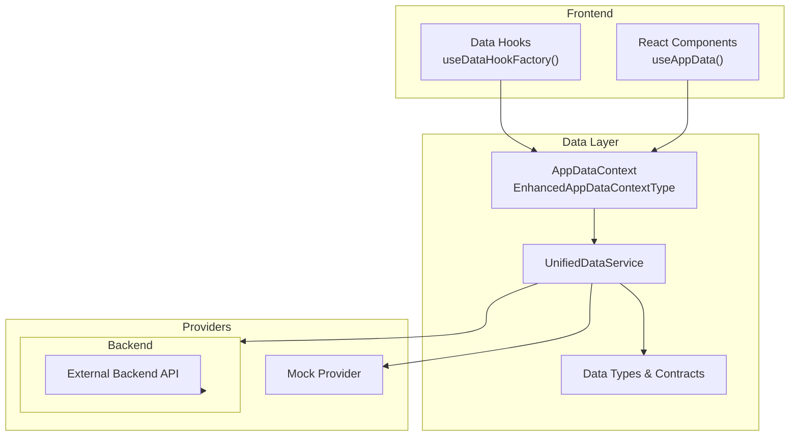
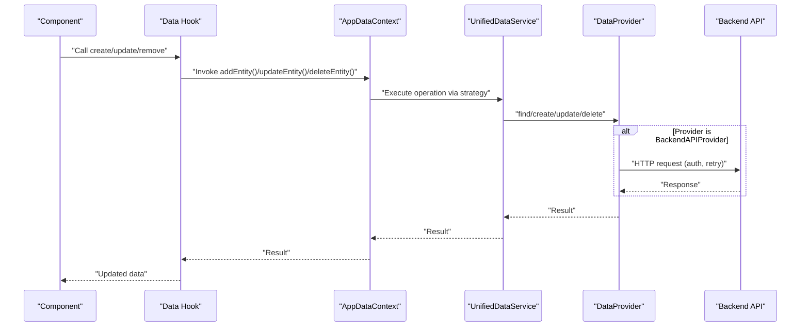
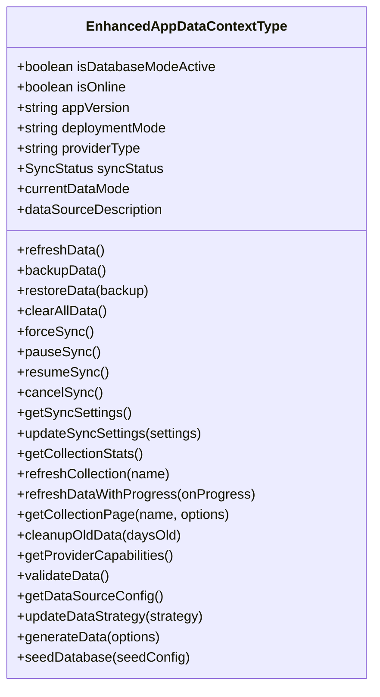
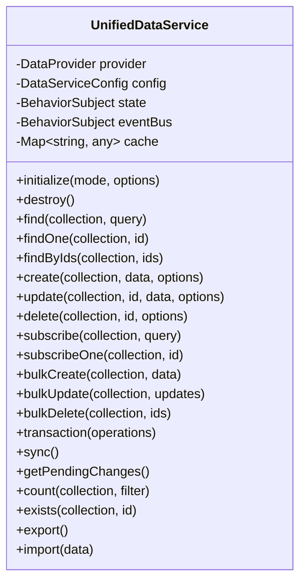
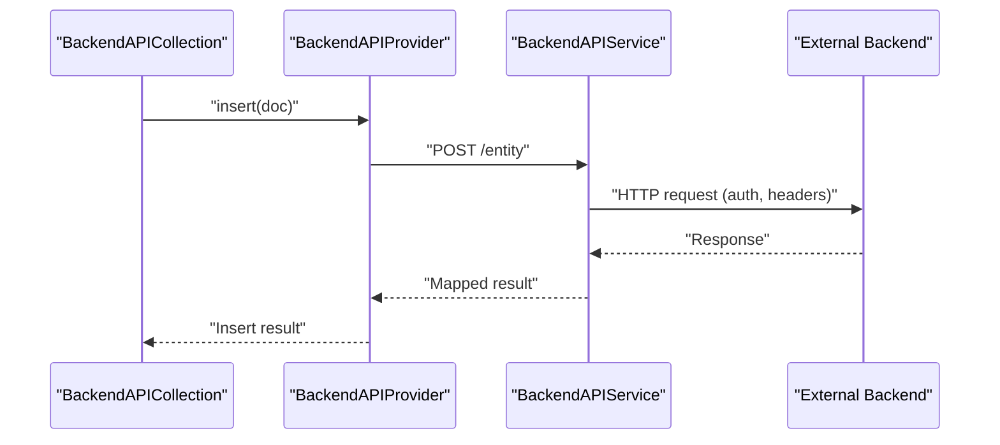
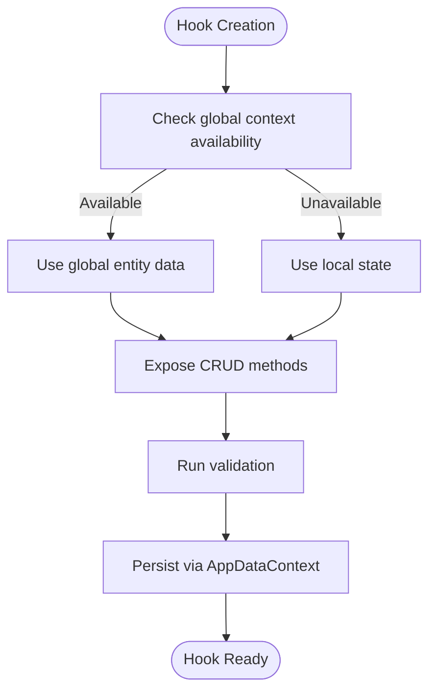
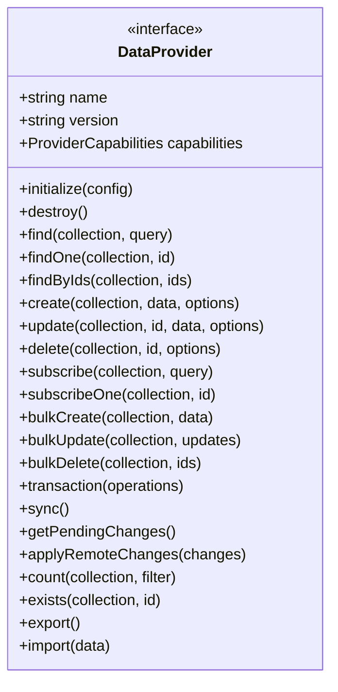
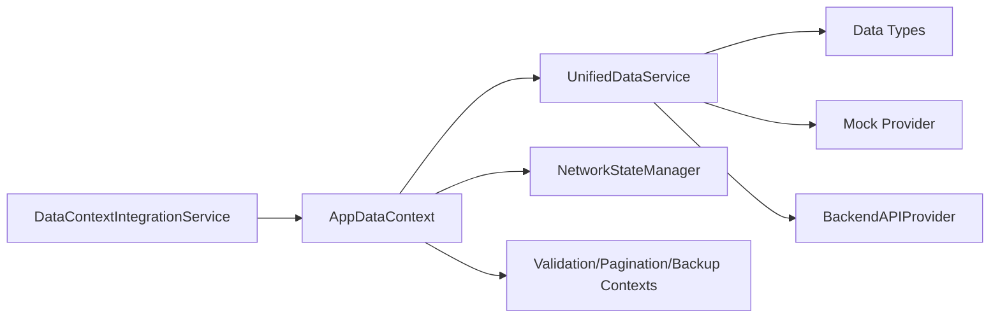

# API Documentation

<cite>
**Referenced Files in This Document**
- [AppDataContext.tsx](file://src/contexts/AppDataContext.tsx)
- [useDataHookFactory.ts](file://src/hooks/useDataHookFactory.ts)
- [UnifiedDataService.ts](file://src/services/data/UnifiedDataService.ts)
- [types.ts](file://src/services/data/types.ts)
- [BackendAPIProvider.ts](file://src/services/database/BackendAPIProvider.ts)
- [BackendAPIService.ts](file://src/services/backend/BackendAPIService.ts)
- [BackendServiceAdapter.ts](file://src/services/backend/BackendServiceAdapter.ts)
- [DataContextIntegrationService.ts](file://src/services/data/DataContextIntegrationService.ts)
- [DATA_LAYER_STRATEGY.md](file://docs/architecture/DATA_LAYER_STRATEGY.md)
- [api-spec.md](file://docs/specs/api-spec.md)
- [IMPLEMENTATION_GUIDELINES.md](file://docs/implementation/IMPLEMENTATION_GUIDELINES.md)
</cite>

## Table of Contents
1. [Introduction](#introduction)
2. [Project Structure](#project-structure)
3. [Core Components](#core-components)
4. [Architecture Overview](#architecture-overview)
5. [Detailed Component Analysis](#detailed-component-analysis)
6. [Dependency Analysis](#dependency-analysis)
7. [Performance Considerations](#performance-considerations)
8. [Troubleshooting Guide](#troubleshooting-guide)
9. [Conclusion](#conclusion)
10. [Appendices](#appendices)

## Introduction
This document describes the unified data access layer for SchoolPilot3, focusing on the AppDataContext contract and the underlying Unified Data Service. It explains how modules expose consistent CRUD operations via a central context, how the unified service abstracts providers and backend integrations, and how data consistency and synchronization are handled. It also covers the mock data API for development, backend service adapters, and operational patterns for frontend integration.

## Project Structure
The unified data access layer centers around:
- AppDataContext: A React context that exposes normalized data and CRUD methods to all components.
- UnifiedDataService: A provider-agnostic service offering CRUD, subscriptions, bulk operations, transactions, and sync.
- Backend Integration: BackendAPIProvider and BackendAPIService for connecting to external systems.
- Data Hook Factory: A standardized factory for creating module-specific data hooks with consistent patterns.
- Integration Service: Bridges module data registrations to AppDataContext.

**Diagram sources**
- [AppDataContext.tsx:102-183](file://src/contexts/AppDataContext.tsx#L102-L183)
- [UnifiedDataService.ts:36-128](file://src/services/data/UnifiedDataService.ts#L36-L128)
- [types.ts:135-182](file://src/services/data/types.ts#L135-L182)
- [BackendAPIProvider.ts:1-43](file://src/services/database/BackendAPIProvider.ts#L1-L43)
- [BackendAPIService.ts:342-381](file://src/services/backend/BackendAPIService.ts#L342-L381)

**Section sources**
- [AppDataContext.tsx:102-183](file://src/contexts/AppDataContext.tsx#L102-L183)
- [UnifiedDataService.ts:36-128](file://src/services/data/UnifiedDataService.ts#L36-L128)
- [types.ts:135-182](file://src/services/data/types.ts#L135-L182)

## Core Components
- AppDataContext: Exposes normalized collections and CRUD methods through a typed context. It manages sync status, settings, pagination, memory cleanup, and validation.
- UnifiedDataService: Provides a consistent API across providers, with caching, event emission, and optional sync capabilities.
- Backend Integration: BackendAPIProvider and BackendAPIService encapsulate HTTP requests, authentication, retries, and offline queueing.
- Data Hook Factory: Generates standardized hooks with consistent CRUD signatures and global/local state synchronization.
- Integration Service: Registers module data entities with AppDataContext and wires write operations to the data strategy manager.

**Section sources**
- [AppDataContext.tsx:102-183](file://src/contexts/AppDataContext.tsx#L102-L183)
- [useDataHookFactory.ts:15-34](file://src/hooks/useDataHookFactory.ts#L15-L34)
- [DataContextIntegrationService.ts:72-129](file://src/services/data/DataContextIntegrationService.ts#L72-L129)

## Architecture Overview
The unified architecture routes all data operations through AppDataContext, which delegates to UnifiedDataService. UnifiedDataService selects a provider (mock, backend-api, etc.) and executes CRUD, subscriptions, bulk operations, and sync. BackendAPIProvider and BackendAPIService handle external API communication with configurable authentication and retry policies.

**Diagram sources**
- [AppDataContext.tsx:102-183](file://src/contexts/AppDataContext.tsx#L102-L183)
- [UnifiedDataService.ts:153-283](file://src/services/data/UnifiedDataService.ts#L153-L283)
- [BackendAPIProvider.ts:311-335](file://src/services/database/BackendAPIProvider.ts#L311-L335)
- [BackendAPIService.ts:342-381](file://src/services/backend/BackendAPIService.ts#L342-L381)

## Detailed Component Analysis

### AppDataContext Contract and CRUD Exposure
- Purpose: Centralized data access for all modules with consistent loading, error, and CRUD semantics.
- Key capabilities:
  - CRUD methods per entity (addEntity, updateEntity, deleteEntity) via AppDataContextType.
  - Pagination, validation, sync controls, and memory cleanup.
  - Data strategy configuration and runtime mode switching.
- Integration: DataContextIntegrationService registers module entities and injects CRUD methods into AppDataContext.

**Diagram sources**
- [AppDataContext.tsx:102-183](file://src/contexts/AppDataContext.tsx#L102-L183)

**Section sources**
- [AppDataContext.tsx:102-183](file://src/contexts/AppDataContext.tsx#L102-L183)
- [DataContextIntegrationService.ts:72-129](file://src/services/data/DataContextIntegrationService.ts#L72-L129)
- [api-spec.md:1-21](file://docs/specs/api-spec.md#L1-L21)

### UnifiedDataService: Provider-Agnostic Data Access
- Purpose: Provide a single interface for CRUD, subscriptions, bulk operations, transactions, and sync regardless of the underlying provider.
- Key features:
  - Initialization with deployment modes.
  - Caching with TTL and cache invalidation.
  - Event bus for data lifecycle events.
  - Fallback polling for non-realtime providers.
  - Export/import and transaction support where providers allow.

**Diagram sources**
- [UnifiedDataService.ts:36-128](file://src/services/data/UnifiedDataService.ts#L36-L128)
- [UnifiedDataService.ts:153-283](file://src/services/data/UnifiedDataService.ts#L153-L283)
- [UnifiedDataService.ts:477-505](file://src/services/data/UnifiedDataService.ts#L477-L505)

**Section sources**
- [UnifiedDataService.ts:36-128](file://src/services/data/UnifiedDataService.ts#L36-L128)
- [UnifiedDataService.ts:153-283](file://src/services/data/UnifiedDataService.ts#L153-L283)
- [DATA_LAYER_STRATEGY.md:91-174](file://docs/architecture/DATA_LAYER_STRATEGY.md#L91-L174)

### Backend Integration: BackendAPIProvider and BackendAPIService
- BackendAPIProvider: Implements a collection interface against an external backend, supporting offline queueing, optimistic updates, and mapping between local and backend schemas.
- BackendAPIService: Encapsulates HTTP requests, authentication, request queueing, caching, and error reporting.

**Diagram sources**
- [BackendAPIProvider.ts:432-474](file://src/services/database/BackendAPIProvider.ts#L432-L474)
- [BackendAPIProvider.ts:311-335](file://src/services/database/BackendAPIProvider.ts#L311-L335)
- [BackendAPIService.ts:342-381](file://src/services/backend/BackendAPIService.ts#L342-L381)

**Section sources**
- [BackendAPIProvider.ts:17-43](file://src/services/database/BackendAPIProvider.ts#L17-L43)
- [BackendAPIProvider.ts:432-474](file://src/services/database/BackendAPIProvider.ts#L432-L474)
- [BackendAPIService.ts:342-381](file://src/services/backend/BackendAPIService.ts#L342-L381)

### Data Hook Factory: Consistent CRUD Patterns
- Purpose: Standardize CRUD operations and data synchronization across modules using a single factory.
- Features:
  - Consistent signatures for create, update, remove.
  - Global/local state synchronization with deep comparison.
  - Validation integration and performance monitoring hooks.

**Diagram sources**
- [useDataHookFactory.ts:103-131](file://src/hooks/useDataHookFactory.ts#L103-L131)
- [useDataHookFactory.ts:117-125](file://src/hooks/useDataHookFactory.ts#L117-L125)

**Section sources**
- [useDataHookFactory.ts:15-34](file://src/hooks/useDataHookFactory.ts#L15-L34)
- [useDataHookFactory.ts:103-131](file://src/hooks/useDataHookFactory.ts#L103-L131)

### Data Provider Abstractions and Types
- DataProvider interface defines the contract for all providers, including CRUD, subscriptions, bulk operations, transactions, and sync.
- Deployment modes and capabilities guide provider selection and feature availability.

**Diagram sources**
- [types.ts:135-182](file://src/services/data/types.ts#L135-L182)
- [DATA_LAYER_STRATEGY.md:91-174](file://docs/architecture/DATA_LAYER_STRATEGY.md#L91-L174)

**Section sources**
- [types.ts:135-182](file://src/services/data/types.ts#L135-L182)
- [DATA_LAYER_STRATEGY.md:91-174](file://docs/architecture/DATA_LAYER_STRATEGY.md#L91-L174)

## Dependency Analysis
- AppDataContext depends on UnifiedDatabaseManager, NetworkStateManager, and various contexts for pagination, validation, and backup/restore.
- DataContextIntegrationService registers module entities and injects CRUD methods into AppDataContext.
- UnifiedDataService depends on provider implementations and emits events consumed by the rest of the system.

**Diagram sources**
- [AppDataContext.tsx:284-351](file://src/contexts/AppDataContext.tsx#L284-L351)
- [DataContextIntegrationService.ts:72-85](file://src/services/data/DataContextIntegrationService.ts#L72-L85)
- [UnifiedDataService.ts:477-505](file://src/services/data/UnifiedDataService.ts#L477-L505)

**Section sources**
- [AppDataContext.tsx:284-351](file://src/contexts/AppDataContext.tsx#L284-L351)
- [DataContextIntegrationService.ts:72-85](file://src/services/data/DataContextIntegrationService.ts#L72-L85)
- [UnifiedDataService.ts:477-505](file://src/services/data/UnifiedDataService.ts#L477-L505)

## Performance Considerations
- Caching: UnifiedDataService caches queries for a fixed TTL and invalidates on writes.
- Polling fallback: Non-realtime providers fall back to periodic polling for subscriptions.
- Bulk operations: Prefer bulkCreate/bulkUpdate/bulkDelete to minimize round trips.
- Throttling: AppDataContext refresh operations are throttled to reduce churn.
- Memory cleanup: Periodic cleanup of old data helps maintain performance.

**Section sources**
- [UnifiedDataService.ts:47-48](file://src/services/data/UnifiedDataService.ts#L47-L48)
- [UnifiedDataService.ts:611-629](file://src/services/data/UnifiedDataService.ts#L611-L629)
- [UnifiedDataService.ts:290-321](file://src/services/data/UnifiedDataService.ts#L290-L321)
- [AppDataContext.tsx:654-682](file://src/contexts/AppDataContext.tsx#L654-L682)
- [AppDataContext.tsx:722-769](file://src/contexts/AppDataContext.tsx#L722-L769)

## Troubleshooting Guide
- Authentication failures: Verify BackendAPIService authentication configuration and headers; check error logs and queue status.
- Sync errors: Inspect sync status and settings; ensure provider supports sync and backend is reachable.
- Validation errors: Use validateData to identify issues across collections; fix schema mismatches.
- Conflict resolution: Use conflict resolution strategies (local wins, remote wins, merge) and validate resolved data.

**Section sources**
- [BackendAPIService.ts:338-340](file://src/services/backend/BackendAPIService.ts#L338-L340)
- [AppDataContext.tsx:462-537](file://src/contexts/AppDataContext.tsx#L462-L537)
- [AppDataContext.tsx:159-163](file://src/contexts/AppDataContext.tsx#L159-L163)

## Conclusion
SchoolPilot3’s unified data access layer provides a consistent, provider-agnostic interface for data operations, robust backend integration, and scalable patterns for module development. AppDataContext and UnifiedDataService together ensure predictable CRUD behavior, real-time updates, and reliable synchronization, while the data hook factory and integration service streamline module adoption.

## Appendices

### API Reference: AppDataContext (CRUD and Utilities)
- CRUD methods per entity: addEntity, updateEntity, deleteEntity.
- Pagination: getCollectionPage.
- Validation: validateData.
- Sync controls: forceSync, pauseSync, resumeSync, cancelSync, getSyncSettings, updateSyncSettings.
- Data management: refreshData, refreshCollection, refreshDataWithProgress, cleanupOldData.
- Provider info: getProviderCapabilities, getDataSourceConfig, updateDataStrategy, seedDatabase.

**Section sources**
- [AppDataContext.tsx:102-183](file://src/contexts/AppDataContext.tsx#L102-L183)
- [api-spec.md:1-21](file://docs/specs/api-spec.md#L1-L21)

### API Reference: UnifiedDataService (CRUD and Subscriptions)
- CRUD: find, findOne, findByIds, create, update, delete.
- Subscriptions: subscribe, subscribeOne.
- Bulk: bulkCreate, bulkUpdate, bulkDelete.
- Transactions: transaction.
- Sync: sync, getPendingChanges.
- Utilities: count, exists, export, import.

**Section sources**
- [UnifiedDataService.ts:153-283](file://src/services/data/UnifiedDataService.ts#L153-L283)
- [UnifiedDataService.ts:290-321](file://src/services/data/UnifiedDataService.ts#L290-L321)
- [DATA_LAYER_STRATEGY.md:91-174](file://docs/architecture/DATA_LAYER_STRATEGY.md#L91-L174)

### Backend Integration: Authentication and Endpoints
- Authentication: bearer token, API key, basic, or custom headers.
- Endpoints: configurable per collection with method overrides.
- Retry and queue: configurable retry attempts and offline queueing.

**Section sources**
- [BackendAPIProvider.ts:25-40](file://src/services/database/BackendAPIProvider.ts#L25-L40)
- [BackendAPIProvider.ts:311-335](file://src/services/database/BackendAPIProvider.ts#L311-L335)
- [BackendAPIService.ts:342-381](file://src/services/backend/BackendAPIService.ts#L342-L381)

### Mock Data API for Development
- Development seeding and module-specific generation are supported through mock data adapters and scripts.
- Use seedDatabase and generateData to populate demo or development environments.

**Section sources**
- [AppDataContext.tsx:169-182](file://src/contexts/AppDataContext.tsx#L169-L182)
- [IMPLEMENTATION_GUIDELINES.md:385-441](file://docs/implementation/IMPLEMENTATION_GUIDELINES.md#L385-L441)