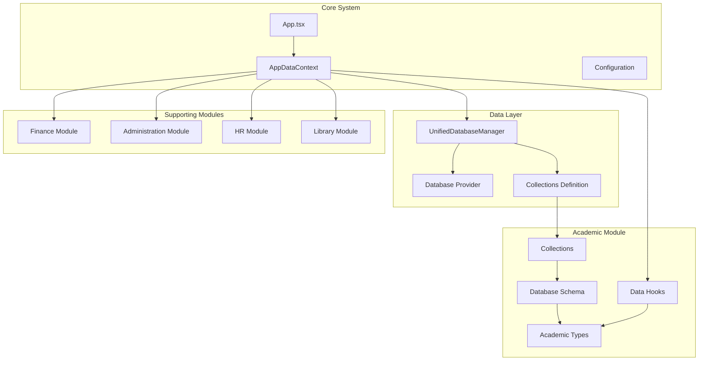
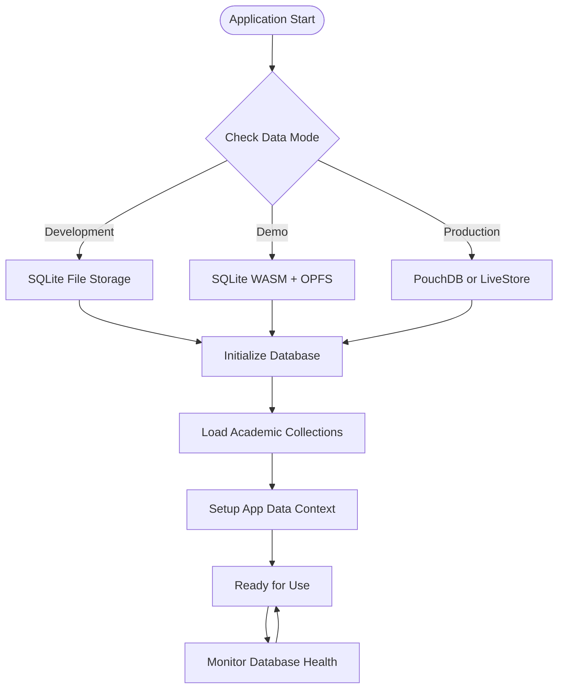
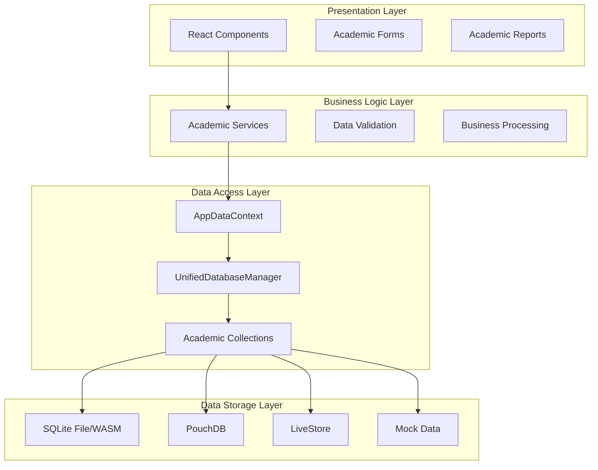
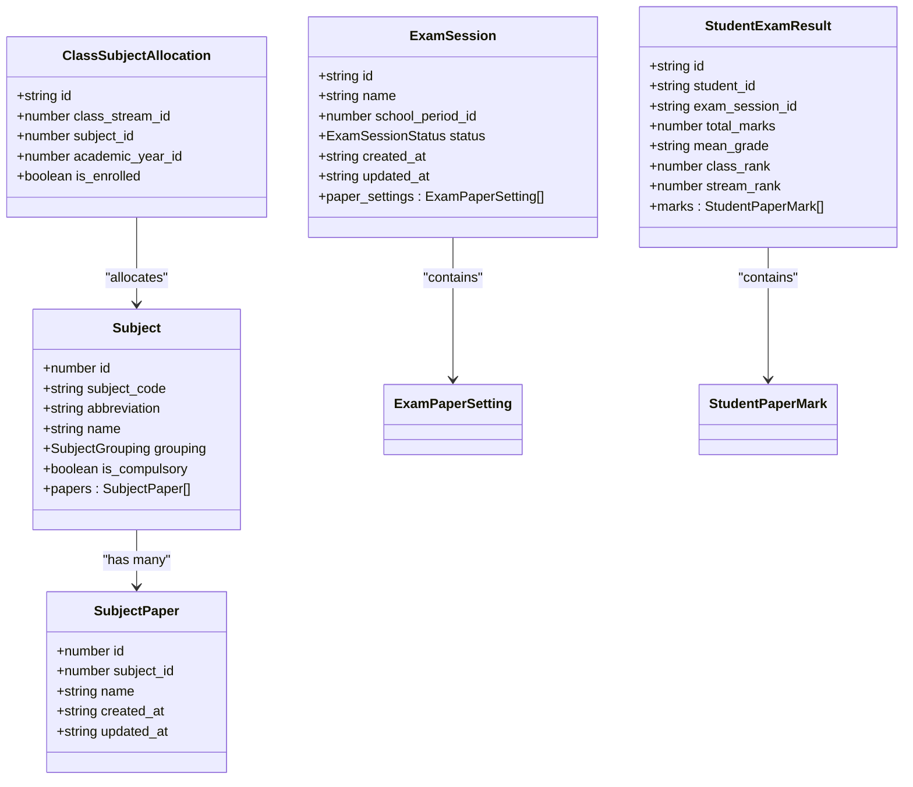
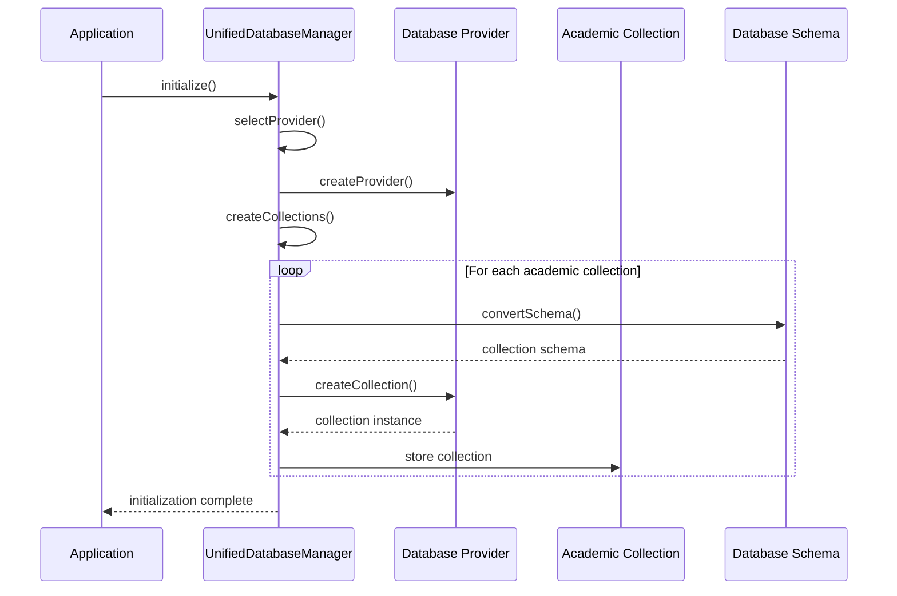
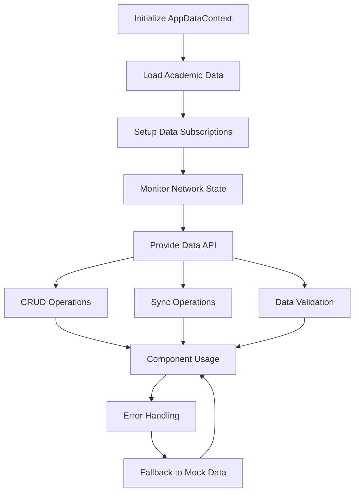
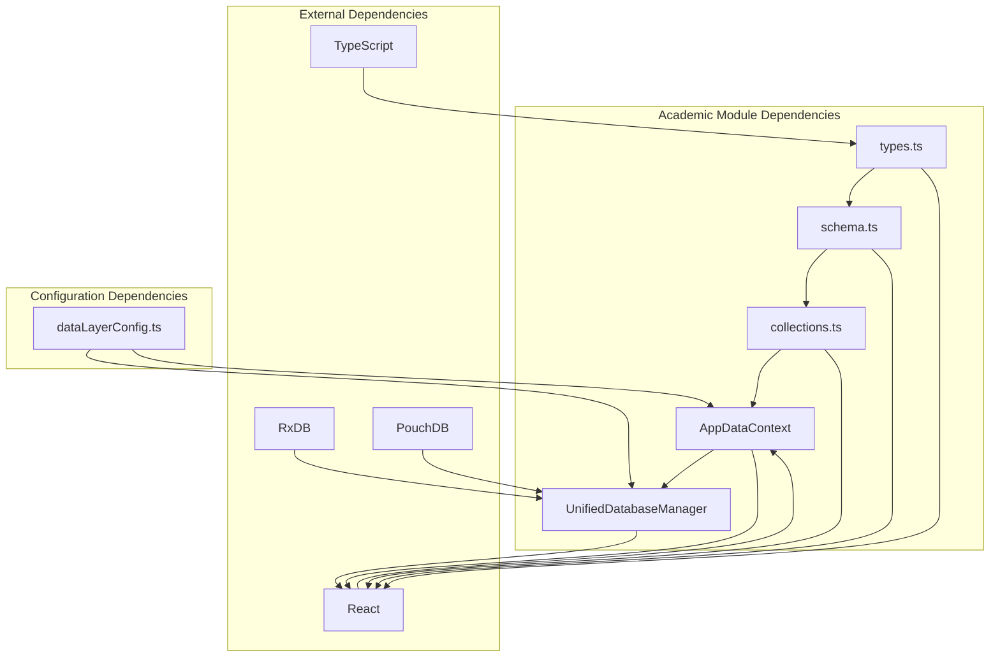

# Academic Data Management

<cite>
**Referenced Files in This Document**
- [README.md](file://README.md)
- [dataLayerConfig.ts](file://src/config/dataLayerConfig.ts)
- [AppDataContext.tsx](file://src/contexts/AppDataContext.tsx)
- [useModularMockData.ts](file://src/hooks/useModularMockData.ts)
- [types.ts](file://src/modules/academics/data/types.ts)
- [schema.ts](file://src/modules/academics/data/schema.ts)
- [collections.ts](file://src/modules/academics/data/collections.ts)
- [UnifiedDatabaseManager.ts](file://src/services/database/UnifiedDatabaseManager.ts)
</cite>

## Table of Contents
1. [Introduction](#introduction)
2. [Project Structure](#project-structure)
3. [Core Components](#core-components)
4. [Architecture Overview](#architecture-overview)
5. [Detailed Component Analysis](#detailed-component-analysis)
6. [Dependency Analysis](#dependency-analysis)
7. [Performance Considerations](#performance-considerations)
8. [Troubleshooting Guide](#troubleshooting-guide)
9. [Conclusion](#conclusion)

## Introduction

The Academic Data Management system is a comprehensive educational administration platform built with React, TypeScript, and Vite. This system manages all aspects of academic operations including curriculum management, examinations, timetabling, and student academic records. The platform features a sophisticated dual-mode architecture supporting both development (persistent SQLite database) and production (PouchDB/local database) environments, with a focus on modular design and type safety.

The system serves as an enterprise-grade solution for educational institutions, providing robust data management capabilities for academic processes while maintaining strict type safety and comprehensive testing coverage. The academic module specifically handles curriculum structures, subject allocations, examination systems, and student academic performance tracking.

## Project Structure

The Academic Data Management system follows a modular architecture pattern with clear separation of concerns across eight distinct business modules. The project structure emphasizes domain-driven design where each module encapsulates its own data types, schemas, and business logic.

**Diagram sources**
- [README.md:77-122](file://README.md#L77-L122)
- [AppDataContext.tsx:1-100](file://src/contexts/AppDataContext.tsx#L1-L100)
- [UnifiedDatabaseManager.ts:44-80](file://src/services/database/UnifiedDatabaseManager.ts#L44-L80)

**Section sources**
- [README.md:77-122](file://README.md#L77-L122)
- [README.md:318-328](file://README.md#L318-L328)

## Core Components

The Academic Data Management system consists of several core components that work together to provide comprehensive academic data management capabilities.

### Data Layer Architecture

The system implements a sophisticated dual-mode data layer architecture that supports both development and production environments seamlessly. The data layer configuration provides three distinct modes: development, demo, and production, each with specific characteristics and use cases.

**Diagram sources**
- [dataLayerConfig.ts:56-236](file://src/config/dataLayerConfig.ts#L56-L236)
- [AppDataContext.tsx:297-351](file://src/contexts/AppDataContext.tsx#L297-L351)

### Academic Data Types

The academic module defines comprehensive type definitions for all academic entities, ensuring type safety across the entire system. These types serve as the single source of truth for academic data structures and relationships.

**Section sources**
- [dataLayerConfig.ts:56-236](file://src/config/dataLayerConfig.ts#L56-L236)
- [AppDataContext.tsx:297-351](file://src/contexts/AppDataContext.tsx#L297-L351)

## Architecture Overview

The Academic Data Management system employs a sophisticated architecture that separates concerns across multiple layers while maintaining seamless integration between components.

**Diagram sources**
- [README.md:50-76](file://README.md#L50-L76)
- [UnifiedDatabaseManager.ts:44-80](file://src/services/database/UnifiedDatabaseManager.ts#L44-L80)
- [AppDataContext.tsx:101-183](file://src/contexts/AppDataContext.tsx#L101-L183)

The architecture follows a layered approach where each layer has specific responsibilities:

- **Presentation Layer**: Handles user interface and user interactions
- **Business Logic Layer**: Contains academic business rules and validation logic
- **Data Access Layer**: Manages data operations and provides unified data access
- **Data Storage Layer**: Handles persistence and retrieval of academic data

**Section sources**
- [README.md:50-76](file://README.md#L50-L76)
- [UnifiedDatabaseManager.ts:44-80](file://src/services/database/UnifiedDatabaseManager.ts#L44-L80)

## Detailed Component Analysis

### Academic Data Types and Schemas

The academic module implements a comprehensive type system that defines all academic entities and their relationships. These types serve as the foundation for data consistency and type safety throughout the system.

**Diagram sources**
- [types.ts:82-191](file://src/modules/academics/data/types.ts#L82-L191)
- [schema.ts:72-207](file://src/modules/academics/data/schema.ts#L72-L207)

The academic data model encompasses several key entities:

- **Subject Management**: Core academic subjects with grouping classifications and department associations
- **Exam Management**: Comprehensive examination system including sessions, paper settings, and scheduling
- **Student Records**: Detailed academic performance tracking with enrollment and results management
- **Timetable Management**: Class scheduling with period definitions and teacher assignments

**Section sources**
- [types.ts:82-191](file://src/modules/academics/data/types.ts#L82-L191)
- [schema.ts:72-207](file://src/modules/academics/data/schema.ts#L72-L207)

### Database Collections and Management

The academic module utilizes a provider-agnostic collection system that supports multiple database backends while maintaining consistent data access patterns.

**Diagram sources**
- [UnifiedDatabaseManager.ts:99-169](file://src/services/database/UnifiedDatabaseManager.ts#L99-L169)
- [collections.ts:6-48](file://src/modules/academics/data/collections.ts#L6-L48)

The collection management system provides:

- **Schema Abstraction**: Database-agnostic schema definitions using the `createDatabaseSchema` helper
- **Collection Registration**: Centralized collection registration through the `academicsCollections` object
- **Provider Compatibility**: Seamless switching between different database providers
- **Index Management**: Automatic index creation for optimal query performance

**Section sources**
- [UnifiedDatabaseManager.ts:99-169](file://src/services/database/UnifiedDatabaseManager.ts#L99-L169)
- [collections.ts:6-48](file://src/modules/academics/data/collections.ts#L6-L48)

### Data Context and State Management

The application implements a sophisticated data context system that provides unified access to academic data across all components while maintaining proper state management and error handling.

**Diagram sources**
- [AppDataContext.tsx:219-571](file://src/contexts/AppDataContext.tsx#L219-L571)
- [useModularMockData.ts:62-582](file://src/hooks/useModularMockData.ts#L62-L582)

The data context provides comprehensive functionality including:

- **Unified Data Access**: Single interface for accessing all academic data collections
- **Real-time Updates**: Reactive data subscriptions for automatic UI updates
- **Error Recovery**: Graceful fallback to mock data when database initialization fails
- **Sync Management**: Automatic synchronization with backend systems when available
- **Validation**: Built-in data validation and consistency checking

**Section sources**
- [AppDataContext.tsx:219-571](file://src/contexts/AppDataContext.tsx#L219-L571)
- [useModularMockData.ts:62-582](file://src/hooks/useModularMockData.ts#L62-L582)

## Dependency Analysis

The Academic Data Management system exhibits excellent modularity with clear dependency relationships that support maintainability and scalability.

**Diagram sources**
- [types.ts:1-363](file://src/modules/academics/data/types.ts#L1-L363)
- [schema.ts:1-305](file://src/modules/academics/data/schema.ts#L1-L305)
- [dataLayerConfig.ts:56-236](file://src/config/dataLayerConfig.ts#L56-L236)

The dependency structure demonstrates:

- **Top-down Configuration**: Configuration drives provider selection and initialization
- **Bottom-up Data Flow**: Academic data flows from collections through context to components
- **Provider Abstraction**: Database provider selection is abstracted from business logic
- **Type Safety**: Comprehensive TypeScript definitions ensure compile-time type checking

**Section sources**
- [types.ts:1-363](file://src/modules/academics/data/types.ts#L1-L363)
- [schema.ts:1-305](file://src/modules/academics/data/schema.ts#L1-L305)
- [dataLayerConfig.ts:56-236](file://src/config/dataLayerConfig.ts#L56-L236)

## Performance Considerations

The Academic Data Management system implements several performance optimization strategies to ensure smooth operation with large academic datasets.

### Database Performance Optimization

The system employs multiple strategies for optimal database performance:

- **Index Optimization**: Strategic indexing on frequently queried fields like `student_id`, `exam_session_id`, and `class_stream_id`
- **Query Optimization**: Efficient query patterns that minimize data transfer and processing overhead
- **Caching Strategies**: Intelligent caching of frequently accessed academic data
- **Batch Operations**: Bulk operations for data synchronization and updates

### Memory Management

The system implements comprehensive memory management for academic data:

- **Lazy Loading**: Academic data is loaded on-demand rather than all at once
- **Pagination Support**: Built-in pagination for large academic datasets
- **Cleanup Mechanisms**: Automatic cleanup of old academic records and temporary data
- **Resource Monitoring**: Continuous monitoring of memory usage and performance metrics

### Network Optimization

For production deployments with backend integration:

- **Connection Pooling**: Efficient management of database connections
- **Background Sync**: Asynchronous synchronization to minimize user impact
- **Conflict Resolution**: Automated conflict resolution for concurrent data updates
- **Offline Support**: Robust offline capabilities with automatic re-synchronization

## Troubleshooting Guide

### Common Academic Data Issues

**Database Initialization Failures**
- Check provider availability and configuration
- Verify database permissions and storage quotas
- Review initialization logs for specific error messages
- Ensure proper fallback mechanisms are in place

**Data Synchronization Problems**
- Verify backend connectivity and authentication
- Check sync intervals and retry configurations
- Monitor conflict resolution settings
- Validate data consistency across systems

**Performance Issues**
- Analyze query performance and optimize indexes
- Review memory usage patterns and cleanup schedules
- Check for memory leaks in academic data processing
- Monitor network latency for remote data operations

**Data Integrity Concerns**
- Validate academic data relationships and referential integrity
- Check for orphaned records in academic collections
- Review audit trails for data modification history
- Ensure proper cascading deletes for dependent academic data

**Section sources**
- [AppDataContext.tsx:461-537](file://src/contexts/AppDataContext.tsx#L461-L537)
- [UnifiedDatabaseManager.ts:563-630](file://src/services/database/UnifiedDatabaseManager.ts#L563-L630)

## Conclusion

The Academic Data Management system represents a sophisticated solution for educational institution data management. Through its modular architecture, comprehensive type safety, and robust data layer, it provides reliable academic data management capabilities while maintaining flexibility for future enhancements.

The system's strength lies in its comprehensive approach to academic data management, from curriculum and examination systems to student performance tracking and timetable management. The dual-mode data layer architecture ensures seamless operation across development and production environments, while the provider-agnostic design allows for future database technology evolution.

Key achievements of the system include:

- **Comprehensive Academic Coverage**: Complete support for all major academic operations
- **Type Safety**: Zero `any` types with extensive TypeScript coverage
- **Modular Design**: Clear separation of concerns with maintainable module structure
- **Performance Optimization**: Efficient data access patterns and memory management
- **Future-Ready Architecture**: Provider-agnostic design supporting technology evolution

The Academic Data Management system provides a solid foundation for educational institutions seeking comprehensive academic data management capabilities while maintaining the flexibility to adapt to changing technological requirements and institutional needs.