# Academic Data Management

<cite>
**Referenced Files in This Document**
- [README.md](file://README.md)
- [dataLayerConfig.ts](file://src/config/dataLayerConfig.ts)
- [AppDataContext.tsx](file://src/contexts/AppDataContext.tsx)
- [useModularMockData.ts](file://src/hooks/useModularMockData.ts)
- [types.ts](file://src/modules/academics/data/types.ts)
- [schema.ts](file://src/modules/academics/data/schema.ts)
- [collections.ts](file://src/modules/academics/data/collections.ts)
- [UnifiedDatabaseManager.ts](file://src/services/database/UnifiedDatabaseManager.ts)
- [useAcademicData.ts](file://src/modules/academics/data/useAcademicData.ts)
- [useSubjectData.ts](file://src/modules/academics/data/useSubjectData.ts)
- [useExamSessionData.ts](file://src/modules/academics/data/useExamSessionData.ts)
- [useDatabaseCollection.ts](file://src/hooks/useDatabaseCollection.ts)
- [databaseService.ts](file://src/services/database/databaseService.ts)
- [mockData.ts](file://src/modules/academics/data/mockData.ts)
- [AcademicsDashboardPage.tsx](file://src/modules/academics/pages/AcademicsDashboardPage.tsx)
- [ModuleDashboardShell.tsx](file://src/components/ModuleDashboardShell.tsx)
- [useAppData.ts](file://src/hooks/useAppData.ts)
</cite>

## Update Summary
**Changes Made**
- Updated Academic Data Types and Schemas section to reflect comprehensive database-backed entity definitions
- Revised Academic Data Hooks section to show real database integration patterns with CRUD operations
- Updated Database Collections and Management section to demonstrate provider-agnostic data access
- Enhanced Data Context and State Management section to show database-backed subscriptions
- Added new section on Enhanced Academic Dashboard with comprehensive alert banners, trend-enabled metrics, quick navigation cards, and enhanced chart visualizations
- Updated troubleshooting guidance to address database integration issues
- Enhanced documentation to cover real-time synchronization capabilities and dashboard analytics features

## Table of Contents
1. [Introduction](#introduction)
2. [Project Structure](#project-structure)
3. [Core Components](#core-components)
4. [Architecture Overview](#architecture-overview)
5. [Detailed Component Analysis](#detailed-component-analysis)
6. [Enhanced Academic Dashboard](#enhanced-academic-dashboard)
7. [Database Integration Patterns](#database-integration-patterns)
8. [Dependency Analysis](#dependency-analysis)
9. [Performance Considerations](#performance-considerations)
10. [Troubleshooting Guide](#troubleshooting-guide)
11. [Conclusion](#conclusion)

## Introduction

The Academic Data Management system is a comprehensive educational administration platform built with React, TypeScript, and Vite. This system manages all aspects of academic operations including curriculum management, examinations, timetabling, and student academic records. The platform features a sophisticated dual-mode architecture supporting both development (SQLite WASM with OPFS) and production (LiveStore with SQLite WASM) environments, with a focus on modular design and type safety.

**Updated** The system now implements comprehensive database-backed operations throughout the academic module, replacing mock data with real database integration patterns. The academic module specifically handles curriculum structures, subject allocations, examination systems, and student academic performance tracking through provider-agnostic database operations with real-time synchronization capabilities. The enhanced dashboard provides comprehensive analytics, alert systems, and interactive visualizations for academic data management.

## Project Structure

The Academic Data Management system follows a modular architecture pattern with clear separation of concerns across eight distinct business modules. The project structure emphasizes domain-driven design where each module encapsulates its own data types, schemas, and business logic.

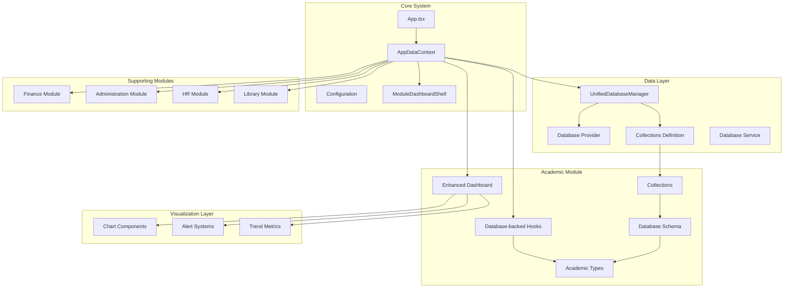

**Diagram sources**
- [README.md:77-122](file://README.md#L77-L122)
- [AppDataContext.tsx:1-100](file://src/contexts/AppDataContext.tsx#L1-L100)
- [UnifiedDatabaseManager.ts:44-80](file://src/services/database/UnifiedDatabaseManager.ts#L44-L80)
- [ModuleDashboardShell.tsx:1-422](file://src/components/ModuleDashboardShell.tsx#L1-L422)

**Section sources**
- [README.md:77-122](file://README.md#L77-L122)
- [README.md:318-328](file://README.md#L318-L328)

## Core Components

The Academic Data Management system consists of several core components that work together to provide comprehensive academic data management capabilities.

### Data Layer Architecture

The system implements a sophisticated dual-mode data layer architecture that supports both development and production environments seamlessly. The data layer configuration provides three distinct modes: development, demo, and production, each with specific characteristics and use cases.

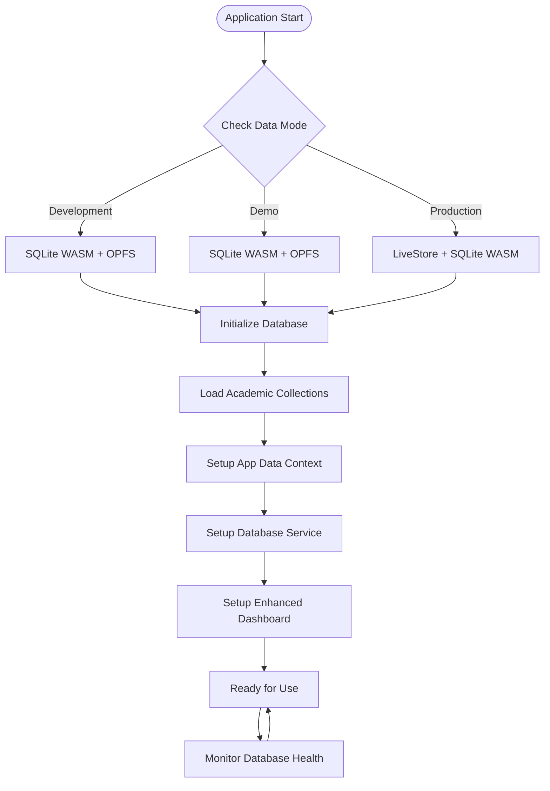

**Diagram sources**
- [dataLayerConfig.ts:56-236](file://src/config/dataLayerConfig.ts#L56-L236)
- [AppDataContext.tsx:297-351](file://src/contexts/AppDataContext.tsx#L297-L351)
- [ModuleDashboardShell.tsx:305-419](file://src/components/ModuleDashboardShell.tsx#L305-L419)

### Academic Data Types

The academic module defines comprehensive type definitions for all academic entities, ensuring type safety across the entire system. These types serve as the single source of truth for academic data structures and relationships.

**Updated** The academic data types now include computed fields and relationship definitions that support database-backed operations with proper foreign key constraints and indexing strategies. The types encompass core academic entities including subjects, exam sessions, student results, and timetable entries.

**Section sources**
- [dataLayerConfig.ts:56-236](file://src/config/dataLayerConfig.ts#L56-L236)
- [AppDataContext.tsx:297-351](file://src/contexts/AppDataContext.tsx#L297-L351)

## Architecture Overview

The Academic Data Management system employs a sophisticated architecture that separates concerns across multiple layers while maintaining seamless integration between components.

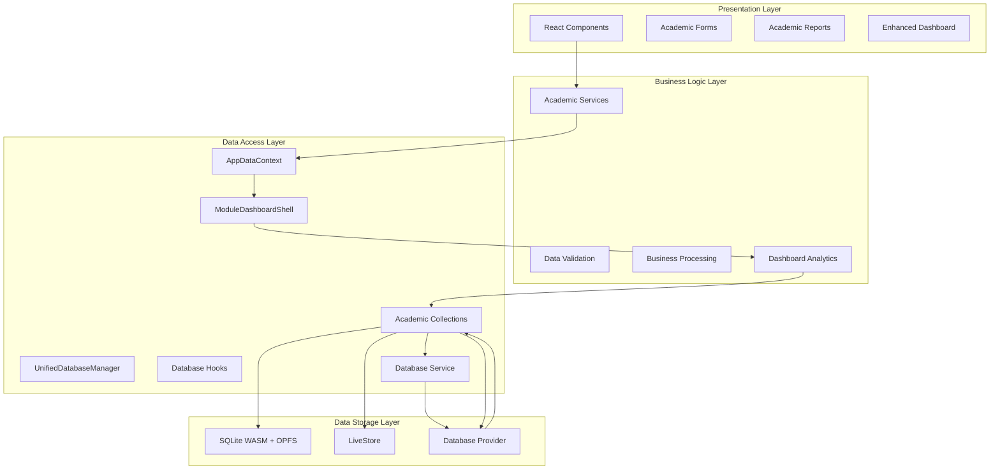

**Diagram sources**
- [README.md:50-76](file://README.md#L50-L76)
- [UnifiedDatabaseManager.ts:44-80](file://src/services/database/UnifiedDatabaseManager.ts#L44-L80)
- [AppDataContext.tsx:101-183](file://src/contexts/AppDataContext.tsx#L101-L183)
- [ModuleDashboardShell.tsx:305-419](file://src/components/ModuleDashboardShell.tsx#L305-L419)

The architecture follows a layered approach where each layer has specific responsibilities:

- **Presentation Layer**: Handles user interface and user interactions including enhanced dashboard components
- **Business Logic Layer**: Contains academic business rules and validation logic with dashboard analytics
- **Data Access Layer**: Manages data operations and provides unified data access with real-time subscriptions
- **Data Storage Layer**: Handles persistence and retrieval of academic data through provider-agnostic operations

**Section sources**
- [README.md:50-76](file://README.md#L50-L76)
- [UnifiedDatabaseManager.ts:44-80](file://src/services/database/UnifiedDatabaseManager.ts#L44-L80)

## Detailed Component Analysis

### Academic Data Types and Schemas

The academic module implements a comprehensive type system that defines all academic entities and their relationships. These types serve as the foundation for data consistency and type safety throughout the system.

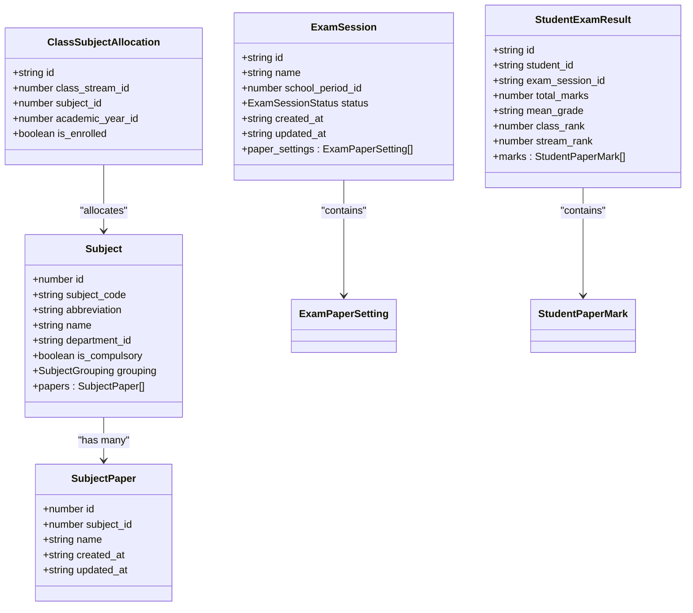

**Diagram sources**
- [types.ts:82-191](file://src/modules/academics/data/types.ts#L82-L191)
- [schema.ts:72-207](file://src/modules/academics/data/schema.ts#L72-L207)

The academic data model encompasses several key entities:

- **Subject Management**: Core academic subjects with grouping classifications and department associations
- **Exam Management**: Comprehensive examination system including sessions, paper settings, and scheduling
- **Student Records**: Detailed academic performance tracking with enrollment and results management
- **Timetable Management**: Class scheduling with period definitions and teacher assignments

**Updated** The schema definitions now include proper indexing strategies, foreign key constraints, and computed field support for database-backed operations with comprehensive validation rules.

**Section sources**
- [types.ts:82-191](file://src/modules/academics/data/types.ts#L82-L191)
- [schema.ts:72-207](file://src/modules/academics/data/schema.ts#L72-L207)

### Database Collections and Management

The academic module utilizes a provider-agnostic collection system that supports multiple database backends while maintaining consistent data access patterns.

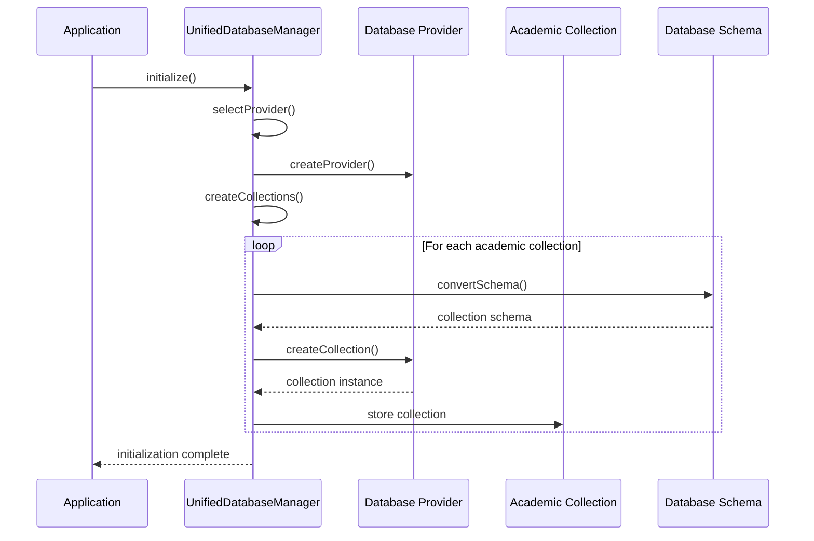

**Diagram sources**
- [UnifiedDatabaseManager.ts:99-169](file://src/services/database/UnifiedDatabaseManager.ts#L99-L169)
- [collections.ts:6-48](file://src/modules/academics/data/collections.ts#L6-L48)

**Updated** The collection management system now provides real database-backed operations with proper error handling and fallback mechanisms, supporting both development and production database providers.

The collection management system provides:

- **Schema Abstraction**: Database-agnostic schema definitions using the `createDatabaseSchema` helper
- **Collection Registration**: Centralized collection registration through the `academicsCollections` object
- **Provider Compatibility**: Seamless switching between different database providers
- **Index Management**: Automatic index creation for optimal query performance
- **Real-time Subscriptions**: Reactive data updates through database provider subscriptions

**Section sources**
- [UnifiedDatabaseManager.ts:99-169](file://src/services/database/UnifiedDatabaseManager.ts#L99-L169)
- [collections.ts:6-48](file://src/modules/academics/data/collections.ts#L6-L48)

### Academic Data Hooks and Database Integration

**Updated** The academic module now implements database-backed hooks that provide real-time data access and manipulation through the UnifiedDatabaseManager with comprehensive CRUD operations.

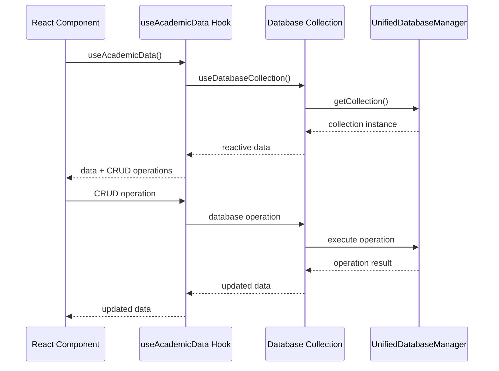

**Diagram sources**
- [useAcademicData.ts:10-279](file://src/modules/academics/data/useAcademicData.ts#L10-L279)

The academic data hooks provide:

- **Database-backed CRUD Operations**: Real database operations instead of mock data
- **Reactive Data Subscriptions**: Automatic UI updates when data changes
- **Type Safety**: Full TypeScript support with academic data types
- **Error Handling**: Proper error handling and fallback mechanisms
- **Provider Agnostic**: Works with any supported database provider
- **Real-time Synchronization**: Automatic data synchronization across components

**Section sources**
- [useAcademicData.ts:10-279](file://src/modules/academics/data/useAcademicData.ts#L10-L279)

### Data Context and State Management

The application implements a sophisticated data context system that provides unified access to academic data across all components while maintaining proper state management and error handling.

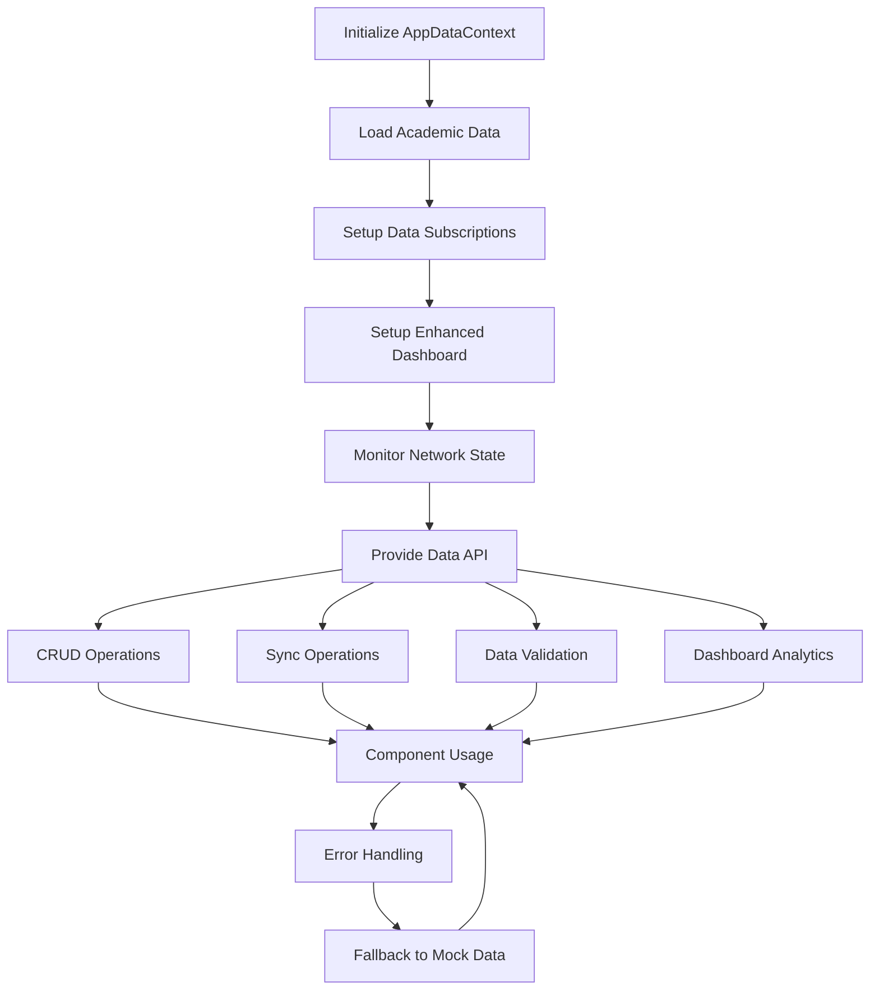

**Diagram sources**
- [AppDataContext.tsx:219-571](file://src/contexts/AppDataContext.tsx#L219-L571)
- [useModularMockData.ts:62-582](file://src/hooks/useModularMockData.ts#L62-L582)
- [ModuleDashboardShell.tsx:305-419](file://src/components/ModuleDashboardShell.tsx#L305-L419)

**Updated** The data context now provides database-backed operations with real-time subscriptions and proper error recovery mechanisms, supporting both online and offline data modes. The enhanced dashboard analytics provide comprehensive academic insights and visualizations.

The data context provides comprehensive functionality including:

- **Unified Data Access**: Single interface for accessing all academic data collections
- **Real-time Updates**: Reactive data subscriptions for automatic UI updates
- **Error Recovery**: Graceful fallback to mock data when database initialization fails
- **Sync Management**: Automatic synchronization with backend systems when available
- **Validation**: Built-in data validation and consistency checking
- **Database Integration**: Direct integration with UnifiedDatabaseManager for provider-agnostic operations
- **Offline Support**: Seamless operation in offline and hybrid data modes
- **Dashboard Analytics**: Integrated analytics and visualization capabilities

**Section sources**
- [AppDataContext.tsx:219-571](file://src/contexts/AppDataContext.tsx#L219-L571)
- [useModularMockData.ts:62-582](file://src/hooks/useModularMockData.ts#L62-L582)

## Enhanced Academic Dashboard

**New Section** The Academic Data Management system now features a comprehensive enhanced dashboard that provides real-time academic insights through interactive visualizations, alert systems, and quick navigation capabilities.

### Dashboard Architecture

The enhanced dashboard leverages the ModuleDashboardShell component to provide a consistent, accessible, and responsive academic management interface with comprehensive analytics capabilities.

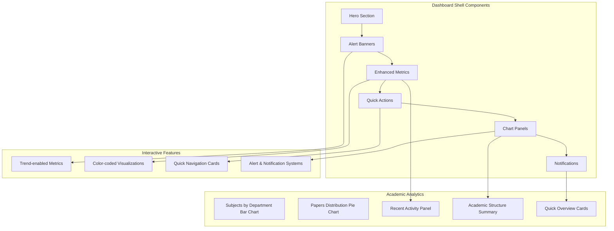

**Diagram sources**
- [ModuleDashboardShell.tsx:305-419](file://src/components/ModuleDashboardShell.tsx#L305-L419)
- [AcademicsDashboardPage.tsx:47-412](file://src/modules/academics/pages/AcademicsDashboardPage.tsx#L47-L412)

### Enhanced Metrics and Trend Visualization

The dashboard implements trend-enabled metric cards that provide real-time academic insights with color-coded indicators and directional trends.

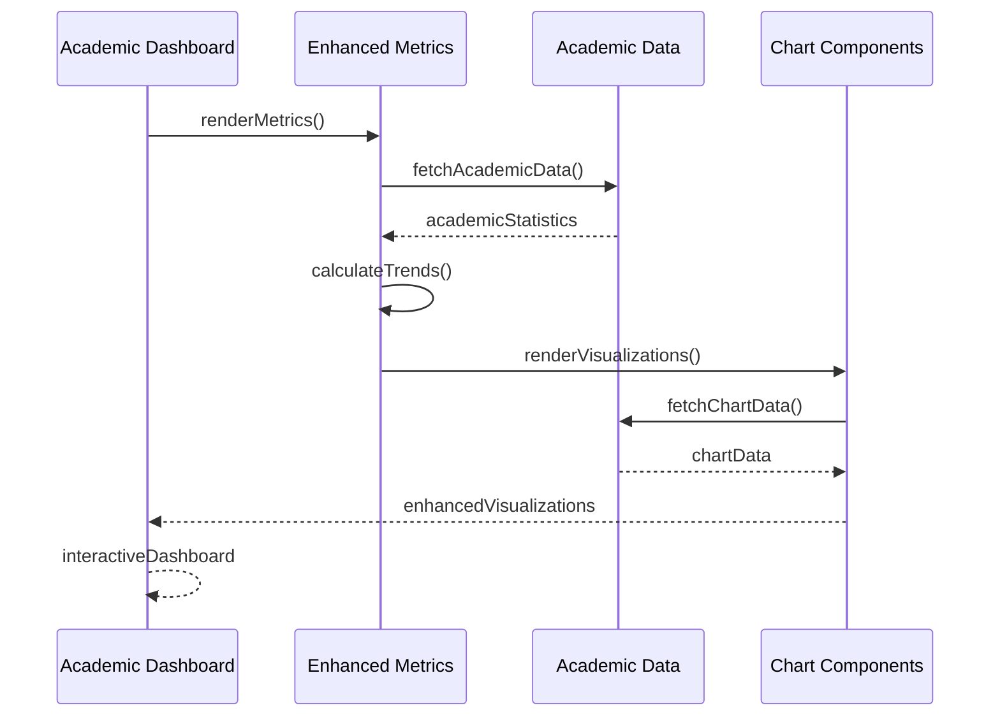

**Diagram sources**
- [AcademicsDashboardPage.tsx:105-150](file://src/modules/academics/pages/AcademicsDashboardPage.tsx#L105-L150)
- [ModuleDashboardShell.tsx:211-271](file://src/components/ModuleDashboardShell.tsx#L211-L271)

### Interactive Chart Visualizations

The dashboard features comprehensive chart visualizations including bar charts for subjects by department and pie charts for paper distribution, providing actionable academic insights.

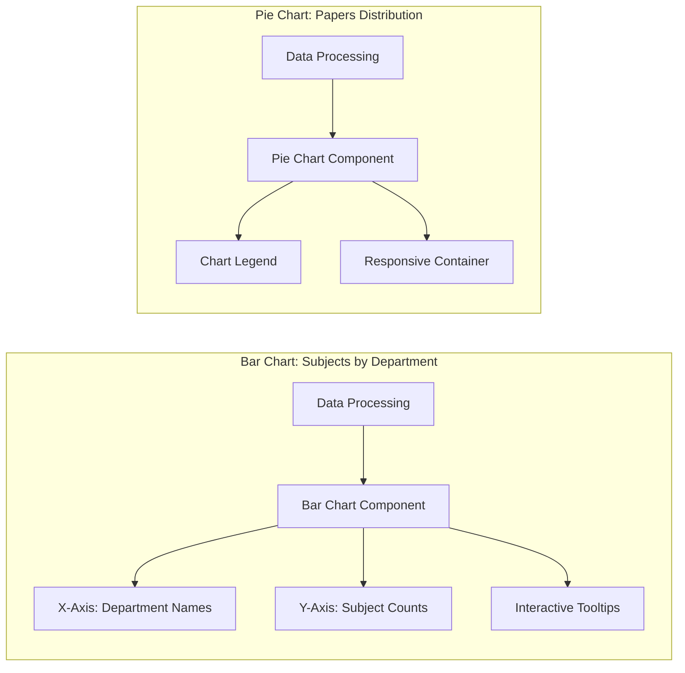

**Diagram sources**
- [AcademicsDashboardPage.tsx:237-278](file://src/modules/academics/pages/AcademicsDashboardPage.tsx#L237-L278)
- [ModuleDashboardShell.tsx:405-414](file://src/components/ModuleDashboardShell.tsx#L405-L414)

### Alert Systems and Notification Management

The dashboard implements comprehensive alert banner systems that provide real-time notifications for academic activities, pending tasks, and system status updates.

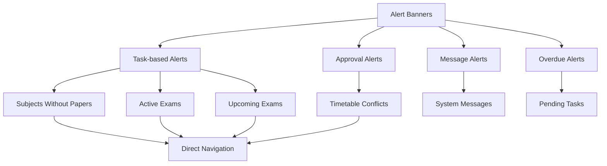

**Diagram sources**
- [AcademicsDashboardPage.tsx:153-182](file://src/modules/academics/pages/AcademicsDashboardPage.tsx#L153-L182)
- [ModuleDashboardShell.tsx:162-208](file://src/components/ModuleDashboardShell.tsx#L162-L208)

### Quick Navigation and Academic Information Panels

The dashboard provides comprehensive quick navigation cards and academic information panels that offer instant access to academic functions and structured academic summaries.

**Section sources**
- [ModuleDashboardShell.tsx:305-419](file://src/components/ModuleDashboardShell.tsx#L305-L419)
- [AcademicsDashboardPage.tsx:47-412](file://src/modules/academics/pages/AcademicsDashboardPage.tsx#L47-L412)

## Database Integration Patterns

**New Section** The Academic Data Management system implements comprehensive database integration patterns that ensure provider-agnostic operations while maintaining real-time data access and synchronization.

### Provider-Agnostic Data Access

The system uses a provider-agnostic approach to database operations, allowing seamless switching between different database providers without code changes.

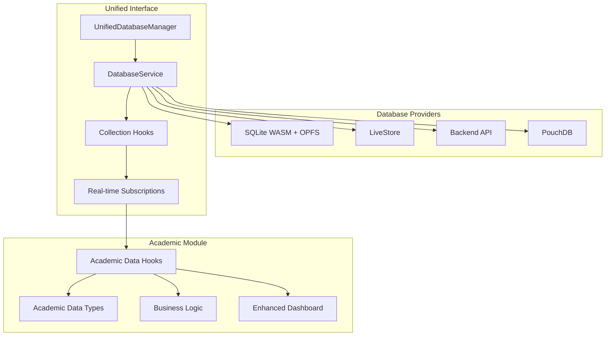

**Diagram sources**
- [useAcademicData.ts:10-279](file://src/modules/academics/data/useAcademicData.ts#L10-L279)
- [UnifiedDatabaseManager.ts:44-80](file://src/services/database/UnifiedDatabaseManager.ts#L44-L80)
- [databaseService.ts:1-200](file://src/services/database/databaseService.ts#L1-L200)

### Real-time Data Subscriptions

The academic module implements real-time data subscriptions that automatically update components when underlying data changes, providing seamless user experience.

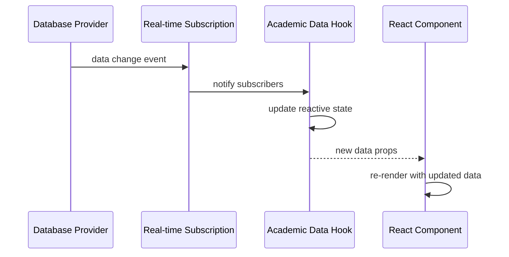

**Diagram sources**
- [useAcademicData.ts:10-279](file://src/modules/academics/data/useAcademicData.ts#L10-L279)
- [useDatabaseCollection.ts:85-126](file://src/hooks/useDatabaseCollection.ts#L85-L126)

### Database-backed CRUD Operations

All academic data operations now use real database-backed CRUD operations instead of mock data implementations, with comprehensive error handling and validation.

**Section sources**
- [useAcademicData.ts:10-279](file://src/modules/academics/data/useAcademicData.ts#L10-L279)
- [UnifiedDatabaseManager.ts:44-80](file://src/services/database/UnifiedDatabaseManager.ts#L44-L80)
- [databaseService.ts:142-147](file://src/services/database/databaseService.ts#L142-L147)

## Dependency Analysis

The Academic Data Management system exhibits excellent modularity with clear dependency relationships that support maintainability and scalability.

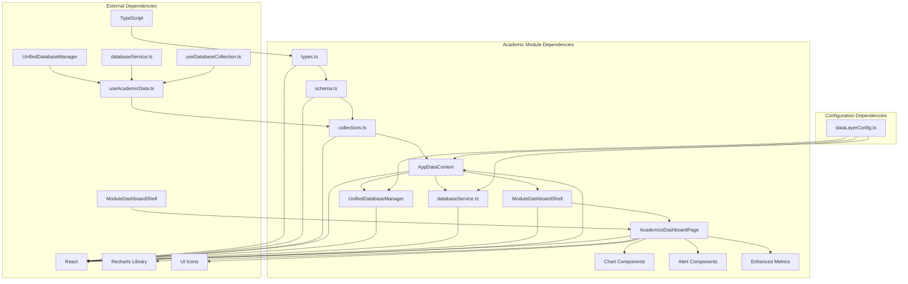

**Diagram sources**
- [types.ts:1-363](file://src/modules/academics/data/types.ts#L1-L363)
- [schema.ts:1-305](file://src/modules/academics/data/schema.ts#L1-L305)
- [dataLayerConfig.ts:56-236](file://src/config/dataLayerConfig.ts#L56-L236)
- [ModuleDashboardShell.tsx:1-422](file://src/components/ModuleDashboardShell.tsx#L1-L422)
- [AcademicsDashboardPage.tsx:1-412](file://src/modules/academics/pages/AcademicsDashboardPage.tsx#L1-L412)

**Updated** The dependency structure now reflects database-backed operations with proper integration between academic hooks and the database service layer, supporting real-time synchronization and offline capabilities. The enhanced dashboard components depend on the ModuleDashboardShell for consistent layout and interaction patterns.

The dependency structure demonstrates:

- **Top-down Configuration**: Configuration drives provider selection and initialization
- **Bottom-up Data Flow**: Academic data flows from collections through context to components
- **Provider Abstraction**: Database provider selection is abstracted from business logic
- **Type Safety**: Comprehensive TypeScript definitions ensure compile-time type checking
- **Database Integration**: Academic hooks integrate directly with database service layer
- **Real-time Synchronization**: Automatic data synchronization across components
- **Dashboard Integration**: Enhanced dashboard components leverage reusable shell infrastructure

**Section sources**
- [types.ts:1-363](file://src/modules/academics/data/types.ts#L1-L363)
- [schema.ts:1-305](file://src/modules/academics/data/schema.ts#L1-L305)
- [dataLayerConfig.ts:56-236](file://src/config/dataLayerConfig.ts#L56-L236)
- [ModuleDashboardShell.tsx:1-422](file://src/components/ModuleDashboardShell.tsx#L1-L422)
- [AcademicsDashboardPage.tsx:1-412](file://src/modules/academics/pages/AcademicsDashboardPage.tsx#L1-L412)

## Performance Considerations

The Academic Data Management system implements several performance optimization strategies to ensure smooth operation with large academic datasets and real-time synchronization.

### Database Performance Optimization

The system employs multiple strategies for optimal database performance:

- **Index Optimization**: Strategic indexing on frequently queried fields like `student_id`, `exam_session_id`, and `class_stream_id`
- **Query Optimization**: Efficient query patterns that minimize data transfer and processing overhead
- **Caching Strategies**: Intelligent caching of frequently accessed academic data
- **Batch Operations**: Bulk operations for data synchronization and updates
- **Real-time Subscriptions**: Efficient reactive updates through database provider subscriptions
- **Connection Pooling**: Optimized database connection management for multiple concurrent operations

### Memory Management

The system implements comprehensive memory management for academic data:

- **Lazy Loading**: Academic data is loaded on-demand rather than all at once
- **Pagination Support**: Built-in pagination for large academic datasets
- **Cleanup Mechanisms**: Automatic cleanup of old academic records and temporary data
- **Resource Monitoring**: Continuous monitoring of memory usage and performance metrics
- **Database Connection Pooling**: Efficient management of database connections
- **Offline Data Management**: Optimized storage and retrieval of offline data

### Network Optimization

For production deployments with backend integration:

- **Connection Pooling**: Efficient management of database connections
- **Background Sync**: Asynchronous synchronization to minimize user impact
- **Conflict Resolution**: Automated conflict resolution for concurrent data updates
- **Offline Support**: Robust offline capabilities with automatic re-synchronization
- **Provider Selection**: Intelligent provider selection based on capabilities and performance
- **Real-time Synchronization**: Seamless data synchronization across devices and sessions

### Dashboard Performance Optimization

The enhanced dashboard implements specific optimizations for academic data visualization:

- **Chart Optimization**: Responsive chart containers with efficient rendering
- **Data Processing**: Optimized data transformation for chart visualizations
- **Component Caching**: Cached dashboard components to reduce re-rendering
- **Lazy Loading**: Lazy loading of chart components and heavy data processing
- **Memory Management**: Efficient memory usage for large academic datasets
- **Performance Monitoring**: Continuous monitoring of dashboard performance metrics

## Troubleshooting Guide

### Common Academic Data Issues

**Database Initialization Failures**
- Check provider availability and configuration
- Verify database permissions and storage quotas
- Review initialization logs for specific error messages
- Ensure proper fallback mechanisms are in place
- Validate database schema version compatibility
- Check network connectivity for remote database providers

**Data Synchronization Problems**
- Verify backend connectivity and authentication
- Check sync intervals and retry configurations
- Monitor conflict resolution settings
- Validate data consistency across systems
- Review database provider capabilities
- Ensure proper offline data management

**Performance Issues**
- Analyze query performance and optimize indexes
- Review memory usage patterns and cleanup schedules
- Check for memory leaks in academic data processing
- Monitor network latency for remote data operations
- Validate database provider selection for optimal performance
- Review real-time subscription performance

**Data Integrity Concerns**
- Validate academic data relationships and referential integrity
- Check for orphaned records in academic collections
- Review audit trails for data modification history
- Ensure proper cascading deletes for dependent academic data
- Verify database schema version compatibility
- Validate computed field calculations

**Database Provider Issues**
- Check provider availability and compatibility
- Verify database configuration and credentials
- Review provider-specific error messages
- Ensure proper fallback chain configuration
- Validate database schema conversion for provider-agnostic operations
- Check provider capabilities and limitations

**Dashboard Rendering Issues**
- Verify chart data processing and transformation
- Check responsive container sizing and rendering
- Review component lifecycle and state management
- Validate real-time data subscriptions and updates
- Ensure proper error boundaries and fallback mechanisms
- Check browser compatibility and performance metrics

**Section sources**
- [AppDataContext.tsx:461-537](file://src/contexts/AppDataContext.tsx#L461-L537)
- [UnifiedDatabaseManager.ts:563-630](file://src/services/database/UnifiedDatabaseManager.ts#L563-L630)
- [ModuleDashboardShell.tsx:305-419](file://src/components/ModuleDashboardShell.tsx#L305-L419)

## Conclusion

The Academic Data Management system represents a sophisticated solution for educational institution data management. Through its modular architecture, comprehensive type safety, and robust database-backed operations, it provides reliable academic data management capabilities while maintaining flexibility for future enhancements.

**Updated** The system's transition from mock data to database-backed operations represents a significant architectural improvement, providing real-time data access, proper error handling, and provider-agnostic data management patterns with comprehensive real-time synchronization capabilities. The enhanced dashboard provides comprehensive academic analytics, interactive visualizations, and real-time alert systems that transform academic data management into an intuitive, data-driven experience.

The system's strength lies in its comprehensive approach to academic data management, from curriculum and examination systems to student performance tracking and timetable management. The dual-mode data layer architecture ensures seamless operation across development and production environments, while the provider-agnostic design allows for future database technology evolution.

Key achievements of the system include:

- **Database-backed Operations**: Real database operations replace mock data throughout the academic module
- **Provider Agnostic Design**: Seamless switching between different database providers
- **Real-time Subscriptions**: Automatic UI updates through reactive database operations
- **Comprehensive Academic Coverage**: Complete support for all major academic operations
- **Type Safety**: Zero `any` types with extensive TypeScript coverage
- **Modular Design**: Clear separation of concerns with maintainable module structure
- **Performance Optimization**: Efficient data access patterns and memory management
- **Real-time Synchronization**: Seamless data synchronization across components and devices
- **Offline Support**: Robust offline capabilities with automatic re-synchronization
- **Future-ready Architecture**: Provider-agnostic design supporting technology evolution
- **Enhanced Dashboard Experience**: Comprehensive analytics, visualizations, and alert systems
- **Interactive Visualizations**: Bar charts, pie charts, and trend-enabled metrics for academic insights
- **Quick Navigation**: Intuitive navigation cards and academic information panels
- **Real-time Alerts**: Comprehensive alert systems for academic activities and notifications

The Academic Data Management system provides a solid foundation for educational institutions seeking comprehensive academic data management capabilities while maintaining the flexibility to adapt to changing technological requirements and institutional needs. The enhanced dashboard transforms raw academic data into actionable insights, enabling data-driven decision-making and improved academic outcomes.