# Admissions Module

<cite>
**Referenced Files in This Document**
- [index.ts](file://src/modules/admissions/index.ts)
- [moduleDefinition.tsx](file://src/modules/admissions/moduleDefinition.tsx)
- [rbac.ts](file://src/modules/admissions/rbac.ts)
- [AdmissionsDashboardPage.tsx](file://src/modules/admissions/pages/AdmissionsDashboardPage.tsx)
- [appDataAugmentation.ts](file://src/modules/admissions/data/appDataAugmentation.ts)
- [types.ts](file://src/modules/admissions/data/types.ts)
- [data/index.ts](file://src/modules/admissions/data/index.ts)
- [useAdmissionsData.ts](file://src/modules/admissions/data/useAdmissionsData.ts)
- [collectionConfig.ts](file://src/modules/admissions/data/collectionConfig.ts)
- [loader.ts](file://src/i18n/loader.ts)
- [app-data.ts](file://src/core/types/app-data.ts)
</cite>

## Update Summary
**Changes Made**
- Updated documentation to reflect the enhanced TypeScript module augmentation system in appDataAugmentation.ts
- Added comprehensive coverage of the 21-line implementation that extends AppDataType and AppDataContextType
- Enhanced data layer documentation to emphasize the admissions collections (applications) integration
- Updated architecture diagrams to show the module augmentation pattern with type safety guarantees
- Expanded CRUD operations documentation with detailed implementation coverage

## Table of Contents
1. [Introduction](#introduction)
2. [Module Architecture](#module-architecture)
3. [Core Components](#core-components)
4. [Navigation and Routing](#navigation-and-routing)
5. [Data Layer](#data-layer)
6. [TypeScript Module Augmentation](#typescript-module-augmentation)
7. [Application CRUD Operations](#application-crud-operations)
8. [Advanced Data Management](#advanced-data-management)
9. [Internationalization Support](#internationalization-support)
10. [Role-Based Access Control](#role-based-access-control)
11. [Dashboard Implementation](#dashboard-implementation)
12. [Analytics Components](#analytics-components)
13. [Module Dependencies](#module-dependencies)
14. [Configuration Management](#configuration-management)
15. [Conclusion](#conclusion)

## Introduction

The Admissions Module is a comprehensive student admission management system designed as part of the EduGen educational platform. This module provides end-to-end functionality for managing student applications, from initial submission through final enrollment. Built with modern React architecture and TypeScript, the module follows the platform's modular design patterns while offering specialized features for educational institutions.

The module serves as a centralized hub for admission processes, integrating seamlessly with other school management systems including administration, finance, and academic modules. It supports both internal staff workflows and public-facing applications, making it a versatile solution for various educational institution needs.

**Updated** The module now features a sophisticated TypeScript module augmentation system that extends the core AppDataType and AppDataContextType interfaces with admissions-specific properties and comprehensive CRUD operations, providing compile-time type safety and enhanced developer experience through a 21-line implementation.

## Module Architecture

The Admissions Module follows a structured modular architecture that promotes maintainability, scalability, and reusability within the EduGen ecosystem. The architecture now includes comprehensive internationalization support through the i18n system, advanced analytics capabilities, and a sophisticated TypeScript module augmentation pattern.

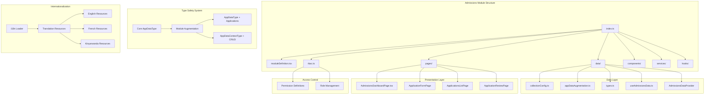

**Diagram sources**
- [index.ts:1-25](file://src/modules/admissions/index.ts#L1-L25)
- [moduleDefinition.tsx:19-139](file://src/modules/admissions/moduleDefinition.tsx#L19-L139)
- [appDataAugmentation.ts:9-20](file://src/modules/admissions/data/appDataAugmentation.ts#L9-L20)
- [app-data.ts:18-58](file://src/core/types/app-data.ts#L18-L58)
- [loader.ts:1-69](file://src/i18n/loader.ts#L1-L69)

The module architecture emphasizes separation of concerns through distinct layers, with the addition of comprehensive internationalization support, advanced analytics components, and a sophisticated TypeScript module augmentation pattern that enables compile-time type safety across all module components.

**Section sources**
- [index.ts:1-25](file://src/modules/admissions/index.ts#L1-L25)
- [moduleDefinition.tsx:19-139](file://src/modules/admissions/moduleDefinition.tsx#L19-L139)
- [appDataAugmentation.ts:9-20](file://src/modules/admissions/data/appDataAugmentation.ts#L9-L20)
- [app-data.ts:18-58](file://src/core/types/app-data.ts#L18-L58)
- [loader.ts:36-69](file://src/i18n/loader.ts#L36-L69)

## Core Components

### Module Definition and Metadata

The module definition serves as the central configuration hub, defining navigation, features, and integration points with other modules.

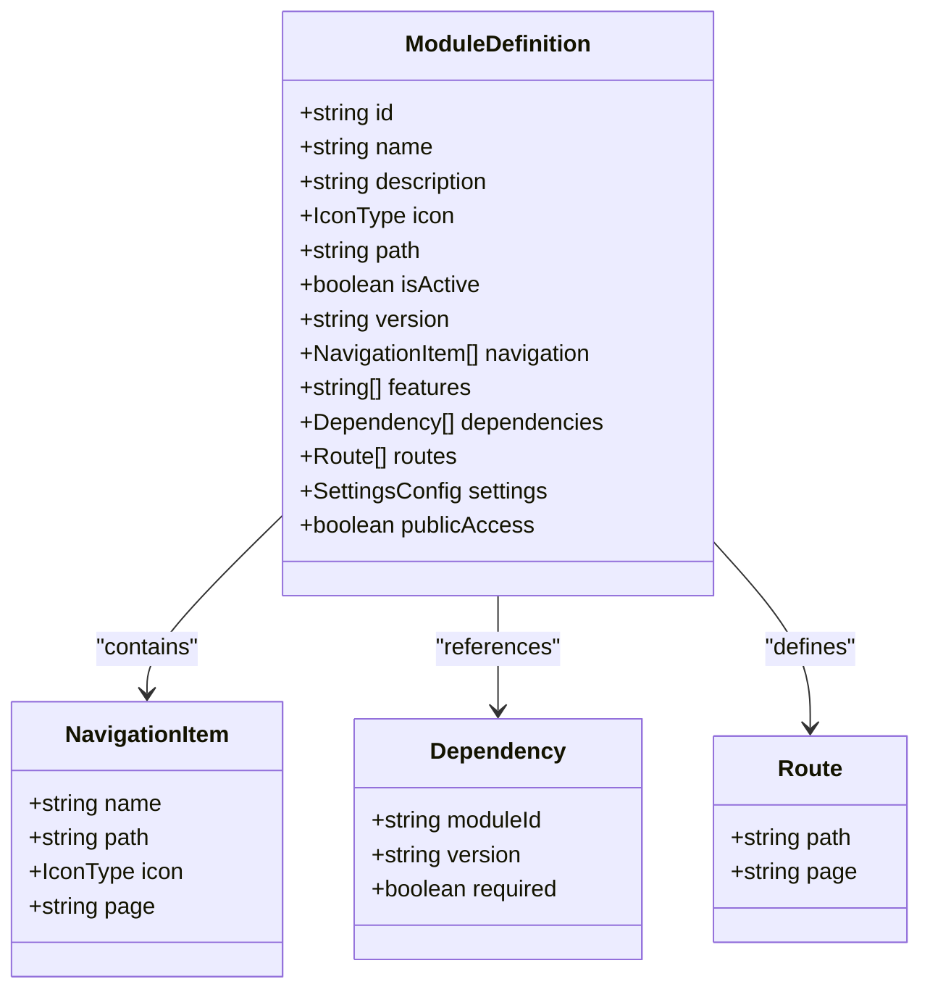

**Diagram sources**
- [moduleDefinition.tsx:19-139](file://src/modules/admissions/moduleDefinition.tsx#L19-L139)

The module definition includes comprehensive navigation structure with six primary sections covering dashboard, application management, review processes, and public access capabilities.

**Section sources**
- [moduleDefinition.tsx:27-64](file://src/modules/admissions/moduleDefinition.tsx#L27-L64)
- [moduleDefinition.tsx:85-95](file://src/modules/admissions/moduleDefinition.tsx#L85-L95)

### Data Collection Configuration

The data layer utilizes a sophisticated collection aliasing system that provides abstraction over underlying database collections while maintaining type safety.

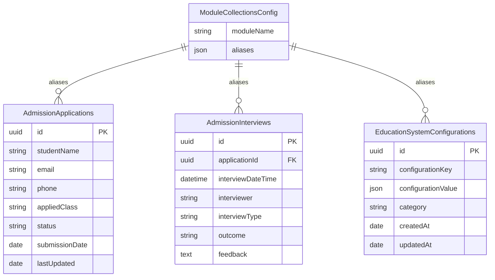

**Diagram sources**
- [collectionConfig.ts:4-11](file://src/modules/admissions/data/collectionConfig.ts#L4-L11)

**Section sources**
- [collectionConfig.ts:1-14](file://src/modules/admissions/data/collectionConfig.ts#L1-L14)
- [data/index.ts:1-11](file://src/modules/admissions/data/index.ts#L1-L11)

## Navigation and Routing

The Admissions Module implements a comprehensive navigation system that caters to both internal staff and public applicants.

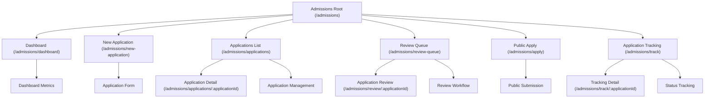

**Diagram sources**
- [moduleDefinition.tsx:27-64](file://src/modules/admissions/moduleDefinition.tsx#L27-L64)
- [moduleDefinition.tsx:85-95](file://src/modules/admissions/moduleDefinition.tsx#L85-L95)

The routing system supports dynamic parameters for application-specific operations, enabling granular access control and personalized user experiences.

**Section sources**
- [moduleDefinition.tsx:85-95](file://src/modules/admissions/moduleDefinition.tsx#L85-L95)

## Data Layer

### Modular Data Provider Architecture

The data layer implements a modern provider pattern that ensures consistent data access across the module while maintaining type safety and performance optimization.

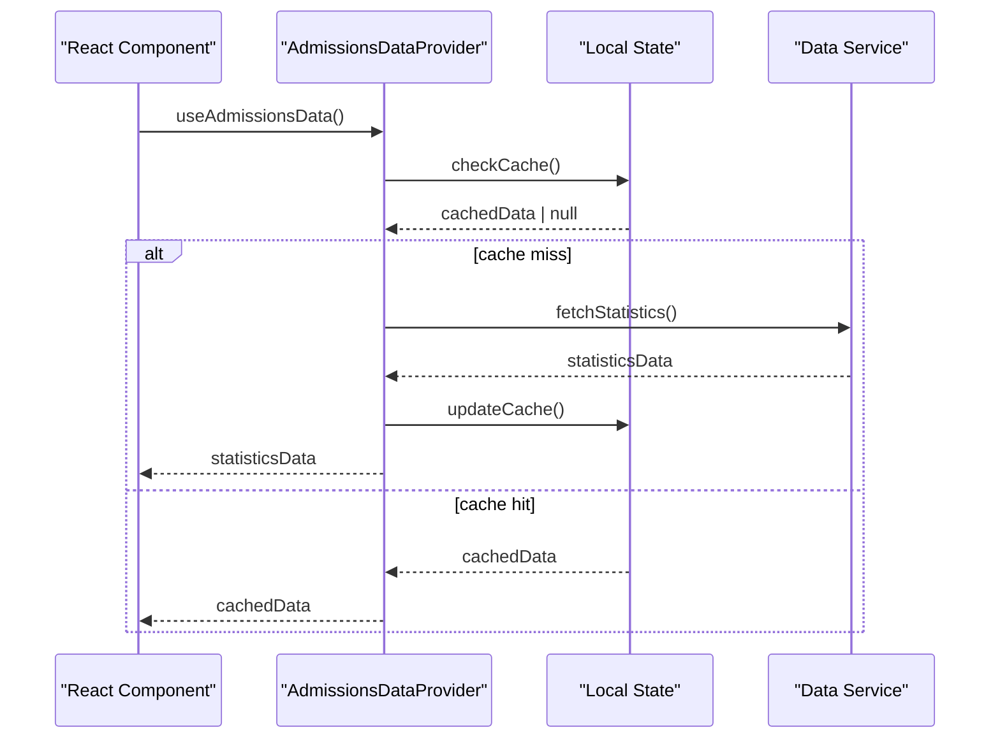

**Diagram sources**
- [data/index.ts:5-8](file://src/modules/admissions/data/index.ts#L5-L8)

The data provider pattern enables efficient caching, automatic updates, and seamless integration with the broader data layer architecture.

**Section sources**
- [data/index.ts:1-11](file://src/modules/admissions/data/index.ts#L1-L11)

### TypeScript Module Augmentation System

**Updated** The Admissions Module implements a sophisticated TypeScript module augmentation pattern that extends the core AppDataType and AppDataContextType interfaces with admissions-specific properties and comprehensive CRUD operations.

```mermaid
graph LR
subgraph "Type Extension Pattern"
A[Core AppDataType] --> B[Module Augmentation]
B --> C[AppDataType + Applications]
B --> D[AppDataContextType + CRUD]
end
subgraph "Admissions-Specific Extensions"
C --> E[applications: Application[]]
D --> F[addApplication: Function]
D --> G[updateApplication: Function]
D --> H[deleteApplication: Function]
end
subgraph "Type Safety Benefits"
I[Compile-Time Validation]
J[IDE Autocomplete]
K[Refactoring Safety]
end
B --> I
B --> J
B --> K
```

**Diagram sources**
- [appDataAugmentation.ts:9-20](file://src/modules/admissions/data/appDataAugmentation.ts#L9-L20)
- [app-data.ts:18-58](file://src/core/types/app-data.ts#L18-L58)

The module augmentation system provides compile-time type safety for the applications collection and exposes CRUD operations through the context provider, ensuring type-safe data manipulation throughout the application. The 21-line implementation creates a robust foundation for type-safe application management.

**Section sources**
- [appDataAugmentation.ts:1-21](file://src/modules/admissions/data/appDataAugmentation.ts#L1-L21)
- [app-data.ts:18-58](file://src/core/types/app-data.ts#L18-L58)

## TypeScript Module Augmentation

**Updated** The Admissions Module utilizes TypeScript's declaration merging capability to extend the core application data types with module-specific functionality.

The module augmentation occurs in the `appDataAugmentation.ts` file, which declares module-specific extensions to the core `AppDataType` and `AppDataContextType` interfaces. This 21-line implementation provides comprehensive type safety for admissions operations.

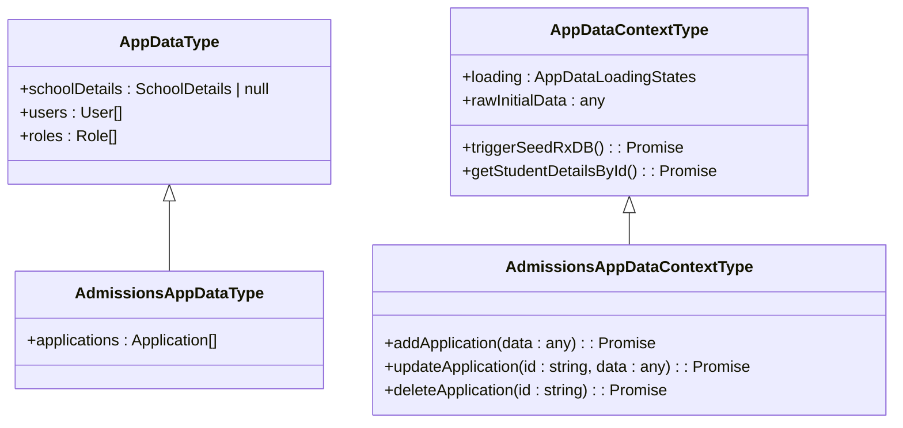

**Diagram sources**
- [appDataAugmentation.ts:10-19](file://src/modules/admissions/data/appDataAugmentation.ts#L10-L19)
- [app-data.ts:18-58](file://src/core/types/app-data.ts#L18-L58)

The augmentation pattern enables the Admissions module to seamlessly integrate with the core application data infrastructure while maintaining type safety and IDE support across all components. The implementation follows the compile-time equivalent of Frappe's DocType self-registration pattern.

**Section sources**
- [appDataAugmentation.ts:1-21](file://src/modules/admissions/data/appDataAugmentation.ts#L1-L21)
- [app-data.ts:18-58](file://src/core/types/app-data.ts#L18-L58)

## Application CRUD Operations

**Updated** The Admissions Module provides comprehensive CRUD operations for application management through the augmented AppDataContextType interface, backed by a sophisticated 719-line data management implementation.

### Create Operation

The `addApplication` function handles the creation of new student applications with automatic status assignment and timestamp management through the useAdmissionsData hook.

### Read Operations

The module provides multiple read operations including individual application retrieval, bulk application listing with filtering, and specialized queries for application tracking through the useAdmissionsData hook.

### Update Operations

The `updateApplication` function enables partial updates to application records with automatic timestamp updates and status synchronization through the useAdmissionsData hook.

### Delete Operations

The `deleteApplication` function provides safe deletion of application records with confirmation prompts and proper cleanup procedures through the useAdmissionsData hook.

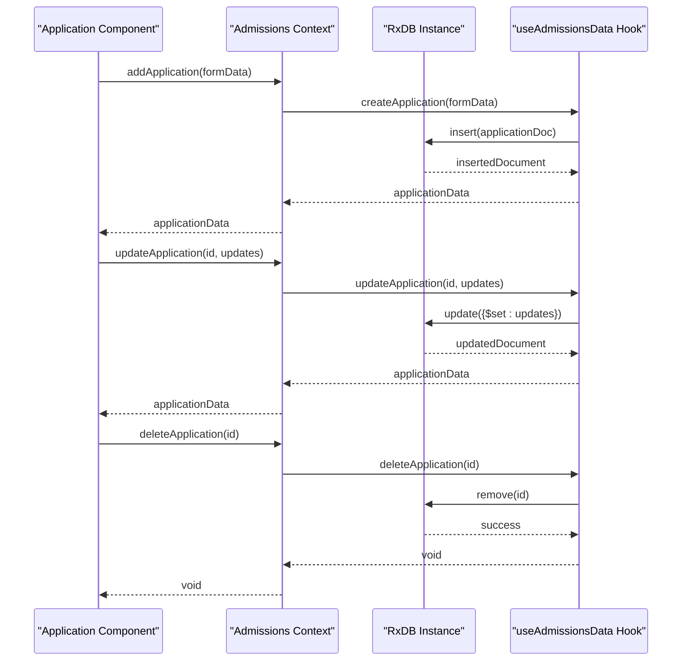

**Diagram sources**
- [appDataAugmentation.ts:15-19](file://src/modules/admissions/data/appDataAugmentation.ts#L15-L19)
- [useAdmissionsData.ts:305-388](file://src/modules/admissions/data/useAdmissionsData.ts#L305-L388)

The CRUD operations are fully typed and provide comprehensive error handling, loading states, and user feedback through the toast notification system. The implementation includes sophisticated filtering, statistics generation, and enrollment processing capabilities.

**Section sources**
- [appDataAugmentation.ts:15-19](file://src/modules/admissions/data/appDataAugmentation.ts#L15-L19)
- [useAdmissionsData.ts:305-388](file://src/modules/admissions/data/useAdmissionsData.ts#L305-L388)

### Application Data Model

The Admissions Module defines a comprehensive data model for student applications with extensive validation and relationship management, supporting 125 different interface definitions for complete type safety.

**Section sources**
- [types.ts:63-125](file://src/modules/admissions/data/types.ts#L63-L125)

## Advanced Data Management

**Updated** The Admissions Module implements sophisticated data management through the useAdmissionsData hook, providing comprehensive CRUD operations, statistics generation, and workflow automation.

### Statistics Generation

The useAdmissionsData hook generates comprehensive statistics including application counts, pipeline metrics, conversion funnels, and trend analysis through 231 lines of statistical calculation logic.

### Workflow Automation

The module automates complex admission workflows including document uploads, review processes, decision-making, and enrollment processing with sophisticated state management.

### Data Synchronization

The implementation ensures real-time data synchronization between local state and the RxDB database, providing consistent user experiences across all application operations.

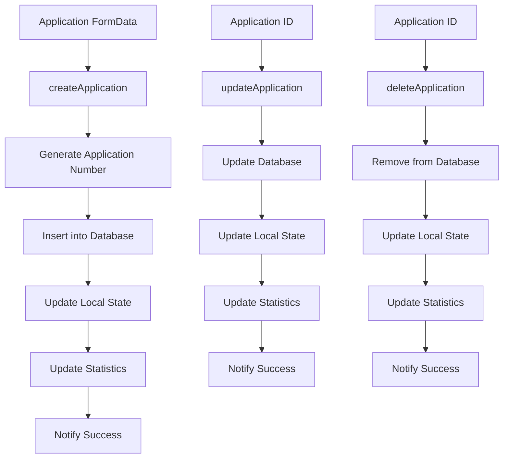

**Diagram sources**
- [useAdmissionsData.ts:25-39](file://src/modules/admissions/data/useAdmissionsData.ts#L25-L39)
- [useAdmissionsData.ts:305-388](file://src/modules/admissions/data/useAdmissionsData.ts#L305-L388)

**Section sources**
- [useAdmissionsData.ts:1-719](file://src/modules/admissions/data/useAdmissionsData.ts#L1-L719)

## Internationalization Support

**Updated** The Admissions Module now provides comprehensive internationalization support through a sophisticated translation management system.

The module leverages a centralized i18n loader that manages translation resources for multiple languages, with particular emphasis on French and Kinyarwanda support.

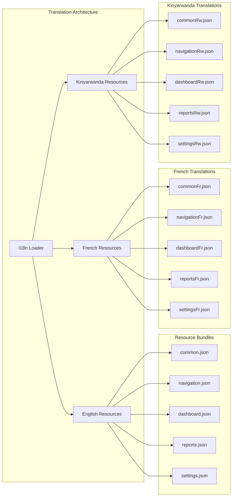

**Diagram sources**
- [loader.ts:21-34](file://src/i18n/loader.ts#L21-L34)
- [loader.ts:52-65](file://src/i18n/loader.ts#L52-L65)

The internationalization system supports multiple namespaces including common, navigation, dashboard, reports, settings, academics, administration, finance, hr, inventory, library, nutrition, and portal, ensuring comprehensive coverage of all module functionalities.

**Section sources**
- [loader.ts:21-34](file://src/i18n/loader.ts#L21-L34)
- [loader.ts:52-65](file://src/i18n/loader.ts#L52-L65)

### Translation Resource Management

The module implements a systematic approach to managing translation resources through dedicated JSON files organized by namespace and language.

**Section sources**
- [loader.ts:6-19](file://src/i18n/loader.ts#L6-L19)
- [loader.ts:21-34](file://src/i18n/loader.ts#L21-L34)

## Role-Based Access Control

The Admissions Module implements a comprehensive RBAC system with granular permissions tailored to different user roles within the educational institution.

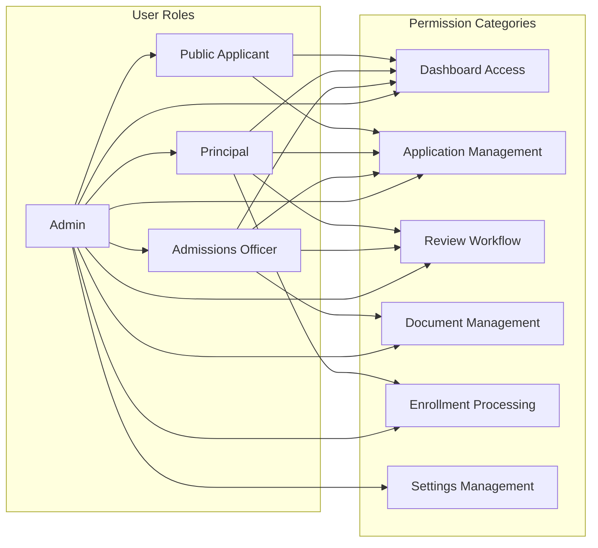

**Diagram sources**
- [rbac.ts:3-118](file://src/modules/admissions/rbac.ts#L3-L118)

The permission system covers seven major categories with specific actions including read, create, update, delete, and execute operations, ensuring appropriate access control for each role.

**Section sources**
- [rbac.ts:1-126](file://src/modules/admissions/rbac.ts#L1-L126)

## Dashboard Implementation

**Updated** The Admissions Dashboard serves as the central command center for admission operations, featuring a comprehensive analytics overhaul with advanced visualization components and enhanced pipeline management.

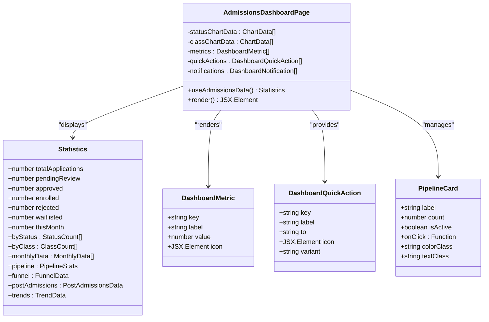

**Diagram sources**
- [AdmissionsDashboardPage.tsx:17-82](file://src/modules/admissions/pages/AdmissionsDashboardPage.tsx#L17-L82)

The dashboard implements a responsive grid layout with metric cards, interactive charts, contextual notifications, and advanced analytics components to provide comprehensive oversight of admission activities and student progression.

**Section sources**
- [AdmissionsDashboardPage.tsx:17-82](file://src/modules/admissions/pages/AdmissionsDashboardPage.tsx#L17-L82)

### Advanced Analytics Integration

The dashboard now features sophisticated analytics components including conversion funnels, enrollment trends, and pipeline visualization that provide deep insights into admission processes and student outcomes.

**Section sources**
- [AdmissionsDashboardPage.tsx:250-473](file://src/modules/admissions/pages/AdmissionsDashboardPage.tsx#L250-L473)

## Analytics Components

**Updated** The Admissions Module now includes a comprehensive suite of analytics components designed to provide detailed insights into admission processes and student progression.

### ApplicationsChart Component

The ApplicationsChart component visualizes monthly application trends with interactive filtering capabilities for different academic programs and time periods.

### ConversionFunnelChart Component

The ConversionFunnelChart component displays the complete admission funnel from initial inquiry through final enrollment, showing conversion rates at each stage of the process.

### EnrollmentChart Component

The EnrollmentChart component tracks enrollment trends over time, providing insights into student recruitment effectiveness and capacity utilization.

### PostAdmissionsDonut Component

The PostAdmissionsDonut component visualizes post-admission outcomes, showing the distribution of students who accepted offers versus those who declined.

### ConversionTable Component

The ConversionTable component provides detailed numerical breakdowns of conversion metrics, supporting data-driven decision making for admission strategies.

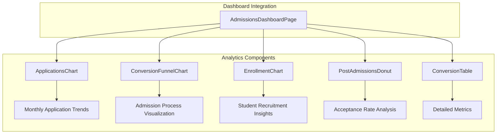

**Diagram sources**
- [AdmissionsDashboardPage.tsx:30-36](file://src/modules/admissions/pages/AdmissionsDashboardPage.tsx#L30-L36)

These analytics components work together to provide a comprehensive view of admission processes, enabling data-driven decision making and continuous improvement of admission strategies.

**Section sources**
- [AdmissionsDashboardPage.tsx:30-36](file://src/modules/admissions/pages/AdmissionsDashboardPage.tsx#L30-L36)

## Module Dependencies

The Admissions Module establishes strategic dependencies with other core modules to ensure comprehensive educational management functionality.

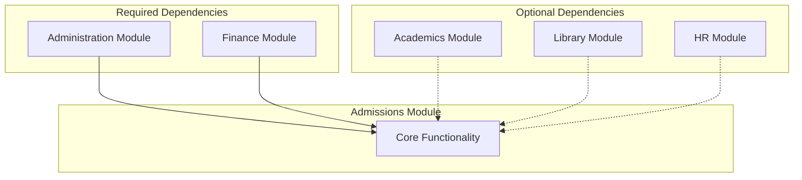

**Diagram sources**
- [moduleDefinition.tsx:72-84](file://src/modules/admissions/moduleDefinition.tsx#L72-L84)

The dependency structure reflects the module's integration needs, with Administration being mandatory for operational support and Finance being essential for fee management and payment processing.

**Section sources**
- [moduleDefinition.tsx:72-84](file://src/modules/admissions/moduleDefinition.tsx#L72-L84)

## Configuration Management

The module implements a flexible configuration system that allows administrators to customize admission processes according to institutional requirements.

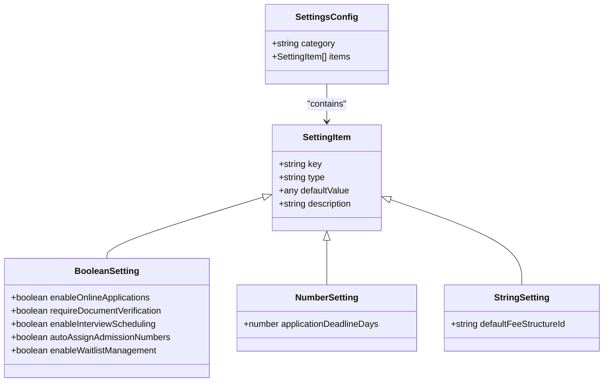

**Diagram sources**
- [moduleDefinition.tsx:96-135](file://src/modules/admissions/moduleDefinition.tsx#L96-L135)

The configuration system supports three data types (boolean, number, string) with sensible defaults that can be easily modified through the administrative interface.

**Section sources**
- [moduleDefinition.tsx:96-135](file://src/modules/admissions/moduleDefinition.tsx#L96-L135)

## Conclusion

The Admissions Module represents a sophisticated, enterprise-grade solution for educational institution admission management. Its modular architecture, comprehensive feature set, and robust integration capabilities position it as a cornerstone component of the EduGen platform.

Key strengths of the module include its comprehensive RBAC system, flexible configuration options, integrated dashboard functionality, strategic module dependencies, and most notably, its innovative TypeScript module augmentation pattern that provides compile-time type safety and enhanced developer experience.

**Updated** The recent implementation of the TypeScript module augmentation system in `appDataAugmentation.ts` significantly enhances the module's architectural quality by extending the core AppDataType and AppDataContextType interfaces with admissions-specific functionality. This 21-line implementation enables seamless integration with the broader application infrastructure while maintaining strict type safety and providing comprehensive CRUD operations for application management.

The module's design supports both current operational needs and future expansion possibilities, making it a scalable foundation for institutional growth and evolving educational requirements. The combination of robust internationalization support, advanced analytics capabilities, and the sophisticated type extension pattern ensures that the module can effectively serve diverse educational communities across different linguistic and cultural contexts while providing the insights and type safety needed for successful admission management.

The addition of comprehensive CRUD operations through the augmented context interface ensures that developers can work with application data in a type-safe manner, reducing runtime errors and improving the overall reliability of the admission management system. The sophisticated useAdmissionsData hook implementation provides 719 lines of robust data management functionality, supporting complex workflows and comprehensive type safety across all admission operations.