# Admissions Module

<cite>
**Referenced Files in This Document**
- [index.ts](file://src/modules/admissions/index.ts)
- [moduleDefinition.tsx](file://src/modules/admissions/moduleDefinition.tsx)
- [rbac.ts](file://src/modules/admissions/rbac.ts)
- [AdmissionsDashboardPage.tsx](file://src/modules/admissions/pages/AdmissionsDashboardPage.tsx)
- [ApplicationsHubPage.tsx](file://src/modules/admissions/pages/ApplicationsHubPage.tsx)
- [FormBuilderPage.tsx](file://src/modules/admissions/pages/FormBuilderPage.tsx)
- [collectionConfig.ts](file://src/modules/admissions/data/collectionConfig.ts)
- [data/index.ts](file://src/modules/admissions/data/index.ts)
</cite>

## Update Summary
**Changes Made**
- Added new ApplicationsHubPage implementing hub-and-spoke pattern for application management
- Added new FormBuilderPage for form template management
- Updated navigation structure to include new hub page and form builder route
- Enhanced module definition with new routes and deprecated old routes
- Updated module architecture to reflect new page composition pattern

## Table of Contents
1. [Introduction](#introduction)
2. [Module Architecture](#module-architecture)
3. [Core Components](#core-components)
4. [Navigation and Routing](#navigation-and-routing)
5. [Data Layer](#data-layer)
6. [Role-Based Access Control](#role-based-access-control)
7. [Dashboard Implementation](#dashboard-implementation)
8. [Hub-and-Spoke Pattern Implementation](#hub-and-spoke-pattern-implementation)
9. [Form Builder Functionality](#form-builder-functionality)
10. [Module Dependencies](#module-dependencies)
11. [Configuration Management](#configuration-management)
12. [Conclusion](#conclusion)

## Introduction

The Admissions Module is a comprehensive student admission management system designed as part of the EduGen educational platform. This module provides end-to-end functionality for managing student applications, from initial submission through final enrollment. Built with modern React architecture and TypeScript, the module follows the platform's modular design patterns while offering specialized features for educational institutions.

The module serves as a centralized hub for admission processes, integrating seamlessly with other school management systems including administration, finance, and academic modules. It supports both internal staff workflows and public-facing applications, making it a versatile solution for various educational institution needs.

**Updated** The module now implements a sophisticated hub-and-spoke pattern through the ApplicationsHubPage, consolidating multiple application management functions into a unified tabbed interface that improves workflow efficiency and user experience.

## Module Architecture

The Admissions Module follows a structured modular architecture that promotes maintainability, scalability, and reusability within the EduGen ecosystem.

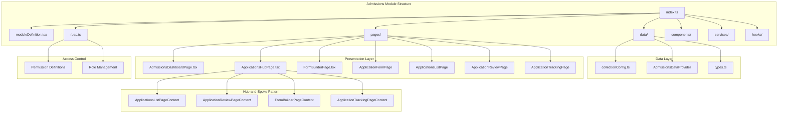

**Diagram sources**
- [index.ts:1-25](file://src/modules/admissions/index.ts#L1-L25)
- [moduleDefinition.tsx:1-161](file://src/modules/admissions/moduleDefinition.tsx#L1-L161)
- [ApplicationsHubPage.tsx:1-100](file://src/modules/admissions/pages/ApplicationsHubPage.tsx#L1-L100)

The module architecture emphasizes separation of concerns through distinct layers, with the new hub-and-spoke pattern providing centralized access to related functionalities while maintaining individual page responsibilities.

**Section sources**
- [index.ts:1-25](file://src/modules/admissions/index.ts#L1-L25)
- [moduleDefinition.tsx:19-161](file://src/modules/admissions/moduleDefinition.tsx#L19-L161)

## Core Components

### Module Definition and Metadata

The module definition serves as the central configuration hub, defining navigation, features, and integration points with other modules.

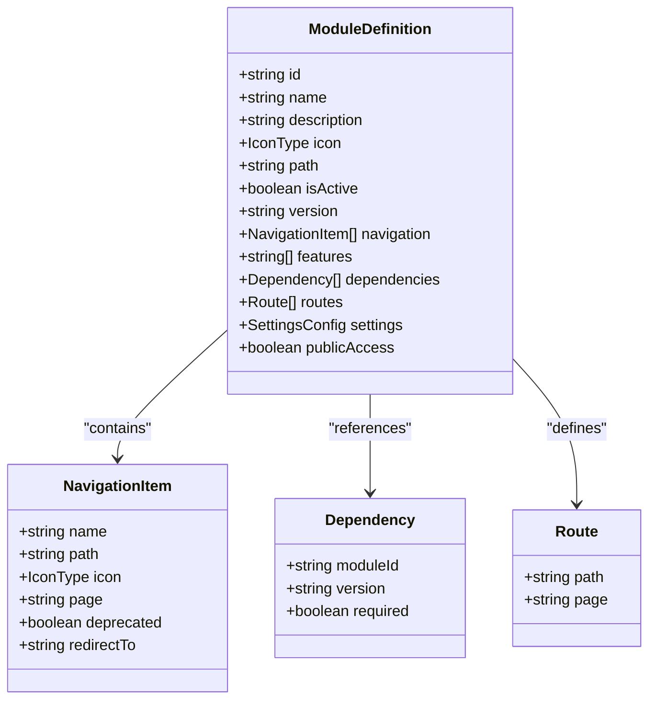

**Diagram sources**
- [moduleDefinition.tsx:19-161](file://src/modules/admissions/moduleDefinition.tsx#L19-L161)

The module definition includes comprehensive navigation structure with eight primary sections covering dashboard, application management, review processes, form building, and public access capabilities. The new ApplicationsHubPage consolidates previously separate application management functions.

**Section sources**
- [moduleDefinition.tsx:27-83](file://src/modules/admissions/moduleDefinition.tsx#L27-L83)
- [moduleDefinition.tsx:104-116](file://src/modules/admissions/moduleDefinition.tsx#L104-L116)

### Data Collection Configuration

The data layer utilizes a sophisticated collection aliasing system that provides abstraction over underlying database collections while maintaining type safety.

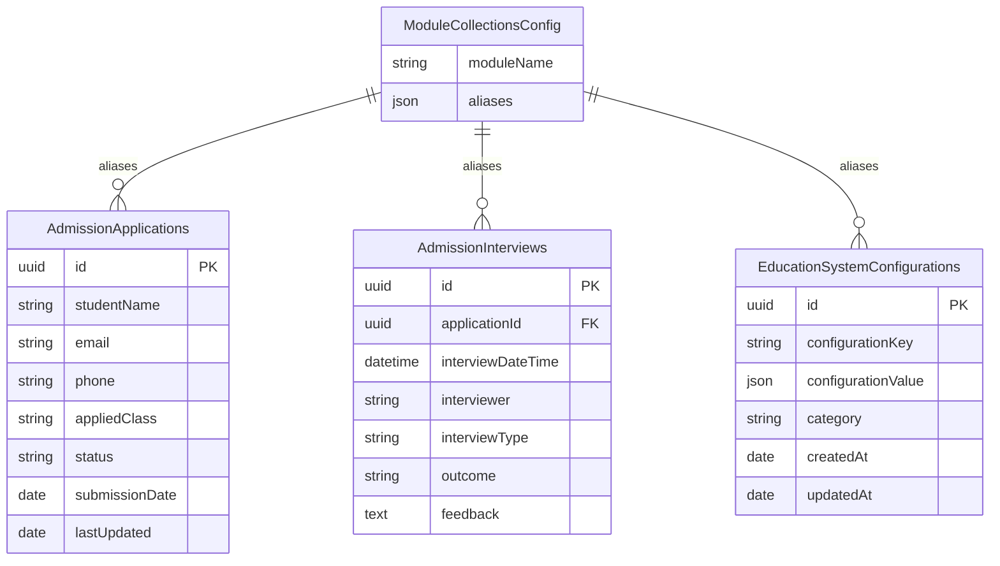

**Diagram sources**
- [collectionConfig.ts:4-11](file://src/modules/admissions/data/collectionConfig.ts#L4-L11)

**Section sources**
- [collectionConfig.ts:1-14](file://src/modules/admissions/data/collectionConfig.ts#L1-L14)
- [data/index.ts:1-12](file://src/modules/admissions/data/index.ts#L1-L12)

## Navigation and Routing

The Admissions Module implements a comprehensive navigation system that caters to both internal staff and public applicants, now enhanced with the hub-and-spoke pattern.

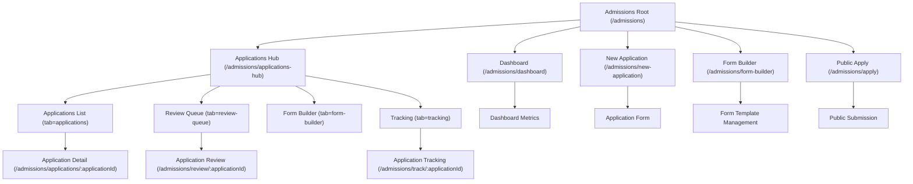

**Diagram sources**
- [moduleDefinition.tsx:27-83](file://src/modules/admissions/moduleDefinition.tsx#L27-L83)
- [moduleDefinition.tsx:104-116](file://src/modules/admissions/moduleDefinition.tsx#L104-L116)

The routing system supports dynamic parameters for application-specific operations and includes the new ApplicationsHubPage with tab-based navigation, enabling granular access control and personalized user experiences.

**Updated** The ApplicationsHubPage implements a hub-and-spoke pattern that consolidates application management functions into a single entry point with four distinct tabs: Applications List, Review Queue, Form Builder, and Tracking.

**Section sources**
- [moduleDefinition.tsx:104-116](file://src/modules/admissions/moduleDefinition.tsx#L104-L116)
- [ApplicationsHubPage.tsx:31-56](file://src/modules/admissions/pages/ApplicationsHubPage.tsx#L31-L56)

## Data Layer

### Modular Data Provider Architecture

The data layer implements a modern provider pattern that ensures consistent data access across the module while maintaining type safety and performance optimization.

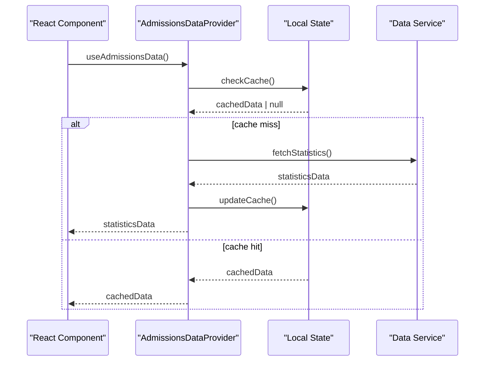

**Diagram sources**
- [data/index.ts:5-8](file://src/modules/admissions/data/index.ts#L5-L8)

The data provider pattern enables efficient caching, automatic updates, and seamless integration with the broader data layer architecture.

**Section sources**
- [data/index.ts:1-12](file://src/modules/admissions/data/index.ts#L1-L12)

## Role-Based Access Control

The Admissions Module implements a comprehensive RBAC system with granular permissions tailored to different user roles within the educational institution.

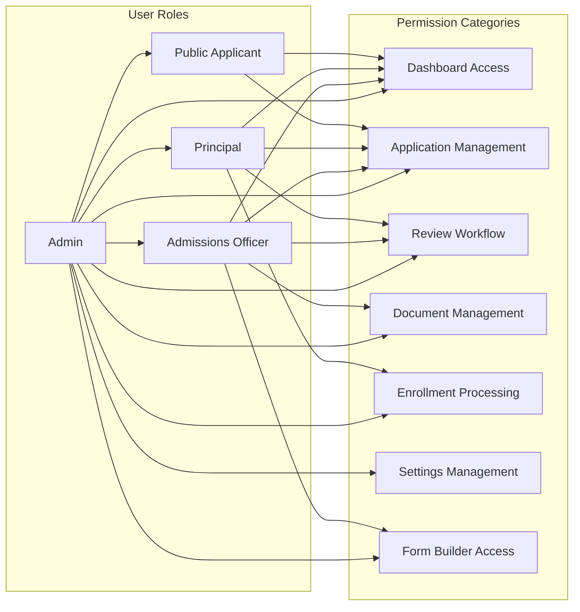

**Diagram sources**
- [rbac.ts:3-126](file://src/modules/admissions/rbac.ts#L3-L126)

The permission system covers eight major categories with specific actions including read, create, update, delete, and execute operations, ensuring appropriate access control for each role. The new form builder functionality includes dedicated permissions.

**Section sources**
- [rbac.ts:1-126](file://src/modules/admissions/rbac.ts#L1-L126)

## Dashboard Implementation

The Admissions Dashboard serves as the central command center for admission operations, providing real-time insights and quick access to critical functions.

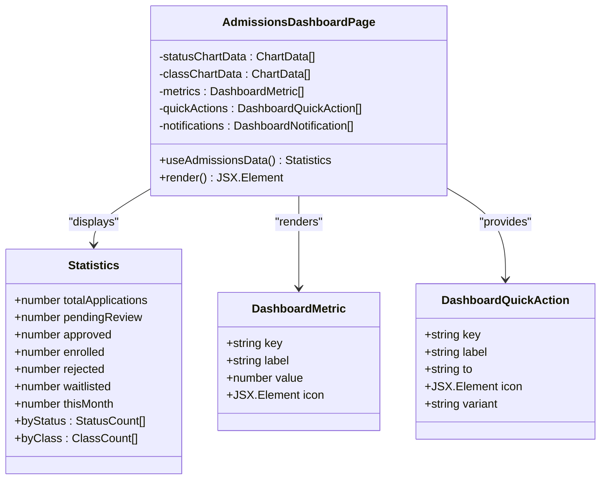

**Diagram sources**
- [AdmissionsDashboardPage.tsx:17-82](file://src/modules/admissions/pages/AdmissionsDashboardPage.tsx#L17-L82)

The dashboard implements a responsive grid layout with metric cards, interactive charts, and contextual notifications to provide comprehensive oversight of admission activities.

**Section sources**
- [AdmissionsDashboardPage.tsx:17-82](file://src/modules/admissions/pages/AdmissionsDashboardPage.tsx#L17-L82)

## Hub-and-Spoke Pattern Implementation

The ApplicationsHubPage implements a sophisticated hub-and-spoke pattern that consolidates multiple application management functions into a unified tabbed interface, improving workflow efficiency and user experience.

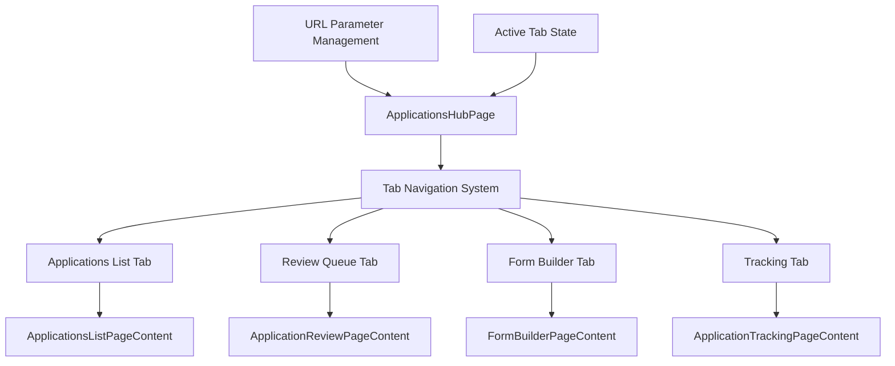

**Diagram sources**
- [ApplicationsHubPage.tsx:26-96](file://src/modules/admissions/pages/ApplicationsHubPage.tsx#L26-L96)

The hub-and-spoke pattern provides several key benefits:
- **Centralized Access**: Single entry point for all application management functions
- **Tab-Based Navigation**: Clean separation of concerns with persistent URL state
- **Consistent UX**: Unified styling and interaction patterns across all tabs
- **Flexible Routing**: Support for both hash-based and parameter-based navigation

**Section sources**
- [ApplicationsHubPage.tsx:26-96](file://src/modules/admissions/pages/ApplicationsHubPage.tsx#L26-L96)

## Form Builder Functionality

The FormBuilderPage provides comprehensive form template management capabilities, allowing administrators to design and maintain admission application forms.

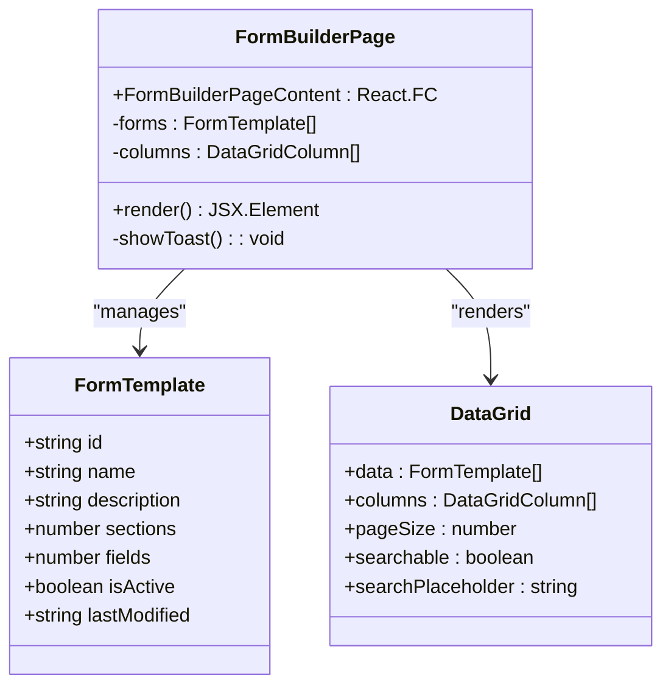

**Diagram sources**
- [FormBuilderPage.tsx:14-134](file://src/modules/admissions/pages/FormBuilderPage.tsx#L14-L134)

The form builder includes comprehensive CRUD operations with mock data for demonstration purposes, supporting form creation, editing, duplication, and deletion workflows.

**Section sources**
- [FormBuilderPage.tsx:30-134](file://src/modules/admissions/pages/FormBuilderPage.tsx#L30-L134)

## Module Dependencies

The Admissions Module establishes strategic dependencies with other core modules to ensure comprehensive educational management functionality.

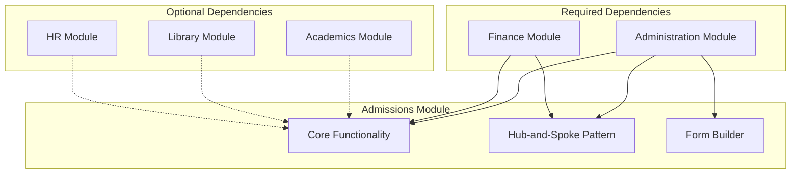

**Diagram sources**
- [moduleDefinition.tsx:91-102](file://src/modules/admissions/moduleDefinition.tsx#L91-L102)

The dependency structure reflects the module's integration needs, with Administration being mandatory for operational support and Finance being essential for fee management and payment processing. The hub-and-spoke pattern enhances the module's integration capabilities.

**Section sources**
- [moduleDefinition.tsx:91-102](file://src/modules/admissions/moduleDefinition.tsx#L91-L102)

## Configuration Management

The module implements a flexible configuration system that allows administrators to customize admission processes according to institutional requirements.

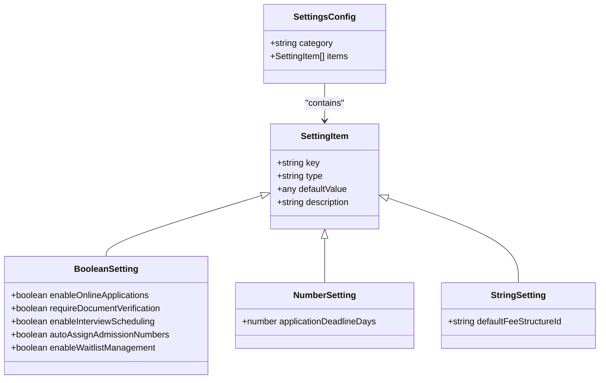

**Diagram sources**
- [moduleDefinition.tsx:117-156](file://src/modules/admissions/moduleDefinition.tsx#L117-L156)

The configuration system supports three data types (boolean, number, string) with sensible defaults that can be easily modified through the administrative interface. The new form builder functionality includes configuration options for form management.

**Section sources**
- [moduleDefinition.tsx:117-156](file://src/modules/admissions/moduleDefinition.tsx#L117-L156)

## Conclusion

The Admissions Module represents a sophisticated, enterprise-grade solution for educational institution admission management. Its modular architecture, comprehensive feature set, and robust integration capabilities position it as a cornerstone component of the EduGen platform.

Key strengths of the module include its comprehensive RBAC system, flexible configuration options, integrated dashboard functionality, strategic module dependencies, and the innovative hub-and-spoke pattern implementation. The addition of ApplicationsHubPage and FormBuilderPage demonstrates best practices in modern React development while maintaining the specialized requirements of educational administration.

The hub-and-spoke pattern significantly improves workflow efficiency by consolidating related application management functions into a unified interface, while the form builder provides powerful customization capabilities for admission processes. These enhancements, combined with the module's existing comprehensive feature set, make it a scalable and future-ready foundation for institutional growth and evolving educational requirements.