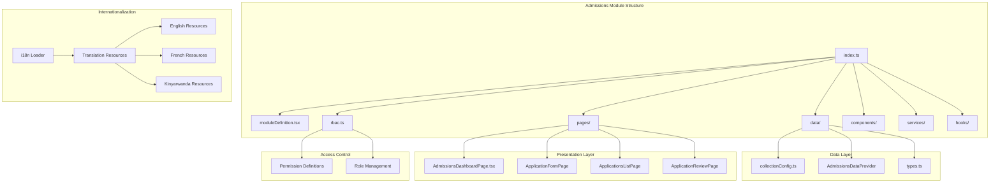
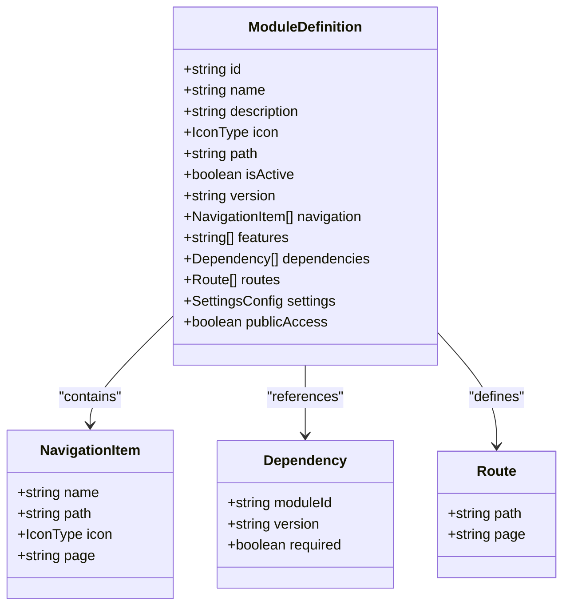
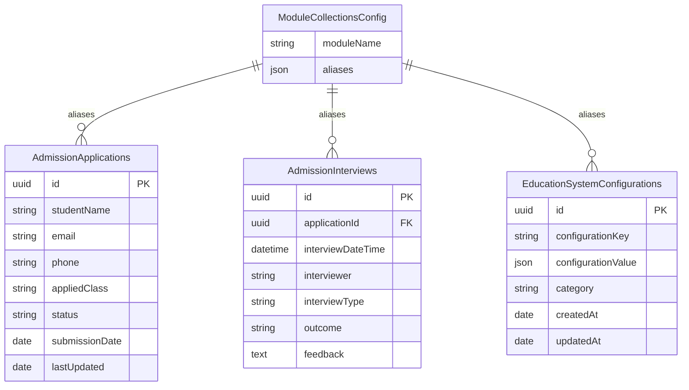
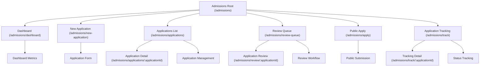
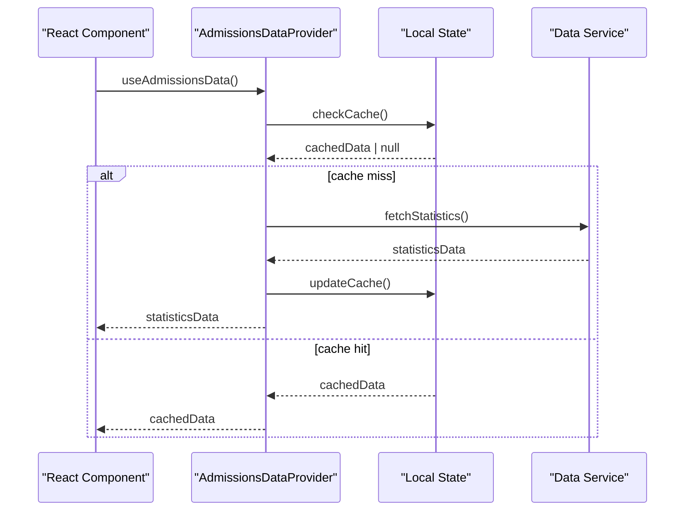
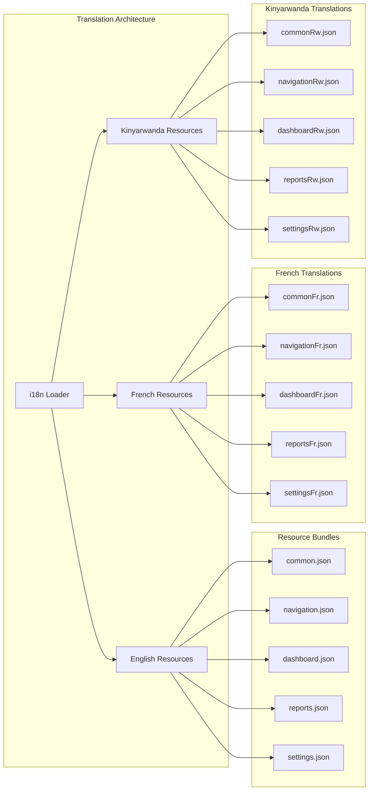
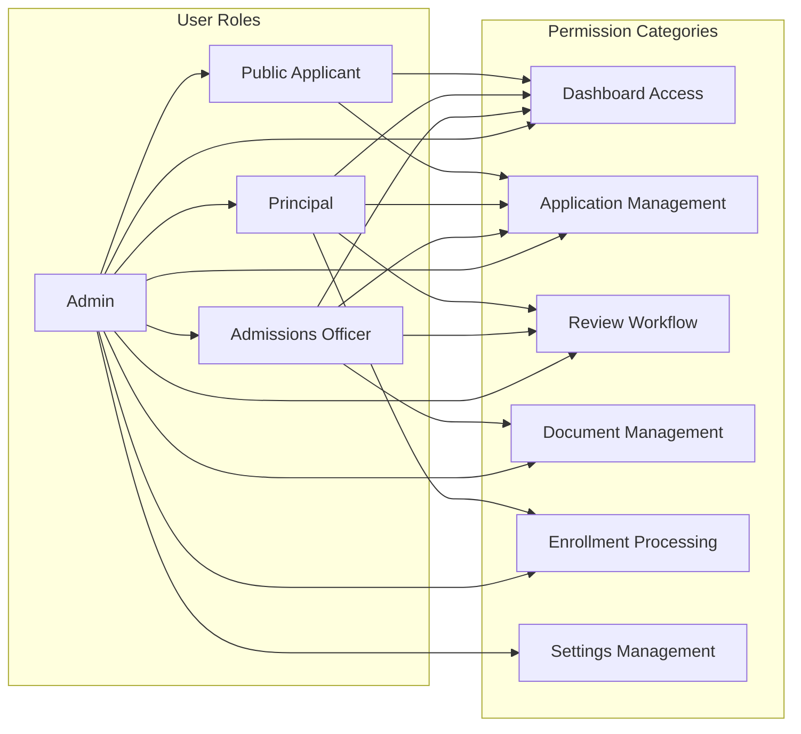
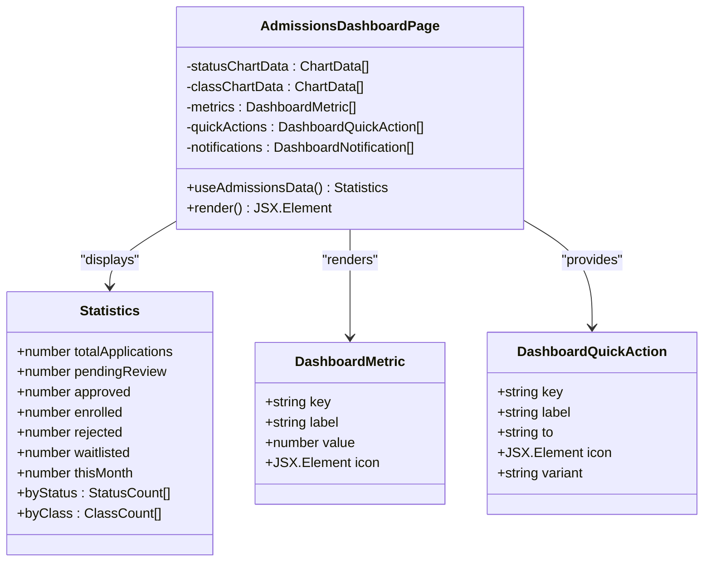
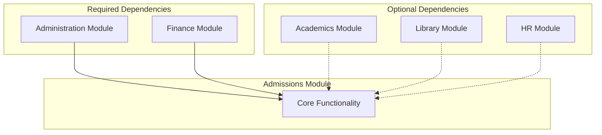
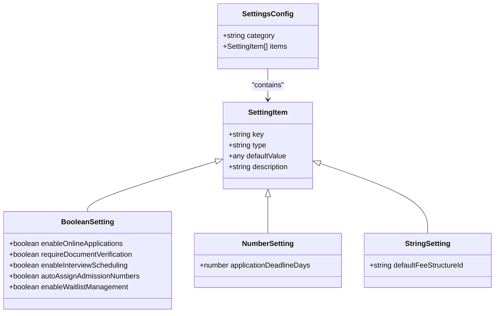

# Admissions Module

<cite>
**Referenced Files in This Document**
- [index.ts](file://src/modules/admissions/index.ts)
- [moduleDefinition.tsx](file://src/modules/admissions/moduleDefinition.tsx)
- [rbac.ts](file://src/modules/admissions/rbac.ts)
- [AdmissionsDashboardPage.tsx](file://src/modules/admissions/pages/AdmissionsDashboardPage.tsx)
- [collectionConfig.ts](file://src/modules/admissions/data/collectionConfig.ts)
- [data/index.ts](file://src/modules/admissions/data/index.ts)
- [loader.ts](file://src/i18n/loader.ts)
</cite>

## Update Summary
**Changes Made**
- Added comprehensive internationalization section documenting French and Kinyarwanda language support
- Updated module architecture diagram to include i18n integration
- Enhanced data layer section to reflect translation resource management
- Added language support configuration documentation

## Table of Contents
1. [Introduction](#introduction)
2. [Module Architecture](#module-architecture)
3. [Core Components](#core-components)
4. [Navigation and Routing](#navigation-and-routing)
5. [Data Layer](#data-layer)
6. [Internationalization Support](#internationalization-support)
7. [Role-Based Access Control](#role-based-access-control)
8. [Dashboard Implementation](#dashboard-implementation)
9. [Module Dependencies](#module-dependencies)
10. [Configuration Management](#configuration-management)
11. [Conclusion](#conclusion)

## Introduction

The Admissions Module is a comprehensive student admission management system designed as part of the EduGen educational platform. This module provides end-to-end functionality for managing student applications, from initial submission through final enrollment. Built with modern React architecture and TypeScript, the module follows the platform's modular design patterns while offering specialized features for educational institutions.

The module serves as a centralized hub for admission processes, integrating seamlessly with other school management systems including administration, finance, and academic modules. It supports both internal staff workflows and public-facing applications, making it a versatile solution for various educational institution needs.

**Updated** Enhanced internationalization support now includes comprehensive French and Kinyarwanda translations, expanding the module's global reach and accessibility.

## Module Architecture

The Admissions Module follows a structured modular architecture that promotes maintainability, scalability, and reusability within the EduGen ecosystem. The architecture now includes comprehensive internationalization support through the i18n system.

**Diagram sources**
- [index.ts:1-25](file://src/modules/admissions/index.ts#L1-L25)
- [moduleDefinition.tsx:19-139](file://src/modules/admissions/moduleDefinition.tsx#L19-L139)
- [loader.ts:1-69](file://src/i18n/loader.ts#L1-L69)

The module architecture emphasizes separation of concerns through distinct layers, with the addition of comprehensive internationalization support that enables multi-language functionality across all module components.

**Section sources**
- [index.ts:1-25](file://src/modules/admissions/index.ts#L1-L25)
- [moduleDefinition.tsx:19-139](file://src/modules/admissions/moduleDefinition.tsx#L19-L139)
- [loader.ts:36-69](file://src/i18n/loader.ts#L36-L69)

## Core Components

### Module Definition and Metadata

The module definition serves as the central configuration hub, defining navigation, features, and integration points with other modules.

**Diagram sources**
- [moduleDefinition.tsx:19-139](file://src/modules/admissions/moduleDefinition.tsx#L19-L139)

The module definition includes comprehensive navigation structure with six primary sections covering dashboard, application management, review processes, and public access capabilities.

**Section sources**
- [moduleDefinition.tsx:27-64](file://src/modules/admissions/moduleDefinition.tsx#L27-L64)
- [moduleDefinition.tsx:85-95](file://src/modules/admissions/moduleDefinition.tsx#L85-L95)

### Data Collection Configuration

The data layer utilizes a sophisticated collection aliasing system that provides abstraction over underlying database collections while maintaining type safety.

**Diagram sources**
- [collectionConfig.ts:4-11](file://src/modules/admissions/data/collectionConfig.ts#L4-L11)

**Section sources**
- [collectionConfig.ts:1-14](file://src/modules/admissions/data/collectionConfig.ts#L1-L14)
- [data/index.ts:1-11](file://src/modules/admissions/data/index.ts#L1-L11)

## Navigation and Routing

The Admissions Module implements a comprehensive navigation system that caters to both internal staff and public applicants.

**Diagram sources**
- [moduleDefinition.tsx:27-64](file://src/modules/admissions/moduleDefinition.tsx#L27-L64)
- [moduleDefinition.tsx:85-95](file://src/modules/admissions/moduleDefinition.tsx#L85-L95)

The routing system supports dynamic parameters for application-specific operations, enabling granular access control and personalized user experiences.

**Section sources**
- [moduleDefinition.tsx:85-95](file://src/modules/admissions/moduleDefinition.tsx#L85-L95)

## Data Layer

### Modular Data Provider Architecture

The data layer implements a modern provider pattern that ensures consistent data access across the module while maintaining type safety and performance optimization.

**Diagram sources**
- [data/index.ts:5-8](file://src/modules/admissions/data/index.ts#L5-L8)

The data provider pattern enables efficient caching, automatic updates, and seamless integration with the broader data layer architecture.

**Section sources**
- [data/index.ts:1-11](file://src/modules/admissions/data/index.ts#L1-L11)

## Internationalization Support

**Updated** The Admissions Module now provides comprehensive internationalization support through a sophisticated translation management system.

The module leverages a centralized i18n loader that manages translation resources for multiple languages, with particular emphasis on French and Kinyarwanda support.

**Diagram sources**
- [loader.ts:21-34](file://src/i18n/loader.ts#L21-L34)
- [loader.ts:52-65](file://src/i18n/loader.ts#L52-L65)

The internationalization system supports multiple namespaces including common, navigation, dashboard, reports, settings, academics, administration, finance, hr, inventory, library, nutrition, and portal, ensuring comprehensive coverage of all module functionalities.

**Section sources**
- [loader.ts:21-34](file://src/i18n/loader.ts#L21-L34)
- [loader.ts:52-65](file://src/i18n/loader.ts#L52-L65)

### Translation Resource Management

The module implements a systematic approach to managing translation resources through dedicated JSON files organized by namespace and language.

**Section sources**
- [loader.ts:6-19](file://src/i18n/loader.ts#L6-L19)
- [loader.ts:21-34](file://src/i18n/loader.ts#L21-L34)

## Role-Based Access Control

The Admissions Module implements a comprehensive RBAC system with granular permissions tailored to different user roles within the educational institution.

**Diagram sources**
- [rbac.ts:3-118](file://src/modules/admissions/rbac.ts#L3-L118)

The permission system covers seven major categories with specific actions including read, create, update, delete, and execute operations, ensuring appropriate access control for each role.

**Section sources**
- [rbac.ts:1-126](file://src/modules/admissions/rbac.ts#L1-L126)

## Dashboard Implementation

The Admissions Dashboard serves as the central command center for admission operations, providing real-time insights and quick access to critical functions.

**Diagram sources**
- [AdmissionsDashboardPage.tsx:17-82](file://src/modules/admissions/pages/AdmissionsDashboardPage.tsx#L17-L82)

The dashboard implements a responsive grid layout with metric cards, interactive charts, and contextual notifications to provide comprehensive oversight of admission activities.

**Section sources**
- [AdmissionsDashboardPage.tsx:17-82](file://src/modules/admissions/pages/AdmissionsDashboardPage.tsx#L17-L82)

## Module Dependencies

The Admissions Module establishes strategic dependencies with other core modules to ensure comprehensive educational management functionality.

**Diagram sources**
- [moduleDefinition.tsx:72-84](file://src/modules/admissions/moduleDefinition.tsx#L72-L84)

The dependency structure reflects the module's integration needs, with Administration being mandatory for operational support and Finance being essential for fee management and payment processing.

**Section sources**
- [moduleDefinition.tsx:72-84](file://src/modules/admissions/moduleDefinition.tsx#L72-L84)

## Configuration Management

The module implements a flexible configuration system that allows administrators to customize admission processes according to institutional requirements.

**Diagram sources**
- [moduleDefinition.tsx:96-135](file://src/modules/admissions/moduleDefinition.tsx#L96-L135)

The configuration system supports three data types (boolean, number, string) with sensible defaults that can be easily modified through the administrative interface.

**Section sources**
- [moduleDefinition.tsx:96-135](file://src/modules/admissions/moduleDefinition.tsx#L96-L135)

## Conclusion

The Admissions Module represents a sophisticated, enterprise-grade solution for educational institution admission management. Its modular architecture, comprehensive feature set, and robust integration capabilities position it as a cornerstone component of the EduGen platform.

Key strengths of the module include its comprehensive RBAC system, flexible configuration options, integrated dashboard functionality, and strategic module dependencies. The implementation demonstrates best practices in modern React development while maintaining the specialized requirements of educational administration.

**Updated** The recent enhancement of comprehensive French and Kinyarwanda translations significantly expands the module's internationalization capabilities, making it accessible to a broader global audience while maintaining the high standards of functionality and user experience that characterize the EduGen platform.

The module's design supports both current operational needs and future expansion possibilities, making it a scalable foundation for institutional growth and evolving educational requirements. The addition of robust internationalization support ensures that the module can effectively serve diverse educational communities across different linguistic and cultural contexts.