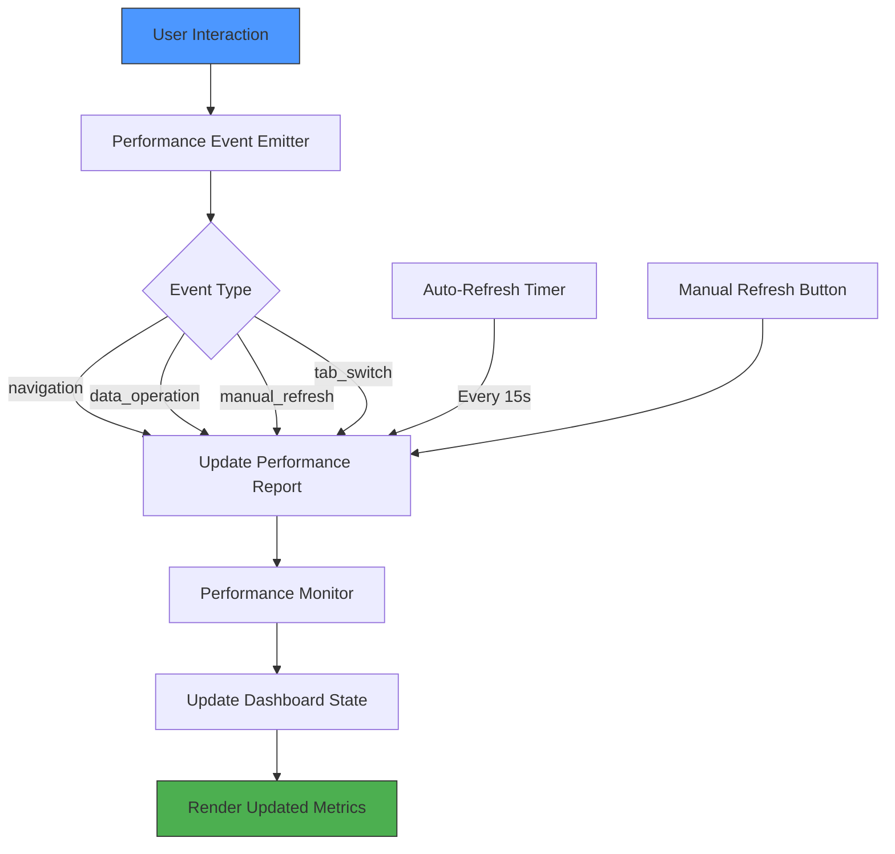
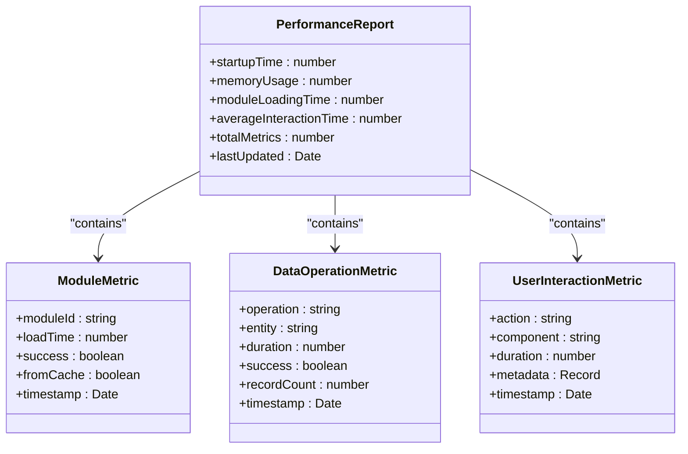
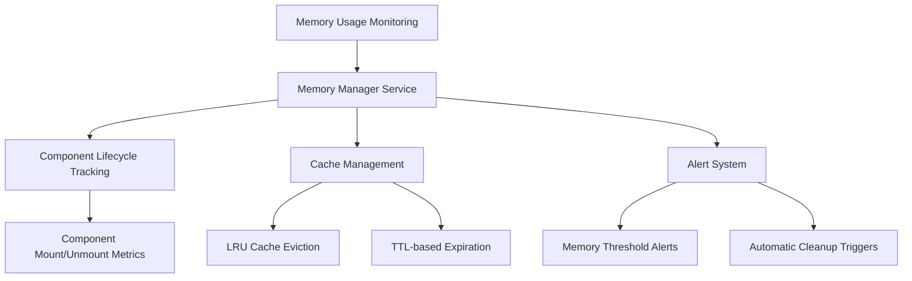
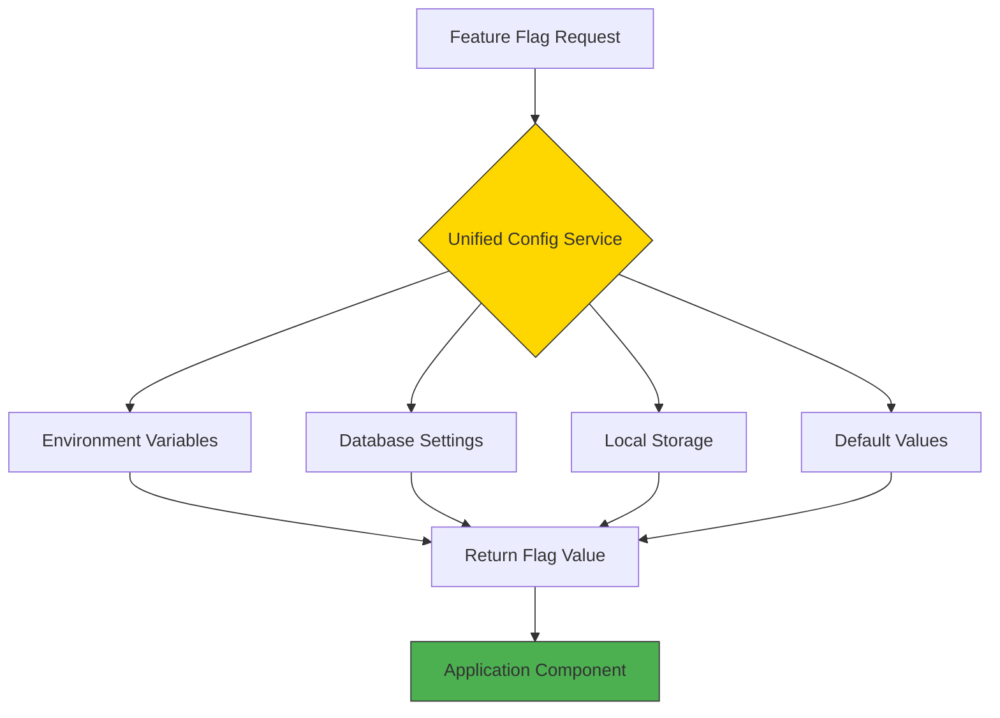
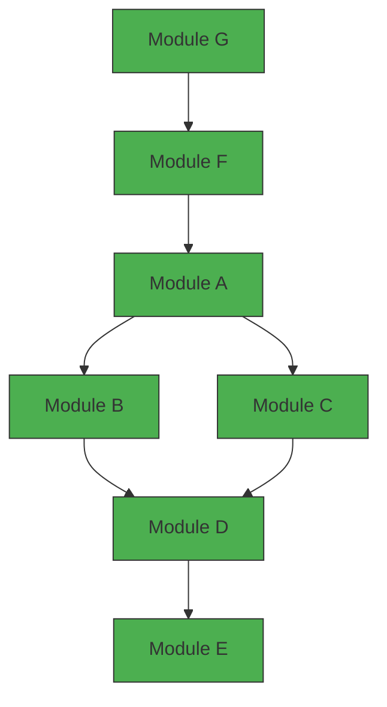
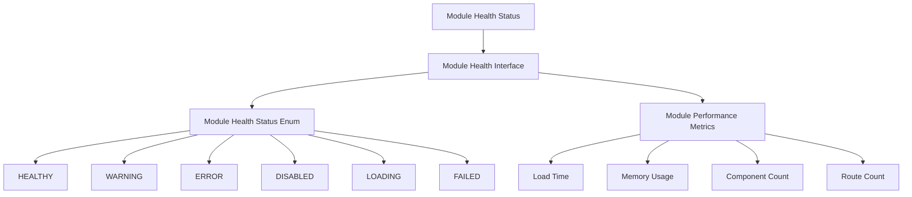
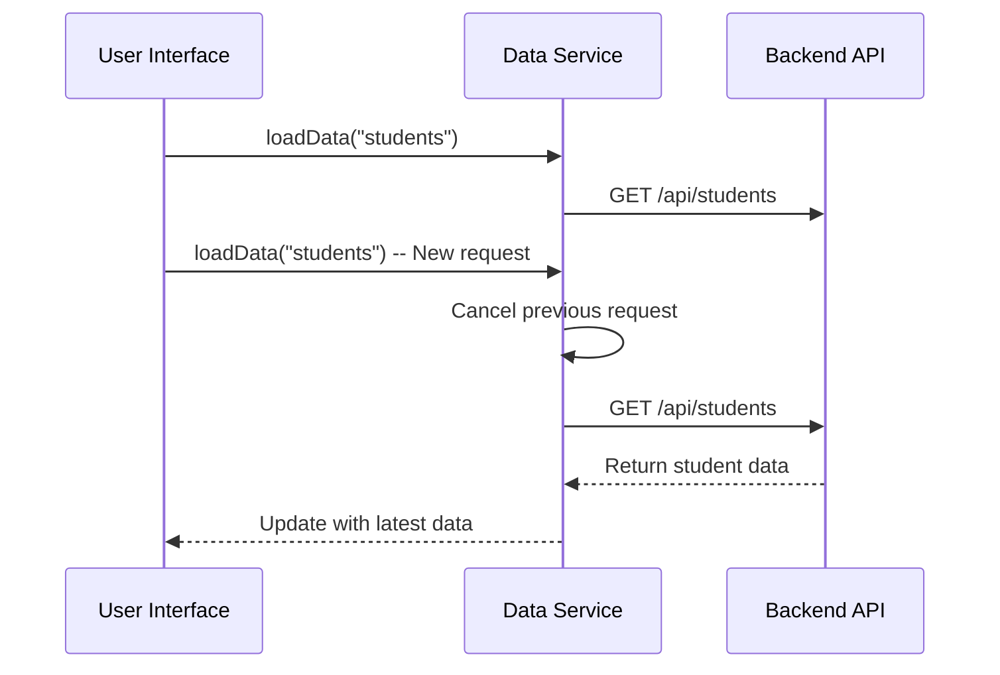
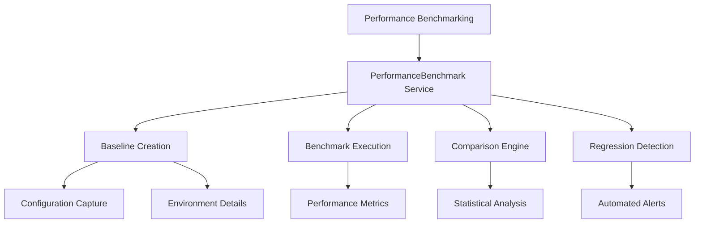

# Advanced Topics

<cite>
**Referenced Files in This Document**
- [PerformanceDashboard.tsx](file://src/components/PerformanceDashboard.tsx)
- [usePerformanceMonitoring.ts](file://src/hooks/usePerformanceMonitoring.ts)
- [PerformanceBenchmark.tsx](file://src/components/PerformanceBenchmark.tsx)
- [usePerformanceBenchmark.ts](file://src/hooks/usePerformanceBenchmark.ts)
- [performanceMonitor.ts](file://src/services/performanceMonitor.ts)
- [performanceBenchmark.ts](file://src/services/performanceBenchmark.ts)
- [ModuleDependencyValidator.ts](file://src/core/services/ModuleDependencyValidator.ts)
- [moduleLoader.ts](file://src/core/moduleLoader.ts)
- [unifiedConfig.ts](file://src/config/unifiedConfig.ts)
- [tabbedModeConfig.ts](file://src/config/tabbedModeConfig.ts)
- [enhancedModuleLoader.ts](file://src/services/enhancedModuleLoader.ts)
- [memoryManager.ts](file://src/services/memoryManager.ts)
- [assetOptimizer.ts](file://src/services/assetOptimizer.ts)
- [useModuleLoadingPerformance.ts](file://src/hooks/useModuleLoadingPerformance.ts)
</cite>

## Update Summary
**Changes Made**
- Enhanced performance optimization techniques with new benchmarking capabilities and memory management improvements
- Improved feature flags configuration with comprehensive rollout strategies and tabbed mode controls
- Enhanced module dependency management with version compatibility checking and circular dependency detection
- Added advanced memory management with leak detection and automatic cleanup
- Integrated asset optimization for improved loading performance
- Expanded module health monitoring with detailed performance metrics

## Table of Contents
1. [Performance Optimization Techniques](#performance-optimization-techniques)
2. [Feature Flag System](#feature-flag-system)
3. [Module Dependency Validation](#module-dependency-validation)
4. [Advanced Module System Extensions](#advanced-module-system-extensions)
5. [Troubleshooting Complex Issues](#troubleshooting-complex-issues)

## Performance Optimization Techniques

The schoolpilot3 platform implements a comprehensive performance monitoring and optimization framework designed to maintain high responsiveness and efficient resource utilization. The system provides both real-time monitoring through the `PerformanceDashboard` component and historical benchmarking via the `PerformanceBenchmark` system.

### Real-time Performance Monitoring

The `PerformanceDashboard` component offers a comprehensive view of application performance metrics, including startup time, memory usage, module loading performance, and user interaction response times. The dashboard uses an event-driven architecture to minimize unnecessary re-renders and performance measurement overhead.



**Diagram sources**
- [PerformanceDashboard.tsx:45-100](file://src/components/PerformanceDashboard.tsx#L45-L100)
- [usePerformanceMonitoring.ts:45-60](file://src/hooks/usePerformanceMonitoring.ts#L45-L60)

**Section sources**
- [PerformanceDashboard.tsx:1-382](file://src/components/PerformanceDashboard.tsx#L1-L382)
- [usePerformanceMonitoring.ts:1-293](file://src/hooks/usePerformanceMonitoring.ts#L1-L293)

### Performance Metrics Collection

The `usePerformanceMonitoring` hook provides React components with easy integration to the performance monitoring system. Components can track user interactions, data operations, and async operations with minimal code changes.

```typescript
// Example of performance monitoring integration
const { trackUserInteraction, trackDataOperation, measureAsync } = usePerformanceMonitoring({
  componentName: 'StudentListPage',
  trackMounts: true,
  trackInteractions: true
});

// Track a user interaction
trackUserInteraction('filter_applied', { filterType: 'grade' });

// Track a data operation
await trackDataOperation('read', 'students', studentCount);

// Measure async operation performance
const result = await measureAsync(
  fetchStudentData,
  'load_student_list'
);
```

The performance monitoring system categorizes metrics into three main types:
- **User interactions**: Component mounts, unmounts, renders, and user actions
- **Data operations**: CRUD operations on entities with duration and success tracking
- **System metrics**: Startup time, memory usage, and module loading performance

### Module Loading Benchmarks

The platform tracks module loading performance as a critical metric for application responsiveness. The `performanceMonitor.getModuleMetrics()` method returns detailed information about each module's load time, success status, and whether it was loaded from cache.



**Diagram sources**
- [performanceMonitor.ts:15-50](file://src/services/performanceMonitor.ts#L15-L50)
- [PerformanceDashboard.tsx:15-30](file://src/components/PerformanceDashboard.tsx#L15-L30)

### Render Loop Prevention

The tabbed workspace system implements several mechanisms to prevent render loops and excessive re-renders:

1. **Event throttling**: Performance updates are throttled to a minimum of 2 seconds between refreshes
2. **Selective event listening**: The dashboard only responds to relevant events (navigation, data operations, manual refresh, tab switch)
3. **Conditional rendering**: Components only re-render when necessary data has changed
4. **Memoization**: Critical functions are wrapped in `useCallback` to prevent unnecessary re-creation

```typescript
// Event-driven performance updates with throttling
const { shouldRefresh, emitEvent } = usePerformanceEvents(
  (event) => {
    if (shouldRefresh(lastRefresh, 2000)) { // Minimum 2 seconds between refreshes
      updateReport();
      setLastRefresh(Date.now());
    }
  },
  ['navigation', 'data_operation', 'manual_refresh', 'tab_switch']
);
```

### Memory Management

The platform implements proactive memory management strategies to prevent memory leaks in long-running sessions:

1. **Component cleanup**: Effect hooks return cleanup functions to remove event listeners and cancel pending operations
2. **Metric aging**: Old performance metrics are automatically cleared to prevent memory bloat
3. **Reference management**: Refs are properly managed to avoid dangling references
4. **Cache invalidation**: Module loading cache is periodically validated and cleaned

The `PerformanceDashboard` includes a "Clear Data" button that allows administrators to manually clear old metrics and reset the monitoring system.

**Enhanced Memory Management System**

The platform now includes a comprehensive memory management system with leak detection and automatic cleanup:



**Diagram sources**
- [memoryManager.ts:55-103](file://src/services/memoryManager.ts#L55-L103)

**Section sources**
- [memoryManager.ts:1-511](file://src/services/memoryManager.ts#L1-L511)

### Asset Optimization

The platform implements intelligent asset optimization to improve loading performance:

1. **Intelligent loading strategies**: Assets can be preloaded, lazily loaded, or deferred based on usage patterns
2. **Image optimization**: Lazy loading with intersection observers for improved perceived performance
3. **Module prefetching**: Strategic preloading of frequently accessed modules
4. **Performance metrics**: Detailed tracking of asset loading times and sizes

**Section sources**
- [assetOptimizer.ts:86-185](file://src/services/assetOptimizer.ts#L86-L185)

## Feature Flag System

The schoolpilot3 platform implements a sophisticated feature flag system that enables gradual rollout of new functionality through unified configuration. This system allows for controlled feature releases, A/B testing, and emergency feature toggling without requiring code deployments.

### Unified Configuration Architecture

The feature flag system is built on the `unifiedConfig.ts` configuration framework, which provides a centralized location for managing application settings and feature toggles. The system supports multiple configuration sources and environments.



**Diagram sources**
- [unifiedConfig.ts:1-50](file://src/config/unifiedConfig.ts#L1-L50)
- [tabbedModeConfig.ts:1-30](file://src/config/tabbedModeConfig.ts#L1-L30)

### Implementation and Usage

The feature flag system is accessed through the `UnifiedConfigContext` and can be used in both React components and service layers:

```typescript
// In a React component
import { useUnifiedConfig } from '../contexts/UnifiedConfigContext';

const MyComponent = () => {
  const { getFeatureFlag } = useUnifiedConfig();
  const isNewUIEnabled = getFeatureFlag('new_ui_design');
  
  if (isNewUIEnabled) {
    return <NewUserInterface />;
  }
  return <LegacyUserInterface />;
};

// In a service
import { unifiedConfigService } from '../services/unifiedConfigService';

const processStudentData = async (data) => {
  if (unifiedConfigService.getFeatureFlag('enhanced_validation')) {
    return await enhancedValidationService.validate(data);
  }
  return legacyValidationService.validate(data);
};
```

### Gradual Rollout Strategies

The platform supports multiple rollout strategies for new features:

1. **Percentage-based rollout**: Enable a feature for a percentage of users
2. **User segment rollout**: Enable features for specific user roles or groups
3. **Geographic rollout**: Enable features based on user location
4. **Time-based rollout**: Schedule feature releases for specific dates/times

These strategies are configured in the `unifiedConfig.json` file and can be modified through the administration interface without requiring code changes.

**Enhanced Tabbed Mode Configuration**

The platform now includes sophisticated tabbed mode feature flags with granular control:

```typescript
// Tabbed mode configuration with per-module control
const tabbedModeConfig = {
  globalEnabled: true,
  enablePerModuleControl: true,
  enableTabbedMode: true,
  moduleOverrides: {
    'dashboard': true,
    'settings': true,
    'reports': true,
    'academics': false,
    'administration': false,
    // ... other modules
  }
};
```

**Section sources**
- [unifiedConfig.ts:285-917](file://src/config/unifiedConfig.ts#L285-L917)
- [tabbedModeConfig.ts:1-86](file://src/config/tabbedModeConfig.ts#L1-L86)

## Module Dependency Validation

The schoolpilot3 platform implements a robust module dependency validation system that ensures proper loading order and prevents circular dependencies. This system is critical for maintaining application stability and preventing runtime errors.

### Dependency Validation Architecture

The `ModuleDependencyValidator` service analyzes module dependencies and validates the loading order before modules are loaded. The system uses a directed acyclic graph (DAG) to represent module dependencies and detect circular references.



**Diagram sources**
- [ModuleDependencyValidator.ts:1-40](file://src/core/services/ModuleDependencyValidator.ts#L1-L40)
- [moduleLoader.ts:1-30](file://src/core/moduleLoader.ts#L1-L30)

### Validation Process

The module dependency validation process occurs in several stages:

1. **Dependency Analysis**: The system parses module definitions to identify dependencies
2. **Graph Construction**: A dependency graph is constructed from the module relationships
3. **Cycle Detection**: The system checks for circular dependencies using depth-first search
4. **Version Compatibility**: Validates semantic version compatibility for modules
5. **Topological Sorting**: Modules are sorted into a valid loading order
6. **Validation Reporting**: Any issues are reported before module loading begins

```typescript
// Example of module dependency validation
class ModuleDependencyValidator {
  validateDependencies(modules: ModuleDefinition[]): ValidationResult {
    // Build dependency graph
    const graph = this.buildDependencyGraph(modules);
    
    // Check for circular dependencies
    const cycles = this.detectCycles(graph);
    if (cycles.length > 0) {
      return {
        valid: false,
        errors: cycles.map(cycle => 
          `Circular dependency detected: ${cycle.join(' → ')}`
        )
      };
    }
    
    // Check version compatibility
    const versionErrors = this.checkVersionCompatibility(modules);
    if (versionErrors.length > 0) {
      return {
        valid: false,
        errors: versionErrors
      };
    }
    
    // Generate valid loading order
    const loadingOrder = this.topologicalSort(graph);
    return {
      valid: true,
      loadingOrder,
      warnings: this.checkDeprecatedDependencies(modules)
    };
  }
}
```

### Practical Examples

When optimizing slow-performing modules, developers can use the dependency validation system to identify bottlenecks:

```typescript
// Debugging a slow-loading module
const validationResult = moduleDependencyValidator.validateDependencies(modules);
if (!validationResult.valid) {
  console.error('Module dependency issues:', validationResult.errors);
  // Fix circular dependencies or adjust loading order
}

// Optimizing module loading
const optimizedOrder = validationResult.loadingOrder;
await moduleLoader.loadModulesInOrder(optimizedOrder);
```

The system also provides debugging tools to visualize complex dependency chains and identify potential optimization opportunities.

**Enhanced Module Health Monitoring**

The platform now includes comprehensive module health monitoring with detailed performance metrics:



**Diagram sources**
- [enhancedModuleLoader.ts:4-51](file://src/services/enhancedModuleLoader.ts#L4-L51)

**Section sources**
- [ModuleDependencyValidator.ts:1-297](file://src/core/services/ModuleDependencyValidator.ts#L1-L297)
- [enhancedModuleLoader.ts:1-51](file://src/services/enhancedModuleLoader.ts#L1-L51)

## Advanced Module System Extensions

The schoolpilot3 platform supports advanced usage patterns that allow developers to extend the module system with custom providers and implement sophisticated data synchronization strategies.

### Custom Module Providers

Developers can create custom module providers to handle specialized loading requirements:

```typescript
// Example of a custom module provider
class LazyLoadModuleProvider implements ModuleProvider {
  async load(moduleId: string): Promise<ModuleInstance> {
    // Implement lazy loading with intersection observer
    return new Promise((resolve) => {
      const observer = new IntersectionObserver((entries) => {
        entries.forEach((entry) => {
          if (entry.isIntersecting) {
            import(`../modules/${moduleId}/moduleDefinition`)
              .then((module) => {
                resolve(module);
                observer.unobserve(entry.target);
              });
          }
        });
      });
      
      const placeholder = document.getElementById(`module-${moduleId}`);
      if (placeholder) {
        observer.observe(placeholder);
      }
    });
  }
  
  supports(moduleId: string): boolean {
    return moduleId.startsWith('lazy-');
  }
}
```

### Advanced Data Synchronization

The platform supports advanced data synchronization strategies for modules that require real-time data updates:

```typescript
// Example of a data synchronization strategy
class RealTimeSyncStrategy implements DataSyncStrategy {
  private connections: Map<string, WebSocket> = new Map();
  
  async synchronize(moduleId: string, dataSource: string): Promise<void> {
    const socket = new WebSocket(`${dataSource}/ws/${moduleId}`);
    this.connections.set(moduleId, socket);
    
    socket.onmessage = (event) => {
      const data = JSON.parse(event.data);
      moduleRegistry.updateModuleData(moduleId, data);
    };
    
    socket.onclose = () => {
      // Implement reconnection logic
      setTimeout(() => this.reconnect(moduleId, dataSource), 5000);
    };
  }
  
  private async reconnect(moduleId: string, dataSource: string): Promise<void> {
    const existing = this.connections.get(moduleId);
    if (existing) {
      existing.close();
      this.connections.delete(moduleId);
    }
    
    await this.synchronize(moduleId, dataSource);
  }
  
  async disconnect(moduleId: string): Promise<void> {
    const socket = this.connections.get(moduleId);
    if (socket) {
      socket.close();
      this.connections.delete(moduleId);
    }
  }
}
```

### Performance Optimization Patterns

For optimizing slow-performing modules, several patterns are recommended:

1. **Code splitting**: Break large modules into smaller chunks that can be loaded on demand
2. **Lazy loading**: Load modules only when they are needed
3. **Caching**: Implement aggressive caching strategies for module metadata and dependencies
4. **Preloading**: Preload critical modules during application startup
5. **Bundle optimization**: Use tree-shaking and minification to reduce module size

```typescript
// Example of module optimization
class OptimizedModuleLoader {
  private moduleCache: Map<string, ModuleInstance> = new Map();
  private loadingPromises: Map<string, Promise<ModuleInstance>> = new Map();
  
  async loadModule(moduleId: string): Promise<ModuleInstance> {
    // Check cache first
    if (this.moduleCache.has(moduleId)) {
      return this.moduleCache.get(moduleId)!;
    }
    
    // Check if already loading
    if (this.loadingPromises.has(moduleId)) {
      return this.loadingPromises.get(moduleId)!;
    }
    
    // Start loading
    const loadingPromise = this.performLoad(moduleId);
    this.loadingPromises.set(moduleId, loadingPromise);
    
    try {
      const module = await loadingPromise;
      this.moduleCache.set(moduleId, module);
      return module;
    } finally {
      this.loadingPromises.delete(moduleId);
    }
  }
  
  private async performLoad(moduleId: string): Promise<ModuleInstance> {
    // Implement optimized loading logic
    const response = await fetch(`/modules/${moduleId}/bundle.js`);
    const code = await response.text();
    
    // Use Web Workers for heavy parsing
    if (code.length > 100000) {
      return await this.parseInWorker(code);
    }
    
    return this.parseModule(code);
  }
}
```

**Enhanced Module Performance Monitoring**

The platform now provides detailed module performance monitoring through the `useModuleLoadingPerformance` hook:

```typescript
// Example of enhanced module performance monitoring
const { 
  loadingProgress, 
  performanceMetrics, 
  allPerformanceMetrics,
  loadTime,
  allLoadTimes,
  performanceReport,
  isLoading,
  refreshMetrics 
} = useModuleLoadingPerformance({
  moduleId: 'academics',
  autoRefresh: true,
  refreshInterval: 30000
});
```

**Section sources**
- [useModuleLoadingPerformance.ts:1-110](file://src/hooks/useModuleLoadingPerformance.ts#L1-L110)

## Troubleshooting Complex Issues

The platform provides comprehensive tools and strategies for troubleshooting complex issues such as race conditions in data loading and memory leaks in long-running sessions.

### Race Condition Prevention

Race conditions in data loading are prevented through several mechanisms:

1. **Request cancellation**: Pending requests are canceled when a new request is made
2. **Version tracking**: Data responses include version numbers to detect stale responses
3. **Sequential processing**: Critical operations are processed sequentially to prevent conflicts
4. **Locking mechanisms**: Resource locks prevent concurrent modifications



**Diagram sources**
- [DataServiceFactory.ts:45-70](file://src/services/DataServiceFactory.ts#L45-L70)
- [UnifiedCRUDService.ts:30-55](file://src/services/UnifiedCRUDService.ts#L30-L55)

### Memory Leak Detection and Prevention

Memory leaks in long-running sessions are addressed through:

1. **Proper cleanup**: All event listeners and subscriptions are cleaned up in component unmount
2. **Weak references**: Use WeakMap and WeakSet for cache storage when possible
3. **Periodic cleanup**: Background tasks clean up unused resources
4. **Memory monitoring**: The PerformanceDashboard tracks memory usage over time

```typescript
// Example of proper cleanup
useEffect(() => {
  const eventListener = (event: CustomEvent) => {
    handleEvent(event.detail);
  };
  
  window.addEventListener('custom-event', eventListener);
  
  // Cleanup function prevents memory leak
  return () => {
    window.removeEventListener('custom-event', eventListener);
    cleanupResources();
  };
}, [dependencies]);
```

### Debugging Tools

The platform includes several debugging tools to help identify and resolve complex issues:

1. **PerformanceBenchmark**: Compare current performance against historical baselines
2. **ModuleHealthDashboard**: Monitor module health and dependency status
3. **RenderLoopDebugger**: Detect and prevent excessive re-renders
4. **MemoryDashboard**: Track memory usage and detect potential leaks
5. **AssetOptimizer**: Monitor and optimize asset loading performance

These tools can be accessed through the administration interface and provide detailed insights into application behavior.

**Enhanced Performance Benchmarking**

The platform now includes comprehensive performance benchmarking capabilities:



**Diagram sources**
- [performanceBenchmark.ts:86-140](file://src/services/performanceBenchmark.ts#L86-L140)

**Section sources**
- [PerformanceBenchmark.tsx:1-599](file://src/components/PerformanceBenchmark.tsx#L1-L599)
- [usePerformanceBenchmark.ts:1-309](file://src/hooks/usePerformanceBenchmark.ts#L1-L309)
- [performanceBenchmark.ts:1-672](file://src/services/performanceBenchmark.ts#L1-L672)