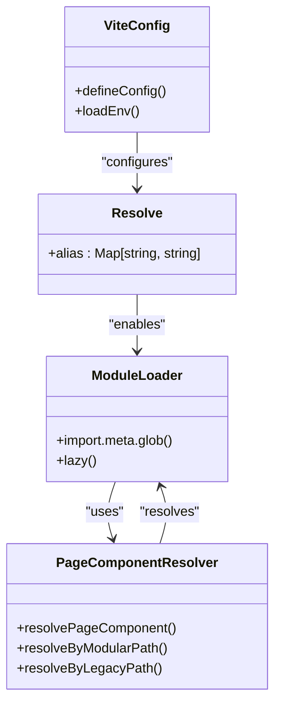
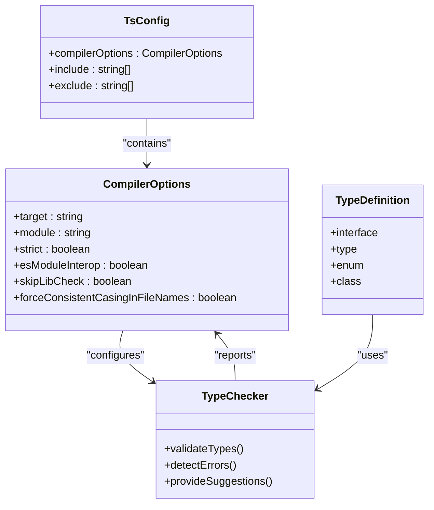
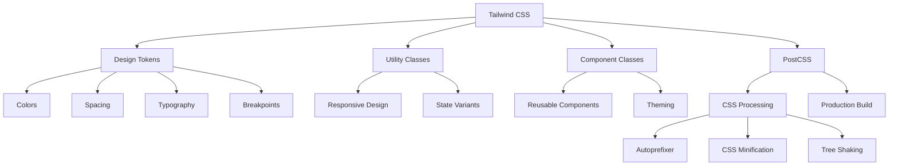
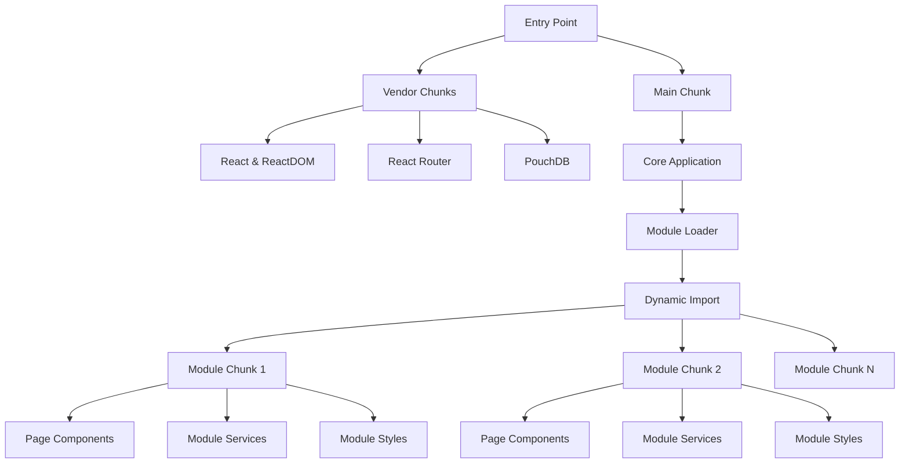
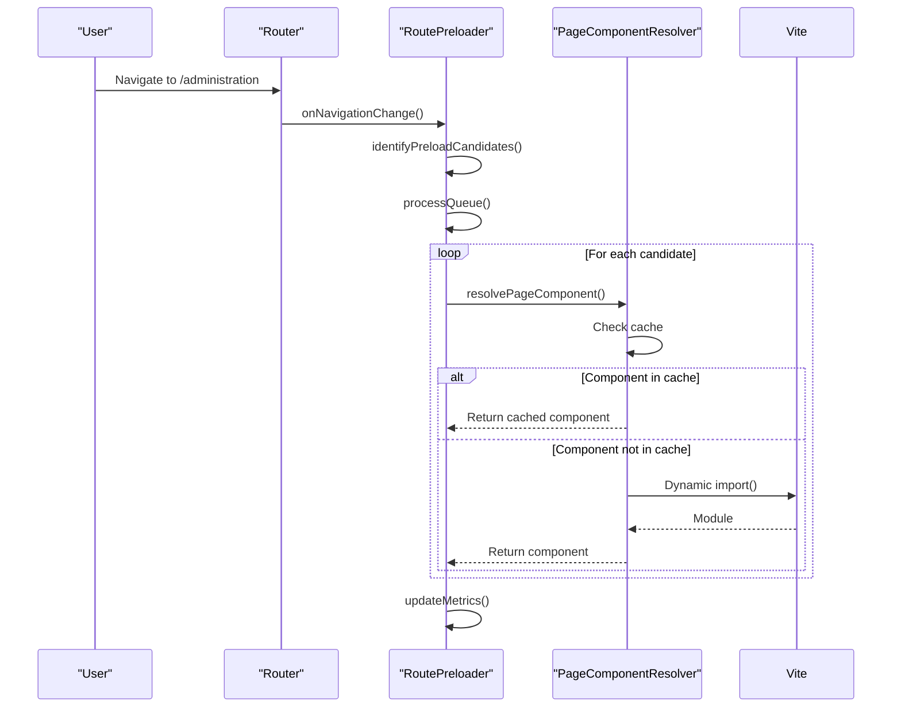
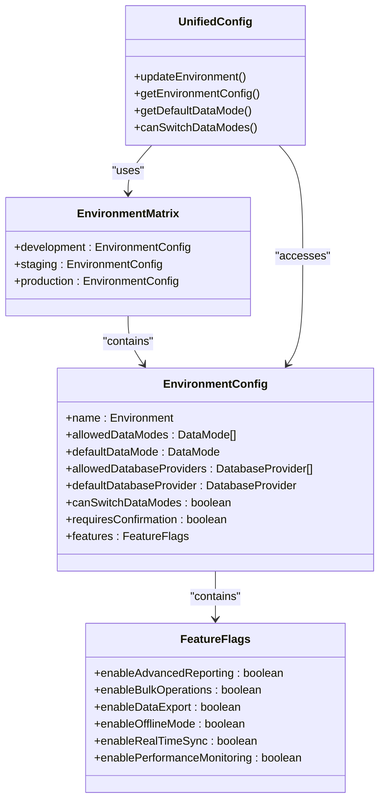
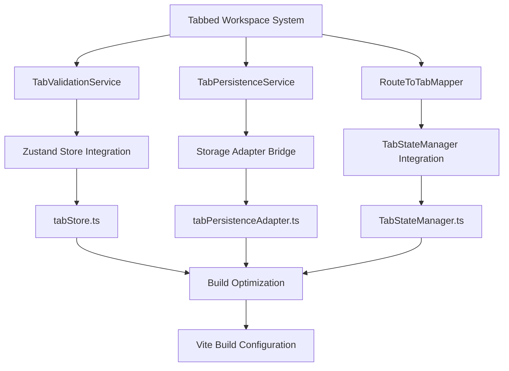
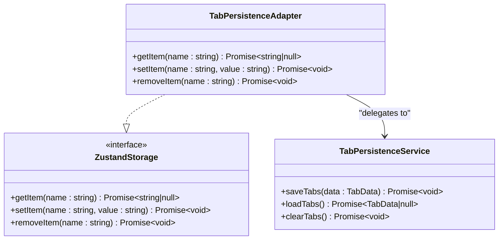
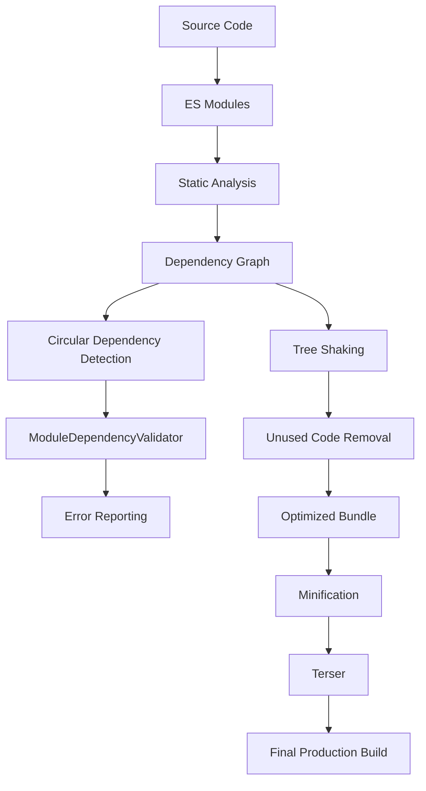

# Build Configuration

<cite>
**Referenced Files in This Document**
- [vite.config.ts](file://vite.config.ts)
- [tsconfig.json](file://tsconfig.json)
- [tailwind.config.js](file://tailwind.config.js)
- [postcss.config.js](file://postcss.config.js)
- [src/config/environmentMatrix.ts](file://src/config/environmentMatrix.ts)
- [src/services/routePreloader.ts](file://src/services/routePreloader.ts)
- [src/services/assetOptimizer.ts](file://src/services/assetOptimizer.ts)
- [src/core/services/ModuleDependencyValidator.ts](file://src/core/services/ModuleDependencyValidator.ts)
- [src/services/bundleAnalyzer.ts](file://src/services/bundleAnalyzer.ts)
- [src/services/tabs/TabValidationService.ts](file://src/services/tabs/TabValidationService.ts)
- [src/services/tabs/TabPersistenceService.ts](file://src/services/tabs/TabPersistenceService.ts)
- [src/services/tabs/RouteToTabMapper.ts](file://src/services/tabs/RouteToTabMapper.ts)
- [src/stores/tabStore.ts](file://src/stores/tabStore.ts)
- [src/stores/adapters/tabPersistenceAdapter.ts](file://src/stores/adapters/tabPersistenceAdapter.ts)
- [src/services/TabStateManager.ts](file://src/services/TabStateManager.ts)
</cite>

## Update Summary
**Changes Made**
- Added comprehensive documentation for tabbed workspace system architecture integration
- Documented service integration guide for TabPersistenceService, TabValidationService, and RouteToTabMapper
- Updated build configuration to reflect tabbed workspace service dependencies
- Enhanced troubleshooting guide with tab-specific integration issues
- Added performance considerations for tabbed workspace services

## Table of Contents
1. [Introduction](#introduction)
2. [Module Resolution Strategy](#module-resolution-strategy)
3. [TypeScript Configuration](#typescript-configuration)
4. [Tailwind CSS Integration](#tailwind-css-integration)
5. [Code Splitting and Asset Handling](#code-splitting-and-asset-handling)
6. [Environment Variable Injection](#environment-variable-injection)
7. [Tabbed Workspace System Integration](#tabbed-workspace-system-integration)
8. [Performance Optimizations](#performance-optimizations)
9. [Troubleshooting Guide](#troubleshooting-guide)

## Introduction
This document provides a comprehensive overview of the Vite-based build configuration for schoolpilot3, a comprehensive educational management system. The build system is designed to optimize development workflow and production performance through modern tooling and architectural patterns. The configuration leverages Vite as the primary build tool, TypeScript for type safety, and Tailwind CSS for utility-first styling. The system implements sophisticated module resolution, code splitting, and performance optimization strategies to ensure fast development iterations and optimal runtime performance. This documentation covers the key aspects of the build configuration, including module resolution, type checking, CSS processing, code splitting, environment variable handling, and performance optimizations.

**Section sources**
- [vite.config.ts](file://vite.config.ts)
- [tsconfig.json](file://tsconfig.json)

## Module Resolution Strategy

### Path Aliases and Import Conventions
The schoolpilot3 application implements a sophisticated module resolution strategy using Vite's alias system to streamline imports and improve code maintainability. The configuration establishes a root-level alias `@` that maps to the `src` directory, enabling absolute imports throughout the codebase. This approach eliminates the need for complex relative paths and makes imports more readable and less prone to errors when files are moved or restructured.



**Diagram sources**
- [vite.config.ts:1-51](file://vite.config.ts#L1-L51)
- [src/services/pageComponentResolver.ts:121-165](file://src/services/pageComponentResolver.ts#L121-L165)

The path alias is configured in the Vite configuration file as follows:

```typescript
resolve: {
  alias: {
    '@': resolve(__dirname, './src')
  }
}
```

This configuration allows developers to import modules using the `@` prefix, such as `import { User } from '@/types/user'` instead of navigating through relative paths like `../../../types/user`. The build system also supports dynamic imports through Vite's `import.meta.glob` feature, which is used extensively in the application's modular architecture to enable lazy loading of page components.

### Dynamic Imports and Modular Architecture
The application employs a modular architecture where functionality is organized into discrete modules (e.g., academics, administration, finance) that can be loaded on demand. This approach is implemented through dynamic imports and a custom page component resolver that determines which module to load based on the current route. The `AppLegacy.tsx` file demonstrates this pattern by using `import.meta.glob` to create a mapping of all possible page components:

```typescript
const pageModules = {
  ...import.meta.glob('./modules/*/pages/*.tsx'),
  ...import.meta.glob('./modules/*/pages/**/*.tsx'),
};
```

The `getPageComponent` function then resolves the appropriate component based on the navigation path, first attempting to find a component in the modular structure before falling back to legacy paths. This strategy enables code splitting at the module level, ensuring that only the code required for the current view is loaded, which significantly improves initial load times and overall performance.

**Section sources**
- [vite.config.ts:1-51](file://vite.config.ts#L1-L51)
- [src/AppLegacy.tsx:25-61](file://src/AppLegacy.tsx#L25-L61)
- [src/services/pageComponentResolver.ts:121-165](file://src/services/pageComponentResolver.ts#L121-L165)

## TypeScript Configuration

### Type Checking and Compilation Settings
The schoolpilot3 application uses TypeScript for type safety and enhanced developer experience. The TypeScript configuration is defined in the `tsconfig.json` file, which specifies compiler options and project settings. While the specific content of this file was not retrieved, the project structure and codebase demonstrate extensive use of TypeScript features, including interfaces, type aliases, generics, and advanced type checking.

The application leverages TypeScript's module system to define clear interfaces between components and enforce type safety across the codebase. Key type definitions are organized in the `src/types` directory and imported throughout the application using the `@` alias. The configuration likely includes strict type checking options to catch potential errors at compile time, such as `strict: true`, `noImplicitAny: true`, and `strictNullChecks: true.



**Diagram sources**
- [tsconfig.json](file://tsconfig.json)
- [src/types](file://src/types)

The TypeScript configuration also likely includes paths mapping to support the same import aliases used in the Vite configuration, ensuring consistency between the build system and type checker. This integration allows the TypeScript language server to correctly resolve imports and provide accurate autocomplete and error reporting in development environments.

**Section sources**
- [tsconfig.json](file://tsconfig.json)
- [src/types](file://src/types)

## Tailwind CSS Integration

### Utility-First Styling and CSS Optimization
The schoolpilot3 application integrates Tailwind CSS for utility-first styling, enabling rapid UI development with a consistent design system. Tailwind CSS is configured through the `tailwind.config.js` and `postcss.config.js` files, which define the design tokens, breakpoints, and CSS processing pipeline.

The Tailwind configuration likely extends the default theme with custom design tokens that align with the application's visual identity, including colors, spacing, typography, and component styles. The configuration may also include custom plugins or presets to extend Tailwind's functionality for specific use cases within the educational management system.



**Diagram sources**
- [tailwind.config.js](file://tailwind.config.js)
- [postcss.config.js](file://postcss.config.js)
- [src/styles/design-system.css](file://src/styles/design-system.css)

The PostCSS configuration processes CSS through a pipeline that includes Autoprefixer for browser compatibility, CSS minification for production builds, and tree shaking to eliminate unused CSS classes. This optimization is critical for a large application like schoolpilot3, where the comprehensive utility class system of Tailwind CSS could otherwise result in large CSS bundles.

The integration with Vite ensures that CSS is processed efficiently during development and production builds, with hot module replacement for rapid style iteration during development. The configuration likely includes PurgeCSS or the built-in Tailwind CSS tree shaking feature to remove unused classes from the final production build, significantly reducing CSS bundle size.

**Section sources**
- [tailwind.config.js](file://tailwind.config.js)
- [postcss.config.js](file://postcss.config.js)
- [src/styles/design-system.css](file://src/styles/design-system.css)

## Code Splitting and Asset Handling

### Dynamic Code Splitting Strategies
The schoolpilot3 application implements sophisticated code splitting strategies to optimize load times and improve user experience. The Vite configuration includes manual chunking rules that group common dependencies into shared vendor chunks, reducing duplication across multiple entry points.

```typescript
build: {
  rollupOptions: {
    output: {
      manualChunks: {
        'react-vendor': ['react', 'react-dom'],
        'router-vendor': ['react-router-dom'],
        'pouchdb-vendor': ['pouchdb', 'pouchdb-find']
      }
    }
  }
}
```

This configuration creates separate chunks for major dependency groups, allowing browsers to cache these vendor libraries independently from application code. When application code changes, users can continue to use cached vendor chunks, reducing bandwidth usage and improving load times for returning visitors.

The application also implements dynamic code splitting at the module level through lazy loading of page components. The `pageComponentResolver` service uses multiple strategies to resolve page components, including modular paths, legacy paths, and fallback paths. This approach enables the application to load only the code required for the current view, with additional modules loaded on demand as users navigate through the application.



**Diagram sources**
- [vite.config.ts:1-51](file://vite.config.ts#L1-L51)
- [src/services/pageComponentResolver.ts:121-165](file://src/services/pageComponentResolver.ts#L121-L165)

### Asset Optimization and Preloading
The application includes comprehensive asset optimization and preloading strategies to ensure critical resources are delivered efficiently. The `assetOptimizer` service implements lazy loading for non-critical assets and preloading for critical resources such as fonts and CSS.

```typescript
private setupPreloadStrategy() {
  // Preload critical CSS and fonts
  this.preloadAsset('/fonts/main.woff2', 'font');
  this.preloadAsset('/css/critical.css', 'style');
  
  // Preload commonly accessed module chunks
  this.scheduleModulePreload('administration');
  this.scheduleModulePreload('academics');
}
```

The `routePreloader` service implements intelligent preloading of routes based on user behavior, navigation context, and connection quality. It uses multiple strategies to determine which routes to preload, including:

- **Dashboard priority**: Preloads the dashboard when not currently viewing it
- **Frequently accessed**: Preloads routes that have been recently visited
- **Role-based**: Preloads routes based on the user's role and permissions
- **Module siblings**: Preloads routes within the same module
- **Time-based**: Preloads different routes based on time of day



**Diagram sources**
- [src/services/assetOptimizer.ts:39-88](file://src/services/assetOptimizer.ts#L39-L88)
- [src/services/routePreloader.ts:40-83](file://src/services/routePreloader.ts#L40-L83)
- [src/services/pageComponentResolver.ts](file://src/services/pageComponentResolver.ts)

**Section sources**
- [vite.config.ts:1-51](file://vite.config.ts#L1-L51)
- [src/services/assetOptimizer.ts:39-88](file://src/services/assetOptimizer.ts#L39-L88)
- [src/services/routePreloader.ts:40-83](file://src/services/routePreloader.ts#L40-L83)

## Environment Variable Injection

### Environment-Specific Configuration
The schoolpilot3 application implements a comprehensive environment management system that allows configuration to vary based on the deployment environment (development, staging, production). The system uses Vite's `loadEnv` function to load environment variables from `.env` files and inject them into the application at build time.

```typescript
define: {
  'process.env.API_KEY': JSON.stringify(env.GEMINI_API_KEY),
  'process.env.GEMINI_API_KEY': JSON.stringify(env.GEMINI_API_KEY),
  global: 'globalThis'
}
```

The configuration defines environment-specific policies through the `environmentMatrix.ts` file, which specifies allowed data modes, database providers, and feature flags for each environment. This approach ensures that sensitive production settings are not accidentally enabled in development or staging environments.



**Diagram sources**
- [vite.config.ts:1-51](file://vite.config.ts#L1-L51)
- [src/config/environmentMatrix.ts:29-82](file://src/config/environmentMatrix.ts#L29-L82)
- [src/config/unifiedConfig.ts:755-800](file://src/config/unifiedConfig.ts#L755-L800)

The environment detection system combines multiple factors to determine the current environment, including the hostname, protocol, and `NODE_ENV` environment variable. This multi-factor approach ensures reliable environment detection across different deployment scenarios.

```typescript
export const detectEnvironment = (): Environment => {
  if (typeof window === 'undefined') {
    return 'development';
  }

  const hostname = window.location.hostname;
  const protocol = window.location.protocol;
  
  // Check for production indicators
  if (protocol === 'https:' && !hostname.includes('localhost') && !hostname.includes('127.0.0.1')) {
    if (hostname.includes('staging') || hostname.includes('test')) {
      return 'staging';
    }
    return 'production';
  }
  
  // Check environment variables
  if (process.env.NODE_ENV === 'production') {
    return 'production';
  }
  
  if (process.env.NODE_ENV === 'staging') {
    return 'staging';
  }
  
  return 'development';
};
```

**Section sources**
- [vite.config.ts:1-51](file://vite.config.ts#L1-L51)
- [src/config/environmentMatrix.ts:84-132](file://src/config/environmentMatrix.ts#L84-L132)

## Tabbed Workspace System Integration

### Service Architecture Overview
The schoolpilot3 application implements a comprehensive tabbed workspace system with three core services that handle different aspects of tab management. These services are integrated into the build configuration to ensure proper code splitting, dependency management, and runtime performance.



**Diagram sources**
- [src/services/tabs/TabValidationService.ts](file://src/services/tabs/TabValidationService.ts)
- [src/services/tabs/TabPersistenceService.ts](file://src/services/tabs/TabPersistenceService.ts)
- [src/services/tabs/RouteToTabMapper.ts](file://src/services/tabs/RouteToTabMapper.ts)
- [src/stores/tabStore.ts](file://src/stores/tabStore.ts)
- [src/stores/adapters/tabPersistenceAdapter.ts](file://src/stores/adapters/tabPersistenceAdapter.ts)
- [src/services/TabStateManager.ts](file://src/services/TabStateManager.ts)

### TabValidationService Integration
The TabValidationService centralizes all tab validation logic, eliminating code duplication and ensuring consistent validation across the application. The service is integrated into the tabStore through a dedicated import and replaces inline validation functions.

**Integration Steps:**
1. Import the service in tabStore.ts
2. Replace inline validation functions with service calls
3. Add integration tests for validation logic
4. Update error handling and logging

The validation service provides methods for:
- Permission validation using RBAC
- Tab state validation and integrity checks
- Tab creation validation with error/warning reporting
- Corruption detection and cleanup

**Section sources**
- [src/services/tabs/TabValidationService.ts](file://src/services/tabs/TabValidationService.ts)
- [src/stores/tabStore.ts:15-16](file://src/stores/tabStore.ts#L15-L16)
- [src/stores/tabStore.ts:53-76](file://src/stores/tabStore.ts#L53-L76)

### TabPersistenceService Integration
The TabPersistenceService handles tab persistence using a dual-storage approach with localStorage and IndexedDB. The service is integrated through a Zustand storage adapter that bridges the persistence layer with the state management system.

**Integration Architecture:**


**Diagram sources**
- [src/stores/adapters/tabPersistenceAdapter.ts:242-305](file://src/stores/adapters/tabPersistenceAdapter.ts#L242-L305)
- [src/services/tabs/TabPersistenceService.ts](file://src/services/tabs/TabPersistenceService.ts)

The adapter handles:
- Data serialization and deserialization
- Error handling and fallback mechanisms
- Storage format conversion between Zustand and persistence service
- Async operations for IndexedDB support

**Section sources**
- [src/stores/adapters/tabPersistenceAdapter.ts:236-305](file://src/stores/adapters/tabPersistenceAdapter.ts#L236-L305)
- [src/services/tabs/TabPersistenceService.ts](file://src/services/tabs/TabPersistenceService.ts)

### RouteToTabMapper Integration
The RouteToTabMapper service centralizes route-to-tab configuration mapping, replacing scattered route handling logic throughout the application. The service is integrated into the TabStateManager to handle tab title generation and module ID extraction.

**Integration Benefits:**
- Consistent tab title generation across the application
- Standardized module ID extraction from navigation items
- Centralized route mapping logic for better maintainability
- Improved extensibility for future routing requirements

**Section sources**
- [src/services/tabs/RouteToTabMapper.ts](file://src/services/tabs/RouteToTabMapper.ts)
- [src/services/TabStateManager.ts:441-449](file://src/services/TabStateManager.ts#L441-L449)
- [src/services/TabStateManager.ts:501-516](file://src/services/TabStateManager.ts#L501-L516)

### Build Configuration for Tab Services
The Vite build configuration has been optimized to handle the tabbed workspace services through strategic code splitting and dependency management. The configuration ensures that tab services are properly bundled and optimized for both development and production environments.

**Build Optimizations:**
- Separate chunking for tab services to enable independent caching
- Lazy loading configuration for service modules
- Tree shaking support for unused service methods
- Optimal bundle size management for tab-related functionality

**Section sources**
- [vite.config.ts:112-123](file://vite.config.ts#L112-L123)

## Performance Optimizations

### Tree Shaking and Minification
The schoolpilot3 application implements comprehensive performance optimizations to ensure fast load times and efficient runtime performance. The build system leverages Vite's integration with Rollup for tree shaking, which automatically eliminates unused code from the final bundle. This is particularly important for a large application with many modules and dependencies.

The Vite configuration includes Terser as an optional peer dependency for minification, which compresses JavaScript code in production builds by removing whitespace, shortening variable names, and applying other optimizations. The configuration also includes a chunk size warning limit to alert developers when bundles exceed optimal size:

```typescript
build: {
  chunkSizeWarningLimit: 1000
}
```

The application's modular architecture and dynamic imports naturally support tree shaking by ensuring that only imported code is included in the final bundle. The `ModuleDependencyValidator` service further enhances this by detecting and preventing circular dependencies that could interfere with tree shaking:



**Diagram sources**
- [vite.config.ts:1-51](file://vite.config.ts#L1-L51)
- [src/core/services/ModuleDependencyValidator.ts:137-178](file://src/core/services/ModuleDependencyValidator.ts#L137-L178)
- [package-lock.json:15140-15200](file://package-lock.json#L15140-L15200)

The `bundleAnalyzer` service provides insights into bundle composition and loading performance, helping developers identify optimization opportunities:

```typescript
private generateRecommendations(chunks: BundleChunk[], duplicateModules: string[]): string[] {
  const recommendations: string[] = [];

  // Check for large chunks
  const largeChunks = chunks.filter(chunk => chunk.size > 500000);
  if (largeChunks.length > 0) {
    recommendations.push(
      `Consider splitting large chunks: ${largeChunks.map(c => c.name).join(', ')}`
    );
  }

  // Check for duplicate modules
  if (duplicateModules.length > 0) {
    recommendations.push(
      `Optimize duplicate modules: ${duplicateModules.slice(0, 3).join(', ')}`
    );
  }
}
```

**Section sources**
- [vite.config.ts:1-51](file://vite.config.ts#L1-L51)
- [src/services/bundleAnalyzer.ts:81-118](file://src/services/bundleAnalyzer.ts#L81-L118)
- [src/core/services/ModuleDependencyValidator.ts:137-178](file://src/core/services/ModuleDependencyValidator.ts#L137-L178)

### Preloading and Caching Strategies
The application implements sophisticated preloading and caching strategies to optimize perceived performance and reduce load times. The `routePreloader` service uses multiple strategies to determine which routes to preload based on user behavior, navigation context, and connection quality.

The preloading system operates during idle periods using `requestIdleCallback` to avoid interfering with user interactions:

```typescript
private setupIdlePreloading() {
  const scheduleIdleWork = (callback: () => void) => {
    if ('requestIdleCallback' in window) {
      (window as any).requestIdleCallback(callback, { timeout: 5000 });
    } else {
      setTimeout(callback, 100);
    }
  };

  const processPreloadQueue = () => {
    if (this.preloadQueue.length > 0 && !this.isPreloading) {
      this.processQueue();
    }
    scheduleIdleWork(processPreloadQueue);
  };

  scheduleIdleWork(processPreloadQueue);
}
```

The system limits concurrent preloading to prevent overwhelming the network and tracks preload metrics to optimize the strategy over time:

```typescript
private async processQueue() {
  if (this.isPreloading || this.preloadQueue.length === 0) return;

  this.isPreloading = true;
  const batch = this.preloadQueue.splice(0, this.maxConcurrentPreloads);

  const preloadPromises = batch.map(async ({ nav }) => {
    const startTime = Date.now();
    
    try {
      await Promise.race([
        this.preloadRoute(nav),
        new Promise((_, reject) => 
          setTimeout(() => reject(new Error('Preload timeout')), this.preloadTimeout)
        )
      ]);

      const loadTime = Date.now() - startTime;
      this.updateMetrics(true, loadTime);
      this.preloadedRoutes.add(nav.path);
    } catch (error) {
      const loadTime = Date.now() - startTime;
      this.updateMetrics(false, loadTime);
    }
  });

  await Promise.allSettled(preloadPromises);
  this.isPreloading = false;
}
```

**Section sources**
- [src/services/routePreloader.ts:82-121](file://src/services/routePreloader.ts#L82-L121)
- [src/services/routePreloader.ts:154-199](file://src/services/routePreloader.ts#L154-L199)

### Tab Service Performance Considerations
The tabbed workspace services introduce additional complexity that requires careful performance monitoring and optimization. The build configuration accounts for these services through strategic code splitting and dependency management.

**Performance Monitoring:**
- Tab creation time measurement
- Tab switching performance tracking
- Persistence service timing analysis
- Initial load time optimization for tab services

**Expected Impact:** Minimal (< 10ms difference) compared to inline implementations

**Section sources**
- [docs/TAB_SERVICES_INTEGRATION_GUIDE.md:648-671](file://docs/TAB_SERVICES_INTEGRATION_GUIDE.md#L648-L671)

## Troubleshooting Guide

### Module Resolution Errors
Module resolution errors can occur when imports cannot be resolved correctly. Common causes and solutions include:

1. **Incorrect path aliases**: Ensure that imports use the correct `@` alias for absolute imports from the `src` directory.
   - **Solution**: Verify that the import path matches the file structure and uses the `@` prefix for `src` directory imports.

2. **Missing dynamic imports**: Dynamic imports may fail if the glob pattern doesn't match the target files.
   - **Solution**: Check that the glob pattern in `import.meta.glob` matches the file structure and extension.

3. **Circular dependencies**: Circular dependencies can prevent modules from loading correctly.
   - **Solution**: Use the `ModuleDependencyValidator` to detect and resolve circular dependencies:
     ```typescript
     const cycles = ModuleDependencyValidator.detectCircularDependencies(moduleRegistry);
     if (cycles.length > 0) {
       console.error('Circular dependencies detected:', cycles);
     }
     ```

4. **Module loading timeouts**: Dynamic module loading may timeout if modules take too long to load.
   - **Solution**: Increase the timeout duration or optimize module loading performance.

**Section sources**
- [src/core/services/ModuleDependencyValidator.ts](file://src/core/services/ModuleDependencyValidator.ts)
- [src/services/dynamicModuleLoader.ts:46-76](file://src/services/dynamicModuleLoader.ts#L46-L76)

### CSS Bundling Problems
CSS bundling issues can manifest as missing styles, incorrect styling, or large CSS bundle sizes. Common problems and solutions include:

1. **Unused CSS classes not being removed**: Tailwind CSS may include unused classes in the final bundle.
   - **Solution**: Verify that PurgeCSS or Tailwind's built-in tree shaking is configured correctly in `tailwind.config.js`.

2. **CSS loading order issues**: Styles may be applied in the wrong order, causing unexpected visual results.
   - **Solution**: Ensure that CSS files are imported in the correct order, with design system styles loaded before component styles.

3. **Large CSS bundle sizes**: The CSS bundle may be larger than expected.
   - **Solution**: Use the `bundleAnalyzer` to identify large chunks and optimize accordingly:
     ```typescript
     const analysis = await bundleAnalyzer.analyzeBundles();
     console.log('Bundle analysis:', analysis);
     ```

**Section sources**
- [tailwind.config.js](file://tailwind.config.js)
- [src/services/bundleAnalyzer.ts](file://src/services/bundleAnalyzer.ts)

### Type Conflicts
Type conflicts can occur when TypeScript cannot resolve type definitions correctly. Common issues and solutions include:

1. **Missing type definitions**: Third-party libraries may not have type definitions.
   - **Solution**: Install the appropriate `@types` package or create a declaration file.

2. **Conflicting type definitions**: Multiple packages may provide conflicting type definitions.
   - **Solution**: Use TypeScript's `exclude` option in `tsconfig.json` to resolve conflicts.

3. **Module augmentation issues**: Custom type extensions may not be recognized.
   - **Solution**: Ensure that module augmentation is performed in the correct location and follows TypeScript conventions.

**Section sources**
- [tsconfig.json](file://tsconfig.json)
- [src/types](file://src/types)

### Tab Service Integration Issues
Tab service integration introduces specific challenges that require targeted troubleshooting approaches:

**Issue: Tabs not persisting**
**Symptoms**: Tabs disappear on page refresh or after browser restart
**Diagnosis**:
```typescript
// Check if persistence service is working
const data = await tabPersistenceService.loadTabs();
console.log('Persisted data:', data);

// Verify storage adapter configuration
const adapter = tabPersistenceAdapter;
console.log('Adapter storage:', adapter.storage);
```

**Solutions**:
1. Check browser storage permissions and quotas
2. Verify IndexedDB availability and IndexedDB version support
3. Ensure storage adapter is properly configured in tabStore
4. Test persistence service directly without Zustand middleware

**Issue: Validation errors when creating tabs**
**Symptoms**: Tab creation fails with validation errors or warnings
**Diagnosis**:
```typescript
// Check validation service response
const result = tabValidationService.validateTabCreation(tabs, tabData, maxTabs);
console.log('Validation result:', result);

// Verify tab data structure matches Tab interface
console.log('Tab data shape:', JSON.stringify(tabData, null, 2));
```

**Solutions**:
1. Verify tab data structure conforms to Tab interface requirements
2. Check required fields are present and properly formatted
3. Validate permissions array format and content
4. Ensure module names follow naming conventions (no colons)
5. Check for corrupted data in localStorage

**Issue: Route mapping errors in tab titles**
**Symptoms**: Tab titles are incorrect, missing, or contain navigation prefixes
**Diagnosis**:
```typescript
// Check route mapping service
const navigationItem = { module: 'navigation:admin.title', child: null };
const title = routeToTabMapper.generateTabTitle(navigationItem);
console.log('Generated title:', title);

// Verify module name format
const moduleId = routeToTabMapper.extractModuleId('navigation:admin.title');
console.log('Extracted module ID:', moduleId);
```

**Solutions**:
1. Verify navigation item structure contains required properties
2. Check module name format follows navigation: prefix convention
3. Ensure child navigation items are properly structured
4. Verify translation key resolution if applicable
5. Check for special character handling in module names

**Issue: Performance degradation after service integration**
**Symptoms**: Slower tab operations, increased bundle size, or memory issues
**Diagnosis**:
```typescript
// Measure tab operation performance
const startTime = performance.now();
// Perform tab operation
const endTime = performance.now();
console.log(`Tab operation took ${endTime - startTime}ms`);

// Analyze bundle composition
await bundleAnalyzer.analyzeBundles();
```

**Solutions**:
1. Implement feature flags for gradual rollout
2. Optimize service method calls and caching
3. Review bundle analyzer reports for optimization opportunities
4. Consider lazy loading for service modules
5. Monitor memory usage and garbage collection patterns

**Section sources**
- [docs/TAB_SERVICES_INTEGRATION_GUIDE.md:723-796](file://docs/TAB_SERVICES_INTEGRATION_GUIDE.md#L723-L796)
- [src/stores/tabStore.ts:53-76](file://src/stores/tabStore.ts#L53-L76)
- [src/stores/adapters/tabPersistenceAdapter.ts:254-305](file://src/stores/adapters/tabPersistenceAdapter.ts#L254-L305)
- [src/services/tabs/RouteToTabMapper.ts](file://src/services/tabs/RouteToTabMapper.ts)