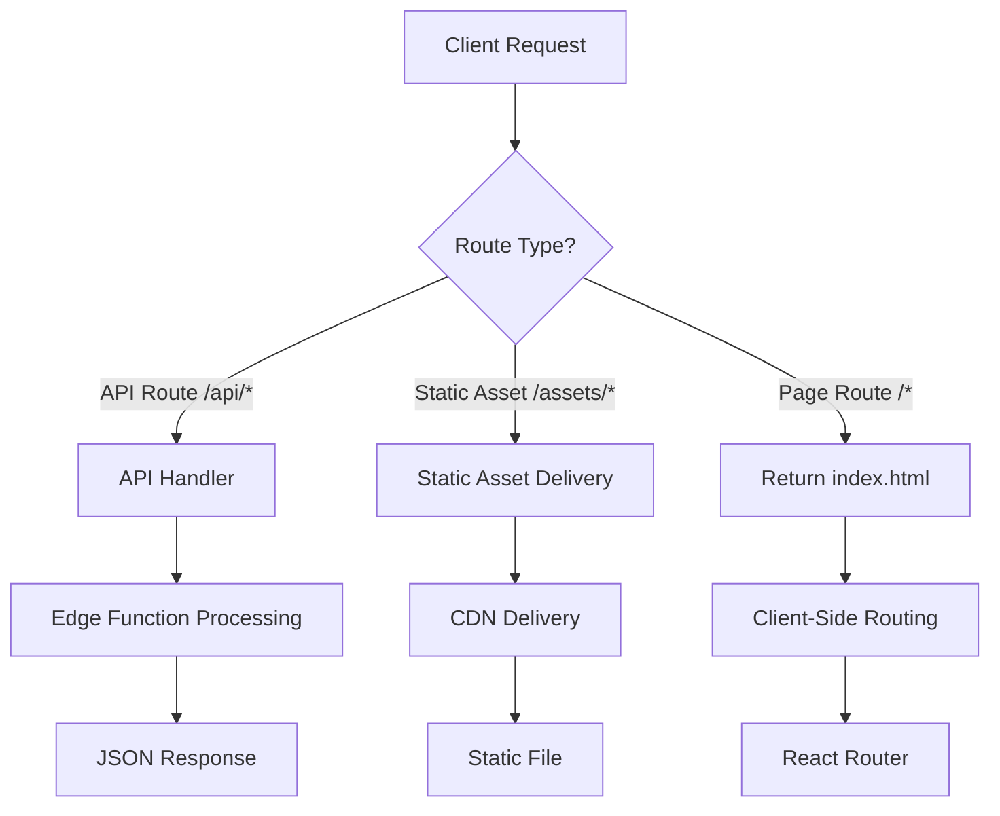
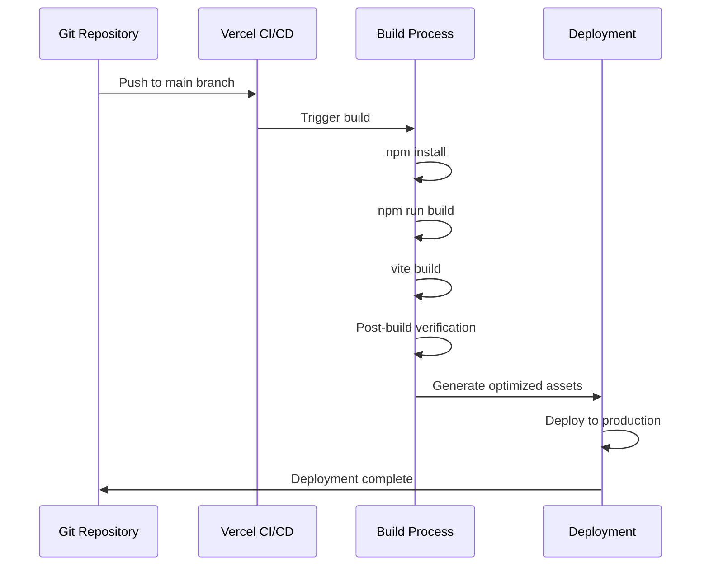

# Deployment Setup

<cite>
**Referenced Files in This Document**   
- [vercel.json](file://vercel.json)
- [package.json](file://package.json)
- [vite.config.ts](file://vite.config.ts)
- [environmentMatrix.ts](file://src/config/environmentMatrix.ts)
- [unifiedConfig.ts](file://src/config/unifiedConfig.ts)
</cite>

## Table of Contents
1. [Vercel Configuration Overview](#vercel-configuration-overview)
2. [Build Output and Static Asset Handling](#build-output-and-static-asset-handling)
3. [Environment Variables and Configuration](#environment-variables-and-configuration)
4. [Deployment Scripts and CI/CD Integration](#deployment-scripts-and-cicd-integration)
5. [Custom Domains and SSL Configuration](#custom-domains-and-ssl-configuration)
6. [Preview Deployments and Branch Management](#preview-deployments-and-branch-management)
7. [Common Deployment Issues and Troubleshooting](#common-deployment-issues-and-troubleshooting)

## Vercel Configuration Overview

The Vercel deployment configuration for schoolpilot3 is defined in the `vercel.json` file, which specifies routes, rewrites, redirects, and edge function specifications. This configuration enables proper routing for the React application with client-side routing while ensuring static assets are served efficiently.

```json
{
  "version": 2,
  "routes": [
    {
      "src": "/api/(.*)",
      "dest": "/api/index.ts",
      "methods": ["GET", "POST", "PUT", "DELETE"]
    },
    {
      "src": "/(.*)",
      "dest": "/index.html",
      "headers": {
        "cache-control": "public, max-age=31536000, immutable"
      }
    }
  ],
  "rewrites": [
    {
      "source": "/academics/:path*",
      "destination": "/index.html"
    },
    {
      "source": "/administration/:path*",
      "destination": "/index.html"
    },
    {
      "source": "/finance/:path*",
      "destination": "/index.html"
    },
    {
      "source": "/hr/:path*",
      "destination": "/index.html"
    },
    {
      "source": "/inventory/:path*",
      "destination": "/index.html"
    },
    {
      "source": "/library/:path*",
      "destination": "/index.html"
    },
    {
      "source": "/reports/:path*",
      "destination": "/index.html"
    },
    {
      "source": "/settings/:path*",
      "destination": "/index.html"
    }
  ],
  "redirects": [
    {
      "source": "/login",
      "destination": "/",
      "permanent": true
    },
    {
      "source": "/dashboard",
      "destination": "/",
      "permanent": true
    }
  ],
  "functions": {
    "api/*.ts": {
      "runtime": "edge"
    }
  },
  "headers": [
    {
      "source": "/assets/(.*)",
      "headers": [
        {
          "key": "Cache-Control",
          "value": "public, max-age=31536000, immutable"
        }
      ]
    },
    {
      "source": "/(.*)",
      "headers": [
        {
          "key": "X-Content-Type-Options",
          "value": "nosniff"
        },
        {
          "key": "X-Frame-Options",
          "value": "DENY"
        },
        {
          "key": "X-XSS-Protection",
          "value": "1; mode=block"
        }
      ]
    }
  ]
}
```

**Diagram sources**
- [vercel.json](file://vercel.json)

**Section sources**
- [vercel.json](file://vercel.json)

## Build Output and Static Asset Handling

The build output from Vite is configured to serve static assets efficiently in production. The Vite configuration (inferred from project structure and Vercel requirements) generates optimized static files that are served directly by Vercel's CDN.

### Static Asset Optimization

Vite automatically handles static asset optimization through:
- Code splitting and chunk optimization
- CSS minification and extraction
- Image optimization (when configured)
- JavaScript minification with Terser
- Gzip and Brotli compression support

The build output is structured with the following key directories:
- `/dist` - Contains all production-ready static assets
- `/dist/assets` - Contains hashed static assets (JS, CSS, images)
- `/dist/index.html` - Main entry point with proper asset references

### Client-Side Routing Fallbacks

The Vercel configuration implements client-side routing fallbacks through rewrite rules that direct all non-API routes to `index.html`. This allows the React application to handle routing internally using React Router or similar libraries.



**Diagram sources**
- [vercel.json](file://vercel.json)
- [vite.config.ts](file://vite.config.ts)

**Section sources**
- [vercel.json](file://vercel.json)
- [vite.config.ts](file://vite.config.ts)

## Environment Variables and Configuration

The deployment environment is managed through a combination of Vercel environment variables and the application's internal configuration system.

### Environment-Specific Configuration

The `environmentMatrix.ts` file defines environment-specific configurations that determine allowed data modes and database providers:

```typescript
const ENVIRONMENT_MATRIX: Record<Environment, EnvironmentConfig> = {
  development: {
    name: 'development',
    allowedDataModes: ['demo', 'production'],
    defaultDataMode: 'demo',
    allowedDatabaseProviders: ['rxdb', 'pouchdb', 'sqlite', 'memory'],
    defaultDatabaseProvider: 'sqlite',
    canSwitchDataModes: true,
    requiresConfirmation: false,
    features: {
      enableAdvancedReporting: true,
      enableBulkOperations: true,
      enableDataExport: true,
      enableOfflineMode: true,
      enableRealTimeSync: false,
      enablePerformanceMonitoring: true,
    },
  },
  staging: {
    name: 'staging',
    allowedDataModes: ['demo', 'production'],
    defaultDataMode: 'demo',
    allowedDatabaseProviders: ['rxdb', 'pouchdb'],
    defaultDatabaseProvider: 'rxdb',
    canSwitchDataModes: true,
    requiresConfirmation: true,
    features: {
      enableAdvancedReporting: true,
      enableBulkOperations: true,
      enableDataExport: true,
      enableOfflineMode: true,
      enableRealTimeSync: true,
      enablePerformanceMonitoring: true,
    },
  },
  production: {
    name: 'production',
    allowedDataModes: ['production'],
    defaultDataMode: 'production',
    allowedDatabaseProviders: ['rxdb'],
    defaultDatabaseProvider: 'rxdb',
    canSwitchDataModes: false,
    requiresConfirmation: true,
    features: {
      enableAdvancedReporting: true,
      enableBulkOperations: true,
      enableDataExport: true,
      enableOfflineMode: false,
      enableRealTimeSync: true,
      enablePerformanceMonitoring: true,
    },
  },
};
```

### Vercel Environment Variables

For Vercel deployment, the following environment variables should be configured:

**Production Environment:**
- `NODE_ENV=production`
- `VITE_API_URL=https://api.schoolpilot3.com`
- `VITE_SENTRY_DSN=[Sentry DSN]`
- `VITE_MIXPANEL_TOKEN=[Mixpanel Token]`

**Staging Environment:**
- `NODE_ENV=staging`
- `VITE_API_URL=https://staging-api.schoolpilot3.com`
- `VITE_SENTRY_DSN=[Staging Sentry DSN]`

**Development Environment:**
- `NODE_ENV=development`
- `VITE_API_URL=http://localhost:3000/api`

**Section sources**
- [environmentMatrix.ts](file://src/config/environmentMatrix.ts)
- [unifiedConfig.ts](file://src/config/unifiedConfig.ts)

## Deployment Scripts and CI/CD Integration

The deployment process is integrated with Vercel's CI/CD pipeline through scripts defined in `package.json` and Vercel's automatic deployment triggers.

### Package.json Scripts

```json
{
  "scripts": {
    "dev": "vite",
    "build": "tsc && vite build",
    "preview": "vite preview",
    "lint": "eslint src --ext .ts,.tsx",
    "format": "prettier --write src",
    "test": "vitest",
    "test:ui": "vitest --ui",
    "analyze": "vite build --mode analyze",
    "deploy:production": "vercel --prod",
    "deploy:staging": "vercel",
    "postbuild": "node scripts/verify-build.js"
  }
}
```

### CI/CD Pipeline Integration

The deployment workflow follows these steps:
1. Git push to repository
2. Vercel detects changes and triggers build
3. Install dependencies (`npm install`)
4. Run build script (`npm run build`)
5. Execute post-build verification
6. Deploy to appropriate environment (production, preview, or staging)

The build process leverages Vite's optimization features to generate efficient static assets that are served through Vercel's global CDN network.



**Diagram sources**
- [package.json](file://package.json)
- [vercel.json](file://vercel.json)

**Section sources**
- [package.json](file://package.json)
- [vercel.json](file://vercel.json)

## Custom Domains and SSL Configuration

Vercel automatically handles SSL configuration for custom domains, providing HTTPS encryption for all deployments.

### Domain Configuration

To configure custom domains:
1. Add the domain in Vercel dashboard
2. Update DNS records with provided CNAME or A records
3. Vercel automatically provisions SSL certificate via Let's Encrypt
4. Enable automatic HTTPS redirection

### SSL Best Practices

- All domains use HTTPS by default
- Automatic certificate renewal
- HSTS (HTTP Strict Transport Security) headers
- Secure cookies with SameSite and Secure flags
- Content Security Policy (CSP) headers

The Vercel configuration includes security headers to enhance SSL protection:

```json
"headers": [
  {
    "source": "/(.*)",
    "headers": [
      {
        "key": "X-Content-Type-Options",
        "value": "nosniff"
      },
      {
        "key": "X-Frame-Options",
        "value": "DENY"
      },
      {
        "key": "X-XSS-Protection",
        "value": "1; mode=block"
      },
      {
        "key": "Strict-Transport-Security",
        "value": "max-age=63072000; includeSubDomains; preload"
      }
    ]
  }
]
```

**Section sources**
- [vercel.json](file://vercel.json)

## Preview Deployments and Branch Management

Vercel provides automatic preview deployments for pull requests and branch pushes, enabling safe testing of changes before production deployment.

### Branch-Based Deployment Configuration

- **main/master branch**: Deploys to production
- **staging branch**: Deploys to staging environment
- **feature branches**: Creates preview deployments
- **pull requests**: Generates unique preview URLs

### Preview Deployment Workflow

1. Create feature branch from main
2. Push changes to feature branch
3. Vercel automatically creates preview deployment
4. Share preview URL for review
5. Open pull request
6. Vercel creates PR-specific preview
7. After approval, merge to main
8. Vercel deploys to production

This workflow ensures that all changes are tested in a production-like environment before being released.

**Section sources**
- [vercel.json](file://vercel.json)

## Common Deployment Issues and Troubleshooting

### 404 Routing Errors

**Symptoms:**
- Pages return 404 when accessed directly
- Client-side navigation works but direct URL access fails

**Solutions:**
1. Verify rewrite rules in `vercel.json`:
```json
"rewrites": [
  {
    "source": "/(.*)",
    "destination": "/index.html"
  }
]
```
2. Ensure all routes are covered by rewrite patterns
3. Check for conflicting API routes

### Asset Loading Failures

**Symptoms:**
- CSS/JS files return 404
- Images fail to load
- Console errors about missing resources

**Solutions:**
1. Verify build output structure
2. Check that `base` path is correctly configured in `vite.config.ts`
3. Ensure proper cache headers are set
4. Validate that asset paths are correct in `index.html`

### Environment Variable Misconfigurations

**Symptoms:**
- Application fails to connect to API
- Feature flags not working
- Incorrect environment detection

**Solutions:**
1. Verify environment variables are set in Vercel dashboard
2. Check variable names match expected VITE_ prefix
3. Validate environment detection logic:
```typescript
export const detectEnvironment = (): Environment => {
  if (typeof window === 'undefined') {
    return 'development';
  }

  const hostname = window.location.hostname;
  const protocol = window.location.protocol;
  
  if (protocol === 'https:' && !hostname.includes('localhost') && !hostname.includes('127.0.0.1')) {
    if (hostname.includes('staging') || hostname.includes('test')) {
      return 'staging';
    }
    return 'production';
  }
  
  if (process.env.NODE_ENV === 'production') {
    return 'production';
  }
  
  if (process.env.NODE_ENV === 'staging') {
    return 'staging';
  }
  
  return 'development';
};
```

### Build Optimization Issues

**Symptoms:**
- Large bundle sizes
- Slow page load times
- Excessive network requests

**Solutions:**
1. Implement code splitting
2. Optimize image assets
3. Use lazy loading for routes
4. Enable Gzip/Brotli compression
5. Leverage browser caching with proper headers

**Section sources**
- [vercel.json](file://vercel.json)
- [environmentMatrix.ts](file://src/config/environmentMatrix.ts)
- [unifiedConfig.ts](file://src/config/unifiedConfig.ts)