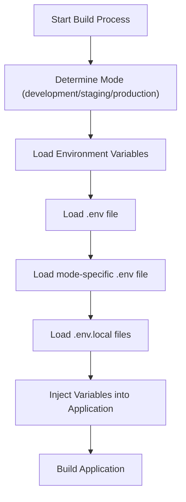
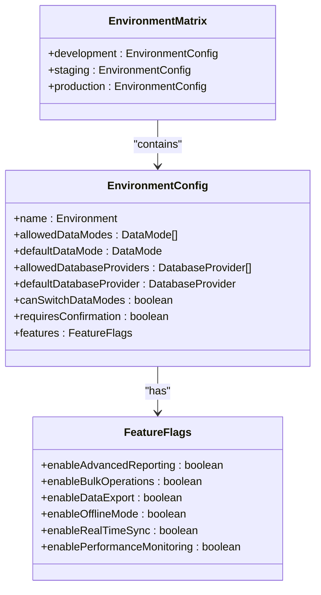
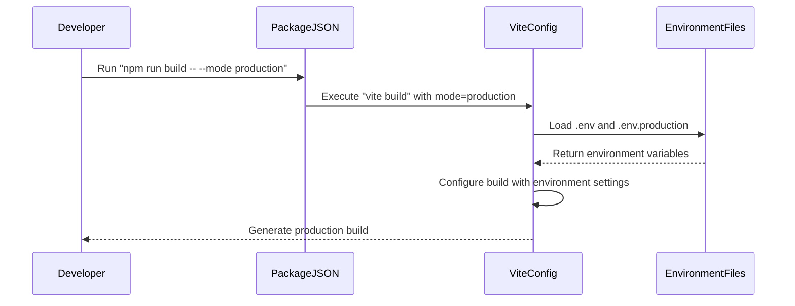

# Environment Management

<cite>
**Referenced Files in This Document**   
- [vite.config.ts](file://vite.config.ts)
- [package.json](file://package.json)
- [src/config/environmentMatrix.ts](file://src/config/environmentMatrix.ts)
- [src/config/dataModePolicies.ts](file://src/config/dataModePolicies.ts)
- [src/config/productionDemo.ts](file://src/config/productionDemo.ts)
- [src/config/unifiedConfig.ts](file://src/config/unifiedConfig.ts)
</cite>

## Table of Contents
1. [Environment Management](#environment-management)
2. [Vite Environment Variable Handling](#vite-environment-variable-handling)
3. [Environment Matrix Configuration](#environment-matrix-configuration)
4. [Build Scripts and Targets](#build-scripts-and-targets)
5. [Environment-Specific Configuration Examples](#environment-specific-configuration-examples)
6. [Security Considerations](#security-considerations)
7. [Troubleshooting Environment Issues](#troubleshooting-environment-issues)

## Vite Environment Variable Handling

The schoolpilot3 application uses Vite as its build tool, which provides a robust system for managing environment variables through `.env` files. Vite automatically loads environment variables based on the current mode (development, production, etc.) and injects them into the application at build time.

In the `vite.config.ts` file, the `loadEnv` function is used to load environment variables from `.env` files. The configuration shows that environment variables are loaded with an empty path prefix, meaning variables from files like `.env`, `.env.local`, `.env.development`, and `.env.production` are automatically loaded based on the current mode.



**Diagram sources**
- [vite.config.ts](file://vite.config.ts#L1-L51)

**Section sources**
- [vite.config.ts](file://vite.config.ts#L1-L51)

The Vite configuration specifically defines how certain environment variables are injected into the application using the `define` property:

```typescript
define: {
  'process.env.API_KEY': JSON.stringify(env.GEMINI_API_KEY),
  'process.env.GEMINI_API_KEY': JSON.stringify(env.GEMINI_API_KEY),
  global: 'globalThis'
}
```

This approach ensures that sensitive API keys like `GEMINI_API_KEY` are securely embedded in the application bundle during the build process rather than being exposed at runtime. The variables are statically replaced during compilation, making them available throughout the application via `process.env.API_KEY`.

## Environment Matrix Configuration

The core of the environment management system in schoolpilot3 is the `environmentMatrix.ts` file located in the `src/config` directory. This file defines a comprehensive matrix that specifies configuration options, allowed data modes, database providers, and feature availability for each environment.



**Diagram sources**
- [src/config/environmentMatrix.ts](file://src/config/environmentMatrix.ts#L0-L149)

**Section sources**
- [src/config/environmentMatrix.ts](file://src/config/environmentMatrix.ts#L0-L149)

The environment matrix defines three primary environments: development, staging, and production, each with specific constraints and capabilities:

### Development Environment
The development environment is the most permissive, allowing maximum flexibility for testing and debugging:

```typescript
development: {
  name: 'development',
  allowedDataModes: ['demo', 'production'],
  defaultDataMode: 'demo',
  allowedDatabaseProviders: ['rxdb', 'pouchdb', 'sqlite', 'memory'],
  defaultDatabaseProvider: 'sqlite',
  canSwitchDataModes: true,
  requiresConfirmation: false,
  features: {
    enableAdvancedReporting: true,
    enableBulkOperations: true,
    enableDataExport: true,
    enableOfflineMode: true,
    enableRealTimeSync: false,
    enablePerformanceMonitoring: true,
  },
}
```

Key characteristics:
- **Data Modes**: Supports both 'demo' and 'production' modes, with 'demo' as the default
- **Database Providers**: Allows all available providers including SQLite, RxDB, PouchDB, and in-memory storage
- **Flexibility**: Enables data mode switching without confirmation
- **Features**: Enables performance monitoring and advanced reporting for development purposes

### Staging Environment
The staging environment serves as a pre-production testing environment with more restrictions than development:

```typescript
staging: {
  name: 'staging',
  allowedDataModes: ['demo', 'production'],
  defaultDataMode: 'demo',
  allowedDatabaseProviders: ['rxdb', 'pouchdb'],
  defaultDatabaseProvider: 'rxdb',
  canSwitchDataModes: true,
  requiresConfirmation: true,
  features: {
    enableAdvancedReporting: true,
    enableBulkOperations: true,
    enableDataExport: true,
    enableOfflineMode: true,
    enableRealTimeSync: true,
    enablePerformanceMonitoring: true,
  },
}
```

Key characteristics:
- **Data Modes**: Similar to development with both demo and production modes
- **Database Providers**: Restricts to RxDB and PouchDB, excluding SQLite and memory providers
- **Safety**: Requires confirmation for data mode switching
- **Features**: Enables real-time synchronization for testing

### Production Environment
The production environment has the strictest constraints to ensure stability and security:

```typescript
production: {
  name: 'production',
  allowedDataModes: ['production'],
  defaultDataMode: 'production',
  allowedDatabaseProviders: ['rxdb'],
  defaultDatabaseProvider: 'rxdb',
  canSwitchDataModes: false,
  requiresConfirmation: true,
  features: {
    enableAdvancedReporting: true,
    enableBulkOperations: true,
    enableDataExport: true,
    enableOfflineMode: false,
    enableRealTimeSync: true,
    enablePerformanceMonitoring: true,
  },
}
```

Key characteristics:
- **Data Modes**: Only allows 'production' mode with no switching capability
- **Database Providers**: Restricts to RxDB only for consistency
- **Security**: Requires confirmation for critical operations
- **Features**: Disables offline mode to prevent data inconsistencies

The environment detection mechanism uses both hostname analysis and environment variables to determine the current environment:

```typescript
export const detectEnvironment = (): Environment => {
  if (typeof window === 'undefined') {
    return 'development';
  }

  const hostname = window.location.hostname;
  const protocol = window.location.protocol;
  
  // Check for production indicators
  if (protocol === 'https:' && !hostname.includes('localhost') && !hostname.includes('127.0.0.1')) {
    if (hostname.includes('staging') || hostname.includes('test')) {
      return 'staging';
    }
    return 'production';
  }
  
  // Check environment variables
  if (process.env.NODE_ENV === 'production') {
    return 'production';
  }
  
  if (process.env.NODE_ENV === 'staging') {
    return 'staging';
  }
  
  return 'development';
};
```

This dual approach ensures reliable environment detection both from the client-side URL and server-side environment variables.

## Build Scripts and Targets

The `package.json` file defines the build scripts and targets for the application. While the current configuration shows standard Vite scripts, the environment management system is designed to work with these scripts to produce environment-specific builds.

```json
{
  "scripts": {
    "dev": "vite",
    "build": "vite build",
    "preview": "vite preview",
    "test": "vitest",
    "test:run": "vitest run",
    "test:ui": "vitest --ui"
  }
}
```

The build process leverages Vite's mode system, where different environments can be specified when running the build command. For example:

- Development build: `npm run build` (uses development mode by default)
- Production build: `npm run build -- --mode production`
- Staging build: `npm run build -- --mode staging`

The Vite configuration automatically loads the appropriate `.env` files based on the specified mode, ensuring that environment-specific variables are injected into the build.



**Diagram sources**
- [package.json](file://package.json#L0-L131)
- [vite.config.ts](file://vite.config.ts#L1-L51)

**Section sources**
- [package.json](file://package.json#L0-L131)

## Environment-Specific Configuration Examples

The environment management system enables various practical configuration scenarios for different environments.

### API Endpoint Configuration

API endpoints can be configured differently for each environment using environment variables. For example:

```typescript
// In .env.development
API_BASE_URL=http://localhost:3000/api
GEMINI_API_KEY=dev_api_key_123

// In .env.staging
API_BASE_URL=https://staging.schoolpilot3.com/api
GEMINI_API_KEY=staging_api_key_456

// In .env.production
API_BASE_URL=https://api.schoolpilot3.com
GEMINI_API_KEY=prod_api_key_789
```

These variables are then accessed in the application:

```typescript
const apiClient = new APIClient({
  baseURL: import.meta.env.VITE_API_BASE_URL,
  headers: {
    'Authorization': `Bearer ${import.meta.env.VITE_GEMINI_API_KEY}`
  }
});
```

### Feature Flag Management

Feature flags allow gradual rollout of new functionality. The environment matrix defines which features are enabled in each environment:

```typescript
// Example of feature-based conditional rendering
const ComponentWithNewFeature = () => {
  const { features } = useConfig();
  
  if (features.enablePerformanceMonitoring) {
    return <PerformanceMonitorWidget />;
  }
  
  return null;
};
```

### Analytics Settings

Analytics services can be configured differently across environments to prevent test data from contaminating production analytics:

```typescript
// In analytics service
const initializeAnalytics = () => {
  if (import.meta.env.MODE === 'production') {
    // Initialize production analytics with full tracking
    analytics.initialize(import.meta.env.VITE_PRODUCTION_ANALYTICS_ID);
  } else if (import.meta.env.MODE === 'staging') {
    // Initialize staging analytics with limited tracking
    analytics.initialize(import.meta.env.VITE_STAGING_ANALYTICS_ID);
    analytics.setTrackingLevel('limited');
  } else {
    // Development: mock analytics or minimal tracking
    analytics.initialize('dev-mock-id');
    analytics.setTrackingLevel('none');
  }
};
```

### Database Configuration

The environment matrix controls which database providers are available in each environment:

```typescript
// Database service configuration
const getDatabaseProvider = () => {
  const environment = detectEnvironment();
  const config = getEnvironmentConfig(environment);
  
  // Validate current provider against allowed providers
  if (isValidDatabaseProvider(currentProvider, environment)) {
    return currentProvider;
  }
  
  // Fallback to default provider
  return getDefaultDatabaseProvider(environment);
};
```

## Security Considerations

The environment management system incorporates several security measures to protect sensitive credentials and prevent leakage of production secrets.

### Environment Variable Security

The Vite configuration demonstrates proper handling of sensitive environment variables:

```typescript
define: {
  'process.env.API_KEY': JSON.stringify(env.GEMINI_API_KEY),
  'process.env.GEMINI_API_KEY': JSON.stringify(env.GEMINI_API_KEY),
  global: 'globalThis'
}
```

Key security practices include:

- **Build-time injection**: Sensitive variables are injected at build time rather than exposed at runtime
- **Stringification**: Variables are stringified to prevent code injection
- **Limited exposure**: Only necessary variables are exposed to the client-side application

### Production Secret Protection

The system prevents accidental leakage of production secrets through several mechanisms:

1. **Environment-specific .env files**: Secrets are stored in environment-specific files that should not be committed to version control
2. **Git ignore configuration**: The `.env` files should be added to `.gitignore` to prevent accidental commits
3. **Variable validation**: The environment matrix validates that only appropriate providers and modes are available in production

### Data Mode Security

The environment matrix enforces strict data mode policies in production:

```typescript
production: {
  allowedDataModes: ['production'],
  canSwitchDataModes: false,
}
```

This prevents users from accidentally switching to demo mode in production, which could lead to data loss or exposure of test data.

### Confirmation Requirements

Critical operations in staging and production environments require explicit confirmation:

```typescript
requiresConfirmation: true,
```

This safety measure prevents accidental configuration changes that could impact system stability.

## Troubleshooting Environment Issues

When encountering environment-related issues, several common problems and their solutions should be considered.

### Incorrect API Endpoints

**Symptom**: Application cannot connect to backend services.

**Diagnosis**:
- Check if the correct `.env` file is being loaded
- Verify the `API_BASE_URL` variable in the appropriate `.env` file
- Confirm the build mode matches the intended environment

**Solution**:
```bash
# Ensure building with correct mode
npm run build -- --mode production

# Verify environment variables are loaded
console.log('Current mode:', import.meta.env.MODE);
console.log('API URL:', import.meta.env.VITE_API_BASE_URL);
```

### Missing Environment Variables

**Symptom**: Application fails to start or certain features don't work.

**Diagnosis**:
- Check if required `.env` files exist in the project root
- Verify variable names match what the application expects
- Ensure variables are prefixed correctly (VITE_ for client-side access)

**Solution**:
1. Create the appropriate `.env` file (e.g., `.env.production`)
2. Add required variables with correct prefixes:
```env
VITE_API_BASE_URL=https://api.schoolpilot3.com
VITE_GEMINI_API_KEY=your_production_key
```

### Configuration Mismatches

**Symptom**: Features behave differently than expected between environments.

**Diagnosis**:
- Compare environment matrix configurations
- Check if environment detection is working correctly
- Verify the current environment is what's expected

**Solution**:
```typescript
// Debug environment detection
console.log('Detected environment:', detectEnvironment());
console.log('Hostname:', window.location.hostname);
console.log('Protocol:', window.location.protocol);
console.log('NODE_ENV:', import.meta.env.MODE);
```

### Database Provider Issues

**Symptom**: Database operations fail or are unavailable.

**Diagnosis**:
- Check if the selected database provider is allowed in the current environment
- Verify the provider is properly configured

**Solution**:
```typescript
// Check allowed providers
const environment = detectEnvironment();
const allowedProviders = getAllowedDatabaseProviders(environment);
console.log('Allowed providers:', allowedProviders);

// Validate current provider
if (!isValidDatabaseProvider(currentProvider, environment)) {
  console.warn(`Provider ${currentProvider} not allowed in ${environment}`);
  // Switch to default provider
  setDatabaseProvider(getDefaultDatabaseProvider(environment));
}
```

### Build Configuration Problems

**Symptom**: Build fails or produces incorrect environment configuration.

**Diagnosis**:
- Verify the build command includes the correct mode flag
- Check that Vite can access the environment files

**Solution**:
```bash
# Explicitly specify the mode
npm run build -- --mode staging

# Clean build and retry
rm -rf dist
npm run build -- --mode production
```

By following these troubleshooting guidelines and understanding the environment management system, developers can effectively diagnose and resolve environment-related issues in the schoolpilot3 application.