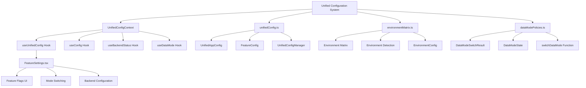
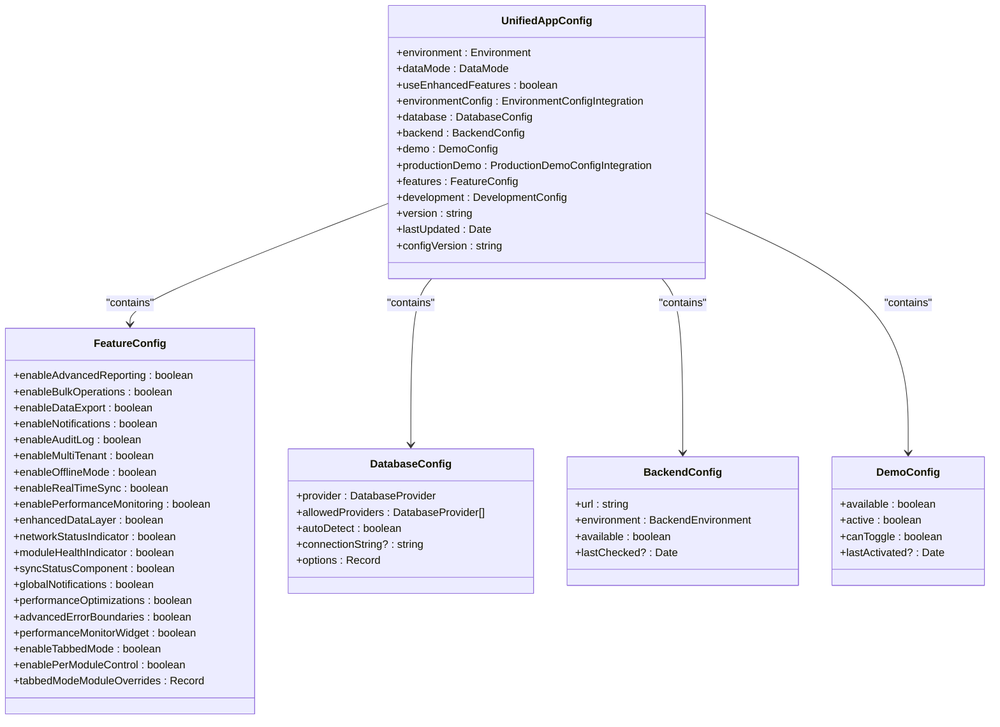
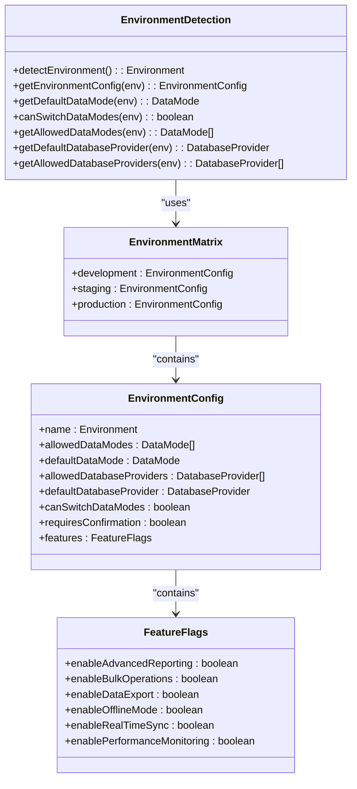
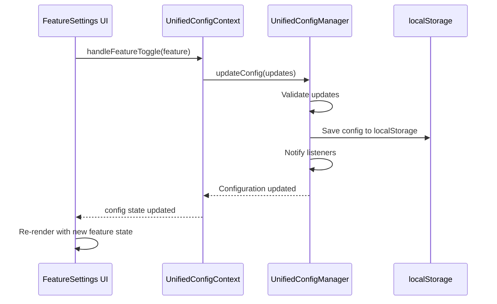
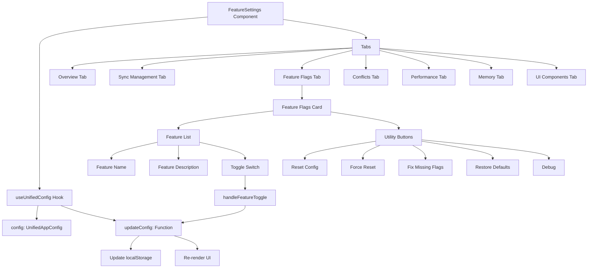
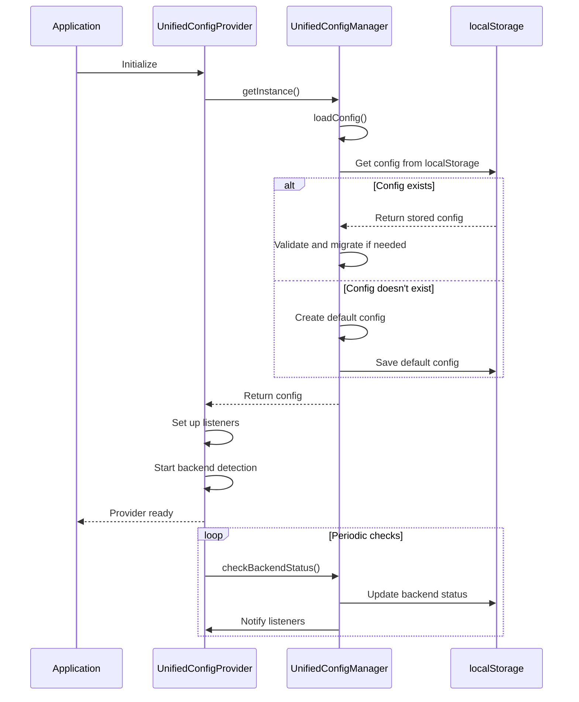
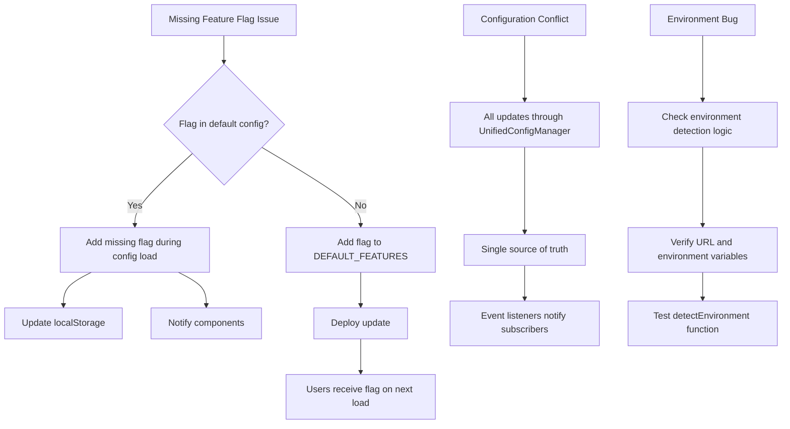
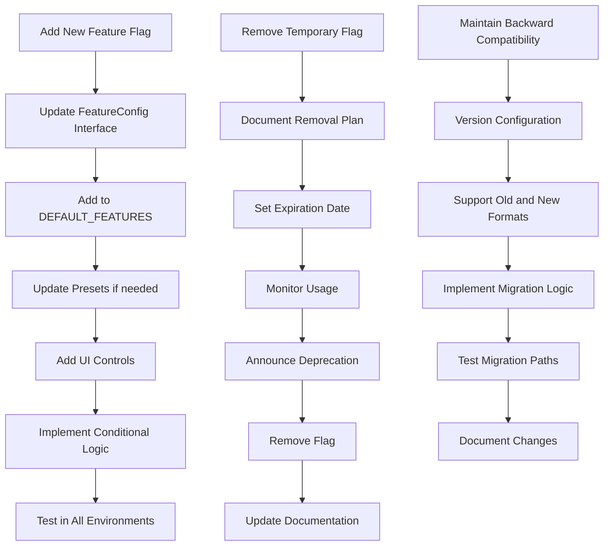

# Feature Flags & Configuration

<cite>
**Referenced Files in This Document**   
- [unifiedConfig.ts](file://src/config/unifiedConfig.ts)
- [UnifiedConfigContext.tsx](file://src/contexts/UnifiedConfigContext.tsx)
- [environmentMatrix.ts](file://src/config/environmentMatrix.ts)
- [dataModePolicies.ts](file://src/config/dataModePolicies.ts)
- [FeatureSettings.tsx](file://src/components/FeatureSettings.tsx)
- [FeatureSettingsPage.tsx](file://src/modules/settings/pages/FeatureSettingsPage.tsx)
</cite>

## Table of Contents
1. [Introduction](#introduction)
2. [Configuration Architecture Overview](#configuration-architecture-overview)
3. [Unified Configuration System](#unified-configuration-system)
4. [Environment-Specific Configuration Management](#environment-specific-configuration-management)
5. [Data Mode Policies and Switching](#data-mode-policies-and-switching)
6. [Feature Flag Implementation](#feature-flag-implementation)
7. [UI Integration and Feature Settings](#ui-integration-and-feature-settings)
8. [Configuration Lifecycle and Persistence](#configuration-lifecycle-and-persistence)
9. [Common Issues and Troubleshooting](#common-issues-and-troubleshooting)
10. [Best Practices](#best-practices)

## Introduction
The schoolpilot3 application implements a comprehensive feature flag and configuration management system designed to support gradual feature rollouts, environment-specific configurations, and dynamic application behavior. This system enables developers and administrators to control application functionality without requiring code deployments, facilitating safer releases and targeted feature testing. The architecture centers around a unified configuration system that integrates environment detection, data mode management, and feature flag evaluation to provide a cohesive configuration experience across different deployment scenarios.

**Section sources**
- [unifiedConfig.ts](file://src/config/unifiedConfig.ts#L1-L50)
- [UnifiedConfigContext.tsx](file://src/contexts/UnifiedConfigContext.tsx#L1-L30)

## Configuration Architecture Overview



**Diagram sources**
- [unifiedConfig.ts](file://src/config/unifiedConfig.ts#L1-L1052)
- [UnifiedConfigContext.tsx](file://src/contexts/UnifiedConfigContext.tsx#L1-L639)
- [environmentMatrix.ts](file://src/config/environmentMatrix.ts#L1-L149)
- [dataModePolicies.ts](file://src/config/dataModePolicies.ts#L1-L190)
- [FeatureSettings.tsx](file://src/components/FeatureSettings.tsx#L1-L544)

## Unified Configuration System

The unified configuration system in schoolpilot3 provides a centralized approach to managing application settings, feature flags, and environment-specific configurations. At its core is the `UnifiedAppConfig` interface, which defines the complete configuration structure including environment settings, data modes, database providers, and feature flags.



**Diagram sources**
- [unifiedConfig.ts](file://src/config/unifiedConfig.ts#L50-L150)

**Section sources**
- [unifiedConfig.ts](file://src/config/unifiedConfig.ts#L1-L200)

## Environment-Specific Configuration Management

The environment matrix system provides environment-specific configuration policies that govern data mode availability, database providers, and feature flag defaults. This ensures consistent behavior across development, staging, and production environments while allowing appropriate flexibility for each deployment scenario.



**Diagram sources**
- [environmentMatrix.ts](file://src/config/environmentMatrix.ts#L1-L149)

**Section sources**
- [environmentMatrix.ts](file://src/config/environmentMatrix.ts#L1-L149)

## Data Mode Policies and Switching

The data mode policies system implements rules for switching between demo and production data modes, with appropriate validation and persistence. This ensures data integrity and prevents invalid mode transitions based on the current environment.

```mermaid
classDiagram
class DataModeState {
+current : DataMode
+available : DataMode[]
+canSwitch : boolean
+requiresConfirmation : boolean
+lastSwitched? : Date
}
class DataModeSwitchResult {
+success : boolean
+previousMode : DataMode
+newMode : DataMode
+requiresReload : boolean
+message? : string
+error? : string
}
class DataModePolicies {
+getStoredDataMode() : DataMode | null
+storeDataMode(mode) : void
+getDataModeState(current, environment) : DataModeState
+validateDataMode(newMode, environment) : {valid : boolean, error? : string}
+switchDataMode(newMode, currentMode, environment, options) : Promise<DataModeSwitchResult>
+clearStoredDataMode() : void
+getDataModeHistory() : {mode : DataMode, timestamp : Date}[]
}
DataModePolicies --> DataModeState : "returns"
DataModePolicies --> DataModeSwitchResult : "returns"
DataModePolicies --> EnvironmentConfig : "uses"
```

**Diagram sources**
- [dataModePolicies.ts](file://src/config/dataModePolicies.ts#L1-L190)

**Section sources**
- [dataModePolicies.ts](file://src/config/dataModePolicies.ts#L1-L190)

## Feature Flag Implementation

The feature flag system is implemented through the `UnifiedConfigManager` class, which manages configuration persistence, updates, and validation. Feature flags are stored as part of the `UnifiedAppConfig` and can be dynamically updated through the configuration context.



**Diagram sources**
- [unifiedConfig.ts](file://src/config/unifiedConfig.ts#L600-L800)
- [UnifiedConfigContext.tsx](file://src/contexts/UnifiedConfigContext.tsx#L100-L200)
- [FeatureSettings.tsx](file://src/components/FeatureSettings.tsx#L300-L400)

**Section sources**
- [unifiedConfig.ts](file://src/config/unifiedConfig.ts#L600-L800)
- [UnifiedConfigContext.tsx](file://src/contexts/UnifiedConfigContext.tsx#L100-L200)

## UI Integration and Feature Settings

The FeatureSettings component provides a user interface for managing feature flags, data modes, and application configuration. It integrates with the unified configuration context to display and modify feature flags, with visual feedback and debugging tools.



**Diagram sources**
- [FeatureSettings.tsx](file://src/components/FeatureSettings.tsx#L1-L544)

**Section sources**
- [FeatureSettings.tsx](file://src/components/FeatureSettings.tsx#L1-L544)

## Configuration Lifecycle and Persistence

The configuration system follows a specific lifecycle for initialization, persistence, and updates. Configuration is persisted in localStorage with versioning to support migrations and ensure compatibility across application updates.



**Diagram sources**
- [unifiedConfig.ts](file://src/config/unifiedConfig.ts#L400-L600)
- [UnifiedConfigContext.tsx](file://src/contexts/UnifiedConfigContext.tsx#L399-L500)

**Section sources**
- [unifiedConfig.ts](file://src/config/unifiedConfig.ts#L400-L600)
- [UnifiedConfigContext.tsx](file://src/contexts/UnifiedConfigContext.tsx#L399-L500)

## Common Issues and Troubleshooting

### Configuration Conflicts
Configuration conflicts can occur when multiple sources attempt to modify the configuration simultaneously. The system handles this through a single source of truth pattern, where all configuration changes flow through the `UnifiedConfigManager`.

### Environment-Specific Bugs
Environment-specific bugs often stem from incorrect environment detection or mismatched configuration policies. The system includes debugging tools in the FeatureSettings component to inspect the current configuration state.

### Missing Feature Flags
When new feature flags are added to the codebase but not present in existing user configurations, the system automatically detects and adds missing flags during the configuration loading process.



**Diagram sources**
- [unifiedConfig.ts](file://src/config/unifiedConfig.ts#L400-L500)
- [FeatureSettings.tsx](file://src/components/FeatureSettings.tsx#L350-L400)

**Section sources**
- [unifiedConfig.ts](file://src/config/unifiedConfig.ts#L400-L500)
- [FeatureSettings.tsx](file://src/components/FeatureSettings.tsx#L350-L400)

## Best Practices

### Adding New Feature Flags
When adding new feature flags, follow these steps:
1. Add the flag to the `FeatureConfig` interface in `unifiedConfig.ts`
2. Include the flag in the `DEFAULT_FEATURES` constant with an appropriate default value
3. Add the flag to relevant configuration presets if needed
4. Implement UI controls in the FeatureSettings component
5. Use the flag in conditional rendering or logic with appropriate fallbacks

### Managing Technical Debt from Temporary Flags
Temporary feature flags should be managed with clear expiration criteria:
- Document the purpose and expected removal date
- Implement automated reminders or alerts for flags approaching expiration
- Regularly audit and remove obsolete flags
- Use feature flag analytics to determine usage and inform removal decisions

### Ensuring Backward Compatibility
To maintain backward compatibility during feature evolution:
- Never remove feature flags without a migration path
- Support both old and new configurations during transition periods
- Implement versioning in the configuration system
- Provide clear upgrade paths and documentation
- Test configuration migrations thoroughly



**Diagram sources**
- [unifiedConfig.ts](file://src/config/unifiedConfig.ts#L200-L300)
- [FeatureSettings.tsx](file://src/components/FeatureSettings.tsx#L300-L400)

**Section sources**
- [unifiedConfig.ts](file://src/config/unifiedConfig.ts#L200-L300)
- [FeatureSettings.tsx](file://src/components/FeatureSettings.tsx#L300-L400)