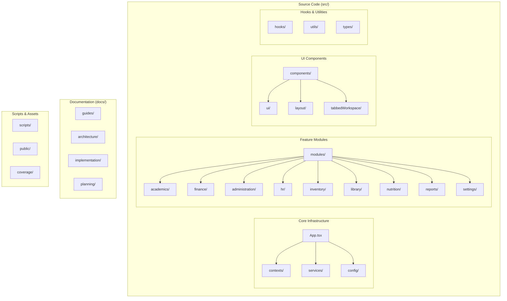
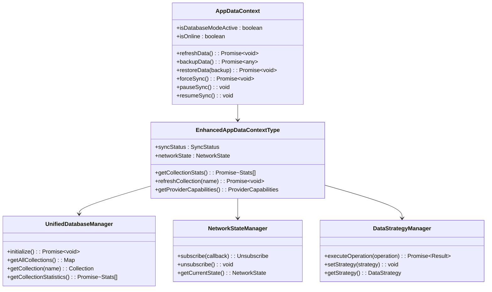
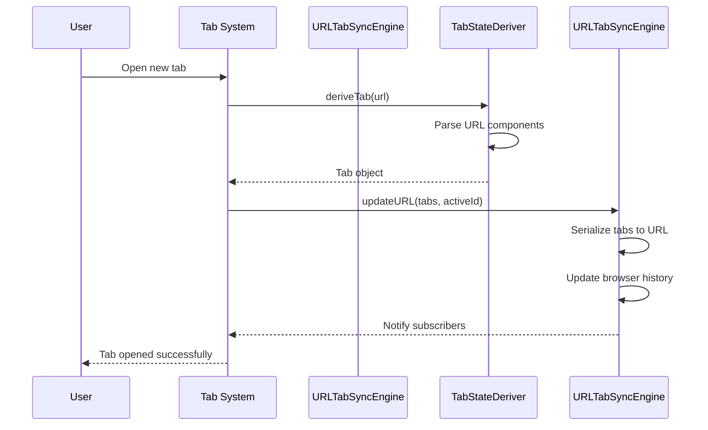
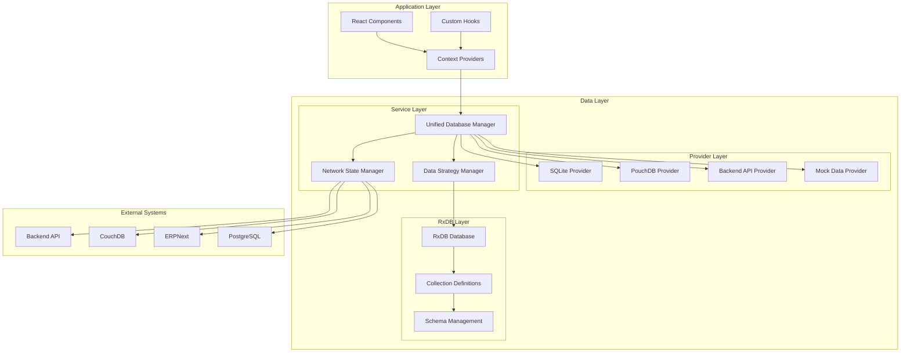
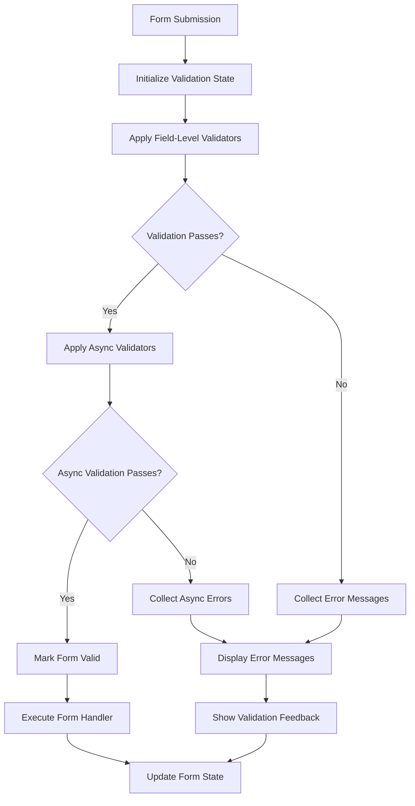
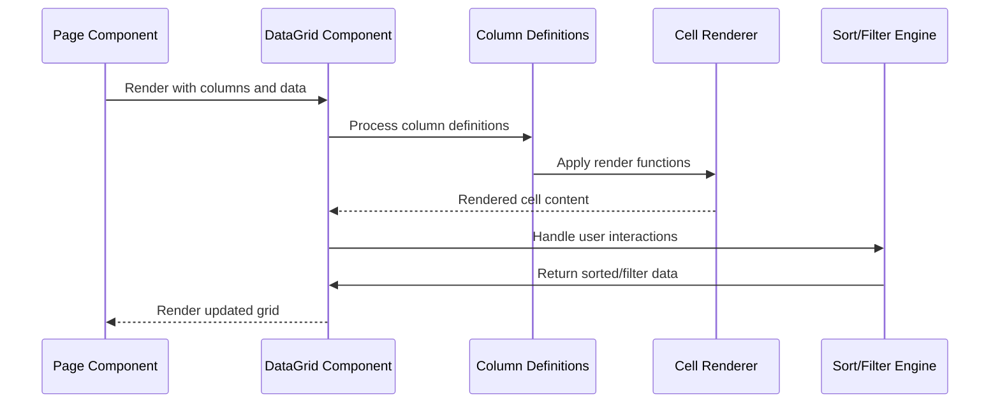
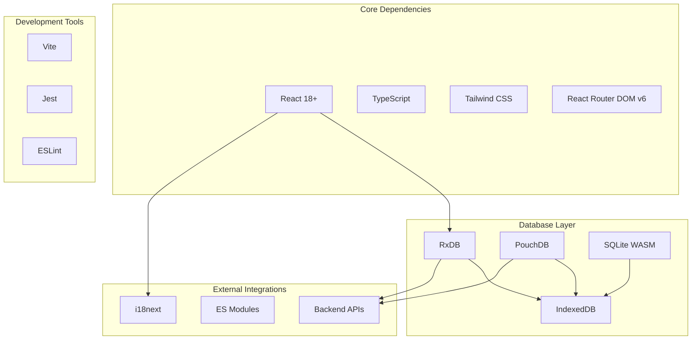

# Implementation Guidelines

<cite>
**Referenced Files in This Document**
- [README.md](file://README.md)
- [IMPLEMENTATION_GUIDELINES.md](file://docs/implementation/IMPLEMENTATION_GUIDELINES.md)
- [code-structure-dev-guide.md](file://docs/guides/code-structure-dev-guide.md)
- [architecture.md](file://docs/architecture/architecture.md)
- [backend-integration-guide.md](file://docs/guides/backend-integration-guide.md)
- [form-validation-framework-implementation.md](file://docs/guides/form-validation-framework-implementation.md)
- [table-to-datagrid-implementation-guide.md](file://docs/guides/table-to-datagrid-implementation-guide.md)
- [plugin-dev-guide.md](file://docs/guides/plugin-dev-guide.md)
- [implementation-checklist.md](file://docs/planning/implementation-checklist.md)
- [AppDataContext.tsx](file://src/contexts/AppDataContext.tsx)
- [rxdbService.ts](file://src/services/rxdbService.ts)
- [useRxDBData.ts](file://src/hooks/useRxDBData.ts)
- [dataLayerConfig.ts](file://src/config/dataLayerConfig.ts)
</cite>

## Table of Contents
1. [Introduction](#introduction)
2. [Project Structure](#project-structure)
3. [Core Components](#core-components)
4. [Architecture Overview](#architecture-overview)
5. [Detailed Component Analysis](#detailed-component-analysis)
6. [Dependency Analysis](#dependency-analysis)
7. [Performance Considerations](#performance-considerations)
8. [Troubleshooting Guide](#troubleshooting-guide)
9. [Conclusion](#conclusion)

## Introduction

This document provides comprehensive implementation guidelines for the SchoolPilot3 education management system. The project is a modern React application built with TypeScript and Vite, featuring a sophisticated dual-mode data layer architecture that supports both development (persistent SQLite database) and production (PouchDB/local database) environments. The system emphasizes modular architecture, type safety, and developer experience excellence.

The implementation guidelines cover the complete development lifecycle from initial setup through deployment, including coding standards, testing requirements, and performance optimization strategies. The system supports advanced features like tabbed workspace navigation, form validation frameworks, and comprehensive data layer management.

## Project Structure

The SchoolPilot3 project follows a well-organized modular architecture with clear separation of concerns:

**Diagram sources**
- [README.md:77-122](file://README.md#L77-L122)

The project structure emphasizes modularity with each business domain contained within its own module directory, containing data definitions, types, mock data, and schemas. The architecture supports both development and production modes through a unified configuration system.

**Section sources**
- [README.md:77-122](file://README.md#L77-L122)
- [code-structure-dev-guide.md:7-56](file://docs/guides/code-structure-dev-guide.md#L7-L56)

## Core Components

### Data Layer Architecture

The system implements a sophisticated dual-mode data layer architecture that seamlessly switches between different data providers:

**Diagram sources**
- [AppDataContext.tsx:89-171](file://src/contexts/AppDataContext.tsx#L89-L171)
- [AppDataContext.tsx:207-530](file://src/contexts/AppDataContext.tsx#L207-L530)

The data layer supports four distinct strategies: offline-first, online-first, hybrid, and demo modes. Each strategy provides intelligent routing of data operations based on network conditions and operational requirements.

### Tabbed Workspace System

The tabbed workspace implementation provides URL-driven tab management with persistence and synchronization:

**Diagram sources**
- [IMPLEMENTATION_GUIDELINES.md:142-226](file://docs/implementation/IMPLEMENTATION_GUIDELINES.md#L142-L226)

**Section sources**
- [AppDataContext.tsx:207-530](file://src/contexts/AppDataContext.tsx#L207-L530)
- [IMPLEMENTATION_GUIDELINES.md:9-226](file://docs/implementation/IMPLEMENTATION_GUIDELINES.md#L9-L226)

## Architecture Overview

The SchoolPilot3 architecture implements a comprehensive data layer strategy with multiple provider options and intelligent fallback mechanisms:

**Diagram sources**
- [backend-integration-guide.md:54-82](file://docs/guides/backend-integration-guide.md#L54-L82)
- [dataLayerConfig.ts:55-235](file://src/config/dataLayerConfig.ts#L55-L235)

The architecture supports multiple deployment modes with automatic fallback mechanisms ensuring system resilience and reliability.

**Section sources**
- [backend-integration-guide.md:54-82](file://docs/guides/backend-integration-guide.md#L54-L82)
- [dataLayerConfig.ts:55-235](file://src/config/dataLayerConfig.ts#L55-L235)

## Detailed Component Analysis

### Form Validation Framework

The form validation framework provides comprehensive validation capabilities with real-time feedback and accessibility support:

**Diagram sources**
- [form-validation-framework-implementation.md:81-112](file://docs/guides/form-validation-framework-implementation.md#L81-L112)

The framework supports multiple validation modes including real-time validation with debouncing, custom validation rules, and comprehensive error management with screen reader compatibility.

### Data Grid Migration Strategy

The DataGrid implementation provides enhanced table functionality with sorting, filtering, and selection capabilities:

**Diagram sources**
- [table-to-datagrid-implementation-guide.md:21-148](file://docs/guides/table-to-datagrid-implementation-guide.md#L21-L148)

**Section sources**
- [form-validation-framework-implementation.md:81-112](file://docs/guides/form-validation-framework-implementation.md#L81-L112)
- [table-to-datagrid-implementation-guide.md:21-148](file://docs/guides/table-to-datagrid-implementation-guide.md#L21-L148)

### Plugin Development Pattern

While the system doesn't implement a formal plugin architecture, it provides a clean extension pattern through its modular structure:

**Diagram sources**
- [plugin-dev-guide.md:11-31](file://docs/guides/plugin-dev-guide.md#L11-L31)

**Section sources**
- [plugin-dev-guide.md:11-31](file://docs/guides/plugin-dev-guide.md#L11-L31)

## Dependency Analysis

The system maintains clean dependency relationships through its modular architecture and centralized configuration management:

**Diagram sources**
- [architecture.md:7-16](file://docs/architecture/architecture.md#L7-L16)

The dependency graph shows clear separation between UI libraries, database providers, and external integrations, enabling flexible configuration and easy replacement of components.

**Section sources**
- [architecture.md:7-16](file://docs/architecture/architecture.md#L7-L16)

## Performance Considerations

The implementation incorporates several performance optimization strategies:

### Memory Management
- **Lazy Loading**: Modules are dynamically imported to reduce initial bundle size
- **Component Memoization**: Strategic use of React.memo and useMemo to prevent unnecessary re-renders
- **Database Connection Pooling**: Optimized RxDB connection management

### Data Layer Optimization
- **Caching Strategies**: Intelligent caching with configurable TTL for API responses
- **Batch Operations**: Support for bulk operations to minimize database round trips
- **Virtual Scrolling**: Implementation for large dataset rendering

### Network Optimization
- **Connection Quality Assessment**: Real-time monitoring of network conditions
- **Intelligent Retry Logic**: Exponential backoff for failed operations
- **Background Sync**: Asynchronous data synchronization to minimize UI blocking

## Troubleshooting Guide

### Common Implementation Issues

**Database Initialization Failures**
- Verify IndexedDB availability in target browsers
- Check storage permissions for SQLite WASM OPFS
- Validate RxDB schema definitions and collection configurations

**Network Connectivity Problems**
- Monitor NetworkStateManager for accurate connectivity detection
- Verify backend API endpoints and CORS configuration
- Test offline mode functionality with service worker support

**Performance Degradation**
- Analyze bundle size using webpack-bundle-analyzer
- Monitor React component rendering performance
- Profile database query performance and optimize indexes

**Section sources**
- [implementation-checklist.md:115-181](file://docs/planning/implementation-checklist.md#L115-L181)

## Conclusion

The SchoolPilot3 implementation guidelines provide a comprehensive framework for developing and maintaining a sophisticated education management system. The modular architecture, dual-mode data layer, and comprehensive development tools create an excellent foundation for scalable application development.

Key implementation strengths include:
- **Type Safety**: Complete TypeScript coverage with 1,400+ lines of centralized type definitions
- **Modular Design**: Domain-driven architecture with clear separation of concerns
- **Developer Experience**: Rich mock data system, instant mode switching, and comprehensive tooling
- **Performance**: Optimized bundle sizes, reactive data architectures, and memory management
- **Flexibility**: Multiple deployment modes with intelligent fallback mechanisms

The implementation guidelines serve as both a development reference and a quality assurance framework, ensuring consistent code quality and maintainable architecture across all system components.