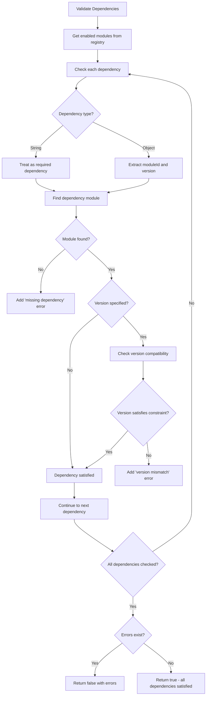
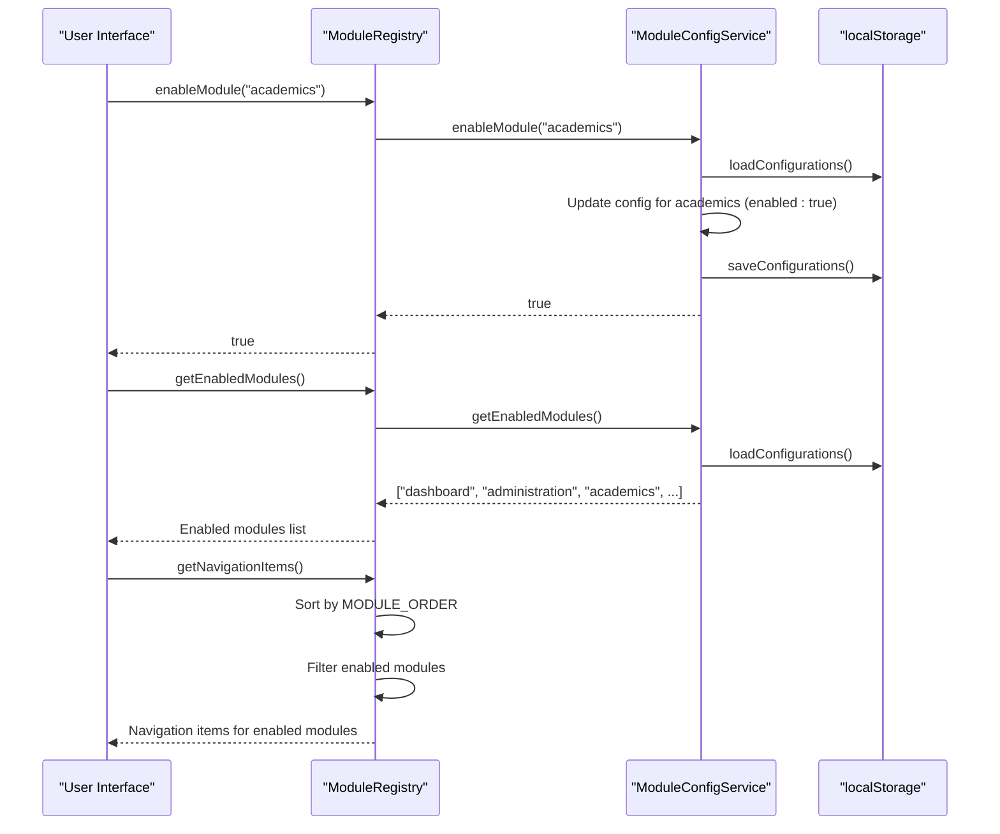
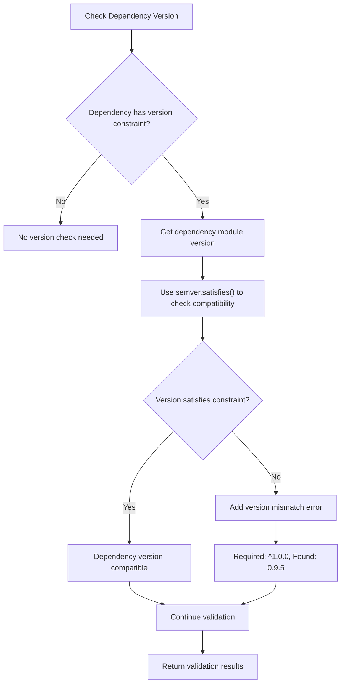
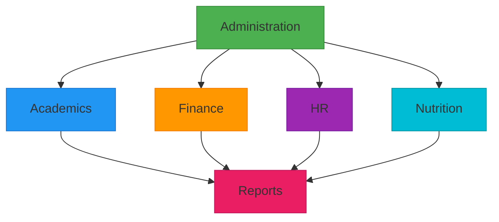
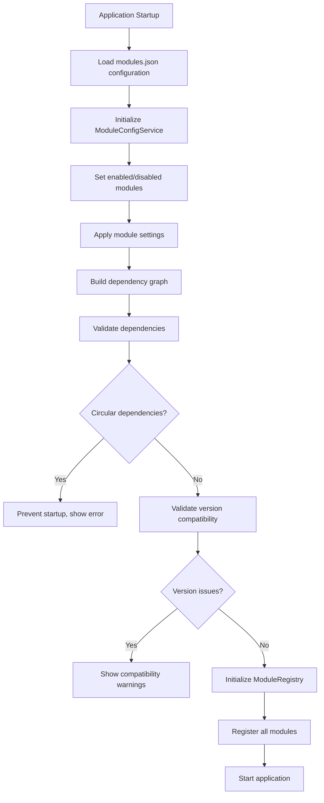
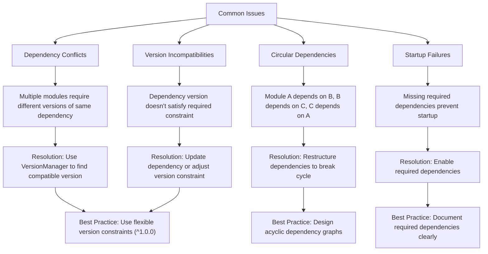
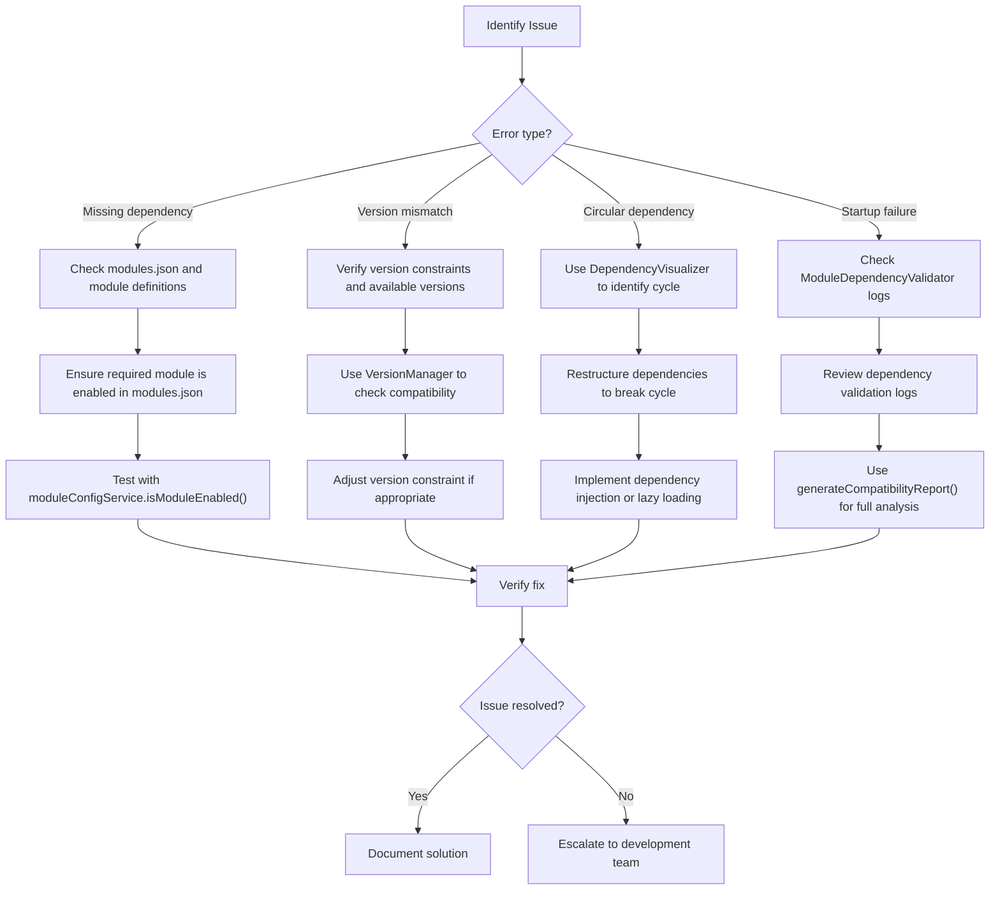
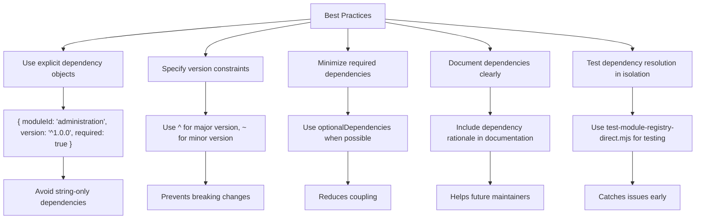
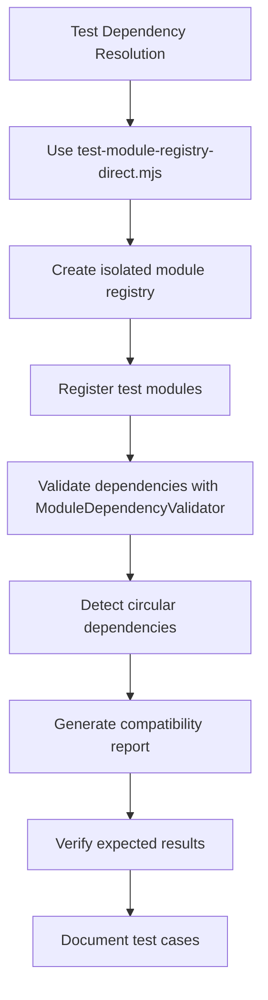

# Module Dependency Management

<cite>
**Referenced Files in This Document**   
- [ModuleDependencyValidator.ts](file://src/core/services/ModuleDependencyValidator.ts)
- [moduleRegistry.ts](file://src/core/moduleRegistry.ts)
- [moduleConfigService.ts](file://src/services/moduleConfigService.ts)
- [modules.json](file://src/config/modules.json)
- [VersionManager.ts](file://src/core/services/VersionManager.ts)
- [academics/moduleDefinition.tsx](file://src/modules/academics/moduleDefinition.tsx)
- [administration/moduleDefinition.tsx](file://src/modules/administration/moduleDefinition.tsx)
</cite>

## Table of Contents
1. [Introduction](#introduction)
2. [Module Dependency Validation System](#module-dependency-validation-system)
3. [Module Registry and Configuration Service](#module-registry-and-configuration-service)
4. [Version Management and Compatibility Checking](#version-management-and-compatibility-checking)
5. [Dependency Resolution in Complex Module Chains](#dependency-resolution-in-complex-module-chains)
6. [Module Configuration with modules.json](#module-configuration-with-modulesjson)
7. [Common Issues and Troubleshooting](#common-issues-and-troubleshooting)
8. [Best Practices for Module Dependencies](#best-practices-for-module-dependencies)

## Introduction
The schoolpilot3 system implements a comprehensive module dependency management system that ensures proper loading order, detects circular dependencies, and validates version compatibility between modules. This documentation provides a detailed analysis of the module dependency validation system, registry, and configuration services that manage module lifecycles and dependencies. The system is designed to prevent startup failures, ensure compatibility, and provide clear error reporting when dependency issues arise.

**Section sources**
- [ModuleDependencyValidator.ts](file://src/core/services/ModuleDependencyValidator.ts)
- [moduleRegistry.ts](file://src/core/moduleRegistry.ts)

## Module Dependency Validation System

### Circular Dependency Detection
The ModuleDependencyValidator class implements a robust circular dependency detection system using depth-first search (DFS) algorithm. The system builds a dependency graph from all modules and their dependencies, then traverses the graph to identify cycles that would prevent proper module loading.

```mermaid
flowchart TD
Start([Start Detection]) --> BuildGraph["Build Dependency Graph"]
BuildGraph --> Initialize["Initialize Sets: visited, recursionStack, path"]
Initialize --> ProcessModules["For each unvisited module: detectCycle()"]
subgraph detectCycle
detectCycle["detectCycle(moduleId)"]
detectCycle --> CheckRecursion["recursionStack.has(moduleId)?"]
CheckRecursion --> |Yes| FoundCycle["Found Cycle: Extract from path"]
CheckRecursion --> |No| CheckVisited["visited.has(moduleId)?"]
CheckVisited --> |Yes| ReturnFalse["Return false"]
CheckVisited --> |No| MarkVisited["Add to visited and recursionStack"]
MarkVisited --> AddToPath["Add to path"]
AddToPath --> ProcessDeps["For each dependency: detectCycle(dep)"]
ProcessDeps --> RemoveFromStack["Remove from recursionStack"]
RemoveFromStack --> RemoveFromPath["Remove from path"]
RemoveFromPath --> ReturnFalse
end
ProcessModules --> ReturnCycles["Return all detected cycles"]
FoundCycle --> ReturnCycles
ReturnFalse --> ProcessDeps
```

**Diagram sources**
- [ModuleDependencyValidator.ts](file://src/core/services/ModuleDependencyValidator.ts#L137-L178)

**Section sources**
- [ModuleDependencyValidator.ts](file://src/core/services/ModuleDependencyValidator.ts#L120-L178)

### Dependency Validation Process
The dependency validation system performs synchronous validation to avoid race conditions during module loading. It checks both required and optional dependencies, validates version compatibility using semver, and provides detailed error reporting.



**Diagram sources**
- [ModuleDependencyValidator.ts](file://src/core/services/ModuleDependencyValidator.ts#L25-L70)

**Section sources**
- [ModuleDependencyValidator.ts](file://src/core/services/ModuleDependencyValidator.ts#L14-L70)

## Module Registry and Configuration Service

### Module Registry Implementation
The ModuleRegistry class serves as the central repository for all module definitions and provides methods to manage module lifecycles. It integrates with the moduleConfigService to determine module enablement status and provides access to enabled modules.

```mermaid
classDiagram
class ModuleRegistry {
-modules : Map<string, ModuleDefinition>
+registerModule(module : ModuleDefinition) : void
+unregisterModule(moduleId : string) : void
+enableModule(moduleId : string) : boolean
+disableModule(moduleId : string) : boolean
+getAllModules() : ModuleDefinition[]
+getEnabledModules() : ModuleDefinition[]
+getModule(moduleId : string) : ModuleDefinition | undefined
+isModuleEnabled(moduleId : string) : boolean
+getNavigationItems() : NavItem[]
+getModuleNavigation(moduleId : string) : NavItem[]
+checkDependencies(moduleId : string) : {satisfied : boolean, missing : string[]}
+validateModuleDependencies(moduleId : string) : Promise<boolean>
+getModulesByFeature(feature : string) : ModuleDefinition[]
+getAllFeatures() : string[]
+getModuleSettings() : Array<{moduleId : string, settings : ModuleDefinition['settings']}>
}
class ModuleConfigService {
-STORAGE_KEY : string
-configs : Map<string, ModuleConfig>
-isLoading : boolean
+enableModule(moduleId : string) : boolean
+disableModule(moduleId : string) : boolean
+isModuleEnabled(moduleId : string) : boolean
+getEnabledModules() : string[]
+getModuleConfig(moduleId : string) : ModuleConfig | null
+updateModuleSettings(moduleId : string, settings : Record<string, any>) : void
+getModuleSettings(moduleId : string) : Record<string, any>
+getAllConfigurations() : ModuleConfig[]
+resetModuleConfig(moduleId : string) : void
+exportConfigurations() : string
+importConfigurations(configJson : string) : void
+getAllModuleInfo() : ModuleInfo[]
+validateConfig() : {valid : boolean, errors : string[]}
+hasCircularDependency(moduleId : string, dependencies : string[], visited : Set<string>, stack : Set<string>, allModules : any[]) : boolean
+checkDependencies(moduleId : string) : {satisfied : boolean, missing : string[]}
+getModuleDependencies(moduleId : string) : string[]
+getConfig() : {moduleDependencies : Record<string, string[]>}
}
ModuleRegistry --> ModuleConfigService : "uses"
ModuleRegistry --> ModuleDependencyValidator : "depends on"
```

**Diagram sources**
- [moduleRegistry.ts](file://src/core/moduleRegistry.ts#L11-L178)
- [moduleConfigService.ts](file://src/services/moduleConfigService.ts#L21-L322)

**Section sources**
- [moduleRegistry.ts](file://src/core/moduleRegistry.ts#L11-L178)
- [moduleConfigService.ts](file://src/services/moduleConfigService.ts#L21-L322)

### Module Lifecycle Management
The module registry and configuration service work together to manage module lifecycles. The ModuleRegistry handles module registration and provides access to module definitions, while the ModuleConfigService manages the persistent configuration of module enablement and settings.



**Diagram sources**
- [moduleRegistry.ts](file://src/core/moduleRegistry.ts#L26-L31)
- [moduleConfigService.ts](file://src/services/moduleConfigService.ts#L45-L60)

**Section sources**
- [moduleRegistry.ts](file://src/core/moduleRegistry.ts#L26-L31)
- [moduleConfigService.ts](file://src/services/moduleConfigService.ts#L45-L60)

## Version Management and Compatibility Checking

### VersionManager Implementation
The VersionManager class provides utilities for validating version compatibility between modules using semantic versioning (semver). It supports various version constraints and can determine the best compatible version from a list of available versions.

```mermaid
classDiagram
class VersionManager {
+validateVersion(moduleVersion : string, constraint : string) : boolean
+findCompatibleVersion(constraint : string, availableVersions : string[]) : string | null
+getVersionCompatibility(constraint : string, currentVersion : string) : {compatible : boolean, message : string, recommended? : string}
+parseConstraint(constraint : string) : {min? : string, max? : string, exact? : string}
}
class ModuleDependencyValidator {
-_validateDependenciesSync(module : ModuleDefinition, moduleRegistry? : any) : boolean
-_detectCircularDependenciesSync(moduleRegistry : any) : string[][]
-_generateCompatibilityReportSync(moduleRegistry : any) : {totalModules : number, modulesWithIssues : number, issues : Array<{moduleId : string, type : 'missing' | 'version' | 'circular', details : string}>}
}
ModuleDependencyValidator --> VersionManager : "uses for version validation"
```

**Diagram sources**
- [VersionManager.ts](file://src/core/services/VersionManager.ts#L5-L104)
- [ModuleDependencyValidator.ts](file://src/core/services/ModuleDependencyValidator.ts#L51-L55)

**Section sources**
- [VersionManager.ts](file://src/core/services/VersionManager.ts#L5-L104)

### Version Compatibility Workflow
The system validates version compatibility when checking module dependencies. It uses semver to determine if a dependency's version satisfies the required version constraint specified in the module definition.



**Diagram sources**
- [ModuleDependencyValidator.ts](file://src/core/services/ModuleDependencyValidator.ts#L51-L55)
- [VersionManager.ts](file://src/core/services/VersionManager.ts#L5-L10)

**Section sources**
- [ModuleDependencyValidator.ts](file://src/core/services/ModuleDependencyValidator.ts#L51-L55)

## Dependency Resolution in Complex Module Chains

### Academics Module Dependencies
The academics module has a complex dependency chain that requires the administration module as a required dependency, with finance and reports as optional dependencies. This creates a dependency hierarchy where academics depends on administration, and reports depends on both administration and academics.



**Diagram sources**
- [academics/moduleDefinition.tsx](file://src/modules/academics/moduleDefinition.tsx#L42-L87)
- [administration/moduleDefinition.tsx](file://src/modules/administration/moduleDefinition.tsx#L91-L111)
- [modules.json](file://src/config/modules.json#L50-L55)

**Section sources**
- [academics/moduleDefinition.tsx](file://src/modules/academics/moduleDefinition.tsx#L42-L87)

### Administration Module Dependencies
The administration module serves as the core foundation for many other modules in the system. It has no required dependencies but supports optional dependencies on finance and HR modules, allowing for enhanced functionality when these modules are enabled.

```mermaid
graph TD
A[Administration] --> B[Academics]
A --> C[Finance]
A --> D[HR]
A --> E[Nutrition]
A --> F[Reports]
subgraph "Administration Module"
A
end
subgraph "Dependent Modules"
B
C
D
E
F
end
style A fill:#4CAF50,stroke:#388E3C,color:white
style B fill:#2196F3,stroke:#1976D2
style C fill:#FF9800,stroke:#F57C00
style D fill:#9C27B0,stroke:#7B1FA2
style E fill:#00BCD4,stroke:#0097A7
style F fill:#E91E63,stroke:#C2185B
classDef core fill:#4CAF50,stroke:#388E3C,color:white
classDef dependent fill:#FFCDD2,stroke:#EF5350
class A core
class B,C,D,E,F dependent
linkStyle 0 stroke:#2196F3;
linkStyle 1 stroke:#FF9800;
linkStyle 2 stroke:#9C27B0;
linkStyle 3 stroke:#00BCD4;
linkStyle 4 stroke:#E91E63;
```

**Diagram sources**
- [administration/moduleDefinition.tsx](file://src/modules/administration/moduleDefinition.tsx#L91-L111)
- [modules.json](file://src/config/modules.json#L1-L10)

**Section sources**
- [administration/moduleDefinition.tsx](file://src/modules/administration/moduleDefinition.tsx#L91-L111)

## Module Configuration with modules.json

### modules.json Structure
The modules.json file serves as the central configuration for module dependencies and relationships. It defines which modules are enabled, their settings, and their dependency requirements.

```json
{
  "enabledModules": [
    "dashboard",
    "administration", 
    "academics",
    "finance",
    "hr",
    "inventory",
    "library",
    "nutrition",
    "reports",
    "settings"
  ],
  "disabledModules": [],
  "moduleSettings": {
    "dashboard": {
      "enabled": true,
      "required": true,
      "description": "Core dashboard functionality"
    },
    "administration": {
      "enabled": true,
      "required": false,
      "description": "Student and staff administration"
    },
    "academics": {
      "enabled": true,
      "required": false,
      "description": "Academic curriculum and exam management"
    }
  },
  "moduleDependencies": {
    "academics": ["administration"],
    "finance": ["administration"],
    "hr": ["administration"],
    "nutrition": ["administration"],
    "reports": ["administration", "academics", "finance"]
  }
}
```

**Section sources**
- [modules.json](file://src/config/modules.json#L1-L74)

### Configuration Processing Workflow
The system processes the modules.json configuration during initialization, using it to set up the initial module state and validate dependencies.



**Diagram sources**
- [modules.json](file://src/config/modules.json#L1-L74)
- [moduleConfigService.ts](file://src/services/moduleConfigService.ts#L21-L322)

**Section sources**
- [modules.json](file://src/config/modules.json#L1-L74)

## Common Issues and Troubleshooting

### Dependency Conflict Resolution
Common issues in module dependency management include dependency conflicts, version incompatibilities, and startup failures due to circular dependencies. The system provides several tools for diagnosing and resolving these issues.



**Section sources**
- [ModuleDependencyValidator.ts](file://src/core/services/ModuleDependencyValidator.ts#L268-L296)
- [VersionManager.ts](file://src/core/services/VersionManager.ts#L5-L104)

### Troubleshooting Steps
When encountering module dependency issues, follow these systematic troubleshooting steps:



**Section sources**
- [ModuleDependencyValidator.ts](file://src/core/services/ModuleDependencyValidator.ts#L268-L296)
- [moduleConfigService.ts](file://src/services/moduleConfigService.ts#L147-L147)

## Best Practices for Module Dependencies

### Defining Module Dependencies
When defining module dependencies, follow these best practices to ensure a maintainable and scalable architecture:



**Section sources**
- [academics/moduleDefinition.tsx](file://src/modules/academics/moduleDefinition.tsx#L42-L87)
- [administration/moduleDefinition.tsx](file://src/modules/administration/moduleDefinition.tsx#L91-L111)

### Handling Optional Dependencies
Optional dependencies provide flexibility in module configuration while maintaining core functionality. Implement them using the optionalDependencies array in module definitions.

```typescript
// Example: administration module with optional dependencies
const administrationModule: ModuleDefinition = {
  id: 'administration',
  name: 'Administration',
  version: '1.0.0',
  dependencies: [], // No required dependencies
  optionalDependencies: [
    {
      moduleId: 'finance',
      version: '^1.0.0',
      required: false
    },
    {
      moduleId: 'hr',
      version: '^1.0.0',
      required: false
    }
  ],
  // ... other properties
};
```

**Section sources**
- [administration/moduleDefinition.tsx](file://src/modules/administration/moduleDefinition.tsx#L91-L111)

### Testing Dependency Resolution in Isolation
The system provides tools for testing dependency resolution in isolation, which is crucial for verifying module compatibility before deployment.



**Section sources**
- [test-module-registry-direct.mjs](file://test-module-registry-direct.mjs)
- [ModuleDependencyValidator.ts](file://src/core/services/ModuleDependencyValidator.ts#L268-L296)