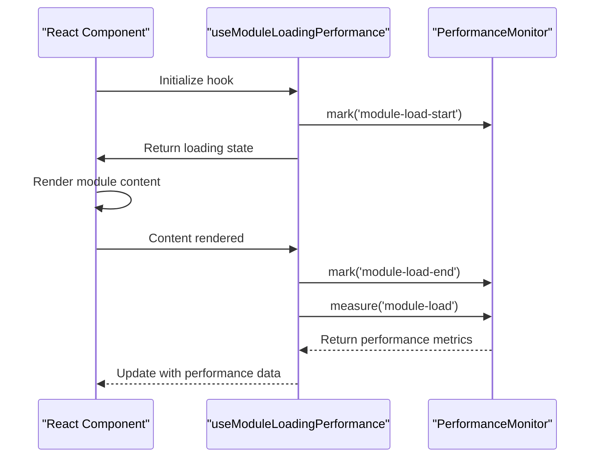
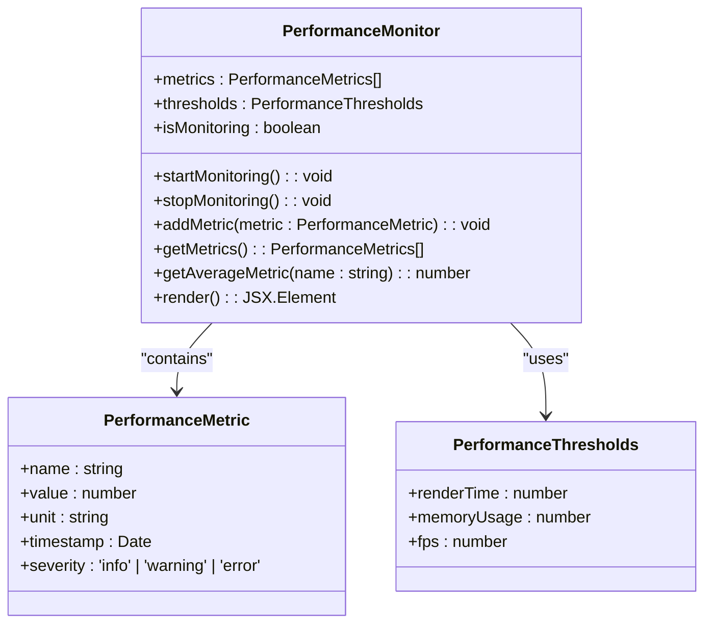
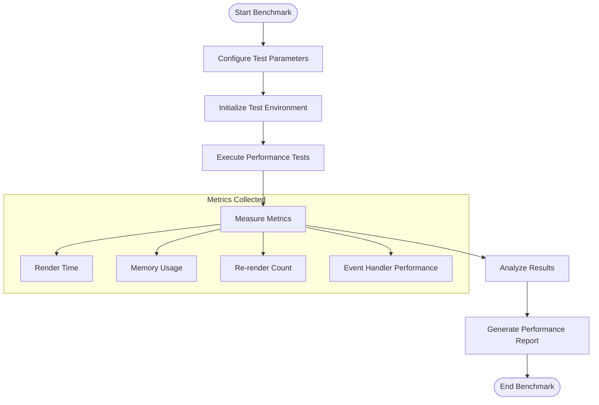
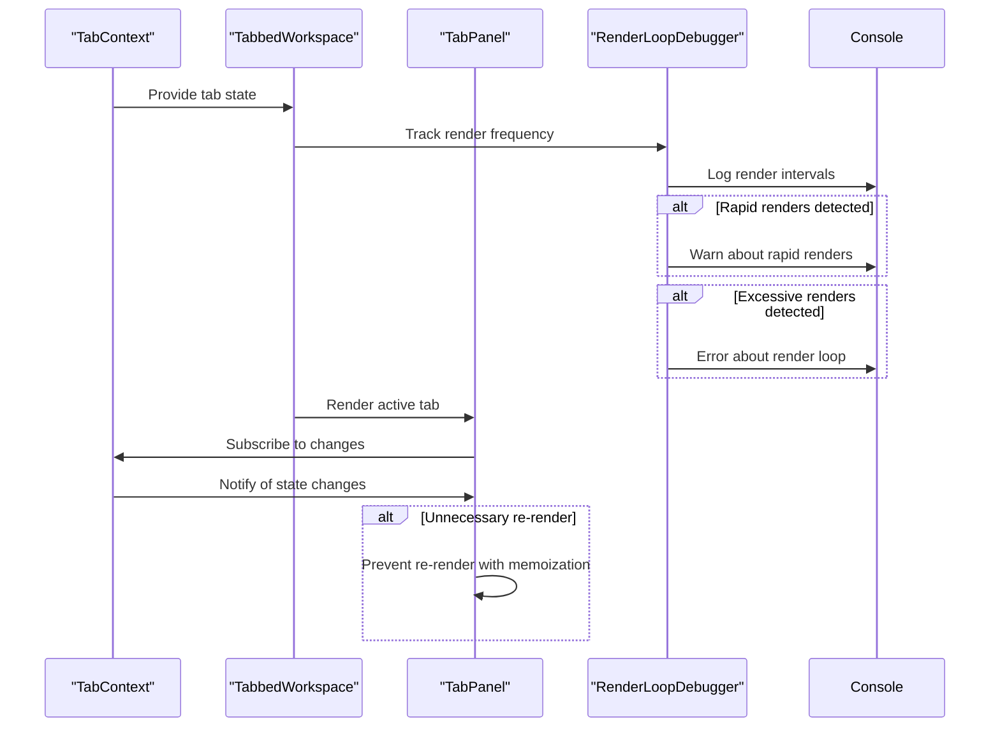
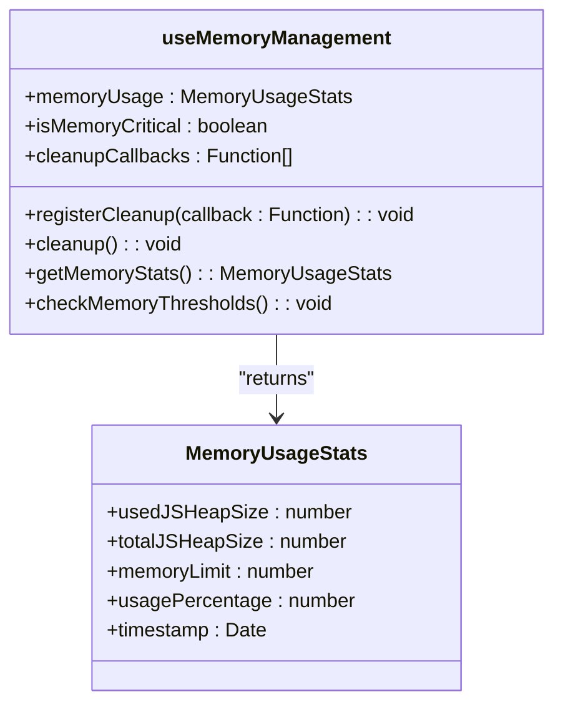
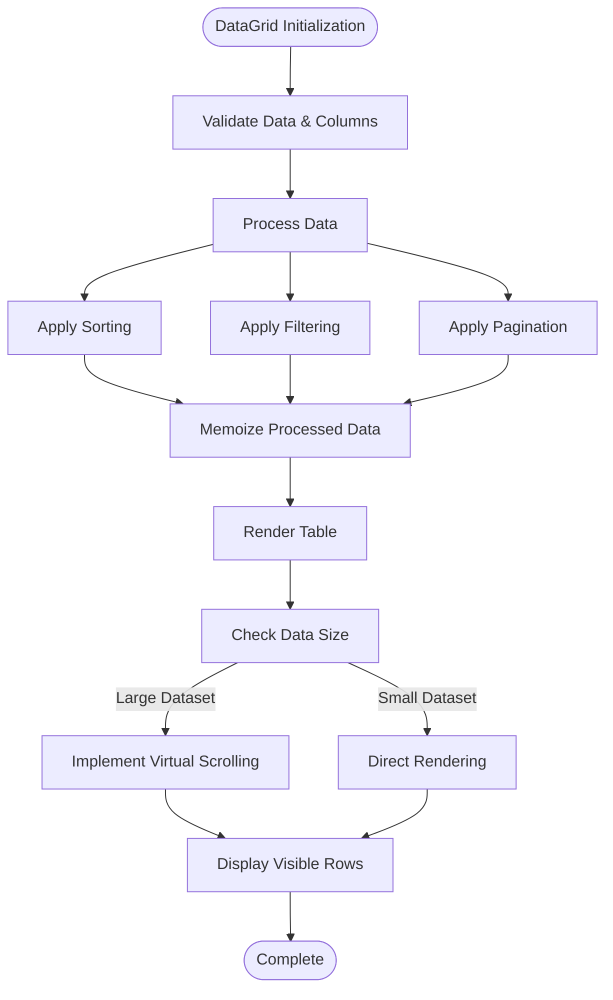
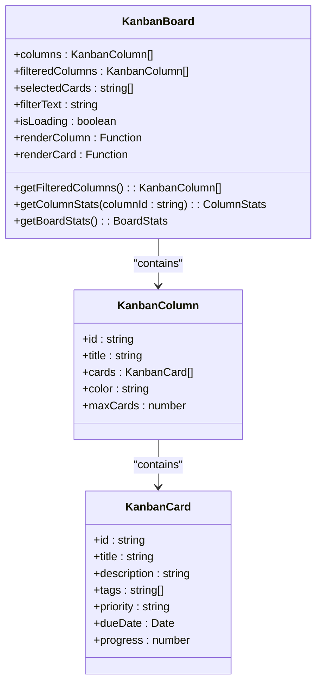

# Performance Optimization

<cite>
**Referenced Files in This Document**   
- [useModuleLoadingPerformance.ts](file://src/hooks/useModuleLoadingPerformance.ts)
- [PerformanceMonitor.tsx](file://src/components/PerformanceMonitor.tsx)
- [PerformanceBenchmark.tsx](file://src/components/PerformanceBenchmark.tsx)
- [useMemoryManagement.ts](file://src/hooks/useMemoryManagement.ts)
- [DataGrid.tsx](file://src/components/ui/data/DataGrid.tsx)
- [KanbanBoard.tsx](file://src/components/ui/data/KanbanBoard.tsx)
- [tabbedWorkspace/TabbedWorkspace.tsx](file://src/components/tabbedWorkspace/TabbedWorkspace.tsx)
- [renderLoopDebugger.tsx](file://src/components/tabbedWorkspace/__tests__/renderLoopDebugger.tsx)
- [performanceMonitor.ts](file://src/services/performanceMonitor.ts)
- [memoryManager.ts](file://src/services/memoryManager.ts)
</cite>

## Table of Contents
1. [Introduction](#introduction)
2. [Module Loading Performance Monitoring](#module-loading-performance-monitoring)
3. [Runtime Performance Tracking](#runtime-performance-tracking)
4. [Render Loop Prevention](#render-loop-prevention)
5. [Memory Management](#memory-management)
6. [Data-Intensive Component Optimization](#data-intensive-component-optimization)
7. [Troubleshooting Common Performance Issues](#troubleshooting-common-performance-issues)
8. [Best Practices](#best-practices)

## Introduction

The schoolpilot3 application implements a comprehensive performance optimization framework to ensure responsive user experiences across various modules and data scenarios. This document details the performance monitoring, optimization techniques, and best practices implemented throughout the codebase. The system focuses on three key areas: module loading performance, runtime performance tracking, and memory management. Special attention is given to optimizing data-intensive components like DataGrid and KanbanBoard, as well as preventing common issues such as render loops in tabbed workspaces.

**Section sources**
- [src/hooks/useModuleLoadingPerformance.ts](file://src/hooks/useModuleLoadingPerformance.ts)
- [src/components/PerformanceMonitor.tsx](file://src/components/PerformanceMonitor.tsx)
- [src/components/PerformanceBenchmark.tsx](file://src/components/PerformanceBenchmark.tsx)

## Module Loading Performance Monitoring

The module loading performance monitoring system provides detailed insights into the initialization times of various application modules. This system enables developers to identify bottlenecks in module loading and optimize startup performance.

### useModuleLoadingPerformance Hook

The `useModuleLoadingPerformance` hook is a custom React hook that measures and analyzes module initialization times. It leverages the Performance API to capture precise timing metrics during the module loading process.



**Diagram sources**
- [src/hooks/useModuleLoadingPerformance.ts](file://src/hooks/useModuleLoadingPerformance.ts)
- [src/services/performanceMonitor.ts](file://src/services/performanceMonitor.ts)

**Section sources**
- [src/hooks/useModuleLoadingPerformance.ts](file://src/hooks/useModuleLoadingPerformance.ts)

The hook implementation follows this pattern:

```typescript
// Example implementation pattern
const useModuleLoadingPerformance = (moduleName: string) => {
  const [performanceData, setPerformanceData] = useState<PerformanceMetrics | null>(null);
  const [isLoading, setIsLoading] = useState(true);

  useEffect(() => {
    // Mark the start of module loading
    performanceMonitor.mark(`${moduleName}-load-start`);
    
    // Simulate or wait for module initialization
    initializeModule().then(() => {
      // Mark the end of module loading
      performanceMonitor.mark(`${moduleName}-load-end`);
      
      // Measure the duration
      const loadTime = performanceMonitor.measure(`${moduleName}-load`);
      
      setPerformanceData({
        moduleName,
        loadTime,
        timestamp: new Date().toISOString()
      });
      
      setIsLoading(false);
    });
  }, [moduleName]);

  return { performanceData, isLoading };
};
```

This hook can be integrated into any module component to track its loading performance:

```typescript
// Usage example
const StudentManagementModule = () => {
  const { performanceData, isLoading } = useModuleLoadingPerformance('student-management');
  
  if (isLoading) {
    return <ModuleLoadingFallback />;
  }
  
  return (
    <div>
      <h1>Student Management</h1>
      {/* Module content */}
      {performanceData && (
        <ModuleLoadingPerformancePanel data={performanceData} />
      )}
    </div>
  );
};
```

## Runtime Performance Tracking

The application provides two primary components for tracking runtime performance metrics: PerformanceMonitor and PerformanceBenchmark.

### PerformanceMonitor Component

The PerformanceMonitor component displays real-time performance metrics in the UI, allowing developers and administrators to monitor application performance during usage.



**Diagram sources**
- [src/components/PerformanceMonitor.tsx](file://src/components/PerformanceMonitor.tsx)
- [src/types/performance.ts](file://src/types/performance.ts)

**Section sources**
- [src/components/PerformanceMonitor.tsx](file://src/components/PerformanceMonitor.tsx)

The component integrates with the performance monitoring service to collect various metrics:

```typescript
// Key metrics tracked by PerformanceMonitor
const DEFAULT_METRICS = [
  'render-time',
  'memory-usage',
  'fps',
  'api-response-time',
  'database-query-time'
];

// Thresholds for performance alerts
const PERFORMANCE_THRESHOLDS = {
  renderTime: 500, // ms
  memoryUsage: 100, // MB
  fps: 30,
  apiResponseTime: 2000 // ms
};
```

### PerformanceBenchmark Component

The PerformanceBenchmark component provides a more detailed analysis of specific performance aspects, allowing for targeted optimization efforts.



**Diagram sources**
- [src/components/PerformanceBenchmark.tsx](file://src/components/PerformanceBenchmark.tsx)
- [src/services/performanceBenchmark.ts](file://src/services/performanceBenchmark.ts)

**Section sources**
- [src/components/PerformanceBenchmark.tsx](file://src/components/PerformanceBenchmark.tsx)

The benchmark component can be used to test specific scenarios:

```typescript
// Example usage
<PerformanceBenchmark
  testName="DataGrid Large Dataset"
  testFunction={async () => {
    const largeData = Array.from({ length: 1000 }, (_, i) => ({
      id: i,
      name: `User ${i}`,
      email: `user${i}@example.com`
    }));
    
    const startTime = performance.now();
    render(<DataGrid data={largeData} />);
    const endTime = performance.now();
    
    return {
      renderTime: endTime - startTime,
      dataSize: largeData.length,
      memoryUsage: performance.memory?.usedJSHeapSize || 0
    };
  }}
  iterations={5}
/>
```

## Render Loop Prevention

The application implements several mechanisms to prevent render loops, particularly in complex components like the tabbed workspace.

### Tabbed Workspace Render Loop Prevention

The tabbed workspace system includes built-in safeguards to prevent infinite re-render cycles, which can occur due to state changes triggering additional state updates.



**Diagram sources**
- [src/components/tabbedWorkspace/TabbedWorkspace.tsx](file://src/components/tabbedWorkspace/TabbedWorkspace.tsx)
- [src/components/tabbedWorkspace/__tests__/renderLoopDebugger.tsx](file://src/components/tabbedWorkspace/__tests__/renderLoopDebugger.tsx)

**Section sources**
- [src/components/tabbedWorkspace/TabbedWorkspace.tsx](file://src/components/tabbedWorkspace/TabbedWorkspace.tsx)
- [src/components/tabbedWorkspace/__tests__/renderLoopDebugger.tsx](file://src/components/tabbedWorkspace/__tests__/renderLoopDebugger.tsx)

The render loop debugger implementation includes:

```typescript
// Render loop detection thresholds
const RENDER_LOOP_CONFIG = {
  rapidRenderThreshold: 100, // milliseconds
  maxRendersInWindow: 10,
  timeWindow: 1000 // 1 second
};

// Render tracking references
const renderCountRef = useRef(0);
const lastRenderTimeRef = useRef(Date.now());
const renderTimestampsRef = useRef<number[]>([]);

// Effect to monitor render frequency
useEffect(() => {
  renderCountRef.current++;
  const now = Date.now();
  const timeSinceLastRender = now - lastRenderTimeRef.current;
  
  // Track render timestamps
  renderTimestampsRef.current.push(now);
  
  // Keep only timestamps within the time window
  const cutoffTime = now - RENDER_LOOP_CONFIG.timeWindow;
  renderTimestampsRef.current = renderTimestampsRef.current.filter(
    timestamp => timestamp > cutoffTime
  );
  
  // Check for rapid consecutive renders
  if (timeSinceLastRender < RENDER_LOOP_CONFIG.rapidRenderThreshold) {
    console.warn(
      `⚠️ RAPID RENDER DETECTED: Only ${timeSinceLastRender}ms since last render`,
      {
        renderCount: renderCountRef.current,
        timestamp: new Date().toISOString()
      }
    );
  }
  
  // Check for excessive renders within time window
  if (renderTimestampsRef.current.length > RENDER_LOOP_CONFIG.maxRendersInWindow) {
    console.error(
      `🚨 RENDER LOOP DETECTED: ${renderTimestampsRef.current.length} renders in ${RENDER_LOOP_CONFIG.timeWindow}ms`,
      {
        renderCount: renderCountRef.current,
        timestamps: renderTimestampsRef.current.map(t => new Date(t).toISOString())
      }
    );
  }
  
  lastRenderTimeRef.current = now;
}, [/* dependencies */]);
```

Additional prevention mechanisms include:

- **Memoization**: Using React.memo and useMemo to prevent unnecessary re-renders
- **Callback stabilization**: Using useCallback to prevent function recreation
- **State batching**: Grouping related state updates to minimize re-renders
- **Dependency optimization**: Carefully managing useEffect dependencies to prevent infinite loops

## Memory Management

The application implements proactive memory management strategies to prevent memory leaks and optimize resource usage.

### useMemoryManagement Hook

The `useMemoryManagement` hook provides tools for monitoring and managing memory usage within components.



**Diagram sources**
- [src/hooks/useMemoryManagement.ts](file://src/hooks/useMemoryManagement.ts)
- [src/services/memoryManager.ts](file://src/services/memoryManager.ts)

**Section sources**
- [src/hooks/useMemoryManagement.ts](file://src/hooks/useMemoryManagement.ts)

The hook implementation includes:

```typescript
// Memory management hook
const useMemoryManagement = () => {
  const [memoryUsage, setMemoryUsage] = useState<MemoryUsageStats | null>(null);
  const cleanupCallbacks = useRef<Function[]>([]);
  const [isMemoryCritical, setIsMemoryCritical] = useState(false);

  // Register cleanup functions
  const registerCleanup = useCallback((callback: Function) => {
    cleanupCallbacks.current.push(callback);
  }, []);

  // Cleanup function
  const cleanup = useCallback(() => {
    cleanupCallbacks.current.forEach(callback => callback());
    cleanupCallbacks.current = [];
  }, []);

  // Memory monitoring effect
  useEffect(() => {
    const updateMemoryStats = () => {
      if (performance.memory) {
        const stats = {
          usedJSHeapSize: performance.memory.usedJSHeapSize,
          totalJSHeapSize: performance.memory.totalJSHeapSize,
          memoryLimit: performance.memory.jsHeapSizeLimit,
          usagePercentage: (performance.memory.usedJSHeapSize / performance.memory.jsHeapSizeLimit) * 100,
          timestamp: new Date()
        };
        
        setMemoryUsage(stats);
        setIsMemoryCritical(stats.usagePercentage > 80);
        
        // Trigger cleanup if memory is critical
        if (stats.usagePercentage > 90) {
          cleanup();
        }
      }
    };

    // Update memory stats periodically
    const intervalId = setInterval(updateMemoryStats, 5000);
    
    // Initial update
    updateMemoryStats();

    return () => {
      clearInterval(intervalId);
      cleanup();
    };
  }, [cleanup]);

  return {
    memoryUsage,
    isMemoryCritical,
    registerCleanup,
    cleanup
  };
};
```

Common memory management patterns include:

- **Event listener cleanup**: Removing event listeners in useEffect cleanup functions
- **Subscription disposal**: Unsubscribing from observables and streams
- **Timer clearing**: Clearing intervals and timeouts
- **Reference cleanup**: Nullifying references to large objects
- **Cache invalidation**: Implementing cache eviction policies

## Data-Intensive Component Optimization

The application includes specific optimizations for data-intensive components like DataGrid and KanbanBoard.

### DataGrid Optimization

The DataGrid component implements several performance optimizations for handling large datasets.



**Diagram sources**
- [src/components/ui/data/DataGrid.tsx](file://src/components/ui/data/DataGrid.tsx)
- [src/utils/dataValidationUtils.ts](file://src/utils/dataValidationUtils.ts)

**Section sources**
- [src/components/ui/data/DataGrid.tsx](file://src/components/ui/data/DataGrid.tsx)

Key optimization techniques in DataGrid:

- **Memoization**: Using useMemo to cache processed data
- **Virtualization**: Implementing virtual scrolling for large datasets
- **Lazy loading**: Loading data incrementally
- **Debounced filtering**: Preventing excessive re-renders during typing
- **Column virtualization**: Only rendering visible columns

```typescript
// DataGrid performance optimizations
const DataGrid = <T extends Record<string, any>>({
  columns,
  data,
  loading = false,
  sortable = true,
  filterable = true,
  selectable = false,
  pagination,
  onRowClick,
  onSelectionChange,
  onSort,
  onFilter,
  emptyState,
  loadingState,
  className = ''
}: DataGridProps<T>): React.ReactElement => {
  // Validate and prepare data with defensive checks
  const validatedData = useMemo(() => {
    const safeData = DataValidationUtils.ensureArray(data);
    return safeData;
  }, [data]);

  // Process data (sorting and filtering if not handled externally)
  const processedData = useMemo(() => {
    let result = [...validatedData];

    // Apply filtering if not handled externally
    if (!onFilter && Object.keys(filterState).length > 0) {
      result = result.filter(row => {
        return Object.entries(filterState).every(([key, filterValue]) => {
          const cellValue = String(row[key] || '').toLowerCase();
          return cellValue.includes(filterValue.toLowerCase());
        });
      });
    }

    // Apply sorting if not handled externally
    if (!onSort && sortState) {
      result.sort((a, b) => {
        const aValue = a[sortState.key];
        const bValue = b[sortState.key];
        
        if (aValue === bValue) return 0;
        
        const comparison = aValue < bValue ? -1 : 1;
        return sortState.direction === 'asc' ? comparison : -comparison;
      });
    }

    return result;
  }, [data, sortState, filterState, onSort, onFilter]);
  
  // Rest of implementation...
};
```

### KanbanBoard Optimization

The KanbanBoard component includes optimizations for handling numerous cards and columns.



**Diagram sources**
- [src/components/ui/data/KanbanBoard.tsx](file://src/components/ui/data/KanbanBoard.tsx)
- [src/hooks/useKanban.tsx](file://src/hooks/useKanban.tsx)

**Section sources**
- [src/components/ui/data/KanbanBoard.tsx](file://src/components/ui/data/KanbanBoard.tsx)

Optimization strategies in KanbanBoard:

- **Memoized rendering**: Using useCallback and useMemo to prevent unnecessary re-renders
- **Conditional loading**: Displaying skeleton loaders during data fetching
- **Filtered rendering**: Only rendering visible cards based on search filters
- **Animation optimization**: Using CSS transforms for smooth drag-and-drop
- **Event delegation**: Minimizing event listeners for better performance

```typescript
// KanbanBoard performance optimizations
const KanbanBoard = <T extends KanbanCard>({
  columns,
  onCardMove,
  onCardClick,
  onCardSelect,
  onColumnUpdate,
  loading = false,
  className = ''
}: KanbanBoardProps<T>) => {
  const [filterText, setFilterText] = useState('');
  const [selectedCards, setSelectedCards] = useState<string[]>([]);

  // Memoize filtered columns to prevent unnecessary re-computation
  const filteredColumns = useMemo(() => {
    if (!filterText) return columns;
    
    return columns.map(column => ({
      ...column,
      cards: column.cards.filter(card =>
        card.title.toLowerCase().includes(filterText.toLowerCase()) ||
        card.description?.toLowerCase().includes(filterText.toLowerCase()) ||
        card.tags?.some(tag => tag.toLowerCase().includes(filterText.toLowerCase()))
      ),
    }));
  }, [columns, filterText]);

  // Memoize column rendering function
  const renderColumn = useCallback((column: KanbanColumn<T>) => {
    // Column rendering implementation
  }, [onCardMove, onCardClick, selectedCards, filterText]);

  if (loading) {
    return (
      <div className={`flex space-x-6 overflow-x-auto pb-4 ${className}`}>
        {[1, 2, 3].map((i) => (
          <div key={i} className="flex-shrink-0 w-80 bg-gray-50 rounded-lg p-4 animate-pulse">
            <div className="h-6 bg-gray-200 rounded mb-4" />
            <div className="space-y-3">
              {[1, 2, 3].map((j) => (
                <div key={j} className="h-24 bg-gray-200 rounded-lg" />
              ))}
            </div>
          </div>
        ))}
      </div>
    );
  }

  return (
    <div className={`flex space-x-6 overflow-x-auto pb-4 ${className}`}>
      {filteredColumns.map(renderColumn)}
    </div>
  );
};
```

## Troubleshooting Common Performance Issues

This section addresses common performance issues encountered in the application and provides specific troubleshooting steps.

### Slow Module Loading

**Symptoms**:
- Long delays when navigating to modules
- High CPU usage during module initialization
- Memory spikes during loading

**Troubleshooting Steps**:
1. Use the `useModuleLoadingPerformance` hook to measure initialization time
2. Check for expensive computations in module initialization
3. Verify data fetching operations are optimized
4. Ensure proper code splitting is implemented
5. Monitor network requests for large payloads

**Optimization Patterns**:
- Implement lazy loading for non-essential components
- Optimize data fetching with pagination and filtering
- Move expensive computations to web workers
- Use memoization for expensive calculations
- Implement skeleton loaders for better perceived performance

### Excessive Re-renders

**Symptoms**:
- High render frequency in console logs
- UI feels sluggish or unresponsive
- PerformanceMonitor shows high render times

**Troubleshooting Steps**:
1. Use React DevTools to identify unnecessary re-renders
2. Check useEffect dependencies for incorrect values
3. Verify useCallback and useMemo are used appropriately
4. Look for state updates in render methods
5. Use the render loop debugger to detect patterns

**Optimization Patterns**:
- Wrap event handlers with useCallback
- Memoize expensive calculations with useMemo
- Use React.memo for components with stable props
- Implement shouldComponentUpdate or React.memo
- Break down large components into smaller ones

### Memory Leaks

**Symptoms**:
- Increasing memory usage over time
- Performance degradation with prolonged usage
- Browser crashes on complex operations

**Troubleshooting Steps**:
1. Use Chrome DevTools Memory tab to track heap usage
2. Check for unremoved event listeners
3. Verify subscriptions are properly unsubscribed
4. Look for detached DOM elements in heap snapshots
5. Monitor setInterval and setTimeout usage

**Optimization Patterns**:
- Always clean up event listeners in useEffect cleanup
- Unsubscribe from observables and streams
- Clear intervals and timeouts
- Use weak references when appropriate
- Implement proper cleanup in component unmount

## Best Practices

### Optimizing Large Datasets

When working with large datasets in DataGrid and KanbanBoard components:

1. **Implement pagination**: Limit the number of records displayed at once
2. **Use virtual scrolling**: Only render visible rows to reduce DOM nodes
3. **Debounce filtering**: Prevent excessive re-renders during typing
4. **Optimize sorting**: Use server-side sorting for large datasets
5. **Lazy load data**: Load data incrementally as needed

### General Performance Optimization

1. **Use memoization wisely**: Apply useMemo and useCallback to expensive operations
2. **Minimize re-renders**: Structure components to minimize unnecessary updates
3. **Optimize images and assets**: Compress and lazy load media files
4. **Code splitting**: Split code into smaller chunks for faster loading
5. **Tree shaking**: Remove unused code from production bundles

### Monitoring and Testing

1. **Regular performance testing**: Include performance tests in CI/CD pipeline
2. **Real user monitoring**: Collect performance data from production users
3. **Automated alerts**: Set up alerts for performance degradation
4. **Benchmark comparisons**: Compare performance across releases
5. **User feedback**: Collect feedback on perceived performance

By following these practices and utilizing the provided performance tools, developers can ensure schoolpilot3 maintains optimal performance across various usage scenarios and data volumes.