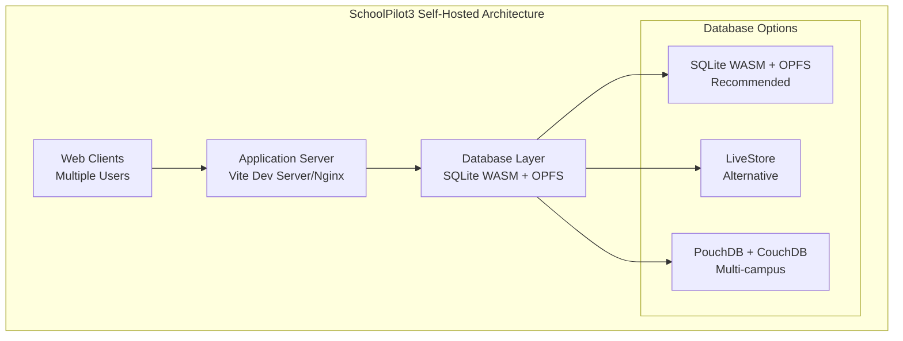
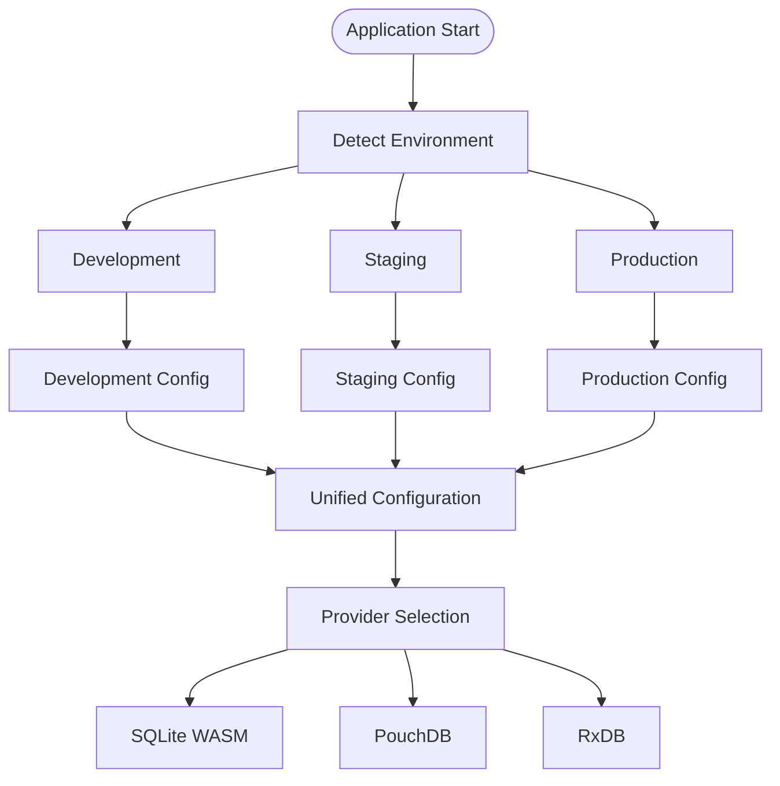
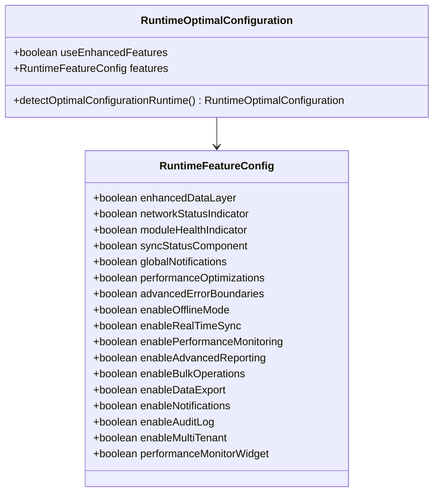

# Self-Hosting Deployment

<cite>
**Referenced Files in This Document**
- [SELF_HOSTING_DEPLOYMENT.md](file://docs/SELF_HOSTING_DEPLOYMENT.md)
- [setup-self-hosted.cjs](file://scripts/setup-self-hosted.cjs)
- [deployment.ts](file://src/config/deployment.ts)
- [environmentRuntime.ts](file://src/config/environmentRuntime.ts)
- [databaseEnvVars.ts](file://src/config/databaseEnvVars.ts)
- [unifiedConfig.ts](file://src/config/unifiedConfig.ts)
- [databaseConfigRuntime.ts](file://src/config/databaseConfigRuntime.ts)
- [databaseConfigSchema.ts](file://src/config/databaseConfigSchema.ts)
- [environmentMatrix.ts](file://src/config/environmentMatrix.ts)
- [vite.config.ts](file://vite.config.ts)
- [databaseService.ts](file://src/services/database/databaseService.ts)
- [DatabaseProviderFactory.ts](file://src/services/database/DatabaseProviderFactory.ts)
- [interfaces.ts](file://src/services/database/interfaces.ts)
- [package.json](file://package.json)
- [DEPLOYMENT_CLARIFICATION.md](file://docs/architecture/DEPLOYMENT_CLARIFICATION.md)
</cite>

## Table of Contents
1. [Introduction](#introduction)
2. [Architecture Overview](#architecture-overview)
3. [System Requirements](#system-requirements)
4. [Quick Start Setup](#quick-start-setup)
5. [Linux Deployment](#linux-deployment)
6. [Windows Deployment](#windows-deployment)
7. [Configuration Management](#configuration-management)
8. [Database Options](#database-options)
9. [Network Configuration](#network-configuration)
10. [Performance Optimization](#performance-optimization)
11. [Migration Path](#migration-path)
12. [Troubleshooting Guide](#troubleshooting-guide)
13. [Security Considerations](#security-considerations)
14. [Testing Protocols](#testing-protocols)
15. [Conclusion](#conclusion)

## Introduction

SchoolPilot3 offers a comprehensive self-hosting deployment solution that enables educational institutions to run the complete school management system on their own infrastructure. This deployment model provides complete control over data while maintaining the flexibility to scale and customize the system according to institutional needs.

The self-hosting option eliminates the need for external dependencies while providing robust multi-user access capabilities. The system supports both Linux and Windows environments with automatic database provider selection and optimal configuration management.

**Section sources**
- [SELF_HOSTING_DEPLOYMENT.md:26-51](file://docs/SELF_HOSTING_DEPLOYMENT.md#L26-L51)

## Architecture Overview

SchoolPilot3 follows a single-tenant architecture where each deployed instance serves exactly one school. The system operates as a companion application to backend systems, providing offline-first functionality with optional cloud connectivity.



**Diagram sources**
- [SELF_HOSTING_DEPLOYMENT.md:56-86](file://docs/SELF_HOSTING_DEPLOYMENT.md#L56-L86)

The architecture ensures that each SchoolPilot3 instance operates as a single-tenant system, providing complete data isolation while supporting multiple concurrent users through shared local storage mechanisms.

**Section sources**
- [DEPLOYMENT_CLARIFICATION.md:1-34](file://docs/architecture/DEPLOYMENT_CLARIFICATION.md#L1-L34)
- [DEPLOYMENT_CLARIFICATION.md:38-47](file://docs/architecture/DEPLOYMENT_CLARIFICATION.md#L38-L47)

## System Requirements

### Hardware Requirements

| Component | Minimum | Recommended |
|-----------|---------|-------------|
| **CPU** | 2 cores | 4 cores |
| **RAM** | 4 GB | 8 GB |
| **Storage** | 20 GB SSD | 50 GB NVMe SSD |
| **Network** | 100 Mbps LAN | 1 Gbps LAN |

### Software Requirements

- **Operating Systems**: Ubuntu 20.04+/22.04 LTS or Windows 10/11/Server 2022
- **Node.js**: 18+ (LTS recommended)
- **Browsers**: Chrome 113+, Firefox 115+, Edge 113+
- **Additional**: Git for repository access

### User Capacity Planning

| Configuration | Concurrent Users | Response Time |
|---------------|------------------|---------------|
| Minimum (SQLite) | 10-20 users | < 500ms |
| Recommended (SQLite) | 20-50 users | < 200ms |
| With LiveStore | 30-60 users | < 150ms |
| With CouchDB | 100+ users | < 100ms |

**Section sources**
- [SELF_HOSTING_DEPLOYMENT.md:126-157](file://docs/SELF_HOSTING_DEPLOYMENT.md#L126-L157)

## Quick Start Setup

The fastest way to deploy SchoolPilot3 involves a simple five-step process:

### Step 1: Prerequisites Verification
```bash
# Verify Node.js installation
node --version  # Should show v18.x or higher
npm --version   # Should show 9.x or higher
git --version
```

### Step 2: Repository Setup
```bash
# Clone the repository
git clone https://github.com/your-org/schoolpilot3.git
cd schoolpilot3

# Install dependencies
npm install
```

### Step 3: Environment Configuration
```bash
# Create .env.local file
cat > .env.local << EOF
VITE_PORT=5200
VITE_HOST=0.0.0.0
VITE_DATABASE_PROVIDER=sqlite-wasm
VITE_DATABASE_NAME=schoolpilot_prod
VITE_NODE_ENV=production
EOF
```

### Step 4: Application Launch
```bash
# Start the development server
npm run dev

# Access from clients
# http://<server-ip>:5200
```

### Step 5: Initial Configuration
The setup script automates most configuration tasks and provides clear next-step guidance for production deployment.

**Section sources**
- [SELF_HOSTING_DEPLOYMENT.md:169-188](file://docs/SELF_HOSTING_DEPLOYMENT.md#L169-L188)
- [setup-self-hosted.cjs:149-171](file://scripts/setup-self-hosted.cjs#L149-L171)

## Linux Deployment

### Ubuntu/Debian Installation

#### System Preparation
```bash
# Update system packages
sudo apt update && sudo apt upgrade -y

# Install Node.js 18+
curl -fsSL https://deb.nodesource.com/setup_18.x | sudo -E bash -
sudo apt install -y nodejs

# Install Git and PM2
sudo apt install -y git
sudo npm install -g pm2
```

#### Application Setup
```bash
# Create application directory
sudo mkdir -p /opt/schoolpilot3
sudo chown $USER:$USER /opt/schoolpilot3

# Clone repository
cd /opt/schoolpilot3
git clone https://github.com/your-org/schoolpilot3.git .

# Install dependencies
npm ci --production

# Create environment configuration
cat > .env.local << EOF
VITE_PORT=5200
VITE_HOST=0.0.0.0
VITE_DATABASE_PROVIDER=sqlite-wasm
VITE_DATABASE_NAME=schoolpilot_prod
VITE_NODE_ENV=production
EOF
```

#### Production Build
```bash
# Build for production
npm run build

# Verify build output
ls -la dist/
```

#### Nginx Configuration
```bash
# Install Nginx
sudo apt install -y nginx

# Create Nginx configuration
sudo tee /etc/nginx/sites-available/schoolpilot3 << 'EOF'
server {
    listen 80;
    server_name your-server-ip;

    # Security headers
    add_header X-Frame-Options "SAMEORIGIN" always;
    add_header X-Content-Type-Options "nosniff" always;
    add_header X-XSS-Protection "1; mode=block" always;
    add_header Referrer-Policy "strict-origin-when-cross-origin" always;

    # WASM and OPFS requirements
    add_header Cross-Origin-Opener-Policy "same-origin" always;
    add_header Cross-Origin-Embedder-Policy "require-corp" always;

    # Static file serving
    location / {
        root /opt/schoolpilot3/dist;
        try_files $uri $uri/ /index.html;
    }
}
EOF

# Enable site and restart
sudo ln -s /etc/nginx/sites-available/schoolpilot3 /etc/nginx/sites-enabled/
sudo nginx -t && sudo systemctl restart nginx
```

#### Firewall Configuration
```bash
# Enable UFW
sudo ufw enable

# Allow HTTP traffic
sudo ufw allow 80/tcp

# Allow HTTPS if using SSL
sudo ufw allow 443/tcp

# Deny direct access to dev server port
sudo ufw deny 5200/tcp
```

#### Process Management with PM2
```bash
# Start with PM2
pm2 start npm --name "schoolpilot3" -- run dev
pm2 save
pm2 startup systemd
```

### CentOS/RHEL Deployment
```bash
# Install Node.js
sudo dnf module install nodejs:18

# Install Nginx
sudo dnf install -y nginx

# Start and enable services
sudo systemctl start nginx
sudo systemctl enable nginx

# Configure firewall
sudo firewall-cmd --permanent --add-service=http
sudo firewall-cmd --permanent --add-service=https
sudo firewall-cmd --reload
```

**Section sources**
- [SELF_HOSTING_DEPLOYMENT.md:220-387](file://docs/SELF_HOSTING_DEPLOYMENT.md#L220-L387)

## Windows Deployment

### System Requirements
- **Operating Systems**: Windows 10/11 or Windows Server 2022
- **Prerequisites**: Node.js LTS and Git installation

### Installation Process

#### Prerequisite Verification
```powershell
# Verify installations
node --version   # Should show v18.x or higher
npm --version    # Should show 9.x or higher
git --version
```

#### Application Setup
```powershell
# Create application directory
New-Item -ItemType Directory -Path "C:\SchoolPilot3" -Force
Set-Location "C:\SchoolPilot3"

# Clone repository
git clone https://github.com/your-org/schoolpilot3.git .

# Install dependencies
npm ci --production

# Create environment configuration
@"
VITE_PORT=5200
VITE_HOST=0.0.0.0
VITE_DATABASE_PROVIDER=sqlite-wasm
VITE_DATABASE_NAME=schoolpilot_prod
VITE_NODE_ENV=production
"@ | Out-File -FilePath ".env.local" -Encoding UTF8
```

#### Production Build
```powershell
# Build application
npm run build

# Verify output
Get-ChildItem -Path "dist"
```

#### IIS Configuration (Optional)
For production deployments, configure IIS as a reverse proxy:

```xml
<!-- web.config for IIS -->
<?xml version="1.0" encoding="UTF-8"?>
<configuration>
  <system.webServer>
    <rewrite>
      <rules>
        <rule name="SPA Routes" stopProcessing="true">
          <match url=".*" />
          <conditions>
            <add input="{REQUEST_FILENAME}" matchType="IsFile" negate="true" />
            <add input="{REQUEST_FILENAME}" matchType="IsDirectory" negate="true" />
          </conditions>
          <action type="Rewrite" url="/" />
        </rule>
      </rules>
    </rewrite>
    <httpProtocol>
      <customHeaders>
        <add name="Cross-Origin-Opener-Policy" value="same-origin" />
        <add name="Cross-Origin-Embedder-Policy" value="require-corp" />
      </customHeaders>
    </httpProtocol>
  </system.webServer>
</configuration>
```

#### Windows Firewall Configuration
```powershell
# Allow HTTP traffic
New-NetFirewallRule -DisplayName "SchoolPilot3 HTTP" -Direction Inbound -Protocol TCP -LocalPort 80 -Action Allow

# Allow HTTPS traffic
New-NetFirewallRule -DisplayName "SchoolPilot3 HTTPS" -Direction Inbound -Protocol TCP -LocalPort 443 -Action Allow
```

#### Windows Service Deployment
Use NSSM (Non-Sucking Service Manager) for automatic startup:
```powershell
# Install NSSM and create service
nssm install SchoolPilot3 "C:\Program Files\nodejs\node.exe" "C:\SchoolPilot3\server.js"
nssm start SchoolPilot3
nssm set SchoolPilot3 AppDirectory "C:\SchoolPilot3"
```

**Section sources**
- [SELF_HOSTING_DEPLOYMENT.md:391-514](file://docs/SELF_HOSTING_DEPLOYMENT.md#L391-L514)

## Configuration Management

### Environment-Based Configuration

SchoolPilot3 implements a sophisticated configuration management system that adapts to different environments and deployment modes:



**Diagram sources**
- [environmentMatrix.ts:85-112](file://src/config/environmentMatrix.ts#L85-L112)
- [unifiedConfig.ts:340-456](file://src/config/unifiedConfig.ts#L340-L456)

### Database Configuration Schema

The system uses a comprehensive validation framework to ensure configuration integrity:

| Configuration Category | Key Variables | Purpose |
|------------------------|---------------|---------|
| **Provider Selection** | `DATABASE_PROVIDER`, `DATABASE_AUTO_DETECT` | Database engine choice |
| **Connection Settings** | `DATABASE_URL`, `DATABASE_NAME` | Connection parameters |
| **Performance Tuning** | `DATABASE_CACHE_SIZE`, `DATABASE_QUERY_TIMEOUT` | Performance optimization |
| **Storage Management** | `DATABASE_MAX_SIZE`, `DATABASE_ENCRYPTION` | Storage configuration |
| **Sync Settings** | `DATABASE_SYNC_ENABLED`, `DATABASE_SYNC_INTERVAL` | Synchronization behavior |
| **Monitoring** | `DATABASE_HEALTH_CHECKS`, `DATABASE_LOG_LEVEL` | Operational monitoring |

### Runtime Configuration Detection

The system automatically detects optimal runtime configurations based on environment capabilities:



**Diagram sources**
- [environmentRuntime.ts:24-57](file://src/config/environmentRuntime.ts#L24-L57)

**Section sources**
- [unifiedConfig.ts:1-800](file://src/config/unifiedConfig.ts#L1-L800)
- [databaseConfigSchema.ts:54-200](file://src/config/databaseConfigSchema.ts#L54-L200)
- [environmentRuntime.ts:29-57](file://src/config/environmentRuntime.ts#L29-L57)

## Database Options

### SQLite WASM + OPFS (Recommended)

**What It Is**: SQLite compiled to WebAssembly with Origin Private File System storage for browsers.

**Key Advantages**:
- Zero external dependencies
- Native SQLite performance
- Persistent storage across browser sessions
- Automatic backup capabilities
- No synchronization overhead

**Storage Location**: Browser's OPFS (origin-isolated storage)

### LiveStore Alternative

**Purpose**: Real-time collaborative database for scenarios requiring immediate multi-user updates.

**Use Cases**:
- Real-time collaborative features without CouchDB
- Complex queries with reactive updates
- Simplified alternative to PouchDB synchronization
- Enhanced query capabilities for reporting

### PouchDB + CouchDB (Multi-campus)

**When to Use**: Enterprise-scale deployments requiring multi-campus synchronization.

**Migration Path**: Configured through environment variables and database provider selection.

**Section sources**
- [SELF_HOSTING_DEPLOYMENT.md:88-123](file://docs/SELF_HOSTING_DEPLOYMENT.md#L88-L123)
- [DatabaseProviderFactory.ts:39-115](file://src/services/database/DatabaseProviderFactory.ts#L39-L115)

## Network Configuration

### Port Configuration

The system uses configurable ports for optimal deployment flexibility:

| Configuration Method | Default Port | Purpose |
|---------------------|--------------|---------|
| **Environment Variable** | `VITE_PORT=5200` | Development server |
| **Command Line** | `npm run dev -- --port 8080` | Temporary override |
| **Vite Config** | Direct edit | Permanent change |

### Server Binding Configuration

The development server automatically binds to all interfaces for network access:

```typescript
// Vite server configuration
server: {
  port: 5200,
  host: true,  // Binds to 0.0.0.0 for network access
  fs: { strict: false },
  headers: {
    'Cross-Origin-Opener-Policy': 'same-origin',
    'Cross-Origin-Embedder-Policy': 'require-corp',
  },
}
```

### Client Access Patterns

Clients access the application through standardized URLs:
- `http://<server-ip>:<port>`
- Examples: `http://192.168.1.100:5200`, `http://school-server.local:5200`

### Firewall Configuration

#### Linux (UFW)
```bash
# Allow application port
sudo ufw allow 5200/tcp

# Allow HTTP/HTTPS if using reverse proxy
sudo ufw allow 80/tcp
sudo ufw allow 443/tcp
```

#### Linux (firewalld)
```bash
# Allow port
sudo firewall-cmd --permanent --add-port=5200/tcp
sudo firewall-cmd --reload
```

#### Windows Firewall
```powershell
# Allow port
New-NetFirewallRule -DisplayName "SchoolPilot3" -Direction Inbound -Protocol TCP -LocalPort 5200 -Action Allow
```

**Section sources**
- [vite.config.ts:92-101](file://vite.config.ts#L92-L101)
- [SELF_HOSTING_DEPLOYMENT.md:517-622](file://docs/SELF_HOSTING_DEPLOYMENT.md#L517-L622)

## Performance Optimization

### Benchmark Specifications

Testing was conducted on a production-ready configuration:
- **Server**: Ubuntu 22.04, 4 cores, 8GB RAM, NVMe SSD
- **Database**: SQLite WASM + OPFS
- **Network**: 1 Gbps LAN
- **Clients**: Chrome 120 on Windows 11

### Performance Metrics

#### Single User Performance
| Operation | Response Time | Notes |
|-----------|---------------|-------|
| Page Load | < 1s | First load with cache |
| Page Load (cached) | < 200ms | Subsequent loads |
| Data Query | < 50ms | Simple queries |
| Complex Query | < 200ms | With joins/aggregations |
| Data Insert | < 30ms | Single record |
| Bulk Insert (100) | < 500ms | Transaction batch |
| Data Update | < 40ms | Single record |
| Data Delete | < 30ms | Single record |

#### Multi-User Performance
| Concurrent Users | Avg Response Time | P95 Response Time | Notes |
|------------------|-------------------|-------------------|-------|
| 10 users | < 100ms | < 200ms | Excellent |
| 20 users | < 150ms | < 300ms | Good |
| 30 users | < 200ms | < 400ms | Acceptable |
| 50 users | < 300ms | < 600ms | Degraded |
| 100 users | > 500ms | > 1000ms | Consider CouchDB |

### Optimization Strategies

#### Database Optimization
```bash
# Enable indexing (default: enabled)
VITE_DATABASE_ENABLE_INDEXING=true

# Set cache size (default: 100 MB)
VITE_DATABASE_CACHE_SIZE=100

# Set batch size for bulk operations (default: 1000)
VITE_DATABASE_BATCH_SIZE=1000
```

#### Application Optimization
```bash
# Enable compression
VITE_ENABLE_COMPRESSION=true

# Enable caching
VITE_ENABLE_CACHING=true

# Set query timeout (default: 30000ms)
VITE_QUERY_TIMEOUT=30000
```

**Section sources**
- [SELF_HOSTING_DEPLOYMENT.md:640-738](file://docs/SELF_HOSTING_DEPLOYMENT.md#L640-L738)

## Migration Path

### When to Consider Migration

Migration to CouchDB becomes necessary when:
- Concurrent users exceed 50
- Multiple campuses require synchronization
- Enterprise backup/DR requirements exist
- Real-time sync across locations is needed
- Advanced replication features are required

### Migration Process

#### Step 1: Prepare CouchDB Server
```bash
# Install CouchDB
sudo apt install -y couchdb

# Configure CouchDB
sudo nano /etc/couchdb/local.ini
# Set bind_address = 0.0.0.0
# Set port = 5984

# Start CouchDB
sudo systemctl start couchdb
sudo systemctl enable couchdb

# Create admin user
curl -X PUT http://localhost:5984/_node/_local/_config/admins/admin -d '"your-password"'
```

#### Step 2: Data Export
```bash
# Use application backup feature
# Navigate to Settings > Backup & Restore > Export

# Or use API
curl -X POST http://localhost:5200/api/backup \
  -H "Authorization: Bearer <token>" \
  -o backup.json
```

#### Step 3: System Configuration
Update `.env.local` for CouchDB migration:
```bash
# Switch to PouchDB provider
VITE_DATABASE_PROVIDER=pouchdb

# Configure CouchDB connection
VITE_DATABASE_URL=http://localhost:5984
VITE_DATABASE_NAME=schoolpilot
```

**Section sources**
- [SELF_HOSTING_DEPLOYMENT.md:741-800](file://docs/SELF_HOSTING_DEPLOYMENT.md#L741-L800)

## Troubleshooting Guide

### Common Issues and Solutions

#### Database Initialization Problems
**Symptoms**: Application fails to start with database errors
**Solutions**:
1. Verify SQLite WASM availability in browser
2. Check OPFS permissions for browser storage
3. Validate database file permissions on server
4. Review browser console for specific error messages

#### Network Access Issues
**Symptoms**: Clients cannot connect to server
**Solutions**:
1. Verify port is open in firewall
2. Check VITE_HOST configuration (should be 0.0.0.0)
3. Validate reverse proxy configuration if using Nginx/IIS
4. Test connectivity with telnet or curl

#### Performance Degradation
**Symptoms**: Slow response times under load
**Solutions**:
1. Increase cache size configuration
2. Optimize database indexes
3. Implement proper connection pooling
4. Consider hardware upgrades

#### Configuration Validation
The system includes comprehensive configuration validation:
```javascript
// Configuration validation checks
const validationRules = [
  { field: 'provider', validator: isValidProvider },
  { field: 'cacheSize', validator: isWithinRange(10, 10000) },
  { field: 'queryTimeout', validator: isWithinRange(1000, 300000) },
  { field: 'maxSize', validator: isNonNegative }
];
```

**Section sources**
- [databaseConfigSchema.ts:316-359](file://src/config/databaseConfigSchema.ts#L316-L359)
- [databaseService.ts:38-70](file://src/services/database/databaseService.ts#L38-L70)

## Security Considerations

### Production Security Hardening

#### Network Security
- **HTTPS Termination**: Use reverse proxy with SSL certificates
- **Firewall Rules**: Restrict access to necessary ports only
- **Rate Limiting**: Implement rate limiting for API endpoints
- **DDoS Protection**: Deploy WAF for protection against attacks

#### Authentication and Authorization
- **API Key Management**: Secure API key storage and rotation
- **Session Management**: Implement secure session handling
- **Access Control**: Role-based access control for administrative functions
- **Audit Logging**: Comprehensive logging of all administrative actions

#### Data Protection
- **Encryption**: Enable database encryption for sensitive data
- **Backup Security**: Secure encrypted backups with rotation policies
- **Data Retention**: Implement automated cleanup policies
- **Compliance**: Ensure compliance with educational data privacy regulations

#### Browser Security Headers
```nginx
# Essential security headers for production
add_header X-Frame-Options "SAMEORIGIN" always;
add_header X-Content-Type-Options "nosniff" always;
add_header X-XSS-Protection "1; mode=block" always;
add_header Referrer-Policy "strict-origin-when-cross-origin" always;
add_header Cross-Origin-Opener-Policy "same-origin" always;
add_header Cross-Origin-Embedder-Policy "require-corp" always;
```

**Section sources**
- [SELF_HOSTING_DEPLOYMENT.md:632-637](file://docs/SELF_HOSTING_DEPLOYMENT.md#L632-L637)
- [vite.config.ts:97-100](file://vite.config.ts#L97-L100)

## Testing Protocols

### Performance Testing

#### Load Testing Strategy
1. **Baseline Testing**: Establish performance baselines with 10 concurrent users
2. **Stress Testing**: Gradually increase load to identify breaking points
3. **Soak Testing**: Extended testing periods to identify memory leaks
4. **Endurance Testing**: 24-hour continuous operation testing

#### Performance Metrics Collection
- **Response Times**: Track p50, p95, and p99 latency
- **Throughput**: Measure requests per second under load
- **Resource Utilization**: Monitor CPU, memory, and disk usage
- **Database Performance**: Track query execution times and cache hit rates

#### Automated Testing
```bash
# Performance test scripts
npm run test:performance
npm run test:stress
npm run test:endurance
```

### Integration Testing

#### Database Provider Testing
```bash
# Test all supported database providers
npm run test:sqlite-implementation
npm run test:wasm-sqlite
npm run test:sqlite-migration
```

#### Deployment Testing
```bash
# Test deployment configurations
npm run test:generators
npm run test:generators:performance
npm run test:generators:full
```

**Section sources**
- [package.json:58-61](file://package.json#L58-L61)
- [SELF_HOSTING_DEPLOYMENT.md:726-738](file://docs/SELF_HOSTING_DEPLOYMENT.md#L726-L738)

## Conclusion

SchoolPilot3's self-hosting deployment solution provides educational institutions with complete control over their data while maintaining the flexibility to scale and customize the system according to their specific needs. The architecture ensures single-tenant operation with robust multi-user support through shared local storage mechanisms.

### Key Benefits

1. **Complete Data Control**: All data remains within institutional infrastructure
2. **Flexible Deployment**: Support for both Linux and Windows environments
3. **Automatic Optimization**: Intelligent provider selection and configuration
4. **Scalable Architecture**: Designed to handle growing institutional needs
5. **Enterprise Ready**: Comprehensive security, monitoring, and backup capabilities

### Deployment Recommendations

- **Small Institutions**: Start with SQLite WASM + OPFS for simplicity
- **Medium Institutions**: Consider LiveStore for enhanced real-time features
- **Large Institutions**: Plan for CouchDB migration as user base grows
- **Multi-campus**: Implement centralized CouchDB for synchronization needs

The self-hosting deployment model positions SchoolPilot3 as a comprehensive, institution-owned solution that grows with the educational community it serves, providing both operational independence and technical excellence.

**Section sources**
- [DEPLOYMENT_CLARIFICATION.md:185-197](file://docs/architecture/DEPLOYMENT_CLARIFICATION.md#L185-L197)
- [SELF_HOSTING_DEPLOYMENT.md:26-51](file://docs/SELF_HOSTING_DEPLOYMENT.md#L26-L51)