# Analytics Module Overview

<cite>
**Referenced Files in This Document**
- [index.ts](file://src/plugins/builtin/analytics-mock/index.ts)
- [performanceMonitor.ts](file://src/services/performanceMonitor.ts)
- [PerformanceMonitor.tsx](file://src/components/PerformanceMonitor.tsx)
- [usePerformanceMonitoring.ts](file://src/hooks/usePerformanceMonitoring.ts)
- [AnalyticsTrendsPage.tsx](file://src/modules/reports/pages/analytics/AnalyticsTrendsPage.tsx)
- [AnalyticsClassPage.tsx](file://src/modules/reports/pages/analytics/AnalyticsClassPage.tsx)
- [AnalyticsExportPage.tsx](file://src/modules/reports/pages/analytics/AnalyticsExportPage.tsx)
- [AnalyticsSubjectPage.tsx](file://src/modules/reports/pages/analytics/AnalyticsSubjectPage.tsx)
- [AnalyticsTeacherDashboardPage.tsx](file://src/modules/reports/pages/analytics/AnalyticsTeacherDashboardPage.tsx)
- [moduleDefinition.tsx](file://src/modules/reports/moduleDefinition.tsx)
- [types.ts](file://src/plugins/types.ts)
- [SecurityAuditLogger.ts](file://src/services/database/SecurityAuditLogger.ts)
</cite>

## Update Summary
**Changes Made**
- Added comprehensive analytics module pages: AnalyticsClassPage, AnalyticsExportPage, AnalyticsSubjectPage, AnalyticsTeacherDashboardPage, AnalyticsTrendsPage
- Updated module structure to reflect merged analytics functionality into reports module
- Enhanced data layer implementation with complete analytics data hooks
- Expanded navigation structure with analytics sub-features
- Added complete TypeScript interfaces for analytics data structures

## Table of Contents
1. [Introduction](#introduction)
2. [Project Structure](#project-structure)
3. [Core Components](#core-components)
4. [Architecture Overview](#architecture-overview)
5. [Detailed Component Analysis](#detailed-component-analysis)
6. [Analytics Dashboard Pages](#analytics-dashboard-pages)
7. [Performance Monitoring System](#performance-monitoring-system)
8. [Analytics Data Engine](#analytics-data-engine)
9. [Data Types and Interfaces](#data-types-and-interfaces)
10. [Security and Audit](#security-and-audit)
11. [Integration Patterns](#integration-patterns)
12. [Conclusion](#conclusion)

## Introduction

The Analytics Module in SchoolPilot3 represents a comprehensive educational analytics framework designed to provide teachers, administrators, and stakeholders with actionable insights into academic performance, trends, and institutional metrics. This module integrates multiple subsystems including performance monitoring, mock analytics engines, interactive dashboards, and robust data visualization components.

The module serves as a critical component for educational data analysis, offering both real-time performance tracking and historical trend analysis capabilities. It supports multiple data sources, provides flexible visualization options, and maintains comprehensive audit trails for security compliance.

**Updated** The module has been significantly expanded with comprehensive analytics dashboard pages and integrated into the reports module structure, providing a unified analytics experience across teacher, subject, class, export, and trend functionalities.

## Project Structure

The Analytics Module is organized into several key architectural layers with enhanced navigation and data management:

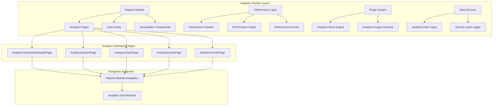

**Diagram sources**
- [moduleDefinition.tsx:44-50](file://src/modules/reports/moduleDefinition.tsx#L44-L50)
- [AnalyticsClassPage.tsx:1-100](file://src/modules/reports/pages/analytics/AnalyticsClassPage.tsx#L1-L100)
- [AnalyticsExportPage.tsx:1-86](file://src/modules/reports/pages/analytics/AnalyticsExportPage.tsx#L1-L86)
- [AnalyticsSubjectPage.tsx:1-31](file://src/modules/reports/pages/analytics/AnalyticsSubjectPage.tsx#L1-L31)
- [AnalyticsTeacherDashboardPage.tsx:1-50](file://src/modules/reports/pages/analytics/AnalyticsTeacherDashboardPage.tsx#L1-L50)

**Section sources**
- [moduleDefinition.tsx:1-53](file://src/modules/reports/moduleDefinition.tsx#L1-L53)
- [index.ts:1-475](file://src/plugins/builtin/analytics-mock/index.ts#L1-L475)
- [performanceMonitor.ts:1-316](file://src/services/performanceMonitor.ts#L1-L316)
- [AnalyticsTrendsPage.tsx:1-42](file://src/modules/reports/pages/analytics/AnalyticsTrendsPage.tsx#L1-L42)

## Core Components

### Analytics Engine Plugin System

The Analytics Engine Plugin System provides a flexible framework for integrating various analytics providers. The system supports both real analytics engines and mock implementations for development and testing purposes.

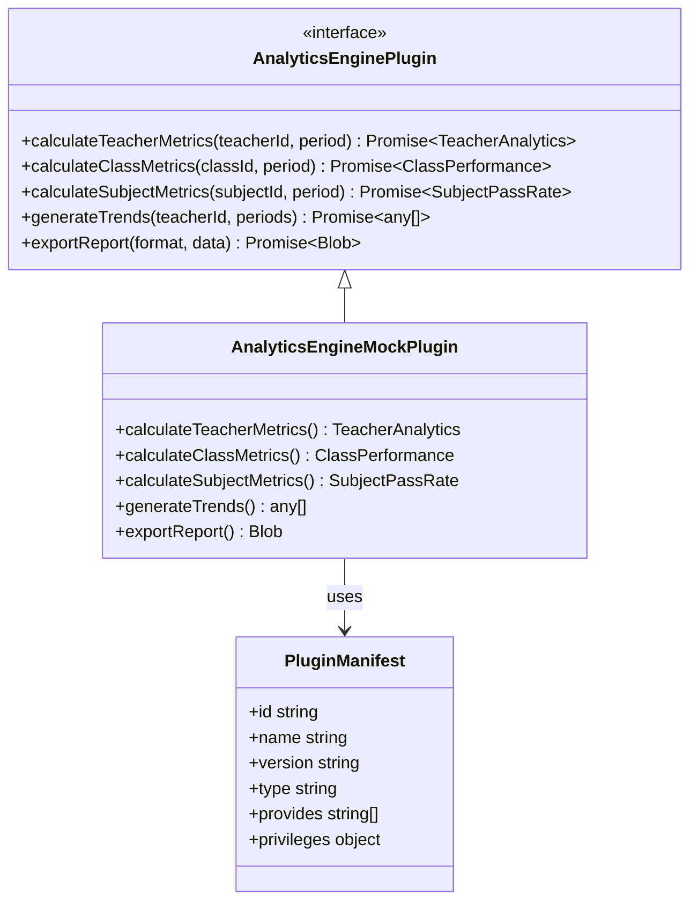

**Diagram sources**
- [types.ts:508-561](file://src/plugins/types.ts#L508-L561)
- [index.ts:111-394](file://src/plugins/builtin/analytics-mock/index.ts#L111-L394)

### Performance Monitoring Infrastructure

The performance monitoring system tracks application performance metrics including startup times, module loading, data operations, and user interactions. This infrastructure provides real-time insights into application performance and helps identify optimization opportunities.

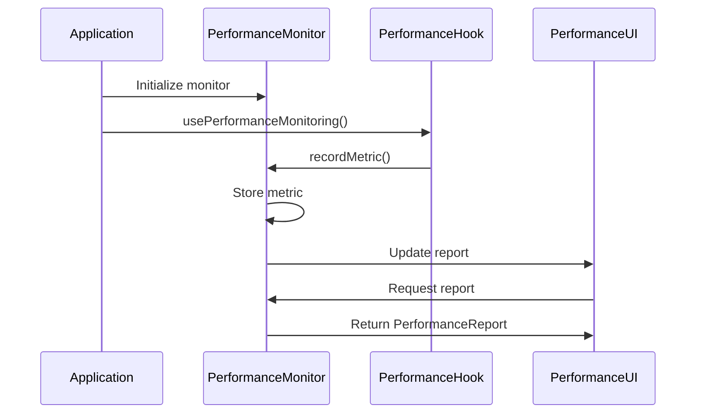

**Diagram sources**
- [performanceMonitor.ts:49-316](file://src/services/performanceMonitor.ts#L49-L316)
- [usePerformanceMonitoring.ts:21-161](file://src/hooks/usePerformanceMonitoring.ts#L21-L161)

**Section sources**
- [types.ts:508-561](file://src/plugins/types.ts#L508-L561)
- [index.ts:111-394](file://src/plugins/builtin/analytics-mock/index.ts#L111-L394)
- [performanceMonitor.ts:49-316](file://src/services/performanceMonitor.ts#L49-L316)
- [usePerformanceMonitoring.ts:21-161](file://src/hooks/usePerformanceMonitoring.ts#L21-L161)

## Architecture Overview

The Analytics Module follows a layered architecture pattern with clear separation of concerns and enhanced dashboard integration:

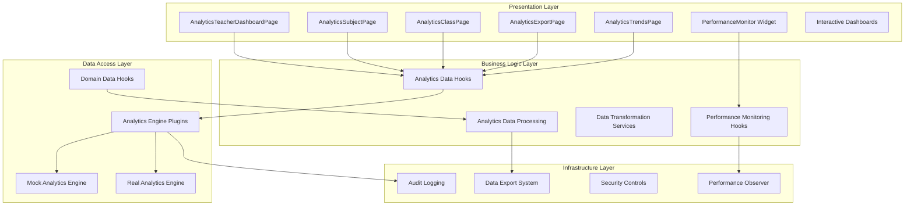

**Diagram sources**
- [AnalyticsClassPage.tsx:1-100](file://src/modules/reports/pages/analytics/AnalyticsClassPage.tsx#L1-L100)
- [AnalyticsExportPage.tsx:1-86](file://src/modules/reports/pages/analytics/AnalyticsExportPage.tsx#L1-L86)
- [AnalyticsSubjectPage.tsx:1-31](file://src/modules/reports/pages/analytics/AnalyticsSubjectPage.tsx#L1-L31)
- [AnalyticsTeacherDashboardPage.tsx:1-50](file://src/modules/reports/pages/analytics/AnalyticsTeacherDashboardPage.tsx#L1-L50)
- [PerformanceMonitor.tsx:1-311](file://src/components/PerformanceMonitor.tsx#L1-L311)
- [index.ts:1-475](file://src/plugins/builtin/analytics-mock/index.ts#L1-L475)

## Detailed Component Analysis

### AnalyticsTrendsPage Component

The AnalyticsTrendsPage serves as the primary interface for viewing academic performance trends over time. This component provides comprehensive analytics visualization with multiple metric views and interactive controls.

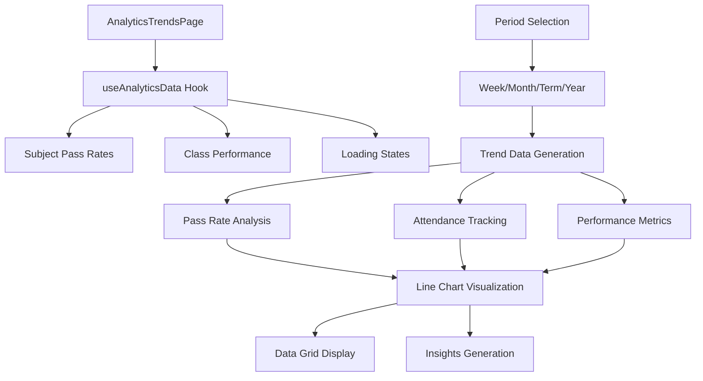

**Diagram sources**
- [AnalyticsTrendsPage.tsx:29-42](file://src/modules/reports/pages/analytics/AnalyticsTrendsPage.tsx#L29-L42)

The component implements sophisticated trend analysis with:
- **Dynamic Period Selection**: Supports week, month, term, and year views
- **Multi-Metric Analysis**: Pass rates, attendance, and performance metrics
- **Interactive Visualizations**: SVG-based line charts with gradient fills
- **Automated Insights**: AI-generated observations based on trend patterns
- **Responsive Design**: Adapts to different screen sizes and orientations

**Section sources**
- [AnalyticsTrendsPage.tsx:1-473](file://src/modules/reports/pages/analytics/AnalyticsTrendsPage.tsx#L1-L473)

### AnalyticsTeacherDashboardPage Component

The AnalyticsTeacherDashboardPage provides a comprehensive overview of teacher performance metrics and classroom analytics. This dashboard consolidates key performance indicators into an intuitive interface.

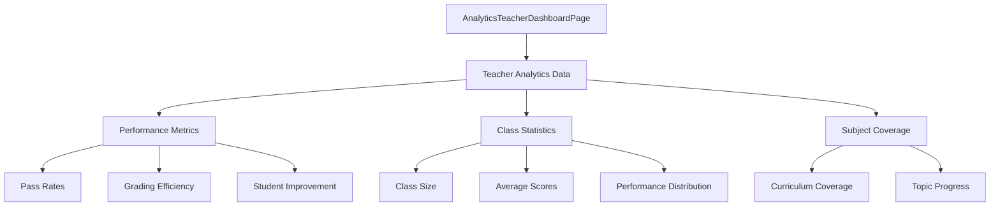

**Diagram sources**
- [AnalyticsTeacherDashboardPage.tsx:1-50](file://src/modules/reports/pages/analytics/AnalyticsTeacherDashboardPage.tsx#L1-L50)

**Section sources**
- [AnalyticsTeacherDashboardPage.tsx:1-328](file://src/modules/reports/pages/analytics/AnalyticsTeacherDashboardPage.tsx#L1-L328)

### AnalyticsSubjectPage Component

The AnalyticsSubjectPage focuses specifically on subject-level performance analysis, providing detailed insights into academic subjects and their performance trends.

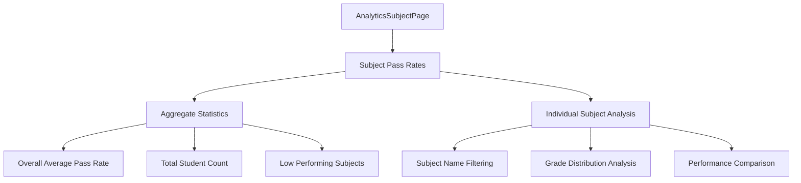

**Diagram sources**
- [AnalyticsSubjectPage.tsx:21-31](file://src/modules/reports/pages/analytics/AnalyticsSubjectPage.tsx#L21-L31)

**Section sources**
- [AnalyticsSubjectPage.tsx:1-345](file://src/modules/reports/pages/analytics/AnalyticsSubjectPage.tsx#L1-L345)

### AnalyticsClassPage Component

The AnalyticsClassPage provides class-level analytics, enabling administrators to monitor performance across different class groups and academic streams.

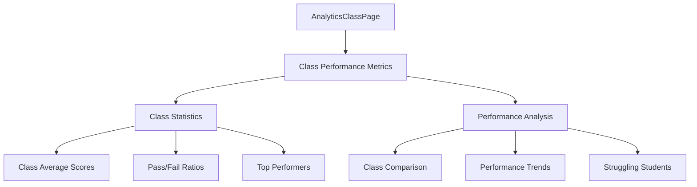

**Diagram sources**
- [AnalyticsClassPage.tsx:1-100](file://src/modules/reports/pages/analytics/AnalyticsClassPage.tsx#L1-L100)

**Section sources**
- [AnalyticsClassPage.tsx:1-478](file://src/modules/reports/pages/analytics/AnalyticsClassPage.tsx#L1-L478)

### AnalyticsExportPage Component

The AnalyticsExportPage enables comprehensive data export functionality with support for multiple formats and filtering options.

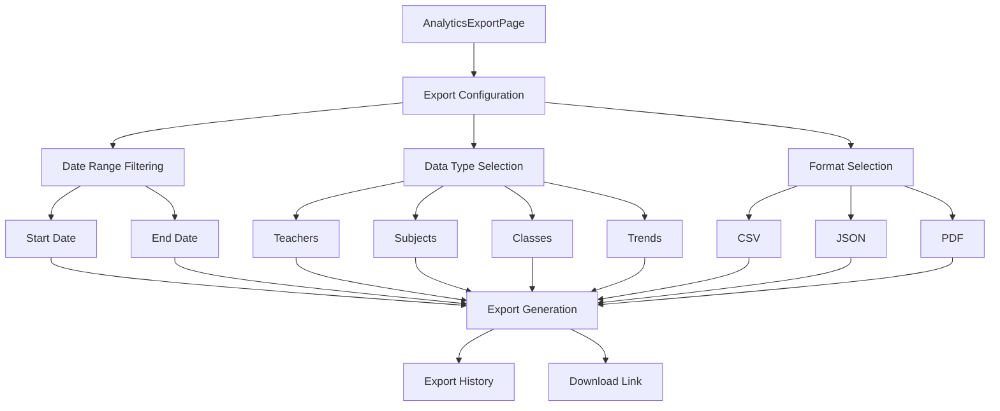

**Diagram sources**
- [AnalyticsExportPage.tsx:21-86](file://src/modules/reports/pages/analytics/AnalyticsExportPage.tsx#L21-L86)

**Section sources**
- [AnalyticsExportPage.tsx:1-489](file://src/modules/reports/pages/analytics/AnalyticsExportPage.tsx#L1-L489)

### PerformanceMonitor Component

The PerformanceMonitor provides real-time application performance insights through an interactive widget interface. This component displays critical performance metrics and allows for detailed analysis.

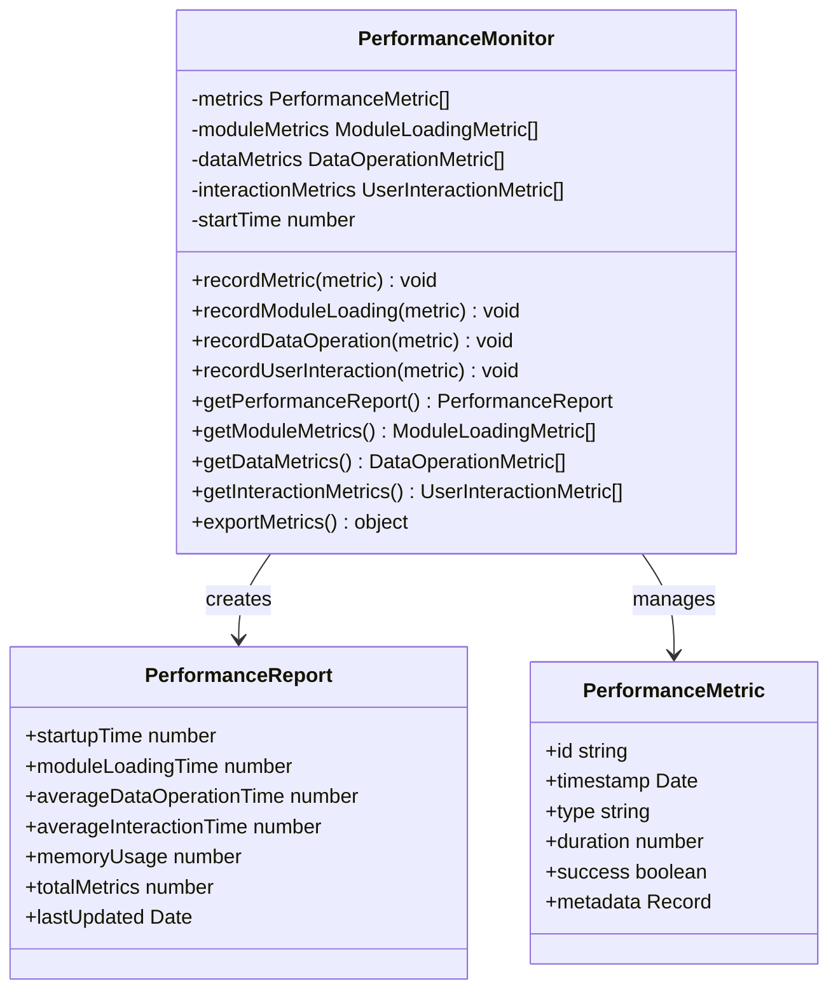

**Diagram sources**
- [performanceMonitor.ts:49-316](file://src/services/performanceMonitor.ts#L49-L316)

**Section sources**
- [PerformanceMonitor.tsx:1-311](file://src/components/PerformanceMonitor.tsx#L1-L311)
- [performanceMonitor.ts:1-316](file://src/services/performanceMonitor.ts#L1-L316)

### Analytics Engine Mock Implementation

The Analytics Engine Mock provides realistic simulation data for development and testing environments. This implementation ensures the analytics system remains functional without requiring access to production data.

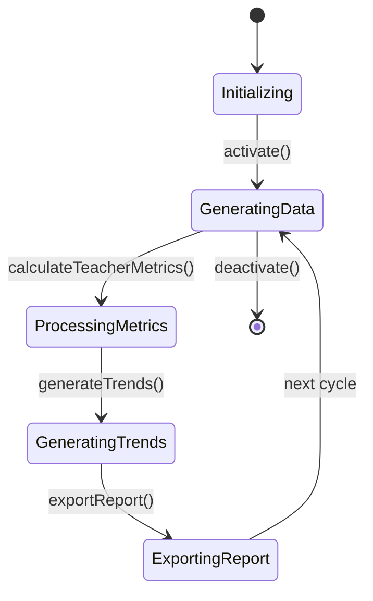

**Diagram sources**
- [index.ts:454-464](file://src/plugins/builtin/analytics-mock/index.ts#L454-L464)

The mock engine implements sophisticated data generation algorithms:
- **Realistic Data Patterns**: Simulates natural variations in academic performance
- **Randomized Metrics**: Generates plausible pass rates, scores, and trends
- **Performance Simulation**: Includes realistic processing delays
- **Export Capabilities**: Supports multiple export formats (CSV, Excel, PDF)

**Section sources**
- [index.ts:1-475](file://src/plugins/builtin/analytics-mock/index.ts#L1-L475)

## Analytics Dashboard Pages

### Dashboard Navigation Integration

The analytics module is seamlessly integrated into the reports module navigation system, providing structured access to different analytics perspectives:

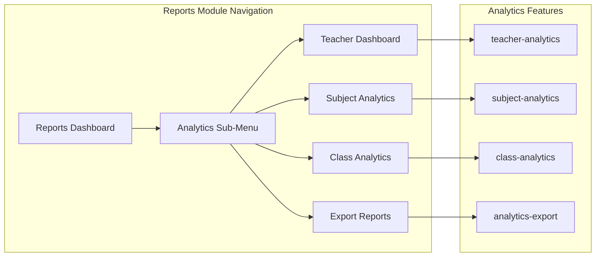

**Diagram sources**
- [moduleDefinition.tsx:44-50](file://src/modules/reports/moduleDefinition.tsx#L44-L50)

### Analytics Feature Architecture

Each analytics dashboard page implements a consistent data flow pattern with specialized functionality:

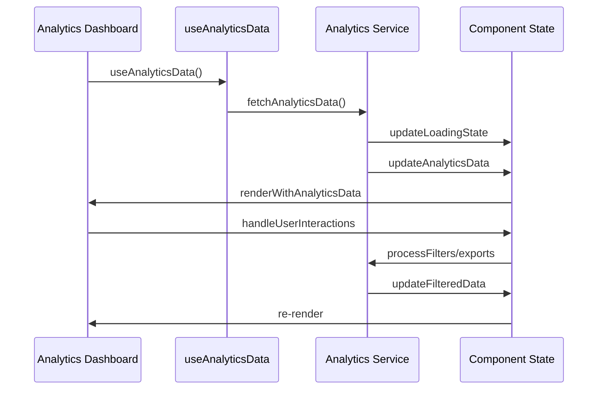

**Diagram sources**
- [AnalyticsClassPage.tsx:1-100](file://src/modules/reports/pages/analytics/AnalyticsClassPage.tsx#L1-L100)
- [AnalyticsExportPage.tsx:1-86](file://src/modules/reports/pages/analytics/AnalyticsExportPage.tsx#L1-L86)
- [AnalyticsSubjectPage.tsx:1-31](file://src/modules/reports/pages/analytics/AnalyticsSubjectPage.tsx#L1-L31)
- [AnalyticsTeacherDashboardPage.tsx:1-50](file://src/modules/reports/pages/analytics/AnalyticsTeacherDashboardPage.tsx#L1-L50)

**Section sources**
- [moduleDefinition.tsx:44-50](file://src/modules/reports/moduleDefinition.tsx#L44-L50)
- [AnalyticsClassPage.tsx:1-478](file://src/modules/reports/pages/analytics/AnalyticsClassPage.tsx#L1-L478)
- [AnalyticsExportPage.tsx:1-489](file://src/modules/reports/pages/analytics/AnalyticsExportPage.tsx#L1-L489)
- [AnalyticsSubjectPage.tsx:1-345](file://src/modules/reports/pages/analytics/AnalyticsSubjectPage.tsx#L1-L345)
- [AnalyticsTeacherDashboardPage.tsx:1-328](file://src/modules/reports/pages/analytics/AnalyticsTeacherDashboardPage.tsx#L1-L328)

## Performance Monitoring System

### Performance Hook Integration

The performance monitoring system integrates seamlessly with React applications through specialized hooks that provide automatic instrumentation.

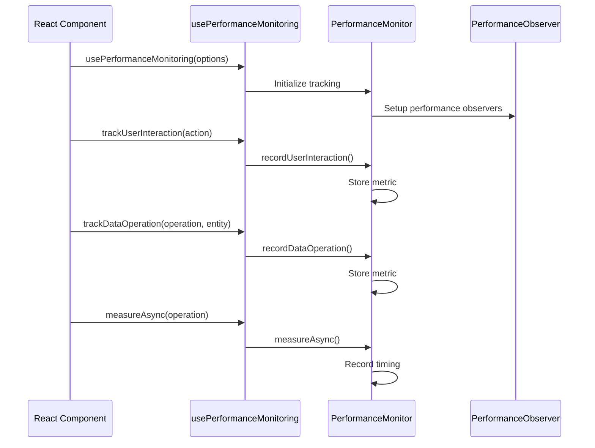

**Diagram sources**
- [usePerformanceMonitoring.ts:21-231](file://src/hooks/usePerformanceMonitoring.ts#L21-L231)
- [performanceMonitor.ts:64-111](file://src/services/performanceMonitor.ts#L64-L111)

### Performance Event Management

The system employs an event-driven architecture for performance updates, ensuring efficient resource utilization and responsive user interfaces.

**Section sources**
- [usePerformanceMonitoring.ts:1-274](file://src/hooks/usePerformanceMonitoring.ts#L1-L274)
- [performanceMonitor.ts:64-111](file://src/services/performanceMonitor.ts#L64-L111)

## Analytics Data Engine

### Data Types and Structures

The analytics system defines comprehensive data structures for representing educational metrics and performance indicators.

```mermaid
erDiagram
TEACHER_ANALYTICS {
string teacherId PK
string teacherName
object period
array passRates
array classPerformance
number assignmentsCreated
number assignmentsGraded
number gradingTurnaroundDays
number studentImprovement
number consistentPerformers
number strugglingStudents
number syllabusCoverage
array topicsCovered
array topicsPending
}
SUBJECT_PASS_RATE {
string subjectId PK
string subjectName
number examCount
number studentCount
number passRate
number averageScore
string trend
}
CLASS_PERFORMANCE {
string classId PK
string className
number streamCount
number studentCount
number averageScore
number passRate
array topPerformers
array bottomPerformers
}
ANALYTICS_PERIOD {
string type
string startDate
string endDate
}
TEACHER_ANALYTICS ||--o{ SUBJECT_PASS_RATE : contains
TEACHER_ANALYTICS ||--o{ CLASS_PERFORMANCE : contains
TEACHER_ANALYTICS --> ANALYTICS_PERIOD : covers
```

**Diagram sources**
- [types.ts:509-551](file://src/plugins/types.ts#L509-L551)

**Section sources**
- [types.ts:508-561](file://src/plugins/types.ts#L508-L561)

## Data Types and Interfaces

### Core Analytics Interfaces

The module defines standardized interfaces for analytics data exchange and processing:

| Interface | Purpose | Key Properties |
|-----------|---------|----------------|
| `AnalyticsEnginePlugin` | Defines analytics calculation and reporting interface | `calculateTeacherMetrics`, `calculateClassMetrics`, `calculateSubjectMetrics`, `generateTrends`, `exportReport` |
| `TeacherAnalytics` | Comprehensive teacher performance metrics | `passRates`, `classPerformance`, `assignmentsCreated`, `gradingTurnaroundDays`, `studentImprovement` |
| `ClassPerformance` | Class-level academic performance data | `studentCount`, `averageScore`, `passRate`, `topPerformers`, `bottomPerformers` |
| `SubjectPassRate` | Subject-specific pass rate statistics | `examCount`, `studentCount`, `passRate`, `averageScore`, `trend` |
| `AnalyticsPeriod` | Time period specification for analytics | `type`, `startDate`, `endDate` |

### Plugin Architecture

The analytics system supports extensible plugin architecture allowing integration of multiple analytics providers:

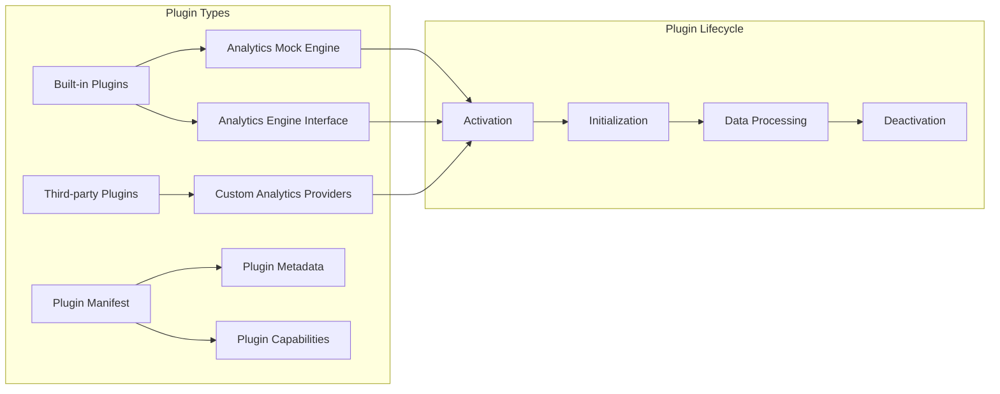

**Diagram sources**
- [index.ts:399-448](file://src/plugins/builtin/analytics-mock/index.ts#L399-L448)

**Section sources**
- [types.ts:508-561](file://src/plugins/types.ts#L508-L561)
- [index.ts:399-448](file://src/plugins/builtin/analytics-mock/index.ts#L399-L448)

## Security and Audit

### Security Audit Logging

The analytics module incorporates comprehensive security audit logging to maintain compliance and track data access patterns.

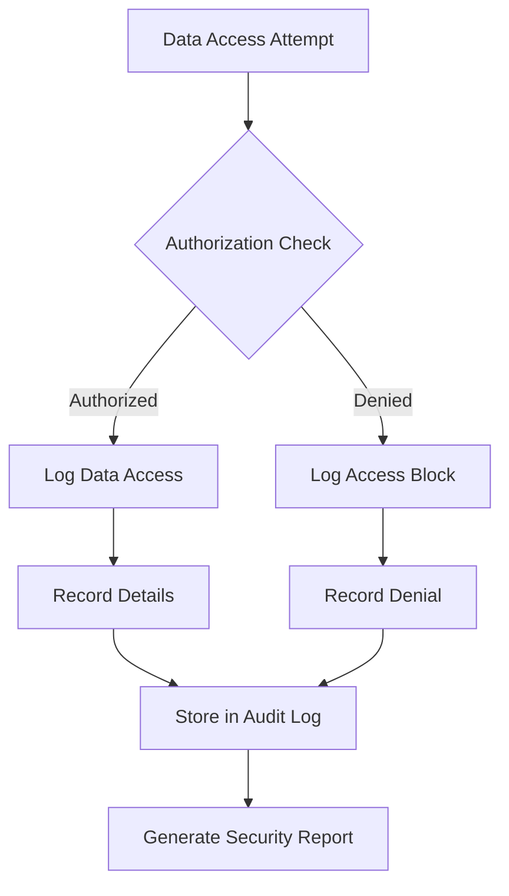

**Diagram sources**
- [SecurityAuditLogger.ts:240-291](file://src/services/database/SecurityAuditLogger.ts#L240-L291)

The security audit system tracks:
- **Data Access Events**: Read, query, export, and view operations
- **Data Modification Events**: Create, update, delete, and bulk operations
- **User Context**: Session IDs, IP addresses, and user agents
- **Compliance Reporting**: Automated security and audit reports

**Section sources**
- [SecurityAuditLogger.ts:240-291](file://src/services/database/SecurityAuditLogger.ts#L240-L291)

## Integration Patterns

### React Component Integration

The analytics components integrate seamlessly with the broader SchoolPilot3 ecosystem through established patterns:

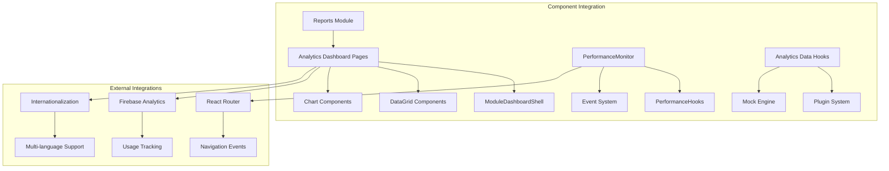

### Plugin System Integration

The analytics module leverages the plugin architecture for extensible functionality:

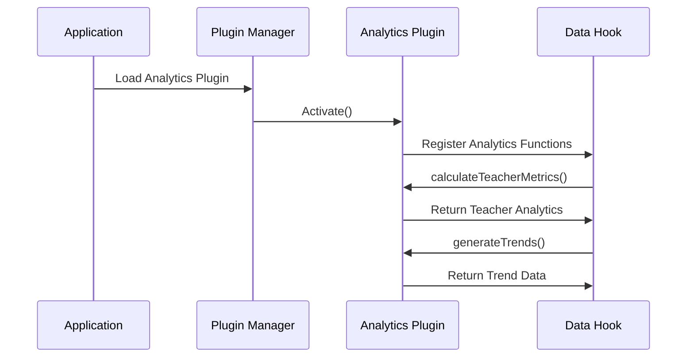

**Diagram sources**
- [index.ts:454-464](file://src/plugins/builtin/analytics-mock/index.ts#L454-L464)

**Section sources**
- [AnalyticsTrendsPage.tsx:1-473](file://src/modules/reports/pages/analytics/AnalyticsTrendsPage.tsx#L1-L473)
- [PerformanceMonitor.tsx:1-311](file://src/components/PerformanceMonitor.tsx#L1-L311)
- [index.ts:454-464](file://src/plugins/builtin/analytics-mock/index.ts#L454-L464)

## Conclusion

The Analytics Module in SchoolPilot3 represents a sophisticated educational analytics framework that successfully combines performance monitoring, comprehensive data visualization, and robust security measures. The modular architecture enables seamless integration of multiple analytics providers while maintaining flexibility for future enhancements.

**Updated** The module has been significantly enhanced with comprehensive analytics dashboard pages including teacher dashboards, subject analytics, class performance tracking, export functionality, and trend analysis. The integration into the reports module provides a unified analytics experience with structured navigation and feature-based access control.

Key strengths of the module include:

- **Comprehensive Performance Monitoring**: Real-time tracking of application performance with detailed metrics
- **Flexible Analytics Engine**: Support for both mock and real analytics providers
- **Rich Data Visualization**: Interactive dashboards with multiple metric views and trend analysis
- **Robust Security**: Complete audit logging and compliance tracking
- **Extensible Architecture**: Plugin-based system supporting third-party integrations
- **Unified Dashboard Experience**: Integrated analytics functionality within the reports module
- **Multiple Analytics Perspectives**: Dedicated pages for teachers, subjects, classes, export capabilities, and trend analysis
- **Advanced Data Export**: Comprehensive export functionality with filtering and format options
- **Complete TypeScript Integration**: Strongly typed analytics data structures and interfaces

The module provides educators and administrators with actionable insights into academic performance while maintaining high standards for data security and system reliability. Its modular design ensures scalability and adaptability to evolving educational analytics requirements, with the enhanced dashboard pages providing focused analytics experiences for different user roles and analytical needs.