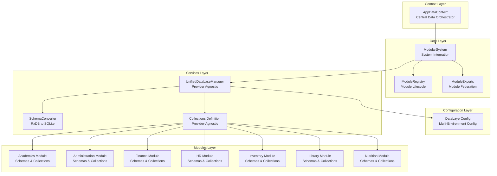
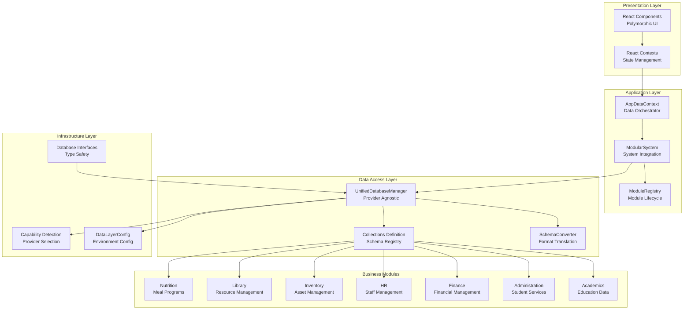
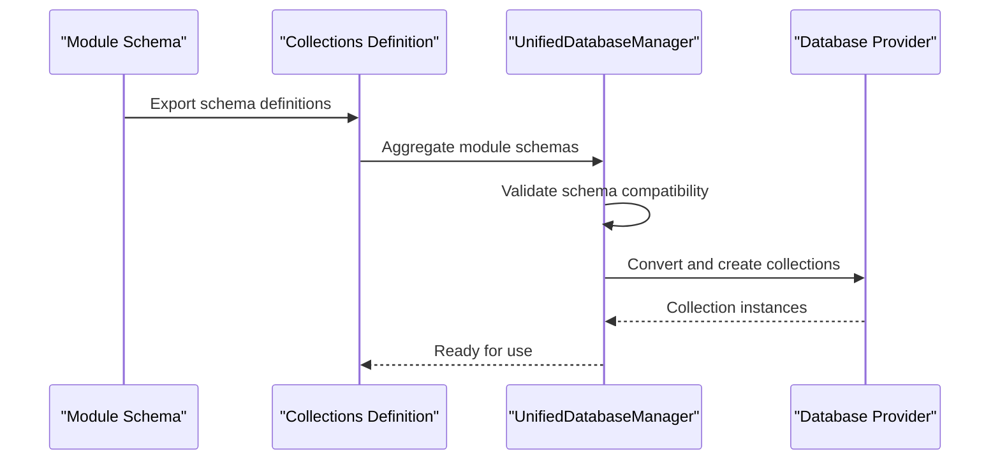
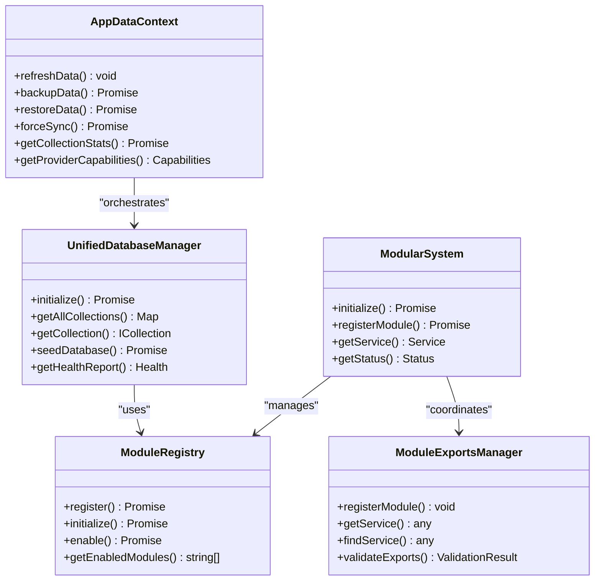
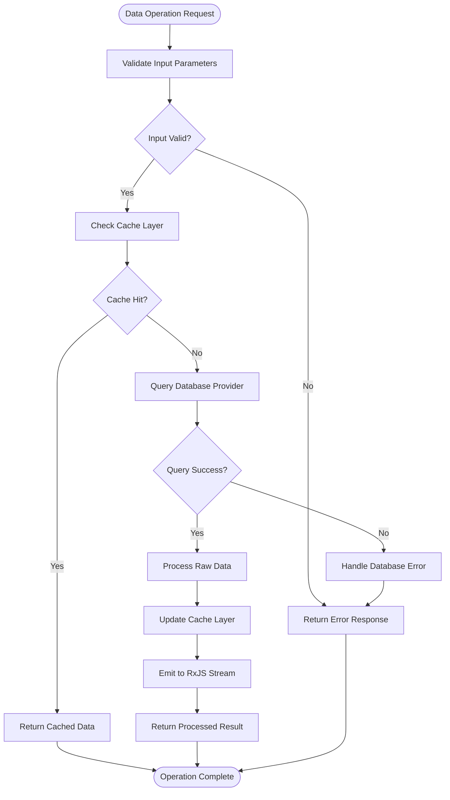
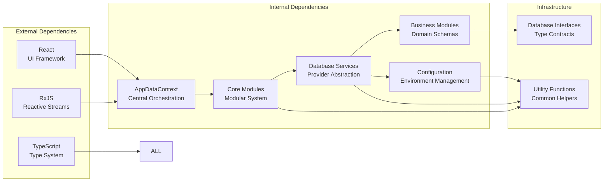

# Architecture Overview

<cite>
**Referenced Files in This Document**
- [AppDataContext.tsx](file://src/contexts/AppDataContext.tsx)
- [ModularSystem.ts](file://src/core/ModularSystem.ts)
- [dataLayerConfig.ts](file://src/config/dataLayerConfig.ts)
- [UnifiedDatabaseManager.ts](file://src/services/database/UnifiedDatabaseManager.ts)
- [moduleRegistry.ts](file://src/core/moduleRegistry.ts)
- [ModuleExports.ts](file://src/core/ModuleExports.ts)
- [collections.ts](file://src/services/database/collections.ts)
- [interfaces.ts](file://src/services/database/interfaces.ts)
- [schema.ts](file://src/livestore/schema.ts)
- [schema.ts](file://src/modules/academics/data/schema.ts)
- [schema.ts](file://src/modules/administration/data/schema.ts)
- [SchemaConverter.ts](file://src/services/database/SchemaConverter.ts)
</cite>

## Table of Contents
1. [Introduction](#introduction)
2. [Project Structure](#project-structure)
3. [Core Components](#core-components)
4. [Architecture Overview](#architecture-overview)
5. [Detailed Component Analysis](#detailed-component-analysis)
6. [Dependency Analysis](#dependency-analysis)
7. [Performance Considerations](#performance-considerations)
8. [Troubleshooting Guide](#troubleshooting-guide)
9. [Conclusion](#conclusion)

## Introduction
This document presents the architectural blueprint of SchoolPilot3, a modular educational management system designed with a focus on flexibility, scalability, and type-driven development. The architecture centers around three core patterns:

- Switchboard Pattern with AppDataContext as the central abstraction layer for data orchestration
- Dual-mode data layer architecture supporting development (SQLite OPFS) and production (PouchDB/LiveStore) modes
- Module Federation Pattern where each business module contributes schemas to a unified, provider-agnostic database

Additional architectural pillars include polymorphic component design, reactive data flow through RxJS observables, and a comprehensive type system that ensures consistency across modules and providers.

## Project Structure
SchoolPilot3 organizes functionality into cohesive layers:

- **Context Layer**: Centralized application state and data orchestration via React contexts
- **Core Layer**: Modular system management, registries, and lifecycle coordination
- **Configuration Layer**: Multi-environment database configuration and provider selection
- **Services Layer**: Database abstraction, provider factories, and schema conversion
- **Modules Layer**: Business domain modules contributing schemas and functionality
- **Infrastructure Layer**: Type definitions, interfaces, and cross-cutting concerns

**Diagram sources**
- [AppDataContext.tsx:1-200](file://src/contexts/AppDataContext.tsx#L1-L200)
- [ModularSystem.ts:1-120](file://src/core/ModularSystem.ts#L1-L120)
- [dataLayerConfig.ts:1-120](file://src/config/dataLayerConfig.ts#L1-L120)
- [UnifiedDatabaseManager.ts:1-120](file://src/services/database/UnifiedDatabaseManager.ts#L1-L120)
- [collections.ts:1-120](file://src/services/database/collections.ts#L1-L120)

**Section sources**
- [AppDataContext.tsx:1-200](file://src/contexts/AppDataContext.tsx#L1-L200)
- [ModularSystem.ts:1-120](file://src/core/ModularSystem.ts#L1-L120)
- [dataLayerConfig.ts:1-120](file://src/config/dataLayerConfig.ts#L1-L120)

## Core Components

### AppDataContext - Central Switchboard
The AppDataContext serves as the primary orchestrator for all application data operations. It encapsulates:

- **Unified Database Management**: Coordinates provider selection, initialization, and lifecycle
- **Network State Management**: Handles connectivity, offline/online transitions, and automatic sync
- **Data Operations**: Provides refresh, backup, restore, and cleanup capabilities
- **Sync Management**: Implements automatic and manual synchronization with configurable policies
- **Context Integration**: Exposes normalized data collections to React components

Key capabilities include:
- Provider-aware data refresh with progress tracking
- Collection statistics and health monitoring
- Pagination support across all collections
- Memory management with automated cleanup
- Real-time sync status and conflict resolution

**Section sources**
- [AppDataContext.tsx:100-380](file://src/contexts/AppDataContext.tsx#L100-L380)

### ModularSystem - System Integration Hub
The ModularSystem acts as the central integration point for all modularity features:

- **Module Registration**: Manages module lifecycle, dependencies, and exports
- **Service Registry**: Coordinates service registration and retrieval across modules
- **Event System**: Provides event forwarding and system-wide notifications
- **Status Monitoring**: Tracks system readiness and module health

The system supports both sequential and parallel module initialization with comprehensive error handling and recovery mechanisms.

**Section sources**
- [ModularSystem.ts:59-180](file://src/core/ModularSystem.ts#L59-L180)

### UnifiedDatabaseManager - Provider Agnostic Database
The UnifiedDatabaseManager provides a provider-agnostic interface for database operations:

- **Multi-Provider Support**: Seamless integration with SQLite, PouchDB, and LiveStore
- **Automatic Selection**: Intelligently chooses optimal provider based on environment and capabilities
- **Schema Conversion**: Converts RxDB schemas to provider-specific formats
- **Health Monitoring**: Continuous monitoring and automatic repair capabilities
- **Collection Management**: Centralized collection definition and lifecycle management

**Section sources**
- [UnifiedDatabaseManager.ts:44-170](file://src/services/database/UnifiedDatabaseManager.ts#L44-L170)

## Architecture Overview

SchoolPilot3 employs a sophisticated layered architecture that separates concerns while maintaining loose coupling:

**Diagram sources**
- [AppDataContext.tsx:1-120](file://src/contexts/AppDataContext.tsx#L1-L120)
- [ModularSystem.ts:1-80](file://src/core/ModularSystem.ts#L1-L80)
- [UnifiedDatabaseManager.ts:1-80](file://src/services/database/UnifiedDatabaseManager.ts#L1-L80)
- [dataLayerConfig.ts:1-80](file://src/config/dataLayerConfig.ts#L1-L80)
- [interfaces.ts:1-80](file://src/services/database/interfaces.ts#L1-L80)

### Dual-Mode Data Layer Architecture
The system implements a sophisticated dual-mode data layer supporting different environments:

**Development Mode (SQLite File)**:
- Uses SQLite with file storage for easy database inspection
- Ideal for development and debugging scenarios
- Provides full SQL query capabilities and database exploration tools

**Production Mode (PouchDB/LiveStore)**:
- Leverages PouchDB for robust offline-first capabilities
- Integrates LiveStore for enhanced performance and reliability
- Supports real-time synchronization and conflict resolution

**Demo Mode (SQLite WASM + OPFS)**:
- Production-like testing environment using WebAssembly
- OPFS (Origin Private File System) for persistent storage
- Enables comprehensive testing without server dependencies

**Section sources**
- [dataLayerConfig.ts:56-160](file://src/config/dataLayerConfig.ts#L56-L160)
- [UnifiedDatabaseManager.ts:222-316](file://src/services/database/UnifiedDatabaseManager.ts#L222-L316)

### Module Federation Pattern
Each business module contributes to a unified schema ecosystem:

**Diagram sources**
- [collections.ts:496-521](file://src/services/database/collections.ts#L496-L521)
- [schema.ts:1-50](file://src/modules/academics/data/schema.ts#L1-L50)
- [schema.ts:1-50](file://src/modules/administration/data/schema.ts#L1-L50)

**Section sources**
- [collections.ts:468-521](file://src/services/database/collections.ts#L468-L521)
- [schema.ts:28-60](file://src/livestore/schema.ts#L28-L60)

## Detailed Component Analysis

### Polymorphic Component Architecture
The system employs polymorphic components that adapt to different contexts and data sources:

**Diagram sources**
- [AppDataContext.tsx:100-200](file://src/contexts/AppDataContext.tsx#L100-L200)
- [ModularSystem.ts:59-120](file://src/core/ModularSystem.ts#L59-L120)
- [UnifiedDatabaseManager.ts:44-120](file://src/services/database/UnifiedDatabaseManager.ts#L44-L120)
- [moduleRegistry.ts:24-80](file://src/core/moduleRegistry.ts#L24-L80)
- [ModuleExports.ts:31-80](file://src/core/ModuleExports.ts#L31-L80)

### Reactive Data Flow with RxJS
The architecture leverages RxJS for reactive data operations:

**Diagram sources**
- [interfaces.ts:106-175](file://src/services/database/interfaces.ts#L106-L175)
- [AppDataContext.tsx:462-537](file://src/contexts/AppDataContext.tsx#L462-L537)

### Type-Driven Development Approach
The system enforces type safety across all layers:

- **Database Interfaces**: Strongly typed collection schemas and operations
- **Module Contracts**: Explicit service and component export contracts
- **Configuration Types**: Compile-time validation of environment configurations
- **Provider Abstractions**: Generic interfaces enabling seamless provider switching

**Section sources**
- [interfaces.ts:1-253](file://src/services/database/interfaces.ts#L1-L253)
- [ModuleExports.ts:1-309](file://src/core/ModuleExports.ts#L1-L309)

## Dependency Analysis

The architecture maintains clean separation of concerns through strategic dependency management:

**Diagram sources**
- [AppDataContext.tsx:1-20](file://src/contexts/AppDataContext.tsx#L1-L20)
- [ModularSystem.ts:1-20](file://src/core/ModularSystem.ts#L1-L20)
- [UnifiedDatabaseManager.ts:1-20](file://src/services/database/UnifiedDatabaseManager.ts#L1-L20)

### Integration Patterns
The system implements several integration patterns:

**Provider Factory Pattern**: Abstracts database provider selection and instantiation
**Repository Pattern**: Encapsulates data access logic behind collection interfaces
**Observer Pattern**: Implements reactive data flow using RxJS observables
**Plugin Pattern**: Supports dynamic module loading and service registration

**Section sources**
- [UnifiedDatabaseManager.ts:405-467](file://src/services/database/UnifiedDatabaseManager.ts#L405-L467)
- [interfaces.ts:177-218](file://src/services/database/interfaces.ts#L177-L218)

## Performance Considerations
The architecture incorporates multiple performance optimization strategies:

- **Lazy Loading**: Modules and services load on-demand to minimize initial bundle size
- **Caching Strategy**: Multi-level caching with automatic invalidation and cleanup
- **Batch Operations**: Optimized bulk operations for large dataset management
- **Memory Management**: Automated cleanup of old data and unused resources
- **Provider Optimization**: Intelligent provider selection based on capability detection

Scalability considerations include horizontal scaling through module federation, database sharding strategies, and distributed synchronization patterns.

## Troubleshooting Guide

### Common Issues and Solutions

**Database Initialization Failures**:
- Verify provider availability and environment configuration
- Check capability detection results for unsupported features
- Review fallback chain configuration for alternative providers

**Module Registration Errors**:
- Validate module dependencies and circular dependency detection
- Ensure proper service registration and export validation
- Check module lifecycle hooks for initialization failures

**Data Synchronization Issues**:
- Monitor sync status and conflict resolution policies
- Verify network connectivity and backend availability
- Review sync settings and retry configurations

**Performance Degradation**:
- Analyze collection statistics and index utilization
- Implement memory cleanup and data pruning strategies
- Optimize queries and consider pagination for large datasets

**Section sources**
- [UnifiedDatabaseManager.ts:548-750](file://src/services/database/UnifiedDatabaseManager.ts#L548-L750)
- [AppDataContext.tsx:462-537](file://src/contexts/AppDataContext.tsx#L462-L537)

## Conclusion
SchoolPilot3's architectural design demonstrates a mature approach to building scalable, maintainable enterprise applications. The combination of the Switchboard pattern with AppDataContext, dual-mode data layer architecture, and module federation creates a robust foundation for educational management systems.

Key architectural strengths include:
- **Flexibility**: Seamless provider switching and environment adaptation
- **Maintainability**: Clear separation of concerns and modular organization
- **Scalability**: Horizontal scaling through module federation and reactive data flow
- **Reliability**: Comprehensive error handling, health monitoring, and recovery mechanisms
- **Developer Experience**: Type-driven development and intuitive APIs

The architecture successfully balances complexity with practicality, providing both powerful capabilities for large-scale deployments and simplicity for development and testing scenarios. This foundation positions SchoolPilot3 for continued evolution and growth in the educational technology landscape.