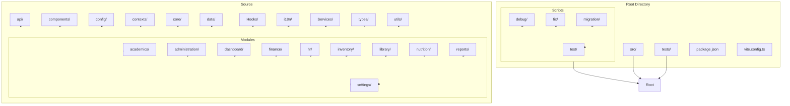
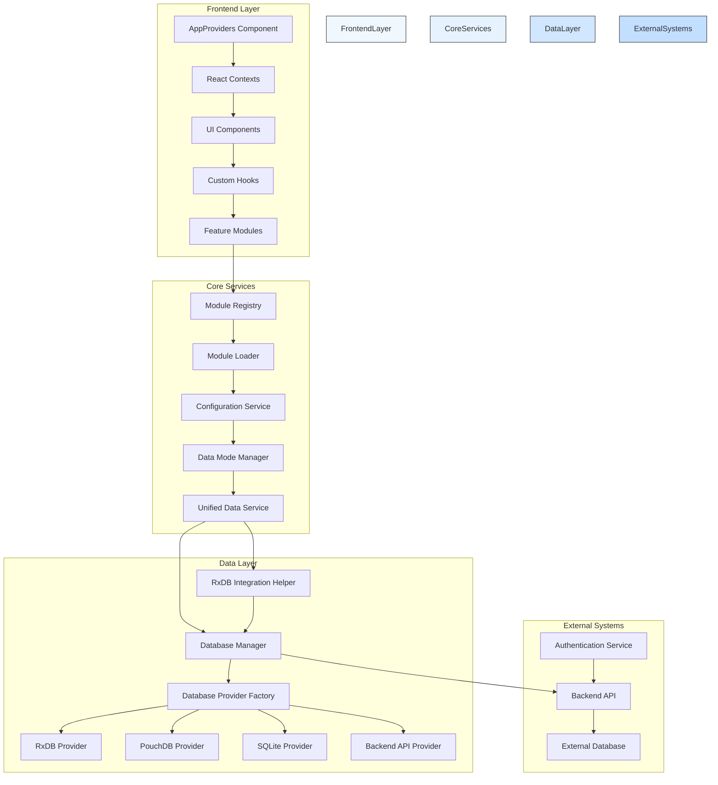
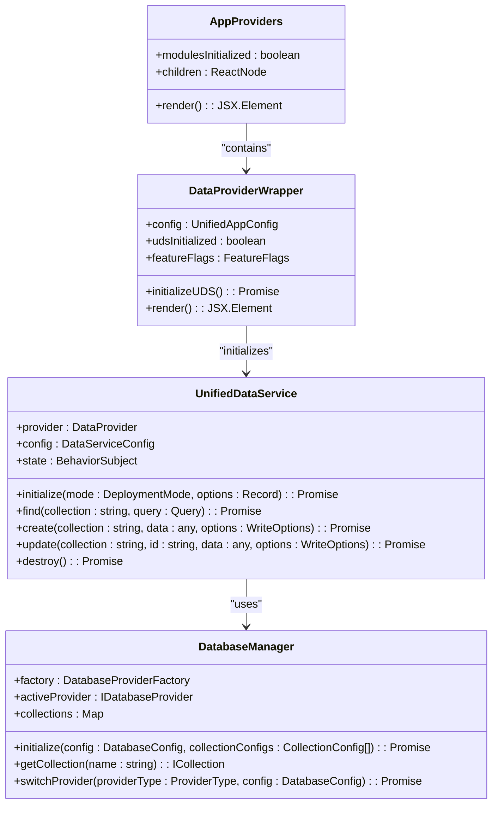
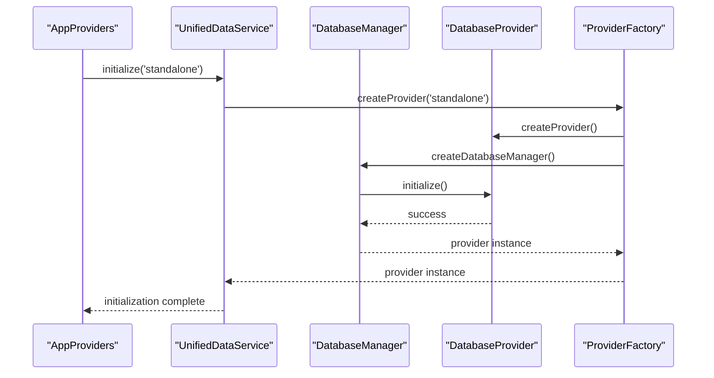
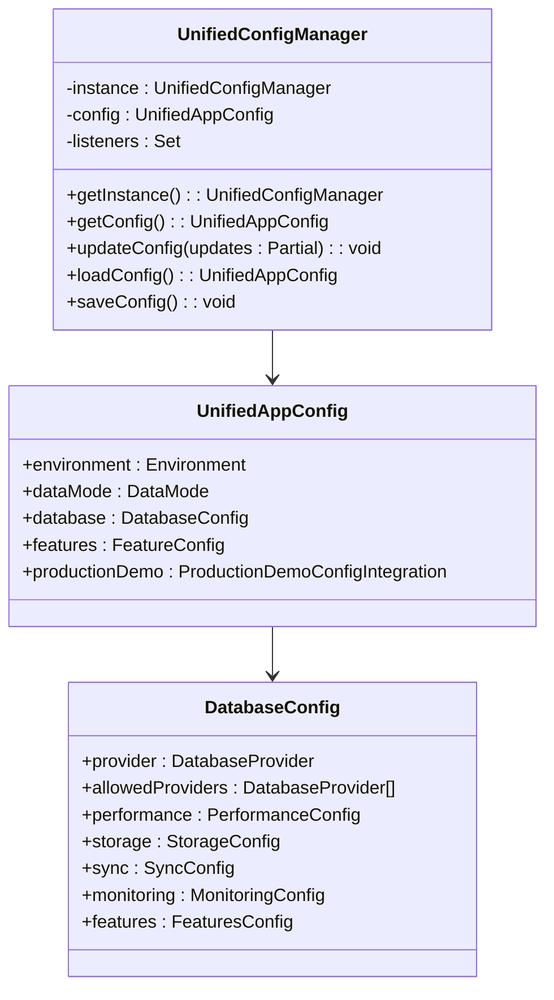
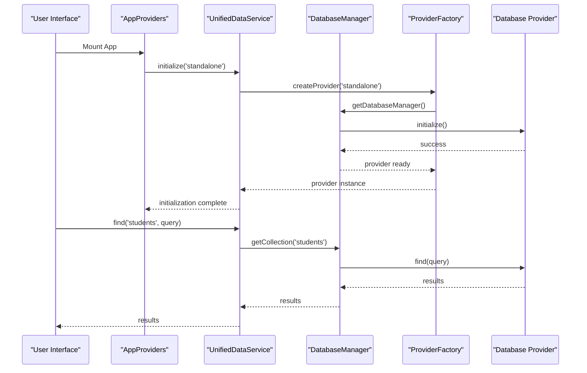
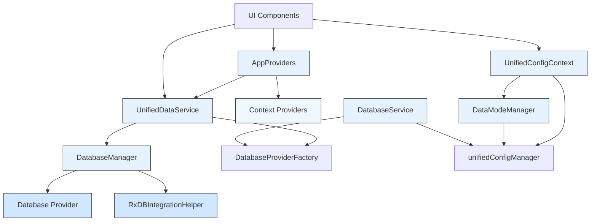

# Architecture Overview

<cite>
**Referenced Files in This Document**
- [AppProviders.tsx](file://src/contexts/AppProviders.tsx)
- [unifiedConfig.ts](file://src/config/unifiedConfig.ts)
- [ProviderSelector.ts](file://src/services/database/ProviderSelector.ts)
- [DatabaseProviderFactory.ts](file://src/services/database/DatabaseProviderFactory.ts)
- [interfaces.ts](file://src/services/database/interfaces.ts)
- [App.tsx](file://src/App.tsx)
- [AppDataContext.tsx](file://src/contexts/AppDataContext.tsx)
- [UnifiedDataService.ts](file://src/services/data/UnifiedDataService.ts)
- [environmentMatrix.ts](file://src/config/environmentMatrix.ts)
- [moduleRegistry.ts](file://src/core/moduleRegistry.ts)
- [moduleLoader.ts](file://src/core/moduleLoader.ts)
- [UnifiedConfigContext.tsx](file://src/contexts/UnifiedConfigContext.tsx)
- [databaseService.ts](file://src/services/databaseService.ts)
- [dataModeManager.ts](file://src/services/dataModeManager.ts)
- [ErrorBoundary.tsx](file://src/components/ErrorBoundary.tsx)
- [PerformanceMonitor.tsx](file://src/components/PerformanceMonitor.tsx)
- [i18n.ts](file://src/i18n/i18n.ts)
</cite>

## Update Summary
**Changes Made**
- Added comprehensive AppProviders component architecture replacing direct App.tsx composition
- Enhanced unified configuration framework with new AppProviders integration
- Updated database provider architecture with DatabaseManager and RxDBIntegrationHelper
- Integrated Unified Data Service (UDS) for enhanced data layer management
- Added new sections on provider selection guidelines and enhanced data flow patterns

## Table of Contents
1. [Introduction](#introduction)
2. [Project Structure](#project-structure)
3. [Core Components](#core-components)
4. [Architecture Overview](#architecture-overview)
5. [Detailed Component Analysis](#detailed-component-analysis)
6. [Dependency Analysis](#dependency-analysis)
7. [Performance Considerations](#performance-considerations)
8. [Troubleshooting Guide](#troubleshooting-guide)
9. [Conclusion](#conclusion)

## Introduction
The schoolpilot3 application is a modular, context-driven React application designed for educational institution management. This document provides a comprehensive architectural overview of the system, focusing on its modular design, service-oriented backend integration, and dynamic component interactions. The architecture emphasizes flexibility through plugin-based modules, hierarchical state management, and feature-flagged functionality. The system supports multiple data modes and database providers, enabling seamless transitions between development, staging, and production environments.

Recent updates have introduced a comprehensive architectural assessment with new AppProviders component, unified configuration framework, and enhanced database provider architecture. The application now features a composite provider system that orchestrates all application-level React contexts, providing a stable provider contract and improved initialization patterns. The enhanced database architecture includes DatabaseManager class for centralized database operations and RxDBIntegrationHelper for seamless RxDB integration.

## Project Structure

The schoolpilot3 application follows a feature-based modular architecture with clear separation of concerns. The project structure is organized into several key directories:

- **src**: Contains all source code for the application
  - **api**: REST API service definitions
  - **components**: Reusable UI components and component libraries
  - **config**: Configuration files and environment-specific settings
  - **contexts**: React context providers for state management
  - **core**: Foundational modules for the modular system
  - **data**: Mock data and data templates
  - **hooks**: Custom React hooks for state and side-effect management
  - **i18n**: Internationalization and localization resources
  - **modules**: Feature modules (academics, administration, finance, etc.)
  - **services**: Business logic and service layer implementations
  - **types**: Shared TypeScript interfaces and types

- **scripts**: Utility scripts for development, testing, and migration
  - **debug**: Debugging and analysis tools
  - **fix**: Code correction and refactoring scripts
  - **migration**: Data migration utilities
  - **test**: Testing scripts and utilities

- **tests**: Comprehensive test suite
  - **integration**: End-to-end integration tests
  - **performance**: Performance and memory tests

The modular structure allows for independent development and deployment of functional areas such as academics, administration, finance, HR, inventory, library, and nutrition. Each module is self-contained with its own components, data models, services, and configuration, enabling teams to work in parallel while maintaining system coherence.

**Diagram sources**
- [project_structure](file://)

**Section sources**
- [project_structure](file://)

## Core Components

The schoolpilot3 application is built around several core architectural components that enable its modular, flexible design. The foundation of the system is the module registry and loader system, which manages the dynamic registration, loading, and dependency resolution of functional modules. This system allows for runtime module activation and deactivation, enabling feature toggling and selective functionality deployment.

The **AppProviders** component serves as a composite provider that orchestrates all application-level React contexts, replacing the previous direct composition in App.tsx. This component reduces nesting depth and establishes a stable provider contract, integrating network, sync, authentication, user, and data providers in a structured manner. The AppProviders component includes sophisticated initialization logic for the Unified Data Service (UDS) with timeout handling and fallback mechanisms.

The unified configuration system provides centralized management of application settings across different environments (development, staging, production). It integrates environment detection, data mode policies, and production demo capabilities, allowing seamless transitions between different operational states. The configuration system is exposed through React contexts, making it easily accessible to UI components while maintaining reactivity.

The service layer implements a plugin-based database provider architecture, supporting multiple database technologies (RxDB, PouchDB, SQLite) based on environment requirements. Recent updates have enhanced this architecture with the introduction of the DatabaseManager class in ProviderSelector.ts, which orchestrates the dual-database architecture and provides centralized management of database operations. The data service factory pattern enables dynamic selection of the appropriate database provider based on the current environment and configuration.

The **Unified Data Service (UDS)** represents a significant enhancement to the data layer architecture. This service provides a consistent API across all storage backends and routes operations to the appropriate provider based on configuration. The UDS includes caching mechanisms, event broadcasting, and provider capability detection, offering a unified interface for data operations regardless of the underlying storage technology.

Internationalization is implemented through a modular loader system that supports multiple languages (English, French, Kinyarwanda, Swahili) with fallback mechanisms. The i18n context provides translation functions to components, enabling localized user interfaces. Error handling is centralized through ErrorBoundary components at multiple levels of the component hierarchy, ensuring graceful degradation when errors occur.

Performance monitoring is integrated throughout the system via the PerformanceMonitor component and associated services. These tools track rendering performance, memory usage, and API response times, providing insights for optimization. The tabbed workspace architecture supports complex user workflows with multiple concurrent tasks, while the hierarchical state management system ensures data consistency across the application.

**Section sources**
- [AppProviders.tsx:1-133](file://src/contexts/AppProviders.tsx#L1-L133)
- [unifiedConfig.ts:1-1668](file://src/config/unifiedConfig.ts#L1-L1668)
- [ProviderSelector.ts:1-450](file://src/services/database/ProviderSelector.ts#L1-L450)
- [DatabaseProviderFactory.ts:1-725](file://src/services/database/DatabaseProviderFactory.ts#L1-L725)
- [UnifiedDataService.ts:1-721](file://src/services/data/UnifiedDataService.ts#L1-L721)

## Architecture Overview

The schoolpilot3 application follows a modular, context-driven architecture with service-oriented backend integration. The system is designed as a single-page application (SPA) with a plugin-like architecture that allows for dynamic module loading and feature activation. The architecture emphasizes separation of concerns, with clear boundaries between the presentation layer, business logic, and data access layers.

At the core of the architecture is the **AppProviders** component, which serves as a composite provider that orchestrates all application-level React contexts. This component replaces the previous direct composition in App.tsx, reducing nesting depth and establishing a stable provider contract. The AppProviders component integrates network, sync, authentication, user, and data providers in a structured manner, with sophisticated initialization logic for the Unified Data Service (UDS).

The **Module Registry** system maintains a registry of available modules and their metadata. Modules are self-contained units of functionality that can be independently developed, tested, and deployed. Each module defines its own routes, components, services, and configuration through a module definition file. The Module Loader dynamically imports and registers these modules at runtime, enabling lazy loading and reducing initial bundle size.

The data flow in the application follows a unidirectional pattern from configuration context through service layer to UI components. Configuration data is managed through the UnifiedConfigContext, which provides a centralized store for application settings. Services consume this configuration to determine their behavior, such as which database provider to use or whether to enable demo data. UI components subscribe to both configuration and data contexts, automatically re-rendering when relevant state changes.

The architecture supports multiple deployment scenarios through its environment-aware design. The system can operate in different data modes (demo, production) and with different database providers (RxDB, PouchDB, SQLite) based on the detected environment. This flexibility allows for seamless transitions between development, staging, and production environments without code changes.

**Diagram sources**
- [AppProviders.tsx:1-133](file://src/contexts/AppProviders.tsx#L1-L133)
- [moduleRegistry.ts:1-195](file://src/core/moduleRegistry.ts#L1-L195)
- [moduleLoader.ts:1-86](file://src/core/moduleLoader.ts#L1-L86)
- [unifiedConfig.ts:1-1668](file://src/config/unifiedConfig.ts#L1-L1668)
- [ProviderSelector.ts:1-450](file://src/services/database/ProviderSelector.ts#L1-L450)
- [DatabaseProviderFactory.ts:1-725](file://src/services/database/DatabaseProviderFactory.ts#L1-L725)
- [UnifiedDataService.ts:1-721](file://src/services/data/UnifiedDataService.ts#L1-L721)

## Detailed Component Analysis

### AppProviders Component Architecture

The **AppProviders** component represents a significant architectural enhancement that serves as a composite provider orchestrating all application-level React contexts. This component replaces the previous direct composition in App.tsx, reducing nesting depth and establishing a stable provider contract.

The AppProviders component integrates multiple context providers in a structured hierarchy: HashRouter, NetworkProvider, SyncProvider, DataProviderWrapper, AuthProvider, UserProvider, ErrorBoundary, and StableActionProvider. This arrangement ensures proper initialization order and dependency management for all application contexts.

The **DataProviderWrapper** within AppProviders implements sophisticated initialization logic for the Unified Data Service (UDS). The wrapper checks for the `useUnifiedDataService` feature flag and initializes the UDS with PouchDB as the default provider. The initialization includes timeout handling with a 10-second timeout and fallback to mock data if initialization fails. This approach ensures application stability even when the data layer initialization encounters issues.

**Diagram sources**
- [AppProviders.tsx:1-133](file://src/contexts/AppProviders.tsx#L1-L133)
- [UnifiedDataService.ts:1-721](file://src/services/data/UnifiedDataService.ts#L1-L721)
- [ProviderSelector.ts:1-450](file://src/services/database/ProviderSelector.ts#L1-L450)

**Section sources**
- [AppProviders.tsx:1-133](file://src/contexts/AppProviders.tsx#L1-L133)
- [UnifiedDataService.ts:1-721](file://src/services/data/UnifiedDataService.ts#L1-L721)

### Enhanced Database Provider Architecture

The enhanced database provider architecture introduces several key components that improve the modularity and maintainability of the data layer. The **DatabaseManager** class serves as the central coordinator for database operations, providing centralized management of database instances and collections.

The **RxDBIntegrationHelper** class bridges the gap between the new unified architecture and existing RxDB-based code. This helper class processes RxDB collection definitions and converts them to the new schema format, enabling seamless integration with the enhanced database architecture. The integration helper includes comprehensive error handling and logging to facilitate debugging during the transition period.

The **DatabaseProviderFactory** implements a sophisticated factory pattern that manages multiple database providers (RxDB, PouchDB, SQLite, Backend API). The factory includes automatic provider selection based on environment and requirements, with fallback mechanisms for provider availability. The factory supports dynamic provider registration and provides status monitoring for all registered providers.

**Diagram sources**
- [AppProviders.tsx:1-133](file://src/contexts/AppProviders.tsx#L1-L133)
- [UnifiedDataService.ts:1-721](file://src/services/data/UnifiedDataService.ts#L1-L721)
- [ProviderSelector.ts:1-450](file://src/services/database/ProviderSelector.ts#L1-L450)
- [DatabaseProviderFactory.ts:1-725](file://src/services/database/DatabaseProviderFactory.ts#L1-L725)

**Section sources**
- [ProviderSelector.ts:1-450](file://src/services/database/ProviderSelector.ts#L1-L450)
- [DatabaseProviderFactory.ts:1-725](file://src/services/database/DatabaseProviderFactory.ts#L1-L725)
- [interfaces.ts:1-253](file://src/services/database/interfaces.ts#L1-L253)

### Unified Configuration System

The unified configuration system provides centralized management of application settings across different environments and deployment scenarios. This system integrates environment detection, data mode policies, and production demo capabilities to enable seamless transitions between development, staging, and production environments.

The configuration system is built around the **UnifiedAppConfig** interface, which consolidates various configuration aspects including environment, data mode, database provider, backend settings, demo configuration, and feature flags. The system uses a hierarchical approach to configuration resolution, combining environment detection, URL parameters, and user preferences to determine the current configuration state.

The **UnifiedConfigManager** class implements a singleton pattern for configuration management, providing methods for configuration loading, updating, and persistence. The manager includes sophisticated configuration migration capabilities to handle version upgrades and feature flag additions. The configuration system supports runtime configuration updates with automatic persistence to localStorage.

**Diagram sources**
- [unifiedConfig.ts:1-1668](file://src/config/unifiedConfig.ts#L1-L1668)
- [environmentMatrix.ts:1-149](file://src/config/environmentMatrix.ts#L1-L149)

**Section sources**
- [unifiedConfig.ts:1-1668](file://src/config/unifiedConfig.ts#L1-L1668)
- [environmentMatrix.ts:1-149](file://src/config/environmentMatrix.ts#L1-L149)

### Data Flow and Service Integration

The data flow in the schoolpilot3 application follows a unidirectional pattern from configuration context through service layer to UI components. This architecture ensures predictable state changes and simplifies debugging by making data flow explicit and traceable.

The process begins with the **AppProviders** component, which initializes the Unified Data Service (UDS) and other context providers. The UDS serves as the central data access layer, providing a consistent API across all storage backends. When the application initializes, the configuration system detects the current environment (development, staging, production) and loads the appropriate configuration from localStorage or applies defaults.

The **UnifiedDataService** manages provider initialization and routing operations to the appropriate backend. The service includes caching mechanisms, event broadcasting, and provider capability detection. The UDS supports multiple deployment modes (standalone, networked, hosted, demo) and automatically selects the optimal provider based on configuration and environment.

**Diagram sources**
- [AppProviders.tsx:1-133](file://src/contexts/AppProviders.tsx#L1-L133)
- [UnifiedDataService.ts:1-721](file://src/services/data/UnifiedDataService.ts#L1-L721)
- [ProviderSelector.ts:1-450](file://src/services/database/ProviderSelector.ts#L1-L450)

**Section sources**
- [AppProviders.tsx:1-133](file://src/contexts/AppProviders.tsx#L1-L133)
- [UnifiedDataService.ts:1-721](file://src/services/data/UnifiedDataService.ts#L1-L721)
- [ProviderSelector.ts:1-450](file://src/services/database/ProviderSelector.ts#L1-L450)

## Dependency Analysis

The schoolpilot3 application has a carefully designed dependency structure that balances flexibility with maintainability. The architecture follows a dependency inversion principle, where high-level modules depend on abstractions rather than concrete implementations. This approach enables loose coupling between components and facilitates testing and maintenance.

The core dependency chain begins with the **AppProviders** component, which serves as the central orchestrator for all application contexts. The AppProviders depends on the Unified Data Service (UDS) for data layer management and integrates multiple context providers. The UDS, in turn, depends on the DatabaseManager for database operations and the DatabaseProviderFactory for provider management.

The **DatabaseManager** class implements a sophisticated dependency injection pattern, managing the lifecycle of database providers and collections. The manager depends on the DatabaseProviderFactory for provider creation and the RxDBIntegrationHelper for seamless RxDB integration. This architecture enables easy swapping of database providers without affecting higher-level components.

**Diagram sources**
- [AppProviders.tsx:1-133](file://src/contexts/AppProviders.tsx#L1-L133)
- [UnifiedDataService.ts:1-721](file://src/services/data/UnifiedDataService.ts#L1-L721)
- [ProviderSelector.ts:1-450](file://src/services/database/ProviderSelector.ts#L1-L450)
- [DatabaseProviderFactory.ts:1-725](file://src/services/database/DatabaseProviderFactory.ts#L1-L725)

**Section sources**
- [AppProviders.tsx:1-133](file://src/contexts/AppProviders.tsx#L1-L133)
- [UnifiedDataService.ts:1-721](file://src/services/data/UnifiedDataService.ts#L1-L721)
- [ProviderSelector.ts:1-450](file://src/services/database/ProviderSelector.ts#L1-L450)
- [DatabaseProviderFactory.ts:1-725](file://src/services/database/DatabaseProviderFactory.ts#L1-L725)

## Performance Considerations

The schoolpilot3 application incorporates several performance optimization strategies to ensure responsive user experiences across different devices and network conditions. The modular architecture enables code splitting and lazy loading, reducing initial bundle size and improving startup time. Dynamic imports are used to load modules only when needed, minimizing memory usage and network bandwidth.

The **Unified Data Service (UDS)** implements efficient data access patterns through intelligent caching and provider management. The service uses a 1-minute cache TTL for query results and includes cache invalidation strategies for write operations. The UDS provides state observables for reactive updates and includes error handling with graceful degradation.

The data layer implements efficient data access patterns through the database service abstraction. The system uses a combination of in-memory caching, indexed database queries, and optimized data synchronization to minimize latency. The DatabaseManager coordinates database operations and provides centralized management of database instances and collections.

Memory management is addressed through the use of React's built-in optimization techniques, including memoization, useCallback, and useMemo hooks. The application implements virtualized lists for large datasets, preventing performance degradation when rendering hundreds or thousands of items. The PerformanceMonitor component tracks key metrics such as rendering time, memory usage, and API response times, providing insights for ongoing optimization.

Network performance is optimized through intelligent data fetching strategies. The application implements request batching, caching, and compression to minimize network overhead. The backend detection service uses efficient polling intervals and cache invalidation to balance freshness with performance. Feature flags allow for gradual rollout of new functionality, enabling performance monitoring before full deployment.

Error boundaries are strategically placed throughout the component hierarchy to prevent cascading failures and ensure graceful degradation. The ErrorBoundary components catch JavaScript errors in child components, log diagnostic information, and display fallback UIs without crashing the entire application. This approach improves reliability and user experience, especially in complex workflows.

## Troubleshooting Guide

When encountering issues with the schoolpilot3 application, follow this systematic troubleshooting approach:

1. **Check AppProviders Initialization**: Verify that the AppProviders component is properly mounting and initializing the Unified Data Service (UDS). Check the browser console for initialization errors and timeout messages. The AppProviders component includes timeout handling with 10-second timeouts for UDS initialization.

2. **Unified Data Service Issues**: If the UDS fails to initialize, check the feature flags for `useUnifiedDataService` and verify that the PouchDB provider is available. The UDS includes fallback mechanisms to mock data if initialization fails, but this indicates underlying configuration or provider issues.

3. **Database Provider Selection**: If database operations fail, verify the current database provider configuration in the unified configuration. Check the `database.provider` setting and ensure it matches the environment requirements. The DatabaseProviderFactory includes automatic provider selection logic that can be overridden by explicit configuration.

4. **RxDB Integration Problems**: For applications using RxDB, verify that the RxDBIntegrationHelper is properly converting collection schemas. Check the console logs for schema conversion errors and ensure that the RxDB collection definitions are properly formatted.

5. **Configuration Validation**: Use the unified configuration system to validate current settings. Check the `environmentConfig`, `database`, and `features` sections for proper configuration values. The configuration system includes validation functions and migration capabilities.

6. **Performance Monitoring**: Use the PerformanceMonitor component to identify bottlenecks. Check for excessive re-renders, large data sets, or inefficient queries. The application's modular architecture allows for isolating performance issues to specific modules.

7. **Error Boundary Triggers**: When an ErrorBoundary component catches an error, examine the error details and stack trace. The error tracking system logs diagnostic information to help identify the root cause. Check the error boundaries in AppProviders, AppDataContext, and individual components.

8. **Context Provider Issues**: Verify that all context providers are properly nested within the AppProviders component. Missing or improperly ordered context providers can cause initialization failures and runtime errors.

**Section sources**
- [AppProviders.tsx:1-133](file://src/contexts/AppProviders.tsx#L1-L133)
- [UnifiedDataService.ts:1-721](file://src/services/data/UnifiedDataService.ts#L1-L721)
- [ProviderSelector.ts:1-450](file://src/services/database/ProviderSelector.ts#L1-L450)
- [ErrorBoundary.tsx](file://src/components/ErrorBoundary.tsx)
- [unifiedConfig.ts:1-1668](file://src/config/unifiedConfig.ts#L1-L1668)

## Conclusion

The schoolpilot3 application demonstrates a sophisticated modular architecture that balances flexibility with maintainability. The introduction of the AppProviders component represents a significant architectural improvement, providing a stable provider contract and centralized context management. The enhanced database provider architecture with DatabaseManager and RxDBIntegrationHelper enables seamless integration of existing RxDB code with the new unified architecture.

The unified configuration system provides centralized control over application behavior across different environments, while the Unified Data Service (UDS) offers a consistent API for data operations regardless of the underlying storage technology. The plugin-based design enables independent development and deployment of functional modules, while the environment-aware design supports seamless transitions between development, staging, and production scenarios.

The architecture's key strengths include its dynamic module loading capability, which allows for runtime feature activation and deactivation, and its enhanced provider management system that improves reliability and maintainability. The composite provider pattern established by AppProviders reduces component nesting and provides a stable foundation for application initialization.

However, this flexibility comes with increased complexity in the dependency management and configuration systems. The multiple layers of abstraction, while providing flexibility, can make debugging more challenging for developers unfamiliar with the architecture. The reliance on dynamic imports and code splitting may also impact performance in low-bandwidth scenarios.

Future improvements could focus on enhancing the developer experience through better tooling for module development and testing, improving documentation of the configuration system, and optimizing the initial loading performance. The architecture provides a solid foundation for continued evolution, with clear extension points for new modules, data providers, and integration scenarios.

The schoolpilot3 application serves as an excellent example of modern web application architecture, demonstrating how modular design principles can be applied to create flexible, maintainable systems for complex educational management requirements. The recent architectural enhancements position the application for continued growth and adaptation to evolving requirements.