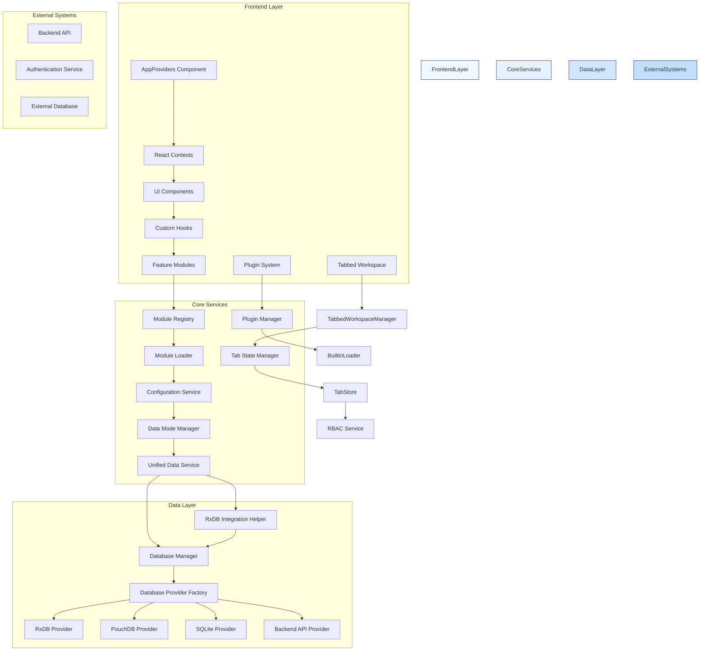
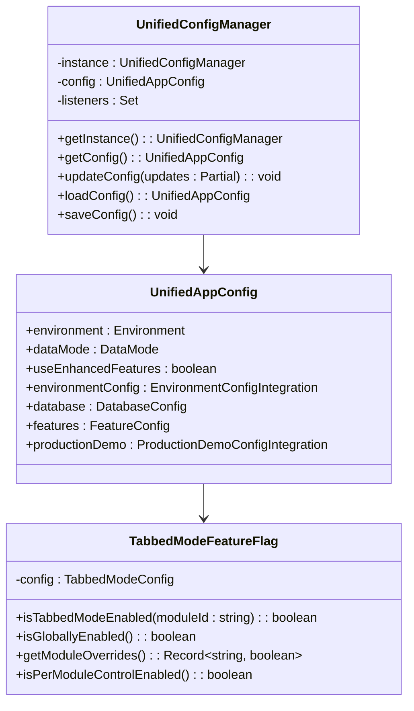
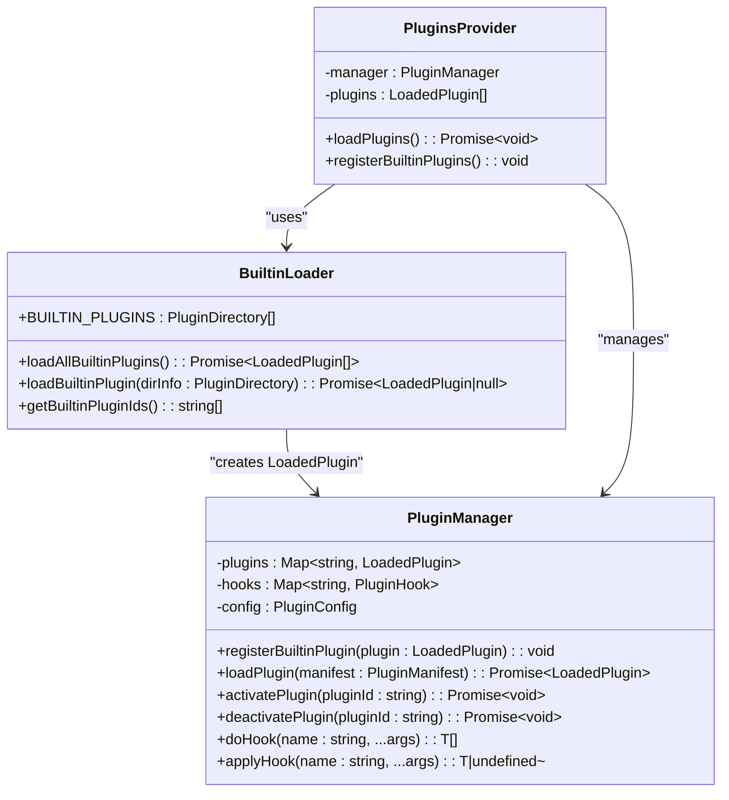
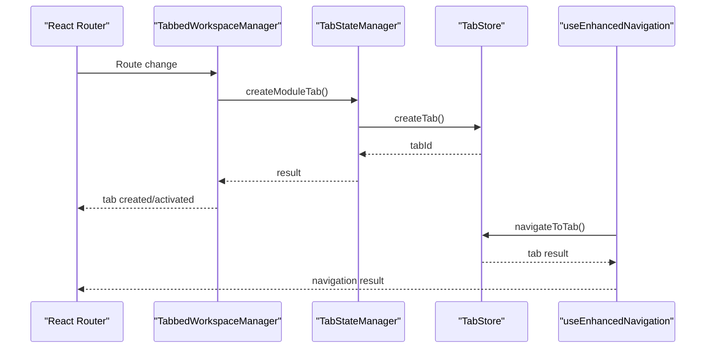
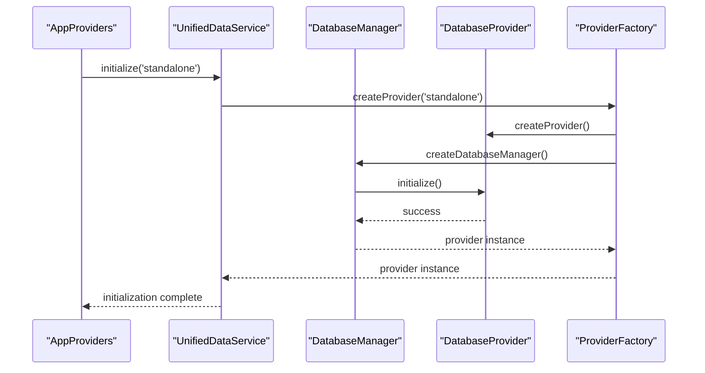
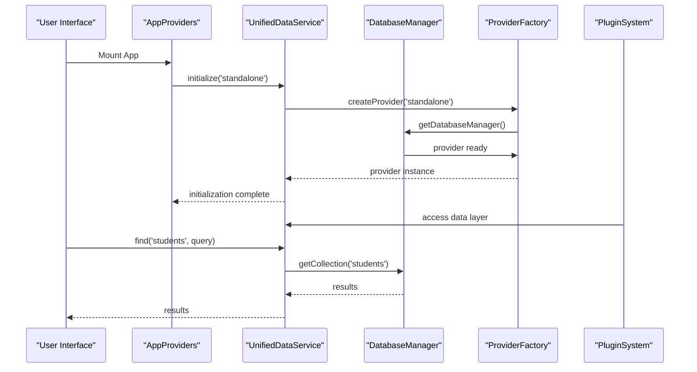
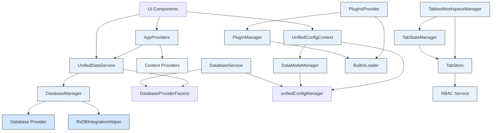

# Architecture Overview

<cite>
**Referenced Files in This Document**
- [AppProviders.tsx](file://src/contexts/AppProviders.tsx)
- [unifiedConfig.ts](file://src/config/unifiedConfig.ts)
- [BuiltinLoader.ts](file://src/plugins/BuiltinLoader.ts)
- [PluginManager.ts](file://src/plugins/PluginManager.ts)
- [PluginsProvider.tsx](file://src/plugins/PluginsProvider.tsx)
- [tabbedModeFeatureFlag.ts](file://src/services/tabbedModeFeatureFlag.ts)
- [useEnhancedNavigation.ts](file://src/hooks/useEnhancedNavigation.ts)
- [TabbedWorkspaceManager.tsx](file://src/components/tabbedWorkspace/TabbedWorkspaceManager.tsx)
- [tabStore.ts](file://src/stores/tabStore.ts)
- [tabStateManager.ts](file://src/services/tabStateManager.ts)
- [tabbedWorkspace.ts](file://src/types/tabbedWorkspace.ts)
- [ProviderSelector.ts](file://src/services/database/ProviderSelector.ts)
- [DatabaseProviderFactory.ts](file://src/services/database/DatabaseProviderFactory.ts)
- [interfaces.ts](file://src/services/database/interfaces.ts)
- [App.tsx](file://src/App.tsx)
- [AppDataContext.tsx](file://src/contexts/AppDataContext.tsx)
- [UnifiedDataService.ts](file://src/services/data/UnifiedDataService.ts)
- [environmentMatrix.ts](file://src/config/environmentMatrix.ts)
- [moduleRegistry.ts](file://src/core/moduleRegistry.ts)
- [moduleLoader.ts](file://src/core/moduleLoader.ts)
- [UnifiedConfigContext.tsx](file://src/contexts/UnifiedConfigContext.tsx)
- [databaseService.ts](file://src/services/databaseService.ts)
- [dataModeManager.ts](file://src/services/dataModeManager.ts)
- [ErrorBoundary.tsx](file://src/components/ErrorBoundary.tsx)
- [PerformanceMonitor.tsx](file://src/components/PerformanceMonitor.tsx)
- [i18n.ts](file://src/i18n/i18n.ts)
</cite>

## Update Summary
**Changes Made**
- Added comprehensive plugin system with builtin plugin loader and plugin manager
- Enhanced unified configuration system with comprehensive feature flags and environment integration
- Integrated comprehensive tabbed workspace navigation system with hierarchical support
- Added TabbedWorkspaceManager for module-aware navigation and tab creation
- Enhanced navigation system with useEnhancedNavigation hook for tabbed mode integration
- Added TabStateManager for intelligent tab lifecycle management and platform adaptation
- Integrated RBAC support throughout the tabbed workspace architecture

## Table of Contents
1. [Introduction](#introduction)
2. [Project Structure](#project-structure)
3. [Core Components](#core-components)
4. [Architecture Overview](#architecture-overview)
5. [Detailed Component Analysis](#detailed-component-analysis)
6. [Dependency Analysis](#dependency-analysis)
7. [Performance Considerations](#performance-considerations)
8. [Troubleshooting Guide](#troubleshooting-guide)
9. [Conclusion](#conclusion)

## Introduction
The schoolpilot3 application is a modular, context-driven React application designed for educational institution management. This document provides a comprehensive architectural overview of the system, focusing on its modular design, service-oriented backend integration, and dynamic component interactions. The architecture emphasizes flexibility through plugin-based modules, hierarchical state management, and feature-flagged functionality. The system supports multiple data modes and database providers, enabling seamless transitions between development, staging, and production environments.

Recent updates have introduced a comprehensive plugin system with builtin plugin loader, enhanced unified configuration framework, and comprehensive tabbed workspace navigation system. The application now features a plugin-based architecture that supports dynamic module loading and feature activation, while the tabbed workspace system provides sophisticated navigation with hierarchical support and RBAC integration.

## Project Structure

The schoolpilot3 application follows a feature-based modular architecture with clear separation of concerns. The project structure is organized into several key directories:

- **src**: Contains all source code for the application
  - **api**: REST API service definitions
  - **components**: Reusable UI components and component libraries
  - **config**: Configuration files and environment-specific settings
  - **contexts**: React context providers for state management
  - **core**: Foundational modules for the modular system
  - **data**: Mock data and data templates
  - **hooks**: Custom React hooks for state and side-effect management
  - **i18n**: Internationalization and localization resources
  - **modules**: Feature modules (academics, administration, finance, etc.)
  - **plugins**: Plugin system with builtin loaders and plugin management
  - **services**: Business logic and service layer implementations
  - **stores**: State management with Zustand and persistence
  - **types**: Shared TypeScript interfaces and types
  - **utils**: Utility functions and helpers

- **scripts**: Utility scripts for development, testing, and migration
  - **debug**: Debugging and analysis tools
  - **fix**: Code correction and refactoring scripts
  - **migration**: Data migration utilities
  - **test**: Testing scripts and utilities

- **tests**: Comprehensive test suite
  - **integration**: End-to-end integration tests
  - **performance**: Performance and memory tests

The modular structure allows for independent development and deployment of functional areas such as academics, administration, finance, HR, inventory, library, and nutrition. Each module is self-contained with its own components, data models, services, and configuration, enabling teams to work in parallel while maintaining system coherence.

```mermaid
graph TD
subgraph "Root Directory"
Scripts[scripts/]
Src[src/]
Tests[tests/]
Package[package.json]
Vite[vite.config.ts]
end
subgraph "Scripts"
Debug[debug/]
Fix[fix/]
Migration[migration/]
TestScripts[test/]
end
subgraph "Source"
Api[api/]
Components[components/]
Config[config/]
Contexts[contexts/]
Core[core/]
Data[data/]
Hooks[Hooks/]
I18n[i18n/]
Modules[modules/]
Plugins[plugins/]
Services[Services/]
Stores[stores/]
Types[types/]
Utils[utils/]
end
subgraph "Modules"
Academics[academics/]
Administration[administration/]
Dashboard[dashboard/]
Finance[finance/]
HR[hr/]
Inventory[inventory/]
Library[library/]
Nutrition[nutrition/]
Reports[reports/]
Settings[settings/]
end
subgraph "Plugins"
Builtin[builtin/]
PluginManager[PluginManager.ts]
BuiltinLoader[BuiltinLoader.ts]
PluginsProvider[PluginsProvider.tsx]
end
subgraph "Stores"
TabStore[tabStore.ts]
TabStateManager[tabStateManager.ts]
end
Scripts --> Root
Src --> Root
Tests --> Root
Debug --> Scripts
Fix --> Scripts
Migration --> Scripts
TestScripts --> Scripts
Api --> Source
Components --> Source
Config --> Source
Contexts --> Source
Core --> Source
Data --> Source
Hooks --> Source
I18n --> Source
Modules --> Source
Plugins --> Source
Services --> Source
Stores --> Source
Types --> Source
Utils --> Source
Academics --> Modules
Administration --> Modules
Dashboard --> Modules
Finance --> Modules
HR --> Modules
Inventory --> Modules
Library --> Modules
Nutrition --> Modules
Reports --> Modules
Settings --> Modules
Builtin --> Plugins
PluginManager --> Plugins
BuiltinLoader --> Plugins
PluginsProvider --> Plugins
TabStore --> Stores
TabStateManager --> Stores
```

**Diagram sources**
- [project_structure](file://)

**Section sources**
- [project_structure](file://)

## Core Components

The schoolpilot3 application is built around several core architectural components that enable its modular, flexible design. The foundation of the system is the module registry and loader system, which manages the dynamic registration, loading, and dependency resolution of functional modules. This system allows for runtime module activation and deactivation, enabling feature toggling and selective functionality deployment.

The **AppProviders** component serves as a composite provider that orchestrates all application-level React contexts, replacing the previous direct composition in App.tsx. This component reduces nesting depth and establishes a stable provider contract, integrating network, sync, authentication, user, and data providers in a structured manner. The AppProviders component includes sophisticated initialization logic for the Unified Data Service (UDS) with timeout handling and fallback mechanisms.

The **Enhanced Unified Configuration System** provides comprehensive configuration management across different environments and deployment scenarios. This system integrates environment detection, data mode policies, production demo capabilities, and extensive feature flag management. The configuration system supports granular control over tabbed mode functionality, module-specific overrides, and feature availability across different modules.

The **Plugin System** represents a significant architectural enhancement that enables dynamic module loading and feature activation through a builtin plugin loader and plugin manager. The system supports builtin plugins (whitelabel, grading-engine, fee-calculator) with automatic discovery and validation, while the PluginManager handles plugin lifecycle, activation, and integration with the main application.

The **Comprehensive Tabbed Workspace System** provides sophisticated navigation with hierarchical support, RBAC integration, and platform adaptation. The system includes TabbedWorkspaceManager for module-aware navigation, TabStateManager for intelligent tab lifecycle management, and TabStore for state persistence and management. The tabbed system supports tab groups, breadcrumbs, hierarchical navigation, and platform-specific adaptations.

The service layer implements a plugin-based database provider architecture, supporting multiple database technologies (RxDB, PouchDB, SQLite) based on environment requirements. The unified configuration system provides centralized management of database provider selection, performance tuning, and feature flags for different deployment scenarios.

Internationalization is implemented through a modular loader system that supports multiple languages (English, French, Kinyarwanda, Swahili) with fallback mechanisms. The i18n context provides translation functions to components, enabling localized user interfaces. Error handling is centralized through ErrorBoundary components at multiple levels of the component hierarchy, ensuring graceful degradation when errors occur.

Performance monitoring is integrated throughout the system via the PerformanceMonitor component and associated services. These tools track rendering performance, memory usage, and API response times, providing insights for optimization. The tabbed workspace architecture supports complex user workflows with multiple concurrent tasks, while the hierarchical state management system ensures data consistency across the application.

**Section sources**
- [AppProviders.tsx:1-133](file://src/contexts/AppProviders.tsx#L1-L133)
- [unifiedConfig.ts:1-1682](file://src/config/unifiedConfig.ts#L1-L1682)
- [BuiltinLoader.ts:1-83](file://src/plugins/BuiltinLoader.ts#L1-L83)
- [PluginManager.ts:1-765](file://src/plugins/PluginManager.ts#L1-L765)
- [PluginsProvider.tsx:1-88](file://src/plugins/PluginsProvider.tsx#L1-L88)
- [tabbedModeFeatureFlag.ts:1-158](file://src/services/tabbedModeFeatureFlag.ts#L1-L158)
- [useEnhancedNavigation.ts:1-139](file://src/hooks/useEnhancedNavigation.ts#L1-L139)
- [TabbedWorkspaceManager.tsx:1-126](file://src/components/tabbedWorkspace/TabbedWorkspaceManager.tsx#L1-L126)
- [tabStore.ts:1-917](file://src/stores/tabStore.ts#L1-L917)
- [tabStateManager.ts:1-375](file://src/services/tabStateManager.ts#L1-L375)
- [tabbedWorkspace.ts:1-221](file://src/types/tabbedWorkspace.ts#L1-L221)

## Architecture Overview

The schoolpilot3 application follows a modular, context-driven architecture with service-oriented backend integration. The system is designed as a single-page application (SPA) with a plugin-like architecture that allows for dynamic module loading and feature activation. The architecture emphasizes separation of concerns, with clear boundaries between the presentation layer, business logic, and data access layers.

At the core of the architecture is the **AppProviders** component, which serves as a composite provider that orchestrates all application-level React contexts. This component replaces the previous direct composition in App.tsx, reducing nesting depth and establishing a stable provider contract. The AppProviders component integrates network, sync, authentication, user, and data providers in a structured manner, with sophisticated initialization logic for the Unified Data Service (UDS).

The **Enhanced Unified Configuration System** provides comprehensive configuration management across different environments and deployment scenarios. The system integrates environment detection, data mode policies, production demo capabilities, and extensive feature flag management. The configuration system supports granular control over tabbed mode functionality, module-specific overrides, and feature availability across different modules.

The **Plugin System** introduces a builtin plugin loader and plugin manager that enable dynamic module loading and feature activation. The system supports builtin plugins (whitelabel, grading-engine, fee-calculator) with automatic discovery and validation, while the PluginManager handles plugin lifecycle, activation, and integration with the main application.

The **Comprehensive Tabbed Workspace System** provides sophisticated navigation with hierarchical support, RBAC integration, and platform adaptation. The system includes TabbedWorkspaceManager for module-aware navigation, TabStateManager for intelligent tab lifecycle management, and TabStore for state persistence and management. The tabbed system supports tab groups, breadcrumbs, hierarchical navigation, and platform-specific adaptations.

The data flow in the application follows a unidirectional pattern from configuration context through service layer to UI components. Configuration data is managed through the UnifiedConfigContext, which provides a centralized store for application settings. Services consume this configuration to determine their behavior, such as which database provider to use or whether to enable demo data. UI components subscribe to both configuration and data contexts, automatically re-rendering when relevant state changes.

The architecture supports multiple deployment scenarios through its environment-aware design. The system can operate in different data modes (demo, production) and with different database providers (RxDB, PouchDB, SQLite) based on the detected environment. This flexibility allows for seamless transitions between development, staging, and production environments without code changes.

**Diagram sources**
- [AppProviders.tsx:1-133](file://src/contexts/AppProviders.tsx#L1-L133)
- [moduleRegistry.ts:1-195](file://src/core/moduleRegistry.ts#L1-L195)
- [moduleLoader.ts:1-86](file://src/core/moduleLoader.ts#L1-L86)
- [unifiedConfig.ts:1-1682](file://src/config/unifiedConfig.ts#L1-L1682)
- [BuiltinLoader.ts:1-83](file://src/plugins/BuiltinLoader.ts#L1-L83)
- [PluginManager.ts:1-765](file://src/plugins/PluginManager.ts#L1-L765)
- [tabbedModeFeatureFlag.ts:1-158](file://src/services/tabbedModeFeatureFlag.ts#L1-L158)
- [useEnhancedNavigation.ts:1-139](file://src/hooks/useEnhancedNavigation.ts#L1-L139)
- [TabbedWorkspaceManager.tsx:1-126](file://src/components/tabbedWorkspace/TabbedWorkspaceManager.tsx#L1-L126)
- [tabStore.ts:1-917](file://src/stores/tabStore.ts#L1-L917)
- [tabStateManager.ts:1-375](file://src/services/tabStateManager.ts#L1-L375)
- [ProviderSelector.ts:1-450](file://src/services/database/ProviderSelector.ts#L1-L450)
- [DatabaseProviderFactory.ts:1-725](file://src/services/database/DatabaseProviderFactory.ts#L1-L725)
- [UnifiedDataService.ts:1-721](file://src/services/data/UnifiedDataService.ts#L1-L721)

## Detailed Component Analysis

### Enhanced Unified Configuration System

The enhanced unified configuration system provides comprehensive configuration management across different environments and deployment scenarios. This system integrates environment detection, data mode policies, production demo capabilities, and extensive feature flag management to enable seamless transitions between development, staging, and production environments.

The configuration system is built around the **UnifiedAppConfig** interface, which consolidates various configuration aspects including environment, data mode, database provider, backend settings, demo configuration, and feature flags. The system uses a hierarchical approach to configuration resolution, combining environment detection, URL parameters, and user preferences to determine the current configuration state.

The **UnifiedConfigManager** class implements a singleton pattern for configuration management, providing methods for configuration loading, updating, and persistence. The manager includes sophisticated configuration migration capabilities to handle version upgrades and feature flag additions. The configuration system supports runtime configuration updates with automatic persistence to localStorage.

The system includes comprehensive feature flag management for tabbed mode functionality, with support for global enablement, per-module overrides, and runtime configuration updates. The tabbed mode feature flag system allows for gradual rollout of tabbed mode functionality across different modules.

**Diagram sources**
- [unifiedConfig.ts:1-1682](file://src/config/unifiedConfig.ts#L1-L1682)
- [tabbedModeFeatureFlag.ts:1-158](file://src/services/tabbedModeFeatureFlag.ts#L1-L158)

**Section sources**
- [unifiedConfig.ts:1-1682](file://src/config/unifiedConfig.ts#L1-L1682)
- [tabbedModeFeatureFlag.ts:1-158](file://src/services/tabbedModeFeatureFlag.ts#L1-L158)

### Plugin System Architecture

The plugin system introduces a comprehensive architecture for dynamic module loading and feature activation. The system consists of a builtin plugin loader, plugin manager, and plugin provider that work together to enable seamless plugin integration.

The **BuiltinLoader** provides automatic discovery and loading of builtin plugins from the `/src/plugins/builtin/` directory. The loader uses plugin.json manifests for metadata and dynamically imports plugin modules. Currently supported builtin plugins include whitelabel, grading-engine, and fee-calculator.

The **PluginManager** serves as the core of the plugin system, handling plugin lifecycle, activation, management, and integration with the main application. The manager supports plugin registration, activation/deactivation, hook system integration, and marketplace key management. The system includes security features such as hook timeout protection, circuit breaker patterns, and sandbox mode support.

The **PluginsProvider** component integrates the plugin system into the React component tree, providing plugin context and state management. The provider automatically discovers and loads builtin plugins using the BuiltinLoader, registers them with the PluginManager, and exposes plugin state to child components.

**Diagram sources**
- [BuiltinLoader.ts:1-83](file://src/plugins/BuiltinLoader.ts#L1-L83)
- [PluginManager.ts:1-765](file://src/plugins/PluginManager.ts#L1-L765)
- [PluginsProvider.tsx:1-88](file://src/plugins/PluginsProvider.tsx#L1-L88)

**Section sources**
- [BuiltinLoader.ts:1-83](file://src/plugins/BuiltinLoader.ts#L1-L83)
- [PluginManager.ts:1-765](file://src/plugins/PluginManager.ts#L1-L765)
- [PluginsProvider.tsx:1-88](file://src/plugins/PluginsProvider.tsx#L1-L88)

### Comprehensive Tabbed Workspace System

The comprehensive tabbed workspace system provides sophisticated navigation with hierarchical support, RBAC integration, and platform adaptation. The system includes multiple components working together to create a seamless tabbed navigation experience.

The **TabbedWorkspaceManager** serves as the orchestrator for tabbed navigation, handling route changes, module detection, and tab creation. The manager uses TabStateManager for intelligent tab lifecycle management and integrates with the dynamic navigation system to detect module structure and create appropriate tabs.

The **TabStateManager** provides intelligent tab lifecycle management with platform adaptation, module dashboard detection, and tab cleanup strategies. The state manager handles tab creation, activation, cleanup, and platform-specific behaviors for web, desktop, and mobile environments.

The **TabStore** implements comprehensive state management using Zustand with persistence, RBAC integration, and hierarchical navigation support. The store manages tab collections, active tab state, pinned tabs, recently closed tabs, and provides extensive tab manipulation operations.

The **useEnhancedNavigation** hook provides enhanced navigation functionality that integrates tabbed mode with standard navigation. The hook checks tabbed mode configuration, attempts tabbed navigation, and falls back to standard navigation when tabbed mode is disabled or fails.

**Diagram sources**
- [TabbedWorkspaceManager.tsx:1-126](file://src/components/tabbedWorkspace/TabbedWorkspaceManager.tsx#L1-L126)
- [tabStateManager.ts:1-375](file://src/services/tabStateManager.ts#L1-L375)
- [tabStore.ts:1-917](file://src/stores/tabStore.ts#L1-L917)
- [useEnhancedNavigation.ts:1-139](file://src/hooks/useEnhancedNavigation.ts#L1-L139)

**Section sources**
- [TabbedWorkspaceManager.tsx:1-126](file://src/components/tabbedWorkspace/TabbedWorkspaceManager.tsx#L1-L126)
- [tabStateManager.ts:1-375](file://src/services/tabStateManager.ts#L1-L375)
- [tabStore.ts:1-917](file://src/stores/tabStore.ts#L1-L917)
- [useEnhancedNavigation.ts:1-139](file://src/hooks/useEnhancedNavigation.ts#L1-L139)

### Enhanced Database Provider Architecture

The enhanced database provider architecture introduces several key components that improve the modularity and maintainability of the data layer. The **DatabaseManager** class serves as the central coordinator for database operations, providing centralized management of database instances and collections.

The **RxDBIntegrationHelper** class bridges the gap between the new unified architecture and existing RxDB-based code. This helper class processes RxDB collection definitions and converts them to the new schema format, enabling seamless integration with the enhanced database architecture. The integration helper includes comprehensive error handling and logging to facilitate debugging during the transition period.

The **DatabaseProviderFactory** implements a sophisticated factory pattern that manages multiple database providers (RxDB, PouchDB, SQLite, Backend API). The factory includes automatic provider selection based on environment and requirements, with fallback mechanisms for provider availability. The factory supports dynamic provider registration and provides status monitoring for all registered providers.

**Diagram sources**
- [AppProviders.tsx:1-133](file://src/contexts/AppProviders.tsx#L1-L133)
- [UnifiedDataService.ts:1-721](file://src/services/data/UnifiedDataService.ts#L1-L721)
- [ProviderSelector.ts:1-450](file://src/services/database/ProviderSelector.ts#L1-L450)
- [DatabaseProviderFactory.ts:1-725](file://src/services/database/DatabaseProviderFactory.ts#L1-L725)

**Section sources**
- [ProviderSelector.ts:1-450](file://src/services/database/ProviderSelector.ts#L1-L450)
- [DatabaseProviderFactory.ts:1-725](file://src/services/database/DatabaseProviderFactory.ts#L1-L725)
- [interfaces.ts:1-253](file://src/services/database/interfaces.ts#L1-L253)

### Data Flow and Service Integration

The data flow in the schoolpilot3 application follows a unidirectional pattern from configuration context through service layer to UI components. This architecture ensures predictable state changes and simplifies debugging by making data flow explicit and traceable.

The process begins with the **AppProviders** component, which initializes the Unified Data Service (UDS) and other context providers. The UDS serves as the central data access layer, providing a consistent API across all storage backends. When the application initializes, the configuration system detects the current environment (development, staging, production) and loads the appropriate configuration from localStorage or applies defaults.

The **UnifiedDataService** manages provider initialization and routing operations to the appropriate backend. The service includes caching mechanisms, event broadcasting, and provider capability detection. The UDS supports multiple deployment modes (standalone, networked, hosted, demo) and automatically selects the optimal provider based on configuration and environment.

The plugin system integrates with the data flow through the PluginManager, which can access the data layer through the unified service. The tabbed workspace system integrates with the data flow through the TabStore, which manages tab state and can access the data layer for tab content.

**Diagram sources**
- [AppProviders.tsx:1-133](file://src/contexts/AppProviders.tsx#L1-L133)
- [UnifiedDataService.ts:1-721](file://src/services/data/UnifiedDataService.ts#L1-L721)
- [ProviderSelector.ts:1-450](file://src/services/database/ProviderSelector.ts#L1-L450)
- [PluginManager.ts:1-765](file://src/plugins/PluginManager.ts#L1-L765)

**Section sources**
- [AppProviders.tsx:1-133](file://src/contexts/AppProviders.tsx#L1-L133)
- [UnifiedDataService.ts:1-721](file://src/services/data/UnifiedDataService.ts#L1-L721)
- [ProviderSelector.ts:1-450](file://src/services/database/ProviderSelector.ts#L1-L450)
- [PluginManager.ts:1-765](file://src/plugins/PluginManager.ts#L1-L765)

## Dependency Analysis

The schoolpilot3 application has a carefully designed dependency structure that balances flexibility with maintainability. The architecture follows a dependency inversion principle, where high-level modules depend on abstractions rather than concrete implementations. This approach enables loose coupling between components and facilitates testing and maintenance.

The core dependency chain begins with the **AppProviders** component, which serves as the central orchestrator for all application contexts. The AppProviders depends on the Unified Data Service (UDS) for data layer management and integrates multiple context providers. The UDS, in turn, depends on the DatabaseManager for database operations and the DatabaseProviderFactory for provider management.

The **DatabaseManager** class implements a sophisticated dependency injection pattern, managing the lifecycle of database providers and collections. The manager depends on the DatabaseProviderFactory for provider creation and the RxDBIntegrationHelper for seamless RxDB integration. This architecture enables easy swapping of database providers without affecting higher-level components.

The **Plugin System** introduces additional dependency layers with the BuiltinLoader depending on the PluginManager, and the PluginsProvider depending on both components. The plugin system maintains loose coupling through interfaces and contracts, allowing for easy replacement of plugin implementations.

The **Tabbed Workspace System** creates dependencies between TabbedWorkspaceManager, TabStateManager, and TabStore. The TabbedWorkspaceManager depends on TabStateManager for enhanced tab creation, while TabStateManager depends on TabStore for state management. The system includes RBAC integration through the RBAC service, creating additional dependency chains.

**Diagram sources**
- [AppProviders.tsx:1-133](file://src/contexts/AppProviders.tsx#L1-L133)
- [UnifiedDataService.ts:1-721](file://src/services/data/UnifiedDataService.ts#L1-L721)
- [ProviderSelector.ts:1-450](file://src/services/database/ProviderSelector.ts#L1-L450)
- [DatabaseProviderFactory.ts:1-725](file://src/services/database/DatabaseProviderFactory.ts#L1-L725)
- [PluginsProvider.tsx:1-88](file://src/plugins/PluginsProvider.tsx#L1-L88)
- [PluginManager.ts:1-765](file://src/plugins/PluginManager.ts#L1-L765)
- [BuiltinLoader.ts:1-83](file://src/plugins/BuiltinLoader.ts#L1-L83)
- [TabbedWorkspaceManager.tsx:1-126](file://src/components/tabbedWorkspace/TabbedWorkspaceManager.tsx#L1-L126)
- [tabStateManager.ts:1-375](file://src/services/tabStateManager.ts#L1-L375)
- [tabStore.ts:1-917](file://src/stores/tabStore.ts#L1-L917)

**Section sources**
- [AppProviders.tsx:1-133](file://src/contexts/AppProviders.tsx#L1-L133)
- [UnifiedDataService.ts:1-721](file://src/services/data/UnifiedDataService.ts#L1-L721)
- [ProviderSelector.ts:1-450](file://src/services/database/ProviderSelector.ts#L1-L450)
- [DatabaseProviderFactory.ts:1-725](file://src/services/database/DatabaseProviderFactory.ts#L1-L725)
- [PluginsProvider.tsx:1-88](file://src/plugins/PluginsProvider.tsx#L1-L88)
- [PluginManager.ts:1-765](file://src/plugins/PluginManager.ts#L1-L765)
- [BuiltinLoader.ts:1-83](file://src/plugins/BuiltinLoader.ts#L1-L83)
- [TabbedWorkspaceManager.tsx:1-126](file://src/components/tabbedWorkspace/TabbedWorkspaceManager.tsx#L1-L126)
- [tabStateManager.ts:1-375](file://src/services/tabStateManager.ts#L1-L375)
- [tabStore.ts:1-917](file://src/stores/tabStore.ts#L1-L917)

## Performance Considerations

The schoolpilot3 application incorporates several performance optimization strategies to ensure responsive user experiences across different devices and network conditions. The modular architecture enables code splitting and lazy loading, reducing initial bundle size and improving startup time. Dynamic imports are used to load modules only when needed, minimizing memory usage and network bandwidth.

The **Unified Data Service (UDS)** implements efficient data access patterns through intelligent caching and provider management. The service uses a 1-minute cache TTL for query results and includes cache invalidation strategies for write operations. The UDS provides state observables for reactive updates and includes error handling with graceful degradation.

The **Tabbed Workspace System** implements performance optimizations including tab cleanup strategies, platform adaptation, and intelligent tab lifecycle management. The TabStateManager performs automatic tab cleanup when limits are exceeded, prioritizing active tabs and preserving important module dashboards. The system adapts tab behavior based on platform (web, desktop, mobile) to optimize performance.

The **Plugin System** includes performance considerations such as plugin loading strategies, hook timeout protection, and circuit breaker patterns. The PluginManager implements timeout protection for plugin hooks and temporary banning of failing plugins to prevent performance degradation.

Memory management is addressed through the use of React's built-in optimization techniques, including memoization, useCallback, and useMemo hooks. The application implements virtualized lists for large datasets, preventing performance degradation when rendering hundreds or thousands of items. The PerformanceMonitor component tracks key metrics such as rendering time, memory usage, and API response times, providing insights for ongoing optimization.

Network performance is optimized through intelligent data fetching strategies. The application implements request batching, caching, and compression to minimize network overhead. The backend detection service uses efficient polling intervals and cache invalidation to balance freshness with performance. Feature flags allow for gradual rollout of new functionality, enabling performance monitoring before full deployment.

Error boundaries are strategically placed throughout the component hierarchy to prevent cascading failures and ensure graceful degradation. The ErrorBoundary components catch JavaScript errors in child components, log diagnostic information, and display fallback UIs without crashing the entire application. This approach improves reliability and user experience, especially in complex workflows.

## Troubleshooting Guide

When encountering issues with the schoolpilot3 application, follow this systematic troubleshooting approach:

1. **Check AppProviders Initialization**: Verify that the AppProviders component is properly mounting and initializing the Unified Data Service (UDS). Check the browser console for initialization errors and timeout messages. The AppProviders component includes timeout handling with 10-second timeouts for UDS initialization.

2. **Unified Data Service Issues**: If the UDS fails to initialize, check the feature flags for `useUnifiedDataService` and verify that the PouchDB provider is available. The UDS includes fallback mechanisms to mock data if initialization fails, but this indicates underlying configuration or provider issues.

3. **Plugin System Issues**: For plugin-related problems, verify that the BuiltinLoader is properly discovering and loading builtin plugins. Check the browser console for plugin loading errors and ensure that plugin manifests are valid. The PluginManager includes comprehensive error handling and logging for plugin lifecycle operations.

4. **Tabbed Workspace Issues**: If tabbed navigation fails, check the tabbed mode feature flags and verify that the TabbedWorkspaceManager is properly handling route changes. The system includes extensive logging for tab creation, activation, and cleanup operations. Verify that TabStateManager is properly initialized with store references and platform information.

5. **Configuration Validation**: Use the unified configuration system to validate current settings. Check the `environmentConfig`, `database`, and `features` sections for proper configuration values. The configuration system includes validation functions and migration capabilities.

6. **RBAC Integration Issues**: For RBAC-related problems in the tabbed workspace, verify that the RBAC service is properly initialized and accessible. Check user role and permission retrieval, and ensure that tab permissions are validated correctly.

7. **Performance Monitoring**: Use the PerformanceMonitor component to identify bottlenecks. Check for excessive re-renders, large data sets, or inefficient queries. The application's modular architecture allows for isolating performance issues to specific modules.

8. **Error Boundary Triggers**: When an ErrorBoundary component catches an error, examine the error details and stack trace. The error tracking system logs diagnostic information to help identify the root cause. Check the error boundaries in AppProviders, AppDataContext, and individual components.

9. **Navigation Issues**: For navigation problems, verify that the useEnhancedNavigation hook is properly detecting tabbed mode configuration and attempting appropriate navigation strategies. Check route parameters and module detection logic.

**Section sources**
- [AppProviders.tsx:1-133](file://src/contexts/AppProviders.tsx#L1-L133)
- [UnifiedDataService.ts:1-721](file://src/services/data/UnifiedDataService.ts#L1-L721)
- [ProviderSelector.ts:1-450](file://src/services/database/ProviderSelector.ts#L1-L450)
- [BuiltinLoader.ts:1-83](file://src/plugins/BuiltinLoader.ts#L1-L83)
- [PluginManager.ts:1-765](file://src/plugins/PluginManager.ts#L1-L765)
- [TabbedWorkspaceManager.tsx:1-126](file://src/components/tabbedWorkspace/TabbedWorkspaceManager.tsx#L1-L126)
- [tabStateManager.ts:1-375](file://src/services/tabStateManager.ts#L1-L375)
- [useEnhancedNavigation.ts:1-139](file://src/hooks/useEnhancedNavigation.ts#L1-L139)
- [ErrorBoundary.tsx](file://src/components/ErrorBoundary.tsx)
- [unifiedConfig.ts:1-1682](file://src/config/unifiedConfig.ts#L1-L1682)

## Conclusion

The schoolpilot3 application demonstrates a sophisticated modular architecture that balances flexibility with maintainability. The introduction of the AppProviders component represents a significant architectural improvement, providing a stable provider contract and centralized context management. The enhanced database provider architecture with DatabaseManager and RxDBIntegrationHelper enables seamless integration of existing RxDB code with the new unified architecture.

The comprehensive plugin system with builtin plugin loader and plugin manager introduces powerful extensibility capabilities, enabling dynamic module loading and feature activation. The enhanced unified configuration system provides granular control over application behavior across different environments, while the comprehensive tabbed workspace system delivers sophisticated navigation with hierarchical support and RBAC integration.

The architecture's key strengths include its dynamic module loading capability, which allows for runtime feature activation and deactivation, and its enhanced provider management system that improves reliability and maintainability. The composite provider pattern established by AppProviders reduces component nesting and provides a stable foundation for application initialization. The plugin system enables third-party extensions and custom functionality without modifying core application code.

However, this flexibility comes with increased complexity in the dependency management and configuration systems. The multiple layers of abstraction, while providing flexibility, can make debugging more challenging for developers unfamiliar with the architecture. The reliance on dynamic imports and code splitting may also impact performance in low-bandwidth scenarios.

Future improvements could focus on enhancing the developer experience through better tooling for plugin development and testing, improving documentation of the configuration system, and optimizing the initial loading performance. The architecture provides a solid foundation for continued evolution, with clear extension points for new modules, data providers, and integration scenarios.

The schoolpilot3 application serves as an excellent example of modern web application architecture, demonstrating how modular design principles can be applied to create flexible, maintainable systems for complex educational management requirements. The recent architectural enhancements position the application for continued growth and adaptation to evolving requirements.