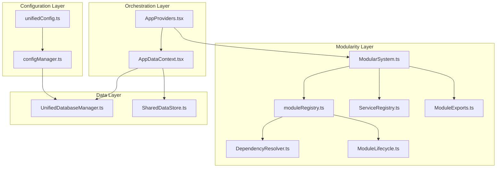
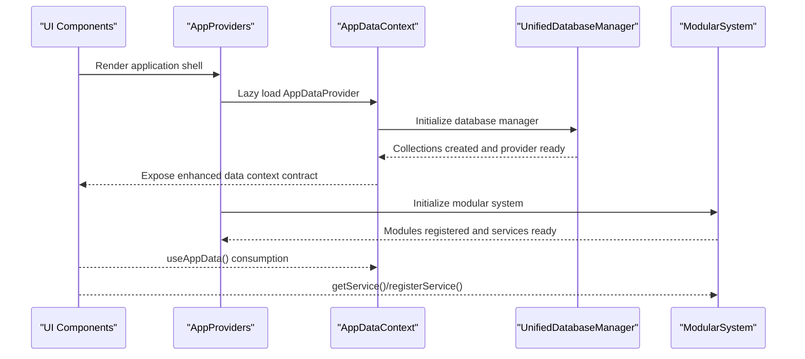
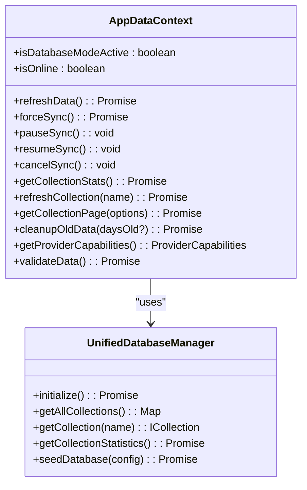
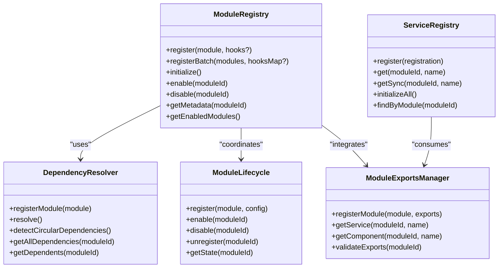
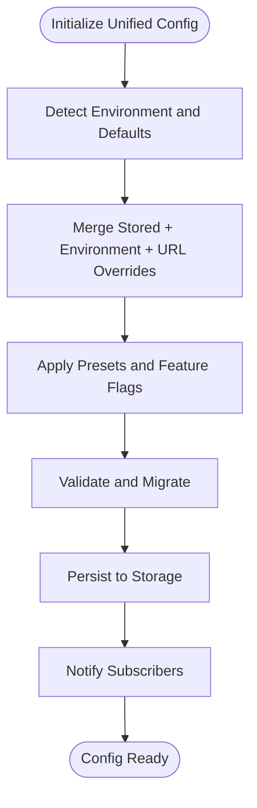
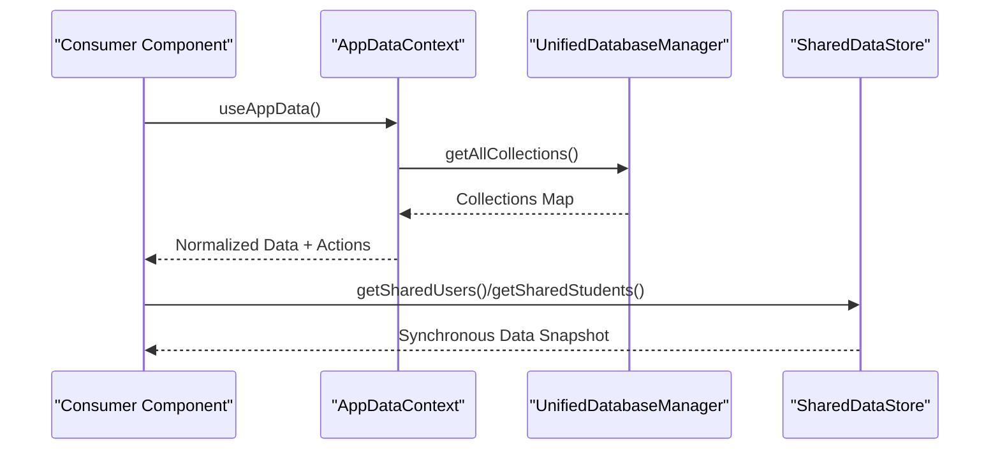
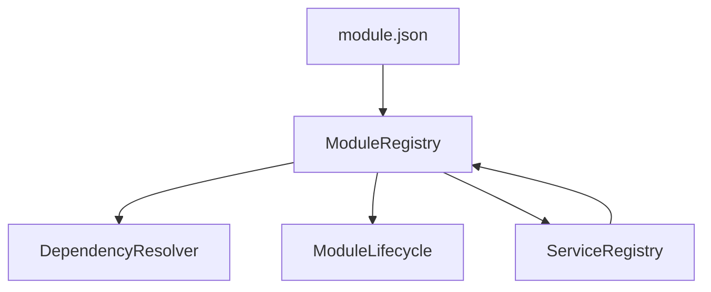

# Core Architectural Patterns

<cite>
**Referenced Files in This Document**
- [AppDataContext.tsx](file://src/contexts/AppDataContext.tsx)
- [AppProviders.tsx](file://src/contexts/AppProviders.tsx)
- [UnifiedDatabaseManager.ts](file://src/services/database/UnifiedDatabaseManager.ts)
- [ModularSystem.ts](file://src/core/ModularSystem.ts)
- [moduleRegistry.ts](file://src/core/moduleRegistry.ts)
- [ServiceRegistry.ts](file://src/core/ServiceRegistry.ts)
- [ModuleExports.ts](file://src/core/ModuleExports.ts)
- [DependencyResolver.ts](file://src/core/DependencyResolver.ts)
- [ModuleLifecycle.ts](file://src/core/ModuleLifecycle.ts)
- [unifiedConfig.ts](file://src/config/unifiedConfig.ts)
- [configManager.ts](file://src/config/configManager.ts)
- [module.json](file://src/modules/dashboard/module.json)
- [SharedDataStore.ts](file://src/services/data/SharedDataStore.ts)
- [useAppData.ts](file://src/hooks/useAppData.ts)
- [module.ts](file://src/core/types/module.ts)
</cite>

## Table of Contents
1. [Introduction](#introduction)
2. [Project Structure](#project-structure)
3. [Core Components](#core-components)
4. [Architecture Overview](#architecture-overview)
5. [Detailed Component Analysis](#detailed-component-analysis)
6. [Dependency Analysis](#dependency-analysis)
7. [Performance Considerations](#performance-considerations)
8. [Troubleshooting Guide](#troubleshooting-guide)
9. [Conclusion](#conclusion)

## Introduction
This document explains SchoolPilot3's core architectural patterns with a focus on:
- The Switchboard pattern implemented via AppDataContext as the central abstraction layer
- A modular system design with self-contained modules and explicit contracts
- A unified configuration system that governs environment, data modes, and feature flags
- Polymorphic component architecture and reactive data flows
- Type-driven development that enforces correctness across boundaries

These patterns work together to achieve loose coupling, maintainability, and scalability by centralizing concerns, enforcing contracts, and providing flexible runtime composition.

## Project Structure
SchoolPilot3 organizes its architecture around three pillars:
- Central orchestration: AppDataContext and AppProviders
- Modularity: ModularSystem, moduleRegistry, ServiceRegistry, ModuleExports
- Configuration: unifiedConfig and configManager

**Diagram sources**
- [AppProviders.tsx:1-139](file://src/contexts/AppProviders.tsx#L1-L139)
- [AppDataContext.tsx:1-800](file://src/contexts/AppDataContext.tsx#L1-L800)
- [ModularSystem.ts:1-384](file://src/core/ModularSystem.ts#L1-L384)
- [moduleRegistry.ts:1-348](file://src/core/moduleRegistry.ts#L1-L348)
- [ServiceRegistry.ts:1-277](file://src/core/ServiceRegistry.ts#L1-L277)
- [ModuleExports.ts:1-309](file://src/core/ModuleExports.ts#L1-L309)
- [DependencyResolver.ts:1-252](file://src/core/DependencyResolver.ts#L1-L252)
- [ModuleLifecycle.ts:1-295](file://src/core/ModuleLifecycle.ts#L1-L295)
- [unifiedConfig.ts:1-221](file://src/config/unifiedConfig.ts#L1-L221)
- [configManager.ts:1-800](file://src/config/configManager.ts#L1-L800)
- [UnifiedDatabaseManager.ts:1-800](file://src/services/database/UnifiedDatabaseManager.ts#L1-L800)
- [SharedDataStore.ts:1-312](file://src/services/data/SharedDataStore.ts#L1-L312)

**Section sources**
- [AppProviders.tsx:1-139](file://src/contexts/AppProviders.tsx#L1-L139)
- [AppDataContext.tsx:1-800](file://src/contexts/AppDataContext.tsx#L1-L800)
- [ModularSystem.ts:1-384](file://src/core/ModularSystem.ts#L1-L384)
- [moduleRegistry.ts:1-348](file://src/core/moduleRegistry.ts#L1-L348)
- [ServiceRegistry.ts:1-277](file://src/core/ServiceRegistry.ts#L1-L277)
- [ModuleExports.ts:1-309](file://src/core/ModuleExports.ts#L1-L309)
- [DependencyResolver.ts:1-252](file://src/core/DependencyResolver.ts#L1-L252)
- [ModuleLifecycle.ts:1-295](file://src/core/ModuleLifecycle.ts#L1-L295)
- [unifiedConfig.ts:1-221](file://src/config/unifiedConfig.ts#L1-L221)
- [configManager.ts:1-800](file://src/config/configManager.ts#L1-L800)
- [UnifiedDatabaseManager.ts:1-800](file://src/services/database/UnifiedDatabaseManager.ts#L1-L800)
- [SharedDataStore.ts:1-312](file://src/services/data/SharedDataStore.ts#L1-L312)

## Core Components
- AppDataContext: Central data orchestration hub integrating UnifiedDatabaseManager, network state, sync controls, pagination, validation, and provider capabilities. It exposes a rich contract for consumers and coordinates reactive data flows.
- AppProviders: Composite provider that composes all context providers and ensures proper initialization order and lazy loading.
- ModularSystem: Central integration point combining ModuleRegistry, ServiceRegistry, ModuleExports, and ModuleLoader to manage modules, services, and exports.
- UnifiedDatabaseManager: Provider-agnostic database manager that selects and initializes the appropriate database provider based on configuration and capabilities.
- Unified Configuration: A thin orchestrator that re-exports from focused modules and delegates to configManager for persistence, validation, and updates.
- SharedDataStore: Non-React access layer mirroring AppDataContext data for utilities, tests, and background tasks.

Benefits:
- Loose coupling: Consumers depend on contracts (AppDataContext, ServiceRegistry) rather than concrete implementations.
- Maintainability: Clear separation of concerns across orchestration, modularity, configuration, and data layers.
- Scalability: Pluggable providers, dynamic module loading, and centralized configuration enable growth without invasive changes.

**Section sources**
- [AppDataContext.tsx:1-800](file://src/contexts/AppDataContext.tsx#L1-L800)
- [AppProviders.tsx:1-139](file://src/contexts/AppProviders.tsx#L1-L139)
- [ModularSystem.ts:1-384](file://src/core/ModularSystem.ts#L1-L384)
- [UnifiedDatabaseManager.ts:1-800](file://src/services/database/UnifiedDatabaseManager.ts#L1-L800)
- [unifiedConfig.ts:1-221](file://src/config/unifiedConfig.ts#L1-L221)
- [configManager.ts:1-800](file://src/config/configManager.ts#L1-L800)
- [SharedDataStore.ts:1-312](file://src/services/data/SharedDataStore.ts#L1-L312)

## Architecture Overview
The architecture follows a Switchboard pattern centered on AppDataContext:
- AppProviders composes all providers and lazily loads AppDataContext.
- AppDataContext initializes UnifiedDatabaseManager, subscribes to network state, and manages sync, pagination, validation, and provider capabilities.
- ModularSystem orchestrates modules, services, and exports with dependency resolution and lifecycle management.
- Unified configuration drives environment, data mode, and feature flags.

**Diagram sources**
- [AppProviders.tsx:1-139](file://src/contexts/AppProviders.tsx#L1-L139)
- [AppDataContext.tsx:1-800](file://src/contexts/AppDataContext.tsx#L1-L800)
- [UnifiedDatabaseManager.ts:1-800](file://src/services/database/UnifiedDatabaseManager.ts#L1-L800)
- [ModularSystem.ts:1-384](file://src/core/ModularSystem.ts#L1-L384)
- [useAppData.ts:1-21](file://src/hooks/useAppData.ts#L1-L21)

## Detailed Component Analysis

### AppDataContext: The Switchboard Pattern
AppDataContext centralizes data orchestration:
- Integrates UnifiedDatabaseManager for provider-agnostic database operations
- Manages network state, sync lifecycle, pagination, validation, memory cleanup, and provider capabilities
- Exposes a comprehensive contract (EnhancedAppDataContextType) for consumers
- Coordinates reactive data flows and provides toast helpers for user feedback

Key responsibilities:
- Database initialization and health monitoring
- Sync scheduling and manual triggers
- Collection refresh and pagination
- Data validation and cleanup
- Provider capability detection and strategy management

**Diagram sources**
- [AppDataContext.tsx:101-183](file://src/contexts/AppDataContext.tsx#L101-L183)
- [UnifiedDatabaseManager.ts:44-80](file://src/services/database/UnifiedDatabaseManager.ts#L44-L80)

**Section sources**
- [AppDataContext.tsx:1-800](file://src/contexts/AppDataContext.tsx#L1-L800)
- [useAppData.ts:1-21](file://src/hooks/useAppData.ts#L1-L21)

### Modular System Design: Self-Contained Modules
The modular system enforces self-containment and explicit contracts:
- Module metadata (module.json) defines dependencies, capabilities, provides, and config
- ModuleRegistry handles dependency resolution and lifecycle
- ServiceRegistry provides cross-module service discovery and DI
- ModuleExports manages exports and validates against module.json provides declarations
- DependencyResolver performs topological sorting and detects circular dependencies
- ModuleLifecycle manages register → enable → disable → unregister with hooks

**Diagram sources**
- [moduleRegistry.ts:24-348](file://src/core/moduleRegistry.ts#L24-L348)
- [ServiceRegistry.ts:32-277](file://src/core/ServiceRegistry.ts#L32-L277)
- [ModuleExports.ts:31-309](file://src/core/ModuleExports.ts#L31-L309)
- [DependencyResolver.ts:19-252](file://src/core/DependencyResolver.ts#L19-L252)
- [ModuleLifecycle.ts:37-295](file://src/core/ModuleLifecycle.ts#L37-L295)

**Section sources**
- [moduleRegistry.ts:1-348](file://src/core/moduleRegistry.ts#L1-L348)
- [ServiceRegistry.ts:1-277](file://src/core/ServiceRegistry.ts#L1-L277)
- [ModuleExports.ts:1-309](file://src/core/ModuleExports.ts#L1-L309)
- [DependencyResolver.ts:1-252](file://src/core/DependencyResolver.ts#L1-L252)
- [ModuleLifecycle.ts:1-295](file://src/core/ModuleLifecycle.ts#L1-L295)
- [module.json:1-70](file://src/modules/dashboard/module.json#L1-L70)
- [module.ts:138-279](file://src/core/types/module.ts#L138-L279)

### Unified Configuration System
The unified configuration system provides a single source of truth:
- unifiedConfig.ts re-exports from focused modules and delegates to configManager
- configManager creates default configurations, applies presets, persists to storage, and notifies subscribers
- Configuration covers environment, data mode, database settings, features, and development options

**Diagram sources**
- [unifiedConfig.ts:1-221](file://src/config/unifiedConfig.ts#L1-L221)
- [configManager.ts:415-742](file://src/config/configManager.ts#L415-L742)

**Section sources**
- [unifiedConfig.ts:1-221](file://src/config/unifiedConfig.ts#L1-L221)
- [configManager.ts:1-800](file://src/config/configManager.ts#L1-L800)

### Polymorphic Component Architecture and Reactive Data Flow
Polymorphism and reactivity are achieved through:
- Provider-agnostic interfaces (UnifiedDatabaseManager) enabling pluggable database backends
- Reactive data flows via AppDataContext exposing normalized data and state
- Non-React access via SharedDataStore for utilities and background tasks
- Type-driven development enforced by module metadata and TypeScript interfaces

**Diagram sources**
- [AppDataContext.tsx:396-417](file://src/contexts/AppDataContext.tsx#L396-L417)
- [UnifiedDatabaseManager.ts:472-511](file://src/services/database/UnifiedDatabaseManager.ts#L472-L511)
- [SharedDataStore.ts:118-151](file://src/services/data/SharedDataStore.ts#L118-L151)
- [useAppData.ts:1-21](file://src/hooks/useAppData.ts#L1-L21)

**Section sources**
- [UnifiedDatabaseManager.ts:1-800](file://src/services/database/UnifiedDatabaseManager.ts#L1-L800)
- [SharedDataStore.ts:1-312](file://src/services/data/SharedDataStore.ts#L1-L312)
- [AppDataContext.tsx:1-800](file://src/contexts/AppDataContext.tsx#L1-L800)
- [useAppData.ts:1-21](file://src/hooks/useAppData.ts#L1-L21)

## Dependency Analysis
The modular system relies on explicit contracts and dependency resolution:
- Module metadata declares dependencies and capabilities
- DependencyResolver computes loading order and detects cycles
- ModuleRegistry coordinates lifecycle and emits events
- ServiceRegistry enables cross-module service discovery

**Diagram sources**
- [module.json:1-70](file://src/modules/dashboard/module.json#L1-L70)
- [moduleRegistry.ts:24-348](file://src/core/moduleRegistry.ts#L24-L348)
- [DependencyResolver.ts:19-252](file://src/core/DependencyResolver.ts#L19-L252)
- [ModuleLifecycle.ts:37-295](file://src/core/ModuleLifecycle.ts#L37-L295)
- [ServiceRegistry.ts:32-277](file://src/core/ServiceRegistry.ts#L32-L277)

**Section sources**
- [module.json:1-70](file://src/modules/dashboard/module.json#L1-L70)
- [moduleRegistry.ts:1-348](file://src/core/moduleRegistry.ts#L1-L348)
- [DependencyResolver.ts:1-252](file://src/core/DependencyResolver.ts#L1-L252)
- [ModuleLifecycle.ts:1-295](file://src/core/ModuleLifecycle.ts#L1-L295)
- [ServiceRegistry.ts:1-277](file://src/core/ServiceRegistry.ts#L1-L277)

## Performance Considerations
- Lazy initialization: AppProviders lazily loads AppDataContext to avoid blocking the UI.
- Batched initialization: ModularSystem supports parallel loading and batching to improve startup performance.
- Provider selection: UnifiedDatabaseManager selects optimal providers based on environment and capabilities.
- Health monitoring: Periodic health checks and automatic repair reduce downtime.
- Pagination and cleanup: Built-in pagination and cleanup APIs help manage large datasets efficiently.

[No sources needed since this section provides general guidance]

## Troubleshooting Guide
Common issues and resolutions:
- Database initialization failures: AppDataContext logs and attempts recovery; check provider availability and configuration.
- Sync errors: Verify network state, backend availability, and provider capabilities; use pause/resume/cancel controls.
- Module loading errors: Check module.json provides declarations and validate exports; inspect dependency cycles.
- Configuration drift: Use unifiedConfig utilities to reload, validate, and migrate configuration.

**Section sources**
- [AppDataContext.tsx:337-344](file://src/contexts/AppDataContext.tsx#L337-L344)
- [AppDataContext.tsx:462-537](file://src/contexts/AppDataContext.tsx#L462-L537)
- [ModuleExports.ts:210-281](file://src/core/ModuleExports.ts#L210-L281)
- [unifiedConfig.ts:116-121](file://src/config/unifiedConfig.ts#L116-L121)

## Conclusion
SchoolPilot3’s architectural patterns—Switchboard via AppDataContext, modular system with self-contained modules, and a unified configuration system—collaborate to deliver a maintainable, scalable, and type-safe platform. The polymorphic data layer and reactive flows further reinforce loose coupling and adaptability. Together, these patterns enable confident evolution of features, providers, and environments while preserving developer productivity and system reliability.