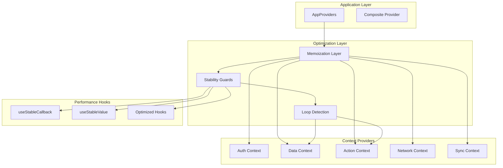
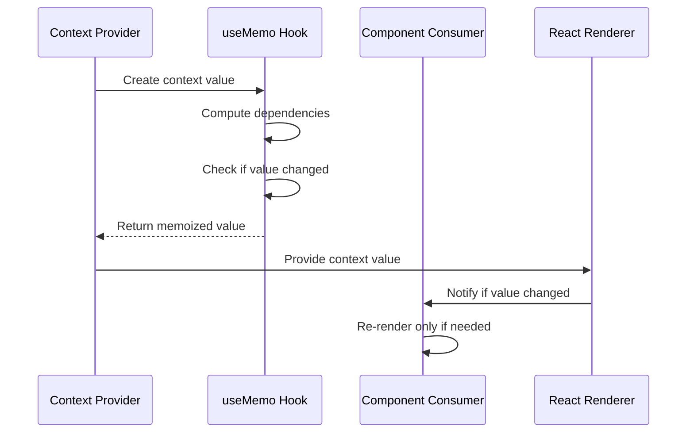
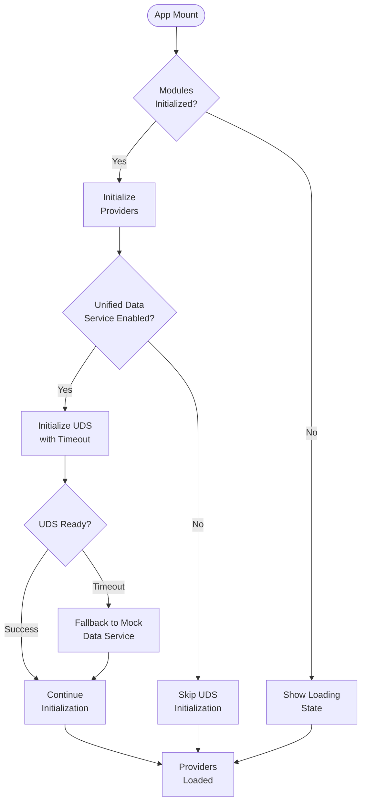
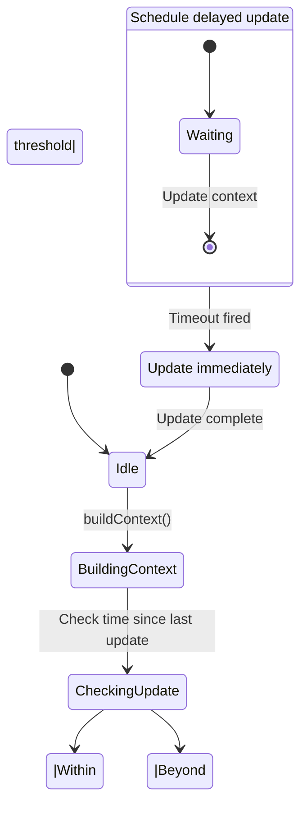

# Context Provider Optimizations

<cite>
**Referenced Files in This Document**
- [AppProviders.tsx](file://src/contexts/AppProviders.tsx)
- [AppDataContext.tsx](file://src/contexts/AppDataContext.tsx)
- [AuthContext.tsx](file://src/contexts/AuthContext.tsx)
- [UserContext.tsx](file://src/contexts/UserContext.tsx)
- [StableActionProvider.tsx](file://src/contexts/StableActionProvider.tsx)
- [SimpleActionProvider.tsx](file://src/contexts/SimpleActionProvider.tsx)
- [NetworkContext.tsx](file://src/contexts/NetworkContext.tsx)
- [SyncContext.tsx](file://src/contexts/SyncContext.tsx)
- [useStableCallback.ts](file://src/hooks/useStableCallback.ts)
- [useStableValue.ts](file://src/hooks/useStableValue.ts)
- [STATE_MANAGEMENT_GUIDELINES.md](file://docs/architecture/STATE_MANAGEMENT_GUIDELINES.md)
- [HOOK_PATTERNS.md](file://docs/guides/HOOK_PATTERNS.md)
- [INFINITE_LOOP_PREVENTION.md](file://docs/INFINITE_LOOP_PREVENTION.md)
</cite>

## Table of Contents
1. [Introduction](#introduction)
2. [Optimization Architecture](#optimization-architecture)
3. [Core Context Provider Patterns](#core-context-provider-patterns)
4. [Performance Optimization Strategies](#performance-optimization-strategies)
5. [Infinite Loop Prevention](#infinite-loop-prevention)
6. [Context Provider Implementation Analysis](#context-provider-implementation-analysis)
7. [Advanced Optimization Techniques](#advanced-optimization-techniques)
8. [Best Practices and Guidelines](#best-practices-and-guidelines)
9. [Troubleshooting and Debugging](#troubleshooting-and-debugging)
10. [Conclusion](#conclusion)

## Introduction

Context Provider Optimizations represent a comprehensive approach to enhancing React application performance through strategic context management. This documentation focuses on the sophisticated optimization patterns implemented in the EduGen SchoolPilot3 system, specifically targeting the prevention of infinite loops, reduction of unnecessary re-renders, and establishment of stable provider contracts.

The optimization strategy centers around three fundamental principles: **stability through memoization**, **controlled re-render boundaries**, and **preventive loop detection**. These principles are systematically applied across all context providers to create a robust, performant state management architecture that scales effectively with application complexity.

## Optimization Architecture

The Context Provider Optimization architecture employs a layered approach to ensure optimal performance while maintaining clean separation of concerns. The system implements several key optimization layers:

**Diagram sources**
- [AppProviders.tsx:105-136](file://src/contexts/AppProviders.tsx#L105-L136)
- [StableActionProvider.tsx:246-276](file://src/contexts/StableActionProvider.tsx#L246-L276)
- [useStableCallback.ts:58-79](file://src/hooks/useStableCallback.ts#L58-L79)

The architecture ensures that each optimization layer builds upon the previous one, creating a comprehensive safety net against performance degradation while maintaining the flexibility needed for complex application state management.

## Core Context Provider Patterns

### Memoized Context Values

The foundation of context provider optimization lies in the strategic use of `useMemo` to prevent unnecessary re-renders. Each context provider implements memoization patterns that ensure stable references for consumers.

**Diagram sources**
- [AuthContext.tsx:142-153](file://src/contexts/AuthContext.tsx#L142-L153)
- [NetworkContext.tsx:28-33](file://src/contexts/NetworkContext.tsx#L28-L33)
- [SyncContext.tsx:148-183](file://src/contexts/SyncContext.tsx#L148-L183)

### Stable Callback References

The `useStableCallback` hook provides a mechanism for maintaining stable function references across renders while ensuring they always call the latest implementation. This prevents infinite loops that commonly occur when callbacks are recreated on every render.

**Section sources**
- [useStableCallback.ts:58-79](file://src/hooks/useStableCallback.ts#L58-L79)

### Context Value Stabilization

The `useStableValue` hook optimizes object and array references by implementing deep equality comparison to maintain stable references when content hasn't changed. This reduces re-renders for complex data structures.

**Section sources**
- [useStableValue.ts:137-162](file://src/hooks/useStableValue.ts#L137-L162)

## Performance Optimization Strategies

### Lazy Initialization and Conditional Rendering

The composite provider architecture implements lazy initialization patterns to prevent application startup bottlenecks. The `AppProviders` component demonstrates sophisticated loading strategies that defer heavy operations until necessary.

**Diagram sources**
- [AppProviders.tsx:25-98](file://src/contexts/AppProviders.tsx#L25-L98)

### Throttled Context Updates

The Stable Action Provider implements sophisticated throttling mechanisms to prevent context update cascades that could lead to infinite loops. The system monitors update frequency and implements intelligent delay mechanisms.

**Section sources**
- [StableActionProvider.tsx:113-145](file://src/contexts/StableActionProvider.tsx#L113-L145)

### Debounced State Updates

Contextual action updates employ debouncing strategies to prevent rapid successive updates that could overwhelm the system. The action registry implements timeout-based update mechanisms with configurable delays.

**Section sources**
- [StableActionProvider.tsx:198-215](file://src/contexts/StableActionProvider.tsx#L198-L215)

## Infinite Loop Prevention

### Loop Detection Mechanisms

The optimization system implements multiple layers of loop detection to prevent cascading updates that could freeze the application. The Stable Action Provider exemplifies this approach through timestamp-based throttling and timeout management.

**Diagram sources**
- [StableActionProvider.tsx:113-145](file://src/contexts/StableActionProvider.tsx#L113-L145)

### Reference Stabilization

The use of `useRef` for critical state references prevents closure-related infinite loops by maintaining stable references across renders while allowing state updates.

**Section sources**
- [StableActionProvider.tsx:89-92](file://src/contexts/StableActionProvider.tsx#L89-L92)

### Timeout Management

Proper timeout management ensures that scheduled updates are properly cleaned up, preventing memory leaks and ensuring system stability.

**Section sources**
- [StableActionProvider.tsx:139-144](file://src/contexts/StableActionProvider.tsx#L139-L144)

## Context Provider Implementation Analysis

### Authentication Context Optimization

The Auth Context demonstrates comprehensive optimization patterns including proper error handling, loading state management, and stable callback implementations. The context value memoization ensures that authentication state changes don't trigger unnecessary re-renders across the application.

**Section sources**
- [AuthContext.tsx:28-168](file://src/contexts/AuthContext.tsx#L28-L168)

### Data Context Architecture

The App Data Context serves as the central nervous system for application data management, implementing sophisticated initialization patterns, error recovery mechanisms, and performance optimizations. The context handles database initialization, sync operations, and data refresh cycles with built-in timeout protection.

**Section sources**
- [AppDataContext.tsx:219-351](file://src/contexts/AppDataContext.tsx#L219-L351)

### Action Context Stabilization

The Stable Action Provider represents the pinnacle of context optimization, implementing comprehensive loop prevention, throttling mechanisms, and intelligent update scheduling. The provider maintains stable references for all exported functions while ensuring they always operate with the latest state.

**Section sources**
- [StableActionProvider.tsx:76-277](file://src/contexts/StableActionProvider.tsx#L76-L277)

### Network and Sync Context Integration

The Network and Sync contexts work in tandem to provide comprehensive offline-first capabilities while maintaining system responsiveness. The integration demonstrates proper dependency management and state coordination.

**Section sources**
- [NetworkContext.tsx:16-48](file://src/contexts/NetworkContext.tsx#L16-L48)
- [SyncContext.tsx:69-190](file://src/contexts/SyncContext.tsx#L69-L190)

## Advanced Optimization Techniques

### Composite Provider Pattern

The AppProviders component exemplifies the composite provider pattern, orchestrating multiple context providers while maintaining optimal performance through lazy loading and conditional initialization. The component serves as a centralized entry point that manages provider lifecycle and initialization order.

**Section sources**
- [AppProviders.tsx:105-136](file://src/contexts/AppProviders.tsx#L105-L136)

### Context Value Composition

The optimized context providers implement value composition patterns that combine multiple state sources while maintaining stable references. This approach prevents cascade updates and ensures efficient re-rendering.

**Section sources**
- [AppDataContext.tsx:208-217](file://src/contexts/AppDataContext.tsx#L208-L217)

### Performance Monitoring Integration

The optimization system includes built-in performance monitoring capabilities that track provider initialization times, update frequencies, and rendering costs. This data-driven approach enables continuous optimization and performance tuning.

## Best Practices and Guidelines

### Context Provider Design Principles

The optimization guidelines emphasize several key principles for effective context provider design:

1. **Always memoize context values** using `useMemo` to prevent unnecessary re-renders
2. **Use stable callback patterns** to avoid function reference churn
3. **Implement proper cleanup** for timeouts, subscriptions, and event listeners
4. **Provide fallback mechanisms** for initialization failures
5. **Consider lazy loading** for heavy initialization operations

**Section sources**
- [STATE_MANAGEMENT_GUIDELINES.md:99-173](file://docs/architecture/STATE_MANAGEMENT_GUIDELINES.md#L99-L173)

### Hook Usage Patterns

The optimized hook implementations demonstrate best practices for performance-critical code:

- **useStableCallback**: Maintains stable function references while ensuring latest implementation
- **useStableValue**: Provides stable object/array references through deep equality comparison
- **Custom optimization hooks**: Implement specialized performance optimizations for specific use cases

**Section sources**
- [useStableCallback.ts:1-79](file://src/hooks/useStableCallback.ts#L1-L79)
- [useStableValue.ts:1-162](file://src/hooks/useStableValue.ts#L1-L162)

### Error Handling and Recovery

The optimization system implements comprehensive error handling strategies that prevent cascading failures while maintaining system stability. Providers include timeout mechanisms, fallback strategies, and graceful degradation patterns.

**Section sources**
- [AppProviders.tsx:45-62](file://src/contexts/AppProviders.tsx#L45-L62)
- [AppDataContext.tsx:308-344](file://src/contexts/AppDataContext.tsx#L308-L344)

## Troubleshooting and Debugging

### Common Performance Issues

The optimization system addresses several common performance challenges:

1. **Infinite loop detection** through timestamp-based throttling
2. **Memory leak prevention** via proper cleanup of timeouts and subscriptions
3. **Render optimization** through selective re-rendering mechanisms
4. **Initialization bottlenecks** through lazy loading and timeout protection

**Section sources**
- [INFINITE_LOOP_PREVENTION.md:575-628](file://docs/INFINITE_LOOP_PREVENTION.md#L575-L628)

### Debugging Strategies

Effective debugging of optimized context providers requires understanding the memoization and stabilization mechanisms. Key debugging approaches include:

- **Monitoring context value changes** using React DevTools Profiler
- **Tracing provider initialization** through console logging
- **Analyzing update frequencies** to identify optimization opportunities
- **Testing fallback scenarios** to ensure graceful degradation

### Performance Monitoring

The system includes built-in performance monitoring capabilities that track:

- Provider initialization times and completion rates
- Context update frequencies and patterns
- Memory usage trends and optimization effectiveness
- Error rates and recovery mechanisms

**Section sources**
- [AppDataContext.tsx:308-344](file://src/contexts/AppDataContext.tsx#L308-L344)

## Conclusion

The Context Provider Optimizations implemented in the EduGen SchoolPilot3 system represent a comprehensive approach to React performance enhancement. Through strategic memoization, stable callback patterns, and preventive loop detection, the system achieves optimal performance while maintaining code maintainability and scalability.

The optimization architecture successfully addresses the fundamental challenges of React context performance: infinite loops, unnecessary re-renders, and initialization bottlenecks. The implementation demonstrates that with careful consideration of React's rendering model and proper use of optimization hooks, complex applications can achieve both high performance and clean architecture.

Key achievements of this optimization strategy include:

- **Elimination of infinite loops** through comprehensive loop detection mechanisms
- **Reduction of unnecessary re-renders** via strategic memoization patterns
- **Improved initialization performance** through lazy loading and timeout protection
- **Enhanced system stability** through proper cleanup and error recovery mechanisms

These optimizations serve as a foundation for scalable React applications, providing patterns and techniques that can be adapted to various application architectures while maintaining focus on performance and user experience.