# Core Architectural Patterns

<cite>
**Referenced Files in This Document**
- [AppDataContext.tsx](file://src/contexts/AppDataContext.tsx)
- [AppProviders.tsx](file://src/contexts/AppProviders.tsx)
- [UnifiedDatabaseManager.ts](file://src/services/database/UnifiedDatabaseManager.ts)
- [ModularSystem.ts](file://src/core/ModularSystem.ts)
- [moduleRegistry.ts](file://src/core/moduleRegistry.ts)
- [ServiceRegistry.ts](file://src/core/ServiceRegistry.ts)
- [ModuleExports.ts](file://src/core/ModuleExports.ts)
- [DependencyResolver.ts](file://src/core/DependencyResolver.ts)
- [ModuleLifecycle.ts](file://src/core/ModuleLifecycle.ts)
- [moduleRegistration.ts](file://src/core/moduleRegistration.ts)
- [unifiedConfig.ts](file://src/config/unifiedConfig.ts)
- [configManager.ts](file://src/config/configManager.ts)
- [module.json](file://src/modules/dashboard/module.json)
- [SharedDataStore.ts](file://src/services/data/SharedDataStore.ts)
- [useAppData.ts](file://src/hooks/useAppData.ts)
- [useService.ts](file://src/hooks/useService.ts)
- [module.ts](file://src/core/types/module.ts)
- [InvoiceService.ts](file://src/modules/finance/services/InvoiceService.ts)
- [registerServices.ts](file://src/modules/finance/services/registerServices.ts)
- [service-lifecycle-integration.md](file://src/core/docs/service-lifecycle-integration.md)
</cite>

## Update Summary
**Changes Made**
- Added comprehensive documentation for the new Service Registry pattern and dependency injection architecture
- Updated Modular System Design section to include service registration and lifecycle management
- Enhanced Dependency Analysis section with service dependency patterns
- Added new section on Service Registration Patterns and Dependency Injection
- Updated architectural diagrams to reflect service registry integration
- Added practical examples of service registration and usage patterns

## Table of Contents
1. [Introduction](#introduction)
2. [Project Structure](#project-structure)
3. [Core Components](#core-components)
4. [Architecture Overview](#architecture-overview)
5. [Detailed Component Analysis](#detailed-component-analysis)
6. [Service Registration Patterns and Dependency Injection](#service-registration-patterns-and-dependency-injection)
7. [Dependency Analysis](#dependency-analysis)
8. [Performance Considerations](#performance-considerations)
9. [Troubleshooting Guide](#troubleshooting-guide)
10. [Conclusion](#conclusion)

## Introduction
This document explains SchoolPilot3's core architectural patterns with a focus on:
- The Switchboard pattern implemented via AppDataContext as the central abstraction layer
- A modular system design with self-contained modules and explicit contracts
- A unified configuration system that governs environment, data modes, and feature flags
- **NEW: A comprehensive service registration pattern with dependency injection architecture supporting modular service implementations**
- Polymorphic component architecture and reactive data flows
- Type-driven development that enforces correctness across boundaries

These patterns work together to achieve loose coupling, maintainability, and scalability by centralizing concerns, enforcing contracts, providing flexible runtime composition, and enabling sophisticated dependency management.

## Project Structure
SchoolPilot3 organizes its architecture around four pillars:
- Central orchestration: AppDataContext and AppProviders
- Modularity: ModularSystem, moduleRegistry, ServiceRegistry, ModuleExports
- **Service Management: ServiceRegistry with dependency injection and lifecycle management**
- Configuration: unifiedConfig and configManager

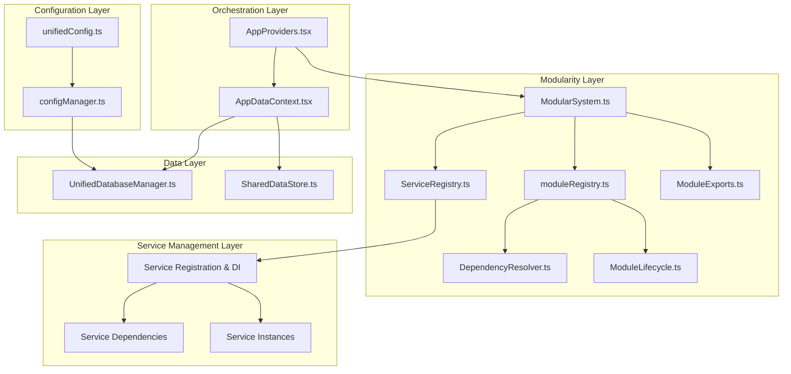

**Diagram sources**
- [AppProviders.tsx:1-139](file://src/contexts/AppProviders.tsx#L1-L139)
- [AppDataContext.tsx:1-800](file://src/contexts/AppDataContext.tsx#L1-L800)
- [ModularSystem.ts:1-384](file://src/core/ModularSystem.ts#L1-L384)
- [moduleRegistry.ts:1-348](file://src/core/moduleRegistry.ts#L1-L348)
- [ServiceRegistry.ts:1-277](file://src/core/ServiceRegistry.ts#L1-L277)
- [ModuleExports.ts:1-309](file://src/core/ModuleExports.ts#L1-L309)
- [DependencyResolver.ts:1-252](file://src/core/DependencyResolver.ts#L1-L252)
- [ModuleLifecycle.ts:1-295](file://src/core/ModuleLifecycle.ts#L1-L295)
- [unifiedConfig.ts:1-221](file://src/config/unifiedConfig.ts#L1-L221)
- [configManager.ts:1-800](file://src/config/configManager.ts#L1-L800)
- [UnifiedDatabaseManager.ts:1-800](file://src/services/database/UnifiedDatabaseManager.ts#L1-L800)
- [SharedDataStore.ts:1-312](file://src/services/data/SharedDataStore.ts#L1-L312)

**Section sources**
- [AppProviders.tsx:1-139](file://src/contexts/AppProviders.tsx#L1-L139)
- [AppDataContext.tsx:1-800](file://src/contexts/AppDataContext.tsx#L1-L800)
- [ModularSystem.ts:1-384](file://src/core/ModularSystem.ts#L1-L384)
- [moduleRegistry.ts:1-348](file://src/core/moduleRegistry.ts#L1-L348)
- [ServiceRegistry.ts:1-277](file://src/core/ServiceRegistry.ts#L1-L277)
- [ModuleExports.ts:1-309](file://src/core/ModuleExports.ts#L1-L309)
- [DependencyResolver.ts:1-252](file://src/core/DependencyResolver.ts#L1-L252)
- [ModuleLifecycle.ts:1-295](file://src/core/ModuleLifecycle.ts#L1-L295)
- [unifiedConfig.ts:1-221](file://src/config/unifiedConfig.ts#L1-L221)
- [configManager.ts:1-800](file://src/config/configManager.ts#L1-L800)
- [UnifiedDatabaseManager.ts:1-800](file://src/services/database/UnifiedDatabaseManager.ts#L1-L800)
- [SharedDataStore.ts:1-312](file://src/services/data/SharedDataStore.ts#L1-L312)

## Core Components
- AppDataContext: Central data orchestration hub integrating UnifiedDatabaseManager, network state, sync controls, pagination, validation, and provider capabilities. It exposes a rich contract for consumers and coordinates reactive data flows.
- AppProviders: Composite provider that composes all context providers and ensures proper initialization order and lazy loading.
- ModularSystem: Central integration point combining ModuleRegistry, ServiceRegistry, ModuleExports, and ModuleLoader to manage modules, services, and exports.
- **ServiceRegistry: Central service management system with dependency injection, lifecycle management, and cross-module service discovery.**
- UnifiedDatabaseManager: Provider-agnostic database manager that selects and initializes the appropriate database provider based on configuration and capabilities.
- Unified Configuration: A thin orchestrator that re-exports from focused modules and delegates to configManager for persistence, validation, and updates.
- SharedDataStore: Non-React access layer mirroring AppDataContext data for utilities, tests, and background tasks.

Benefits:
- Loose coupling: Consumers depend on contracts (AppDataContext, ServiceRegistry) rather than concrete implementations.
- **Enhanced modularity: ServiceRegistry enables sophisticated dependency management and cross-module service composition.**
- Maintainability: Clear separation of concerns across orchestration, modularity, service management, and configuration layers.
- **Scalability: Pluggable providers, dynamic module loading, centralized configuration, and dependency injection enable growth without invasive changes.**

**Section sources**
- [AppDataContext.tsx:1-800](file://src/contexts/AppDataContext.tsx#L1-L800)
- [AppProviders.tsx:1-139](file://src/contexts/AppProviders.tsx#L1-L139)
- [ModularSystem.ts:1-384](file://src/core/ModularSystem.ts#L1-L384)
- [ServiceRegistry.ts:1-277](file://src/core/ServiceRegistry.ts#L1-L277)
- [UnifiedDatabaseManager.ts:1-800](file://src/services/database/UnifiedDatabaseManager.ts#L1-L800)
- [unifiedConfig.ts:1-221](file://src/config/unifiedConfig.ts#L1-L221)
- [configManager.ts:1-800](file://src/config/configManager.ts#L1-L800)
- [SharedDataStore.ts:1-312](file://src/services/data/SharedDataStore.ts#L1-L312)

## Architecture Overview
The architecture follows a Switchboard pattern centered on AppDataContext with enhanced service management:
- AppProviders composes all providers and lazily loads AppDataContext.
- AppDataContext initializes UnifiedDatabaseManager, subscribes to network state, and manages sync, pagination, validation, and provider capabilities.
- ModularSystem orchestrates modules, services, and exports with dependency resolution and lifecycle management.
- **ServiceRegistry provides dependency injection, service lifecycle management, and cross-module service discovery.**
- Unified configuration drives environment, data mode, and feature flags.

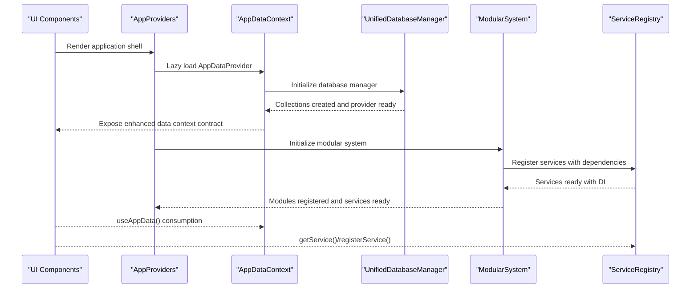

**Diagram sources**
- [AppProviders.tsx:1-139](file://src/contexts/AppProviders.tsx#L1-L139)
- [AppDataContext.tsx:1-800](file://src/contexts/AppDataContext.tsx#L1-L800)
- [UnifiedDatabaseManager.ts:1-800](file://src/services/database/UnifiedDatabaseManager.ts#L1-L800)
- [ModularSystem.ts:1-384](file://src/core/ModularSystem.ts#L1-L384)
- [ServiceRegistry.ts:1-277](file://src/core/ServiceRegistry.ts#L1-L277)
- [useAppData.ts:1-21](file://src/hooks/useAppData.ts#L1-L21)

## Detailed Component Analysis

### AppDataContext: The Switchboard Pattern
AppDataContext centralizes data orchestration:
- Integrates UnifiedDatabaseManager for provider-agnostic database operations
- Manages network state, sync lifecycle, pagination, validation, memory cleanup, and provider capabilities
- Exposes a comprehensive contract (EnhancedAppDataContextType) for consumers
- Coordinates reactive data flows and provides toast helpers for user feedback

Key responsibilities:
- Database initialization and health monitoring
- Sync scheduling and manual triggers
- Collection refresh and pagination
- Data validation and cleanup
- Provider capability detection and strategy management

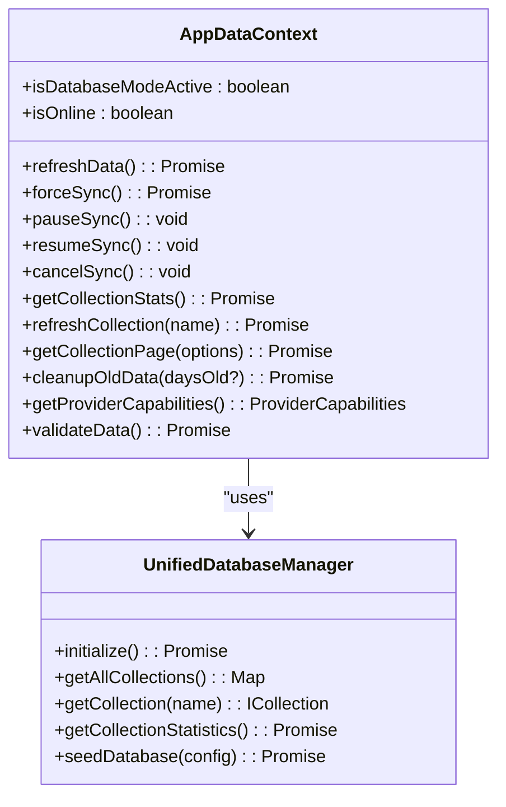

**Diagram sources**
- [AppDataContext.tsx:101-183](file://src/contexts/AppDataContext.tsx#L101-L183)
- [UnifiedDatabaseManager.ts:44-80](file://src/services/database/UnifiedDatabaseManager.ts#L44-L80)

**Section sources**
- [AppDataContext.tsx:1-800](file://src/contexts/AppDataContext.tsx#L1-L800)
- [useAppData.ts:1-21](file://src/hooks/useAppData.ts#L1-L21)

### Modular System Design: Self-Contained Modules
The modular system enforces self-containment and explicit contracts:
- Module metadata (module.json) defines dependencies, capabilities, provides, and config
- ModuleRegistry handles dependency resolution and lifecycle
- **ServiceRegistry provides cross-module service discovery, dependency injection, and lifecycle management**
- ModuleExports manages exports and validates against module.json provides declarations
- DependencyResolver performs topological sorting and detects circular dependencies
- ModuleLifecycle manages register → enable → disable → unregister with hooks

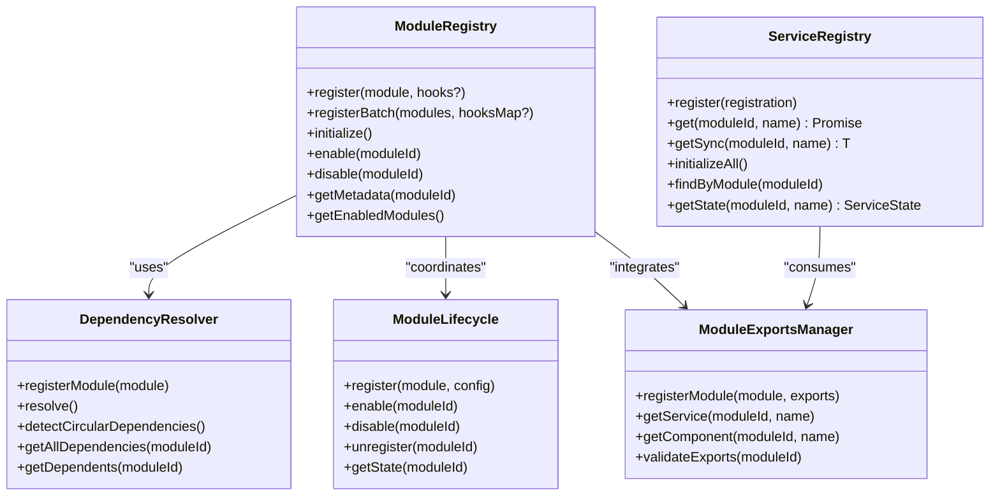

**Diagram sources**
- [moduleRegistry.ts:24-348](file://src/core/moduleRegistry.ts#L24-L348)
- [ServiceRegistry.ts:32-277](file://src/core/ServiceRegistry.ts#L32-L277)
- [ModuleExports.ts:31-309](file://src/core/ModuleExports.ts#L31-L309)
- [DependencyResolver.ts:19-252](file://src/core/DependencyResolver.ts#L19-L252)
- [ModuleLifecycle.ts:37-295](file://src/core/ModuleLifecycle.ts#L37-L295)

**Section sources**
- [moduleRegistry.ts:1-348](file://src/core/moduleRegistry.ts#L1-L348)
- [ServiceRegistry.ts:1-277](file://src/core/ServiceRegistry.ts#L1-L277)
- [ModuleExports.ts:1-309](file://src/core/ModuleExports.ts#L1-L309)
- [DependencyResolver.ts:1-252](file://src/core/DependencyResolver.ts#L1-L252)
- [ModuleLifecycle.ts:1-295](file://src/core/ModuleLifecycle.ts#L1-L295)
- [module.json:1-70](file://src/modules/dashboard/module.json#L1-L70)
- [module.ts:138-279](file://src/core/types/module.ts#L138-L279)

### Unified Configuration System
The unified configuration system provides a single source of truth:
- unifiedConfig.ts re-exports from focused modules and delegates to configManager
- configManager creates default configurations, applies presets, persists to storage, and notifies subscribers
- Configuration covers environment, data mode, database settings, features, and development options

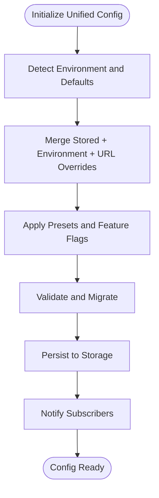

**Diagram sources**
- [unifiedConfig.ts:1-221](file://src/config/unifiedConfig.ts#L1-L221)
- [configManager.ts:415-742](file://src/config/configManager.ts#L415-L742)

**Section sources**
- [unifiedConfig.ts:1-221](file://src/config/unifiedConfig.ts#L1-L221)
- [configManager.ts:1-800](file://src/config/configManager.ts#L1-L800)

### Polymorphic Component Architecture and Reactive Data Flow
Polymorphism and reactivity are achieved through:
- Provider-agnostic interfaces (UnifiedDatabaseManager) enabling pluggable database backends
- Reactive data flows via AppDataContext exposing normalized data and state
- Non-React access via SharedDataStore for utilities and background tasks
- Type-driven development enforced by module metadata and TypeScript interfaces

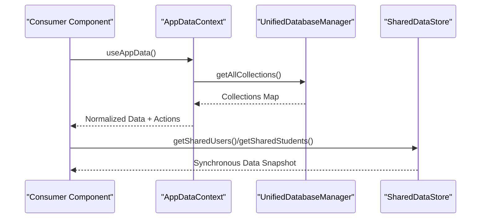

**Diagram sources**
- [AppDataContext.tsx:396-417](file://src/contexts/AppDataContext.tsx#L396-L417)
- [UnifiedDatabaseManager.ts:472-511](file://src/services/database/UnifiedDatabaseManager.ts#L472-L511)
- [SharedDataStore.ts:118-151](file://src/services/data/SharedDataStore.ts#L118-L151)
- [useAppData.ts:1-21](file://src/hooks/useAppData.ts#L1-L21)

**Section sources**
- [UnifiedDatabaseManager.ts:1-800](file://src/services/database/UnifiedDatabaseManager.ts#L1-L800)
- [SharedDataStore.ts:1-312](file://src/services/data/SharedDataStore.ts#L1-L312)
- [AppDataContext.tsx:1-800](file://src/contexts/AppDataContext.tsx#L1-L800)
- [useAppData.ts:1-21](file://src/hooks/useAppData.ts#L1-L21)

## Service Registration Patterns and Dependency Injection

### Service Registry Architecture
The ServiceRegistry provides a comprehensive dependency injection framework:
- **Service Registration**: Centralized registration of service factories with metadata
- **Dependency Injection**: Automatic resolution and initialization of service dependencies
- **Lifecycle Management**: Singleton caching, initialization tracking, and graceful error handling
- **Cross-Module Discovery**: Service lookup across module boundaries
- **Event-Driven Architecture**: Real-time service state notifications

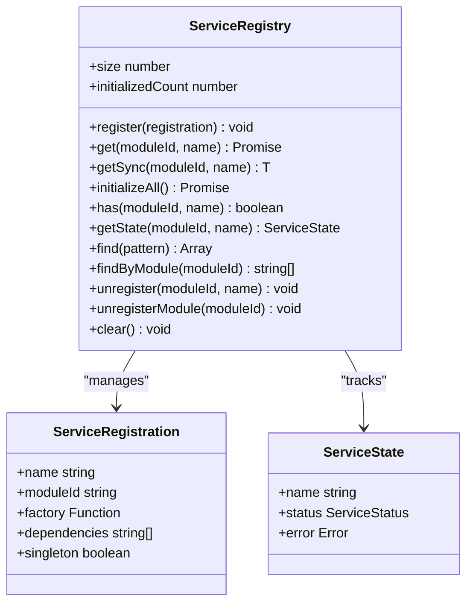

**Diagram sources**
- [ServiceRegistry.ts:32-277](file://src/core/ServiceRegistry.ts#L32-L277)

### Dependency Injection Implementation
The service registry implements sophisticated dependency injection:
- **Automatic Dependency Resolution**: Services can declare dependencies on other services
- **Cross-Module Dependencies**: Support for dot notation (e.g., "administration.StudentService")
- **Circular Dependency Detection**: Prevention of infinite initialization loops
- **Lazy Initialization**: Services are created on-demand, not at registration time
- **Singleton Management**: Optional singleton behavior with automatic caching

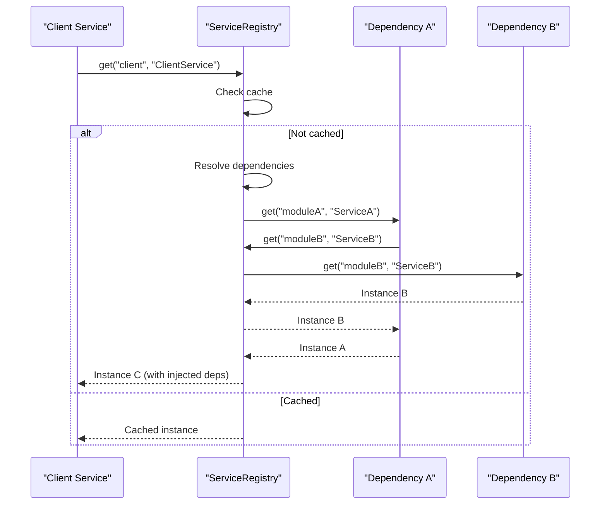

**Diagram sources**
- [ServiceRegistry.ts:67-114](file://src/core/ServiceRegistry.ts#L67-L114)

### Service Registration Patterns
Modules implement service registration through several patterns:

#### Pattern 1: Module Lifecycle Integration
Services are registered during module enable/disable lifecycle hooks:

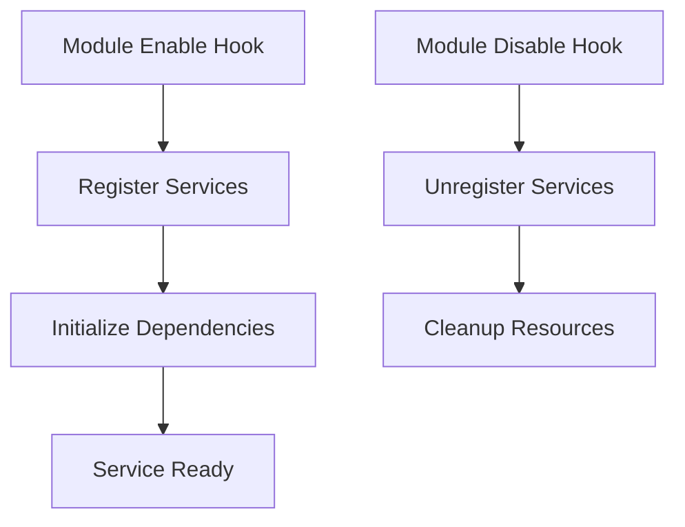

**Diagram sources**
- [service-lifecycle-integration.md:23-35](file://src/core/docs/service-lifecycle-integration.md#L23-L35)

#### Pattern 2: Modular Service Registration
Finance module demonstrates comprehensive service registration:

**Section sources**
- [registerServices.ts:26-58](file://src/modules/finance/services/registerServices.ts#L26-L58)
- [InvoiceService.ts:13-61](file://src/modules/finance/services/InvoiceService.ts#L13-L61)
- [service-lifecycle-integration.md:9-36](file://src/core/docs/service-lifecycle-integration.md#L9-L36)

### React Integration Patterns
The useService hook provides seamless React integration:
- **Automatic Initialization**: Services can auto-initialize on component mount
- **State Management**: Comprehensive loading, error, and ready state tracking
- **Event Subscription**: Real-time service state updates
- **Pattern Matching**: Service discovery and filtering capabilities

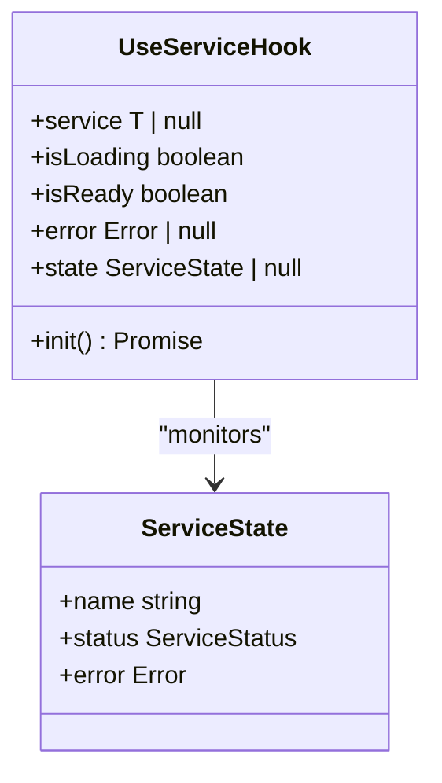

**Diagram sources**
- [useService.ts:25-111](file://src/hooks/useService.ts#L25-L111)

**Section sources**
- [useService.ts:1-229](file://src/hooks/useService.ts#L1-L229)

## Dependency Analysis
The modular system relies on explicit contracts and dependency resolution:
- Module metadata declares dependencies and capabilities
- DependencyResolver computes loading order and detects cycles
- ModuleRegistry coordinates lifecycle and emits events
- **ServiceRegistry enables sophisticated cross-module service dependencies**
- **Service dependencies are resolved automatically with support for dot notation**

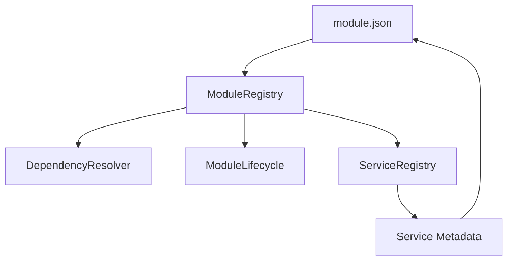

**Diagram sources**
- [module.json:1-70](file://src/modules/dashboard/module.json#L1-L70)
- [moduleRegistry.ts:24-348](file://src/core/moduleRegistry.ts#L24-L348)
- [DependencyResolver.ts:19-252](file://src/core/DependencyResolver.ts#L19-L252)
- [ModuleLifecycle.ts:37-295](file://src/core/ModuleLifecycle.ts#L37-L295)
- [ServiceRegistry.ts:32-277](file://src/core/ServiceRegistry.ts#L32-L277)

**Section sources**
- [module.json:1-70](file://src/modules/dashboard/module.json#L1-L70)
- [moduleRegistry.ts:1-348](file://src/core/moduleRegistry.ts#L1-L348)
- [DependencyResolver.ts:1-252](file://src/core/DependencyResolver.ts#L1-L252)
- [ModuleLifecycle.ts:1-295](file://src/core/ModuleLifecycle.ts#L1-L295)
- [ServiceRegistry.ts:1-277](file://src/core/ServiceRegistry.ts#L1-L277)

## Performance Considerations
- Lazy initialization: AppProviders lazily loads AppDataContext to avoid blocking the UI.
- Batched initialization: ModularSystem supports parallel loading and batching to improve startup performance.
- **Service caching: ServiceRegistry caches singleton instances to avoid repeated initialization costs.**
- **Dependency resolution: Service dependencies are resolved once and reused across requests.**
- Provider selection: UnifiedDatabaseManager selects optimal providers based on environment and capabilities.
- Health monitoring: Periodic health checks and automatic repair reduce downtime.
- Pagination and cleanup: Built-in pagination and cleanup APIs help manage large datasets efficiently.

## Troubleshooting Guide
Common issues and resolutions:
- Database initialization failures: AppDataContext logs and attempts recovery; check provider availability and configuration.
- Sync errors: Verify network state, backend availability, and provider capabilities; use pause/resume/cancel controls.
- Module loading errors: Check module.json provides declarations and validate exports; inspect dependency cycles.
- **Service registration errors: Check service factory functions, dependency declarations, and circular dependency issues.**
- **Cross-module service access: Verify service names, module IDs, and registration timing.**
- Configuration drift: Use unifiedConfig utilities to reload, validate, and migrate configuration.

**Section sources**
- [AppDataContext.tsx:337-344](file://src/contexts/AppDataContext.tsx#L337-L344)
- [AppDataContext.tsx:462-537](file://src/contexts/AppDataContext.tsx#L462-L537)
- [ModuleExports.ts:210-281](file://src/core/ModuleExports.ts#L210-L281)
- [unifiedConfig.ts:116-121](file://src/config/unifiedConfig.ts#L116-L121)
- [ServiceRegistry.ts:47-62](file://src/core/ServiceRegistry.ts#L47-L62)

## Conclusion
SchoolPilot3's architectural patterns—Switchboard via AppDataContext, modular system with self-contained modules, and a unified configuration system—collaborate to deliver a maintainable, scalable, and type-safe platform. **The new Service Registry pattern with dependency injection architecture significantly enhances modularity by enabling sophisticated cross-module service composition, automatic dependency resolution, and lifecycle management.** The polymorphic data layer and reactive flows further reinforce loose coupling and adaptability. Together, these patterns enable confident evolution of features, providers, and environments while preserving developer productivity and system reliability.