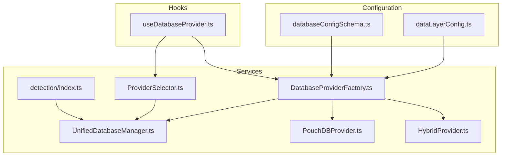
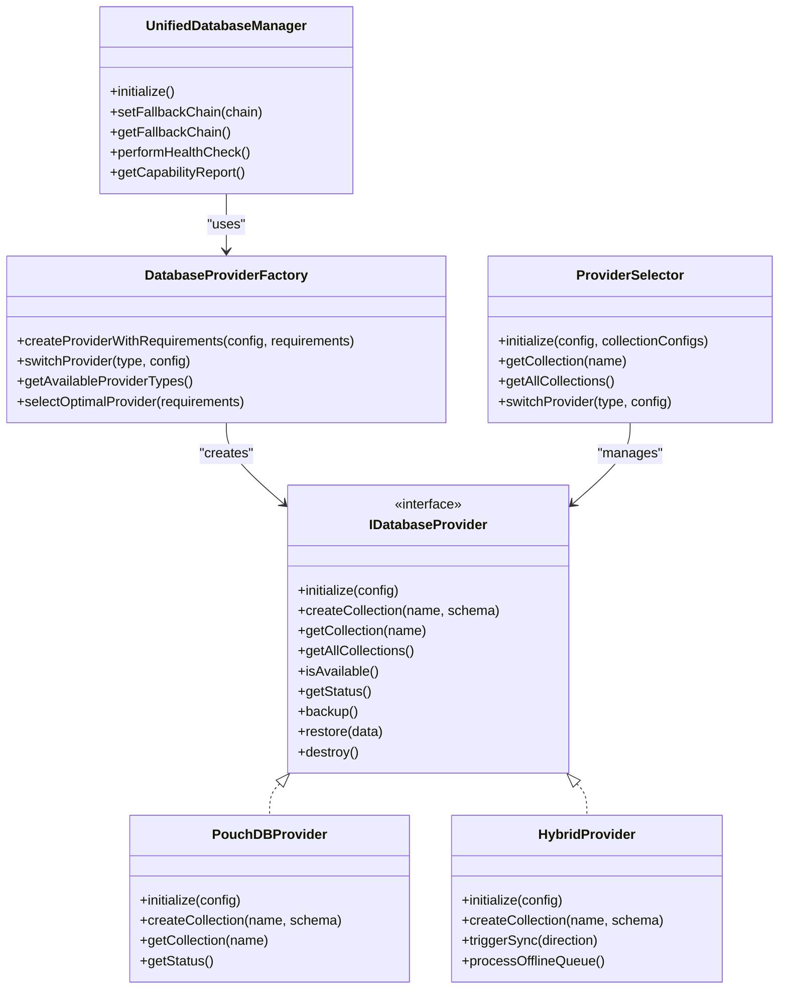
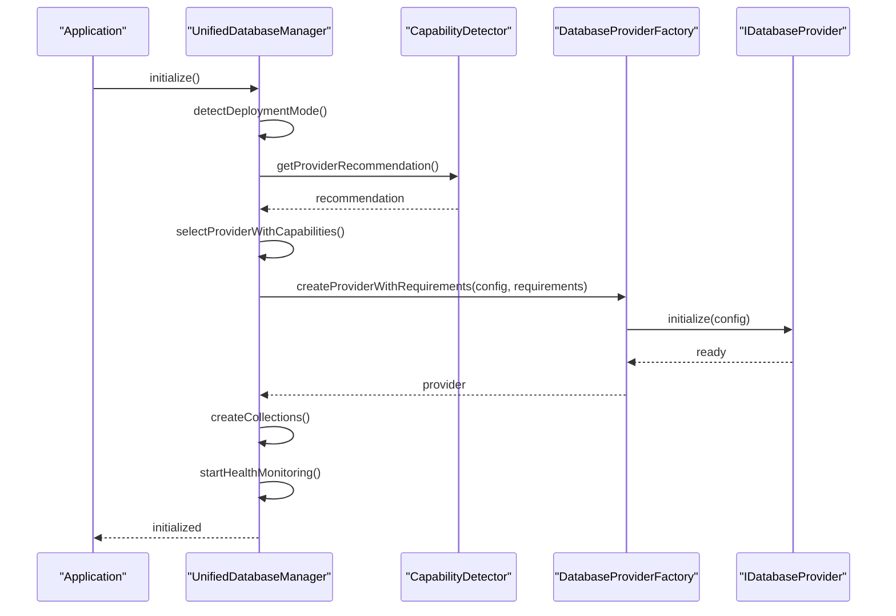
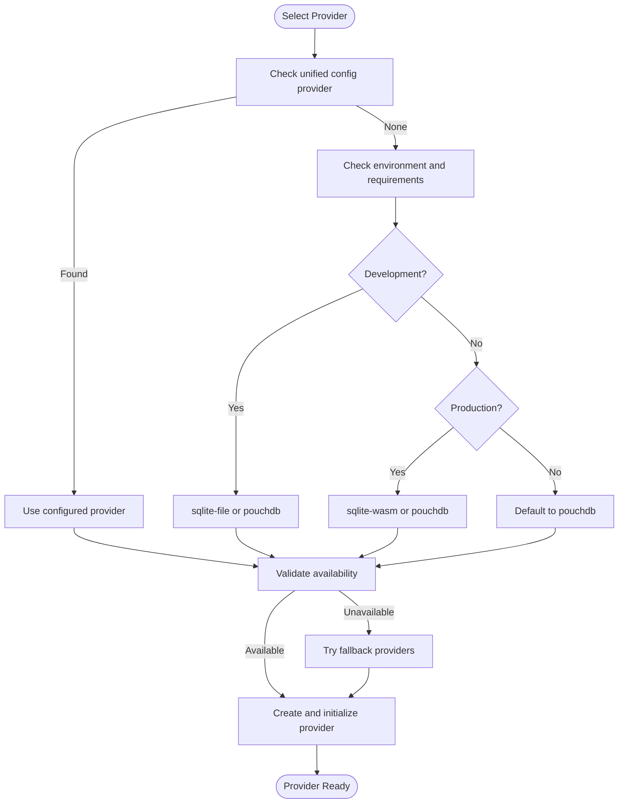
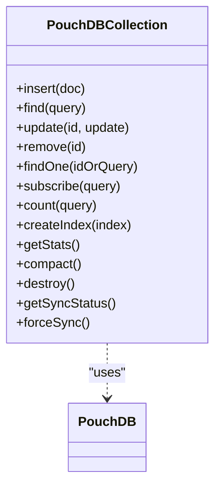
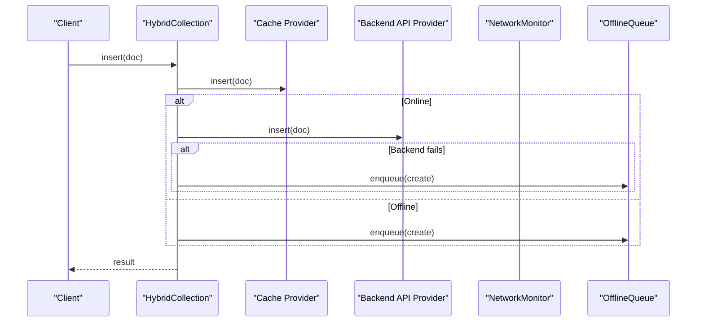
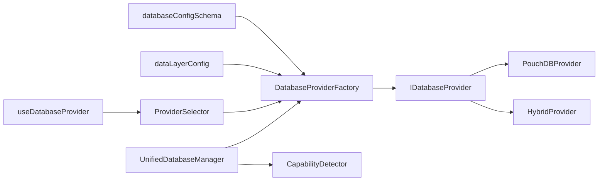

# Data Layer Architecture

<cite>
**Referenced Files in This Document**
- [index.ts](file://src/services/database/index.ts)
- [dataLayerConfig.ts](file://src/config/dataLayerConfig.ts)
- [useDatabaseProvider.ts](file://src/hooks/useDatabaseProvider.ts)
- [databaseConfigSchema.ts](file://src/config/databaseConfigSchema.ts)
- [UnifiedDatabaseManager.ts](file://src/services/database/UnifiedDatabaseManager.ts)
- [ProviderSelector.ts](file://src/services/database/ProviderSelector.ts)
- [DatabaseProviderFactory.ts](file://src/services/database/DatabaseProviderFactory.ts)
- [index.ts](file://src/services/database/detection/index.ts)
- [PouchDBProvider.ts](file://src/services/database/PouchDBProvider.ts)
- [HybridProvider.ts](file://src/services/database/HybridProvider.ts)
</cite>

## Table of Contents
1. [Introduction](#introduction)
2. [Project Structure](#project-structure)
3. [Core Components](#core-components)
4. [Architecture Overview](#architecture-overview)
5. [Detailed Component Analysis](#detailed-component-analysis)
6. [Dependency Analysis](#dependency-analysis)
7. [Performance Considerations](#performance-considerations)
8. [Troubleshooting Guide](#troubleshooting-guide)
9. [Conclusion](#conclusion)
10. [Appendices](#appendices)

## Introduction
This document explains SchoolPilot3’s multi-provider data layer architecture that supports dual operational modes:
- Development mode: SQLite with file storage (easy inspection and iteration)
- Production mode: SQLite WASM with OPFS for local-first, offline-capable applications

The system provides a unified database manager, a provider factory with capability-aware selection, automatic fallback chains, and a schema conversion layer to unify provider-specific differences. It includes configuration strategies, performance tuning, migration paths, and practical examples for provider switching, error handling, and monitoring.

## Project Structure
The data layer spans three main areas:
- Configuration: centralized provider and backend integration definitions
- Services: provider implementations, factory, and orchestration
- Hooks: React integration for seamless data access

**Diagram sources**
- [dataLayerConfig.ts:1-524](file://src/config/dataLayerConfig.ts#L1-L524)
- [databaseConfigSchema.ts:1-530](file://src/config/databaseConfigSchema.ts#L1-L530)
- [UnifiedDatabaseManager.ts:1-800](file://src/services/database/UnifiedDatabaseManager.ts#L1-L800)
- [ProviderSelector.ts:1-451](file://src/services/database/ProviderSelector.ts#L1-L451)
- [DatabaseProviderFactory.ts:1-726](file://src/services/database/DatabaseProviderFactory.ts#L1-L726)
- [PouchDBProvider.ts:1-800](file://src/services/database/PouchDBProvider.ts#L1-L800)
- [HybridProvider.ts:1-608](file://src/services/database/HybridProvider.ts#L1-L608)
- [index.ts:1-17](file://src/services/database/detection/index.ts#L1-L17)
- [useDatabaseProvider.ts:1-456](file://src/hooks/useDatabaseProvider.ts#L1-L456)

**Section sources**
- [index.ts:1-44](file://src/services/database/index.ts#L1-L44)
- [dataLayerConfig.ts:1-524](file://src/config/dataLayerConfig.ts#L1-L524)
- [databaseConfigSchema.ts:1-530](file://src/config/databaseConfigSchema.ts#L1-L530)
- [UnifiedDatabaseManager.ts:1-800](file://src/services/database/UnifiedDatabaseManager.ts#L1-L800)
- [ProviderSelector.ts:1-451](file://src/services/database/ProviderSelector.ts#L1-L451)
- [DatabaseProviderFactory.ts:1-726](file://src/services/database/DatabaseProviderFactory.ts#L1-L726)
- [PouchDBProvider.ts:1-800](file://src/services/database/PouchDBProvider.ts#L1-L800)
- [HybridProvider.ts:1-608](file://src/services/database/HybridProvider.ts#L1-L608)
- [index.ts:1-17](file://src/services/database/detection/index.ts#L1-L17)
- [useDatabaseProvider.ts:1-456](file://src/hooks/useDatabaseProvider.ts#L1-L456)

## Core Components
- UnifiedDatabaseManager: central orchestrator that selects, initializes, and monitors providers; maintains health and fallback chains
- DatabaseProviderFactory: factory implementing provider selection strategy and creation with fallbacks
- ProviderSelector: legacy manager for dual-database orchestration and collection lifecycle
- PouchDBProvider: network-capable provider with sync, conflict resolution, and offline queue
- HybridProvider: composes backend API with local cache for offline-first behavior
- CapabilityDetector: runtime capability assessment for provider recommendations
- Configuration modules: dataLayerConfig and databaseConfigSchema define environments, backends, and validation

Key responsibilities:
- Dual-mode operation: development (SQLite file) vs. production (SQLite WASM + OPFS)
- Automatic fallback: tries alternate providers when primary fails
- Schema agnostic access: converts provider-specific schemas to a unified format
- Health monitoring and diagnostics
- Validation and repair of configuration

**Section sources**
- [UnifiedDatabaseManager.ts:44-800](file://src/services/database/UnifiedDatabaseManager.ts#L44-L800)
- [DatabaseProviderFactory.ts:288-726](file://src/services/database/DatabaseProviderFactory.ts#L288-L726)
- [ProviderSelector.ts:31-242](file://src/services/database/ProviderSelector.ts#L31-L242)
- [PouchDBProvider.ts:62-800](file://src/services/database/PouchDBProvider.ts#L62-L800)
- [HybridProvider.ts:326-608](file://src/services/database/HybridProvider.ts#L326-L608)
- [index.ts:1-17](file://src/services/database/detection/index.ts#L1-L17)
- [dataLayerConfig.ts:14-37](file://src/config/dataLayerConfig.ts#L14-L37)
- [databaseConfigSchema.ts:305-530](file://src/config/databaseConfigSchema.ts#L305-L530)

## Architecture Overview
The architecture separates concerns across configuration, factory selection, provider implementations, and integration hooks. The UnifiedDatabaseManager coordinates initialization, health monitoring, and fallbacks. The factory encapsulates provider creation and selection strategies. Providers expose a common interface for collections, queries, and reactive updates.

**Diagram sources**
- [UnifiedDatabaseManager.ts:44-800](file://src/services/database/UnifiedDatabaseManager.ts#L44-L800)
- [DatabaseProviderFactory.ts:288-726](file://src/services/database/DatabaseProviderFactory.ts#L288-L726)
- [PouchDBProvider.ts:62-800](file://src/services/database/PouchDBProvider.ts#L62-L800)
- [HybridProvider.ts:326-608](file://src/services/database/HybridProvider.ts#L326-L608)
- [ProviderSelector.ts:31-242](file://src/services/database/ProviderSelector.ts#L31-L242)

## Detailed Component Analysis

### Unified Database Manager
Responsibilities:
- Detect deployment mode (development/staging/production) and derive provider selection
- Integrate capability detection to recommend compatible providers
- Validate provider availability and apply fallback chains
- Initialize provider, create collections, and start health monitoring
- Provide health diagnostics and automatic repair triggers

Provider selection logic:
- Environment variables and unified config drive initial selection
- CapabilityDetector augments selection with runtime compatibility
- Fallback chain ensures resilience when primary provider is unavailable

Health monitoring:
- Periodic checks per collection and provider
- Aggregated status with severity levels
- Automatic repair attempts for recoverable issues

**Diagram sources**
- [UnifiedDatabaseManager.ts:99-169](file://src/services/database/UnifiedDatabaseManager.ts#L99-L169)
- [UnifiedDatabaseManager.ts:322-382](file://src/services/database/UnifiedDatabaseManager.ts#L322-L382)
- [DatabaseProviderFactory.ts:477-531](file://src/services/database/DatabaseProviderFactory.ts#L477-L531)

**Section sources**
- [UnifiedDatabaseManager.ts:44-800](file://src/services/database/UnifiedDatabaseManager.ts#L44-L800)

### Database Provider Factory
Responsibilities:
- Register providers based on environment flags
- Implement selection strategy using unified configuration and requirements
- Create providers with fallbacks and mock provider as last resort
- Provide query builder and status diagnostics

Selection strategy:
- Uses unified config to choose provider variants (sqlite-file vs sqlite-wasm)
- Defaults to PouchDB for development flexibility and SQLite WASM for production
- Considers sync/offline/reactivity requirements

**Diagram sources**
- [DatabaseProviderFactory.ts:40-117](file://src/services/database/DatabaseProviderFactory.ts#L40-L117)
- [DatabaseProviderFactory.ts:477-531](file://src/services/database/DatabaseProviderFactory.ts#L477-L531)

**Section sources**
- [DatabaseProviderFactory.ts:288-726](file://src/services/database/DatabaseProviderFactory.ts#L288-L726)

### Provider Implementations

#### PouchDBProvider
Features:
- Built-in sync with CouchDB-compatible remotes
- Conflict resolution strategies (local/remote/manual)
- Offline queue and network monitoring
- Reactive streams and indexing support

**Diagram sources**
- [PouchDBProvider.ts:62-800](file://src/services/database/PouchDBProvider.ts#L62-L800)

**Section sources**
- [PouchDBProvider.ts:1-800](file://src/services/database/PouchDBProvider.ts#L1-L800)

#### HybridProvider
Features:
- Composes BackendAPIProvider with local cache (SQLite WASM/PouchDB/RxDB)
- Cache-first reads with backend fallback
- Offline queue and sync manager for bidirectional synchronization
- Network-aware operations and manual sync controls

**Diagram sources**
- [HybridProvider.ts:69-97](file://src/services/database/HybridProvider.ts#L69-L97)
- [HybridProvider.ts:326-608](file://src/services/database/HybridProvider.ts#L326-L608)

**Section sources**
- [HybridProvider.ts:1-608](file://src/services/database/HybridProvider.ts#L1-L608)

### Capability Detection and Recommendations
- CapabilityDetector assesses runtime environment and available storage/network capabilities
- Recommendations influence provider selection to ensure compatibility
- Diagnostic reports aid troubleshooting

**Section sources**
- [index.ts:1-17](file://src/services/database/detection/index.ts#L1-L17)
- [UnifiedDatabaseManager.ts:387-400](file://src/services/database/UnifiedDatabaseManager.ts#L387-L400)

### Configuration Strategies
- dataLayerConfig defines provider configurations for development, demo, and production
- Supports multiple backend integrations (ERPNext, CouchDB, PostgreSQL API, custom API)
- Consolidated options normalize provider/backend combinations for UI and selection

- databaseConfigSchema validates and repairs configuration, auto-fixing ranges and defaults

**Section sources**
- [dataLayerConfig.ts:14-37](file://src/config/dataLayerConfig.ts#L14-L37)
- [dataLayerConfig.ts:439-495](file://src/config/dataLayerConfig.ts#L439-L495)
- [databaseConfigSchema.ts:305-530](file://src/config/databaseConfigSchema.ts#L305-L530)

### Migration Paths Between Providers
- SchemaConverter transforms RxDB schemas to provider-specific formats
- useDatabaseProvider orchestrates migration from mock data to chosen provider
- Migration status tracks progress and errors

**Section sources**
- [useDatabaseProvider.ts:147-273](file://src/hooks/useDatabaseProvider.ts#L147-L273)
- [UnifiedDatabaseManager.ts:516-543](file://src/services/database/UnifiedDatabaseManager.ts#L516-L543)

### Practical Examples

#### Provider Switching
- Switch provider programmatically via DatabaseProviderFactory.switchProvider
- Validate availability and re-create collections with new provider
- Use resetDatabaseManager to clean up before switching

**Section sources**
- [DatabaseProviderFactory.ts:595-621](file://src/services/database/DatabaseProviderFactory.ts#L595-L621)
- [ProviderSelector.ts:128-164](file://src/services/database/ProviderSelector.ts#L128-L164)
- [ProviderSelector.ts:254-259](file://src/services/database/ProviderSelector.ts#L254-L259)

#### Error Handling and Recovery
- UnifiedDatabaseManager attempts automatic recovery on initialization failure
- Health monitoring detects degraded states and suggests repairs
- PouchDBProvider handles conflicts and retries with exponential backoff

**Section sources**
- [UnifiedDatabaseManager.ts:156-168](file://src/services/database/UnifiedDatabaseManager.ts#L156-L168)
- [UnifiedDatabaseManager.ts:754-800](file://src/services/database/UnifiedDatabaseManager.ts#L754-L800)
- [PouchDBProvider.ts:210-226](file://src/services/database/PouchDBProvider.ts#L210-L226)

#### Monitoring Approaches
- Health checks per collection and aggregated status
- Capability reports for diagnostics
- Performance metrics exposed via provider status

**Section sources**
- [UnifiedDatabaseManager.ts:563-630](file://src/services/database/UnifiedDatabaseManager.ts#L563-L630)
- [UnifiedDatabaseManager.ts:387-389](file://src/services/database/UnifiedDatabaseManager.ts#L387-L389)
- [DatabaseProviderFactory.ts:623-629](file://src/services/database/DatabaseProviderFactory.ts#L623-L629)

## Dependency Analysis
The data layer exhibits low coupling and high cohesion:
- UnifiedDatabaseManager depends on DatabaseProviderFactory and CapabilityDetector
- DatabaseProviderFactory registers and creates providers
- Providers implement a shared interface for collections and operations
- Configuration modules decouple environment-specific settings from provider logic

**Diagram sources**
- [UnifiedDatabaseManager.ts:44-800](file://src/services/database/UnifiedDatabaseManager.ts#L44-L800)
- [DatabaseProviderFactory.ts:288-726](file://src/services/database/DatabaseProviderFactory.ts#L288-L726)
- [ProviderSelector.ts:31-242](file://src/services/database/ProviderSelector.ts#L31-L242)
- [dataLayerConfig.ts:1-524](file://src/config/dataLayerConfig.ts#L1-L524)
- [databaseConfigSchema.ts:1-530](file://src/config/databaseConfigSchema.ts#L1-L530)

**Section sources**
- [UnifiedDatabaseManager.ts:44-800](file://src/services/database/UnifiedDatabaseManager.ts#L44-L800)
- [DatabaseProviderFactory.ts:288-726](file://src/services/database/DatabaseProviderFactory.ts#L288-L726)
- [ProviderSelector.ts:31-242](file://src/services/database/ProviderSelector.ts#L31-L242)
- [dataLayerConfig.ts:1-524](file://src/config/dataLayerConfig.ts#L1-L524)
- [databaseConfigSchema.ts:1-530](file://src/config/databaseConfigSchema.ts#L1-L530)

## Performance Considerations
- Use SQLite WASM with OPFS in production for optimal offline-first performance
- Enable auto-compaction and tune cache sizes per environment
- Leverage provider-specific optimizations (indexes, batching, compression)
- Monitor health and performance metrics to identify bottlenecks

[No sources needed since this section provides general guidance]

## Troubleshooting Guide
Common issues and resolutions:
- Initialization failures: check provider availability and fallback chain; review capability reports
- Health warnings: inspect collection stats and fix indexes or compaction
- Sync conflicts: configure conflict resolution strategy and monitor sync status
- Configuration errors: use validator to auto-fix and repair configuration

**Section sources**
- [UnifiedDatabaseManager.ts:563-630](file://src/services/database/UnifiedDatabaseManager.ts#L563-L630)
- [PouchDBProvider.ts:747-781](file://src/services/database/PouchDBProvider.ts#L747-L781)
- [databaseConfigSchema.ts:305-530](file://src/config/databaseConfigSchema.ts#L305-L530)

## Conclusion
SchoolPilot3’s data layer provides a robust, provider-agnostic architecture with automatic selection, capability-aware recommendations, and resilient fallbacks. The unified manager, factory, and provider implementations deliver consistent APIs across SQLite file/WASM and PouchDB/Hybrid setups, enabling smooth transitions between development and production modes while maintaining reliability and performance.

[No sources needed since this section summarizes without analyzing specific files]

## Appendices

### Configuration Options Reference
- ProviderConfig: provider type, storage type, backend integration, and options
- ConsolidatedConfigurationOption: normalized provider/backend combinations for UI
- Validation rules and repair utilities for configuration integrity

**Section sources**
- [dataLayerConfig.ts:14-54](file://src/config/dataLayerConfig.ts#L14-L54)
- [dataLayerConfig.ts:266-389](file://src/config/dataLayerConfig.ts#L266-L389)
- [databaseConfigSchema.ts:55-201](file://src/config/databaseConfigSchema.ts#L55-L201)