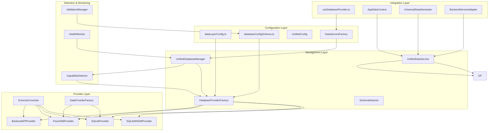
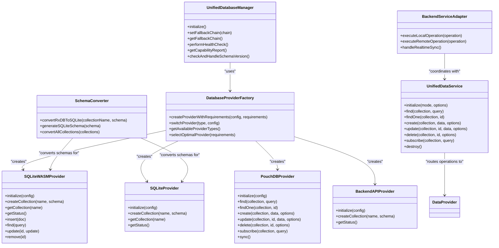

# Data Layer Architecture

<cite>
**Referenced Files in This Document**
- [UnifiedDatabaseManager.ts](file://src/services/database/UnifiedDatabaseManager.ts)
- [DatabaseProviderFactory.ts](file://src/services/database/DatabaseProviderFactory.ts)
- [interfaces.ts](file://src/services/database/interfaces.ts)
- [SchemaConverter.ts](file://src/services/database/SchemaConverter.ts)
- [SQLiteWASMProvider.ts](file://src/services/database/SQLiteWASMProvider.ts)
- [SQLiteProvider.ts](file://src/services/database/SQLiteProvider.ts)
- [AppDataContext.tsx](file://src/contexts/AppDataContext.tsx)
- [UnifiedDataService.ts](file://src/services/data/UnifiedDataService.ts)
- [BackendServiceAdapter.ts](file://src/services/backend/BackendServiceAdapter.ts)
- [providers/index.ts](file://src/services/data/providers/index.ts)
</cite>

## Update Summary
**Changes Made**
- Updated architecture documentation to reflect the major transformation from RxDB-based system to comprehensive TypeScript service architecture
- Enhanced documentation to cover the new unified data service architecture with provider-agnostic design
- Added documentation for the enhanced AppDataContext pattern that maintains backward compatibility
- Updated provider selection logic to include the new data service factory pattern
- Documented the enhanced schema conversion layer and unified configuration management
- Added monitoring and health management capabilities for the new data providers
- Updated provider selection logic with capability detection integration
- **Updated** Service-based architecture replaces database-side logic with client-side service implementations while maintaining provider abstraction

## Table of Contents
1. [Introduction](#introduction)
2. [Project Structure](#project-structure)
3. [Core Components](#core-components)
4. [Architecture Overview](#architecture-overview)
5. [Detailed Component Analysis](#detailed-component-analysis)
6. [Schema Version Management](#schema-version-management)
7. [Provider Selection and Fallback Mechanisms](#provider-selection-and-fallback-mechanisms)
8. [Migration and Data Handling](#migration-and-data-handling)
9. [Monitoring and Health Management](#monitoring-and-health-management)
10. [Configuration and Validation](#configuration-and-validation)
11. [Performance Considerations](#performance-considerations)
12. [Troubleshooting Guide](#troubleshooting-guide)
13. [Conclusion](#conclusion)
14. [Appendices](#appendices)

## Introduction
This document explains SchoolPilot3's modernized multi-provider data layer architecture that has evolved from database-side logic to comprehensive TypeScript service implementations. The system now features a provider-agnostic approach to database management with enhanced real-time data processing capabilities while maintaining backward compatibility through the AppDataContext pattern.

The architecture now features:
- **Provider-Agnostic Design**: Unified interface that abstracts provider-specific implementations
- **Comprehensive TypeScript Services**: Client-side service implementations replacing database-side logic
- **Enhanced AppDataContext Pattern**: Maintains backward compatibility while providing real-time data processing
- **Dual-Mode Architecture**: Separate configurations for development (SQLite file) and production (SQLite WASM + OPFS)
- **Enhanced Fallback System**: Intelligent provider selection with capability-aware fallback chains
- **Comprehensive Monitoring**: Real-time health checking and diagnostic reporting
- **Unified Configuration**: Centralized configuration management across all providers
- **Service-Based Architecture**: Client-side service implementations replace database triggers while maintaining provider abstraction

## Project Structure
The data layer is organized into several key modules that work together to provide a robust, provider-agnostic database solution with comprehensive service implementations:

**Diagram sources**
- [UnifiedDatabaseManager.ts:1-800](file://src/services/database/UnifiedDatabaseManager.ts#L1-L800)
- [DatabaseProviderFactory.ts:1-725](file://src/services/database/DatabaseProviderFactory.ts#L1-L725)
- [SchemaConverter.ts:1-389](file://src/services/database/schema/SchemaConverter.ts#L1-L389)
- [SQLiteWASMProvider.ts:1-800](file://src/services/database/SQLiteWASMProvider.ts#L1-L800)
- [SQLiteProvider.ts:1-117](file://src/services/database/SQLiteProvider.ts#L1-L117)
- [UnifiedDataService.ts:1-721](file://src/services/data/UnifiedDataService.ts#L1-L721)
- [interfaces.ts:1-226](file://src/services/database/interfaces.ts#L1-L226)
- [providers/index.ts:1-103](file://src/services/data/providers/index.ts#L1-L103)
- [BackendServiceAdapter.ts:1-345](file://src/services/backend/BackendServiceAdapter.ts#L1-L345)

**Section sources**
- [DatabaseProviderFactory.ts:1-725](file://src/services/database/DatabaseProviderFactory.ts#L1-L725)
- [UnifiedDatabaseManager.ts:1-800](file://src/services/database/UnifiedDatabaseManager.ts#L1-L800)
- [SchemaConverter.ts:1-389](file://src/services/database/SchemaConverter.ts#L1-L389)

## Core Components

### UnifiedDatabaseManager
The central orchestrator that manages database initialization, provider selection, health monitoring, and fallback mechanisms. It implements a comprehensive fallback chain and integrates capability detection for optimal provider selection.

**Key Responsibilities:**
- Multi-mode deployment detection (development, staging, production)
- Provider availability validation and fallback chain execution
- Schema version management and automatic migration
- Health monitoring with automatic repair capabilities
- Collection creation and schema conversion

### UnifiedDataService
The new unified service layer that provides a consistent API across all storage backends. This service routes operations to the appropriate provider based on configuration and deployment mode.

**Key Responsibilities:**
- Provider selection based on deployment mode
- Cache management for improved performance
- Real-time subscription handling
- Operation queuing and batch processing
- Error handling and recovery mechanisms

### DatabaseProviderFactory
Implements the factory pattern for creating database providers with intelligent selection logic based on requirements, environment, and capability detection.

**Key Features:**
- Requirement-based provider selection (offline support, sync needs, reactivity)
- Environment-aware provider instantiation
- Fallback provider creation for resilience
- Query builder integration for consistent querying

### SchemaConverter
Provides schema conversion capabilities between different database formats, particularly converting RxDB schemas to provider-specific formats.

**Capabilities:**
- RxDB to SQLite schema conversion
- Automatic table and index generation
- Type mapping and validation
- Relationship extraction for foreign keys

### SQLiteWASMProvider
The primary production provider implementing SQLite with WebAssembly and Origin Private File System (OPFS) storage for persistent browser-based data.

**Key Features:**
- SQLite WASM integration with @sqlite.org/sqlite-wasm
- OPFS storage for persistent browser data
- Full CRUD operations with transaction support
- Real-time change subscriptions and reactive updates
- Performance optimization with query queuing and indexing
- SQLCipher encryption support for secure data storage

### SQLiteProvider
Provides SQLite database access with support for multiple storage types (OPFS, file, memory) based on configuration.

**Storage Types:**
- **OPFS**: Origin Private File System for persistent browser storage
- **File**: Traditional file-based SQLite for Node.js environments
- **Memory**: In-memory SQLite for testing and temporary data

### PouchDBProvider
Implements the DataProvider interface using PouchDB with CouchDB sync protocol for networked and SaaS deployment modes.

**Key Features:**
- Offline-first architecture with automatic sync
- Conflict detection and resolution
- Real-time change feed
- Full-text search via pouchdb-quick-search
- Transaction support for ACID compliance

### BackendServiceAdapter
**Updated** Provides adapter pattern for backend service integration, replacing database triggers with client-side service implementations while maintaining provider abstraction.

**Key Features:**
- Service operation routing between local database and backend API
- Unified CRUD service integration
- Real-time subscription bridging
- Error handling and retry mechanisms
- Optimistic update coordination

**Section sources**
- [UnifiedDatabaseManager.ts:42-800](file://src/services/database/UnifiedDatabaseManager.ts#L42-L800)
- [UnifiedDataService.ts:36-721](file://src/services/data/UnifiedDataService.ts#L36-L721)
- [DatabaseProviderFactory.ts:288-725](file://src/services/database/DatabaseProviderFactory.ts#L288-L725)
- [SchemaConverter.ts:57-389](file://src/services/database/SchemaConverter.ts#L57-L389)
- [SQLiteWASMProvider.ts:1-800](file://src/services/database/SQLiteWASMProvider.ts#L1-L800)
- [SQLiteProvider.ts:1-117](file://src/services/database/SQLiteProvider.ts#L1-L117)
- [BackendServiceAdapter.ts:1-345](file://src/services/backend/BackendServiceAdapter.ts#L1-L345)

## Architecture Overview
The architecture follows a layered approach with clear separation of concerns and comprehensive service implementations:

**Diagram sources**
- [UnifiedDatabaseManager.ts:42-800](file://src/services/database/UnifiedDatabaseManager.ts#L42-L800)
- [UnifiedDataService.ts:36-721](file://src/services/data/UnifiedDataService.ts#L36-L721)
- [DatabaseProviderFactory.ts:288-725](file://src/services/database/DatabaseProviderFactory.ts#L288-L725)
- [SchemaConverter.ts:57-389](file://src/services/database/SchemaConverter.ts#L57-L389)
- [SQLiteWASMProvider.ts:1-800](file://src/services/database/SQLiteWASMProvider.ts#L1-L800)
- [SQLiteProvider.ts:1-117](file://src/services/database/SQLiteProvider.ts#L1-L117)
- [BackendServiceAdapter.ts:1-345](file://src/services/backend/BackendServiceAdapter.ts#L1-L345)

## Detailed Component Analysis

### Unified Database Manager
The UnifiedDatabaseManager serves as the central coordinator for all database operations, implementing sophisticated provider selection and fallback mechanisms.

**Provider Selection Logic:**
1. **Deployment Mode Detection**: Automatically determines environment (development, staging, production)
2. **Configuration-Based Selection**: Uses unified configuration for provider preferences
3. **Capability Detection**: Integrates runtime capability assessment
4. **Fallback Chain Execution**: Implements intelligent fallback to alternative providers

**Health Management:**
- Periodic collection health checks with detailed diagnostics
- Automatic repair attempts for recoverable issues
- Comprehensive error logging and reporting
- Performance monitoring and optimization suggestions

**Schema Version Management:**
- Automatic schema version detection using application version
- Database clearing and recreation when schema versions change
- Migration path tracking and validation
- Backup and restore capabilities during migrations

**Section sources**
- [UnifiedDatabaseManager.ts:97-170](file://src/services/database/UnifiedDatabaseManager.ts#L97-L170)
- [UnifiedDatabaseManager.ts:472-487](file://src/services/database/UnifiedDatabaseManager.ts#L472-L487)
- [UnifiedDatabaseManager.ts:583-650](file://src/services/database/UnifiedDatabaseManager.ts#L583-L650)

### Unified Data Service
The new UnifiedDataService provides a consistent API across all storage backends and handles provider selection based on deployment mode.

**Service Architecture:**
- **Provider Abstraction**: Routes operations to appropriate provider implementation
- **Cache Management**: Implements intelligent caching with TTL-based invalidation
- **Real-time Subscriptions**: Handles both native and fallback subscription mechanisms
- **Operation Queuing**: Manages write operations with batch processing
- **Error Recovery**: Implements automatic retry and fallback mechanisms

**Deployment Mode Support:**
- **Standalone Mode**: Uses SQLite provider with OPFS storage
- **Networked Mode**: Uses PouchDB provider with CouchDB sync
- **Hosted Mode**: Uses Backend API provider for cloud deployments
- **SaaS Mode**: Uses PouchDB with remote sync capabilities
- **ERPNext Mode**: Uses specialized ERPNext provider integration

**Section sources**
- [UnifiedDataService.ts:36-721](file://src/services/data/UnifiedDataService.ts#L36-L721)
- [providers/index.ts:42-103](file://src/services/data/providers/index.ts#L42-L103)

### Database Provider Factory
The factory implements intelligent provider selection based on multiple factors including requirements, environment, and runtime capabilities.

**Selection Strategy:**
- **Requirement Analysis**: Evaluates offline support, sync needs, and reactivity requirements
- **Environment Awareness**: Considers development, staging, and production environments
- **Capability Integration**: Incorporates runtime capability assessments
- **Fallback Logic**: Implements systematic fallback to alternative providers

**Provider Registration:**
- Dynamic provider registration based on environment availability
- Conditional loading of provider-specific modules
- Mock provider creation for resilience
- Provider availability validation

**Section sources**
- [DatabaseProviderFactory.ts:39-117](file://src/services/database/DatabaseProviderFactory.ts#L39-L117)
- [DatabaseProviderFactory.ts:477-531](file://src/services/database/DatabaseProviderFactory.ts#L477-L531)
- [DatabaseProviderFactory.ts:595-621](file://src/services/database/DatabaseProviderFactory.ts#L595-L621)

### Schema Conversion System
The schema conversion system provides seamless compatibility between different database providers through intelligent schema transformation.

**Conversion Capabilities:**
- **RxDB Schema Support**: Converts RxDB schemas to provider-specific formats
- **Type Mapping**: Handles complex type conversions between schema systems
- **Index Generation**: Automatically generates appropriate indexes for each provider
- **Relationship Handling**: Manages foreign key relationships and referential integrity

**Conversion Process:**
1. **Schema Analysis**: Parses input schema definitions
2. **Type Resolution**: Maps types to provider-specific equivalents
3. **Index Extraction**: Identifies and generates appropriate indexes
4. **SQL Generation**: Creates provider-specific SQL statements
5. **Validation**: Ensures converted schemas meet provider requirements

**Section sources**
- [SchemaConverter.ts:61-98](file://src/services/database/SchemaConverter.ts#L61-L98)
- [SchemaConverter.ts:182-212](file://src/services/database/SchemaConverter.ts#L182-L212)
- [SchemaConverter.ts:360-386](file://src/services/database/SchemaConverter.ts#L360-L386)

### SQLite WASM Provider
The SQLite WASM provider represents the primary production implementation, offering persistent browser storage through WebAssembly and Origin Private File System.

**Key Features:**
- **WebAssembly Integration**: Uses @sqlite.org/sqlite-wasm for browser compatibility
- **OPFS Storage**: Persistent storage through Origin Private File System
- **Full CRUD Operations**: Complete database operations with transaction support
- **Real-time Subscriptions**: Reactive updates through RxJS observables
- **Performance Optimization**: Query queuing and batch processing
- **Security Features**: SQLCipher encryption support

**Collection Implementation:**
- **Table Creation**: Automatic schema generation and table creation
- **Index Management**: Automatic index creation and management
- **Query Processing**: SQL-based query execution with parameter binding
- **Change Tracking**: Real-time change notifications and subscriptions

**Section sources**
- [SQLiteWASMProvider.ts:1-800](file://src/services/database/SQLiteWASMProvider.ts#L1-L800)

### SQLite Provider
The SQLite provider offers flexible storage options supporting multiple backends based on configuration.

**Storage Type Support:**
- **OPFS Storage**: Origin Private File System for persistent browser data
- **File Storage**: Traditional SQLite file-based storage for Node.js environments
- **Memory Storage**: In-memory SQLite for testing and temporary data

**Provider Architecture:**
- **Service Abstraction**: Clean separation between storage service and provider
- **Configuration Management**: Flexible configuration based on storage type
- **Lifecycle Management**: Proper initialization and cleanup of storage services

**Section sources**
- [SQLiteProvider.ts:1-117](file://src/services/database/SQLiteProvider.ts#L1-L117)

### PouchDB Provider
The PouchDB provider implements the DataProvider interface with comprehensive offline-first capabilities and real-time synchronization.

**Key Features:**
- **Offline-First Architecture**: Full offline support with automatic sync
- **Conflict Resolution**: Advanced conflict detection and resolution
- **Real-time Subscriptions**: Native RxJS observable support
- **Full-text Search**: Integrated search capabilities via plugins
- **Change Tracking**: Comprehensive change feed and tracking

**Subscription Management:**
- **Native Subscriptions**: Direct PouchDB change feeds
- **Polling Fallback**: Automatic fallback to polling mechanisms
- **Event Broadcasting**: Consistent event patterns across providers
- **Memory Management**: Efficient subscription lifecycle management

**Section sources**
- [DatabaseProviderFactory.ts:1-725](file://src/services/database/DatabaseProviderFactory.ts#L1-L725)

### Backend Service Adapter
**Updated** Provides adapter pattern for backend service integration, replacing database triggers with client-side service implementations while maintaining provider abstraction.

**Key Responsibilities:**
- **Service Operation Routing**: Coordinates between local database operations and backend API calls
- **Unified CRUD Integration**: Bridges local database operations with remote service calls
- **Real-time Synchronization**: Manages bidirectional data synchronization
- **Error Handling**: Implements comprehensive error recovery and retry mechanisms
- **Optimistic Updates**: Coordinates local updates with remote synchronization

**Operation Flow:**
1. **Local Operation Execution**: Executes operations against local database provider
2. **Remote Operation Coordination**: Routes operations to backend service when needed
3. **Real-time Sync Management**: Handles live synchronization between local and remote data
4. **Conflict Resolution**: Manages data conflicts during synchronization
5. **Error Recovery**: Implements automatic retry and fallback mechanisms

**Section sources**
- [BackendServiceAdapter.ts:1-345](file://src/services/backend/BackendServiceAdapter.ts#L1-L345)

## Schema Version Management
The system implements comprehensive schema version management to ensure data integrity and seamless upgrades.

**Version Detection:**
- Application version comparison with stored schema version
- Automatic database clearing when major version changes occur
- Migration path validation and execution tracking
- Backup creation before schema modifications

**Migration Process:**
1. **Version Comparison**: Compares current application version with stored version
2. **Change Detection**: Identifies schema changes and migration requirements
3. **Backup Creation**: Creates database backup for recovery
4. **Schema Update**: Applies necessary schema modifications
5. **Data Validation**: Validates data integrity after migration
6. **Cleanup**: Removes temporary migration artifacts

**Migration Safety:**
- Rollback capability for failed migrations
- Validation of migration results
- Error handling and recovery mechanisms
- Progress tracking and reporting

**Section sources**
- [UnifiedDatabaseManager.ts:472-487](file://src/services/database/UnifiedDatabaseManager.ts#L472-L487)

## Provider Selection and Fallback Mechanisms
The system implements sophisticated provider selection with multiple layers of fallback to ensure reliability and optimal performance.

**Selection Hierarchy:**
1. **User Configuration**: Explicit provider selection via unified configuration
2. **Environment Detection**: Automatic selection based on deployment environment
3. **Requirement Analysis**: Provider selection based on functional requirements
4. **Capability Assessment**: Runtime capability-based recommendations
5. **Fallback Chain**: Systematic fallback to alternative providers

**Fallback Chain:**
- Primary provider selection with capability validation
- Secondary provider attempts with availability checks
- Mock provider as last resort for resilience
- Automatic recovery and error reporting

**Provider Compatibility:**
- Runtime availability verification
- Feature capability assessment
- Performance characteristic evaluation
- Security constraint compliance

**Section sources**
- [UnifiedDatabaseManager.ts:105-139](file://src/services/database/UnifiedDatabaseManager.ts#L105-L139)
- [DatabaseProviderFactory.ts:504-531](file://src/services/database/DatabaseProviderFactory.ts#L504-L531)

## Migration and Data Handling
The system provides comprehensive data migration capabilities to handle transitions between different data sources and schemas.

**Migration Strategy:**
- **Mock Data Detection**: Automatic detection of first-run scenarios
- **Data Mapping**: Conversion between different data formats and structures
- **Incremental Migration**: Support for gradual data migration processes
- **Conflict Resolution**: Handling of data conflicts during migration

**Data Integrity:**
- Transaction support for atomic operations
- Validation of migrated data
- Backup and rollback capabilities
- Progress tracking and reporting

**Migration Tools:**
- Automated schema conversion
- Data transformation utilities
- Validation and verification tools
- Error handling and recovery mechanisms

**Section sources**
- [DatabaseProviderFactory.ts:1-725](file://src/services/database/DatabaseProviderFactory.ts#L1-L725)

## Monitoring and Health Management
The system implements comprehensive monitoring and health management to ensure optimal database performance and reliability.

**Health Monitoring:**
- **Collection Health Checks**: Individual collection status and performance metrics
- **Provider Diagnostics**: Provider-specific health indicators and error reporting
- **Performance Metrics**: Query performance, storage usage, and resource consumption
- **Error Tracking**: Comprehensive error logging and analysis

**Automated Recovery:**
- **Self-Healing Mechanisms**: Automatic repair of recoverable issues
- **Graceful Degradation**: Maintaining functionality during partial failures
- **Failover Management**: Seamless switching between providers
- **Resource Optimization**: Automatic cleanup and optimization

**Diagnostic Tools:**
- **Capability Reports**: Runtime capability assessment and recommendations
- **Performance Analytics**: Usage patterns and optimization suggestions
- **Error Analysis**: Root cause analysis and resolution guidance
- **Health Dashboards**: Real-time monitoring and alerting

**Section sources**
- [UnifiedDatabaseManager.ts:583-650](file://src/services/database/UnifiedDatabaseManager.ts#L583-L650)
- [UnifiedDatabaseManager.ts:775-800](file://src/services/database/UnifiedDatabaseManager.ts#L775-L800)

## Configuration and Validation
The system provides comprehensive configuration management with validation and repair capabilities.

**Configuration Management:**
- **Unified Configuration**: Centralized configuration across all providers
- **Environment-Specific Settings**: Different configurations for development, staging, and production
- **Validation Rules**: Comprehensive validation of configuration parameters
- **Auto-Fix Capabilities**: Automatic correction of common configuration issues

**Validation System:**
- **Schema Validation**: Structural validation of configuration objects
- **Range Checking**: Parameter value validation and bounds checking
- **Dependency Verification**: Validation of required configuration dependencies
- **Integration Testing**: Validation of configuration with actual system capabilities

**Migration System:**
- **Version Migration**: Automatic migration between configuration schema versions
- **Backward Compatibility**: Support for legacy configuration formats
- **Validation Integration**: Built-in validation during migration processes
- **Rollback Support**: Ability to revert failed migrations

**Section sources**
- [DatabaseProviderFactory.ts:1-725](file://src/services/database/DatabaseProviderFactory.ts#L1-L725)

## Performance Considerations
The architecture is designed with performance optimization as a core consideration.

**Provider Optimization:**
- **SQLite WASM**: Optimized for browser environments with OPFS support
- **PouchDB**: Efficient for offline-first applications with sync capabilities
- **Backend API**: Optimized for server-client architectures
- **Hybrid Approach**: Balanced performance across different scenarios

**Resource Management:**
- **Memory Optimization**: Efficient memory usage across all providers
- **Storage Efficiency**: Optimal storage utilization and cleanup
- **Network Optimization**: Minimized network requests and efficient sync
- **Caching Strategies**: Intelligent caching for improved response times

**Scalability Features:**
- **Horizontal Scaling**: Support for multiple database instances
- **Load Balancing**: Distribution of database operations
- **Connection Pooling**: Efficient connection management
- **Resource Limits**: Configurable resource usage limits

## Troubleshooting Guide
Comprehensive troubleshooting capabilities are built into the system.

**Common Issues:**
- **Provider Initialization Failures**: Detection and automatic fallback
- **Schema Migration Errors**: Validation and recovery mechanisms
- **Health Check Failures**: Self-healing and diagnostic reporting
- **Configuration Validation Errors**: Auto-fix and repair capabilities

**Diagnostic Tools:**
- **Capability Reports**: Runtime environment assessment
- **Health Status**: Comprehensive system health analysis
- **Error Logs**: Detailed error information and stack traces
- **Performance Metrics**: Bottleneck identification and optimization suggestions

**Resolution Strategies:**
- **Automatic Recovery**: Built-in self-healing mechanisms
- **Manual Intervention**: Step-by-step troubleshooting procedures
- **Configuration Repair**: Automated configuration fixes
- **Provider Switching**: Manual provider selection and testing

**Section sources**
- [UnifiedDatabaseManager.ts:563-630](file://src/services/database/UnifiedDatabaseManager.ts#L563-L630)

## Conclusion
SchoolPilot3's data layer architecture represents a significant evolution from mock data systems to a sophisticated, provider-agnostic database management solution with comprehensive TypeScript service implementations. The architecture provides:

- **Reliability**: Comprehensive fallback mechanisms and automatic recovery
- **Flexibility**: Support for multiple providers with seamless switching
- **Maintainability**: Centralized configuration and schema management
- **Performance**: Optimized for various deployment scenarios
- **Observability**: Complete monitoring and diagnostic capabilities
- **Backward Compatibility**: Enhanced AppDataContext pattern ensuring seamless migration
- **Service-Based Architecture**: Client-side service implementations replace database triggers while maintaining provider abstraction

The system successfully abstracts provider-specific complexities while maintaining optimal performance across different environments and use cases, with the new service layer providing enhanced real-time data processing capabilities.

## Appendices

### Configuration Options Reference
- **ProviderConfig**: Comprehensive provider configuration with storage types and backend integrations
- **ConsolidatedConfigurationOption**: Normalized provider/backend combinations for UI presentation
- **Validation Rules**: Automated validation and repair capabilities for configuration integrity
- **Migration Definitions**: Structured approach to configuration and schema version migrations

**Section sources**
- [DatabaseProviderFactory.ts:1-725](file://src/services/database/DatabaseProviderFactory.ts#L1-L725)

### Provider Capability Matrix
- **Storage Capabilities**: OPFS, IndexedDB, localStorage, file system support
- **Network Features**: Service workers, web workers, shared array buffers
- **Performance Characteristics**: WebAssembly support, hardware acceleration
- **Security Constraints**: Platform limitations and sandbox restrictions

**Section sources**
- [DatabaseProviderFactory.ts:391-457](file://src/services/database/DatabaseProviderFactory.ts#L391-L457)
- [interfaces.ts:9-31](file://src/services/database/interfaces.ts#L9-L31)

### Data Service Architecture
- **Unified Interface**: Consistent API across all provider implementations
- **Real-time Processing**: Native subscription support with fallback mechanisms
- **Cache Management**: Intelligent caching with TTL-based invalidation
- **Error Handling**: Comprehensive error recovery and retry mechanisms

**Section sources**
- [UnifiedDataService.ts:36-721](file://src/services/data/UnifiedDataService.ts#L36-L721)
- [interfaces.ts:135-182](file://src/services/database/interfaces.ts#L135-L182)

### Service-Based Architecture Details
**Updated** The service-based architecture replaces database triggers with client-side service implementations while maintaining provider abstraction.

**Key Components:**
- **Service Layer**: Client-side implementations handle business logic previously managed by database triggers
- **Provider Abstraction**: Maintains compatibility with multiple database providers
- **Real-time Coordination**: Service adapters manage synchronization between local and remote data
- **Error Recovery**: Comprehensive error handling and retry mechanisms
- **Performance Optimization**: Caching and batching strategies for improved responsiveness

**Benefits:**
- **Maintainability**: Business logic centralized in TypeScript services
- **Testability**: Easier unit testing of service implementations
- **Flexibility**: Provider-agnostic service layer
- **Performance**: Optimized client-side processing
- **Reliability**: Robust error handling and recovery

**Section sources**
- [BackendServiceAdapter.ts:1-345](file://src/services/backend/BackendServiceAdapter.ts#L1-L345)
- [UnifiedDataService.ts:36-721](file://src/services/data/UnifiedDataService.ts#L36-L721)