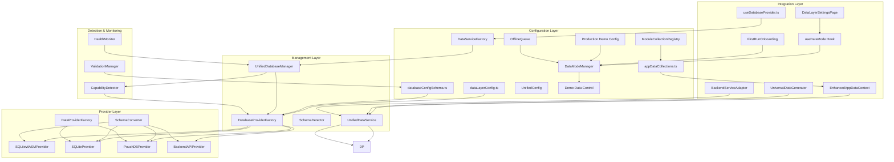
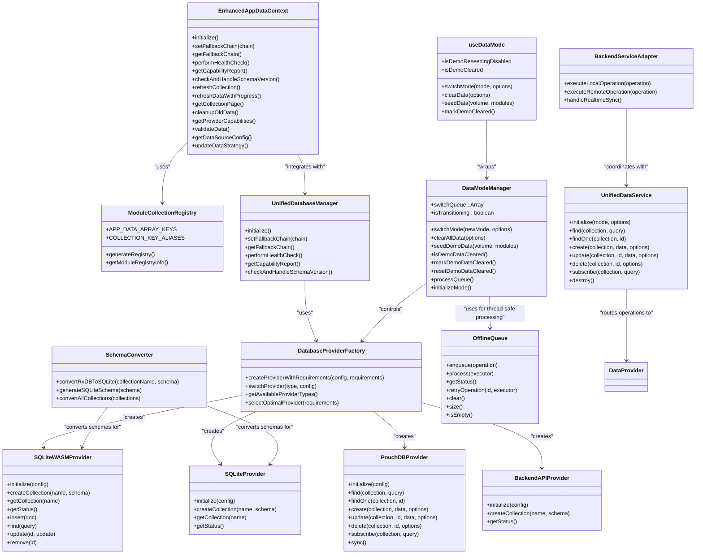

# Data Layer Architecture

<cite>
**Referenced Files in This Document**
- [AppDataContext.tsx](file://src/contexts/AppDataContext.tsx)
- [appDataCollections.ts](file://src/contexts/appData/appDataCollections.ts)
- [moduleCollectionRegistry.ts](file://src/contexts/appData/moduleCollectionRegistry.ts)
- [collectionConfig.ts](file://src/modules/finance/data/collectionConfig.ts)
- [collectionConfig.ts](file://src/modules/administration/data/collectionConfig.ts)
- [collectionConfig.ts](file://src/modules/academics/data/collectionConfig.ts)
- [UnifiedDatabaseManager.ts](file://src/services/database/UnifiedDatabaseManager.ts)
- [DatabaseProviderFactory.ts](file://src/services/database/DatabaseProviderFactory.ts)
- [types.ts](file://src/services/data/types.ts)
- [index.ts](file://src/services/data/providers/index.ts)
- [interfaces.ts](file://src/services/database/interfaces.ts)
- [dataLayerConfig.ts](file://src/config/dataLayerConfig.ts)
- [useDatabaseProvider.ts](file://src/hooks/useDatabaseProvider.ts)
- [databaseConfigSchema.ts](file://src/config/databaseConfigSchema.ts)
- [SchemaConverter.ts](file://src/services/database/schema/SchemaConverter.ts)
- [SQLiteWASMProvider.ts](file://src/services/database/SQLiteWASMProvider.ts)
- [SQLiteProvider.ts](file://src/services/database/SQLiteProvider.ts)
- [UniversalDataGenerator.ts](file://src/services/dataGeneration/UniversalDataGenerator.ts)
- [BackendServiceAdapter.ts](file://src/services/backend/BackendServiceAdapter.ts)
- [DataServiceFactory.ts](file://src/services/data/DataServiceFactory.ts)
- [schemaUtils.ts](file://src/utils/schemaUtils.ts)
- [dataModeManager.ts](file://src/services/data/dataModeManager.ts)
- [useDataMode.ts](file://src/hooks/useDataMode.ts)
- [DataLayerSettingsPage.tsx](file://src/modules/settings/pages/DataLayerSettingsPage.tsx)
- [FirstRunOnboarding.tsx](file://src/components/FirstRunOnboarding.tsx)
- [DataModeSwitch.tsx](file://src/components/DataModeSwitch.tsx)
- [UnifiedConfigContext.tsx](file://src/contexts/UnifiedConfigContext.tsx)
- [configurationSwitching.test.ts](file://src/tests/integration/configurationSwitching.test.ts)
- [useDataMode.test.ts](file://src/tests/useDataMode.test.ts)
- [DataModeManager.test.ts](file://src/services/database/__tests__/DataModeManager.test.ts)
- [productionDemo.ts](file://src/config/productionDemo.ts)
- [OfflineQueue.ts](file://src/services/database/sync/OfflineQueue.ts)
</cite>

## Update Summary
**Changes Made**
- Enhanced documentation to reflect new demo mode protection system with permanent demo data clearing safeguards
- Updated DataModeManager implementation details with hard enforcement mechanisms preventing accidental mode transitions
- Added documentation for user interface components that now display warning banners and disable Apply Configuration button when demo mode is locked
- Updated provider selection logic to include enhanced fallback chains with capability-aware selection
- Documented the comprehensive schema conversion layer and unified configuration management
- Added monitoring and health management capabilities for the enhanced data providers
- Updated provider selection logic with capability detection integration
- Enhanced documentation to cover the new centralized database-loaded data architecture
- Added comprehensive documentation for the enhanced Data Mode Safety System with thread-safe queue processing

## Table of Contents
1. [Introduction](#introduction)
2. [Project Structure](#project-structure)
3. [Core Components](#core-components)
4. [Architecture Overview](#architecture-overview)
5. [Detailed Component Analysis](#detailed-component-analysis)
6. [Schema Version Management](#schema-version-management)
7. [Provider Selection and Fallback Mechanisms](#provider-selection-and-fallback-mechanisms)
8. [Migration and Data Handling](#migration-and-data-handling)
9. [Monitoring and Health Management](#monitoring-and-health-management)
10. [Configuration and Validation](#configuration-and-validation)
11. [Performance Considerations](#performance-considerations)
12. [Troubleshooting Guide](#troubleshooting-guide)
13. [Conclusion](#conclusion)
14. [Appendices](#appendices)

## Introduction
This document explains SchoolPilot3's modernized multi-provider data layer architecture that has evolved from database-side logic to comprehensive TypeScript service implementations. The system now features a provider-agnostic approach to database management with enhanced real-time data processing capabilities while maintaining backward compatibility through the enhanced AppDataContext pattern.

The architecture now features:
- **Provider-Agnostic Design**: Unified interface that abstracts provider-specific implementations
- **Comprehensive TypeScript Services**: Client-side service implementations replacing database-side logic
- **Enhanced AppDataContext Pattern**: Expanded interface supporting centralized database-loaded data management
- **Auto-Discovered Module Collections**: Dynamic collection registration system eliminating manual configuration
- **Dual-Mode Architecture**: Separate configurations for development (SQLite file) and production (SQLite WASM + OPFS)
- **Enhanced Fallback System**: Intelligent provider selection with capability-aware fallback chains
- **Comprehensive Monitoring**: Real-time health checking and diagnostic reporting
- **Unified Configuration**: Centralized configuration management across all providers
- **Service-Based Architecture**: Client-side service implementations replace database triggers while maintaining provider abstraction
- **Enhanced Data Mode Safety**: Hard enforcement mechanisms preventing accidental mode transitions after demo data has been cleared
- **Thread-Safe Queue Processing**: Sequential mode switching with proper error handling and rollback capabilities

## Project Structure
The data layer is organized into several key modules that work together to provide a robust, provider-agnostic database solution with comprehensive service implementations and centralized data management:

**Diagram sources**
- [dataLayerConfig.ts:1-527](file://src/config/dataLayerConfig.ts#L1-L527)
- [databaseConfigSchema.ts:1-530](file://src/config/databaseConfigSchema.ts#L1-L530)
- [UnifiedDatabaseManager.ts:1-800](file://src/services/database/UnifiedDatabaseManager.ts#L1-L800)
- [DatabaseProviderFactory.ts:1-725](file://src/services/database/DatabaseProviderFactory.ts#L1-L725)
- [SchemaConverter.ts:1-389](file://src/services/database/schema/SchemaConverter.ts#L1-L389)
- [SQLiteWASMProvider.ts:1-800](file://src/services/database/SQLiteWASMProvider.ts#L1-L800)
- [SQLiteProvider.ts:1-117](file://src/services/database/SQLiteProvider.ts#L1-L117)
- [UnifiedDataService.ts:1-721](file://src/services/data/UnifiedDataService.ts#L1-L721)
- [types.ts:1-226](file://src/services/data/types.ts#L1-L226)
- [index.ts:1-103](file://src/services/data/providers/index.ts#L1-L103)
- [DataServiceFactory.ts:1-33](file://src/services/data/DataServiceFactory.ts#L1-L33)
- [BackendServiceAdapter.ts:108-149](file://src/services/backend/BackendServiceAdapter.ts#L108-L149)
- [moduleCollectionRegistry.ts:1-120](file://src/contexts/appData/moduleCollectionRegistry.ts#L1-L120)
- [appDataCollections.ts:1-69](file://src/contexts/appData/appDataCollections.ts#L1-L69)
- [dataModeManager.ts:1-432](file://src/services/data/dataModeManager.ts#L1-L432)
- [useDataMode.ts:1-177](file://src/hooks/useDataMode.ts#L1-L177)
- [DataLayerSettingsPage.tsx:1-492](file://src/modules/settings/pages/DataLayerSettingsPage.tsx#L1-L492)
- [FirstRunOnboarding.tsx:1-493](file://src/components/FirstRunOnboarding.tsx#L1-L493)
- [productionDemo.ts:1-301](file://src/config/productionDemo.ts#L1-L301)
- [OfflineQueue.ts:1-458](file://src/services/database/sync/OfflineQueue.ts#L1-L458)

**Section sources**
- [index.ts:1-44](file://src/services/database/index.ts#L1-L44)
- [dataLayerConfig.ts:1-527](file://src/config/dataLayerConfig.ts#L1-L527)
- [databaseConfigSchema.ts:1-530](file://src/config/databaseConfigSchema.ts#L1-L530)
- [UnifiedDatabaseManager.ts:1-800](file://src/services/database/UnifiedDatabaseManager.ts#L1-L800)
- [DatabaseProviderFactory.ts:1-725](file://src/services/database/DatabaseProviderFactory.ts#L1-L725)
- [SchemaConverter.ts:1-389](file://src/services/database/schema/SchemaConverter.ts#L1-L389)
- [moduleCollectionRegistry.ts:1-120](file://src/contexts/appData/moduleCollectionRegistry.ts#L1-L120)
- [appDataCollections.ts:1-69](file://src/contexts/appData/appDataCollections.ts#L1-L69)
- [dataModeManager.ts:1-432](file://src/services/data/dataModeManager.ts#L1-L432)

## Core Components

### Enhanced AppDataContext
The expanded AppDataContext interface provides centralized database-loaded data management with comprehensive CRUD operations, real-time synchronization, and advanced data management capabilities.

**Enhanced Features:**
- **Centralized Data Management**: Unified access to all database-loaded collections
- **Real-time Synchronization**: Bidirectional sync with backend providers
- **Advanced Data Operations**: Enhanced refresh, pagination, and cleanup capabilities
- **Provider Intelligence**: Automatic capability detection and optimization
- **Data Strategy Management**: Configurable data access strategies
- **Validation Framework**: Comprehensive data validation and integrity checking

### Module Collection Registry System
The new auto-discovered module collection system eliminates manual configuration requirements and provides dynamic collection registration across all modules.

**Key Features:**
- **Automatic Discovery**: Modules register collections without manual core edits
- **Centralized Aliasing**: Consistent naming conventions across the application
- **Schema Integration**: Automatic schema registration and validation
- **Module Metadata**: Track collection counts and module relationships
- **Debug Utilities**: Comprehensive module registry inspection tools

### UnifiedDatabaseManager
The central orchestrator that manages database initialization, provider selection, health monitoring, and fallback mechanisms. It implements a comprehensive fallback chain and integrates capability detection for optimal provider selection.

**Key Responsibilities:**
- Multi-mode deployment detection (development, staging, production)
- Provider availability validation and fallback chain execution
- Schema version management and automatic migration
- Health monitoring with automatic repair capabilities
- Collection creation and schema conversion

### UnifiedDataService
The new unified service layer that provides a consistent API across all storage backends. This service routes operations to the appropriate provider based on configuration and deployment mode.

**Key Responsibilities:**
- Provider selection based on deployment mode
- Cache management for improved performance
- Real-time subscription handling
- Operation queuing and batch processing
- Error handling and recovery mechanisms

### DatabaseProviderFactory
Implements the factory pattern for creating database providers with intelligent selection logic based on requirements, environment, and capability detection.

**Key Features:**
- Requirement-based provider selection (offline support, sync needs, reactivity)
- Environment-aware provider instantiation
- Fallback provider creation for resilience
- Query builder integration for consistent querying

### SchemaConverter
Provides schema conversion capabilities between different database formats, particularly converting RxDB schemas to provider-specific formats.

**Capabilities:**
- RxDB to SQLite schema conversion
- Automatic table and index generation
- Type mapping and validation
- Relationship extraction for foreign keys

### SQLiteWASMProvider
The primary production provider implementing SQLite with WebAssembly and Origin Private File System (OPFS) storage for persistent browser-based data.

**Key Features:**
- SQLite WASM integration with @sqlite.org/sqlite-wasm
- OPFS storage for persistent browser data
- Full CRUD operations with transaction support
- Real-time change subscriptions and reactive updates
- Performance optimization with query queuing and indexing
- SQLCipher encryption support for secure data storage

### SQLiteProvider
Provides SQLite database access with support for multiple storage types (OPFS, file, memory) based on configuration.

**Storage Types:**
- **OPFS**: Origin Private File System for persistent browser storage
- **File**: Traditional file-based SQLite for Node.js environments
- **Memory**: In-memory SQLite for testing and temporary data

### PouchDBProvider
Implements the DataProvider interface using PouchDB with CouchDB sync protocol for networked and SaaS deployment modes.

**Key Features:**
- Offline-first architecture with automatic sync
- Conflict detection and resolution
- Real-time change feed
- Full-text search via pouchdb-quick-search
- Transaction support for ACID compliance

### BackendServiceAdapter
Provides adapter pattern for backend service integration, replacing database triggers with client-side service implementations while maintaining provider abstraction.

**Key Features:**
- Service operation routing between local database and backend API
- Unified CRUD service integration
- Real-time subscription bridging
- Error handling and retry mechanisms
- Optimistic update coordination

### DataModeManager
The new centralized data mode management system that provides hard enforcement mechanisms for preventing accidental mode transitions after demo data has been cleared. This system implements comprehensive safety controls to protect production data integrity.

**Enhanced Safety Features:**
- **Hard Enforcement**: Prevents switching to demo mode if demo data has been permanently cleared
- **Permanent Demo Data Flag**: One-way operation that blocks future demo mode transitions
- **Thread-Safe Queue Processing**: Sequential mode switching with proper error handling
- **Audit Logging**: Comprehensive logging of all data clearance and mode transition operations
- **Production Data Protection**: Enhanced security measures for production environment data
- **Rollback Mechanisms**: Automatic rollback on failed mode transitions
- **Transition State Management**: Proper tracking of mode switching states

**Enhanced Thread-Safe Queue Processing:**
- **Sequential Processing**: All mode switching operations are queued and processed sequentially
- **Error Isolation**: Individual queue items can fail without affecting others
- **Automatic Cleanup**: Queue items are automatically cleaned up after processing
- **State Persistence**: Queue state is maintained across application restarts

**Section sources**
- [AppDataContext.tsx:102-183](file://src/contexts/AppDataContext.tsx#L102-L183)
- [moduleCollectionRegistry.ts:48-84](file://src/contexts/appData/moduleCollectionRegistry.ts#L48-L84)
- [appDataCollections.ts:44-68](file://src/contexts/appData/appDataCollections.ts#L44-L68)
- [UnifiedDatabaseManager.ts:42-800](file://src/services/database/UnifiedDatabaseManager.ts#L42-L800)
- [UnifiedDataService.ts:36-721](file://src/services/data/UnifiedDataService.ts#L36-L721)
- [DatabaseProviderFactory.ts:288-725](file://src/services/database/DatabaseProviderFactory.ts#L288-L725)
- [SchemaConverter.ts:57-389](file://src/services/database/schema/SchemaConverter.ts#L57-L389)
- [SQLiteWASMProvider.ts:1-800](file://src/services/database/SQLiteWASMProvider.ts#L1-L800)
- [SQLiteProvider.ts:1-117](file://src/services/database/SQLiteProvider.ts#L1-L117)
- [PouchDBProvider.ts:1-200](file://src/services/data/providers/PouchDBProvider.ts#L1-L200)
- [BackendServiceAdapter.ts:108-149](file://src/services/backend/BackendServiceAdapter.ts#L108-L149)
- [dataModeManager.ts:1-432](file://src/services/data/dataModeManager.ts#L1-L432)

## Architecture Overview
The architecture follows a layered approach with clear separation of concerns and comprehensive service implementations, featuring centralized data management, auto-discovered module collections, and enhanced safety mechanisms:

**Diagram sources**
- [AppDataContext.tsx:102-183](file://src/contexts/AppDataContext.tsx#L102-L183)
- [moduleCollectionRegistry.ts:48-84](file://src/contexts/appData/moduleCollectionRegistry.ts#L48-L84)
- [UnifiedDatabaseManager.ts:42-800](file://src/services/database/UnifiedDatabaseManager.ts#L42-L800)
- [UnifiedDataService.ts:36-721](file://src/services/data/UnifiedDataService.ts#L36-L721)
- [DatabaseProviderFactory.ts:288-725](file://src/services/database/DatabaseProviderFactory.ts#L288-L725)
- [SchemaConverter.ts:57-389](file://src/services/database/schema/SchemaConverter.ts#L57-L389)
- [SQLiteWASMProvider.ts:1-800](file://src/services/database/SQLiteWASMProvider.ts#L1-L800)
- [SQLiteProvider.ts:1-117](file://src/services/database/SQLiteProvider.ts#L1-L117)
- [PouchDBProvider.ts:1-200](file://src/services/data/providers/PouchDBProvider.ts#L1-L200)
- [BackendServiceAdapter.ts:108-149](file://src/services/backend/BackendServiceAdapter.ts#L108-L149)
- [dataModeManager.ts:66-432](file://src/services/data/dataModeManager.ts#L66-L432)
- [useDataMode.ts:1-177](file://src/hooks/useDataMode.ts#L1-L177)
- [OfflineQueue.ts:66-458](file://src/services/database/sync/OfflineQueue.ts#L66-L458)

## Detailed Component Analysis

### Enhanced AppDataContext
The expanded AppDataContext interface provides comprehensive centralized database-loaded data management with advanced operational capabilities and real-time synchronization.

**Enhanced Interface Features:**
- **Database Operations**: Refresh, backup, restore, and clear operations
- **Sync Management**: Force sync, pause/resume, cancel operations with settings
- **Collection Statistics**: Health monitoring and performance metrics
- **Enhanced Refresh**: Single collection refresh with throttling
- **Progress Tracking**: Batch refresh with progress callbacks
- **Pagination Support**: Configurable pagination with sorting and filtering
- **Memory Management**: Automated cleanup of old data
- **Provider Intelligence**: Capability detection and optimization
- **Data Strategy**: Configurable data access strategies
- **Validation Framework**: Comprehensive data integrity checking

**Data Loading System:**
- **Auto-Discovery**: Automatic collection discovery from module registries
- **Normalization**: Consistent camelCase key mapping from snake_case collections
- **Loading States**: Granular loading state management per collection
- **Error Handling**: Graceful degradation and error recovery mechanisms

**Section sources**
- [AppDataContext.tsx:102-183](file://src/contexts/AppDataContext.tsx#L102-L183)
- [AppDataContext.tsx:405-426](file://src/contexts/AppDataContext.tsx#L405-L426)
- [AppDataContext.tsx:664-727](file://src/contexts/AppDataContext.tsx#L664-L727)
- [AppDataContext.tsx:732-778](file://src/contexts/AppDataContext.tsx#L732-L778)

### Module Collection Registry System
The auto-discovered module collection system provides dynamic collection registration eliminating manual configuration requirements across all modules.

**Registry Architecture:**
- **Static Imports**: Modules register through centralized import statements
- **Automatic Generation**: Registry generated from module configurations
- **Alias Mapping**: Consistent naming conventions across the application
- **Schema Integration**: Automatic schema registration and validation
- **Module Tracking**: Metadata about module collections and relationships

**Collection Configuration Pattern:**
- **Finance Module**: Comprehensive financial entity collections
- **Administration Module**: Core educational institution entities
- **Academics Module**: Academic scheduling and grading systems
- **Custom Modules**: Extensible pattern for new module development

**Section sources**
- [moduleCollectionRegistry.ts:48-84](file://src/contexts/appData/moduleCollectionRegistry.ts#L48-L84)
- [collectionConfig.ts:13-55](file://src/modules/finance/data/collectionConfig.ts#L13-L55)
- [collectionConfig.ts:4-61](file://src/modules/administration/data/collectionConfig.ts#L4-L61)
- [collectionConfig.ts:4-25](file://src/modules/academics/data/collectionConfig.ts#L4-L25)

### AppData Collection Normalization
The collection normalization system provides automatic mapping between database collection names and application data keys, ensuring consistent data access patterns.

**Normalization Features:**
- **Snake Case to Camel Case**: Automatic conversion of collection names
- **Alias Resolution**: Module-defined aliases for consistent naming
- **Default Values**: Safe fallbacks for missing collections
- **Type Safety**: Compile-time type checking for collection keys
- **Auto-Discovery**: Integration with module collection registry

**Loading State Management:**
- **Granular Loading**: Individual collection loading states
- **Aggregate States**: Overall application loading status
- **School Details**: Special handling for core application data
- **Performance Optimization**: Efficient state updates and memoization

**Section sources**
- [appDataCollections.ts:29-68](file://src/contexts/appData/appDataCollections.ts#L29-L68)
- [appDataCollections.ts:32-42](file://src/contexts/appData/appDataCollections.ts#L32-L42)

### Unified Database Manager
The UnifiedDatabaseManager serves as the central coordinator for all database operations, implementing sophisticated provider selection and fallback mechanisms.

**Provider Selection Logic:**
1. **Deployment Mode Detection**: Automatically determines environment (development, staging, production)
2. **Configuration-Based Selection**: Uses unified configuration for provider preferences
3. **Capability Detection**: Integrates runtime capability assessment
4. **Fallback Chain Execution**: Implements intelligent fallback to alternative providers

**Health Management:**
- Periodic collection health checks with detailed diagnostics
- Automatic repair attempts for recoverable issues
- Comprehensive error logging and reporting
- Performance monitoring and optimization suggestions

**Schema Version Management:**
- Automatic schema version detection using application version
- Database clearing and recreation when schema versions change
- Migration path tracking and validation
- Backup and restore capabilities during migrations

**Section sources**
- [UnifiedDatabaseManager.ts:97-170](file://src/services/database/UnifiedDatabaseManager.ts#L97-L170)
- [UnifiedDatabaseManager.ts:472-487](file://src/services/database/UnifiedDatabaseManager.ts#L472-L487)
- [UnifiedDatabaseManager.ts:583-650](file://src/services/database/UnifiedDatabaseManager.ts#L583-L650)

### Unified Data Service
The new UnifiedDataService provides a consistent API across all storage backends and handles provider selection based on deployment mode.

**Service Architecture:**
- **Provider Abstraction**: Routes operations to appropriate provider implementation
- **Cache Management**: Implements intelligent caching with TTL-based invalidation
- **Real-time Subscriptions**: Handles both native and fallback subscription mechanisms
- **Operation Queuing**: Manages write operations with batch processing
- **Error Recovery**: Implements automatic retry and fallback mechanisms

**Deployment Mode Support:**
- **Standalone Mode**: Uses SQLite provider with OPFS storage
- **Networked Mode**: Uses PouchDB provider with CouchDB sync
- **Hosted Mode**: Uses Backend API provider for cloud deployments
- **SaaS Mode**: Uses PouchDB with remote sync capabilities
- **ERPNext Mode**: Uses specialized ERPNext provider integration

**Section sources**
- [UnifiedDataService.ts:36-721](file://src/services/data/UnifiedDataService.ts#L36-L721)
- [index.ts:42-103](file://src/services/data/providers/index.ts#L42-L103)

### Database Provider Factory
The factory implements intelligent provider selection based on multiple factors including requirements, environment, and runtime capabilities.

**Selection Strategy:**
- **Requirement Analysis**: Evaluates offline support, sync needs, and reactivity requirements
- **Environment Awareness**: Considers development, staging, and production environments
- **Capability Integration**: Incorporates runtime capability assessments
- **Fallback Logic**: Implements systematic fallback to alternative providers

**Provider Registration:**
- Dynamic provider registration based on environment availability
- Conditional loading of provider-specific modules
- Mock provider creation for resilience
- Provider availability validation

**Section sources**
- [DatabaseProviderFactory.ts:39-117](file://src/services/database/DatabaseProviderFactory.ts#L39-L117)
- [DatabaseProviderFactory.ts:477-531](file://src/services/database/DatabaseProviderFactory.ts#L477-L531)
- [DatabaseProviderFactory.ts:595-621](file://src/services/database/DatabaseProviderFactory.ts#L595-L621)

### Schema Conversion System
The schema conversion system provides seamless compatibility between different database providers through intelligent schema transformation.

**Conversion Capabilities:**
- **RxDB Schema Support**: Converts RxDB schemas to provider-specific formats
- **Type Mapping**: Handles complex type conversions between schema systems
- **Index Generation**: Automatically generates appropriate indexes for each provider
- **Relationship Handling**: Manages foreign key relationships and referential integrity

**Conversion Process:**
1. **Schema Analysis**: Parses input schema definitions
2. **Type Resolution**: Maps types to provider-specific equivalents
3. **Index Extraction**: Identifies and generates appropriate indexes
4. **SQL Generation**: Creates provider-specific SQL statements
5. **Validation**: Ensures converted schemas meet provider requirements

**Section sources**
- [SchemaConverter.ts:61-98](file://src/services/database/schema/SchemaConverter.ts#L61-L98)
- [SchemaConverter.ts:182-212](file://src/services/database/schema/SchemaConverter.ts#L182-L212)
- [SchemaConverter.ts:360-386](file://src/services/database/schema/SchemaConverter.ts#L360-L386)

### SQLite WASM Provider
The SQLite WASM provider represents the primary production implementation, offering persistent browser storage through WebAssembly and Origin Private File System.

**Key Features:**
- **WebAssembly Integration**: Uses @sqlite.org/sqlite-wasm for browser compatibility
- **OPFS Storage**: Persistent storage through Origin Private File System
- **Full CRUD Operations**: Complete database operations with transaction support
- **Real-time Subscriptions**: Reactive updates through RxJS observables
- **Performance Optimization**: Query queuing and batch processing
- **Security Features**: SQLCipher encryption support

**Collection Implementation:**
- **Table Creation**: Automatic schema generation and table creation
- **Index Management**: Automatic index creation and management
- **Query Processing**: SQL-based query execution with parameter binding
- **Change Tracking**: Real-time change notifications and subscriptions

**Section sources**
- [SQLiteWASMProvider.ts:1-800](file://src/services/database/SQLiteWASMProvider.ts#L1-L800)

### SQLite Provider
The SQLite provider offers flexible storage options supporting multiple backends based on configuration.

**Storage Type Support:**
- **OPFS Storage**: Origin Private File System for persistent browser data
- **File Storage**: Traditional SQLite file-based storage for Node.js environments
- **Memory Storage**: In-memory SQLite for testing and temporary data

**Provider Architecture:**
- **Service Abstraction**: Clean separation between storage service and provider
- **Configuration Management**: Flexible configuration based on storage type
- **Lifecycle Management**: Proper initialization and cleanup of storage services

**Section sources**
- [SQLiteProvider.ts:1-117](file://src/services/database/SQLiteProvider.ts#L1-L117)

### PouchDB Provider
The PouchDB provider implements the DataProvider interface with comprehensive offline-first capabilities and real-time synchronization.

**Key Features:**
- **Offline-First Architecture**: Full offline support with automatic sync
- **Conflict Resolution**: Advanced conflict detection and resolution
- **Real-time Subscriptions**: Native RxJS observable support
- **Full-text Search**: Integrated search capabilities via plugins
- **Change Tracking**: Comprehensive change feed and tracking

**Subscription Management:**
- **Native Subscriptions**: Direct PouchDB change feeds
- **Polling Fallback**: Automatic fallback to polling mechanisms
- **Event Broadcasting**: Consistent event patterns across providers
- **Memory Management**: Efficient subscription lifecycle management

**Section sources**
- [PouchDBProvider.ts:1-200](file://src/services/data/providers/PouchDBProvider.ts#L1-L200)

### Backend Service Adapter
Provides adapter pattern for backend service integration, replacing database triggers with client-side service implementations while maintaining provider abstraction.

**Key Responsibilities:**
- **Service Operation Routing**: Coordinates between local database operations and backend API calls
- **Unified CRUD Integration**: Bridges local database operations with remote service calls
- **Real-time Synchronization**: Manages bidirectional data synchronization
- **Error Handling**: Implements comprehensive error recovery and retry mechanisms
- **Optimistic Updates**: Coordinates local updates with remote synchronization

**Operation Flow:**
1. **Local Operation Execution**: Executes operations against local database provider
2. **Remote Operation Coordination**: Routes operations to backend service when needed
3. **Real-time Sync Management**: Handles live synchronization between local and remote data
4. **Conflict Resolution**: Manages data conflicts during synchronization
5. **Error Recovery**: Implements automatic retry and fallback mechanisms

**Section sources**
- [BackendServiceAdapter.ts:108-149](file://src/services/backend/BackendServiceAdapter.ts#L108-L149)

### Data Mode Manager
The DataModeManager provides centralized control over data layer modes with enhanced safety mechanisms to prevent accidental mode transitions after demo data has been cleared.

**Enhanced Safety Controls:**
- **Hard Enforcement**: Prevents switching to demo mode if demo data has been permanently cleared
- **Permanent Demo Data Flag**: One-way operation that blocks future demo mode transitions
- **Thread-Safe Queue Processing**: Sequential mode switching with proper error handling
- **Audit Logging**: Comprehensive logging of all data clearance and mode transition operations
- **Production Data Protection**: Enhanced security measures for production environment data
- **Rollback Mechanisms**: Automatic rollback on failed mode transitions
- **Transition State Management**: Proper tracking of mode switching states

**Enhanced Thread-Safe Queue Processing:**
- **Sequential Processing**: All mode switching operations are queued and processed sequentially
- **Error Isolation**: Individual queue items can fail without affecting others
- **Automatic Cleanup**: Queue items are automatically cleaned up after processing
- **State Persistence**: Queue state is maintained across application restarts

**Key Features:**
- **Mode Switching**: Thread-safe sequential mode switching with rollback capabilities
- **Data Clearance**: Controlled data clearing with audit logging and safety checks
- **Demo Data Management**: Enhanced demo data seeding with permanent clearing safeguards
- **Status Monitoring**: Real-time status tracking with transition state management
- **Error Handling**: Comprehensive error handling with rollback and recovery mechanisms

**Safety Mechanisms:**
- **Demo Data Locked**: Prevents re-seeding demo data after permanent clearing
- **Production Protection**: Enhanced security for production environment data
- **Transition Validation**: Validates all mode transitions before execution
- **State Persistence**: Maintains state across application restarts

**Section sources**
- [dataModeManager.ts:66-432](file://src/services/data/dataModeManager.ts#L66-L432)

### useDataMode Hook
The useDataMode hook provides a comprehensive interface for components to interact with the DataModeManager, including enhanced demo data clearing safeguards and UI state management.

**Enhanced Features:**
- **Demo Data State Management**: Tracks whether demo data has been permanently cleared
- **UI State Synchronization**: Synchronizes UI state with data mode changes
- **Error Handling**: Comprehensive error handling and user feedback
- **Loading States**: Proper loading state management during operations
- **Event Listeners**: Automatic cleanup of event listeners on component unmount

**Key Functions:**
- **switchMode**: Handles mode switching with proper error handling
- **clearData**: Manages data clearing with safety checks and demo data protection
- **seedData**: Handles demo data seeding with volume and module selection
- **Status Tracking**: Monitors data mode status and transition states
- **Demo Data Control**: Manages demo data clearing and reseeding restrictions

**Section sources**
- [useDataMode.ts:1-177](file://src/hooks/useDataMode.ts#L1-L177)

### Data Layer Settings Page
The DataLayerSettingsPage component provides a comprehensive interface for managing data layer configuration, including enhanced demo data clearing safeguards and UI warnings for locked demo mode.

**Enhanced UI Features:**
- **Demo Mode Lock Warning**: Displays warning banner when demo data has been cleared
- **Apply Configuration Button**: Disabled when demo mode is locked to prevent accidental transitions
- **Configuration Validation**: Prevents switching to demo mode after permanent clearing
- **Status Indicators**: Visual indicators for demo data clearing status
- **Advanced Options**: Hidden advanced configuration options with proper validation

**Key Components:**
- **Configuration Controls**: Apply Configuration and Reset buttons with validation
- **Demo Data Management**: Seed, clear, and status controls for demo data
- **Status Display**: Current mode, provider, record count, and last sync information
- **Warning System**: Visual and interactive warnings for locked demo mode
- **Advanced Configuration**: Technical details and backend integration settings

**Enhanced Safety Features:**
- **Hard Enforcement**: Prevents switching to demo mode if demo data has been permanently cleared
- **Visual Warnings**: Clear warning banners and disabled buttons when demo mode is locked
- **User Guidance**: Comprehensive messaging explaining why demo mode switching is blocked
- **State Persistence**: Maintains safety state across page reloads and navigation

**Section sources**
- [DataLayerSettingsPage.tsx:1-492](file://src/modules/settings/pages/DataLayerSettingsPage.tsx#L1-L492)

### First Run Onboarding
The FirstRunOnboarding component guides users through initial setup with enhanced demo data clearing safeguards that prevent accidental re-seeding after production transition.

**Enhanced Onboarding Features:**
- **Demo Data Clearing**: Marks demo data as permanently cleared for production transition
- **Path Selection**: Two clear pathways - demo mode with re-seeding or direct production mode
- **Environment Detection**: Automatic detection of environment capabilities for optimal recommendations
- **State Management**: Persists onboarding state and demo data clearing status
- **Production Ready**: Direct production mode option for immediate deployment

**Onboarding Pathways:**
- **Demo Mode Path**: Load demo data for exploration, then transition to production
- **Production Mode Path**: Direct production setup with environment-appropriate defaults
- **Environment Recommendations**: Automatic provider and mode recommendations based on capabilities
- **State Persistence**: Onboarding state persisted across browser sessions

**Section sources**
- [FirstRunOnboarding.tsx:1-493](file://src/components/FirstRunOnboarding.tsx#L1-L493)

### Data Mode Switch Component
The DataModeSwitch component provides a user interface for switching between data modes with enhanced safety controls and real-time status updates.

**Enhanced Features:**
- **Status Display**: Real-time display of current data mode and transition states
- **Safety Controls**: Prevents switching to demo mode when locked
- **Transition Management**: Handles mode switching with proper loading states
- **Error Handling**: Comprehensive error handling and user feedback
- **Configuration Integration**: Integrates with unified configuration system

**Key Functionality:**
- **Mode Status**: Displays current mode, transition state, and available modes
- **Switch Controls**: Buttons for switching between development, demo, and production modes
- **Clear Data**: Option to clear all data with safety checks and confirmations
- **Status Refresh**: Automatic status refresh with error handling
- **Transition Options**: Configurable transition options with seed data management

**Section sources**
- [DataModeSwitch.tsx:1-117](file://src/components/DataModeSwitch.tsx#L1-L117)

### Enhanced Data Mode Safety System
The enhanced data mode safety system provides hard enforcement mechanisms to prevent accidental mode transitions after demo data has been cleared, ensuring production data integrity.

**Enhanced Safety Features:**
- **Permanent Demo Data Flag**: One-way operation marking demo data as permanently cleared
- **Hard Enforcement**: Prevents switching to demo mode if demo data has been cleared
- **Thread-Safe Processing**: Sequential mode switching with proper error handling
- **Audit Logging**: Comprehensive logging of all safety-critical operations
- **UI Integration**: Warning banners and disabled buttons in user interfaces
- **Rollback Mechanisms**: Automatic rollback on failed mode transitions
- **State Persistence**: Maintains safety state across application restarts

**Key Components:**
- **DataModeManager**: Centralized control with safety enforcement mechanisms
- **useDataMode Hook**: UI state management with safety awareness
- **DataLayerSettingsPage**: Configuration interface with safety warnings
- **FirstRunOnboarding**: Onboarding process with demo data clearing safeguards
- **DataModeSwitch Component**: Direct mode switching with safety controls
- **OfflineQueue**: Thread-safe queue processing for mode switching operations

**Enhanced Thread-Safe Queue Processing:**
- **Sequential Processing**: All mode switching operations are queued and processed sequentially
- **Error Isolation**: Individual queue items can fail without affecting others
- **Automatic Cleanup**: Queue items are automatically cleaned up after processing
- **State Persistence**: Queue state is maintained across application restarts

**Benefits:**
- **Data Integrity**: Prevention of accidental demo mode re-entry after production transition
- **User Experience**: Clear warnings and guidance for safety-critical operations
- **System Reliability**: Enhanced error handling and recovery for safety mechanisms
- **Compliance**: Auditable trail of all safety-critical data operations
- **Peace of Mind**: Assurance that production data remains protected

**Section sources**
- [dataModeManager.ts:1-432](file://src/services/data/dataModeManager.ts#L1-L432)
- [useDataMode.ts:1-177](file://src/hooks/useDataMode.ts#L1-L177)
- [DataLayerSettingsPage.tsx:1-492](file://src/modules/settings/pages/DataLayerSettingsPage.tsx#L1-L492)
- [FirstRunOnboarding.tsx:1-493](file://src/components/FirstRunOnboarding.tsx#L1-L493)
- [DataModeSwitch.tsx:1-117](file://src/components/DataModeSwitch.tsx#L1-L117)
- [OfflineQueue.ts:1-458](file://src/services/database/sync/OfflineQueue.ts#L1-L458)

## Schema Version Management
The system implements comprehensive schema version management to ensure data integrity and seamless upgrades.

**Version Detection:**
- Application version comparison with stored schema version
- Automatic database clearing when major version changes occur
- Migration path validation and execution tracking
- Backup creation before schema modifications

**Migration Process:**
1. **Version Comparison**: Compares current application version with stored version
2. **Change Detection**: Identifies schema changes and migration requirements
3. **Backup Creation**: Creates database backup for recovery
4. **Schema Update**: Applies necessary schema modifications
5. **Data Validation**: Validates data integrity after migration
6. **Cleanup**: Removes temporary migration artifacts

**Migration Safety:**
- Rollback capability for failed migrations
- Validation of migration results
- Error handling and recovery mechanisms
- Progress tracking and reporting

**Section sources**
- [UnifiedDatabaseManager.ts:472-487](file://src/services/database/UnifiedDatabaseManager.ts#L472-L487)

## Provider Selection and Fallback Mechanisms
The system implements sophisticated provider selection with multiple layers of fallback to ensure reliability and optimal performance.

**Selection Hierarchy:**
1. **User Configuration**: Explicit provider selection via unified configuration
2. **Environment Detection**: Automatic selection based on deployment environment
3. **Requirement Analysis**: Provider selection based on functional requirements
4. **Capability Assessment**: Runtime capability-based recommendations
5. **Fallback Chain**: Systematic fallback to alternative providers

**Fallback Chain:**
- Primary provider selection with capability validation
- Secondary provider attempts with availability checks
- Mock provider as last resort for resilience
- Automatic recovery and error reporting

**Provider Compatibility:**
- Runtime availability verification
- Feature capability assessment
- Performance characteristic evaluation
- Security constraint compliance

**Section sources**
- [UnifiedDatabaseManager.ts:105-139](file://src/services/database/UnifiedDatabaseManager.ts#L105-L139)
- [DatabaseProviderFactory.ts:504-531](file://src/services/database/DatabaseProviderFactory.ts#L504-L531)

## Migration and Data Handling
The system provides comprehensive data migration capabilities to handle transitions between different data sources and schemas.

**Migration Strategy:**
- **Mock Data Detection**: Automatic detection of first-run scenarios
- **Data Mapping**: Conversion between different data formats and structures
- **Incremental Migration**: Support for gradual data migration processes
- **Conflict Resolution**: Handling of data conflicts during migration

**Data Integrity:**
- Transaction support for atomic operations
- Validation of migrated data
- Backup and rollback capabilities
- Progress tracking and reporting

**Migration Tools:**
- Automated schema conversion
- Data transformation utilities
- Validation and verification tools
- Error handling and recovery mechanisms

**Section sources**
- [useDatabaseProvider.ts:147-273](file://src/hooks/useDatabaseProvider.ts#L147-L273)
- [useDatabaseProvider.ts:178-204](file://src/hooks/useDatabaseProvider.ts#L178-L204)

## Monitoring and Health Management
The system implements comprehensive monitoring and health management to ensure optimal database performance and reliability.

**Health Monitoring:**
- **Collection Health Checks**: Individual collection status and performance metrics
- **Provider Diagnostics**: Provider-specific health indicators and error reporting
- **Performance Metrics**: Query performance, storage usage, and resource consumption
- **Error Tracking**: Comprehensive error logging and analysis

**Automated Recovery:**
- **Self-Healing Mechanisms**: Automatic repair of recoverable issues
- **Graceful Degradation**: Maintaining functionality during partial failures
- **Failover Management**: Seamless switching between providers
- **Resource Optimization**: Automatic cleanup and optimization

**Diagnostic Tools:**
- **Capability Reports**: Runtime capability assessment and recommendations
- **Performance Analytics**: Usage patterns and optimization suggestions
- **Error Analysis**: Root cause analysis and resolution guidance
- **Health Dashboards**: Real-time monitoring and alerting

**Section sources**
- [UnifiedDatabaseManager.ts:583-650](file://src/services/database/UnifiedDatabaseManager.ts#L583-L650)
- [UnifiedDatabaseManager.ts:775-800](file://src/services/database/UnifiedDatabaseManager.ts#L775-L800)

## Configuration and Validation
The system provides comprehensive configuration management with validation and repair capabilities.

**Configuration Management:**
- **Unified Configuration**: Centralized configuration across all providers
- **Environment-Specific Settings**: Different configurations for development, staging, and production
- **Validation Rules**: Comprehensive validation of configuration parameters
- **Auto-Fix Capabilities**: Automatic correction of common configuration issues

**Validation System:**
- **Schema Validation**: Structural validation of configuration objects
- **Range Checking**: Parameter value validation and bounds checking
- **Dependency Verification**: Validation of required configuration dependencies
- **Integration Testing**: Validation of configuration with actual system capabilities

**Migration System:**
- **Version Migration**: Automatic migration between configuration schema versions
- **Backward Compatibility**: Support for legacy configuration formats
- **Validation Integration**: Built-in validation during migration processes
- **Rollback Support**: Ability to revert failed migrations

**Section sources**
- [databaseConfigSchema.ts:305-530](file://src/config/databaseConfigSchema.ts#L305-L530)
- [dataLayerConfig.ts:442-498](file://src/config/dataLayerConfig.ts#L442-L498)

## Performance Considerations
The architecture is designed with performance optimization as a core consideration.

**Provider Optimization:**
- **SQLite WASM**: Optimized for browser environments with OPFS support
- **PouchDB**: Efficient for offline-first applications with sync capabilities
- **Backend API**: Optimized for server-client architectures
- **Hybrid Approach**: Balanced performance across different scenarios

**Resource Management:**
- **Memory Optimization**: Efficient memory usage across all providers
- **Storage Efficiency**: Optimal storage utilization and cleanup
- **Network Optimization**: Minimized network requests and efficient sync
- **Caching Strategies**: Intelligent caching for improved response times

**Scalability Features:**
- **Horizontal Scaling**: Support for multiple database instances
- **Load Balancing**: Distribution of database operations
- **Connection Pooling**: Efficient connection management
- **Resource Limits**: Configurable resource usage limits

## Troubleshooting Guide
Comprehensive troubleshooting capabilities are built into the system.

**Common Issues:**
- **Provider Initialization Failures**: Detection and automatic fallback
- **Schema Migration Errors**: Validation and recovery mechanisms
- **Health Check Failures**: Self-healing and diagnostic reporting
- **Configuration Validation Errors**: Auto-fix and repair capabilities
- **Demo Mode Safety Errors**: Enhanced error handling for safety mechanisms
- **Thread-Safe Queue Errors**: Proper handling of concurrent mode switching

**Diagnostic Tools:**
- **Capability Reports**: Runtime environment assessment
- **Health Status**: Comprehensive system health analysis
- **Error Logs**: Detailed error information and stack traces
- **Performance Metrics**: Bottleneck identification and optimization suggestions

**Resolution Strategies:**
- **Automatic Recovery**: Built-in self-healing mechanisms
- **Manual Intervention**: Step-by-step troubleshooting procedures
- **Configuration Repair**: Automated configuration fixes
- **Provider Switching**: Manual provider selection and testing

**Enhanced Safety Troubleshooting:**
- **Demo Data Locked Errors**: Guidance for production data protection
- **Mode Transition Failures**: Troubleshooting for safety mechanism violations
- **Data Clearance Issues**: Resolving conflicts with permanent demo data clearing
- **Audit Log Analysis**: Understanding safety mechanism enforcement
- **Queue Processing Issues**: Debugging thread-safe queue problems

**Section sources**
- [UnifiedDatabaseManager.ts:563-630](file://src/services/database/UnifiedDatabaseManager.ts#L563-L630)
- [databaseConfigSchema.ts:471-492](file://src/config/databaseConfigSchema.ts#L471-L492)

## Conclusion
SchoolPilot3's data layer architecture represents a significant evolution from mock data systems to a sophisticated, provider-agnostic database management solution with comprehensive TypeScript service implementations. The architecture provides:

- **Reliability**: Comprehensive fallback mechanisms and automatic recovery
- **Flexibility**: Support for multiple providers with seamless switching
- **Maintainability**: Centralized configuration and schema management
- **Performance**: Optimized for various deployment scenarios
- **Observability**: Complete monitoring and diagnostic capabilities
- **Backward Compatibility**: Enhanced AppDataContext pattern ensuring seamless migration
- **Service-Based Architecture**: Client-side service implementations replace database triggers while maintaining provider abstraction
- **Auto-Discovery System**: Dynamic module collection registration eliminating manual configuration
- **Centralized Data Management**: Unified access to all database-loaded collections with advanced operational capabilities
- **Enhanced Safety Mechanisms**: Hard enforcement protections against accidental mode transitions after demo data clearing
- **Thread-Safe Queue Processing**: Sequential mode switching with proper error handling and rollback capabilities
- **Production-Ready Security**: Comprehensive safeguards for production environment data integrity

The system successfully abstracts provider-specific complexities while maintaining optimal performance across different environments and use cases, with the new service layer providing enhanced real-time data processing capabilities and comprehensive data management operations. The enhanced demo mode protection system ensures data integrity and prevents accidental transitions that could compromise production data, while the thread-safe queue processing guarantees reliable mode switching operations even under concurrent usage scenarios.

## Appendices

### Configuration Options Reference
- **ProviderConfig**: Comprehensive provider configuration with storage types and backend integrations
- **ConsolidatedConfigurationOption**: Normalized provider/backend combinations for UI presentation
- **Validation Rules**: Automated validation and repair capabilities for configuration integrity
- **Migration Definitions**: Structured approach to configuration and schema version migrations

**Section sources**
- [dataLayerConfig.ts:14-54](file://src/config/dataLayerConfig.ts#L14-L54)
- [dataLayerConfig.ts:269-382](file://src/config/dataLayerConfig.ts#L269-L382)
- [databaseConfigSchema.ts:55-201](file://src/config/databaseConfigSchema.ts#L55-L201)

### Provider Capability Matrix
- **Storage Capabilities**: OPFS, IndexedDB, localStorage, file system support
- **Network Features**: Service workers, web workers, shared array buffers
- **Performance Characteristics**: WebAssembly support, hardware acceleration
- **Security Constraints**: Platform limitations and sandbox restrictions

**Section sources**
- [DatabaseProviderFactory.ts:391-457](file://src/services/database/DatabaseProviderFactory.ts#L391-L457)
- [types.ts:9-31](file://src/services/data/types.ts#L9-L31)

### Data Service Architecture
- **Unified Interface**: Consistent API across all provider implementations
- **Real-time Processing**: Native subscription support with fallback mechanisms
- **Cache Management**: Intelligent caching with TTL-based invalidation
- **Error Handling**: Comprehensive error recovery and retry mechanisms

**Section sources**
- [UnifiedDataService.ts:36-721](file://src/services/data/UnifiedDataService.ts#L36-L721)
- [types.ts:135-182](file://src/services/data/types.ts#L135-L182)

### Service-Based Architecture Details
The service-based architecture replaces database triggers with client-side service implementations while maintaining provider abstraction.

**Key Components:**
- **Service Layer**: Client-side implementations handle business logic previously managed by database triggers
- **Provider Abstraction**: Maintains compatibility with multiple database providers
- **Real-time Coordination**: Service adapters manage synchronization between local and remote data
- **Error Recovery**: Comprehensive error handling and retry mechanisms
- **Performance Optimization**: Caching and batching strategies for improved responsiveness

**Benefits:**
- **Maintainability**: Business logic centralized in TypeScript services
- **Testability**: Easier unit testing of service implementations
- **Flexibility**: Provider-agnostic service layer
- **Performance**: Optimized client-side processing
- **Reliability**: Robust error handling and recovery

**Section sources**
- [BackendServiceAdapter.ts:108-149](file://src/services/backend/BackendServiceAdapter.ts#L108-L149)
- [UnifiedDataService.ts:36-721](file://src/services/data/UnifiedDataService.ts#L36-L721)

### Auto-Discovery System Details
The auto-discovery system provides dynamic module collection registration eliminating manual configuration requirements.

**Key Features:**
- **Static Import Pattern**: Modules register through centralized import statements
- **Automatic Registry Generation**: Dynamic registry creation from module configurations
- **Consistent Naming**: Standardized alias mapping across the application
- **Schema Integration**: Automatic schema registration and validation
- **Module Metadata**: Comprehensive tracking of module collections and relationships

**Benefits:**
- **Maintainability**: Eliminates manual core edits when adding new collections
- **Consistency**: Standardized naming conventions across all modules
- **Extensibility**: Easy addition of new modules without core modifications
- **Type Safety**: Compile-time validation of collection configurations
- **Debugging**: Comprehensive module registry inspection tools

**Section sources**
- [moduleCollectionRegistry.ts:48-84](file://src/contexts/appData/moduleCollectionRegistry.ts#L48-L84)
- [collectionConfig.ts:84-91](file://src/modules/finance/data/collectionConfig.ts#L84-L91)
- [collectionConfig.ts:4-61](file://src/modules/administration/data/collectionConfig.ts#L4-L61)
- [collectionConfig.ts:4-25](file://src/modules/academics/data/collectionConfig.ts#L4-L25)

### Enhanced Data Collection Management
The enhanced data collection management system provides centralized database-loaded data with comprehensive CRUD operations and real-time synchronization.

**Key Features:**
- **Centralized Access**: Unified interface for all database-loaded collections
- **Real-time Sync**: Bidirectional synchronization with backend providers
- **Advanced Operations**: Enhanced refresh, pagination, and cleanup capabilities
- **Provider Intelligence**: Automatic capability detection and optimization
- **Data Strategy**: Configurable data access strategies
- **Validation Framework**: Comprehensive data integrity checking

**Benefits:**
- **Developer Experience**: Simplified data access patterns
- **Performance**: Optimized data loading and caching
- **Reliability**: Robust error handling and recovery
- **Maintainability**: Centralized data management operations
- **Scalability**: Support for growing data volumes and complexity

**Section sources**
- [AppDataContext.tsx:102-183](file://src/contexts/AppDataContext.tsx#L102-L183)
- [AppDataContext.tsx:664-727](file://src/contexts/AppDataContext.tsx#L664-L727)
- [AppDataContext.tsx:732-778](file://src/contexts/AppDataContext.tsx#L732-L778)

### Enhanced Data Mode Safety System
The enhanced data mode safety system provides hard enforcement mechanisms to prevent accidental mode transitions after demo data has been cleared, ensuring production data integrity.

**Safety Features:**
- **Permanent Demo Data Flag**: One-way operation marking demo data as permanently cleared
- **Hard Enforcement**: Prevents switching to demo mode if demo data has been cleared
- **Thread-Safe Processing**: Sequential mode switching with proper error handling
- **Audit Logging**: Comprehensive logging of all safety-critical operations
- **UI Integration**: Warning banners and disabled buttons in user interfaces
- **Rollback Mechanisms**: Automatic rollback on failed mode transitions
- **State Persistence**: Maintains safety state across application restarts

**Key Components:**
- **DataModeManager**: Centralized control with safety enforcement mechanisms
- **useDataMode Hook**: UI state management with safety awareness
- **DataLayerSettingsPage**: Configuration interface with safety warnings
- **FirstRunOnboarding**: Onboarding process with demo data clearing safeguards
- **DataModeSwitch Component**: Direct mode switching with safety controls
- **OfflineQueue**: Thread-safe queue processing for mode switching operations

**Enhanced Thread-Safe Queue Processing:**
- **Sequential Processing**: All mode switching operations are queued and processed sequentially
- **Error Isolation**: Individual queue items can fail without affecting others
- **Automatic Cleanup**: Queue items are automatically cleaned up after processing
- **State Persistence**: Queue state is maintained across application restarts

**Benefits:**
- **Data Integrity**: Prevention of accidental demo mode re-entry after production transition
- **User Experience**: Clear warnings and guidance for safety-critical operations
- **System Reliability**: Enhanced error handling and recovery for safety mechanisms
- **Compliance**: Auditable trail of all safety-critical data operations
- **Peace of Mind**: Assurance that production data remains protected

**Section sources**
- [dataModeManager.ts:1-432](file://src/services/data/dataModeManager.ts#L1-L432)
- [useDataMode.ts:1-177](file://src/hooks/useDataMode.ts#L1-L177)
- [DataLayerSettingsPage.tsx:1-492](file://src/modules/settings/pages/DataLayerSettingsPage.tsx#L1-L492)
- [FirstRunOnboarding.tsx:1-493](file://src/components/FirstRunOnboarding.tsx#L1-L493)
- [DataModeSwitch.tsx:1-117](file://src/components/DataModeSwitch.tsx#L1-L117)
- [OfflineQueue.ts:1-458](file://src/services/database/sync/OfflineQueue.ts#L1-L458)