# Data Management Architecture

<cite>
**Referenced Files in This Document**
- [ProviderSelector.ts](file://src\services\database\ProviderSelector.ts)
- [DataStrategyManager.ts](file://src\services\DataStrategyManager.ts)
- [DatabaseProviderFactory.ts](file://src\services\database\DatabaseProviderFactory.ts)
- [App.tsx](file://src\App.tsx)
- [RxDBProvider.ts](file://src\services\database\RxDBProvider.ts)
- [PouchDBProvider.ts](file://src\services\database\PouchDBProvider.ts)
- [SQLiteProvider.ts](file://src\services\database\SQLiteProvider.ts)
- [databaseService.ts](file://src\services\database\databaseService.ts)
- [LiveStoreProvider.ts](file://src\services\database\LiveStoreProvider.ts)
- [useDatabaseData.ts](file://src\hooks\useDatabaseData.ts)
- [useRxDBData.ts](file://src\hooks\useRxDBData.ts)
- [dataLayerConfig.ts](file://src\config\dataLayerConfig.ts)
- [schema.ts](file://src\livestore\schema.ts)
- [UnifiedCRUDService.ts](file://src\services\UnifiedCRUDService.ts)
- [dataModeManager.ts](file://src\services\dataModeManager.ts)
- [productionDemo.ts](file://src\config\productionDemo.ts)
- [UnifiedConfigContext.tsx](file://src\contexts\UnifiedConfigContext.tsx)
- [DataSyncMonitoringService.ts](file://src\services\DataSyncMonitoringService.ts)
- [UniversalDataGenerator.ts](file://src\services\dataGeneration\UniversalDataGenerator.ts)
- [AdapterFactory.ts](file://src\services\dataGeneration\adapters\AdapterFactory.ts)
- [RelationshipManager.ts](file://src\services\dataGeneration\RelationshipManager.ts)
- [BaseGenerator.ts](file://src\services\dataGeneration\generators\BaseGenerator.ts)
- [demo.ts](file://src\services\dataGeneration\demo.ts)
- [README.md](file://src\services\dataGeneration\README.md)
</cite>

## Update Summary
**Changes Made**
- Added comprehensive documentation for the new Universal Data Generation Framework
- Enhanced DataStrategyManager documentation with improved synchronization monitoring
- Updated ProviderSelector pattern to include new SQLite WASM and Backend API providers
- Expanded data synchronization workflow with conflict detection and resolution capabilities
- Added production demo mode configuration and management
- Enhanced unified data access layer with new storage adapters and relationship management

## Table of Contents
1. [Introduction](#introduction)
2. [Multi-Provider Database Strategy](#multi-provider-database-strategy)
3. [ProviderSelector Pattern Implementation](#providerselector-pattern-implementation)
4. [DataStrategyManager and Access Patterns](#datastrategymanager-and-access-patterns)
5. [Enhanced Data Synchronization Workflow](#enhanced-data-synchronization-workflow)
6. [Service Layer Abstraction](#service-layer-abstraction)
7. [RxDB Integration for Reactive Queries](#rxdb-integration-for-reactive-queries)
8. [PouchDB for CouchDB Synchronization](#pouchdb-for-couchdb-synchronization)
9. [SQLite for Desktop Persistence](#sqlite-for-desktop-persistence)
10. [Universal Data Generation Framework](#universal-data-generation-framework)
11. [Production Demo Mode Management](#production-demo-mode-management)
12. [Performance and Optimization](#performance-and-optimization)
13. [Data Flow Sequence Diagrams](#data-flow-sequence-diagrams)

## Introduction
The data management architecture in schoolpilot3 implements a sophisticated multi-provider database strategy designed to support diverse deployment scenarios while maintaining a consistent API interface. This architecture enables the application to function seamlessly in online, offline, and hybrid environments by leveraging different database technologies through a unified abstraction layer. The system supports RxDB for reactive real-time data, PouchDB for CouchDB synchronization, and SQLite for local persistence in desktop environments. This document details the architectural components, patterns, and workflows that enable this flexible data management approach, including the newly enhanced data generation framework and production demo capabilities.

## Multi-Provider Database Strategy
The schoolpilot3 application employs a multi-provider database strategy to accommodate various deployment requirements and connectivity scenarios. This approach allows the system to operate effectively in environments with intermittent connectivity, desktop installations, and cloud-based deployments. The architecture supports seven primary database providers:

- **RxDB**: A reactive database for JavaScript that provides real-time data updates and synchronization capabilities
- **PouchDB**: A JavaScript database that syncs with CouchDB and compatible servers, enabling offline-first functionality
- **SQLite**: A lightweight, file-based database for local persistence in desktop environments
- **SQLite WASM**: WebAssembly-enabled SQLite for high-performance web applications
- **SQLite File**: Traditional file-based SQLite for development environments
- **Backend API**: External API integration for cloud-based data management
- **LiveStore**: Real-time synchronization provider for production environments

This multi-provider strategy ensures that the application can maintain data consistency and availability across different platforms and network conditions. The selection of the appropriate database provider is determined by the deployment environment, user requirements, and performance considerations.

**Section sources**
- [dataLayerConfig.ts:1-50](file://src\config\dataLayerConfig.ts#L1-L50)
- [databaseService.ts:1-30](file://src\services\database\databaseService.ts#L1-L30)
- [DatabaseProviderFactory.ts:22-31](file://src\services\database\DatabaseProviderFactory.ts#L22-L31)

## ProviderSelector Pattern Implementation
The ProviderSelector pattern is a core architectural component that enables dynamic selection of database providers based on runtime conditions. This pattern implements a factory method that instantiates the appropriate database provider according to the current environment configuration and data access requirements.

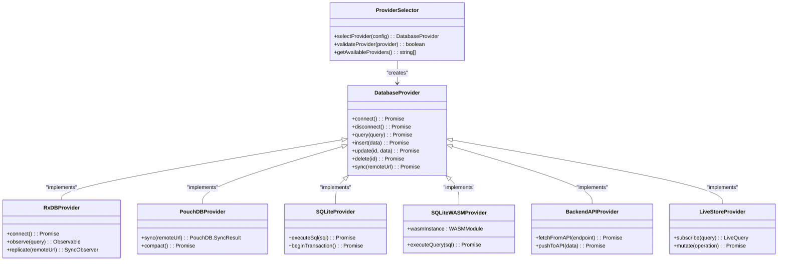

**Diagram sources**
- [ProviderSelector.ts:15-80](file://src\services\database\ProviderSelector.ts#L15-L80)
- [DatabaseProviderFactory.ts:15-20](file://src\services\database\DatabaseProviderFactory.ts#L15-L20)

The ProviderSelector evaluates several factors when determining the appropriate database provider:
- **Environment type**: Development, demo, or production
- **Network connectivity**: Online or offline status
- **Data synchronization requirements**: Real-time, periodic, or manual sync
- **Performance constraints**: Memory usage, disk I/O, and query latency
- **Security requirements**: Data encryption and access controls
- **Storage type**: File-based, memory-based, or WASM-based storage

This pattern enables the application to seamlessly switch between database providers without requiring changes to the higher-level application logic, providing flexibility and future extensibility.

**Section sources**
- [ProviderSelector.ts:1-100](file://src\services\database\ProviderSelector.ts#L1-L100)
- [DatabaseProviderFactory.ts:39-115](file://src\services\database\DatabaseProviderFactory.ts#L39-L115)

## DataStrategyManager and Access Patterns
The DataStrategyManager orchestrates the implementation of various data access patterns, including api-first, offline-first, and hybrid approaches. This component serves as the central coordinator for data operations, determining the optimal strategy based on current conditions and requirements.

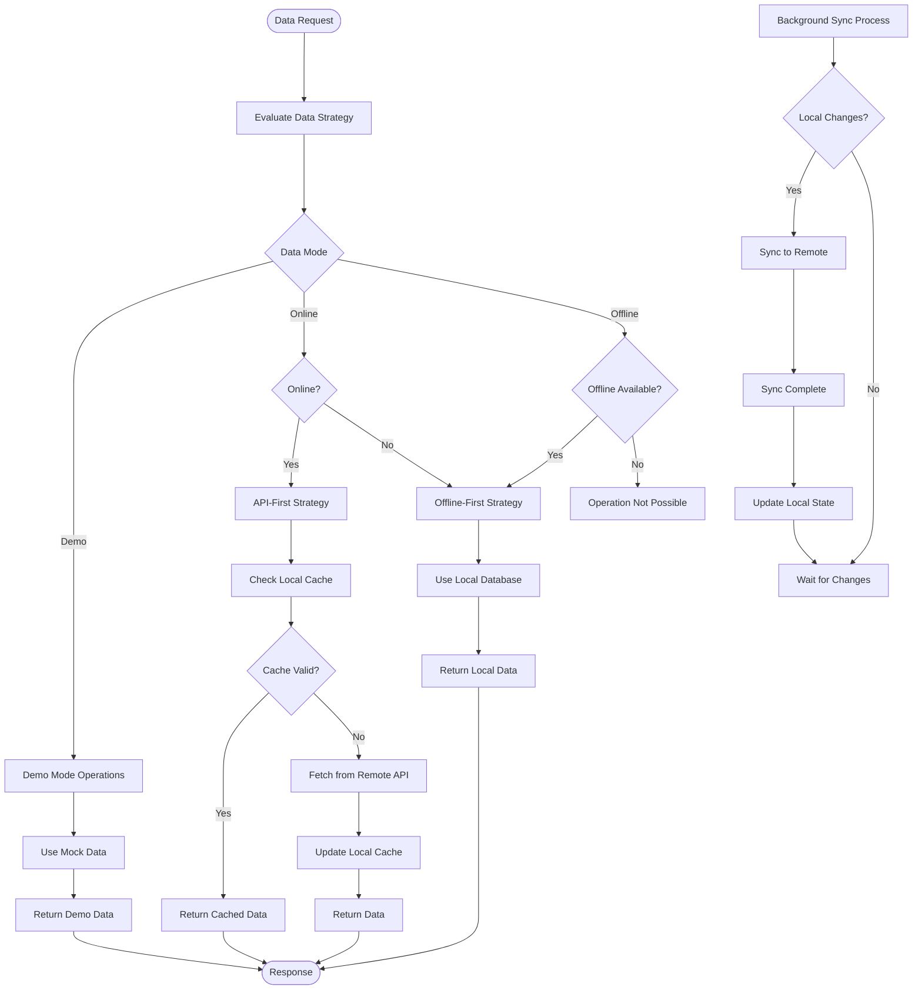

**Diagram sources**
- [DataStrategyManager.ts:20-60](file://src\services\DataStrategyManager.ts#L20-L60)
- [dataModePolicies.ts:10-30](file://src\config\dataModePolicies.ts#L10-L30)

The DataStrategyManager supports four primary data access patterns:

### API-First Pattern
In the API-first pattern, the application prioritizes data retrieval from remote APIs while maintaining a local cache for performance optimization. This approach is suitable for environments with reliable network connectivity.

### Offline-First Pattern
The offline-first pattern prioritizes local data storage and operations, synchronizing with remote servers when connectivity is available. This ensures uninterrupted functionality in disconnected environments.

### Hybrid Pattern
The hybrid pattern combines elements of both approaches, dynamically switching between online and offline modes based on network availability and user preferences.

### Demo Pattern
The demo pattern uses mock data storage for demonstration purposes, providing realistic data without requiring actual database connections.

The DataStrategyManager also handles conflict detection and resolution during synchronization, implementing strategies such as:
- **Last-write-wins**: The most recent update takes precedence
- **Merge strategies**: Combining changes from multiple sources
- **Manual resolution**: Presenting conflicts to users for resolution

**Section sources**
- [DataStrategyManager.ts:1-120](file://src\services\DataStrategyManager.ts#L1-L120)
- [dataModePolicies.ts:1-40](file://src\config\dataModePolicies.ts#L1-L40)

## Enhanced Data Synchronization Workflow
The enhanced data synchronization workflow manages the transfer of data between local and remote databases, ensuring consistency across distributed systems. This process handles both push and pull operations, conflict detection, and resolution with comprehensive monitoring capabilities.

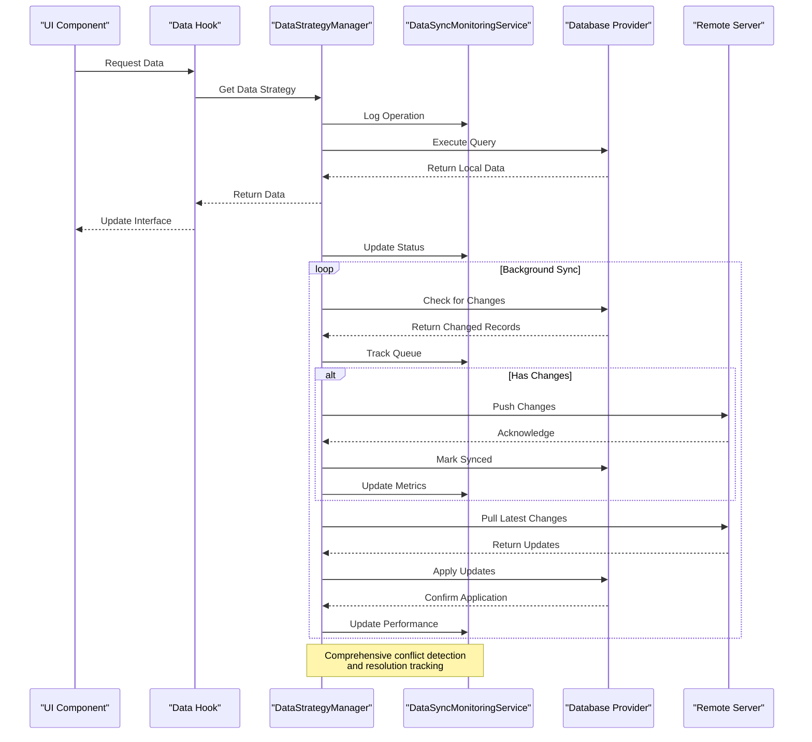

**Diagram sources**
- [DataStrategyManager.ts:50-100](file://src\services\DataStrategyManager.ts#L50-L100)
- [DataSyncMonitoringService.ts:81-120](file://src\services\DataSyncMonitoringService.ts#L81-L120)

The enhanced synchronization workflow includes several key components:

### Comprehensive Conflict Detection
The system detects conflicts by comparing document revisions, timestamps, and operational metadata. When multiple clients modify the same record, the system identifies the conflict during synchronization attempts with detailed conflict categorization.

### Advanced Conflict Resolution
The architecture supports multiple conflict resolution strategies:
- **Automatic resolution**: Based on predefined rules (e.g., timestamp-based)
- **User-mediated resolution**: Presenting conflicting versions to users
- **Custom resolution**: Module-specific logic for handling conflicts
- **Merge strategies**: Intelligent merging of concurrent modifications

### Enhanced Monitoring and Metrics
The DataSyncMonitoringService provides comprehensive tracking of:
- **Sync queue management**: Pending, processing, completed, and failed operations
- **Conflict tracking**: Types, resolution status, and resolution strategies
- **Performance metrics**: Average sync time, success rates, and throughput
- **Error tracking**: Detailed error logs with retry mechanisms

### Batch Processing and Optimization
To optimize network usage, changes are batched and transmitted in groups rather than individual operations, reducing overhead and improving efficiency. The system includes intelligent batching based on operation priority and network conditions.

### Robust Error Handling
The synchronization process includes comprehensive error handling for network failures, authentication issues, and data validation errors, with automatic retry mechanisms, exponential backoff, and appropriate user feedback.

**Section sources**
- [DataStrategyManager.ts:1-120](file://src\services\DataStrategyManager.ts#L1-L120)
- [DataSyncMonitoringService.ts:1-483](file://src\services\DataSyncMonitoringService.ts#L1-L483)

## Service Layer Abstraction
The service layer abstraction provides a unified interface across different database technologies, hiding the complexities of individual providers from the rest of the application. This abstraction enables consistent data access patterns regardless of the underlying database implementation.

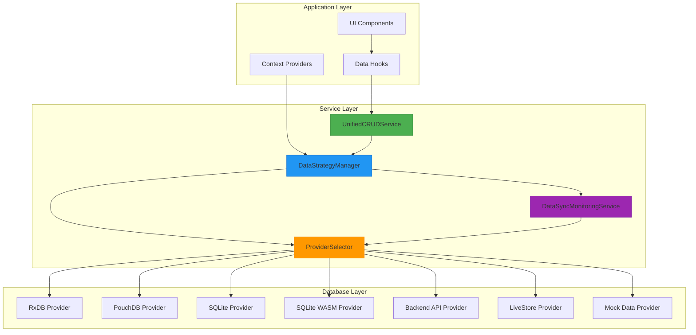

**Diagram sources**
- [UnifiedCRUDService.ts:10-40](file://src\services\UnifiedCRUDService.ts#L10-L40)
- [DataStrategyManager.ts:15-30](file://src\services\DataStrategyManager.ts#L15-L30)
- [ProviderSelector.ts:10-25](file://src\services\database\ProviderSelector.ts#L10-L25)

The UnifiedCRUDService implements standard operations that are translated to provider-specific implementations:
- **Create**: Insert new records with automatic ID generation and validation
- **Read**: Query data with filtering, sorting, pagination, and caching
- **Update**: Modify existing records with version control and conflict resolution
- **Delete**: Remove records with soft-delete capabilities and audit trails

This abstraction layer also handles cross-cutting concerns such as:
- **Data validation**: Ensuring data integrity across providers with schema validation
- **Error translation**: Converting provider-specific errors to a common format
- **Performance monitoring**: Tracking operation latency, success rates, and cache hit ratios
- **Caching strategies**: Implementing multi-level caching with TTL and invalidation
- **Audit logging**: Comprehensive audit trails for all data operations

**Section sources**
- [UnifiedCRUDService.ts:1-60](file://src\services\UnifiedCRUDService.ts#L1-L60)
- [databaseService.ts:1-40](file://src\services\database\databaseService.ts#L1-L40)

## RxDB Integration for Reactive Queries
RxDB integration enables reactive data queries, providing real-time updates to UI components when underlying data changes. This implementation leverages RxJS observables to create a push-based data flow architecture.

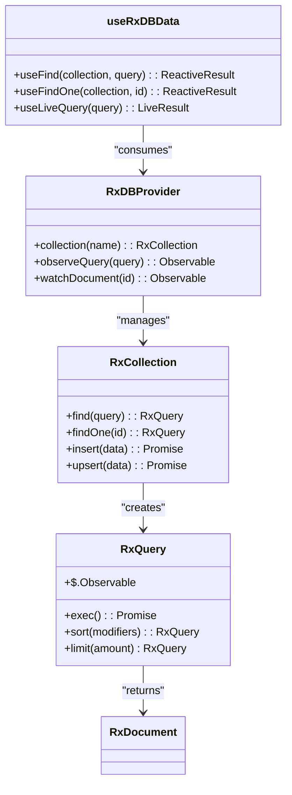

**Diagram sources**
- [RxDBProvider.ts:20-60](file://src\services\database\RxDBProvider.ts#L20-L60)
- [useRxDBData.ts:15-40](file://src\hooks\useRxDBData.ts#L15-L40)

Key features of the RxDB integration include:

### Reactive Data Binding
UI components automatically update when data changes, eliminating the need for manual refresh operations. This creates a more responsive user experience with automatic subscription management.

### Live Queries
Queries remain active and push updates when matching data changes, enabling real-time dashboards and collaborative features with automatic subscription cleanup.

### Change Streams
The system exposes change streams that applications can subscribe to, enabling event-driven architectures and real-time notifications with filtering capabilities.

### Performance Optimization
The implementation includes optimizations such as:
- **Query caching**: Reusing query results when possible with automatic invalidation
- **Batched updates**: Grouping multiple changes into single notifications
- **Selective observation**: Allowing components to observe only relevant data changes
- **Memory management**: Automatic cleanup of unused subscriptions

**Section sources**
- [RxDBProvider.ts:1-80](file://src\services\database\RxDBProvider.ts#L1-L80)
- [useRxDBData.ts:1-50](file://src\hooks\useRxDBData.ts#L1-L50)

## PouchDB for CouchDB Synchronization
PouchDB provides seamless synchronization with CouchDB and compatible servers, enabling robust offline-first capabilities. This integration allows the application to function independently of network connectivity while ensuring data consistency when connectivity is restored.

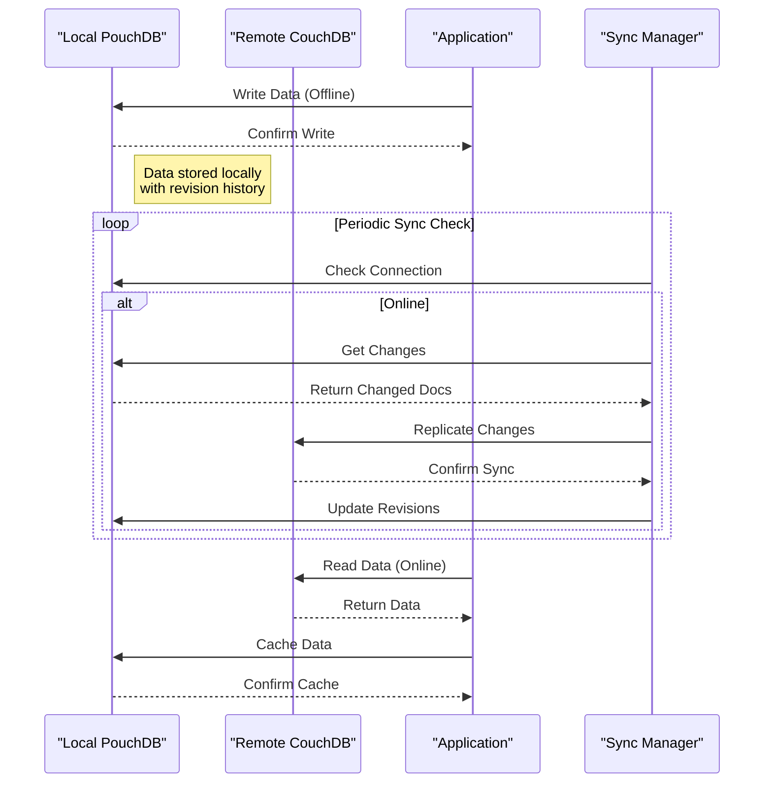

**Diagram sources**
- [PouchDBProvider.ts:25-75](file://src\services\database\PouchDBProvider.ts#L25-L75)
- [database_manager.ts:40-60](file://src\scripts\migration\database_manager.ts#L40-L60)

The PouchDB integration includes several key features:

### Bi-Directional Replication
Changes flow in both directions between local and remote databases, ensuring data consistency across all instances with automatic conflict resolution.

### Conflict Management
PouchDB's built-in conflict detection identifies when the same document has been modified in multiple locations, preserving all versions for resolution with detailed conflict metadata.

### Attachment Support
Binary attachments (documents, images, etc.) are synchronized alongside document data, maintaining complete records with proper MIME type handling.

### Filtered Replication
The system supports filtered replication, allowing selective synchronization of data based on user roles, permissions, or other criteria with custom filter functions.

### Checkpointing
Replication progress is checkpointed, enabling resumption from the last successful sync point after interruptions with automatic conflict resolution.

**Section sources**
- [PouchDBProvider.ts:1-90](file://src\services\database\PouchDBProvider.ts#L1-L90)
- [database_manager.ts:1-70](file://src\scripts\migration\database_manager.ts#L1-L70)

## SQLite for Desktop Persistence
SQLite enables local persistence in desktop environments, providing a reliable, file-based database solution for standalone installations. This implementation leverages WebAssembly (WASM) for optimal performance in browser-based desktop applications.

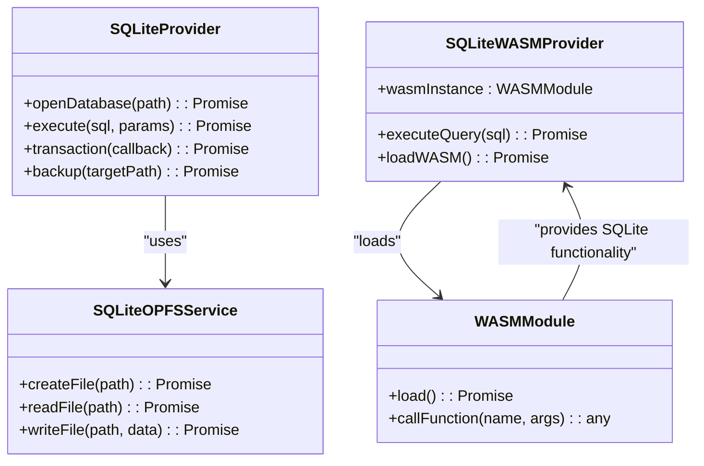

**Diagram sources**
- [SQLiteProvider.ts:15-50](file://src\services\database\SQLiteProvider.ts#L15-L50)
- [DatabaseProviderFactory.ts:17-18](file://src\services\database\DatabaseProviderFactory.ts#L17-L18)

The SQLite implementation includes several optimizations for desktop environments:

### Performance Enhancements
- **WASM acceleration**: Native code execution for database operations with optimized memory management
- **Connection pooling**: Reusing database connections to reduce overhead and improve response times
- **Query compilation**: Pre-compiling frequently used queries with parameter binding
- **Index optimization**: Automatic index creation for frequently queried columns

### Data Management
- **Automatic backups**: Regular database backups to prevent data loss with compression
- **Vacuum operations**: Periodic cleanup to optimize database size and performance
- **Encryption**: Optional data encryption for sensitive information with AES-256
- **Transaction support**: Full ACID compliance with nested transaction support

### File System Integration
- **OPFS support**: Using the Origin Private File System for improved performance and persistence
- **Portable storage**: Database files that can be easily transferred between systems
- **Version management**: Schema migration tools for database updates with rollback support
- **Memory mapping**: Large database support with virtual memory mapping

**Section sources**
- [SQLiteProvider.ts:1-70](file://src\services\database\SQLiteProvider.ts#L1-L70)
- [DatabaseProviderFactory.ts:17-18](file://src\services\database\DatabaseProviderFactory.ts#L17-L18)

## Universal Data Generation Framework
The Universal Data Generation Framework provides a comprehensive solution for generating realistic educational data across all modules and storage backends. This framework supports multiple storage adapters, relationship management, and validation capabilities.

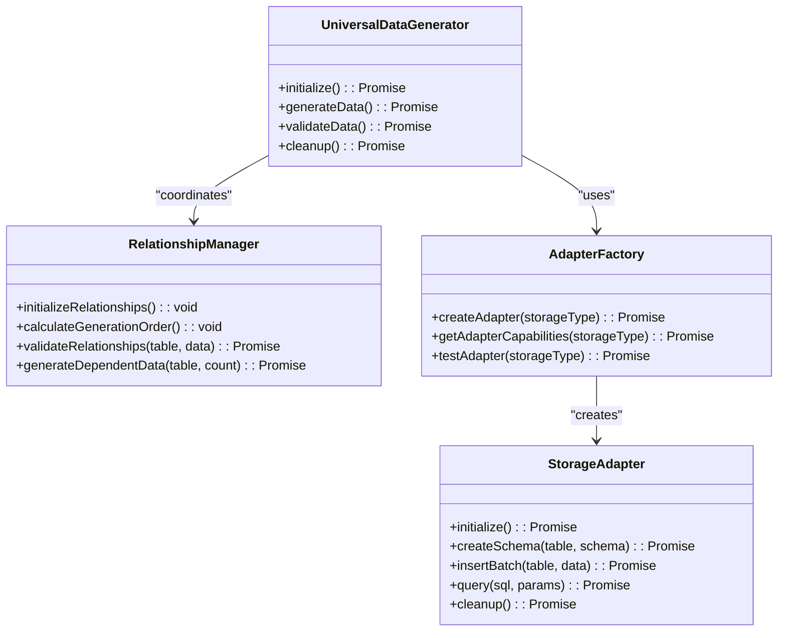

**Diagram sources**
- [UniversalDataGenerator.ts:44-96](file://src\services\dataGeneration\UniversalDataGenerator.ts#L44-L96)
- [AdapterFactory.ts:12-50](file://src\services\dataGeneration\adapters\AdapterFactory.ts#L12-L50)
- [RelationshipManager.ts:25-111](file://src\services\dataGeneration\RelationshipManager.ts#L25-L111)

The framework supports five primary storage backends:

### Storage Backends
- **Mock Adapter**: In-memory storage for testing and development with fast performance
- **SQLite OPFS**: SQLite with Origin Private File System for browser-based persistence
- **SQLite Livestore**: SQLite with Livestore for real-time synchronization
- **PouchDB Adapter**: PouchDB for offline-first applications with sync capabilities
- **Backend API Adapter**: External API integration for cloud-based data generation

### Data Generation Capabilities
The framework generates comprehensive educational data across all modules:
- **Administration**: Students (500+), staff (100+), academic years, classes, dormitories, transport routes
- **Academics**: Subjects, grading schemes, exam sessions, teacher assignments, class timetables
- **Finance**: Chart of accounts, fee templates, suppliers, payment transactions, payroll processing
- **Extra-curricular**: Clubs, societies, activities, member enrollments, budget management
- **Infrastructure**: Library catalog, inventory management, maintenance records, facility allocation

### Relationship Management
The RelationshipManager ensures referential integrity across all generated data:
- **Dependency Graph**: Automatic calculation of generation order based on foreign key relationships
- **Circular Dependency Detection**: Prevention of circular dependencies with detailed error reporting
- **Validation Engine**: Comprehensive validation of generated data against business rules
- **Dynamic Relationship Definition**: Support for custom relationships and dependencies

### Performance and Scalability
The framework includes optimizations for large-scale data generation:
- **Batch Processing**: Configurable batch sizes for optimal memory usage and performance
- **Parallel Generation**: Concurrent generation of independent data sets
- **Memory Management**: Efficient memory usage with automatic cleanup
- **Progress Tracking**: Detailed progress reporting for long-running operations

**Section sources**
- [UniversalDataGenerator.ts:1-300](file://src\services\dataGeneration\UniversalDataGenerator.ts#L1-L300)
- [AdapterFactory.ts:1-178](file://src\services\dataGeneration\adapters\AdapterFactory.ts#L1-L178)
- [RelationshipManager.ts:1-328](file://src\services\dataGeneration\RelationshipManager.ts#L1-L328)
- [BaseGenerator.ts:1-391](file://src\services\dataGeneration\generators\BaseGenerator.ts#L1-L391)
- [demo.ts:1-233](file://src\services\dataGeneration\demo.ts#L1-L233)
- [README.md:1-311](file://src\services\dataGeneration\README.md#L1-L311)

## Production Demo Mode Management
The production demo mode management system provides comprehensive capabilities for managing demonstration environments in production settings. This system enables controlled data generation, session management, and transition to live mode.

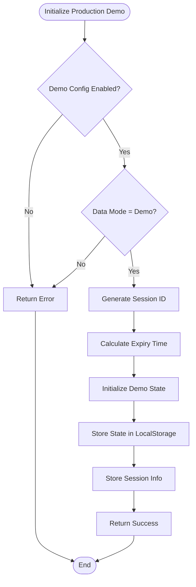

**Diagram sources**
- [productionDemo.ts:135-194](file://src\config\productionDemo.ts#L135-L194)
- [dataModeManager.ts:255-272](file://src\services\dataModeManager.ts#L255-L272)

### Demo Configuration Management
The system provides comprehensive configuration options for production demo environments:

#### Configuration Options
- **Enabled**: Toggle for demo mode activation
- **Allow Transition**: Permission to transition to live mode
- **Data Retention**: Number of days to retain demo data
- **Max Sessions**: Maximum concurrent demo sessions
- **Auto Cleanup**: Automatic cleanup of expired demo data
- **Features**: Granular feature control for demo limitations

#### Demo State Management
- **Active Sessions**: Track currently active demo sessions
- **Session IDs**: Unique identifiers for each demo session
- **Start/Expiry Times**: Session lifecycle management
- **User Count**: Active user tracking for session limits
- **Data Cleared**: Status of demo data initialization

### Demo Data Generation
The system includes comprehensive demo data generation capabilities:

#### Seed Data Options
- **Realistic Data**: Use Faker.js for authentic educational data
- **Test Data**: Include sample data for testing purposes
- **Volume Control**: Scale data generation from tiny to enterprise levels
- **Clear Existing**: Option to clear existing data before seeding

#### Data Volume Levels
- **Tiny**: Minimal data for quick testing
- **Small**: Basic data set for initial evaluation
- **Medium**: Standard demo data for comprehensive testing
- **Large**: Extended data set for performance testing
- **Enterprise**: Full-scale data for production simulation

### Session Management
The system provides robust session management capabilities:

#### Session Lifecycle
- **Session Creation**: Generate unique session identifiers
- **Expiry Management**: Automatic session expiration
- **User Tracking**: Monitor active users per session
- **Resource Limits**: Enforce session-based resource limits
- **Cleanup Automation**: Automatic cleanup of expired sessions

#### Transition to Live Mode
- **Permission Check**: Verify user authorization for transition
- **Data Preservation**: Option to preserve demo data
- **Environment Setup**: Configure production environment
- **Migration Process**: Seamless transition process
- **Audit Trail**: Complete audit of transition actions

**Section sources**
- [productionDemo.ts:1-200](file://src\config\productionDemo.ts#L1-L200)
- [dataModeManager.ts:255-367](file://src\services\dataModeManager.ts#L255-L367)
- [UnifiedConfigContext.tsx:193-276](file://src\contexts\UnifiedConfigContext.tsx#L193-L276)

## Performance and Optimization
The data management architecture incorporates several performance considerations, caching strategies, and bandwidth optimization techniques to ensure efficient operation across various network conditions and device capabilities.

### Caching Strategies
The system implements a multi-layered caching approach:

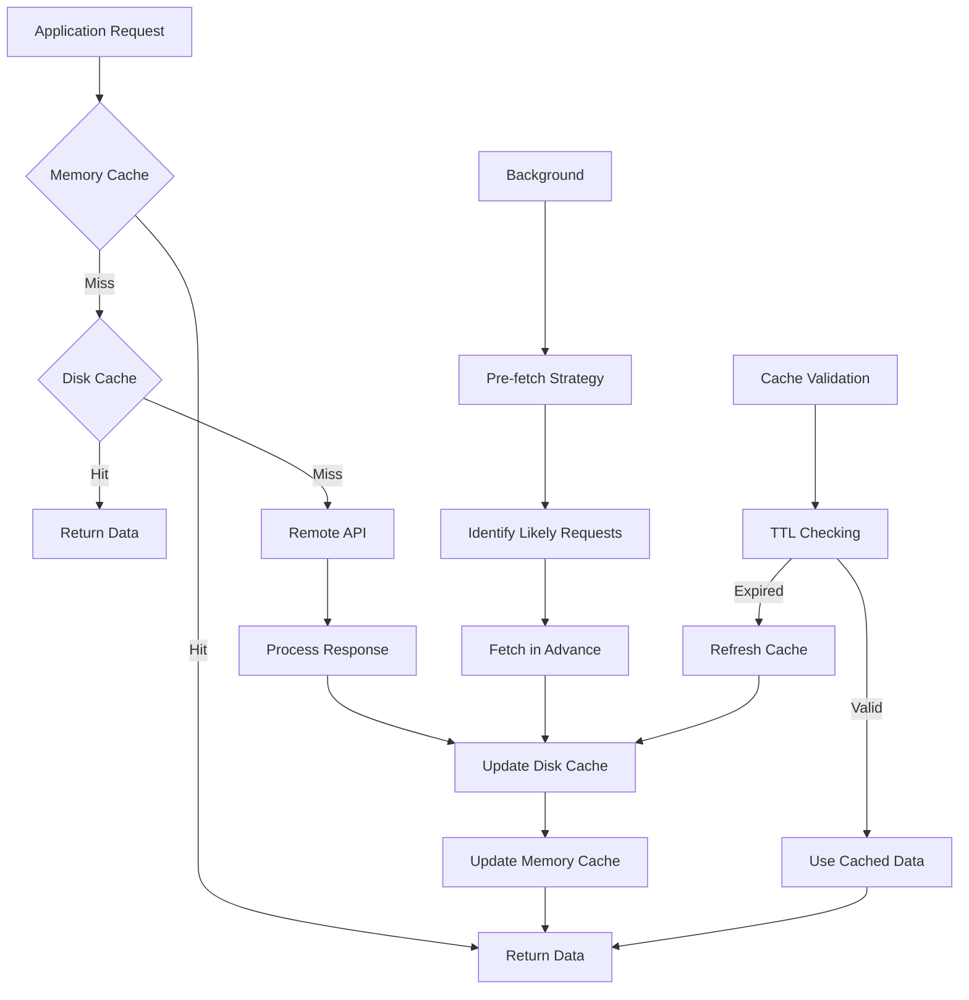

**Diagram sources**
- [DataStrategyManager.ts:30-60](file://src\services\DataStrategyManager.ts#L30-L60)
- [databaseService.ts:20-40](file://src\services\database\databaseService.ts#L20-L40)

### Bandwidth Optimization
To minimize data transfer and improve performance:

- **Delta synchronization**: Only transmitting changed data rather than complete records with differential updates
- **Compression**: Compressing data payloads during transmission with gzip/brotli support
- **Batching**: Combining multiple operations into single network requests with intelligent batching
- **Throttling**: Adjusting sync frequency based on network conditions and battery life
- **Prefetching**: Anticipating user navigation patterns to pre-load likely data requests

### Performance Monitoring
The architecture includes comprehensive performance monitoring:

- **Operation timing**: Tracking latency of database operations with detailed metrics
- **Sync metrics**: Monitoring synchronization success rates, durations, and error rates
- **Resource usage**: Measuring memory and CPU consumption across all providers
- **Error tracking**: Logging and reporting data access issues with correlation IDs
- **Cache hit rates**: Monitoring cache effectiveness and optimization opportunities

### Provider-Specific Optimizations
Each database provider includes specific optimizations:

#### RxDB Optimizations
- **Query optimization**: Automatic query plan optimization
- **Index management**: Intelligent index creation and maintenance
- **Change propagation**: Efficient change notification system
- **Memory management**: Automatic garbage collection and cleanup

#### PouchDB Optimizations
- **Replication optimization**: Efficient delta sync with conflict resolution
- **Attachment handling**: Optimized binary data storage and retrieval
- **Local storage**: Efficient local data caching and indexing
- **Background sync**: Intelligent background synchronization scheduling

#### SQLite Optimizations
- **WASM acceleration**: Native code execution for database operations
- **Connection pooling**: Reusing database connections to reduce overhead
- **Query compilation**: Pre-compiling frequently used queries
- **Transaction optimization**: Batched transaction processing

**Section sources**
- [DataStrategyManager.ts:1-120](file://src\services\DataStrategyManager.ts#L1-L120)
- [databaseService.ts:1-50](file://src\services\database\databaseService.ts#L1-L50)
- [DataSyncMonitoringService.ts:81-120](file://src\services\DataSyncMonitoringService.ts#L81-L120)

## Data Flow Sequence Diagrams
The following sequence diagrams illustrate the complete data flow from UI components through hooks to database providers.

### Read Operation Flow
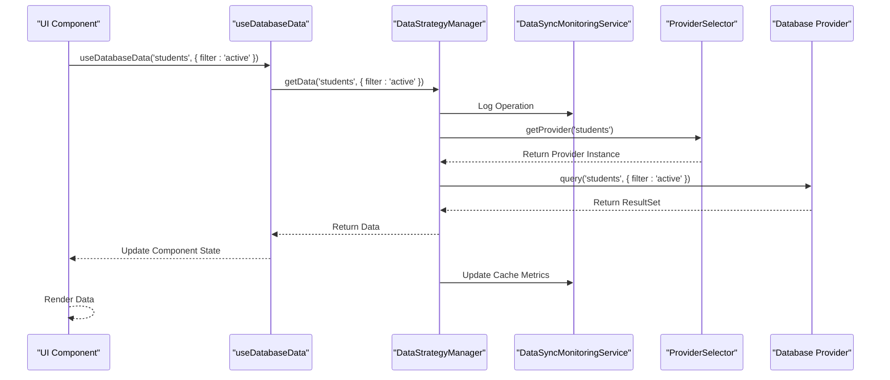

**Diagram sources**
- [useDatabaseData.ts:10-30](file://src\hooks\useDatabaseData.ts#L10-L30)
- [DataStrategyManager.ts:20-40](file://src\services\DataStrategyManager.ts#L20-L40)
- [ProviderSelector.ts:15-25](file://src\services\database\ProviderSelector.ts#L15-L25)

### Write Operation Flow
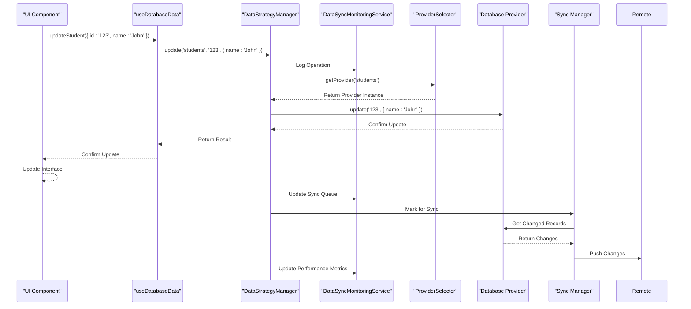

**Diagram sources**
- [useDatabaseData.ts:35-60](file://src\hooks\useDatabaseData.ts#L35-L60)
- [DataStrategyManager.ts:45-70](file://src\services\DataStrategyManager.ts#L45-L70)
- [ProviderSelector.ts:30-40](file://src\services\database\ProviderSelector.ts#L30-L40)

### Data Generation Flow
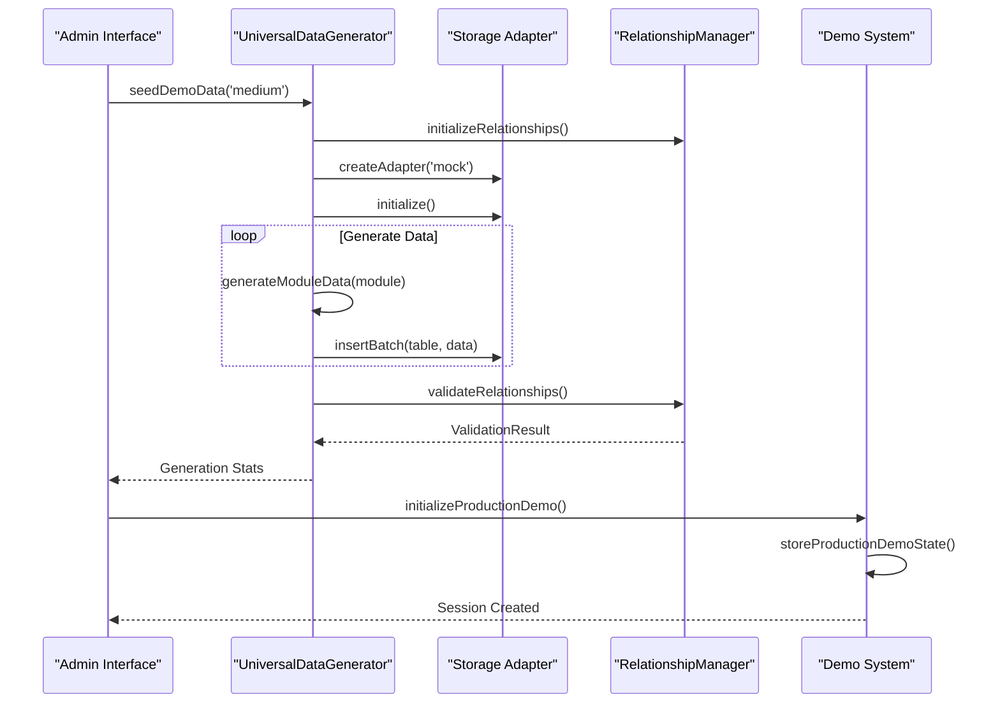

**Diagram sources**
- [dataModeManager.ts:255-272](file://src\services\dataModeManager.ts#L255-L272)
- [UniversalDataGenerator.ts:98-141](file://src\services\dataGeneration\UniversalDataGenerator.ts#L98-L141)
- [demo.ts:64-106](file://src\services\dataGeneration\demo.ts#L64-L106)

These diagrams illustrate how the architecture maintains a consistent interface while adapting to different database providers, network conditions, and data generation requirements, ensuring reliable data management across the schoolpilot3 application.

**Section sources**
- [useDatabaseData.ts:1-80](file://src\hooks\useDatabaseData.ts#L1-L80)
- [DataStrategyManager.ts:1-120](file://src\services\DataStrategyManager.ts#L1-L120)
- [ProviderSelector.ts:1-50](file://src\services\database\ProviderSelector.ts#L1-L50)
- [UniversalDataGenerator.ts:1-300](file://src\services\dataGeneration\UniversalDataGenerator.ts#L1-L300)
- [dataModeManager.ts:255-367](file://src\services\dataModeManager.ts#L255-L367)