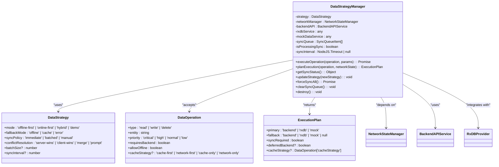
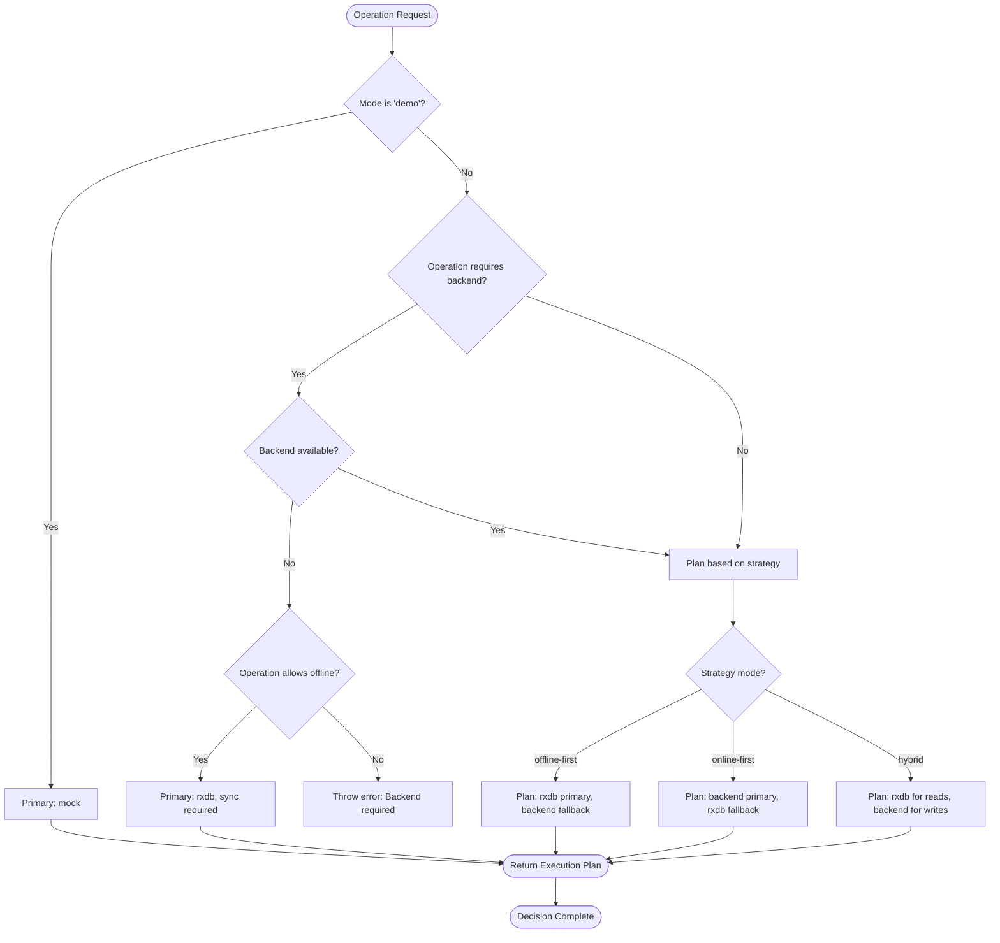
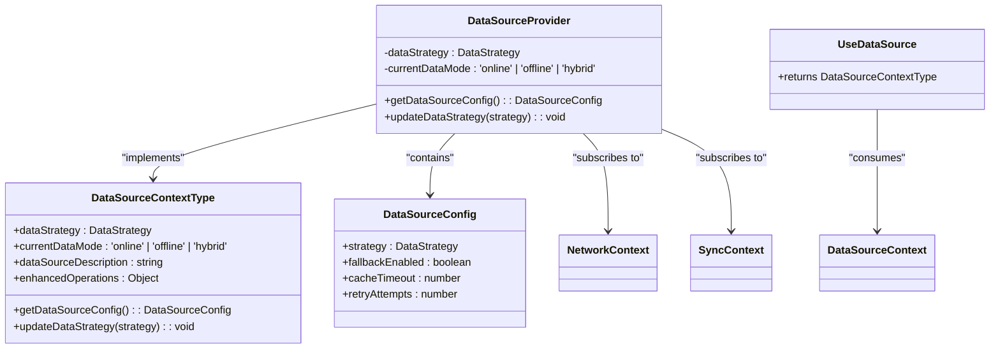
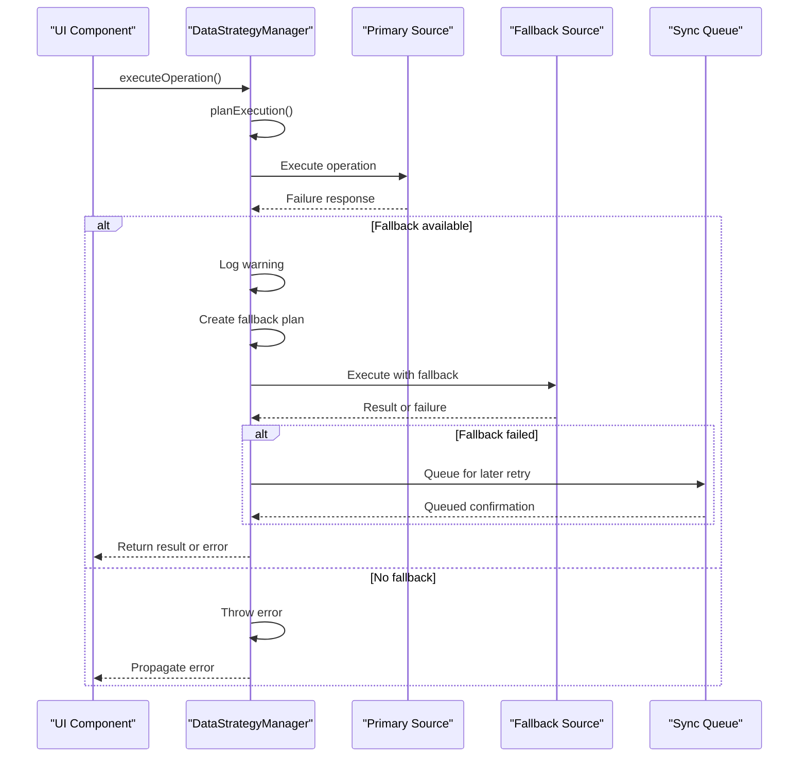
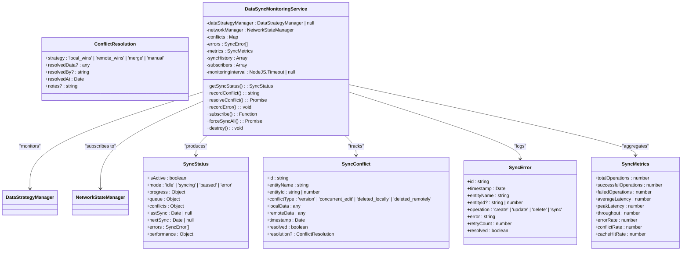
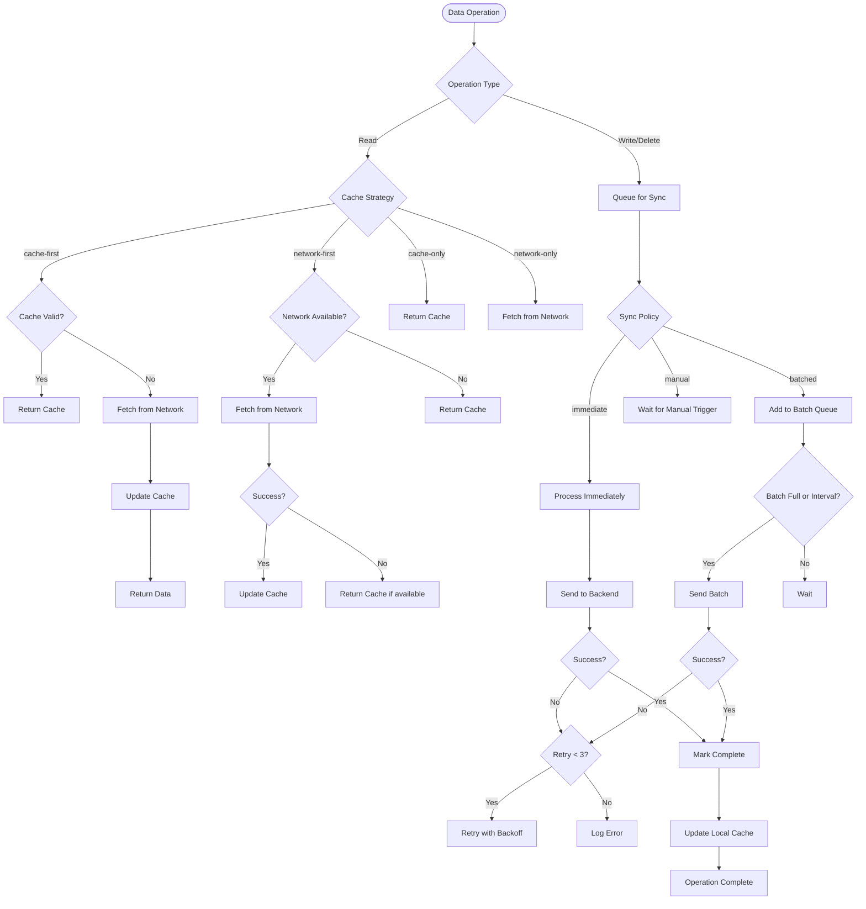
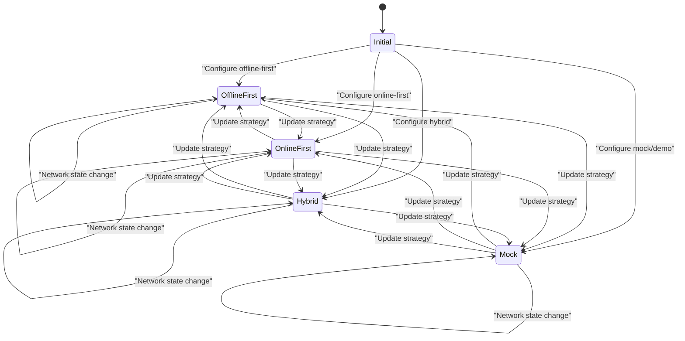
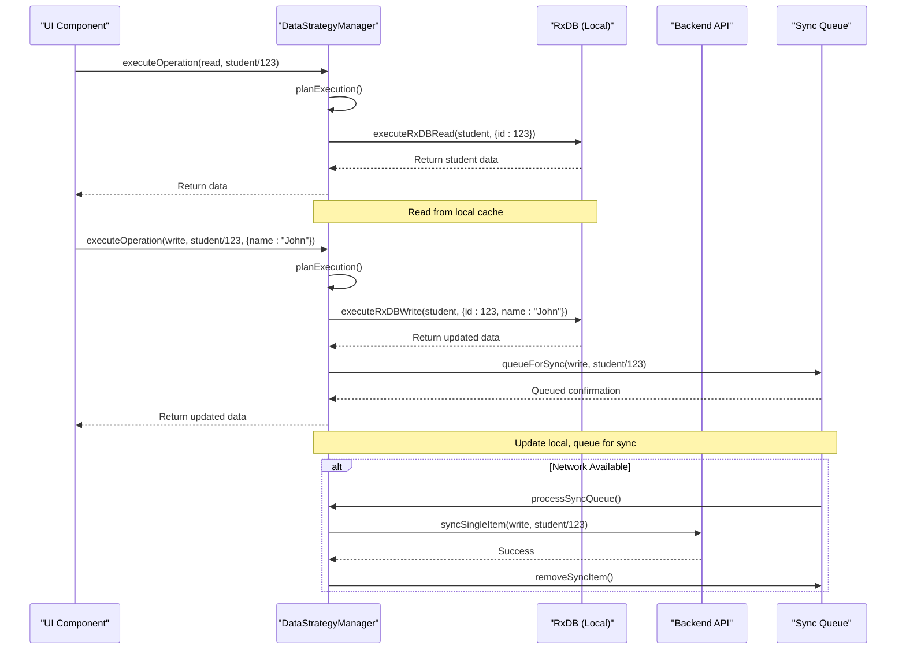
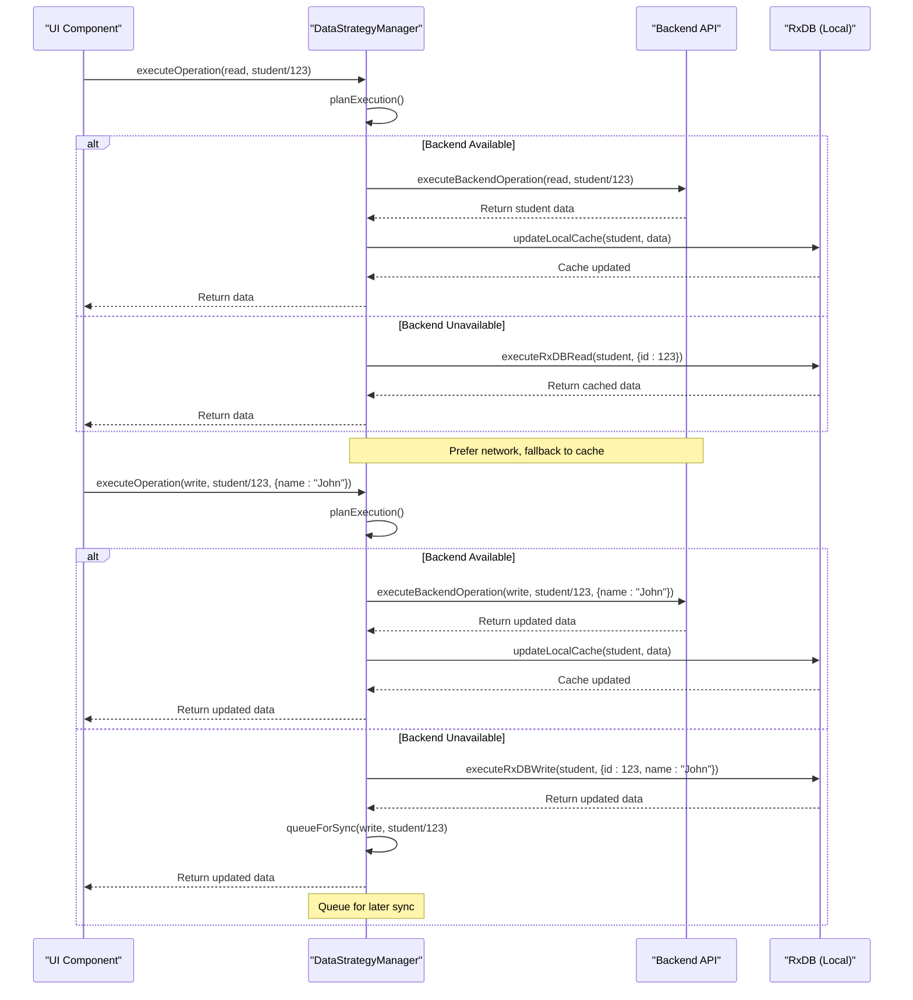
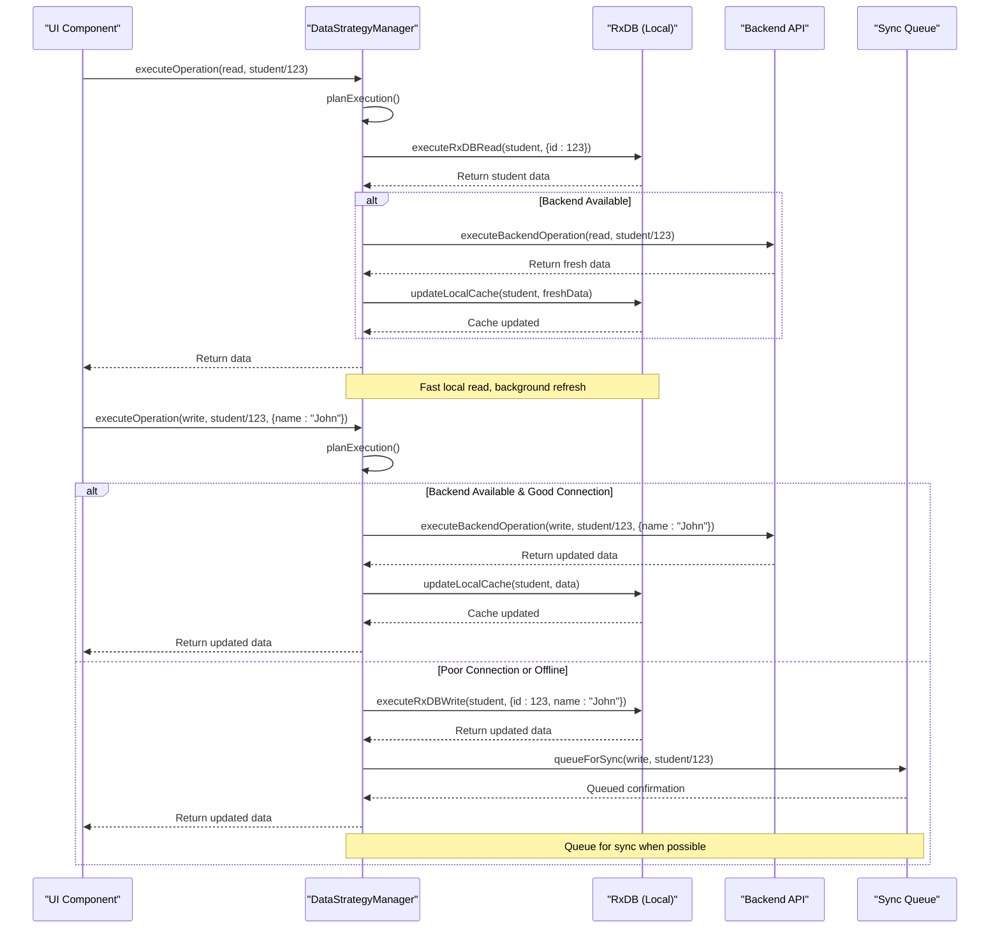

# Data Strategy Management

<cite>
**Referenced Files in This Document**   
- [DataStrategyManager.ts](file://src/services/DataStrategyManager.ts)
- [dataModePolicies.ts](file://src/config/dataModePolicies.ts)
- [DataSourceContext.tsx](file://src/contexts/DataSourceContext.tsx)
- [DataSyncMonitoringService.ts](file://src/services/DataSyncMonitoringService.ts)
</cite>

## Table of Contents
1. [Introduction](#introduction)
2. [Data Strategy Implementation](#data-strategy-implementation)
3. [Configuration Policies](#configuration-policies)
4. [Decision Logic for Strategy Selection](#decision-logic-for-strategy-selection)
5. [Integration with DataSourceContext](#integration-with-datasourcecontext)
6. [Fallback Mechanisms](#fallback-mechanisms)
7. [Monitoring with DataSyncMonitoringService](#monitoring-with-datasyncmonitoringservice)
8. [Caching and Performance Optimization](#caching-and-performance-optimization)
9. [State and Sequence Diagrams](#state-and-sequence-diagrams)

## Introduction
The DataStrategyManager component in schoolpilot3 implements a sophisticated data access management system that supports multiple data access patterns including api-first, offline-first, hybrid, and mock modes. This system intelligently routes data operations based on network availability, user permissions, and performance requirements. The component integrates with various data sources including backend APIs, RxDB (a reactive database), and mock data services, providing a seamless experience across different operational contexts.

**Section sources**
- [DataStrategyManager.ts](file://src/services/DataStrategyManager.ts#L1-L50)

## Data Strategy Implementation
The DataStrategyManager class implements a comprehensive strategy pattern for data access, allowing the application to adapt its data retrieval and persistence behavior based on configuration and runtime conditions. The core implementation revolves around the `DataStrategy` interface which defines key properties including the operational mode, fallback behavior, synchronization policy, conflict resolution strategy, and batch processing parameters.

The manager supports four primary modes:
- **offline-first**: Prioritizes local data access with background synchronization
- **online-first**: Prefers direct API calls with local storage as fallback
- **hybrid**: Intelligent routing based on operation type and network conditions
- **demo/mock**: Uses mock data for demonstration or testing purposes

Each mode is configured with specific behaviors for fallback mechanisms, synchronization policies, and conflict resolution strategies. The implementation uses a pluggable architecture with distinct execution paths for backend API calls, RxDB operations, and mock data access.



**Diagram sources**
- [DataStrategyManager.ts](file://src/services/DataStrategyManager.ts#L1-L574)

**Section sources**
- [DataStrategyManager.ts](file://src/services/DataStrategyManager.ts#L1-L574)

## Configuration Policies
The data access strategies are governed by configuration policies defined in the dataModePolicies.ts file. These policies establish the rules for data mode switching, validation, and environment-specific constraints. The system uses a comprehensive policy framework that considers the current environment (development, staging, production) when determining allowed data modes and switching behaviors.

The configuration includes storage mechanisms for persisting the current data mode using localStorage, with timestamp tracking for audit purposes. The policy system validates mode switches based on environment constraints and user permissions, preventing unauthorized changes in production environments. Each data mode has specific validation rules that ensure the selected strategy is appropriate for the current deployment context.

The policy framework exposes several key functions:
- `validateDataMode()`: Validates whether a mode switch is permitted in the current environment
- `switchDataMode()`: Executes a mode switch with appropriate confirmation requirements
- `getDataModeState()`: Returns the current state including available modes and switching capabilities
- `getStoredDataMode()`: Retrieves the persisted data mode from storage

These policies work in conjunction with the DataStrategyManager to ensure that data access patterns align with organizational requirements and operational constraints.

```mermaid
classDiagram
class DataModeState {
+current : DataMode
+available : DataMode[]
+canSwitch : boolean
+requiresConfirmation : boolean
+lastSwitched? : Date
}
class DataModeSwitchResult {
+success : boolean
+previousMode : DataMode
+newMode : DataMode
+requiresReload : boolean
+message? : string
+error? : string
}
class DataModePolicies {
+getStoredDataMode() : DataMode | null
+storeDataMode(dataMode : DataMode) : void
+getDataModeState(currentMode, environment) : DataModeState
+validateDataMode(newMode, environment) : { valid : boolean; error? : string }
+switchDataMode(newMode, currentMode, environment, options) : Promise<DataModeSwitchResult>
+clearStoredDataMode() : void
+getDataModeHistory() : { mode : DataMode; timestamp : Date }[]
}
DataStrategyManager --> DataModePolicies : "respects"
DataModePolicies --> EnvironmentMatrix : "uses"
```

**Diagram sources**
- [dataModePolicies.ts](file://src/config/dataModePolicies.ts#L1-L190)

**Section sources**
- [dataModePolicies.ts](file://src/config/dataModePolicies.ts#L1-L190)

## Decision Logic for Strategy Selection
The DataStrategyManager employs a sophisticated decision engine to select the appropriate data strategy based on multiple factors including network availability, user permissions, operation type, and performance requirements. The decision logic is implemented through the `planExecution()` method, which evaluates the current network state and operation characteristics to determine the optimal execution path.

For **offline-first** strategy:
- Primary data source is RxDB (local database)
- Backend serves as fallback when available
- Synchronization is required for write operations when network is available
- Cache strategy defaults to 'cache-first'

For **online-first** strategy:
- Primary data source is backend API when available
- RxDB serves as fallback for offline scenarios
- Cache strategy defaults to 'network-first'
- Immediate synchronization is preferred

For **hybrid** strategy:
- Read operations use RxDB as primary with backend fallback
- Write operations prefer backend when network quality is good
- Local storage serves as primary when network is poor
- Intelligent caching with 'cache-first' for reads and 'network-first' for writes

The decision process considers several key factors:
- Network connectivity and backend availability
- Operation priority (critical, high, normal, low)
- Whether the operation requires backend access
- User permissions and role-based access controls
- Connection quality metrics

The system also evaluates performance requirements, giving priority to critical operations in the synchronization queue and adjusting batch sizes based on network conditions.



**Diagram sources**
- [DataStrategyManager.ts](file://src/services/DataStrategyManager.ts#L1-L574)

**Section sources**
- [DataStrategyManager.ts](file://src/services/DataStrategyManager.ts#L1-L574)

## Integration with DataSourceContext
The DataStrategyManager integrates with the DataSourceContext to expose the current data strategy to UI components through a React context provider. The DataSourceContext acts as a bridge between the low-level data strategy implementation and the presentation layer, providing a simplified interface for components to access data source information and modify strategies.

The context exposes several key properties:
- **dataStrategy**: Current strategy ('api-first', 'offline-first', 'hybrid', 'mock')
- **currentDataMode**: Derived mode based on network and strategy ('online', 'offline', 'hybrid')
- **getDataSourceConfig()**: Returns configuration for the current strategy
- **updateDataStrategy()**: Allows components to change the data strategy
- **dataSourceDescription**: Human-readable description of current data source
- **enhancedOperations**: Availability of advanced features based on current context

The context uses React's `useMemo` and `useCallback` hooks to optimize performance, ensuring that consumers only re-render when relevant state changes. It subscribes to network state changes through the NetworkContext and sync status through the SyncContext, automatically updating the exposed values when these states change.

This integration enables UI components to display appropriate indicators about data source status, provide strategy selection controls, and adapt their behavior based on the current data access mode.



**Diagram sources**
- [DataSourceContext.tsx](file://src/contexts/DataSourceContext.tsx#L1-L149)

**Section sources**
- [DataSourceContext.tsx](file://src/contexts/DataSourceContext.tsx#L1-L149)

## Fallback Mechanisms
The DataStrategyManager implements robust fallback mechanisms to ensure data availability and application resilience when primary data sources are unavailable. These mechanisms are designed to handle various failure scenarios including network outages, backend service unavailability, and temporary connectivity issues.

When a primary data operation fails, the system automatically attempts fallback execution if a fallback strategy is defined in the execution plan. The fallback process follows these steps:
1. Capture the original operation and parameters
2. Log a warning about the primary execution failure
3. Create a fallback execution plan with the fallback source as primary
4. Re-execute the operation with the fallback strategy
5. If fallback also fails, propagate the error to the caller

The fallback behavior varies by strategy:
- **offline-first**: Falls back to backend API when available, otherwise fails
- **online-first**: Falls back to RxDB for read operations when offline
- **hybrid**: Has context-specific fallbacks based on operation type
- **mock**: No fallback (mock is the final fallback itself)

The system also implements a persistent synchronization queue that stores operations when the backend is unavailable. These operations are automatically retried when connectivity is restored, with exponential backoff and a maximum retry count of three attempts. Failed sync items are tracked in the monitoring service for diagnostic purposes.



**Diagram sources**
- [DataStrategyManager.ts](file://src/services/DataStrategyManager.ts#L1-L574)

**Section sources**
- [DataStrategyManager.ts](file://src/services/DataStrategyManager.ts#L1-L574)

## Monitoring with DataSyncMonitoringService
The DataSyncMonitoringService provides comprehensive monitoring capabilities for tracking synchronization status, performance metrics, and conflict resolution. This service integrates directly with the DataStrategyManager to collect and expose detailed information about data operations and their outcomes.

Key monitoring features include:
- **Sync Status Tracking**: Real-time monitoring of synchronization state including idle, syncing, paused, and error modes
- **Performance Metrics**: Collection of latency, throughput, success rates, and error rates
- **Conflict Detection**: Identification and tracking of data conflicts between local and remote sources
- **Error Logging**: Comprehensive error tracking with timestamps, operation details, and retry information
- **Historical Analysis**: Maintenance of sync history for trend analysis and performance optimization

The monitoring service maintains several key data structures:
- **SyncQueue**: Tracks pending, processing, and completed operations
- **Conflicts Map**: Stores unresolved data conflicts with resolution status
- **Errors Array**: Maintains recent sync errors for diagnostic purposes
- **Metrics Object**: Aggregates performance statistics over time

The service automatically subscribes to network state changes, pausing monitoring when offline and resuming when connectivity is restored. It also provides a subscription mechanism for UI components to receive real-time updates about sync status, enabling the creation of monitoring dashboards and status indicators.



**Diagram sources**
- [DataSyncMonitoringService.ts](file://src/services/DataSyncMonitoringService.ts#L1-L483)

**Section sources**
- [DataSyncMonitoringService.ts](file://src/services/DataSyncMonitoringService.ts#L1-L483)

## Caching and Performance Optimization
The DataStrategyManager implements comprehensive caching policies and performance optimization techniques to ensure responsive application behavior and efficient data access. These optimizations are tailored to each data strategy while maintaining consistency across the system.

### Caching Policies
Each strategy employs different caching approaches:
- **api-first**: Short cache timeout (5 minutes), network-first strategy
- **offline-first**: Long cache timeout (1 hour), cache-first strategy
- **hybrid**: Moderate cache timeout (10 minutes), context-aware strategy
- **mock**: No caching (data is already local)

The system supports multiple cache strategies:
- **cache-first**: Attempt local cache first, then network
- **network-first**: Attempt network first, then cache
- **cache-only**: Use only local cache
- **network-only**: Use only network, bypass cache

### Bandwidth Optimization
The implementation includes several bandwidth optimization techniques:
- **Batched synchronization**: Groups multiple operations into single requests
- **Priority-based queuing**: Processes critical operations first
- **Conditional requests**: Uses ETags and last-modified headers
- **Delta synchronization**: Transfers only changed data when possible

### Data Freshness Guarantees
The system provides configurable data freshness guarantees:
- **Immediate sync**: Changes sync as soon as they occur
- **Batched sync**: Changes sync at configured intervals
- **Manual sync**: Changes sync only on user request

The synchronization queue prioritizes operations based on their priority level (critical, high, normal, low), ensuring that important data changes are processed first. The system also implements exponential backoff for failed sync attempts and automatically resumes synchronization when network connectivity is restored.



**Diagram sources**
- [DataStrategyManager.ts](file://src/services/DataStrategyManager.ts#L1-L574)

**Section sources**
- [DataStrategyManager.ts](file://src/services/DataStrategyManager.ts#L1-L574)

## State and Sequence Diagrams
This section provides visual representations of the strategy transitions and data retrieval workflows under different operational scenarios.

### Strategy Transition State Diagram


**Diagram sources**
- [DataStrategyManager.ts](file://src/services/DataStrategyManager.ts#L1-L574)

### Data Retrieval Workflow - Offline-First Strategy


**Diagram sources**
- [DataStrategyManager.ts](file://src/services/DataStrategyManager.ts#L1-L574)

### Data Retrieval Workflow - Online-First Strategy


**Diagram sources**
- [DataStrategyManager.ts](file://src/services/DataStrategyManager.ts#L1-L574)

### Data Retrieval Workflow - Hybrid Strategy


**Diagram sources**
- [DataStrategyManager.ts](file://src/services/DataStrategyManager.ts#L1-L574)