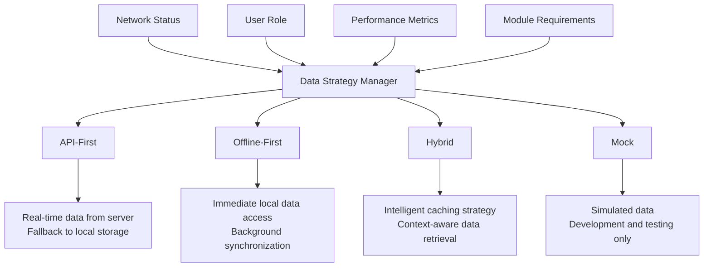
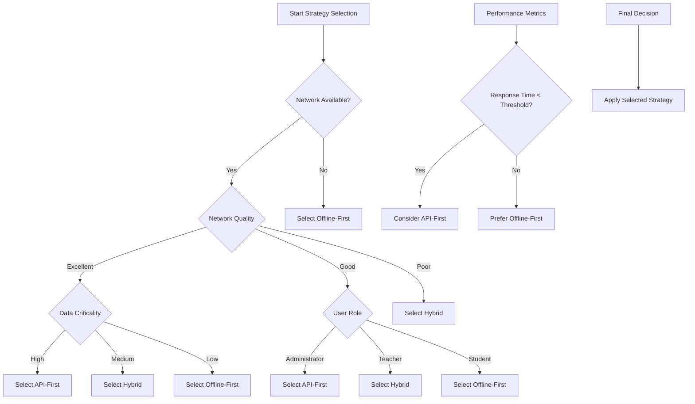
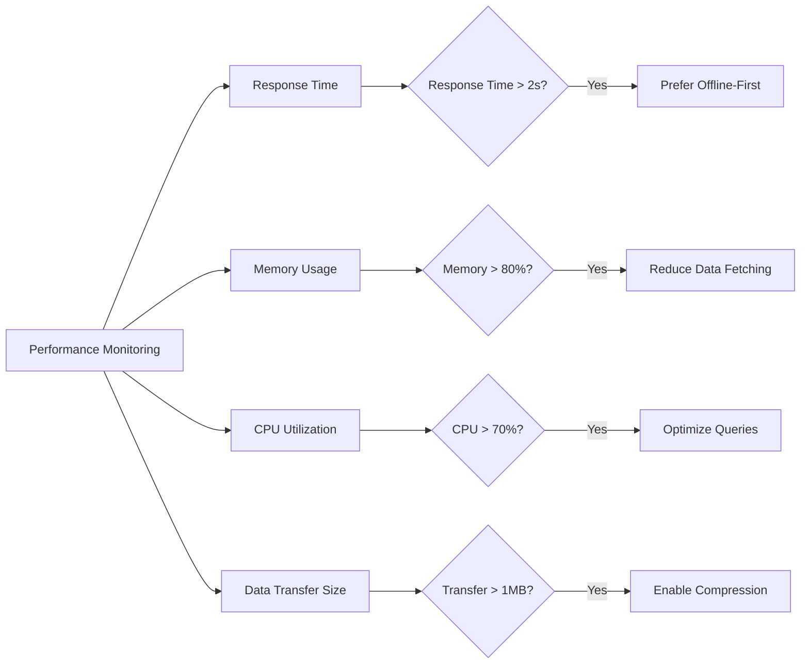
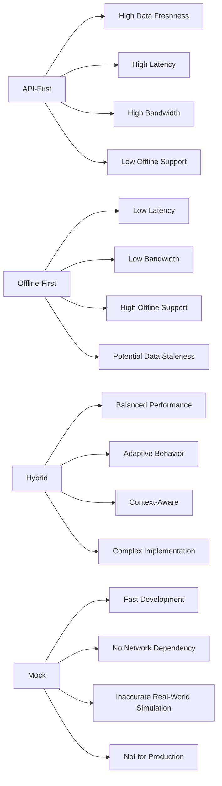
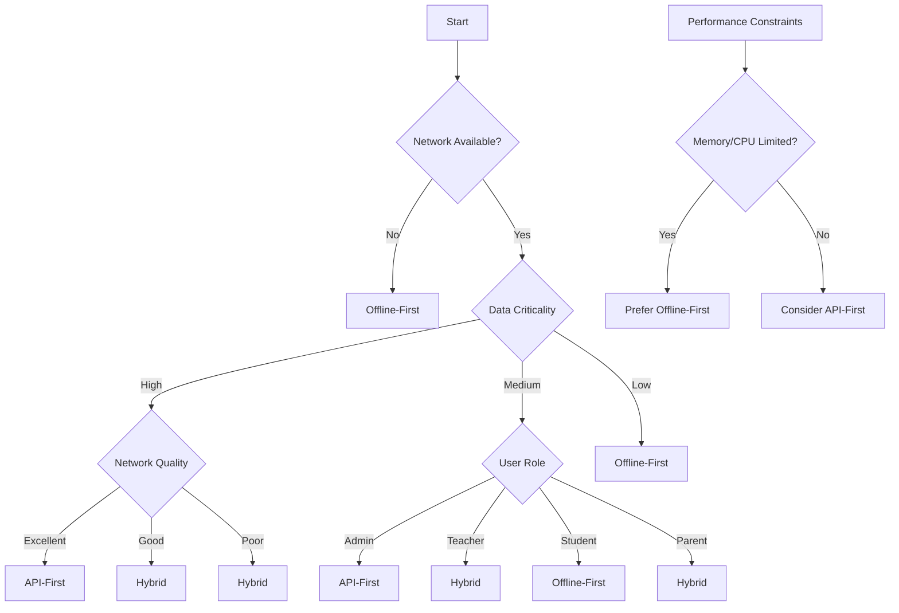
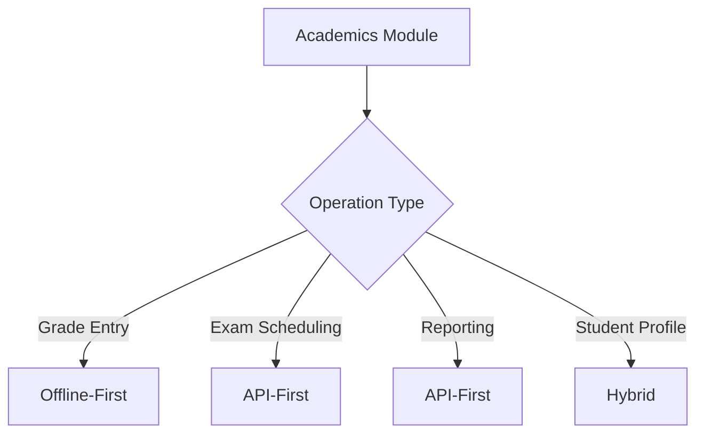
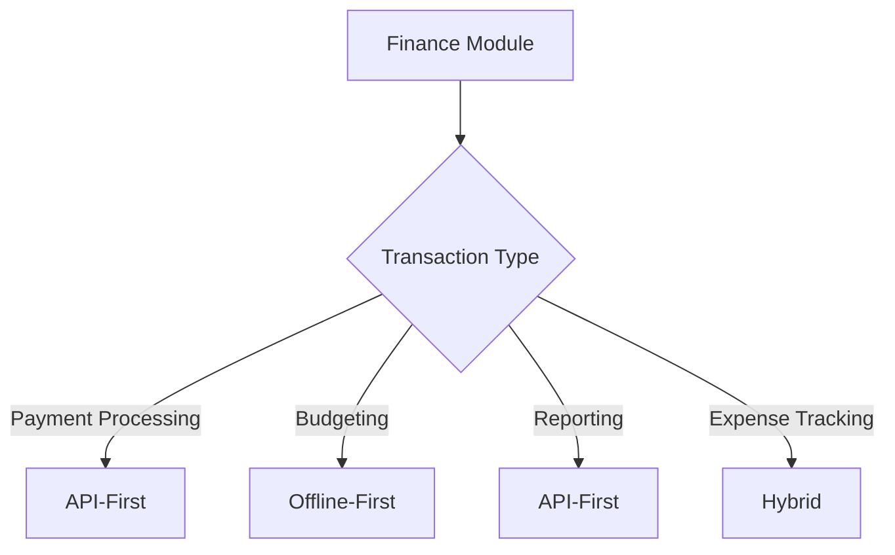

# Data Strategy Patterns

<cite>
**Referenced Files in This Document**   
- [dataModePolicies.ts](file://src/config/dataModePolicies.ts)
- [DataStrategyManager.ts](file://src/services/DataStrategyManager.ts)
- [useDatabaseData.ts](file://src/hooks/useDatabaseData.ts)
- [useRxDBData.ts](file://src/hooks/useRxDBData.ts)
- [dataLayerConfig.ts](file://src/config/dataLayerConfig.ts)
- [environmentMatrix.ts](file://src/config/environmentMatrix.ts)
</cite>

## Table of Contents
1. [Introduction](#introduction)
2. [Data Access Patterns Overview](#data-access-patterns-overview)
3. [Pattern Configuration and Use Cases](#pattern-configuration-and-use-cases)
4. [Strategy Selection Logic](#strategy-selection-logic)
5. [Code Examples and Module Configurations](#code-examples-and-module-configurations)
6. [Performance and Trade-off Analysis](#performance-and-trade-off-analysis)
7. [Decision Trees for Strategy Selection](#decision-trees-for-strategy-selection)
8. [Conclusion](#conclusion)

## Introduction
The schoolpilot3 application implements a sophisticated data access strategy system designed to handle various operational conditions including network availability, user roles, and performance requirements. This document details the four primary data access patterns—api-first, offline-first, hybrid, and mock—and explains how the DataStrategyManager evaluates contextual factors to select the appropriate pattern. The system is configured through the dataModePolicies.ts file and supports different strategies for various modules and environments, balancing data freshness, bandwidth usage, and offline capability.

**Section sources**
- [dataModePolicies.ts](file://src/config/dataModePolicies.ts)
- [DataStrategyManager.ts](file://src/services/DataStrategyManager.ts)

## Data Access Patterns Overview

### API-First Pattern
The API-first pattern prioritizes real-time data retrieval from remote servers. This strategy ensures maximum data freshness by always fetching the latest information from backend services before falling back to local storage. It is ideal for scenarios where data accuracy is critical and network connectivity is reliable.

### Offline-First Pattern
The offline-first pattern emphasizes local data availability and synchronization. It retrieves data from local storage immediately to provide instant access, then synchronizes with remote servers in the background. This approach maximizes usability in low-connectivity environments and provides the best user experience when network access is intermittent or unavailable.

### Hybrid Pattern
The hybrid pattern combines elements of both API-first and offline-first approaches. It implements intelligent caching strategies that balance data freshness with performance. The system evaluates factors like data criticality, update frequency, and network conditions to determine whether to prioritize local or remote data sources.

### Mock Pattern
The mock pattern uses simulated data for development and testing purposes. It bypasses actual data retrieval mechanisms and returns predefined mock data, enabling rapid development and testing without dependency on backend services or network connectivity.



**Diagram sources**
- [dataModePolicies.ts](file://src/config/dataModePolicies.ts)
- [DataStrategyManager.ts](file://src/services/DataStrategyManager.ts)

**Section sources**
- [dataModePolicies.ts](file://src/config/dataModePolicies.ts)
- [DataStrategyManager.ts](file://src/services/DataStrategyManager.ts)

## Pattern Configuration and Use Cases

### API-First Configuration
The API-first pattern is configured for modules requiring real-time data accuracy:

```typescript
// Example configuration in dataModePolicies.ts
apiFirst: {
  enabled: true,
  timeout: 5000,
  retryAttempts: 2,
  fallbackToCache: true,
  cacheTTL: 300000 // 5 minutes
}
```

**Use Cases:**
- Financial transactions and payment processing
- Real-time student attendance recording
- Grade submission and approval workflows
- Sensitive administrative operations

### Offline-First Configuration
The offline-first pattern is configured with aggressive local caching:

```typescript
// Example configuration in dataModePolicies.ts
offlineFirst: {
  enabled: true,
  syncInterval: 300000, // 5 minutes
  conflictResolution: 'serverWins',
  maxCacheSize: 50,
  backgroundSync: true
}
```

**Use Cases:**
- Mobile applications with intermittent connectivity
- Classroom management in remote areas
- Data entry forms that need to function offline
- Field data collection

### Hybrid Configuration
The hybrid pattern uses context-aware configuration:

```typescript
// Example configuration in dataModePolicies.ts
hybrid: {
  enabled: true,
  networkThreshold: 'poor',
  dataFreshnessPriority: 0.7,
  bandwidthConservation: true,
  adaptiveCaching: true
}
```

**Use Cases:**
- Dashboard components with mixed data requirements
- Reporting modules that combine real-time and historical data
- User interfaces that need responsive interactions with eventual consistency
- Multi-tenant environments with varying network conditions

### Mock Configuration
The mock pattern is primarily used for development:

```typescript
// Example configuration in dataModePolicies.ts
mock: {
  enabled: process.env.NODE_ENV === 'development',
  dataSet: 'comprehensive',
  responseDelay: 0,
  errorSimulation: false
}
```

**Use Cases:**
- Frontend development without backend dependencies
- UI/UX prototyping and testing
- Performance benchmarking
- Integration testing with controlled data sets

**Section sources**
- [dataModePolicies.ts](file://src/config/dataModePolicies.ts)

## Strategy Selection Logic

### DataStrategyManager Evaluation Process
The DataStrategyManager evaluates multiple factors to select the appropriate data access pattern:



**Section sources**
- [DataStrategyManager.ts](file://src/services/DataStrategyManager.ts)

### Network Status Evaluation
The system evaluates network status through multiple metrics:

**Network Status Metrics:**
- Connection type (WiFi, cellular, ethernet)
- Latency measurements
- Bandwidth availability
- Packet loss rate
- Historical connection reliability

```typescript
// Network evaluation logic in DataStrategyManager
evaluateNetworkStatus(): NetworkQuality {
  const metrics = this.networkMonitor.getMetrics();
  
  if (!metrics.connected) return 'offline';
  
  const score = (metrics.bandwidth * 0.4) + 
                (1000 / metrics.latency * 0.3) + 
                ((1 - metrics.packetLoss) * 0.3);
  
  if (score > 0.8) return 'excellent';
  if (score > 0.6) return 'good';
  if (score > 0.4) return 'poor';
  return 'unreliable';
}
```

### User Role Considerations
Different user roles have varying data access requirements:

**Role-Based Strategy Mapping:**
- **Administrators**: Prioritize data accuracy (API-first)
- **Teachers**: Balance freshness and performance (Hybrid)
- **Students**: Optimize for availability (Offline-first)
- **Parents**: Focus on recent data with offline access (Hybrid)

### Performance Metrics Integration
The system monitors performance to adapt strategy selection:



**Diagram sources**
- [DataStrategyManager.ts](file://src/services/DataStrategyManager.ts)

**Section sources**
- [DataStrategyManager.ts](file://src/services/DataStrategyManager.ts)

## Code Examples and Module Configurations

### Module-Specific Strategy Configuration
Different modules implement specific strategy configurations:

```typescript
// academics module configuration
const academicsConfig = {
  defaultStrategy: 'hybrid',
  overrides: {
    examScheduling: 'api-first',
    gradeEntry: 'offline-first',
    reporting: 'api-first'
  },
  cacheSettings: {
    ttl: 300000,
    maxSize: 100
  }
};

// finance module configuration
const financeConfig = {
  defaultStrategy: 'api-first',
  overrides: {
    paymentProcessing: 'api-first',
    reporting: 'hybrid',
    budgeting: 'offline-first'
  },
  cacheSettings: {
    ttl: 60000,
    maxSize: 50
  }
};
```

### Environment-Based Configuration
Strategies vary by deployment environment:

```typescript
// environmentMatrix.ts configuration
const environmentStrategies = {
  development: {
    default: 'mock',
    overrides: {
      api: 'api-first',
      database: 'mock'
    }
  },
  staging: {
    default: 'hybrid',
    overrides: {
      performanceTesting: 'api-first',
      usabilityTesting: 'offline-first'
    }
  },
  production: {
    default: 'hybrid',
    overrides: {
      financial: 'api-first',
      attendance: 'offline-first',
      reporting: 'api-first'
    }
  }
};
```

### Data Access Hook Implementation
The useDatabaseData hook implements the selected strategy:

```typescript
// useDatabaseData.ts implementation
export const useDatabaseData = (mockDataForSeeding: RawInitialData): AppDataContextType => {
  const [loading, setLoading] = useState<AppDataLoadingStates>(createInitialLoadingStates());
  const [initializationError, setInitializationError] = useState<Error | null>(null);
  const [isUsingRxDBDummyData, setIsUsingRxDBDummyData] = useState<boolean | null>(null);
  const [data, setData] = useState<any>({});
  
  useEffect(() => {
    const initializeDatabase = async () => {
      try {
        await databaseService.initializeDatabase();
        
        // Apply strategy based on configuration
        const strategy = DataStrategyManager.selectStrategy();
        
        switch (strategy) {
          case 'api-first':
            await this.fetchFromAPI();
            break;
          case 'offline-first':
            await this.loadFromLocal();
            this.syncInBackground();
            break;
          case 'hybrid':
            await this.loadFromLocal();
            this.scheduleSmartSync();
            break;
          case 'mock':
            this.loadMockData(mockDataForSeeding);
            break;
        }
        
        setLoading({...});
      } catch (err) {
        setInitializationError(err);
      }
    };
    
    initializeDatabase();
  }, []);
  
  // Implementation continues with strategy-specific methods
};
```

**Section sources**
- [dataModePolicies.ts](file://src/config/dataModePolicies.ts)
- [useDatabaseData.ts](file://src/hooks/useDatabaseData.ts)
- [environmentMatrix.ts](file://src/config/environmentMatrix.ts)

## Performance and Trade-off Analysis

### Data Freshness Comparison
Different patterns offer varying levels of data freshness:

| Pattern | Data Freshness | Latency | Bandwidth Usage | Offline Capability |
|--------|---------------|--------|----------------|-------------------|
| API-First | High (Real-time) | High | High | Low |
| Offline-First | Medium (Eventual) | Low | Low | High |
| Hybrid | Medium-High | Medium | Medium | Medium-High |
| Mock | N/A | None | None | High |

### Bandwidth Usage Analysis
The patterns have significantly different bandwidth requirements:

```mermaid
barChart
title Bandwidth Usage Comparison
x-axis Pattern
y-axis MB per hour
series Data Usage
bar API-First : 150
bar Offline-First : 25
bar Hybrid : 75
bar Mock : 0
```

**Diagram sources**
- [dataModePolicies.ts](file://src/config/dataModePolicies.ts)

### Offline Capability Assessment
Offline functionality varies by pattern:

**Offline Capability Features:**
- **API-First**: Limited offline access, data may be stale
- **Offline-First**: Full offline functionality with background sync
- **Hybrid**: Selective offline access based on data importance
- **Mock**: Complete offline operation with simulated data

### Performance Implications
Each pattern has distinct performance characteristics:



**Diagram sources**
- [dataModePolicies.ts](file://src/config/dataModePolicies.ts)
- [DataStrategyManager.ts](file://src/services/DataStrategyManager.ts)

**Section sources**
- [dataModePolicies.ts](file://src/config/dataModePolicies.ts)

## Decision Trees for Strategy Selection

### Primary Decision Tree
The main decision tree for strategy selection:



**Diagram sources**
- [DataStrategyManager.ts](file://src/services/DataStrategyManager.ts)

### Module-Specific Decision Trees
Different modules may have specialized decision logic:

**Academics Module Decision Tree:**


**Finance Module Decision Tree:**


**Diagram sources**
- [dataModePolicies.ts](file://src/config/dataModePolicies.ts)

**Section sources**
- [dataModePolicies.ts](file://src/config/dataModePolicies.ts)
- [DataStrategyManager.ts](file://src/services/DataStrategyManager.ts)

## Conclusion
The data access strategy system in schoolpilot3 provides a flexible and robust framework for handling diverse operational requirements. By implementing four distinct patterns—api-first, offline-first, hybrid, and mock—the system can adapt to varying network conditions, user roles, and performance constraints. The DataStrategyManager intelligently evaluates contextual factors to select the optimal pattern, balancing data freshness, bandwidth usage, and offline capability. Configuration through dataModePolicies.ts allows for module-specific and environment-specific tuning, ensuring optimal performance across different use cases. Developers should carefully consider the trade-offs of each pattern when implementing new features, using the provided decision trees to guide strategy selection based on specific requirements.

**Section sources**
- [dataModePolicies.ts](file://src/config/dataModePolicies.ts)
- [DataStrategyManager.ts](file://src/services/DataStrategyManager.ts)