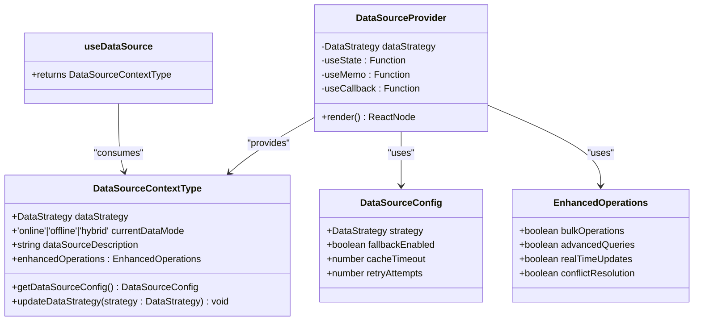
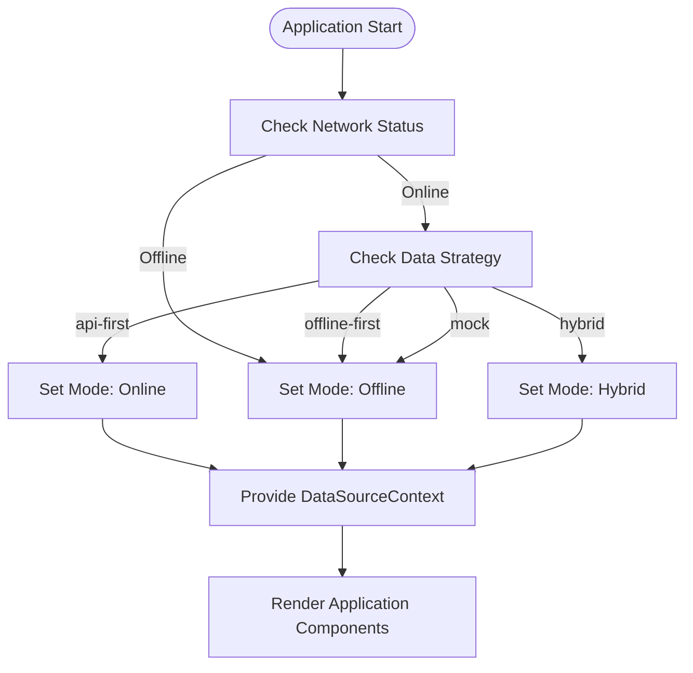
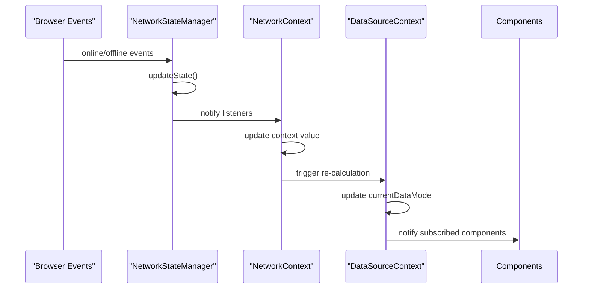
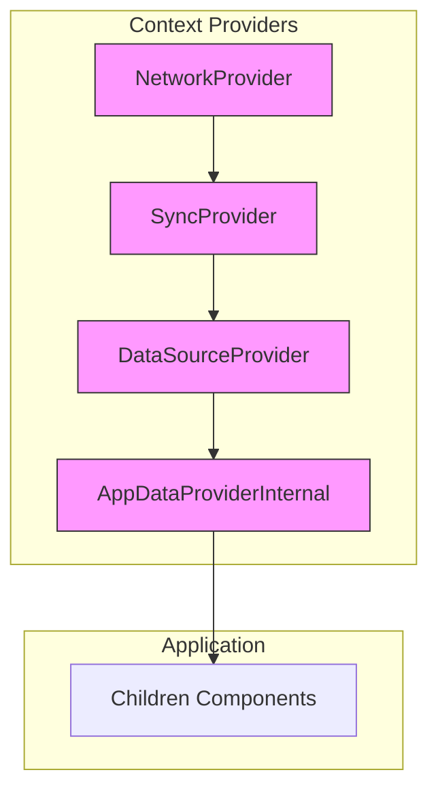
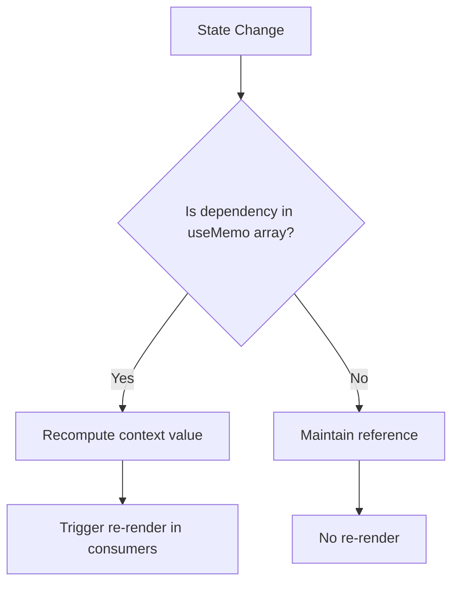

# DataSourceContext Integration

<cite>
**Referenced Files in This Document**   
- [DataSourceContext.tsx](file://src/contexts/DataSourceContext.tsx#L1-L148)
- [NetworkContext.tsx](file://src/contexts/NetworkContext.tsx#L1-L47)
- [SyncContext.tsx](file://src/contexts/SyncContext.tsx#L1-L197)
- [AppDataContext.tsx](file://src/contexts/AppDataContext.tsx#L1-L168)
- [NetworkStateManager.ts](file://src/services/NetworkStateManager.ts#L1-L233)
</cite>

## Table of Contents
1. [Introduction](#introduction)
2. [DataSourceContext Architecture](#datasourcecontext-architecture)
3. [Data Strategy Management](#data-strategy-management)
4. [Online/Offline Mode Transitions](#onlineoffline-mode-transitions)
5. [Component Integration Examples](#component-integration-examples)
6. [Performance Optimization](#performance-optimization)
7. [Best Practices](#best-practices)

## Introduction
The DataSourceContext provides a centralized mechanism for managing data strategies in the application, allowing React components to adapt their behavior based on the current data access strategy. This context enables seamless transitions between different data modes (online, offline, hybrid) and provides configuration options for various data strategies. The implementation integrates with NetworkContext and SyncContext to provide a comprehensive data management solution that handles both connectivity status and synchronization requirements.

**Section sources**
- [DataSourceContext.tsx](file://src/contexts/DataSourceContext.tsx#L1-L148)

## DataSourceContext Architecture



**Diagram sources**
- [DataSourceContext.tsx](file://src/contexts/DataSourceContext.tsx#L1-L148)

**Section sources**
- [DataSourceContext.tsx](file://src/contexts/DataSourceContext.tsx#L1-L148)

## Data Strategy Management

The DataSourceContext implements a comprehensive data strategy management system that supports four distinct strategies:

- **api-first**: Prioritizes live API data with fallback to cached data
- **offline-first**: Uses local cached data primarily, syncing changes when online
- **hybrid**: Optimized strategy that balances local caching with API access
- **mock**: Uses mock data without backend connectivity

Each strategy has specific configuration parameters that control behavior:

```typescript
const DATA_STRATEGY_CONFIGS: Record<DataStrategy, DataSourceConfig> = {
  'api-first': {
    strategy: 'api-first',
    fallbackEnabled: true,
    cacheTimeout: 300000, // 5 minutes
    retryAttempts: 3
  },
  'offline-first': {
    strategy: 'offline-first',
    fallbackEnabled: true,
    cacheTimeout: 3600000, // 1 hour
    retryAttempts: 1
  },
  'hybrid': {
    strategy: 'hybrid',
    fallbackEnabled: true,
    cacheTimeout: 600000, // 10 minutes
    retryAttempts: 2
  },
  'mock': {
    strategy: 'mock',
    fallbackEnabled: false,
    cacheTimeout: 0,
    retryAttempts: 0
  }
};
```

The context exposes the `updateDataStrategy` function that allows components to change the current strategy:

```typescript
const updateDataStrategy = useCallback((strategy: DataStrategy) => {
  console.log(`Updating data strategy from ${dataStrategy} to ${strategy}`);
  setDataStrategy(strategy);
}, [dataStrategy]);
```

Components can access the current strategy and configuration through the `useDataSource` hook:

```typescript
const { dataStrategy, getDataSourceConfig, updateDataStrategy } = useDataSource();
```

**Section sources**
- [DataSourceContext.tsx](file://src/contexts/DataSourceContext.tsx#L1-L148)

## Online/Offline Mode Transitions

The DataSourceContext integrates with NetworkContext to determine the current operational mode based on network connectivity and the selected data strategy:



**Diagram sources**
- [DataSourceContext.tsx](file://src/contexts/DataSourceContext.tsx#L1-L148)
- [NetworkContext.tsx](file://src/contexts/NetworkContext.tsx#L1-L47)

The current data mode is determined by combining network status from NetworkContext with the selected data strategy:

```typescript
const currentDataMode = useMemo((): 'online' | 'offline' | 'hybrid' => {
  if (!isOnline) return 'offline';
  if (dataStrategy === 'offline-first') return 'offline';
  if (dataStrategy === 'api-first') return 'online';
  return 'hybrid';
}, [isOnline, dataStrategy]);
```

The NetworkContext uses NetworkStateManager to monitor connectivity:



**Diagram sources**
- [NetworkStateManager.ts](file://src/services/NetworkStateManager.ts#L1-L233)
- [NetworkContext.tsx](file://src/contexts/NetworkContext.tsx#L1-L47)
- [DataSourceContext.tsx](file://src/contexts/DataSourceContext.tsx#L1-L148)

The AppDataProvider orchestrates the integration of all context providers:



**Diagram sources**
- [AppDataContext.tsx](file://src/contexts/AppDataContext.tsx#L1-L168)

**Section sources**
- [DataSourceContext.tsx](file://src/contexts/DataSourceContext.tsx#L1-L148)
- [NetworkContext.tsx](file://src/contexts/NetworkContext.tsx#L1-L47)
- [SyncContext.tsx](file://src/contexts/SyncContext.tsx#L1-L197)
- [AppDataContext.tsx](file://src/contexts/AppDataContext.tsx#L1-L168)

## Component Integration Examples

Components can use the DataSourceContext to adapt their UI and data fetching logic based on the current strategy. The context provides enhanced operations flags that indicate which features are available:

```typescript
const enhancedOperations = useMemo(() => ({
  bulkOperations: isOnline && dataStrategy !== 'mock',
  advancedQueries: isOnline || dataStrategy === 'offline-first',
  realTimeUpdates: isOnline && dataStrategy === 'api-first',
  conflictResolution: dataStrategy === 'hybrid' || dataStrategy === 'offline-first'
}), [isOnline, dataStrategy]);
```

Components can subscribe to strategy changes and handle transitions:

```typescript
const MyComponent = () => {
  const { 
    dataStrategy, 
    currentDataMode, 
    dataSourceDescription,
    enhancedOperations 
  } = useDataSource();
  
  return (
    <div>
      <div className="data-status">
        <span>Mode: {currentDataMode}</span>
        <span>Strategy: {dataStrategy}</span>
        <p>{dataSourceDescription}</p>
      </div>
      
      {enhancedOperations.bulkOperations && (
        <button>Perform Bulk Operation</button>
      )}
      
      {enhancedOperations.realTimeUpdates && (
        <div>Real-time updates enabled</div>
      )}
    </div>
  );
};
```

The AppDataContext demonstrates how to integrate DataSourceContext with status banners:

```typescript
return (
  <AppDataContext.Provider value={contextValue}>
    {children}
    
    {/* Status banners */}
    {!isOnline && (
      <div className="fixed top-0 left-0 right-0 bg-yellow-500 text-white text-center py-2 z-50">
        📡 Offline Mode - Changes will sync when connection is restored
      </div>
    )}
    
    {syncStatus.state === 'syncing' && (
      <div className="fixed top-0 left-0 right-0 bg-blue-500 text-white text-center py-2 z-50">
        🔄 Syncing data... ({Math.round(syncStatus.progress)}%)
      </div>
    )}
  </AppDataContext.Provider>
);
```

**Section sources**
- [DataSourceContext.tsx](file://src/contexts/DataSourceContext.tsx#L1-L148)
- [AppDataContext.tsx](file://src/contexts/AppDataContext.tsx#L1-L168)

## Performance Optimization

The DataSourceContext implementation includes several performance optimizations to minimize unnecessary re-renders:

### Context Value Memoization
The context value is wrapped in `useMemo` with a comprehensive dependency array to prevent unnecessary re-creation:

```typescript
const contextValue = useMemo((): DataSourceContextType => ({
  dataStrategy,
  currentDataMode,
  getDataSourceConfig,
  updateDataStrategy,
  dataSourceDescription,
  enhancedOperations
}), [
  dataStrategy,
  currentDataMode,
  getDataSourceConfig,
  updateDataStrategy,
  dataSourceDescription,
  enhancedOperations
]);
```

### Callback Memoization
Functions are memoized using `useCallback` to maintain referential equality:

```typescript
const getDataSourceConfig = useCallback((): DataSourceConfig => {
  return DATA_STRATEGY_CONFIGS[dataStrategy];
}, [dataStrategy]);

const updateDataStrategy = useCallback((strategy: DataStrategy) => {
  console.log(`Updating data strategy from ${dataStrategy} to ${strategy}`);
  setDataStrategy(strategy);
}, [dataStrategy]);
```

### Selective State Updates
The context only exposes the minimal necessary state and functions, reducing the surface area for re-renders.



**Diagram sources**
- [DataSourceContext.tsx](file://src/contexts/DataSourceContext.tsx#L1-L148)

**Section sources**
- [DataSourceContext.tsx](file://src/contexts/DataSourceContext.tsx#L1-L148)

## Best Practices

### Minimizing Re-renders
To minimize re-renders when using DataSourceContext:

1. **Use specific selectors**: Extract only the values needed rather than the entire context
2. **Memoize derived values**: Use `useMemo` for computed values based on context data
3. **Use callback memoization**: When passing context functions as props

```typescript
// Good: Extract only needed values
const MyComponent = () => {
  const { dataStrategy, currentDataMode } = useDataSource();
  
  // Memoize derived values
  const isOnline = useMemo(() => currentDataMode === 'online', [currentDataMode]);
  
  return <div>Online: {isOnline.toString()}</div>;
};
```

### Handling Strategy Transitions
When implementing components that respond to strategy changes:

1. **Provide clear UI feedback**: Use the `dataSourceDescription` property to inform users
2. **Graceful degradation**: Ensure functionality is available in all modes
3. **Optimistic updates**: Implement optimistic UI updates for offline operations

### Performance Considerations
The DataSourceContext is designed with performance in mind:

- **Minimal re-renders**: The `useMemo` wrapper ensures the context value only changes when necessary
- **Stable function references**: `useCallback` ensures function references remain stable
- **Efficient updates**: Only components that consume the context will re-render

Components should avoid unnecessary context consumption and use React.memo for optimization:

```typescript
const OptimizedComponent = React.memo(({ children }) => {
  const { dataStrategy } = useDataSource();
  
  return (
    <div data-strategy={dataStrategy}>
      {children}
    </div>
  );
});
```

**Section sources**
- [DataSourceContext.tsx](file://src/contexts/DataSourceContext.tsx#L1-L148)
- [AppDataContext.tsx](file://src/contexts/AppDataContext.tsx#L1-L168)