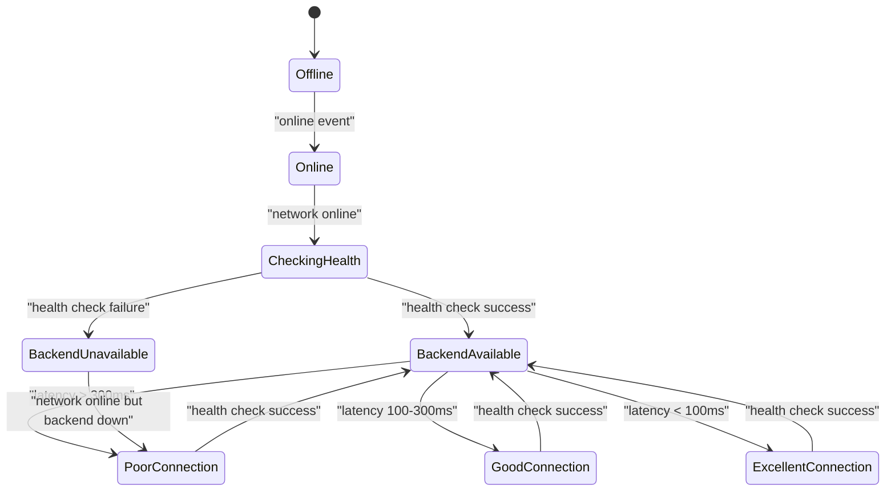
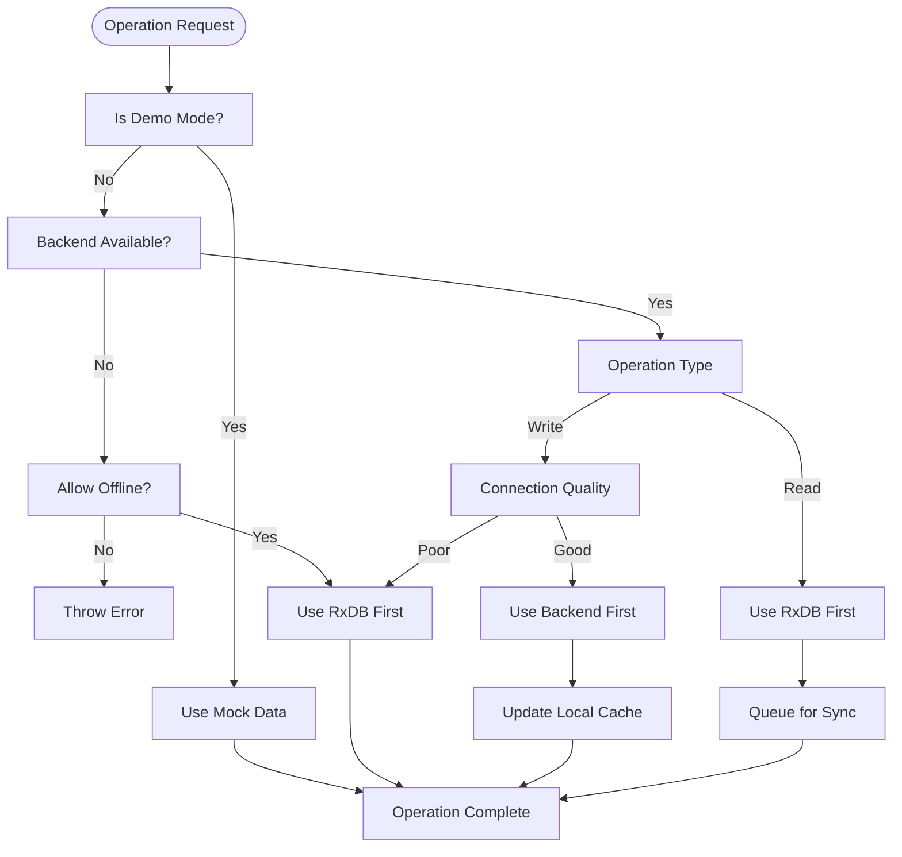
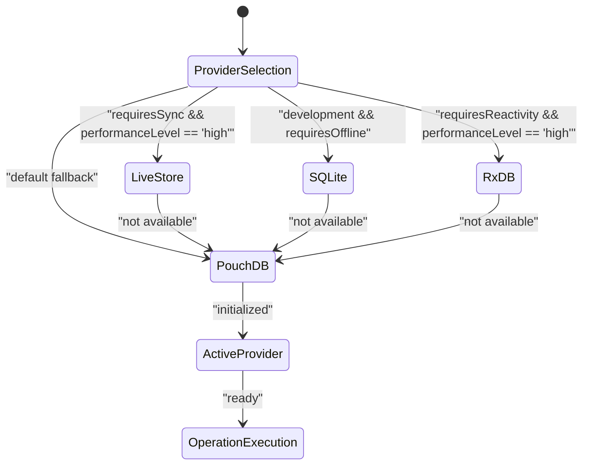
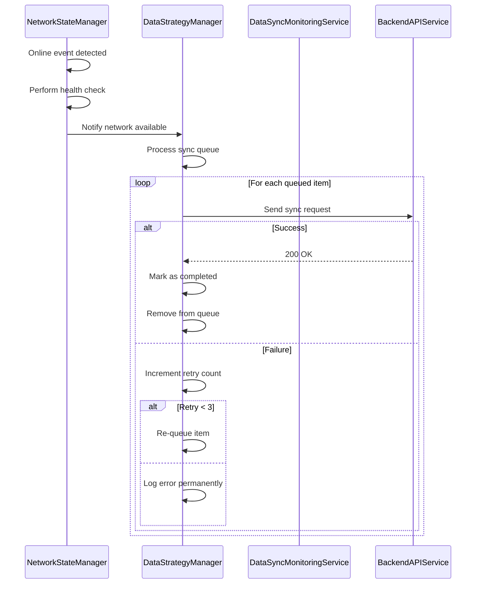
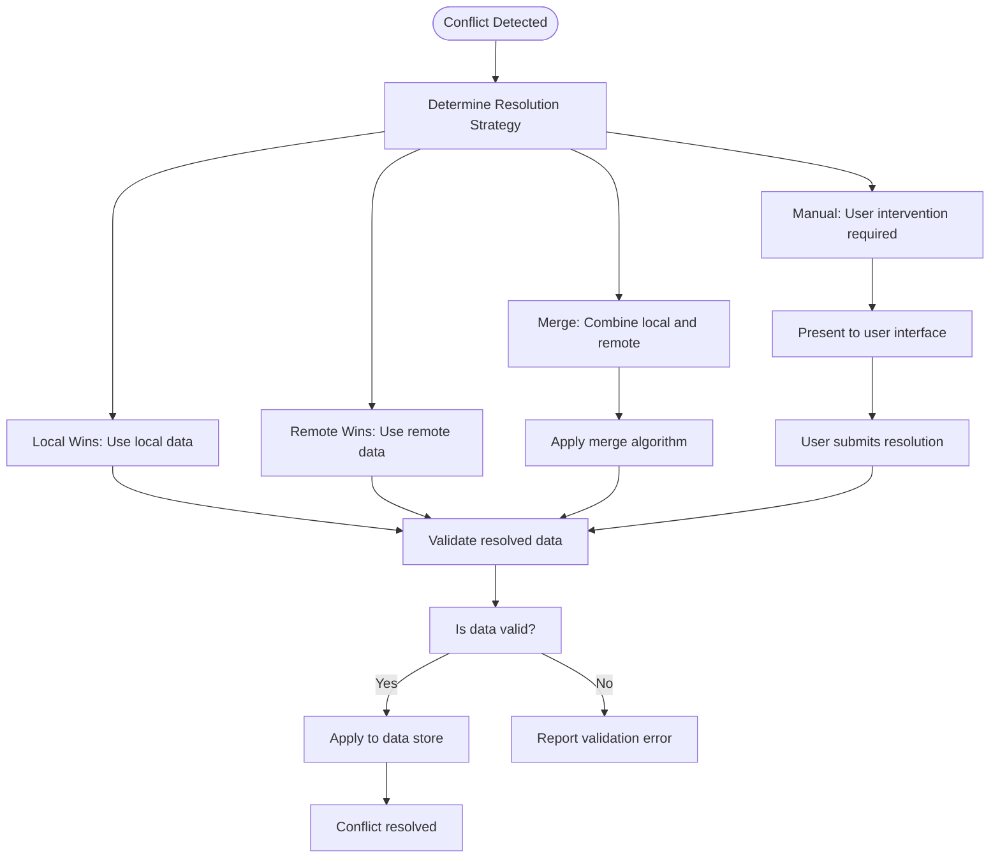
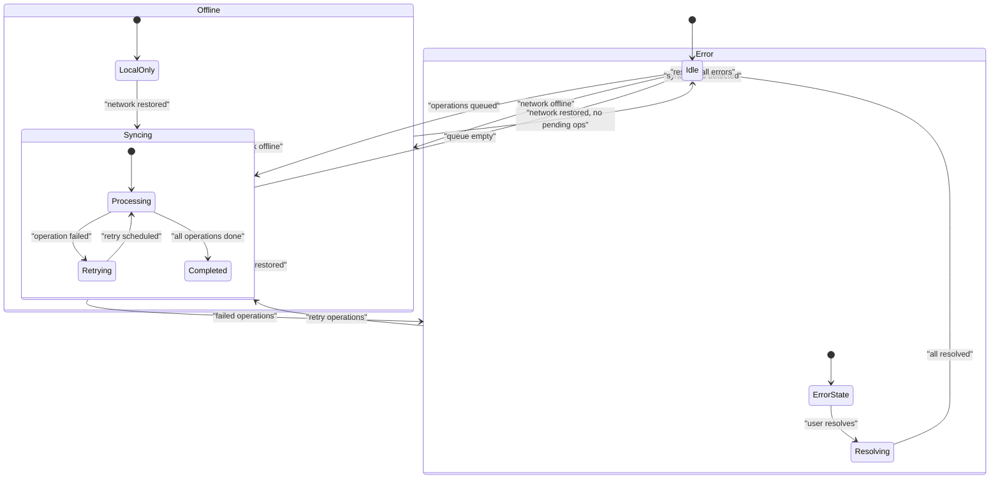

# Fallback and Recovery Mechanisms

<cite>
**Referenced Files in This Document**   
- [DataStrategyManager.ts](file://src\services\DataStrategyManager.ts) - *Updated in recent commit*
- [DatabaseProviderFactory.ts](file://src\services\database\DatabaseProviderFactory.ts) - *Updated in recent commit*
- [NetworkStateManager.ts](file://src\services\NetworkStateManager.ts)
- [DataSyncMonitoringService.ts](file://src\services\DataSyncMonitoringService.ts)
- [BackendAPIService.ts](file://src\services\BackendAPIService.ts)
</cite>

## Update Summary
**Changes Made**   
- Updated **Fallback Mechanisms and Strategy Transitions** section to reflect enhanced provider selection logic
- Added new content on provider fallback mechanisms in database layer
- Updated state machine diagram to include provider selection states
- Enhanced error handling description with improved fallback logic
- Added new diagram for provider selection process

## Table of Contents
1. [Introduction](#introduction)
2. [Health Checking and Network Monitoring](#health-checking-and-network-monitoring)
3. [Fallback Mechanisms and Strategy Transitions](#fallback-mechanisms-and-strategy-transitions)
4. [Recovery Process and Data Reconciliation](#recovery-process-and-data-reconciliation)
5. [Conflict Resolution Strategies](#conflict-resolution-strategies)
6. [State Machine Diagram](#state-machine-diagram)
7. [Error Handling in Critical Workflows](#error-handling-in-critical-workflows)

## Introduction
The schoolpilot3 application implements a robust fallback and recovery system to ensure uninterrupted operation during network disruptions. This document details the mechanisms that enable graceful degradation to offline modes, automatic health monitoring, and seamless recovery when connectivity is restored. The system leverages a sophisticated data strategy framework that dynamically routes operations based on network conditions, ensuring data consistency and user productivity regardless of connectivity status.

## Health Checking and Network Monitoring
The system employs continuous health monitoring through the NetworkStateManager service, which periodically checks backend availability and network quality. This service establishes the foundation for all fallback and recovery decisions by providing real-time network state information.

**Diagram sources**
- [NetworkStateManager.ts](file://src\services\NetworkStateManager.ts#L20-L233)

**Section sources**
- [NetworkStateManager.ts](file://src\services\NetworkStateManager.ts#L20-L233)

The health checking routine operates with the following parameters:
- **Health Check Interval**: 30 seconds (HEALTH_CHECK_INTERVAL)
- **Request Timeout**: 5 seconds (HEALTH_CHECK_TIMEOUT)
- **Connection Quality Thresholds**:
  - Excellent: < 100ms latency
  - Good: 100-300ms latency
  - Poor: > 300ms latency or failed health checks

The system uses the browser's native online/offline events as a first-level indicator, then performs HTTP health checks to the `/api/health` endpoint to verify backend availability. The fetch API with AbortController ensures requests don't hang indefinitely, adhering to the 5-second timeout policy.

## Fallback Mechanisms and Strategy Transitions
When network conditions deteriorate, the system automatically transitions to fallback modes using strategy-based routing. The DataStrategyManager evaluates network state and operation requirements to determine the optimal data source for each operation. Recent updates have enhanced the fallback mechanisms between database providers with improved error handling and recovery processes.

**Diagram sources**
- [DataStrategyManager.ts](file://src\services\DataStrategyManager.ts#L43-L573)
- [DatabaseProviderFactory.ts](file://src\services\database\DatabaseProviderFactory.ts#L150-L436)

**Section sources**
- [DataStrategyManager.ts](file://src\services\DataStrategyManager.ts#L43-L573)
- [DatabaseProviderFactory.ts](file://src\services\database\DatabaseProviderFactory.ts#L150-L436)
- [BackendAPIService.ts](file://src\services\BackendAPIService.ts#L48-L86)

The system supports multiple strategy modes:
- **Offline-first**: Prioritizes local RxDB operations, syncing with backend when available
- **Online-first**: Attempts backend operations first, falling back to local storage if unavailable
- **Hybrid**: Uses context-aware routing based on operation type and network quality

Critical operations requiring backend connectivity will fail immediately if the backend is unavailable and offline mode is not permitted. For operations allowing offline execution, the system routes requests to the local RxDB instance, ensuring uninterrupted user experience.

Recent enhancements in the DatabaseProviderFactory implement intelligent provider selection and fallback mechanisms. When a preferred provider is not available, the system automatically falls back to PouchDB as the default provider. The provider selection strategy considers collection requirements, environment type, and performance needs to determine the optimal provider.

**Diagram sources**
- [DatabaseProviderFactory.ts](file://src\services\database\DatabaseProviderFactory.ts#L150-L436)

## Recovery Process and Data Reconciliation
When connectivity is restored, the system automatically initiates recovery procedures to synchronize offline changes with the backend. The DataStrategyManager processes a prioritized sync queue to ensure data consistency.

**Diagram sources**
- [DataStrategyManager.ts](file://src\services\DataStrategyManager.ts#L374-L573)
- [DataSyncMonitoringService.ts](file://src\services\DataSyncMonitoringService.ts#L80-L479)

**Section sources**
- [DataStrategyManager.ts](file://src\services\DataStrategyManager.ts#L374-L573)

The recovery process follows these steps:
1. NetworkStateManager detects online status and successful health check
2. DataStrategyManager is notified through its network subscription
3. The sync queue processor initiates, batching operations based on strategy configuration
4. Each queued operation is retried with exponential backoff up to 3 attempts
5. Successful operations are removed from the queue; failed operations are logged

The sync queue prioritizes operations by criticality (critical, high, normal, low), ensuring essential data is synchronized first. Operations are stored persistently in the RxDB sync_queue collection, surviving application restarts.

## Conflict Resolution Strategies
When data conflicts occur during synchronization, the system employs multiple resolution strategies to maintain data integrity. Conflicts are detected when the same entity has been modified both locally and remotely since the last synchronization.

**Diagram sources**
- [DataSyncMonitoringService.ts](file://src\services\DataSyncMonitoringService.ts#L80-L479)

**Section sources**
- [DataSyncMonitoringService.ts](file://src\services\DataSyncMonitoringService.ts#L80-L479)

The system supports four conflict resolution strategies:
- **Local Wins**: The locally modified data takes precedence
- **Remote Wins**: The server-side data takes precedence
- **Merge**: A combination of both datasets using field-level rules
- **Manual**: User intervention through a conflict resolution interface

The merge algorithm implements the following rules:
- Prefer remote data for most fields
- Preserve local creation timestamp if remote lacks one
- Use the most recent update timestamp from either source

Before applying any resolution, the system validates the resulting data against business rules using the globalDataConsistencyService to prevent invalid states.

## State Machine Diagram
The overall fallback and recovery system operates as a state machine, transitioning between modes based on network conditions and system status.

**Diagram sources**
- [DataStrategyManager.ts](file://src\services\DataStrategyManager.ts#L43-L573)
- [DataSyncMonitoringService.ts](file://src\services\DataSyncMonitoringService.ts#L80-L479)
- [NetworkStateManager.ts](file://src\services\NetworkStateManager.ts#L20-L233)

## Error Handling in Critical Workflows
The system implements comprehensive error handling across critical workflows, ensuring resilience and providing meaningful feedback to users. Error detection algorithms monitor operation success rates, latency, and failure patterns to identify systemic issues.

Key error handling features include:
- **Retry Mechanism**: Up to 3 automatic retries for failed sync operations
- **Error Categorization**: Classification of errors by operation type and entity
- **Rate Limiting**: Throttling of health checks during prolonged outages
- **User Notifications**: Toast messages and UI indicators for sync status

The BackendAPIService implements request-level timeouts (10 seconds by default) and retry logic (up to 3 attempts) for individual API calls. When operations fail, they are either retried immediately (for transient errors) or queued for later synchronization (for connectivity issues).

The system maintains a rolling log of the last 100 sync errors, providing diagnostic information while preventing memory bloat. Error metrics are continuously updated and exposed through the DataSyncMonitoringService for real-time monitoring and alerting.

Recent updates have enhanced the error handling in the DatabaseProviderFactory, which now implements robust fallback mechanisms when a preferred provider is not available. If the selected provider cannot be initialized, the system automatically falls back to PouchDB as the default provider, ensuring continuous operation even when preferred providers are unavailable in the current environment.