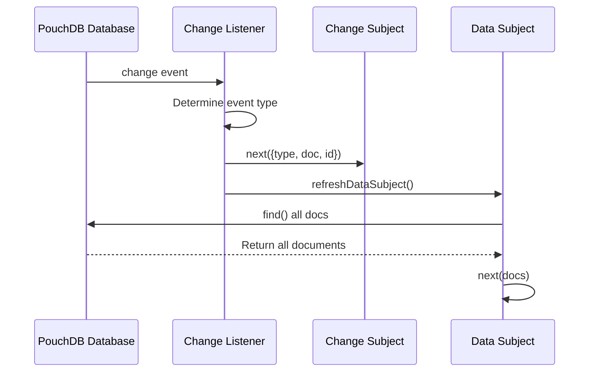
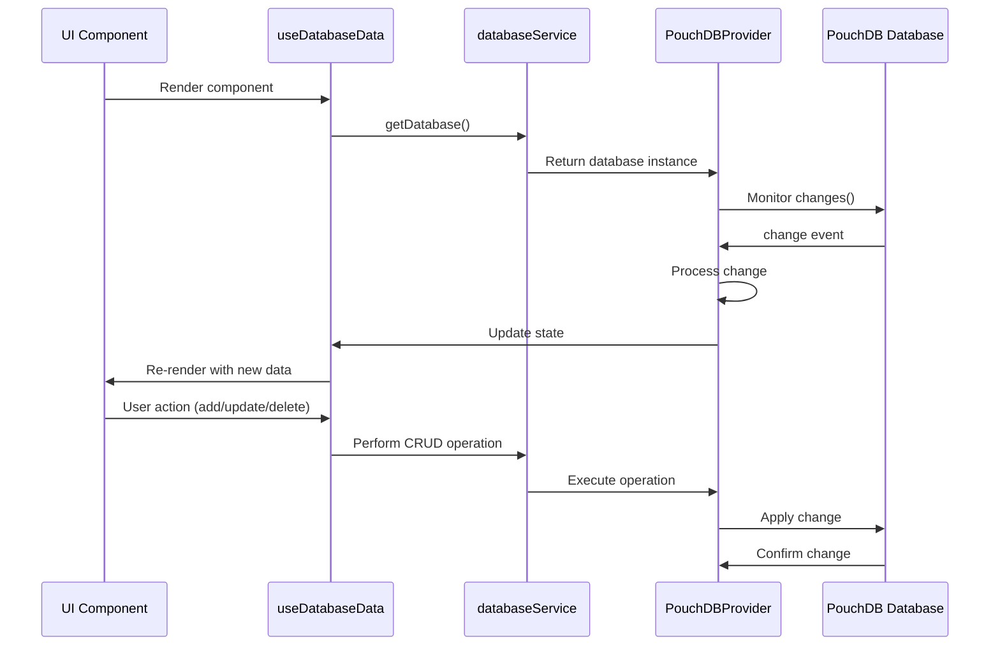
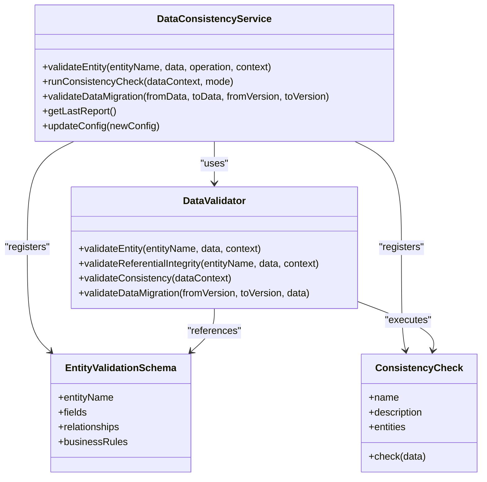

# Change Detection and Propagation

<cite>
**Referenced Files in This Document**   
- [PouchDBProvider.ts](file://src/services/database/PouchDBProvider.ts)
- [DataConsistencyService.ts](file://src/services/DataConsistencyService.ts)
- [useDatabaseData.ts](file://src/hooks/useDatabaseData.ts)
- [databaseService.ts](file://src/services/databaseService.ts)
- [dataValidation.ts](file://src/utils/dataValidation.ts)
</cite>

## Table of Contents
1. [Introduction](#introduction)
2. [Local Change Monitoring with PouchDB](#local-change-monitoring-with-pouchdb)
3. [Batch Processing Mechanism](#batch-processing-mechanism)
4. [Remote Change Detection and Propagation](#remote-change-detection-and-propagation)
5. [Event Chain from Database to UI](#event-chain-from-database-to-ui)
6. [Data Consistency and Referential Integrity](#data-consistency-and-referential-integrity)
7. [Change Event Payloads and Handling](#change-event-payloads-and-handling)
8. [Performance Considerations](#performance-considerations)

## Introduction
This document details the change detection and propagation system in schoolpilot3, focusing on how data changes are monitored, processed, and synchronized across the application. The system leverages PouchDB for local database operations, implements a robust change detection mechanism, and ensures data consistency through validation services. The architecture supports offline functionality while maintaining data integrity across distributed environments.

## Local Change Monitoring with PouchDB

The schoolpilot3 application uses PouchDB to monitor local database changes through change feeds and sequence tracking. PouchDB's change listener provides real-time notifications when documents are created, updated, or deleted in the local database.



**Diagram sources**
- [PouchDBProvider.ts](file://src/services/database/PouchDBProvider.ts#L46-L90)

**Section sources**
- [PouchDBProvider.ts](file://src/services/database/PouchDBProvider.ts#L46-L90)

PouchDB monitors changes using the `changes()` method with the `include_docs: true` option, which provides access to the complete document in the change event. The change listener categorizes events into three types:

- **Insert**: When a document is created (identified by revision starting with '1-')
- **Update**: When an existing document is modified
- **Delete**: When a document is removed (identified by `change.deleted` flag)

Each change event triggers two notifications: one through the change subject for fine-grained change tracking, and another through the data subject refresh for reactive query updates. This dual notification system ensures both granular change awareness and complete dataset synchronization.

## Batch Processing Mechanism

While the current implementation does not explicitly show a batch processing mechanism for change transmission, the architecture supports efficient data operations through reactive programming patterns. The system uses RxJS BehaviorSubjects to manage data state, allowing multiple components to subscribe to the same data stream without redundant database queries.

The `refreshDataSubject()` method in the PouchDB provider demonstrates the approach to data synchronization:

```typescript
private async refreshDataSubject(): Promise<void> {
  try {
    const docs = await this.find();
    this.dataSubject.next(docs);
  } catch (error) {
    console.error(`Failed to refresh data subject for ${this.name}:`, error);
  }
}
```

This method retrieves all documents from the collection and emits them to all subscribers, effectively broadcasting the current state to all interested components. While this approach ensures data consistency, it could be enhanced with true batch processing for high-frequency change scenarios by queuing changes and transmitting them in batches to remote databases.

## Remote Change Detection and Propagation

Remote changes are detected and propagated to local stores through PouchDB's change listeners, which work bidirectionally. When the application synchronizes with a remote CouchDB instance, changes from the server are detected and applied to the local database, triggering the same change event chain as local changes.

The synchronization process follows these steps:
1. PouchDB establishes a replication connection with the remote database
2. Changes are detected on both local and remote databases
3. Conflicts are resolved according to predefined strategies
4. Applied changes trigger local change events
5. Change events propagate through the application

This bidirectional synchronization ensures that updates from any client are eventually propagated to all other clients, maintaining data consistency across distributed instances of the application.

## Event Chain from Database to UI

The event chain from database change to UI update is facilitated by the `useDatabaseData` hook, which connects the database layer with React components. This hook implements a comprehensive data access layer that handles the entire change propagation workflow.



**Diagram sources**
- [useDatabaseData.ts](file://src/hooks/useDatabaseData.ts#L34-L74)
- [databaseService.ts](file://src/services/databaseService.ts)

**Section sources**
- [useDatabaseData.ts](file://src/hooks/useDatabaseData.ts#L34-L74)

The `useDatabaseData` hook creates a context object that provides CRUD operations for all entities in the system. When a database change occurs, the hook's internal state is updated, triggering React's re-rendering mechanism and updating the UI components that depend on the changed data.

## Data Consistency and Referential Integrity

The DataConsistencyService plays a critical role in validating changes and maintaining referential integrity across the application. This service implements a comprehensive validation framework that ensures data quality and consistency.



**Diagram sources**
- [DataConsistencyService.ts](file://src/services/DataConsistencyService.ts)
- [dataValidation.ts](file://src/utils/dataValidation.ts)

**Section sources**
- [DataConsistencyService.ts](file://src/services/DataConsistencyService.ts#L43-L89)
- [dataValidation.ts](file://src/utils/dataValidation.ts#L44-L90)

The service performs several types of validation:

- **Entity validation**: Validates individual entities against defined schemas
- **Referential integrity**: Ensures foreign key relationships are valid
- **Consistency checks**: Validates business rules across multiple entities
- **Data migration validation**: Ensures data integrity when switching between modes

The validation process is configurable, supporting different modes such as 'strict', 'warn', and 'disabled'. The service also supports automatic fixes for certain types of inconsistencies when configured to do so.

## Change Event Payloads and Handling

Change event payloads in the schoolpilot3 system contain essential information for processing database changes. The structure of a change event is standardized across the application:

```typescript
{
  type: 'insert' | 'update' | 'delete',
  doc: T,
  id: string
}
```

The system handles different change types appropriately:

- **Create operations**: Generate a new ID using `crypto.randomUUID()` and insert the document
- **Update operations**: Modify existing documents while preserving revision history
- **Delete operations**: Mark documents as deleted with the `_deleted: true` flag

The `validateEntity` method in DataConsistencyService handles operation-specific validation:

```typescript
async validateEntity(
  entityName: string, 
  data: EntityData, 
  operation: 'create' | 'update' | 'delete',
  context?: any
): Promise<ValidationResult>
```

For create operations, the service validates required fields and ensures uniqueness constraints. For update operations, it verifies that the document exists and that the user has appropriate permissions. For delete operations, it checks cascade constraints to prevent orphaned records.

## Performance Considerations

The system addresses performance considerations for high-frequency change scenarios through several mechanisms:

1. **Reactive programming**: Using RxJS observables to efficiently propagate changes
2. **State management**: Centralized data subjects that prevent redundant database queries
3. **Lazy initialization**: Database initialization occurs only when needed
4. **Error handling**: Comprehensive error handling to prevent cascading failures

However, the current implementation could be enhanced for high-frequency scenarios by:

- Implementing change batching to reduce the number of synchronization operations
- Adding debouncing to change listeners to handle rapid successive changes
- Optimizing the `refreshDataSubject` method to perform incremental updates rather than full dataset refreshes
- Implementing more sophisticated conflict resolution strategies for concurrent edits

The performance event manager provides monitoring capabilities to track system performance and identify bottlenecks:

```typescript
public shouldRefresh(lastRefresh: number, minInterval: number = 1000): boolean {
  if (!this.lastEvent) return false;
  
  const timeSinceLastRefresh = Date.now() - lastRefresh;
  const timeSinceLastEvent = Date.now() - this.lastEvent.timestamp;
  
  // Only refresh if:
  // 1. Enough time has passed since last refresh (prevent spam)
  // 2. There was a recent event (within 5 seconds)
  return timeSinceLastRefresh >= minInterval && timeSinceLastEvent <= 5000;
}
```

This method helps prevent excessive refresh operations by ensuring that updates occur only when necessary, balancing responsiveness with performance.