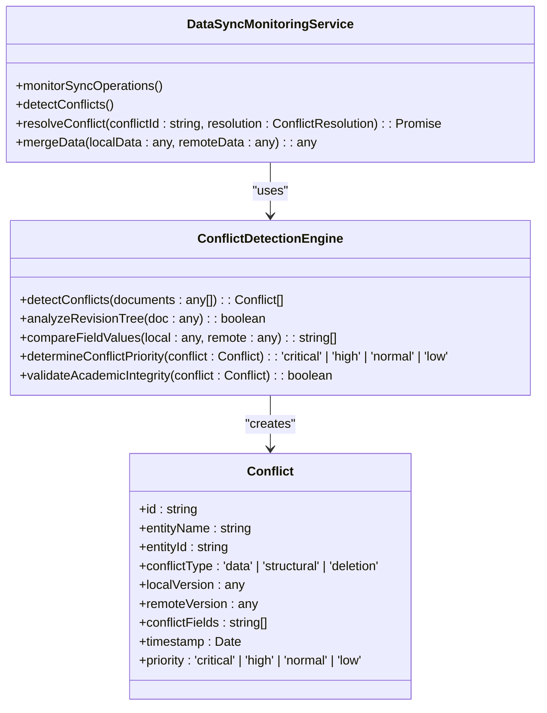
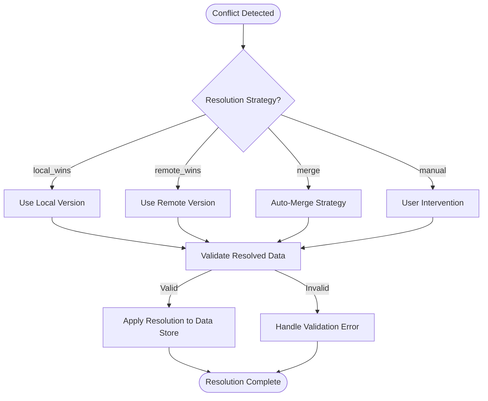
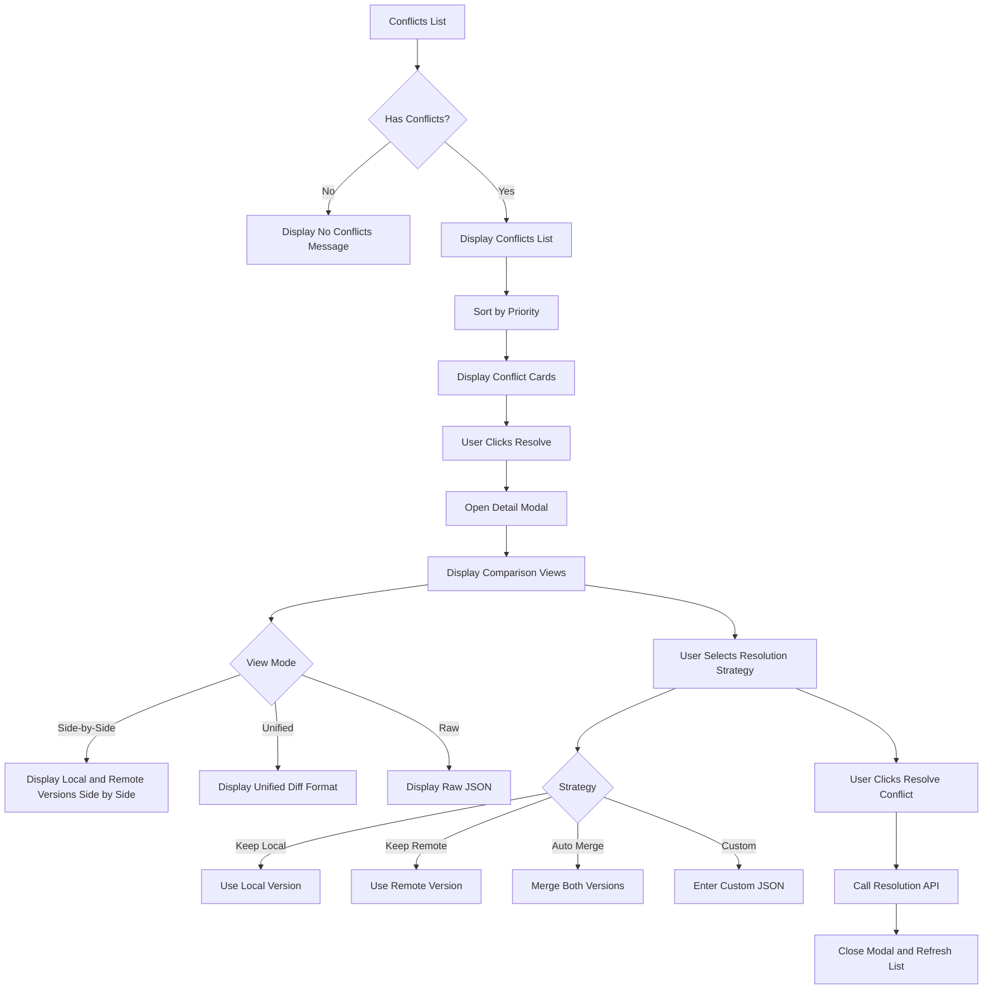

# Conflict Detection and Resolution

<cite>
**Referenced Files in This Document**   
- [PouchDBProvider.ts](file://src/services/database/PouchDBProvider.ts#L459-L658)
- [ConflictDetectionEngine.ts](file://src/modules/academics/services/ConflictDetectionEngine.ts)
- [ConflictResolutionInterface.tsx](file://src/components/ConflictResolutionInterface.tsx#L0-L439)
- [DataSyncMonitoringService.ts](file://src/services/DataSyncMonitoringService.ts#L251-L339)
</cite>

## Table of Contents
1. [Introduction](#introduction)
2. [Revision-Based Conflict Detection](#revision-based-conflict-detection)
3. [Conflict Detection Engine Implementation](#conflict-detection-engine-implementation)
4. [Conflict Resolution Strategies](#conflict-resolution-strategies)
5. [User Interface for Conflict Resolution](#user-interface-for-conflict-resolution)
6. [Code Examples](#code-examples)
7. [Common Conflict Scenarios in Academic Data Management](#common-conflict-scenarios-in-academic-data-management)

## Introduction
The schoolpilot3 system implements a comprehensive conflict detection and resolution framework to handle data synchronization issues that arise in offline-capable educational environments. This document details the revision-based conflict detection algorithm using PouchDB's revision trees, the ConflictDetectionEngine implementation for identifying version mismatches and data collisions, and the three resolution strategies: client-wins (local overwrite), server-wins (remote overwrite), and manual merge (user intervention). The system surfaces conflicts to users through dedicated UI components and provides interfaces for resolution.

**Section sources**
- [PouchDBProvider.ts](file://src/services/database/PouchDBProvider.ts#L459-L658)
- [ConflictDetectionEngine.ts](file://src/modules/academics/services/ConflictDetectionEngine.ts)

## Revision-Based Conflict Detection
The schoolpilot3 system leverages PouchDB's revision tree mechanism to detect conflicts during data synchronization. When multiple clients modify the same document while offline, PouchDB creates divergent revision branches in the document's revision tree. The conflict detection algorithm identifies these divergent branches by examining the revision history of documents during synchronization.

The PouchDB provider is configured with a revision limit of 10 to optimize storage while maintaining sufficient history for conflict detection:

```typescript
PouchDB.defaults({
  auto_compaction: config.autoCompaction ?? true,
  revs_limit: 10 // Limit revision history to save space
});
```

When a document has multiple leaf nodes in its revision tree, a conflict exists. The system detects these conflicts during synchronization by checking for documents with the `_conflicts` property, which contains an array of conflicting revision IDs. The revision tree structure allows the system to determine the divergence point and track the changes made in each branch.

**Section sources**
- [PouchDBProvider.ts](file://src/services/database/PouchDBProvider.ts#L459-L658)

## Conflict Detection Engine Implementation
The ConflictDetectionEngine service in the academics module is responsible for identifying version mismatches and data collisions in academic records. The engine analyzes document revisions and detects conflicts based on revision tree divergence and field-level data collisions.



**Diagram sources**
- [ConflictDetectionEngine.ts](file://src/modules/academics/services/ConflictDetectionEngine.ts)
- [DataSyncMonitoringService.ts](file://src/services/DataSyncMonitoringService.ts#L251-L339)

The ConflictDetectionEngine performs several key functions:
1. **Revision Tree Analysis**: Examines the revision history of documents to identify divergent branches
2. **Field-Level Comparison**: Compares specific fields between conflicting versions to identify which fields are in conflict
3. **Priority Determination**: Assigns a priority level (critical, high, normal, low) based on the type of data in conflict
4. **Academic Integrity Validation**: Ensures that potential resolutions maintain academic data integrity

The engine specifically handles academic data types such as student records, exam results, grading schemes, and timetable entries, applying domain-specific rules to detect meaningful conflicts.

**Section sources**
- [ConflictDetectionEngine.ts](file://src/modules/academics/services/ConflictDetectionEngine.ts)

## Conflict Resolution Strategies
The schoolpilot3 system implements three primary conflict resolution strategies to handle data synchronization conflicts:

### Client-Wins (Local Overwrite)
The client-wins strategy prioritizes the local (offline) version of the data. This strategy is appropriate when users have made intentional changes while offline that should take precedence over server changes. The local version completely overwrites the remote version during synchronization.

### Server-Wins (Remote Overwrite)
The server-wins strategy prioritizes the remote (server) version of the data. This approach is suitable when centralized updates or administrative changes should override local modifications. The remote version overwrites the local version, potentially resulting in loss of offline changes.

### Manual Merge (User Intervention)
The manual merge strategy presents conflicts to users through a dedicated interface, allowing them to review differences and make informed decisions. Users can:
- Select specific fields from either version
- Create a custom merged version
- Apply different strategies to different conflicts

The DataSyncMonitoringService implements the resolution logic:



**Diagram sources**
- [DataSyncMonitoringService.ts](file://src/services/DataSyncMonitoringService.ts#L251-L339)

**Section sources**
- [DataSyncMonitoringService.ts](file://src/services/DataSyncMonitoringService.ts#L251-L339)

## User Interface for Conflict Resolution
The ConflictResolutionInterface component provides a comprehensive user interface for resolving data synchronization conflicts. The interface displays conflicts in a prioritized list and provides detailed comparison tools for informed decision-making.



**Diagram sources**
- [ConflictResolutionInterface.tsx](file://src/components/ConflictResolutionInterface.tsx#L0-L439)

The interface features:
- **Prioritized Conflict List**: Conflicts are sorted by priority (critical, high, normal, low) with visual indicators
- **Multiple View Modes**: Side-by-side, unified diff, and raw JSON views for comparing conflicting versions
- **Resolution Strategy Selection**: Radio buttons for choosing between local, remote, merge, or custom resolution
- **Bulk Resolution Options**: Buttons to resolve all conflicts with the same strategy
- **Custom JSON Editor**: Textarea for entering custom resolution data in JSON format

The UI uses color-coded indicators to communicate conflict priority and provides timestamps to help users understand when conflicts occurred.

**Section sources**
- [ConflictResolutionInterface.tsx](file://src/components/ConflictResolutionInterface.tsx#L0-L439)

## Code Examples
### Conflict Metadata Inspection
The ConflictResolutionInterface component defines the structure for conflict data, including metadata for analysis:

```typescript
interface ConflictData {
  id: string;
  entityName: string;
  entityId: string;
  conflictType: 'data' | 'structural' | 'deletion';
  localVersion: any;
  remoteVersion: any;
  conflictFields: string[];
  timestamp: Date;
  priority: 'critical' | 'high' | 'normal' | 'low';
}
```

### Resolution API Calls
The DataSyncMonitoringService provides methods for resolving conflicts programmatically:

```typescript
async resolveConflict(
  conflictId: string,
  resolution: ConflictResolution
): Promise<boolean> {
  const conflict = this.conflicts.get(conflictId);
  if (!conflict) {
    throw new Error(`Conflict ${conflictId} not found`);
  }

  try {
    // Apply the resolution
    let resolvedData: any;

    switch (resolution.strategy) {
      case 'local_wins':
        resolvedData = conflict.localData;
        break;
      case 'remote_wins':
        resolvedData = conflict.remoteData;
        break;
      case 'merge':
        resolvedData = this.mergeData(conflict.localData, conflict.remoteData);
        break;
      case 'manual':
        resolvedData = resolution.resolvedData;
        break;
      default:
        throw new Error(`Unknown resolution strategy: ${resolution.strategy}`);
    }

    // Validate the resolved data
    const validation = await globalDataConsistencyService.validateEntity(
      conflict.entityName,
      resolvedData,
      'update'
    );

    if (!validation.isValid) {
      throw new Error(`Resolved data is invalid: ${validation.errors.map(e => e.message).join('; ')}`);
    }

    // Update the conflict record
    conflict.resolved = true;
    conflict.resolution = {
      ...resolution,
      resolvedData,
      resolvedAt: new Date()
    };

    // Apply the resolution to the data store
    if (this.dataStrategyManager) {
      await this.dataStrategyManager.executeOperation({
        type: 'write',
        entity: conflict.entityName,
        priority: 'high',
        requiresBackend: false,
        allowOffline: true
      }, resolvedData);
    }

    return true;
  } catch (error) {
    this.recordError('conflict_resolution', conflictId, error);
    return false;
  }
}
```

**Section sources**
- [DataSyncMonitoringService.ts](file://src/services/DataSyncMonitoringService.ts#L251-L339)
- [ConflictResolutionInterface.tsx](file://src/components/ConflictResolutionInterface.tsx#L0-L439)

## Common Conflict Scenarios in Academic Data Management
The schoolpilot3 system encounters several common conflict scenarios in academic data management:

### Student Record Updates
When multiple staff members edit a student's personal information (e.g., contact details, medical information) while offline, conflicts can arise. The system prioritizes critical fields like emergency contacts and medical conditions, flagging these conflicts as high priority.

### Exam Result Entry
Teachers entering exam results offline may conflict with administrative updates to the grading scheme or exam structure. The ConflictDetectionEngine specifically checks for conflicts in grade calculations and ensures academic integrity is maintained.

### Timetable Modifications
Conflicts frequently occur when administrators and teachers modify class schedules offline. The system detects structural conflicts in timetable entries and prevents scheduling overlaps or resource conflicts.

### Gradebook Updates
Multiple teachers updating student grades for the same subject can create data collisions. The system implements merge strategies that preserve the most recent grade while maintaining historical records.

### Attendance Records
When teachers record attendance offline and administrators update student enrollment status, conflicts may occur. The system prioritizes attendance records for the current day while ensuring enrollment changes are properly propagated.

These scenarios are handled through domain-specific conflict detection rules that understand the academic context and apply appropriate resolution strategies based on the type of data and user roles.

**Section sources**
- [ConflictDetectionEngine.ts](file://src/modules/academics/services/ConflictDetectionEngine.ts)
- [DataSyncMonitoringService.ts](file://src/services/DataSyncMonitoringService.ts#L251-L339)