# Data Synchronization Workflow

<cite>
**Referenced Files in This Document**   
- [DatabaseService.ts:14-301](file://src/services/database/databaseService.ts#L14-L301)
- [DataStrategyManager.ts:43-573](file://src/services/DataStrategyManager.ts#L43-L573)
- [DataSyncMonitoringService.ts:80-479](file://src/services/DataSyncMonitoringService.ts#L80-L479)
- [useDatabaseData.ts:86-1958](file://src/hooks/useDatabaseData.ts#L86-L1958)
- [ConflictDetectionEngine.ts:14-248](file://src/modules/academics/services/ConflictDetectionEngine.ts#L14-L248)
- [ProviderSelector.ts:0-449](file://src/services/database/ProviderSelector.ts#L0-L449)
- [SyncManager.ts:1-387](file://src/services/database/sync/SyncManager.ts#L1-L387)
- [NetworkMonitor.ts:1-217](file://src/services/database/sync/NetworkMonitor.ts#L1-L217)
- [OfflineQueue.ts:1-458](file://src/services/database/sync/OfflineQueue.ts#L1-L458)
- [HybridProvider.ts:1-608](file://src/services/database/HybridProvider.ts#L1-L608)
- [BackendAPIProvider.ts:100-299](file://src/services/database/BackendAPIProvider.ts#L100-L299)
</cite>

## Update Summary
**Changes Made**   
- Added comprehensive documentation for new sync components: SyncManager, NetworkMonitor, and OfflineQueue
- Enhanced monitoring capabilities section to include the new components
- Updated architecture overview to include the new sync infrastructure
- Added detailed sections for each new component with their responsibilities and interfaces
- Updated integration patterns to show how these components work together
- Enhanced conflict resolution and offline queue management sections

## Table of Contents
1. [Introduction](#introduction)
2. [Architecture Overview](#architecture-overview)
3. [Core Components](#core-components)
4. [New Sync Infrastructure](#new-sync-infrastructure)
5. [Data Synchronization Process](#data-synchronization-process)
6. [Conflict Detection and Resolution](#conflict-detection-and-resolution)
7. [Event-Driven Architecture and UI Integration](#event-driven-architecture-and-ui-integration)
8. [Error Handling and Retry Mechanisms](#error-handling-and-retry-mechanisms)
9. [Performance and Consistency Guarantees](#performance-and-consistency-guarantees)
10. [Provider Selection and Fallback Mechanism](#provider-selection-and-fallback-mechanism)

## Introduction
The schoolpilot3 application implements a robust bidirectional data synchronization workflow between local databases (RxDB/SQLite) and remote CouchDB instances via PouchDB. This system ensures data consistency across offline and online environments, supports multiple synchronization strategies, and provides comprehensive monitoring and conflict resolution capabilities. The architecture is designed to handle intermittent connectivity, maintain data integrity, and provide a seamless user experience regardless of network conditions.

**Updated** Added new SyncManager, NetworkMonitor, and OfflineQueue components that provide enhanced synchronization capabilities and improved offline-first architecture support.

## Architecture Overview

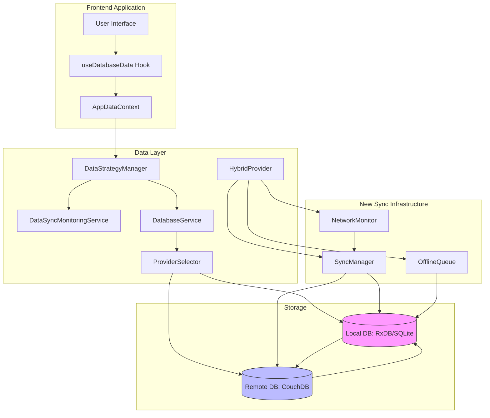

**Diagram sources**
- [DatabaseService.ts:14-301](file://src/services/database/databaseService.ts#L14-L301)
- [DataStrategyManager.ts:43-573](file://src/services/DataStrategyManager.ts#L43-L573)
- [DataSyncMonitoringService.ts:80-479](file://src/services/DataSyncMonitoringService.ts#L80-L479)
- [ProviderSelector.ts:0-449](file://src/services/database/ProviderSelector.ts#L0-L449)
- [SyncManager.ts:90-362](file://src/services/database/sync/SyncManager.ts#L90-L362)
- [NetworkMonitor.ts:29-216](file://src/services/database/sync/NetworkMonitor.ts#L29-L216)
- [OfflineQueue.ts:66-457](file://src/services/database/sync/OfflineQueue.ts#L66-L457)
- [HybridProvider.ts:326-607](file://src/services/database/HybridProvider.ts#L326-L607)

## Core Components

### DatabaseService
The DatabaseService class serves as the central coordinator for database operations, implementing a singleton pattern to ensure consistent access across the application. It dynamically detects and initializes the most appropriate database provider (RxDB or PouchDB) based on environmental capabilities.

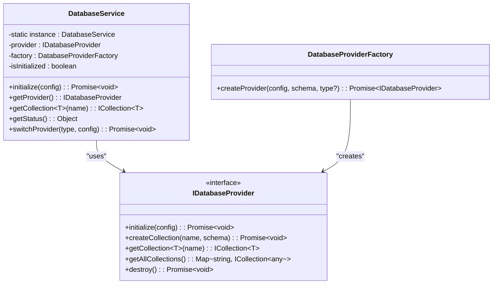

**Diagram sources**
- [DatabaseService.ts:14-301](file://src/services/database/databaseService.ts#L14-L301)

**Section sources**
- [DatabaseService.ts:14-301](file://src/services/database/databaseService.ts#L14-L301)

### DataStrategyManager
The DataStrategyManager orchestrates data operations according to configurable strategies, determining whether operations should be executed against the backend, local database, or mock data. It manages the synchronization queue and implements retry mechanisms.

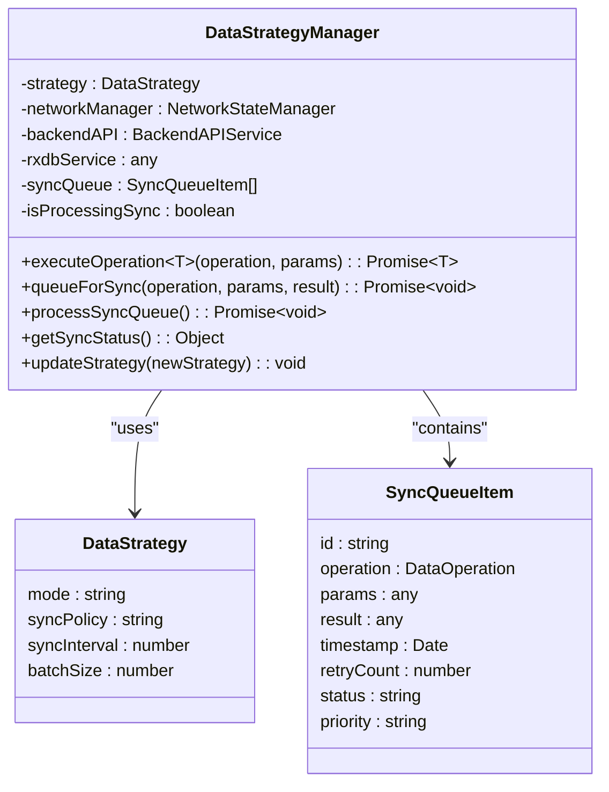

**Diagram sources**
- [DataStrategyManager.ts:43-573](file://src/services/DataStrategyManager.ts#L43-L573)

**Section sources**
- [DataStrategyManager.ts:43-573](file://src/services/DataStrategyManager.ts#L43-L573)

### DataSyncMonitoringService
The DataSyncMonitoringService provides comprehensive monitoring of synchronization operations, tracking metrics such as latency, throughput, error rates, and conflict resolution. It maintains a history of sync operations and notifies subscribers of status changes. The service now includes enhanced network state change handling and automatic sync resumption.

```mermaid
classDiagram
class DataSyncMonitoringService {
-dataStrategyManager : DataStrategyManager
-networkManager : NetworkStateManager
-conflicts : Map~string, SyncConflict~
-errors : SyncError[]
-metrics : SyncMetrics
-syncHistory : {timestamp, duration, success}[]
-subscribers : (status) => void[]
+getSyncStatus() : SyncStatus
+recordConflict(entity, id, type, local, remote) : string
+resolveConflict(id, resolution) : Promise~boolean~
+recordError(operation, entityId, error) : void
+subscribe(callback) : () => void
+forceSyncAll() : Promise~void~
+updateDataStrategyManager(dataStrategyManager) : void
+destroy() : void
}
class SyncConflict {
id : string
entityName : string
entityId : string
conflictType : string
localData : any
remoteData : any
timestamp : Date
resolved : boolean
resolution : ConflictResolution
}
class SyncError {
id : string
timestamp : Date
entityName : string
entityId : string
operation : string
error : string
retryCount : number
resolved : boolean
}
class SyncMetrics {
totalOperations : number
successfulOperations : number
failedOperations : number
averageLatency : number
peakLatency : number
throughput : number
errorRate : number
conflictRate : number
cacheHitRate : number
}
DataSyncMonitoringService --> SyncConflict : "manages"
DataSyncMonitoringService --> SyncError : "manages"
DataSyncMonitoringService --> SyncMetrics : "tracks"
```

**Section sources**   
- [DataSyncMonitoringService.ts:80-479](file://src/services/DataSyncMonitoringService.ts#L80-L479)

## New Sync Infrastructure

### SyncManager
The SyncManager provides bidirectional synchronization between backend APIs and local cache providers. It manages data synchronization, handles conflict resolution, tracks sync progress and statistics, and supports pause/resume functionality. This component replaces and enhances the previous synchronization mechanisms with a more robust event-driven architecture.

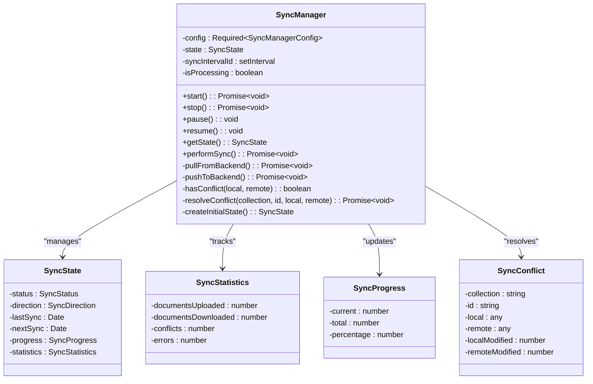

**Diagram sources**
- [SyncManager.ts:90-362](file://src/services/database/sync/SyncManager.ts#L90-L362)

**Section sources**
- [SyncManager.ts:1-387](file://src/services/database/sync/SyncManager.ts#L1-L387)

### NetworkMonitor
The NetworkMonitor provides real-time network connectivity monitoring with online/offline event detection, connection quality metrics, and reconnection notifications. It implements a singleton pattern for centralized network state management and provides detailed network information including connection type, speed, and quality indicators.

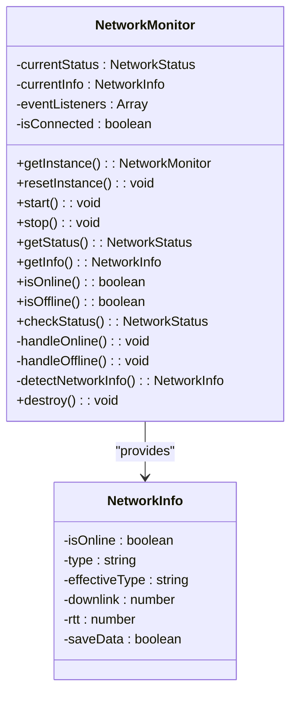

**Diagram sources**
- [NetworkMonitor.ts:29-216](file://src/services/database/sync/NetworkMonitor.ts#L29-L216)

**Section sources**
- [NetworkMonitor.ts:1-217](file://src/services/database/sync/NetworkMonitor.ts#L1-L217)

### OfflineQueue
The OfflineQueue provides persistent queue management for offline operations with IndexedDB persistence, configurable retry strategies, and priority-based processing. It ensures data integrity during offline periods and provides robust error handling with exponential backoff mechanisms.

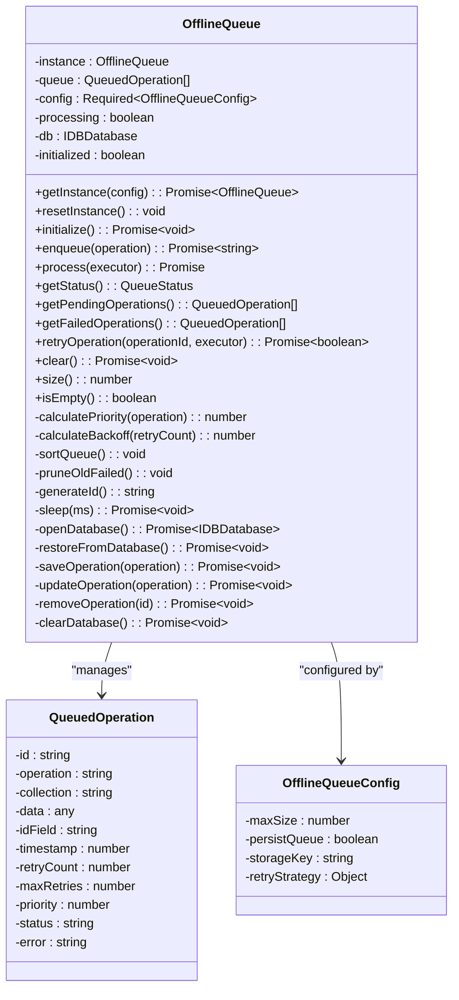

**Diagram sources**
- [OfflineQueue.ts:66-457](file://src/services/database/sync/OfflineQueue.ts#L66-L457)

**Section sources**
- [OfflineQueue.ts:1-458](file://src/services/database/sync/OfflineQueue.ts#L1-L458)

## Data Synchronization Process

### Bidirectional Sync Workflow
The synchronization process follows a sophisticated bidirectional pattern that ensures data consistency between local and remote databases. The workflow adapts to network conditions and user requirements through configurable strategies. The system now includes automatic sync resumption when network connectivity is restored and enhanced conflict detection.

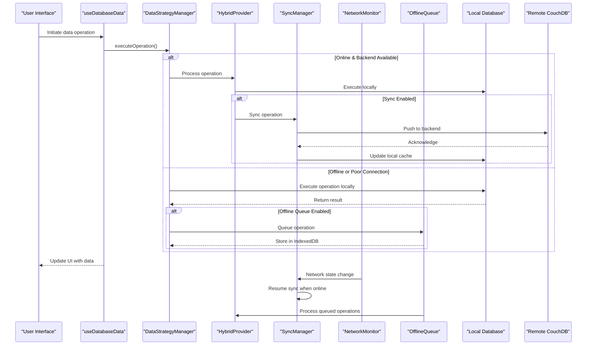

**Diagram sources**
- [DataStrategyManager.ts:43-573](file://src/services/DataStrategyManager.ts#L43-L573)
- [useDatabaseData.ts:86-1958](file://src/hooks/useDatabaseData.ts#L86-L1958)
- [HybridProvider.ts:326-607](file://src/services/database/HybridProvider.ts#L326-L607)
- [SyncManager.ts:90-362](file://src/services/database/sync/SyncManager.ts#L90-L362)
- [NetworkMonitor.ts:29-216](file://src/services/database/sync/NetworkMonitor.ts#L29-L216)
- [OfflineQueue.ts:66-457](file://src/services/database/sync/OfflineQueue.ts#L66-L457)

**Section sources**
- [DataStrategyManager.ts:43-573](file://src/services/DataStrategyManager.ts#L43-L573)
- [useDatabaseData.ts:86-1958](file://src/hooks/useDatabaseData.ts#L86-L1958)
- [HybridProvider.ts:326-607](file://src/services/database/HybridProvider.ts#L326-L607)

### Batch Processing and Queue Management
The system implements intelligent batch processing to optimize network usage and improve performance. Operations are queued and processed according to priority and network conditions.

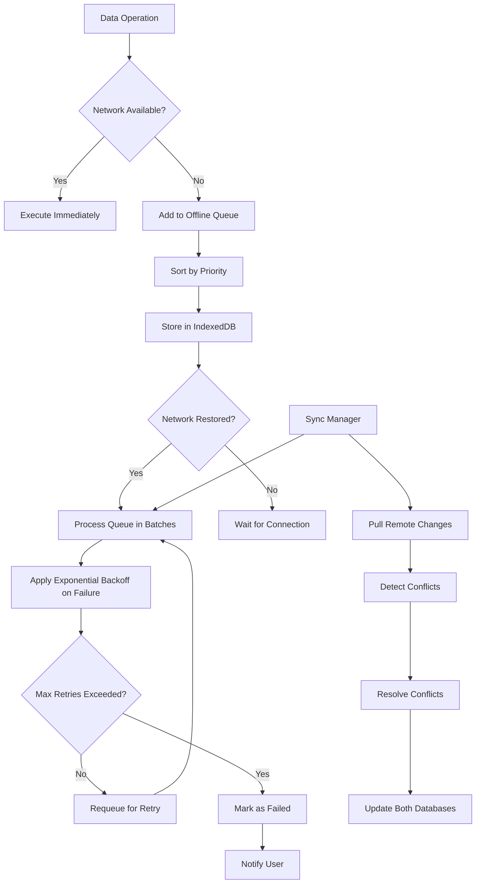

**Diagram sources**
- [OfflineQueue.ts:66-457](file://src/services/database/sync/OfflineQueue.ts#L66-L457)
- [SyncManager.ts:90-362](file://src/services/database/sync/SyncManager.ts#L90-L362)

**Section sources**
- [OfflineQueue.ts:1-458](file://src/services/database/sync/OfflineQueue.ts#L1-L458)
- [SyncManager.ts:1-387](file://src/services/database/sync/SyncManager.ts#L1-L387)

## Conflict Detection and Resolution

### Enhanced Conflict Detection Algorithm
The system employs a comprehensive conflict detection mechanism that identifies version mismatches between local and remote data. The SyncManager now includes sophisticated conflict detection with timestamp-based comparison and multiple resolution strategies.

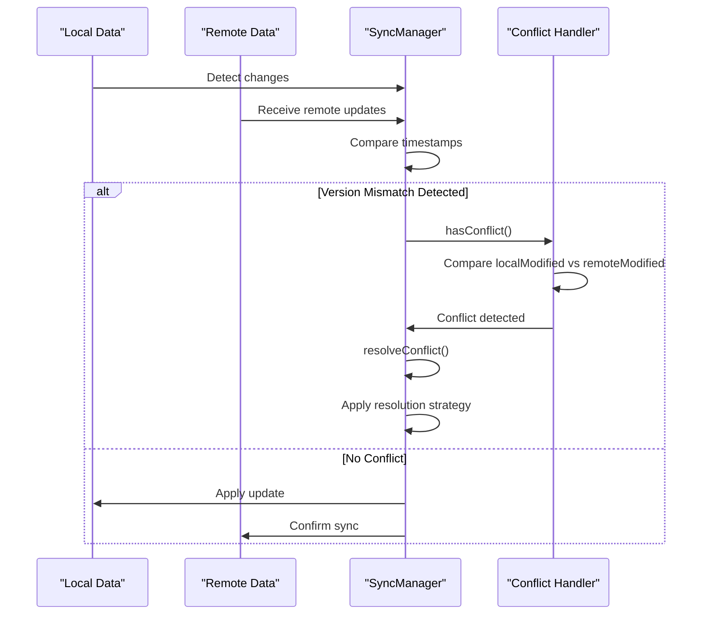

**Diagram sources**
- [SyncManager.ts:297-345](file://src/services/database/sync/SyncManager.ts#L297-L345)

**Section sources**
- [SyncManager.ts:297-345](file://src/services/database/sync/SyncManager.ts#L297-L345)

### Advanced Conflict Resolution Strategies
The system supports multiple conflict resolution strategies to handle data inconsistencies according to business requirements and user preferences. The resolution strategies now include sophisticated timestamp comparison and manual intervention options.

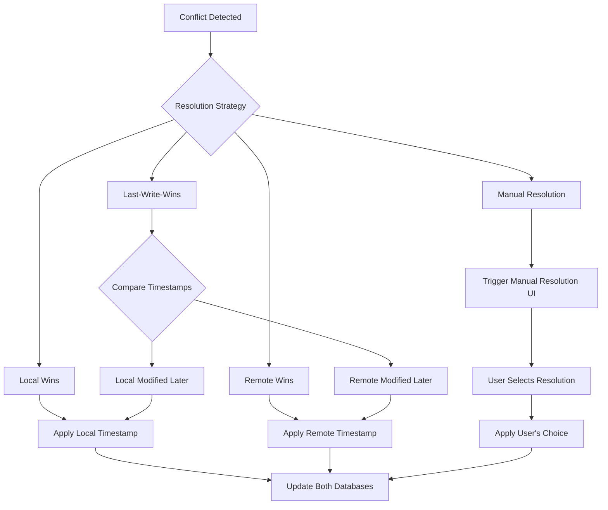

**Section sources**
- [SyncManager.ts:306-345](file://src/services/database/sync/SyncManager.ts#L306-L345)

## Event-Driven Architecture and UI Integration

### useDatabaseData Hook
The useDatabaseData hook serves as the primary interface between the application's UI components and the data synchronization system. It provides a reactive data layer that automatically updates when data changes.

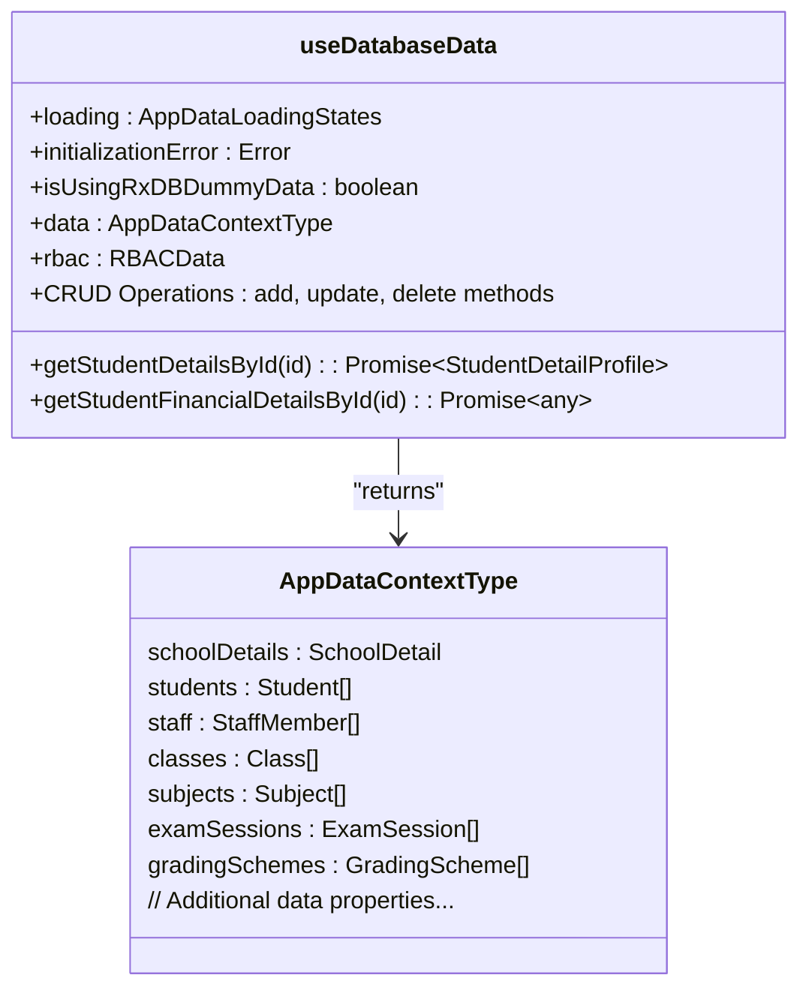

**Diagram sources**
- [useDatabaseData.ts:86-1958](file://src/hooks/useDatabaseData.ts#L86-L1958)

**Section sources**
- [useDatabaseData.ts:86-1958](file://src/hooks/useDatabaseData.ts#L86-L1958)

### Data Change Notification Flow
The event-driven architecture ensures that UI components are promptly notified of data changes, providing a responsive user experience.

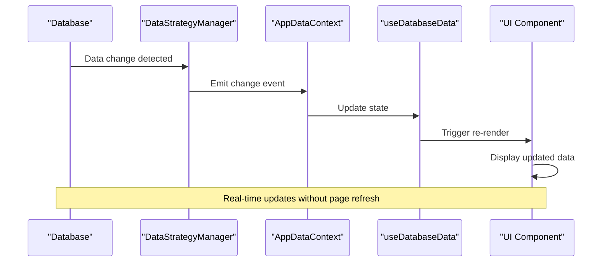

**Diagram sources**
- [useDatabaseData.ts:86-1958](file://src/hooks/useDatabaseData.ts#L86-L1958)
- [DataStrategyManager.ts:43-573](file://src/services/DataStrategyManager.ts#L43-L573)

## Error Handling and Retry Mechanisms

### Enhanced Retry Mechanisms and Exponential Backoff
The system implements robust error handling with exponential backoff strategies to handle transient failures and network issues. The OfflineQueue now provides sophisticated retry logic with configurable strategies.

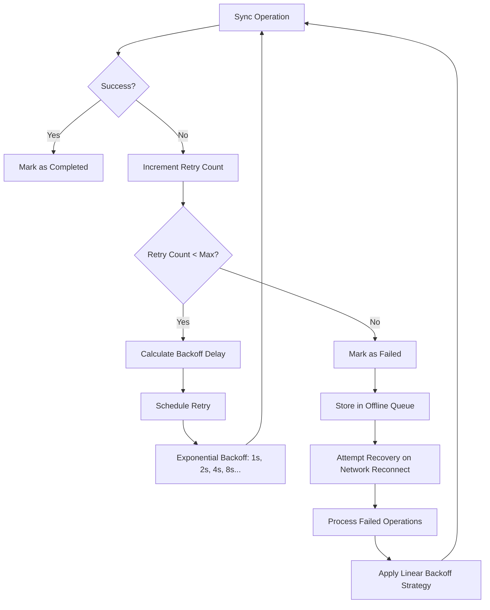

**Diagram sources**
- [OfflineQueue.ts:328-335](file://src/services/database/sync/OfflineQueue.ts#L328-L335)

**Section sources**
- [OfflineQueue.ts:1-458](file://src/services/database/sync/OfflineQueue.ts#L1-L458)

### Offline Queue Management
The system maintains a persistent queue of operations when offline, ensuring data integrity and synchronization when connectivity is restored. The OfflineQueue provides IndexedDB persistence and sophisticated priority-based processing.

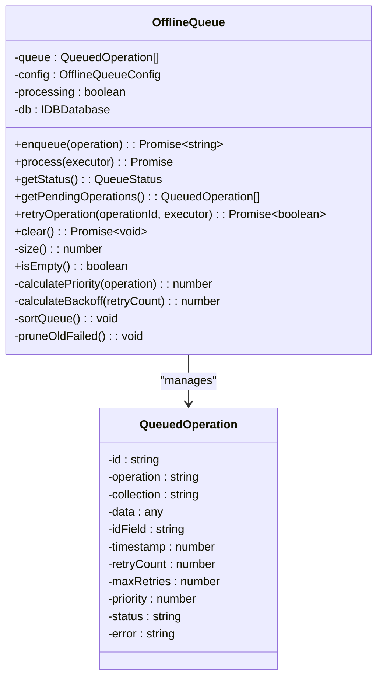

**Diagram sources**
- [OfflineQueue.ts:66-457](file://src/services/database/sync/OfflineQueue.ts#L66-L457)

**Section sources**
- [OfflineQueue.ts:1-458](file://src/services/database/sync/OfflineQueue.ts#L1-L458)

## Performance and Consistency Guarantees

### Data Consistency and Eventual Consistency
The system balances strong consistency requirements with the realities of distributed systems through an eventual consistency model.

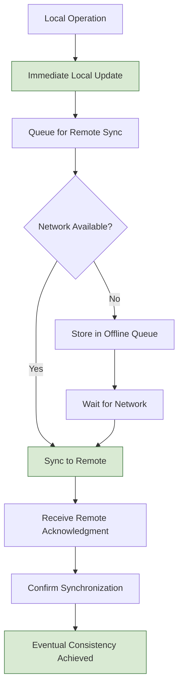

**Diagram sources**
- [SyncManager.ts:169-200](file://src/services/database/sync/SyncManager.ts#L169-L200)

**Section sources**
- [SyncManager.ts:1-387](file://src/services/database/sync/SyncManager.ts#L1-L387)

### Performance Monitoring and Metrics
The DataSyncMonitoringService collects comprehensive metrics to ensure optimal performance and identify potential issues.

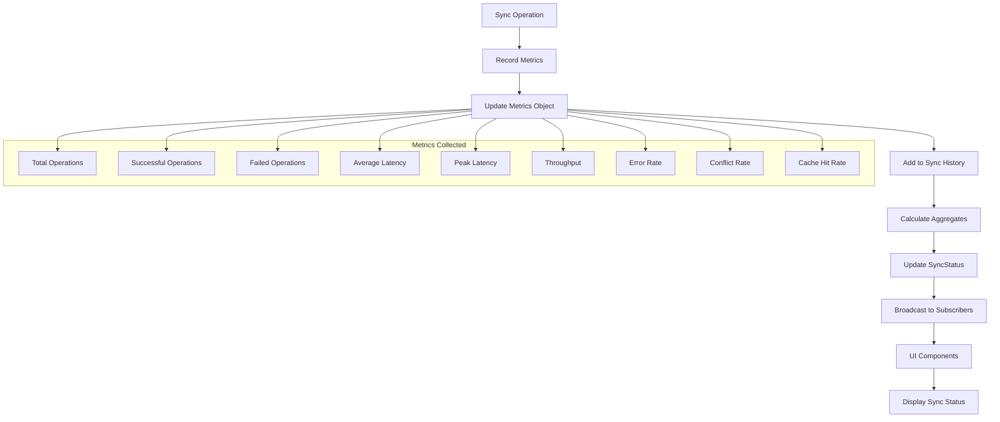

**Diagram sources**
- [DataSyncMonitoringService.ts:80-479](file://src/services/DataSyncMonitoringService.ts#L80-L479)

**Section sources**
- [DataSyncMonitoringService.ts:80-479](file://src/services/DataSyncMonitoringService.ts#L80-L479)

## Provider Selection and Fallback Mechanism

The system implements an enhanced provider selection mechanism that ensures database availability across different environments. The ProviderSelector dynamically chooses the most appropriate database provider based on environmental capabilities and requirements.

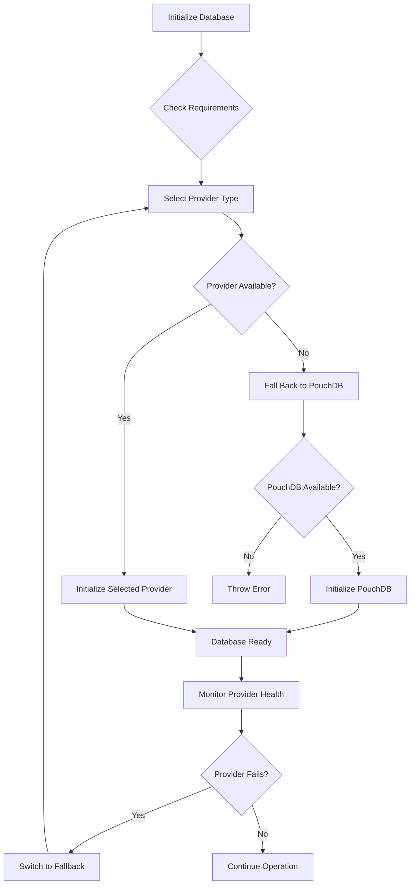

**Section sources**
- [ProviderSelector.ts:0-449](file://src/services/database/ProviderSelector.ts#L0-L449)
- [DatabaseProviderFactory.ts:291-321](file://src/services/database/DatabaseProviderFactory.ts#L291-L321)