# Data Synchronization Workflow

<cite>
**Referenced Files in This Document**
- [SyncManager.ts:1-523](file://src/services/sync/SyncManager.ts#L1-L523)
- [ConflictResolver.ts:1-248](file://src/services/sync/ConflictResolver.ts#L1-L248)
- [NetworkMonitor.ts:1-217](file://src/services/database/sync/NetworkMonitor.ts#L1-L217)
- [OfflineQueue.ts:1-458](file://src/services/database/sync/OfflineQueue.ts#L1-L458)
- [DataSyncMonitoringService.ts:1-483](file://src/services/DataSyncMonitoringService.ts#L1-L483)
- [NetworkStateManager.ts:1-234](file://src/services/NetworkStateManager.ts#L1-L234)
- [DataStrategyManager.ts:1-574](file://src/services/DataStrategyManager.ts#L1-L574)
- [useDatabaseData.ts:1-2121](file://src/hooks/useDatabaseData.ts#L1-L2121)
- [ConflictDetectionEngine.ts:1-259](file://src/modules/academics/services/ConflictDetectionEngine.ts#L1-L259)
</cite>

## Update Summary
**Changes Made**
- Added comprehensive synchronization infrastructure documentation including SyncManager, ConflictResolver, NetworkMonitor, and OfflineQueue components
- Enhanced sync workflow with new centralized SyncManager coordinating all synchronization operations
- Documented new conflict resolution strategies including merge, manual, and timestamp-based approaches
- Added network state monitoring with NetworkMonitor providing real-time connectivity tracking
- Documented offline queue management with IndexedDB persistence and exponential backoff retry strategies
- Updated architecture diagrams to reflect new component relationships and data flow
- Enhanced error handling and retry mechanisms with comprehensive backoff strategies
- Added bandwidth optimization features including compression and slow connection handling

## Table of Contents
1. [Introduction](#introduction)
2. [Architecture Overview](#architecture-overview)
3. [Core Components](#core-components)
4. [Data Synchronization Process](#data-synchronization-process)
5. [Conflict Detection and Resolution](#conflict-detection-and-resolution)
6. [Event-Driven Architecture and UI Integration](#event-driven-architecture-and-ui-integration)
7. [Error Handling and Retry Mechanisms](#error-handling-and-retry-mechanisms)
8. [Performance and Consistency Guarantees](#performance-and-consistency-guarantees)
9. [Network Monitoring and Connectivity Management](#network-monitoring-and-connectivity-management)
10. [Offline Queue Management](#offline-queue-management)
11. [Bandwidth Optimization](#bandwidth-optimization)

## Introduction
The schoolpilot3 application implements a comprehensive bidirectional data synchronization workflow featuring a new centralized synchronization infrastructure. This system provides robust offline-first capabilities with real-time conflict resolution, intelligent retry mechanisms, and extensive monitoring. The architecture supports multiple synchronization strategies, network-aware operations, and maintains data consistency across local databases (RxDB/SQLite) and remote CouchDB instances via PouchDB.

## Architecture Overview

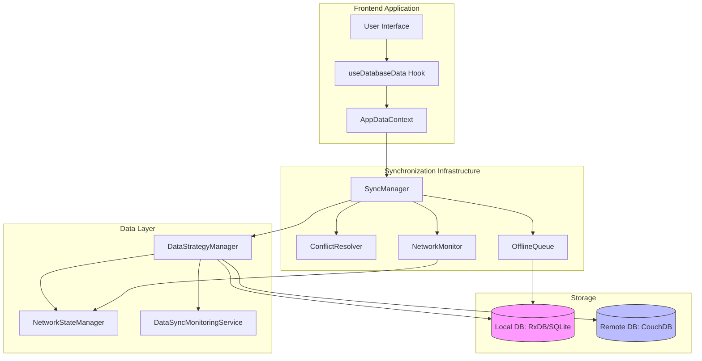

**Diagram sources**
- [SyncManager.ts:1-523](file://src/services/sync/SyncManager.ts#L1-L523)
- [ConflictResolver.ts:1-248](file://src/services/sync/ConflictResolver.ts#L1-L248)
- [NetworkMonitor.ts:1-217](file://src/services/database/sync/NetworkMonitor.ts#L1-L217)
- [OfflineQueue.ts:1-458](file://src/services/database/sync/OfflineQueue.ts#L1-L458)
- [DataStrategyManager.ts:1-574](file://src/services/DataStrategyManager.ts#L1-L574)
- [NetworkStateManager.ts:1-234](file://src/services/NetworkStateManager.ts#L1-L234)
- [DataSyncMonitoringService.ts:1-483](file://src/services/DataSyncMonitoringService.ts#L1-L483)

## Core Components

### SyncManager - Central Synchronization Coordinator
The SyncManager serves as the central coordinator for all synchronization operations, managing provider registration, conflict resolution, bandwidth optimization, and background sync capabilities.

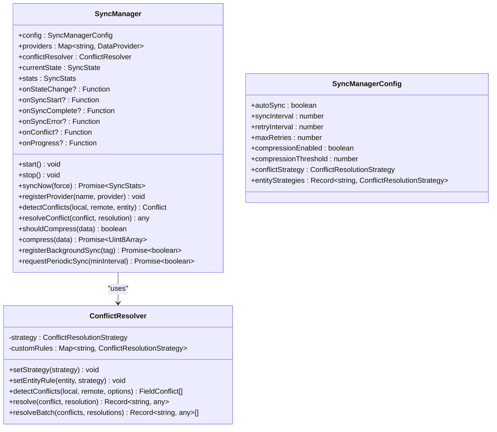

**Diagram sources**
- [SyncManager.ts:1-523](file://src/services/sync/SyncManager.ts#L1-L523)
- [ConflictResolver.ts:1-248](file://src/services/sync/ConflictResolver.ts#L1-L248)

**Section sources**
- [SyncManager.ts:1-523](file://src/services/sync/SyncManager.ts#L1-L523)
- [ConflictResolver.ts:1-248](file://src/services/sync/ConflictResolver.ts#L1-L248)

### NetworkMonitor - Real-Time Network Connectivity
The NetworkMonitor provides comprehensive network status detection with singleton pattern implementation, emitting real-time online/offline events and connection quality metrics.

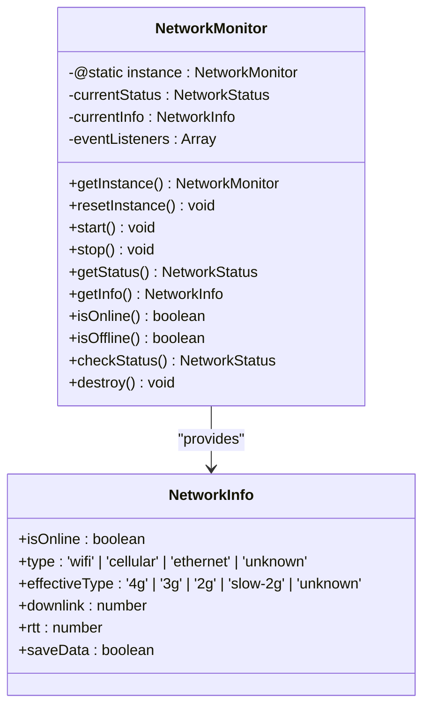

**Diagram sources**
- [NetworkMonitor.ts:1-217](file://src/services/database/sync/NetworkMonitor.ts#L1-L217)

**Section sources**
- [NetworkMonitor.ts:1-217](file://src/services/database/sync/NetworkMonitor.ts#L1-L217)

### OfflineQueue - Persistent Offline Operation Queue
The OfflineQueue manages queued operations with IndexedDB persistence, supporting priority-based processing, exponential backoff retry strategies, and comprehensive queue status tracking.

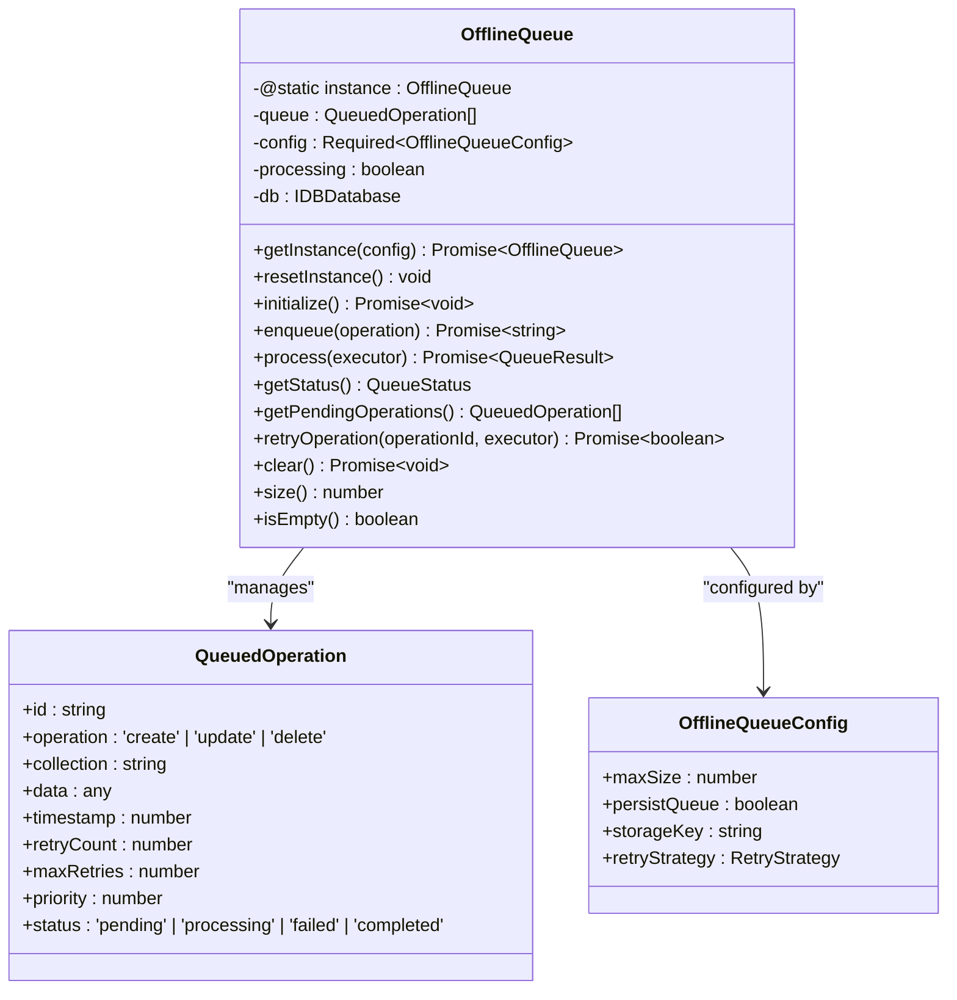

**Diagram sources**
- [OfflineQueue.ts:1-458](file://src/services/database/sync/OfflineQueue.ts#L1-L458)

**Section sources**
- [OfflineQueue.ts:1-458](file://src/services/database/sync/OfflineQueue.ts#L1-L458)

## Data Synchronization Process

### Enhanced Bidirectional Sync Workflow
The new synchronization workflow centers around the SyncManager which coordinates all sync operations, conflict resolution, and network-aware processing.

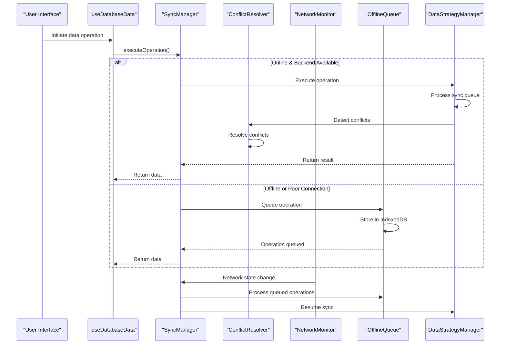

**Diagram sources**
- [SyncManager.ts:1-523](file://src/services/sync/SyncManager.ts#L1-L523)
- [useDatabaseData.ts:1-2121](file://src/hooks/useDatabaseData.ts#L1-L2121)
- [NetworkMonitor.ts:1-217](file://src/services/database/sync/NetworkMonitor.ts#L1-L217)
- [OfflineQueue.ts:1-458](file://src/services/database/sync/OfflineQueue.ts#L1-L458)
- [DataStrategyManager.ts:1-574](file://src/services/DataStrategyManager.ts#L1-L574)

**Section sources**
- [SyncManager.ts:1-523](file://src/services/sync/SyncManager.ts#L1-L523)
- [useDatabaseData.ts:1-2121](file://src/hooks/useDatabaseData.ts#L1-L2121)
- [NetworkMonitor.ts:1-217](file://src/services/database/sync/NetworkMonitor.ts#L1-L217)
- [OfflineQueue.ts:1-458](file://src/services/database/sync/OfflineQueue.ts#L1-L458)
- [DataStrategyManager.ts:1-574](file://src/services/DataStrategyManager.ts#L1-L574)

### Batch Processing and Queue Management
The system implements intelligent batch processing with priority-based ordering and exponential backoff retry mechanisms.

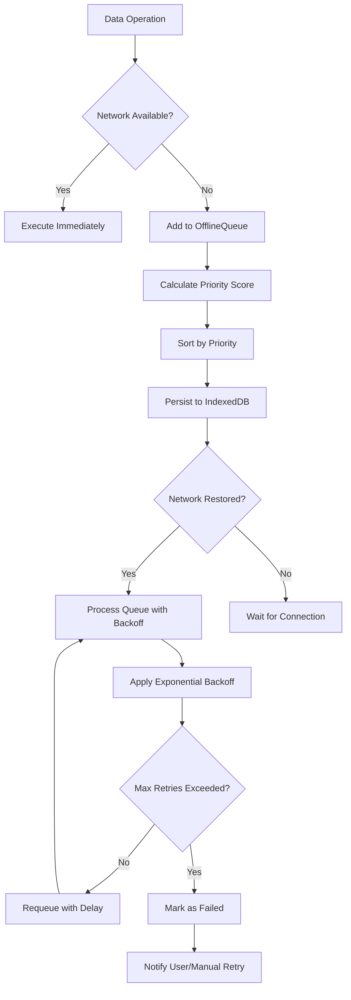

**Diagram sources**
- [OfflineQueue.ts:1-458](file://src/services/database/sync/OfflineQueue.ts#L1-L458)
- [DataStrategyManager.ts:1-574](file://src/services/DataStrategyManager.ts#L1-L574)

**Section sources**
- [OfflineQueue.ts:1-458](file://src/services/database/sync/OfflineQueue.ts#L1-L458)
- [DataStrategyManager.ts:1-574](file://src/services/DataStrategyManager.ts#L1-L574)

## Conflict Detection and Resolution

### Comprehensive Conflict Resolution System
The new conflict resolution system provides multiple strategies with entity-specific customization and detailed conflict tracking.

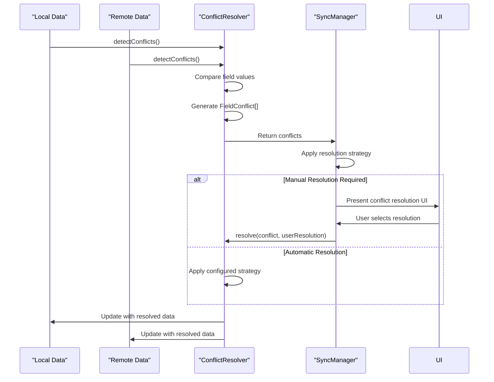

**Diagram sources**
- [ConflictResolver.ts:1-248](file://src/services/sync/ConflictResolver.ts#L1-L248)
- [SyncManager.ts:1-523](file://src/services/sync/SyncManager.ts#L1-L523)

**Section sources**
- [ConflictResolver.ts:1-248](file://src/services/sync/ConflictResolver.ts#L1-L248)
- [SyncManager.ts:1-523](file://src/services/sync/SyncManager.ts#L1-L523)

### Conflict Resolution Strategies
The system supports multiple conflict resolution strategies with entity-specific overrides and detailed resolution tracking.

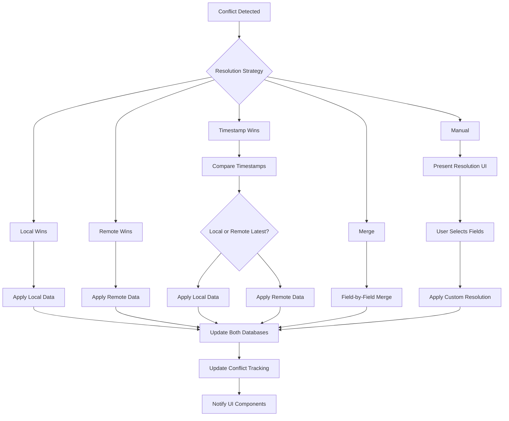

**Section sources**
- [ConflictResolver.ts:1-248](file://src/services/sync/ConflictResolver.ts#L1-L248)
- [DataSyncMonitoringService.ts:1-483](file://src/services/DataSyncMonitoringService.ts#L1-L483)

## Event-Driven Architecture and UI Integration

### Enhanced useDatabaseData Hook Integration
The useDatabaseData hook now integrates with the new synchronization infrastructure for real-time data updates and conflict resolution notifications.

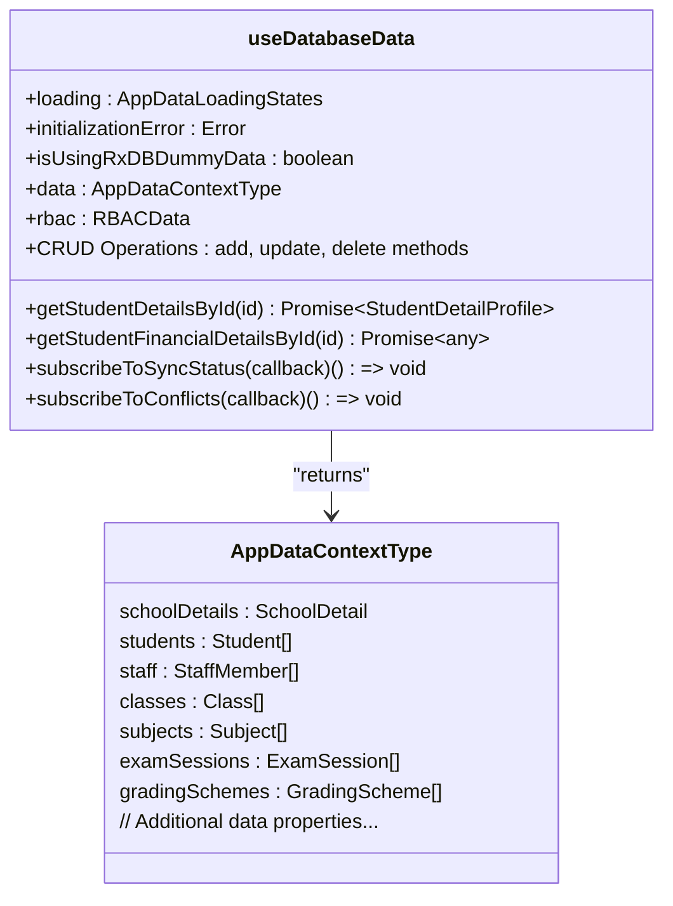

**Diagram sources**
- [useDatabaseData.ts:1-2121](file://src/hooks/useDatabaseData.ts#L1-L2121)

**Section sources**
- [useDatabaseData.ts:1-2121](file://src/hooks/useDatabaseData.ts#L1-L2121)

### Data Change Notification Flow
The event-driven architecture ensures UI components receive real-time updates from all synchronization activities.

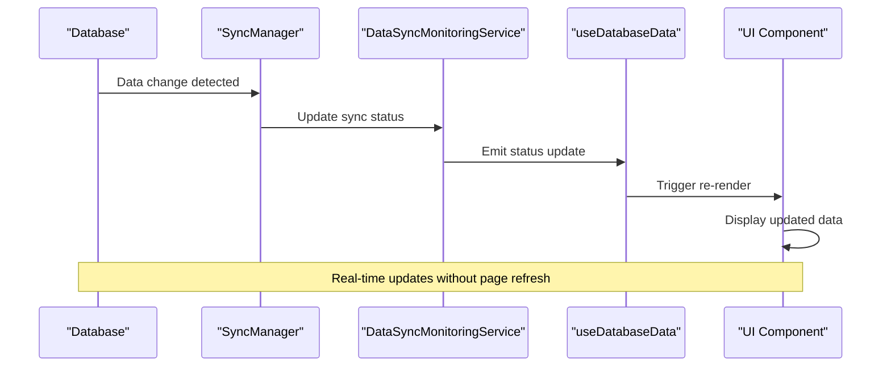

**Diagram sources**
- [SyncManager.ts:1-523](file://src/services/sync/SyncManager.ts#L1-L523)
- [DataSyncMonitoringService.ts:1-483](file://src/services/DataSyncMonitoringService.ts#L1-L483)
- [useDatabaseData.ts:1-2121](file://src/hooks/useDatabaseData.ts#L1-L2121)

## Error Handling and Retry Mechanisms

### Advanced Retry Strategies with Exponential Backoff
The system implements sophisticated error handling with configurable retry strategies and comprehensive error tracking.

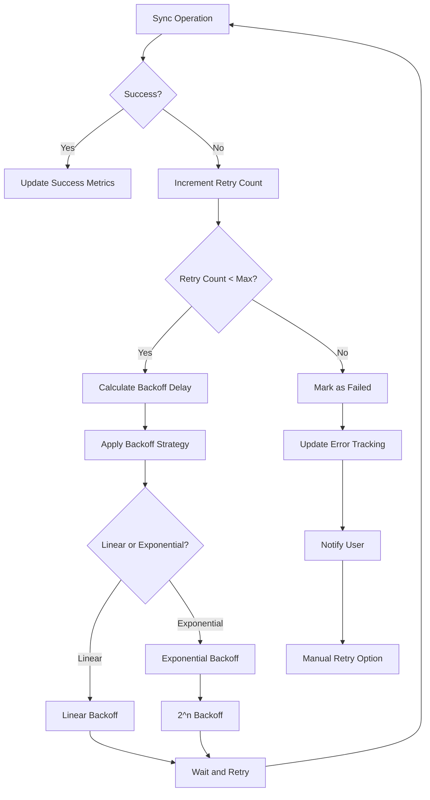

**Diagram sources**
- [OfflineQueue.ts:1-458](file://src/services/database/sync/OfflineQueue.ts#L1-L458)
- [DataStrategyManager.ts:1-574](file://src/services/DataStrategyManager.ts#L1-L574)

**Section sources**
- [OfflineQueue.ts:1-458](file://src/services/database/sync/OfflineQueue.ts#L1-L458)
- [DataStrategyManager.ts:1-574](file://src/services/DataStrategyManager.ts#L1-L574)

### Comprehensive Error Tracking and Resolution
The DataSyncMonitoringService provides detailed error tracking with resolution capabilities and performance metrics.

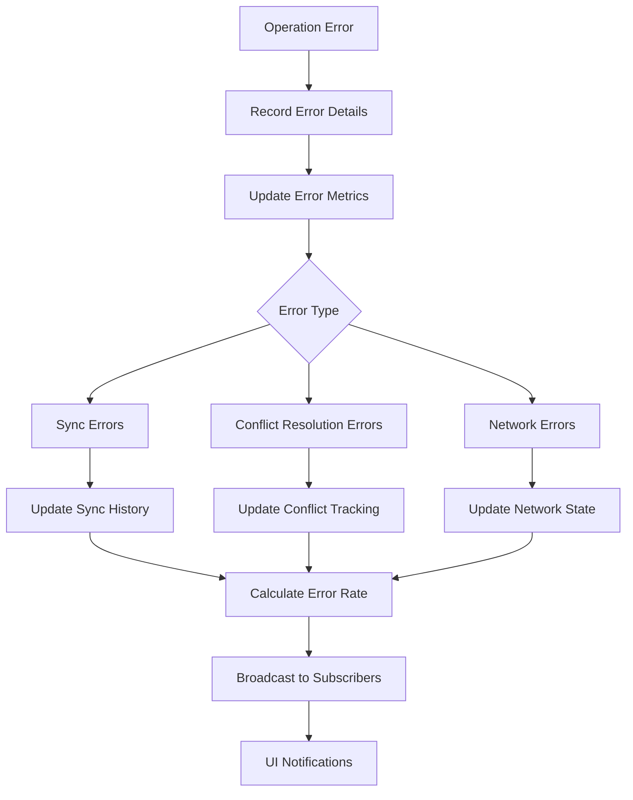

**Diagram sources**
- [DataSyncMonitoringService.ts:1-483](file://src/services/DataSyncMonitoringService.ts#L1-L483)

**Section sources**
- [DataSyncMonitoringService.ts:1-483](file://src/services/DataSyncMonitoringService.ts#L1-L483)

## Performance and Consistency Guarantees

### Data Consistency and Eventual Consistency Model
The system maintains strong consistency requirements while providing eventual consistency through intelligent conflict resolution and synchronization strategies.

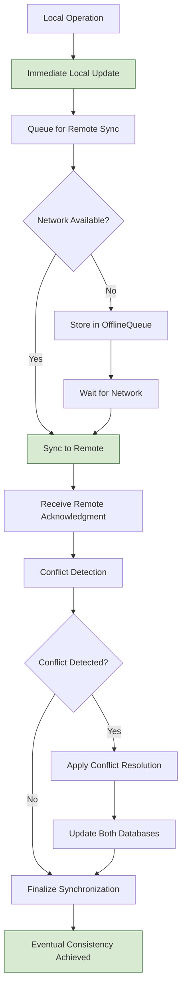

**Diagram sources**
- [SyncManager.ts:1-523](file://src/services/sync/SyncManager.ts#L1-L523)
- [ConflictResolver.ts:1-248](file://src/services/sync/ConflictResolver.ts#L1-L248)
- [OfflineQueue.ts:1-458](file://src/services/database/sync/OfflineQueue.ts#L1-L458)

**Section sources**
- [SyncManager.ts:1-523](file://src/services/sync/SyncManager.ts#L1-L523)
- [ConflictResolver.ts:1-248](file://src/services/sync/ConflictResolver.ts#L1-L248)
- [OfflineQueue.ts:1-458](file://src/services/database/sync/OfflineQueue.ts#L1-L458)

### Performance Monitoring and Metrics Collection
The enhanced monitoring system tracks comprehensive performance metrics and provides real-time insights into synchronization performance.

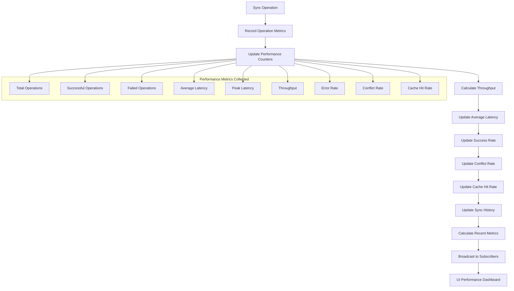

**Diagram sources**
- [DataSyncMonitoringService.ts:1-483](file://src/services/DataSyncMonitoringService.ts#L1-L483)

**Section sources**
- [DataSyncMonitoringService.ts:1-483](file://src/services/DataSyncMonitoringService.ts#L1-L483)

## Network Monitoring and Connectivity Management

### Real-Time Network State Management
The NetworkMonitor provides comprehensive network connectivity monitoring with detailed connection quality metrics and automatic reconnection handling.

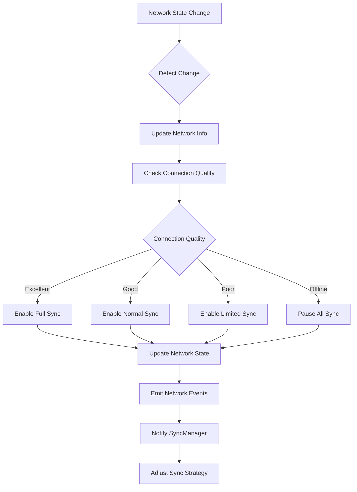

**Diagram sources**
- [NetworkMonitor.ts:1-217](file://src/services/database/sync/NetworkMonitor.ts#L1-L217)
- [NetworkStateManager.ts:1-234](file://src/services/NetworkStateManager.ts#L1-L234)

**Section sources**
- [NetworkMonitor.ts:1-217](file://src/services/database/sync/NetworkMonitor.ts#L1-L217)
- [NetworkStateManager.ts:1-234](file://src/services/NetworkStateManager.ts#L1-L234)

### Network-Aware Synchronization
The system adapts synchronization behavior based on network conditions, connection type, and bandwidth constraints.

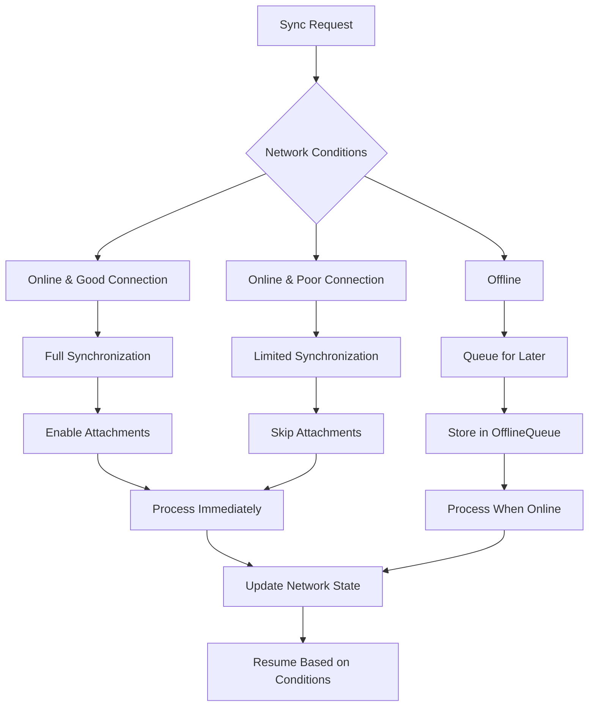

**Section sources**
- [SyncManager.ts:1-523](file://src/services/sync/SyncManager.ts#L1-L523)
- [NetworkMonitor.ts:1-217](file://src/services/database/sync/NetworkMonitor.ts#L1-L217)

## Offline Queue Management

### Persistent Offline Operation Queue
The OfflineQueue provides comprehensive offline operation management with IndexedDB persistence, priority-based processing, and intelligent retry mechanisms.

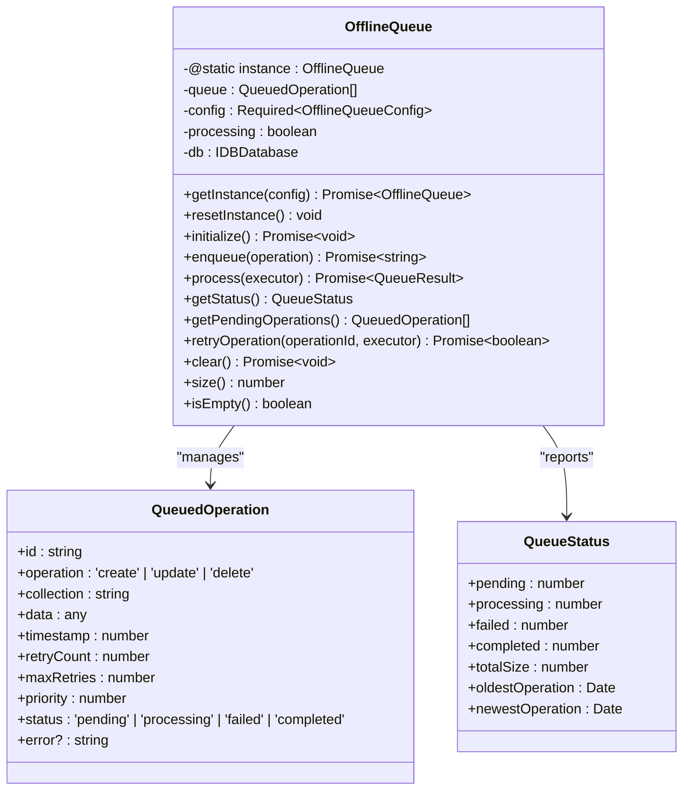

**Diagram sources**
- [OfflineQueue.ts:1-458](file://src/services/database/sync/OfflineQueue.ts#L1-L458)

**Section sources**
- [OfflineQueue.ts:1-458](file://src/services/database/sync/OfflineQueue.ts#L1-L458)

### Queue Processing and Recovery
The system provides robust queue processing with automatic recovery from crashes and comprehensive status tracking.

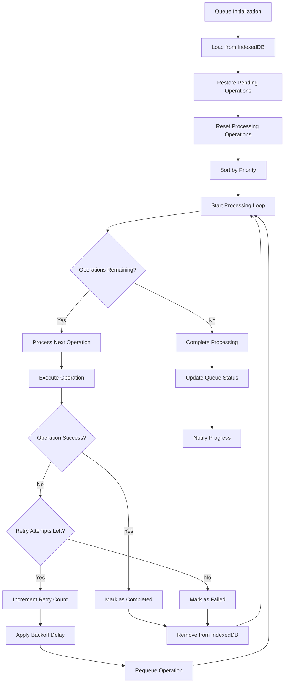

**Diagram sources**
- [OfflineQueue.ts:1-458](file://src/services/database/sync/OfflineQueue.ts#L1-L458)

**Section sources**
- [OfflineQueue.ts:1-458](file://src/services/database/sync/OfflineQueue.ts#L1-L458)

## Bandwidth Optimization

### Intelligent Bandwidth Management
The SyncManager implements comprehensive bandwidth optimization including compression, selective attachment handling, and connection-aware data transfer.

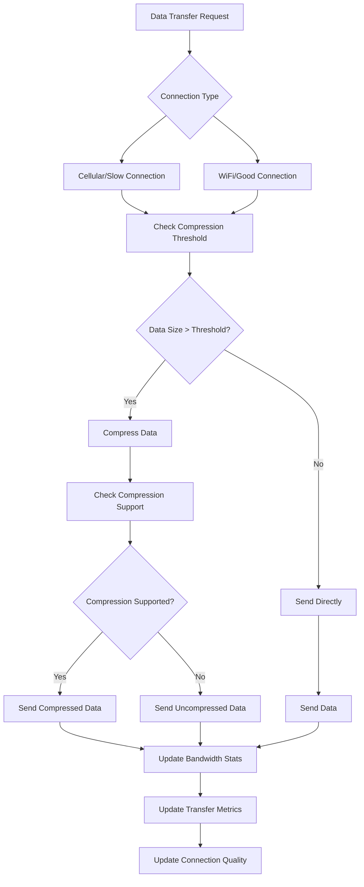

**Diagram sources**
- [SyncManager.ts:1-523](file://src/services/sync/SyncManager.ts#L1-L523)

**Section sources**
- [SyncManager.ts:1-523](file://src/services/sync/SyncManager.ts#L1-L523)

### Connection-Aware Data Transfer
The system intelligently adapts data transfer behavior based on connection quality, battery level, and network constraints.

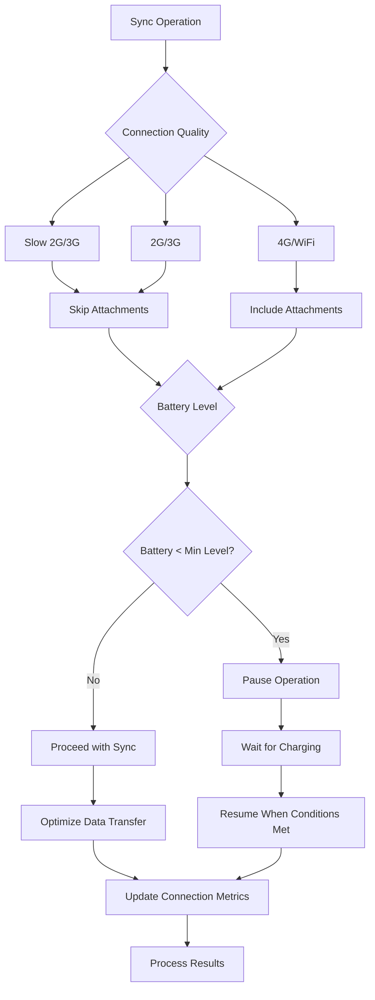

**Section sources**
- [SyncManager.ts:1-523](file://src/services/sync/SyncManager.ts#L1-L523)
- [NetworkMonitor.ts:1-217](file://src/services/database/sync/NetworkMonitor.ts#L1-L217)