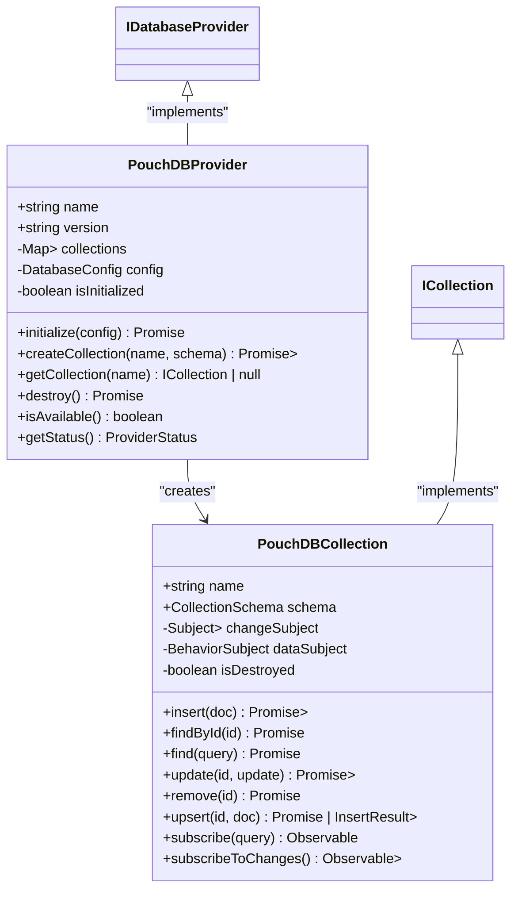
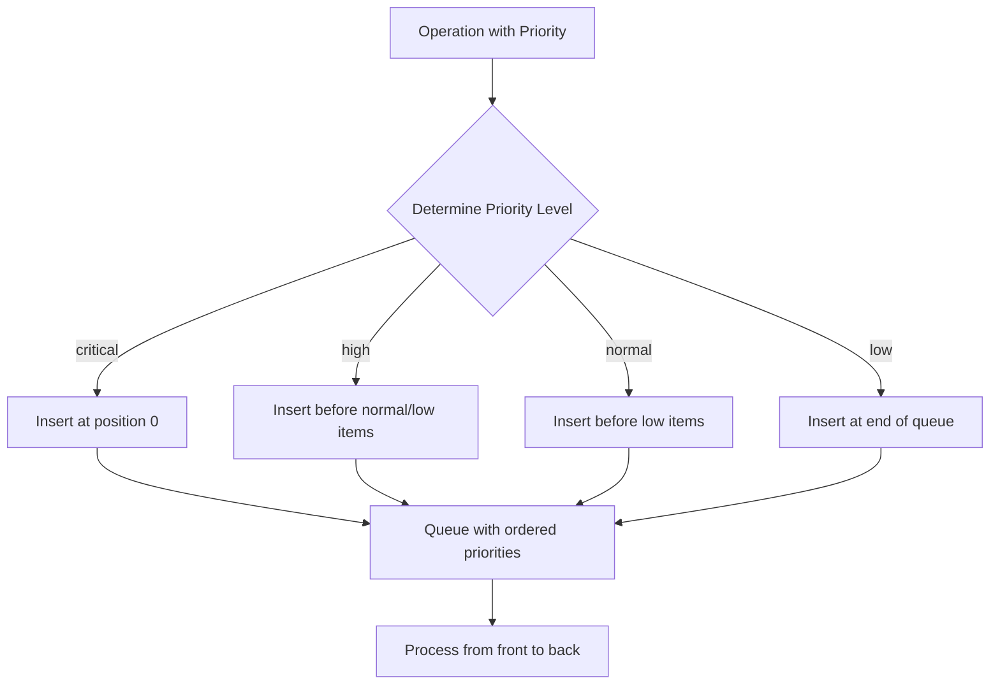
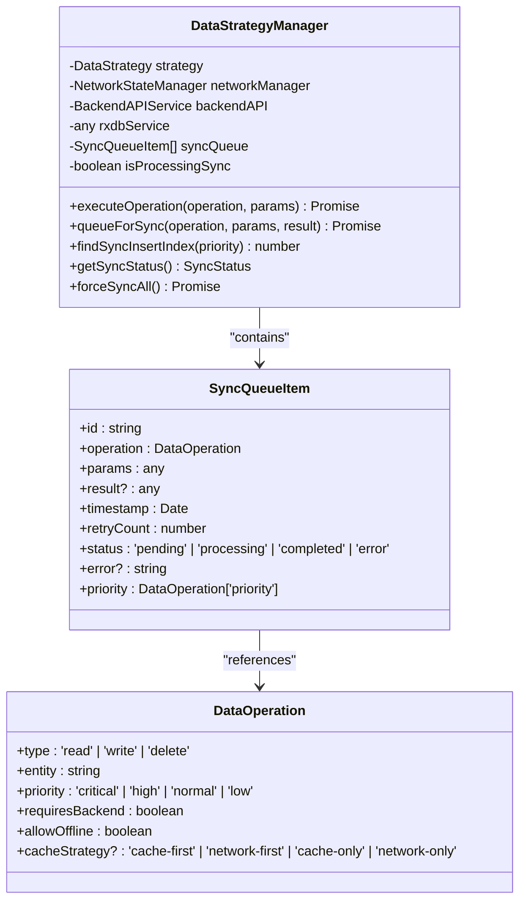
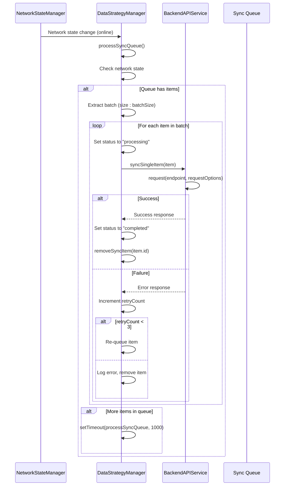
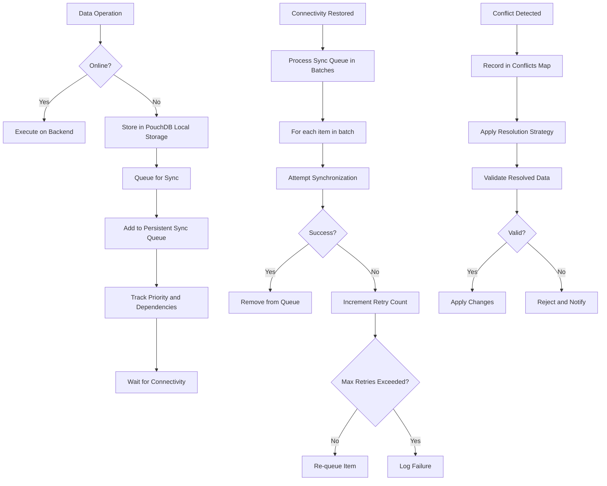

# Offline Queue Management

<cite>
**Referenced Files in This Document**   
- [DataSyncMonitoringService.ts](file://src/services/DataSyncMonitoringService.ts)
- [DataStrategyManager.ts](file://src/services/DataStrategyManager.ts)
- [PouchDBProvider.ts](file://src/services/database/PouchDBProvider.ts)
- [SyncContext.tsx](file://src/contexts/SyncContext.tsx)
- [OfflineCapability.tsx](file://src/components/OfflineCapability.tsx)
</cite>

## Table of Contents
1. [Introduction](#introduction)
2. [Local Change Queuing with PouchDB](#local-change-queuing-with-pouchdb)
3. [Queue Prioritization and Dependency Tracking](#queue-prioritization-and-dependency-tracking)
4. [Rehydration Process and Batch Submission](#rehydration-process-and-batch-submission)
5. [DataSyncMonitoringService: Queue Metrics and Status Tracking](#datasyncmonitoringservice-queue-metrics-and-status-tracking)
6. [Custom Queuing Policies and Monitoring Examples](#custom-queuing-policies-and-monitoring-examples)
7. [Data Integrity Safeguards](#data-integrity-safeguards)
8. [Conclusion](#conclusion)

## Introduction
The schoolpilot3 application implements a robust offline queue management system that enables uninterrupted operation during network outages. This system leverages PouchDB for local storage, implements intelligent prioritization of queued operations, and provides comprehensive monitoring through the DataSyncMonitoringService. The architecture ensures data integrity during extended offline periods and handles complex synchronization scenarios when connectivity is restored.

**Section sources**
- [DataSyncMonitoringService.ts](file://src/services/DataSyncMonitoringService.ts)
- [DataStrategyManager.ts](file://src/services/DataStrategyManager.ts)

## Local Change Queuing with PouchDB

The offline queue management system in schoolpilot3 utilizes PouchDB as the primary local storage mechanism for queuing changes during offline periods. When network connectivity is lost, all data operations are automatically redirected to PouchDB's local IndexedDB storage, ensuring that user actions can continue without interruption.

The `PouchDBProvider` class serves as the interface between the application and PouchDB, implementing the `IDatabaseProvider` interface with comprehensive CRUD operations. When a write operation occurs offline, the system creates a local document in PouchDB with metadata including revision tracking (_rev) and document ID (_id). The provider automatically transforms application-level documents to PouchDB format by mapping the `id` field to `_id` and removing the `_rev` field from the returned data.



**Diagram sources**
- [PouchDBProvider.ts](file://src/services/database/PouchDBProvider.ts)

**Section sources**
- [PouchDBProvider.ts](file://src/services/database/PouchDBProvider.ts)

## Queue Prioritization and Dependency Tracking

The offline queue management system implements a sophisticated prioritization mechanism that ensures critical operations are processed first when connectivity is restored. The `DataStrategyManager` class manages the sync queue and implements priority-based ordering using a priority scale: critical (0), high (1), normal (2), and low (3).

When operations are queued for synchronization, they are inserted at the appropriate position based on their priority level. The `findSyncInsertIndex` method determines the insertion point by comparing the priority of the new item with existing queue items, ensuring that higher-priority items are processed first.



The system also tracks dependencies between related records through its execution planning mechanism. When an operation requires backend processing but is executed locally due to offline status, the `deferredBackend` flag is set to true, creating a dependency that must be resolved when connectivity is restored. The `DataOperation` interface includes fields for tracking entity relationships and operation types, enabling the system to maintain referential integrity.



**Diagram sources**
- [DataStrategyManager.ts](file://src/services/DataStrategyManager.ts)

**Section sources**
- [DataStrategyManager.ts](file://src/services/DataStrategyManager.ts)

## Rehydration Process and Batch Submission

When network connectivity is restored, the system initiates a rehydration process to synchronize queued operations with the backend server. This process is managed by the `processSyncQueue` method in the `DataStrategyManager` class, which operates as a batched submission system.

The rehydration process follows these steps:
1. Check network availability and backend accessibility
2. Process the sync queue in batches (default size: 10 operations)
3. For each item in the batch:
   - Mark as "processing"
   - Attempt synchronization with the backend
   - On success, mark as "completed" and remove from persistent queue
   - On failure, increment retry count and re-queue (up to 3 attempts)



Error handling is implemented with exponential backoff and retry logic. Each failed operation is retried up to three times before being permanently removed from the queue and logged as a failure. The system also implements conflict resolution through the `DataSyncMonitoringService`, which detects and resolves conflicts between local and remote data versions.

**Diagram sources**
- [DataStrategyManager.ts](file://src/services/DataStrategyManager.ts)

**Section sources**
- [DataStrategyManager.ts](file://src/services/DataStrategyManager.ts)

## DataSyncMonitoringService: Queue Metrics and Status Tracking

The `DataSyncMonitoringService` provides comprehensive monitoring of the offline queue, tracking key metrics such as queue depth, age, and processing status. This service acts as a central hub for synchronization monitoring and conflict resolution.

The service maintains several key data structures:
- **SyncQueue**: Tracks pending, processing, completed, and failed operations
- **Conflicts**: Manages detected synchronization conflicts
- **Errors**: Records synchronization errors with timestamps and context
- **Metrics**: Collects performance data including latency, throughput, and success rates

```mermaid
classDiagram
class DataSyncMonitoringService {
-DataStrategyManager dataStrategyManager
-NetworkStateManager networkManager
-Map<string, SyncConflict> conflicts
-SyncError[] errors
-SyncMetrics metrics
-Array<{timestamp : Date, duration : number, success : boolean}> syncHistory
-Array<(status : SyncStatus) => void> subscribers
-NodeJS.Timeout monitoringInterval
+getSyncStatus() SyncStatus
+recordConflict(entityName, entityId, conflictType, localData, remoteData) string
+resolveConflict(conflictId, resolution) Promise<boolean>
+recordError(operation, entityId, error) void
+subscribe(callback) () => void
+forceSyncAll() Promise<void>
+destroy() void
}
class SyncStatus {
+isActive : boolean
+mode : 'idle' | 'syncing' | 'paused' | 'error'
+progress : {current, total, percentage}
+queue : {pending, processing, completed, failed, byPriority}
+conflicts : {total, unresolved, byType}
+lastSync : Date | null
+nextSync : Date | null
+errors : SyncError[]
+performance : {averageSyncTime, successRate, throughput}
}
class SyncConflict {
+id : string
+entityName : string
+entityId : string | number
+conflictType : 'version' | 'concurrent_edit' | 'deleted_locally' | 'deleted_remotely'
+localData : any
+remoteData : any
+timestamp : Date
+resolved : boolean
+resolution? : ConflictResolution
}
class ConflictResolution {
+strategy : 'local_wins' | 'remote_wins' | 'merge' | 'manual'
+resolvedData? : any
+resolvedBy? : string
+resolvedAt : Date
+notes? : string
}
class SyncError {
+id : string
+timestamp : Date
+entityName : string
+entityId? : string | number
+operation : 'create' | 'update' | 'delete' | 'sync'
+error : string
+retryCount : number
+resolved : boolean
}
class SyncMetrics {
+totalOperations : number
+successfulOperations : number
+failedOperations : number
+averageLatency : number
+peakLatency : number
+throughput : number
+errorRate : number
+conflictRate : number
+cacheHitRate : number
}
DataSyncMonitoringService --> SyncStatus : "returns"
DataSyncMonitoringService --> SyncConflict : "manages"
DataSyncMonitoringService --> ConflictResolution : "uses"
DataSyncMonitoringService --> SyncError : "records"
DataSyncMonitoringService --> SyncMetrics : "tracks"
```

The service updates metrics every 5 seconds and notifies subscribers of status changes. It calculates key performance indicators such as:
- **Throughput**: Operations per minute based on the last 60 seconds of activity
- **Success Rate**: Percentage of successful sync operations in the last 10 attempts
- **Average Sync Time**: Mean duration of the last 10 successful sync operations
- **Error Rate**: Ratio of failed operations to total operations

**Diagram sources**
- [DataSyncMonitoringService.ts](file://src/services/DataSyncMonitoringService.ts)

**Section sources**
- [DataSyncMonitoringService.ts](file://src/services/DataSyncMonitoringService.ts)

## Custom Queuing Policies and Monitoring Examples

The offline queue management system supports customizable queuing policies through the `DataStrategy` interface, allowing administrators to configure synchronization behavior based on application requirements. The system supports three primary modes: offline-first, online-first, and hybrid, each with configurable parameters for batch size, sync interval, and conflict resolution.

### Example: Custom Queuing Policy Implementation

```typescript
// Configure a custom synchronization strategy
const customStrategy: DataStrategy = {
  mode: 'offline-first',
  fallbackMode: 'offline',
  syncPolicy: 'batched',
  conflictResolution: 'prompt',
  batchSize: 25,
  syncInterval: 30000 // 30 seconds
};

// Apply the strategy to the DataStrategyManager
dataStrategyManager.updateStrategy(customStrategy);
```

### Example: Monitoring Queue Metrics

```typescript
// Subscribe to sync status updates
const unsubscribe = dataSyncMonitoringService.subscribe((status) => {
  console.log('Sync Status:', {
    mode: status.mode,
    progress: status.progress.percentage,
    pending: status.queue.pending,
    processing: status.queue.processing,
    errors: status.errors.length,
    throughput: status.performance.throughput
  });
  
  // Display queue status in UI
  updateSyncIndicator(status);
});

// Get detailed queue statistics
const metrics = dataSyncMonitoringService.getMetrics();
console.log('Synchronization Metrics:', metrics);

// Get unresolved conflicts
const conflicts = dataSyncMonitoringService.getUnresolvedConflicts();
if (conflicts.length > 0) {
  showConflictResolutionDialog(conflicts);
}
```

### Example: Force Synchronization

```typescript
// Manually trigger synchronization
async function forceSync() {
  try {
    await dataSyncMonitoringService.forceSyncAll();
    showNotification('Synchronization completed successfully');
  } catch (error) {
    showNotification('Synchronization failed: ' + error.message, 'error');
  }
}
```

The system also provides methods to clear resolved conflicts and errors, helping to maintain optimal performance:

```typescript
// Clean up resolved conflicts
dataSyncMonitoringService.clearResolvedConflicts();

// Clear error history
dataSyncMonitoringService.clearErrors();
```

**Section sources**
- [DataSyncMonitoringService.ts](file://src/services/DataSyncMonitoringService.ts)
- [DataStrategyManager.ts](file://src/services/DataStrategyManager.ts)

## Data Integrity Safeguards

The offline queue management system implements multiple safeguards to ensure data integrity during extended offline periods and large queue processing. These safeguards operate at multiple levels of the architecture to prevent data loss and maintain consistency.

### Transactional Integrity
Each synchronization operation is treated as an atomic transaction. When processing a batch, the system processes each item individually and handles failures independently, ensuring that successful operations are not rolled back due to failures in other items.

### Conflict Detection and Resolution
The system detects conflicts through revision tracking and timestamp comparison. When a conflict is detected between local and remote versions of a record, it is recorded in the conflicts map with detailed information about both versions. The conflict resolution strategies include:
- **Local Wins**: Prioritize the locally modified version
- **Remote Wins**: Prioritize the server version
- **Merge**: Combine changes from both versions
- **Manual**: Require user intervention

### Data Validation
Before applying any resolved conflicts, the system validates the data against the entity schema using the `globalDataConsistencyService`. This ensures that merged or resolved data meets all validation requirements before being persisted.

### Persistent Queue Storage
The sync queue is stored persistently in the RxDB database, ensuring that queued operations survive application restarts. Each queue item includes metadata such as timestamp and retry count, enabling the system to prioritize older items and prevent infinite retry loops.

### Performance Protection
For large queues, the system implements batch processing with configurable batch sizes to prevent overwhelming the network or server. The monitoring service tracks throughput and latency, providing feedback that can be used to adjust synchronization parameters dynamically.



**Section sources**
- [DataSyncMonitoringService.ts](file://src/services/DataSyncMonitoringService.ts)
- [DataStrategyManager.ts](file://src/services/DataStrategyManager.ts)
- [PouchDBProvider.ts](file://src/services/database/PouchDBProvider.ts)

## Conclusion
The offline queue management system in schoolpilot3 provides a comprehensive solution for maintaining productivity during network outages. By leveraging PouchDB for local storage, implementing intelligent prioritization, and providing detailed monitoring through the DataSyncMonitoringService, the system ensures data integrity and seamless synchronization. The architecture supports customizable policies, robust error handling, and conflict resolution, making it suitable for educational environments with variable network conditions. This implementation enables users to continue working uninterrupted while ensuring that all changes are safely synchronized when connectivity is restored.