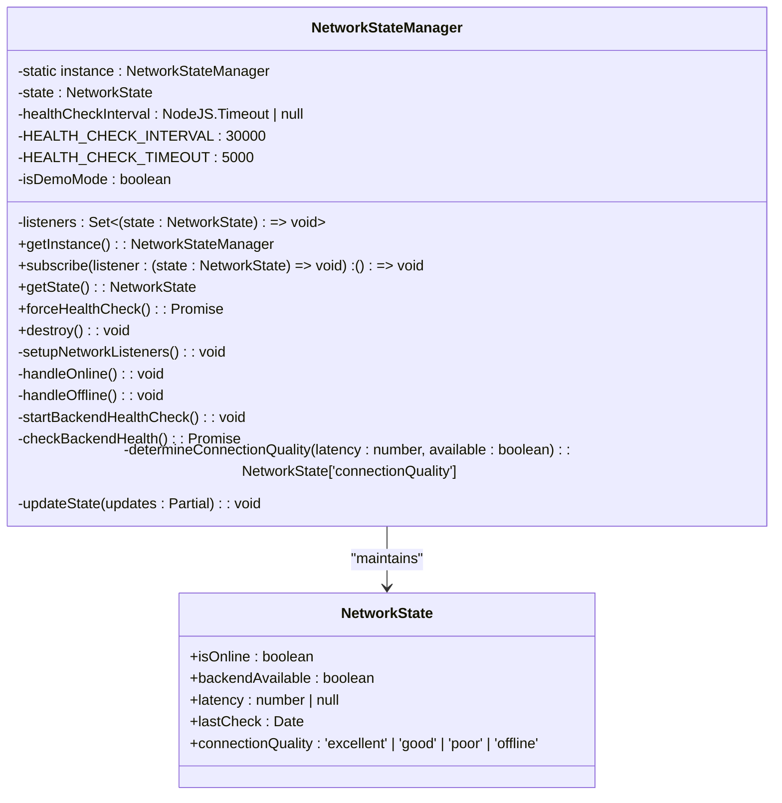
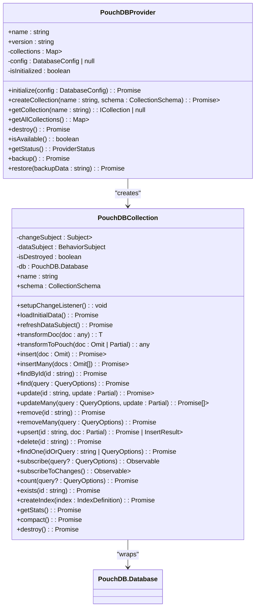
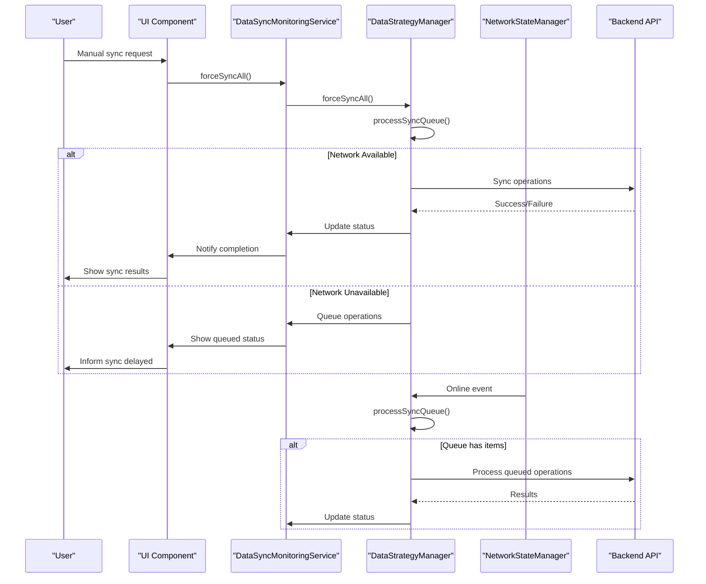

# Sync Initiation Mechanisms

<cite>
**Referenced Files in This Document**   
- [NetworkStateManager.ts](file://src/services/NetworkStateManager.ts#L20-L233)
- [DataStrategyManager.ts](file://src/services/DataStrategyManager.ts#L43-L573)
- [PouchDBProvider.ts](file://src/services/database/PouchDBProvider.ts#L28-L486)
- [DataSyncMonitoringService.ts](file://src/services/DataSyncMonitoringService.ts#L0-L482)
</cite>

## Table of Contents
1. [Introduction](#introduction)
2. [Network State Detection](#network-state-detection)
3. [PouchDB Replication Configuration](#pouchdb-replication-configuration)
4. [Sync Orchestration with DataSyncMonitoringService](#sync-orchestration-with-datasyncmonitoringservice)
5. [Programmatic Sync Triggers](#programmatic-sync-triggers)
6. [Edge Case Handling](#edge-case-handling)

## Introduction
This document details the synchronization initiation mechanisms in schoolpilot3, focusing on how data synchronization is triggered by network state changes, application lifecycle events, and manual user actions. The system employs a sophisticated architecture that combines NetworkStateManager for connectivity monitoring, PouchDB for local data storage, DataStrategyManager for operation routing, and DataSyncMonitoringService for overall sync orchestration. This comprehensive approach ensures reliable data synchronization across various network conditions while maintaining data consistency and providing robust error handling.

## Network State Detection

The NetworkStateManager class is responsible for detecting online/offline transitions and signaling sync readiness through a comprehensive network monitoring system. It implements a singleton pattern to ensure a single source of truth for network state across the application.



**Diagram sources**
- [NetworkStateManager.ts](file://src/services/NetworkStateManager.ts#L20-L233)

**Section sources**
- [NetworkStateManager.ts](file://src/services/NetworkStateManager.ts#L20-L233)

The NetworkStateManager monitors network connectivity through multiple mechanisms:

1. **Browser Event Listeners**: It listens to the native 'online' and 'offline' events from the browser's navigator object to detect when the device connects or disconnects from the network.

2. **Backend Health Checks**: The service performs periodic health checks to the backend API endpoint (/api/health) every 30 seconds when online. These checks have a 5-second timeout to prevent hanging requests.

3. **Connection Quality Assessment**: Based on latency measurements and backend availability, the system categorizes connection quality into four levels:
   - **Excellent**: Latency < 100ms
   - **Good**: Latency < 300ms
   - **Poor**: Latency ≥ 300ms or intermittent connectivity
   - **Offline**: No network connection

4. **Demo Mode Detection**: The system automatically detects demo mode based on environment variables, localhost access, or stored configuration, adjusting its behavior accordingly.

When network state changes, the NetworkStateManager updates its internal state and notifies all registered listeners through the subscribe method. This allows other components, particularly the DataStrategyManager, to react to connectivity changes and initiate appropriate synchronization actions.

## PouchDB Replication Configuration

The PouchDB replication configuration in schoolpilot3 is implemented through the PouchDBCollection class, which provides a wrapper around PouchDB instances with enhanced functionality for the application's needs.



**Diagram sources**
- [PouchDBProvider.ts](file://src/services/database/PouchDBProvider.ts#L28-L486)

**Section sources**
- [PouchDBProvider.ts](file://src/services/database/PouchDBProvider.ts#L28-L486)

The PouchDB replication configuration includes several key features:

1. **Live Replication**: The setupChangeListener method configures PouchDB to listen for changes in real-time with the following settings:
   - **since: 'now'**: Only listen for changes that occur after the listener is established
   - **live: true**: Maintain a continuous connection for real-time updates
   - **include_docs: true**: Include the full document in change events

2. **Change Event Processing**: When changes are detected, the system:
   - Determines the event type (insert, update, or delete) based on revision history
   - Emits events through RxJS Subjects for reactive programming
   - Updates the internal data subject to reflect changes

3. **Data Transformation**: The system handles the transformation between PouchDB's document format and the application's data model:
   - Maps PouchDB's _id field to the application's id property
   - Removes the _rev field from application data
   - Converts application data to PouchDB format during writes

4. **Error Handling**: Comprehensive error handling is implemented for all database operations, with specific error types for different failure scenarios.

5. **Reactive Programming**: The implementation uses RxJS Observables to provide reactive data streams, allowing components to subscribe to data changes and automatically update their state.

## Sync Orchestration with DataSyncMonitoringService

The DataSyncMonitoringService orchestrates sync sessions and manages concurrent replications across multiple collections through a sophisticated queuing and monitoring system.

```mermaid
classDiagram
class DataSyncMonitoringService {
-dataStrategyManager : DataStrategyManager | null
-networkManager : NetworkStateManager
-conflicts : Map<string, SyncConflict>
-errors : SyncError[]
-metrics : SyncMetrics
-syncHistory : Array<{ timestamp : Date; duration : number; success : boolean }>
-subscribers : Array<(status : SyncStatus) => void>
-monitoringInterval : NodeJS.Timeout | null
+getSyncStatus() : SyncStatus
+stopMonitoring() : void
+recordConflict(entityName : string, entityId : string | number, conflictType : SyncConflict['conflictType'], localData : any, remoteData : any) : string
+resolveConflict(conflictId : string, resolution : ConflictResolution) : Promise<boolean>
+recordError(operation : SyncError['operation'], entityId : string | number | string, error : any) : void
+subscribe(callback : (status : SyncStatus) => void) : () => void
+getUnresolvedConflicts() : SyncConflict[]
+getMetrics() : SyncMetrics
+clearResolvedConflicts() : void
+clearErrors() : void
+forceSyncAll() : Promise<void>
+updateDataStrategyManager(dataStrategyManager : DataStrategyManager) : void
+destroy() : void
-startMonitoring() : void
-handleNetworkStateChange(networkState : NetworkState) : void
-resumeSync() : void
-pauseSync() : void
-determineSyncMode(queueStatus : any) : SyncStatus['mode']
-mergeData(localData : any, remoteData : any) : any
-updateMetrics() : void
-calculateThroughput() : number
-getLastSyncTime() : Date | null
-getNextSyncTime() : Date | null
-notifySubscribers() : void
}
class DataStrategyManager {
-strategy : DataStrategy
-networkManager : NetworkStateManager
-backendAPI : BackendAPIService
-rxdbService : any
-mockDataService : any
-syncQueue : SyncQueueItem[]
-isProcessingSync : boolean
-syncInterval : NodeJS.Timeout | null
+executeOperation<T>(operation : DataOperation, params : any) : Promise<T>
+getSyncStatus() : { pending : number; processing : boolean; byPriority : Record<string, number>; errors : number }
+updateStrategy(newStrategy : Partial<DataStrategy>) : void
+forceSyncAll() : Promise<void>
+clearSyncQueue() : void
+destroy() : void
-setupSyncProcessor() : void
-setupNetworkListener() : void
-planExecution(operation : DataOperation, networkState : NetworkState) : ExecutionPlan
-planOfflineFirstExecution(operation : DataOperation, networkState : NetworkState) : ExecutionPlan
-planOnlineFirstExecution(operation : DataOperation, networkState : NetworkState) : ExecutionPlan
-planHybridExecution(operation : DataOperation, networkState : NetworkState) : ExecutionPlan
-executeBackendOperation<T>(operation : DataOperation, params : any, plan : ExecutionPlan) : Promise<T>
-executeRxDBOperation<T>(operation : DataOperation, params : any, plan : ExecutionPlan) : Promise<T>
-executeMockOperation<T>(operation : DataOperation, params : any) : Promise<T>
-updateLocalCache(operation : DataOperation, params : any, result : any) : Promise<void>
-queueForSync(operation : DataOperation, params : any, result : any) : Promise<void>
-findSyncInsertIndex(priority : DataOperation['priority']) : number
-processSyncQueue() : Promise<void>
-syncSingleItem(item : SyncQueueItem) : Promise<void>
-removeSyncItem(id : string) : Promise<void>
-buildEndpoint(operation : DataOperation, params : any) : string
-mapOperationToHTTPMethod(operation : DataOperation) : RequestOptions['method']
}
DataSyncMonitoringService --> DataStrategyManager : "uses"
DataSyncMonitoringService --> NetworkStateManager : "uses"
DataStrategyManager --> NetworkStateManager : "listens to"
```

**Diagram sources**
- [DataSyncMonitoringService.ts](file://src/services/DataSyncMonitoringService.ts#L0-L482)
- [DataStrategyManager.ts](file://src/services/DataStrategyManager.ts#L43-L573)

**Section sources**
- [DataSyncMonitoringService.ts](file://src/services/DataSyncMonitoringService.ts#L0-L482)
- [DataStrategyManager.ts](file://src/services/DataStrategyManager.ts#L43-L573)

The synchronization orchestration works as follows:

1. **Sync Queue Management**: The DataStrategyManager maintains a priority-based sync queue that stores operations requiring backend synchronization. Items are inserted according to their priority (critical, high, normal, low).

2. **Network-Triggered Sync**: The DataStrategyManager listens to network state changes through the NetworkStateManager. When connectivity is restored and the backend is available, it automatically processes the sync queue.

3. **Batch Processing**: The system processes sync operations in batches, with a configurable batch size (default: 10). This optimizes network usage and reduces the number of HTTP requests.

4. **Retry Mechanism**: Failed sync attempts are automatically retried up to 3 times before being marked as failed permanently. This handles transient network issues effectively.

5. **Conflict Resolution**: The DataSyncMonitoringService tracks and manages sync conflicts, providing multiple resolution strategies:
   - **Local Wins**: Apply local changes and overwrite remote data
   - **Remote Wins**: Discard local changes and use remote data
   - **Merge**: Combine changes from both local and remote sources
   - **Manual**: Require user intervention to resolve the conflict

6. **Performance Monitoring**: The service continuously monitors sync performance, tracking metrics such as:
   - Average sync time
   - Success rate
   - Throughput (operations per minute)
   - Error rate
   - Conflict rate

7. **State Synchronization**: The DataSyncMonitoringService maintains a comprehensive sync status that includes:
   - Active sync operations
   - Queue statistics (pending, processing, completed, failed)
   - Conflict tracking
   - Error logging
   - Performance metrics

## Programmatic Sync Triggers

The system provides multiple mechanisms for programmatically triggering synchronization, allowing both automatic and manual control over the sync process.



**Diagram sources**
- [DataSyncMonitoringService.ts](file://src/services/DataSyncMonitoringService.ts#L0-L482)
- [DataStrategyManager.ts](file://src/services/DataStrategyManager.ts#L43-L573)

**Section sources**
- [DataSyncMonitoringService.ts](file://src/services/DataSyncMonitoringService.ts#L0-L482)
- [DataStrategyManager.ts](file://src/services/DataStrategyManager.ts#L43-L573)

Programmatic sync triggers can be initiated through several methods:

1. **Manual User Actions**: Users can manually trigger synchronization through UI components like the SyncManagementPanel. This calls the forceSyncAll method on the DataSyncMonitoringService, which propagates the request to the DataStrategyManager.

```typescript
// Example of manual sync trigger
async function manualSyncTrigger() {
  try {
    await globalDataSyncMonitoringService.forceSyncAll();
    console.log('Manual sync completed successfully');
  } catch (error) {
    console.error('Manual sync failed:', error);
  }
}
```

2. **Application Lifecycle Events**: The system automatically handles sync initiation during application lifecycle events:
   - On application startup, if online, pending operations are processed
   - When the application regains focus, a sync check is performed
   - Before application shutdown, critical operations are prioritized for syncing

3. **Network State Changes**: As previously described, the system automatically initiates sync when network connectivity is restored:

```typescript
// Network state change listener
this.networkManager.subscribe((state) => {
  if (state.isOnline && state.backendAvailable && this.syncQueue.length > 0) {
    this.processSyncQueue();
  }
});
```

4. **Data Operation Triggers**: Certain data operations automatically trigger sync based on the configured strategy:
   - Critical priority operations may trigger immediate sync
   - Write operations in online-first mode trigger immediate backend requests
   - Operations in offline-first mode are queued for later sync

5. **Scheduled Sync**: The system supports configurable sync intervals for batched policies:

```typescript
// Setup for batched sync policy
if (this.strategy.syncPolicy === 'batched' && this.strategy.syncInterval) {
  this.syncInterval = setInterval(() => {
    this.processSyncQueue();
  }, this.strategy.syncInterval);
}
```

Event listeners for sync start events can be implemented as follows:

```typescript
// Subscribe to sync status changes
const unsubscribe = globalDataSyncMonitoringService.subscribe((status) => {
  if (status.mode === 'syncing') {
    console.log('Sync started:', status.progress);
    // Update UI to show sync progress
  } else if (status.mode === 'idle') {
    console.log('Sync completed:', status.progress);
    // Update UI to show sync completion
  } else if (status.mode === 'error') {
    console.log('Sync error:', status.errors);
    // Show error notification to user
  }
});

// Remember to unsubscribe when no longer needed
// unsubscribe();
```

## Edge Case Handling

The synchronization system in schoolpilot3 includes comprehensive handling of edge cases to ensure reliability under various failure conditions.

### Failed Initiation Attempts

The system handles failed sync initiation attempts through multiple mechanisms:

1. **Retry Logic**: Each sync operation is automatically retried up to 3 times before permanent failure:
```typescript
if (item.retryCount < 3) {
  // Re-queue for retry
  this.syncQueue.push(item);
} else {
  console.error('Sync item failed after max retries:', item, error);
  await this.removeSyncItem(item.id);
}
```

2. **Graceful Degradation**: When sync initiation fails, the system continues to function in offline mode, queueing operations for later synchronization.

3. **Error Classification**: Different types of failures are categorized and handled appropriately:
   - **Network Errors**: Temporary issues that warrant retries
   - **Authentication Errors**: Require user intervention
   - **Validation Errors**: Indicate data issues that need resolution

### Connection Timeouts

Connection timeouts are handled through several layers of protection:

1. **Request-Level Timeout**: Each backend request has a 5-second timeout:
```typescript
const controller = new AbortController();
const timeoutId = setTimeout(() => controller.abort(), this.HEALTH_CHECK_TIMEOUT);
// Request with timeout signal
const response = await fetch('/api/health', { signal: controller.signal });
```

2. **Health Check Timeout**: The backend health check mechanism includes timeout handling to prevent hanging requests.

3. **Connection Quality Assessment**: The system monitors connection quality and adjusts behavior accordingly:
   - Poor connections may trigger reduced sync frequency
   - Intermittent connectivity is handled through robust queuing

4. **Adaptive Sync Behavior**: Based on connection quality, the system adapts its sync strategy:
   - Excellent connections: Immediate sync with larger batches
   - Good connections: Regular sync with standard batches
   - Poor connections: Minimal sync with small batches or queuing
   - Offline: Queue all operations for later sync

### Additional Edge Cases

The system also handles other edge cases:

1. **Large Data Volumes**: The batch processing system prevents overwhelming the network with large amounts of data at once.

2. **Conflicting Changes**: The conflict resolution system handles cases where the same data has been modified both locally and remotely.

3. **Storage Limitations**: The system monitors local storage usage and can trigger compaction or warn users when space is low.

4. **Version Incompatibilities**: The system includes mechanisms to handle schema changes and data format differences between client and server.

5. **Multiple Device Sync**: The revision-based system helps detect and resolve conflicts when the same data is modified on multiple devices.

These edge case handling mechanisms ensure that the synchronization system remains robust and reliable even under challenging network conditions and failure scenarios.

**Section sources**
- [DataStrategyManager.ts](file://src/services/DataStrategyManager.ts#L43-L573)
- [NetworkStateManager.ts](file://src/services/NetworkStateManager.ts#L20-L233)
- [DataSyncMonitoringService.ts](file://src/services/DataSyncMonitoringService.ts#L0-L482)