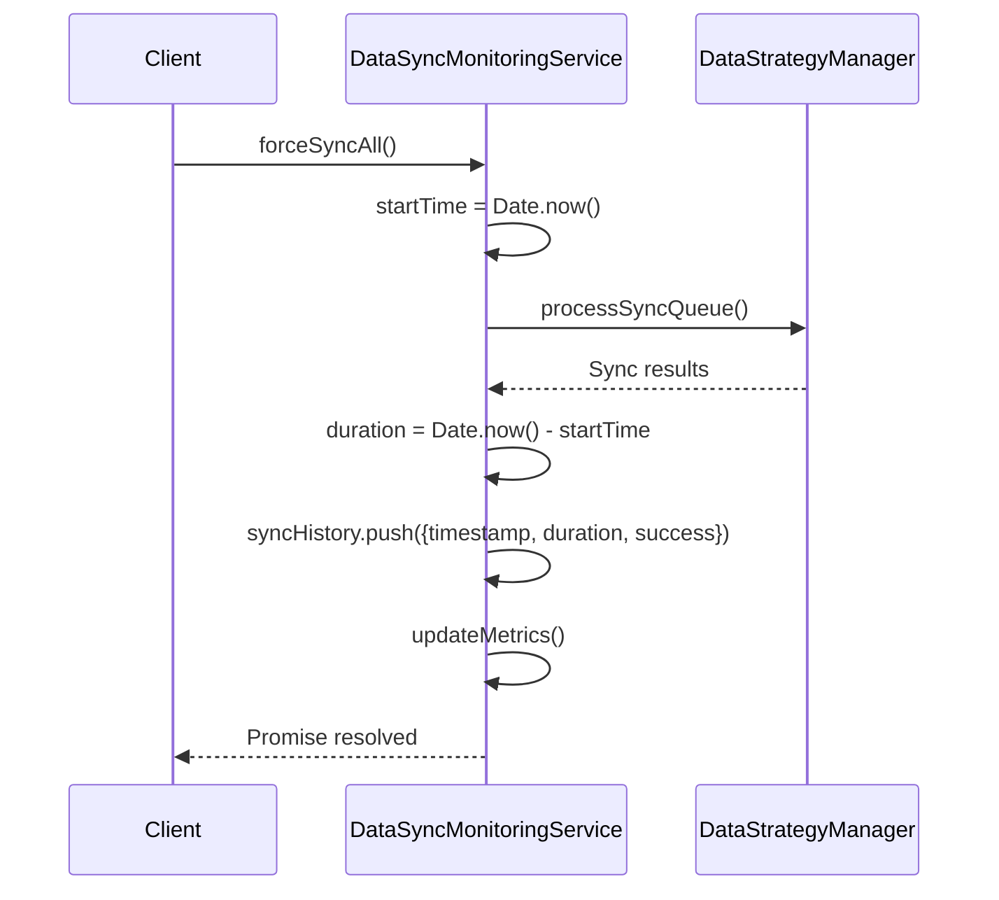
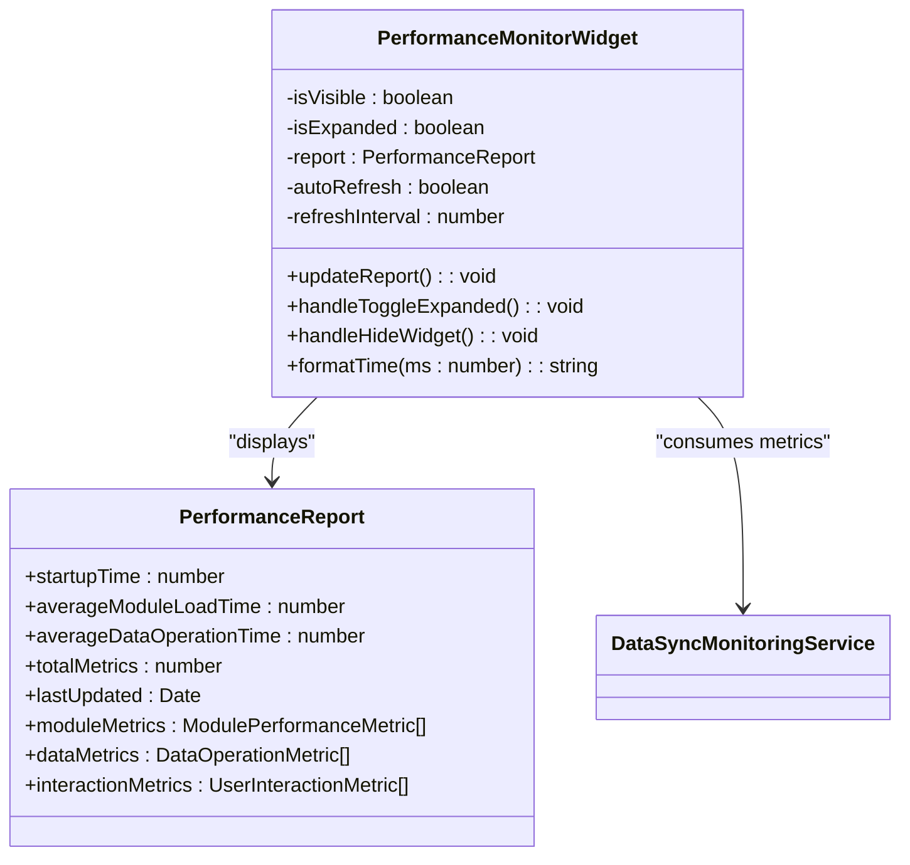
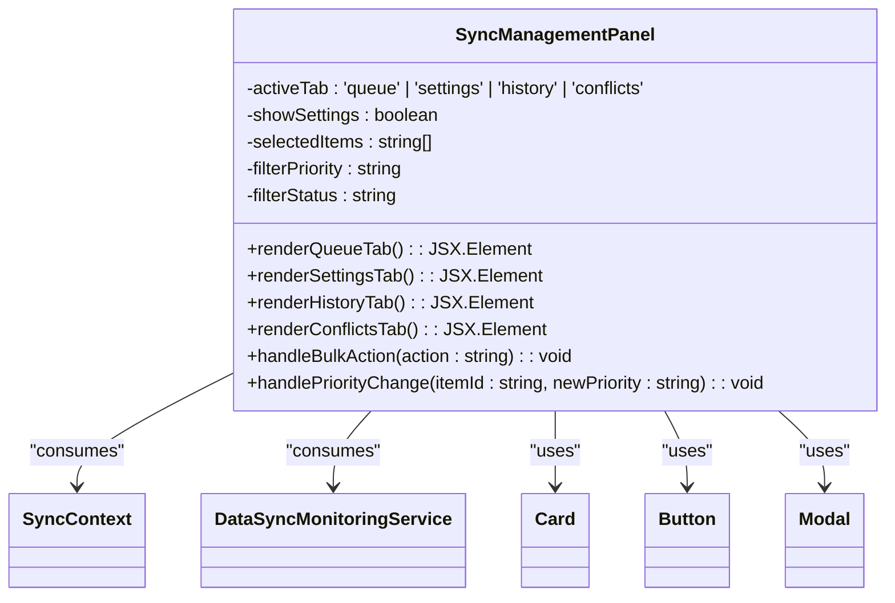
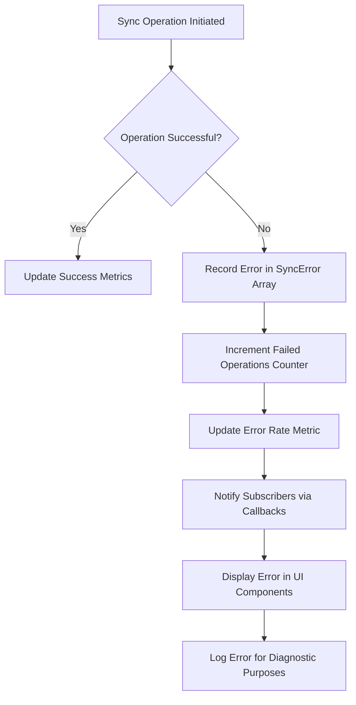

# Sync Status and Monitoring

<cite>
**Referenced Files in This Document**   
- [DataSyncMonitoringService.ts](file://src/services/DataSyncMonitoringService.ts)
- [SyncContext.tsx](file://src/contexts/SyncContext.tsx)
- [SyncManagementPanel.tsx](file://src/components/SyncManagementPanel.tsx)
- [PerformanceMonitorWidget.tsx](file://src/components/PerformanceMonitorWidget.tsx)
- [usePerformanceMonitoring.ts](file://src/hooks/usePerformanceMonitoring.ts)
</cite>

## Table of Contents
1. [Introduction](#introduction)
2. [DataSyncMonitoringService Metrics](#datasyncmonitoringservice-metrics)
3. [PerformanceMonitorWidget Integration](#performancemonitorwidget-integration)
4. [Sync Event System](#sync-event-system)
5. [Programmatic Access to Sync Statistics](#programmatic-access-to-sync-statistics)
6. [Custom Monitoring Dashboards](#custom-monitoring-dashboards)
7. [Alerting Mechanisms](#alerting-mechanisms)
8. [Logging and Diagnostic Information](#logging-and-diagnostic-information)
9. [Conclusion](#conclusion)

## Introduction
The schoolpilot3 application implements a comprehensive sync status monitoring and observability system that provides real-time insights into data synchronization health. This documentation details the architecture and functionality of the DataSyncMonitoringService, its integration with visualization components like PerformanceMonitorWidget, and the mechanisms for alerting, logging, and troubleshooting sync operations. The system exposes key metrics such as sync latency, throughput, success rate, and error counts, enabling administrators and developers to maintain optimal data synchronization performance across the educational platform.

## DataSyncMonitoringService Metrics

The DataSyncMonitoringService is the core component responsible for collecting, calculating, and exposing synchronization metrics across the schoolpilot3 application. This service implements a comprehensive monitoring system that tracks various aspects of data synchronization performance.

```mermaid
classDiagram
class DataSyncMonitoringService {
-dataStrategyManager : DataStrategyManager
-networkManager : NetworkStateManager
-conflicts : Map<string, SyncConflict>
-errors : SyncError[]
-metrics : SyncMetrics
-syncHistory : Array<{timestamp : Date, duration : number, success : boolean}>
-subscribers : Array<(status : SyncStatus) => void>
-monitoringInterval : NodeJS.Timeout
+getSyncStatus() : SyncStatus
+subscribe(callback : (status : SyncStatus) => void) : () => void
+recordError(operation : string, entityId : string | number, error : any) : void
+forceSyncAll() : Promise<void>
+updateMetrics() : void
+notifySubscribers() : void
}
class SyncMetrics {
+totalOperations : number
+successfulOperations : number
+failedOperations : number
+averageLatency : number
+peakLatency : number
+throughput : number
+errorRate : number
+conflictRate : number
+cacheHitRate : number
}
class SyncError {
+id : string
+timestamp : Date
+entityName : string
+entityId : string | number
+operation : 'create' | 'update' | 'delete' | 'sync'
+error : string
+retryCount : number
+resolved : boolean
}
class SyncStatus {
+queue : {pending : number, processing : boolean, byPriority : Record<string, number>, errors : number}
+conflicts : {total : number, unresolved : number, byType : Record<string, number>}
+lastSync : Date | null
+nextSync : Date | null
+errors : SyncError[]
+performance : {averageSyncTime : number, successRate : number, throughput : number}
}
DataSyncMonitoringService --> SyncMetrics : "contains"
DataSyncMonitoringService --> SyncError : "contains"
DataSyncMonitoringService --> SyncStatus : "produces"
```

**Diagram sources**
- [DataSyncMonitoringService.ts](file://src/services/DataSyncMonitoringService.ts#L41-L95)

**Section sources**
- [DataSyncMonitoringService.ts](file://src/services/DataSyncMonitoringService.ts#L41-L95)

### Sync Latency Measurement
The DataSyncMonitoringService measures sync latency by tracking the duration of each synchronization operation. The service maintains a history of sync operations with timestamps and durations, which are used to calculate both average and peak latency metrics.



**Diagram sources**
- [DataSyncMonitoringService.ts](file://src/services/DataSyncMonitoringService.ts#L458-L482)

The service calculates average latency by aggregating the durations of recent sync operations stored in the syncHistory array. The peak latency is determined by finding the maximum duration among recent operations. These calculations are performed periodically by the updateMetrics method, which runs every 5 seconds as part of the monitoring interval.

### Throughput Calculation
Throughput is measured as the number of successful sync operations per minute. The DataSyncMonitoringService implements a calculateThroughput method that examines the syncHistory array to count operations that occurred within the last 60 seconds.

```typescript
// Calculate throughput (operations per minute)
private calculateThroughput(): number {
  const oneMinuteAgo = new Date(Date.now() - 60000);
  const recentOperations = this.syncHistory.filter(h => h.timestamp > oneMinuteAgo);
  return recentOperations.length;
}
```

This approach provides a real-time view of the system's data synchronization capacity, allowing administrators to identify performance trends and potential bottlenecks in the sync process.

### Success Rate and Error Counts
The service tracks synchronization success rate and error counts through several mechanisms. The SyncMetrics interface includes properties for tracking successful and failed operations, which are updated whenever a sync operation completes.

When a sync operation fails, the service records the error through the recordError method, which creates a SyncError object containing details about the failed operation:

```typescript
// Record a sync error
recordError(
  operation: SyncError['operation'],
  entityId: string | number | string,
  error: any
): void {
  const syncError: SyncError = {
    id: `error_${Date.now()}_${Math.random().toString(36).substr(2, 9)}`,
    timestamp: new Date(),
    entityName: typeof entityId === 'string' && entityId.includes('_') ? entityId.split('_')[0] : 'unknown',
    entityId: typeof entityId === 'string' && entityId.includes('_') ? entityId.split('_')[1] : entityId,
    operation,
    error: error instanceof Error ? error.message : String(error),
    retryCount: 0,
    resolved: false
  };

  this.errors.push(syncError);
  
  // Keep only last 100 errors
  if (this.errors.length > 100) {
    this.errors = this.errors.slice(-100);
  }

  this.metrics.failedOperations++;
  this.metrics.errorRate = this.metrics.failedOperations / Math.max(this.metrics.totalOperations, 1);
}
```

The success rate is calculated as the ratio of successful operations to total operations, providing a clear indication of synchronization reliability over time.

## PerformanceMonitorWidget Integration

The PerformanceMonitorWidget component serves as the primary interface for visualizing sync health metrics in real-time. This component integrates with the DataSyncMonitoringService to display key performance indicators in a user-friendly format.



**Diagram sources**
- [PerformanceMonitorWidget.tsx](file://src/components/PerformanceMonitorWidget.tsx#L32-L81)

**Section sources**
- [PerformanceMonitorWidget.tsx](file://src/components/PerformanceMonitorWidget.tsx#L32-L81)

### Real-time Visualization of Sync Health
The PerformanceMonitorWidget provides real-time visualization of sync health through several key features:

1. **Performance Status Indicator**: A color-coded indicator shows the current performance level (green for good, yellow for moderate, red for poor) based on calculated metrics.

2. **Metric Display**: The widget displays key metrics including:
   - Total operations processed
   - Average operation time
   - Success rate
   - Error count
   - Last updated timestamp

3. **Auto-refresh Capability**: The widget supports optional auto-refresh functionality that updates the displayed metrics at configurable intervals, ensuring that administrators have access to current sync health information.

```typescript
// Update performance report
const updateReport = useCallback(() => {
  try {
    const newReport = performanceMonitor.getPerformanceReport();
    setReport(newReport);
  } catch (error) {
    console.warn('Error updating performance report:', error);
  }
}, []);

// Optional auto-refresh (only if explicitly enabled by user)
useEffect(() => {
  if (!autoRefresh || !isVisible) return;
  
  const interval = setInterval(() => {
    if (document.visibilityState === 'visible' && isVisible) {
      updateReport();
    }
  }, refreshInterval);

  return () => clearInterval(interval);
}, [refreshInterval, isVisible, autoRefresh, updateReport]);
```

The widget's design prioritizes usability, with a compact display that can be expanded for detailed information, allowing users to monitor sync health without disrupting their primary workflow.

## Sync Event System

The sync event system in schoolpilot3 is implemented through the SyncContext, which provides a centralized mechanism for broadcasting sync status changes to interested components throughout the application.

```mermaid
classDiagram
class SyncContext {
-syncStatus : SyncStatus
-syncSettings : SyncSettings
-offlineCapabilities : OfflineCapability[]
-disabledFeatures : string[]
+forceSync() : Promise<void>
+pauseSync() : void
+resumeSync() : void
+getQueueStatus() : QueueStatus
+clearQueue() : void
+clearSyncQueue() : void
+getSyncSettings() : SyncSettings
+updateSyncSettings(settings : Partial<SyncSettings>) : void
}
class SyncStatus {
+state : 'idle' | 'syncing' | 'error' | 'paused'
+progress : number
+lastError : Error | null
+conflictsCount : number
+lastSyncTime : Date | null
}
class SyncSettings {
+autoSync : boolean
+syncInterval : number
+batchSize : number
}
class QueueStatus {
+api : {pending : number, processing : boolean, byPriority : Record<string, number>}
+sync : {pending : number, processing : boolean, byPriority : Record<string, number>, errors : number}
}
SyncContext --> SyncStatus : "contains"
SyncContext --> SyncSettings : "contains"
SyncContext --> QueueStatus : "produces"
```

**Diagram sources**
- [SyncContext.tsx](file://src/contexts/SyncContext.tsx#L34-L83)

**Section sources**
- [SyncContext.tsx](file://src/contexts/SyncContext.tsx#L34-L83)

### Event Broadcasting Mechanism
The SyncContext uses React's context API to provide a global state management system for sync-related information. Components that need to respond to sync status changes can use the useSync hook to access the current sync state and subscribe to updates.

When sync status changes occur, the context automatically notifies all subscribed components through React's re-rendering mechanism. This is achieved through the use of useState and useMemo hooks, which ensure that the context value is updated whenever sync state changes, triggering re-renders in dependent components.

The event system supports several types of sync events:

1. **Sync State Changes**: Components can respond to changes in sync state (idle, syncing, error, paused) to update their UI accordingly.

2. **Progress Updates**: The progress property allows components to display the current sync progress as a percentage.

3. **Error Notifications**: When sync errors occur, the lastError property is updated, allowing components to display appropriate error messages.

4. **Settings Changes**: Components can respond to changes in sync settings, such as auto-sync toggles or interval adjustments.

```typescript
export const SyncProvider: React.FC<{ children: ReactNode }> = ({ children }) => {
  const { isOnline } = useNetwork();
  
  const [syncStatus, setSyncStatus] = useState<SyncStatus>({
    state: 'idle',
    progress: 0,
    lastError: null,
    conflictsCount: 0,
    lastSyncTime: null
  });

  // Sync controls
  const forceSync = useCallback(async () => {
    if (!isOnline) {
      console.warn('Cannot sync while offline');
      return;
    }
    console.log('Force sync triggered');
    setSyncStatus(prev => ({ ...prev, state: 'syncing', progress: 0 }));
    // Simulate sync process
    setTimeout(() => {
      setSyncStatus(prev => ({ 
        ...prev, 
        state: 'idle', 
        progress: 100, 
        lastSyncTime: new Date() 
      }));
    }, 2000);
  }, [isOnline]);

  const contextValue = useMemo((): SyncContextType => ({
    // Sync status
    syncStatus,
    pendingSyncCount: 0,
    lastSyncTime: syncStatus.lastSyncTime,
    
    // Sync controls
    forceSync,
    pauseSync,
    resumeSync,
    
    // Queue management
    getQueueStatus,
    clearQueue,
    clearSyncQueue,
    
    // Sync settings
    getSyncSettings,
    updateSyncSettings,
    
    // Offline capabilities
    offlineCapabilities,
    disabledFeatures
  }), [
    syncStatus,
    forceSync,
    pauseSync,
    resumeSync,
    getQueueStatus,
    clearQueue,
    clearSyncQueue,
    getSyncSettings,
    updateSyncSettings,
    offlineCapabilities,
    disabledFeatures
  ]);

  return (
    <SyncContext.Provider value={contextValue}>
      {children}
    </SyncContext.Provider>
  );
};
```

This event system enables a decoupled architecture where components can react to sync status changes without needing direct references to the monitoring service, promoting modularity and maintainability.

## Programmatic Access to Sync Statistics

The schoolpilot3 application provides several mechanisms for programmatically accessing sync statistics, enabling developers to integrate sync monitoring functionality into custom components and workflows.

### Using the useSync Hook
The primary method for accessing sync statistics programmatically is through the useSync hook, which provides access to the SyncContext. This hook returns an object containing the current sync status, controls, and settings:

```typescript
export const useSync = (): SyncContextType => {
  const context = useContext(SyncContext);
  if (context === undefined) {
    throw new Error('useSync must be used within a SyncProvider');
  }
  return context;
};
```

Components can use this hook to access sync statistics and controls:

```typescript
const MyComponent = () => {
  const { 
    syncStatus, 
    pendingSyncCount, 
    lastSyncTime, 
    forceSync, 
    getQueueStatus 
  } = useSync();
  
  // Use sync statistics in component logic
  useEffect(() => {
    console.log('Current sync state:', syncStatus.state);
    console.log('Pending sync operations:', pendingSyncCount);
    console.log('Last sync time:', lastSyncTime);
  }, [syncStatus, pendingSyncCount, lastSyncTime]);
  
  return (
    <div>
      <p>Sync Status: {syncStatus.state}</p>
      <p>Pending Operations: {pendingSyncCount}</p>
      <button onClick={forceSync}>Force Sync</button>
    </div>
  );
};
```

### Direct Service Access
For more advanced use cases, developers can access the DataSyncMonitoringService directly. The service is exported as a global instance, allowing direct access to its methods and properties:

```typescript
import { globalDataSyncMonitoringService } from '../services/DataSyncMonitoringService';

// Access sync metrics directly
const metrics = globalDataSyncMonitoringService.getSyncStatus().performance;
console.log('Sync success rate:', metrics.successRate);
console.log('Throughput:', metrics.throughput);

// Subscribe to sync status updates
const unsubscribe = globalDataSyncMonitoringService.subscribe((status) => {
  console.log('Sync status updated:', status);
  // Handle status update
});

// Remember to unsubscribe when no longer needed
// unsubscribe();
```

### Hook-based Monitoring
The application also provides the usePerformanceMonitoring hook, which offers a higher-level interface for tracking and accessing performance metrics:

```typescript
import usePerformanceMonitoring from '../hooks/usePerformanceMonitoring';

const MyComponent = () => {
  const { trackSyncOperation } = usePerformanceMonitoring();
  
  const handleDataSync = async () => {
    try {
      const result = await trackSyncOperation('students', async () => {
        // Perform sync operation
        return await syncStudentData();
      });
      return result;
    } catch (error) {
      // Error is automatically recorded
      console.error('Sync failed:', error);
    }
  };
  
  return <button onClick={handleDataSync}>Sync Data</button>;
};
```

These programmatic access methods provide flexibility for developers to integrate sync monitoring into various parts of the application, from simple status displays to complex diagnostic tools.

## Custom Monitoring Dashboards

The schoolpilot3 application supports the creation of custom monitoring dashboards through its modular architecture and exposed APIs. Developers can create specialized dashboards that focus on specific aspects of sync performance or combine sync metrics with other system metrics.

### Dashboard Component Structure
Custom dashboards can be built using the existing UI components and data access patterns. The SyncManagementPanel serves as an example of a comprehensive monitoring interface that can be extended or customized:



**Diagram sources**
- [SyncManagementPanel.tsx](file://src/components/SyncManagementPanel.tsx#L32-L81)

**Section sources**
- [SyncManagementPanel.tsx](file://src/components/SyncManagementPanel.tsx#L32-L81)

### Creating Custom Dashboards
To create a custom monitoring dashboard, developers can follow these steps:

1. **Import Required Components and Hooks**:
```typescript
import React from 'react';
import { useSync } from '../contexts/SyncContext';
import { globalDataSyncMonitoringService } from '../services/DataSyncMonitoringService';
import Card from '../components/ui/Card';
import BarChart from '../components/ui/BarChart';
import DonutChart from '../components/ui/DonutChart';
```

2. **Create the Dashboard Component**:
```typescript
const CustomSyncDashboard = () => {
  const { syncStatus, pendingSyncCount, lastSyncTime } = useSync();
  const syncService = globalDataSyncMonitoringService;
  
  // Get detailed metrics
  const syncStatusDetail = syncService.getSyncStatus();
  const metrics = syncStatusDetail.performance;
  
  return (
    <div className="grid grid-cols-1 md:grid-cols-2 lg:grid-cols-3 gap-4">
      {/* Sync Status Card */}
      <Card title="Sync Status">
        <div className="space-y-2">
          <div className="flex justify-between">
            <span>Status:</span>
            <span className={`px-2 py-1 rounded text-white text-xs ${
              syncStatus.state === 'syncing' ? 'bg-blue-500' :
              syncStatus.state === 'error' ? 'bg-red-500' :
              syncStatus.state === 'paused' ? 'bg-yellow-500' : 'bg-green-500'
            }`}>
              {syncStatus.state}
            </span>
          </div>
          <div className="flex justify-between">
            <span>Pending Operations:</span>
            <span>{pendingSyncCount}</span>
          </div>
          <div className="flex justify-between">
            <span>Last Sync:</span>
            <span>{lastSyncTime ? lastSyncTime.toLocaleString() : 'Never'}</span>
          </div>
        </div>
      </Card>
      
      {/* Performance Metrics Card */}
      <Card title="Performance">
        <div className="space-y-3">
          <div>
            <label className="text-sm text-gray-600">Success Rate</label>
            <div className="w-full bg-gray-200 rounded-full h-2.5">
              <div className="bg-green-500 h-2.5 rounded-full" style={{width: `${metrics.successRate * 100}%`}}></div>
            </div>
            <span className="text-sm">{Math.round(metrics.successRate * 100)}%</span>
          </div>
          <div className="flex justify-between">
            <span>Throughput:</span>
            <span>{metrics.throughput} ops/min</span>
          </div>
        </div>
      </Card>
      
      {/* Error Statistics Card */}
      <Card title="Errors">
        <DonutChart 
          data={[
            { name: 'Successful', value: syncStatusDetail.queue.pending },
            { name: 'Failed', value: syncStatusDetail.errors.length }
          ]} 
          colors={['#10B981', '#EF4444']} 
        />
        <div className="mt-2 text-sm text-center">
          {syncStatusDetail.errors.length} errors in queue
        </div>
      </Card>
    </div>
  );
};

export default CustomSyncDashboard;
```

3. **Enhance with Additional Features**:
Custom dashboards can be enhanced with additional features such as:
   - Historical trend charts using the syncHistory data
   - Detailed error logs with filtering and search capabilities
   - Performance comparison across different time periods
   - Alert thresholds and notifications
   - Export functionality for metrics data

These custom dashboards can be integrated into the application's navigation system and made available to users with appropriate permissions, providing tailored monitoring solutions for different roles and use cases.

## Alerting Mechanisms

The schoolpilot3 application implements several alerting mechanisms to notify users and administrators of sync failures and performance degradation. These mechanisms ensure that issues are detected and addressed promptly, minimizing the impact on data consistency and system reliability.

### Failure Detection and Alerting
The DataSyncMonitoringService includes built-in mechanisms for detecting and responding to sync failures:



**Diagram sources**
- [DataSyncMonitoringService.ts](file://src/services/DataSyncMonitoringService.ts#L332-L372)

When a sync operation fails, the service records the error details in the errors array and updates the metrics accordingly. The error recording process includes:

1. **Error Details Capture**: The recordError method captures comprehensive information about the failed operation, including the entity name, operation type, error message, and timestamp.

2. **Error Rate Calculation**: The service automatically updates the errorRate metric based on the ratio of failed operations to total operations.

3. **Subscriber Notification**: All registered subscribers are notified of the status change, allowing UI components to display appropriate alerts.

4. **Error History Maintenance**: The service maintains a history of the last 100 errors, providing a rolling window of recent issues for diagnostic purposes.

### Performance Degradation Alerts
The system also monitors for performance degradation through several metrics:

1. **Latency Thresholds**: When average or peak latency exceeds predefined thresholds, the system can trigger alerts. This is particularly important for maintaining responsive user experiences.

2. **Throughput Monitoring**: A significant drop in throughput (operations per minute) can indicate performance issues that require investigation.

3. **Success Rate Decline**: A decreasing success rate over time may indicate systemic issues with the sync process that need to be addressed.

4. **Queue Backlog**: An increasing number of pending operations in the sync queue can signal that the system is unable to keep up with the data synchronization demand.

These metrics are continuously monitored by the DataSyncMonitoringService, which updates the sync status every 5 seconds. Components that subscribe to sync status changes can implement custom alerting logic based on these metrics.

### User Interface Alerts
The application provides several UI elements for displaying sync alerts:

1. **SyncManagementPanel**: This component displays visual indicators for sync conflicts and errors, with dedicated tabs for viewing and resolving issues.

2. **Status Indicators**: Color-coded indicators in various components show the current sync status (green for healthy, yellow for warnings, red for errors).

3. **Toast Notifications**: Transient notifications can be displayed for critical sync failures, ensuring that users are immediately aware of issues.

4. **Dashboard Warnings**: Custom monitoring dashboards can include prominent warnings when metrics exceed acceptable thresholds.

These alerting mechanisms work together to provide comprehensive coverage of sync issues, from immediate failure notifications to long-term performance trend monitoring.

## Logging and Diagnostic Information

The schoolpilot3 application implements comprehensive logging and diagnostic capabilities to support troubleshooting of sync issues. These features provide detailed information about sync operations, errors, and system performance.

### Diagnostic Data Structures
The system uses several data structures to capture diagnostic information:

```typescript
export interface SyncError {
  id: string;
  timestamp: Date;
  entityName: string;
  entityId?: string | number;
  operation: 'create' | 'update' | 'delete' | 'sync';
  error: string;
  retryCount: number;
  resolved: boolean;
}

export interface SyncStatus {
  queue: {
    pending: number;
    processing: boolean;
    byPriority: Record<string, number>;
    errors: number;
  };
  conflicts: {
    total: number;
    unresolved: number;
    byType: Record<string, number>;
  };
  lastSync: Date | null;
  nextSync: Date | null;
  errors: SyncError[];
  performance: {
    averageSyncTime: number;
    successRate: number;
    throughput: number; // items per minute
  };
}
```

These structures capture detailed information about sync operations and errors, including timestamps, entity identifiers, operation types, and error messages.

### Logging Implementation
The logging system is implemented through several mechanisms:

1. **Error Recording**: The recordError method captures detailed information about each sync failure, including:
   - Unique error identifier
   - Timestamp of the error
   - Entity name and ID involved in the operation
   - Type of operation (create, update, delete, sync)
   - Error message (extracted from Error objects when possible)
   - Retry count and resolution status

2. **Sync History**: The service maintains a history of sync operations with duration and success status, enabling performance analysis and troubleshooting:

```typescript
private syncHistory: Array<{ 
  timestamp: Date; 
  duration: number; 
  success: boolean 
}> = [];
```

3. **Console Logging**: The system includes strategic console.log statements for key operations, such as sync triggers, pauses, and resumptions:

```typescript
const forceSync = useCallback(async () => {
  if (!isOnline) {
    console.warn('Cannot sync while offline');
    return;
  }
  console.log('Force sync triggered');
  // ... sync logic
}, [isOnline]);
```

### Diagnostic Access
The diagnostic information is accessible through several channels:

1. **Programmatic Access**: Developers can access the full error history and sync status through the DataSyncMonitoringService API:

```typescript
// Access error history
const errors = globalDataSyncMonitoringService.getSyncStatus().errors;

// Access sync history
const syncHistory = globalDataSyncMonitoringService.getSyncStatus().performance;
```

2. **UI Components**: The SyncManagementPanel provides a user-friendly interface for viewing sync errors and conflicts, with filtering and search capabilities.

3. **Export Functionality**: The system could be extended to support exporting diagnostic data for offline analysis, such as exporting error logs as CSV files.

4. **Debug Tools**: The application includes debug scripts that can be used to verify the state of the sync system and troubleshoot issues:

```javascript
// Debug script to check Performance Monitor Widget status
console.log('1. Feature Flag Status:');
const storedConfig = localStorage.getItem('app-config');
if (storedConfig) {
  const config = JSON.parse(storedConfig);
  console.log('   performanceMonitorWidget:', config.features?.performanceMonitorWidget);
}
```

These logging and diagnostic capabilities provide a comprehensive toolkit for identifying, analyzing, and resolving sync issues, ensuring that the schoolpilot3 application maintains reliable data synchronization across all components.

## Conclusion
The sync status monitoring and observability system in schoolpilot3 provides a comprehensive solution for tracking, visualizing, and managing data synchronization health. Through the DataSyncMonitoringService, the application exposes key metrics such as sync latency, throughput, success rate, and error counts, enabling administrators to maintain optimal performance.

The integration with the PerformanceMonitorWidget provides real-time visualization of sync health, while the SyncContext event system enables components throughout the application to respond to sync status changes. Developers can access sync statistics programmatically through hooks and direct service access, allowing for the creation of custom monitoring dashboards tailored to specific needs.

The system's alerting mechanisms ensure that sync failures and performance degradation are detected and reported promptly, while comprehensive logging and diagnostic information supports effective troubleshooting. Together, these features create a robust monitoring ecosystem that ensures data consistency and reliability across the educational platform.

By following the patterns and practices documented here, developers can extend and enhance the sync monitoring capabilities of schoolpilot3, creating a more resilient and observable system for educational data management.