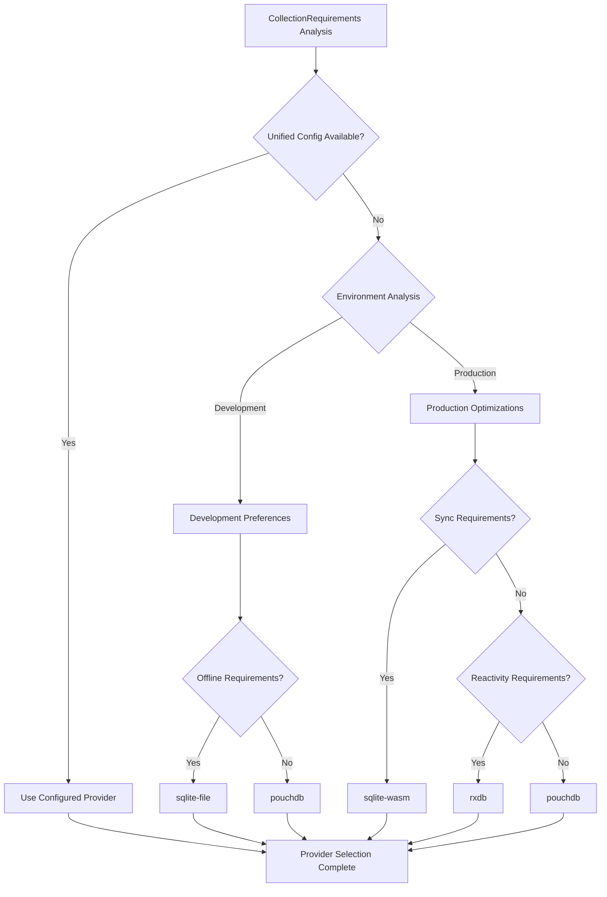
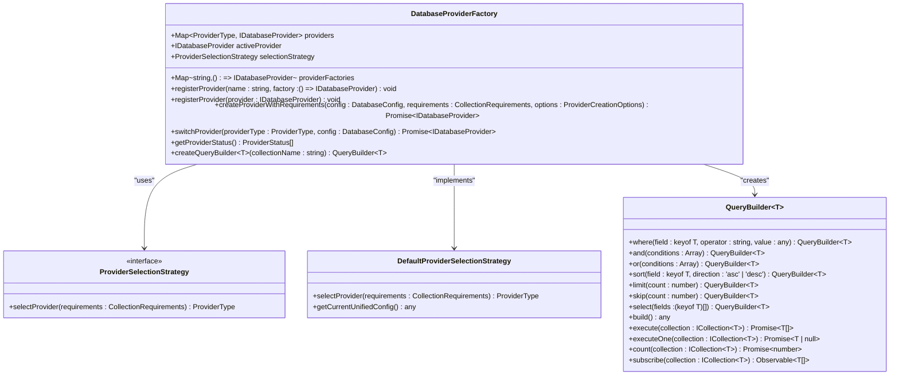
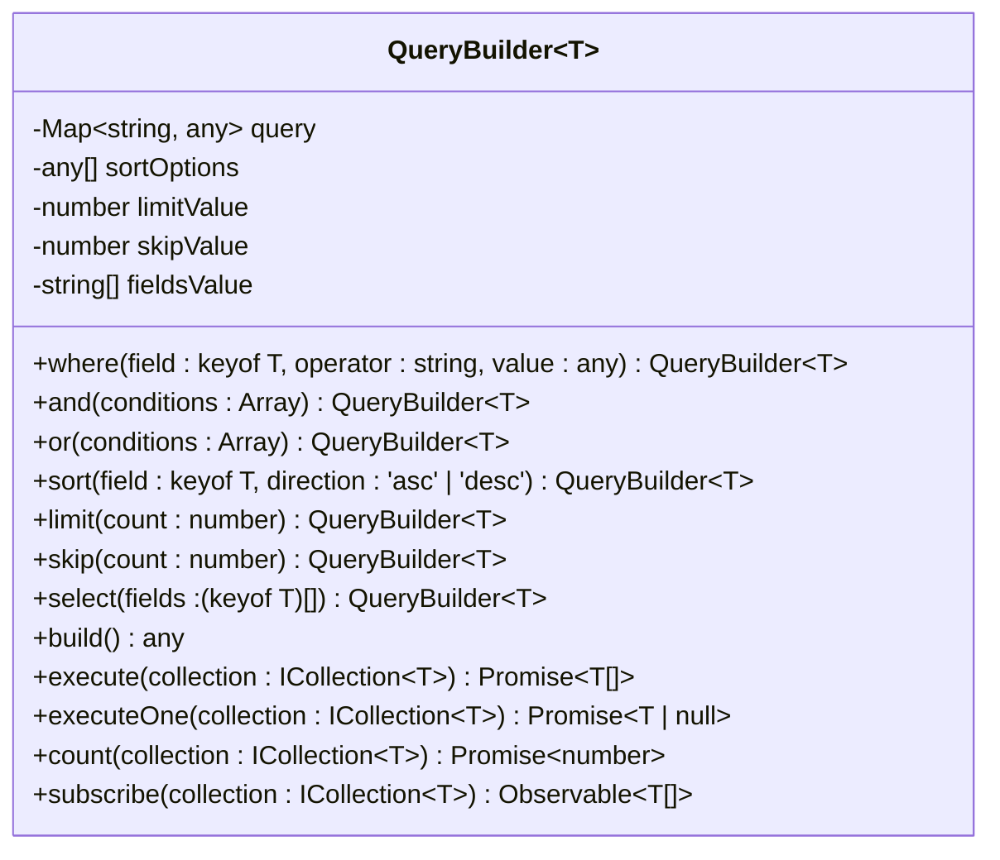
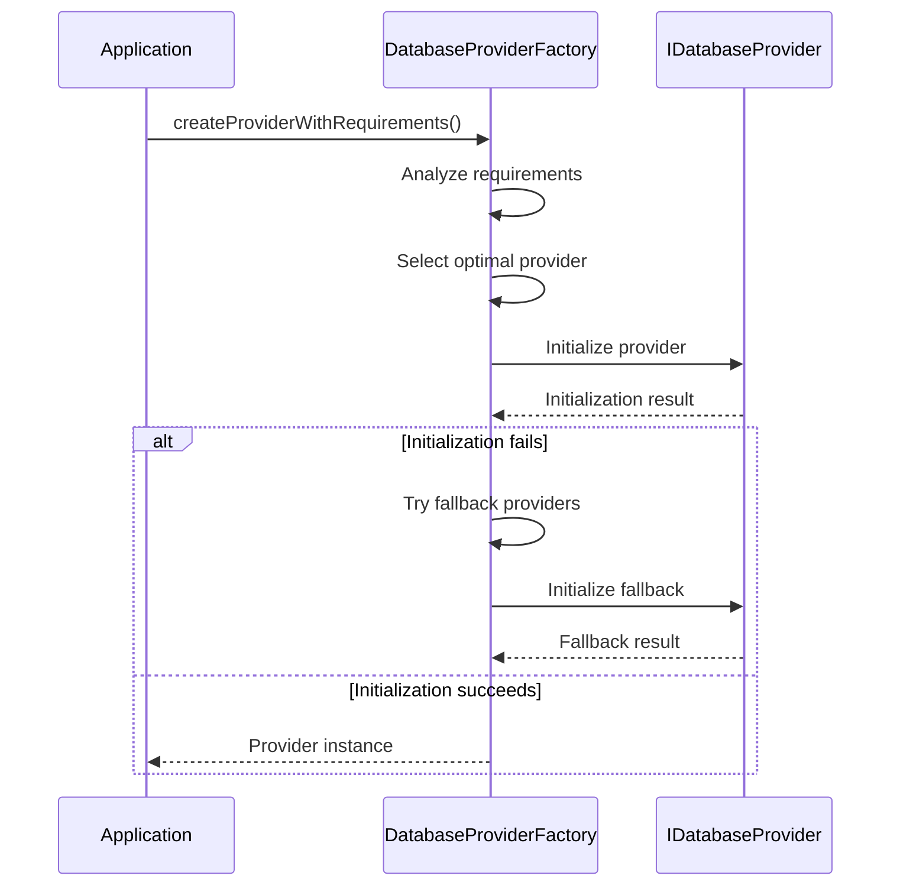
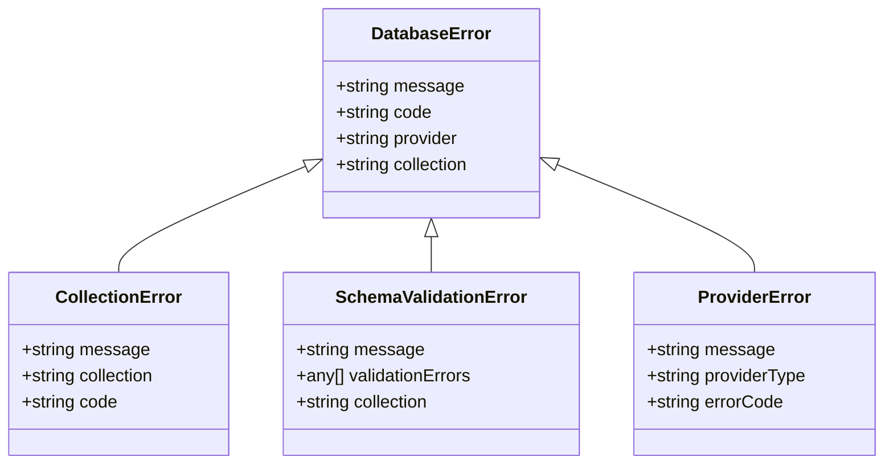
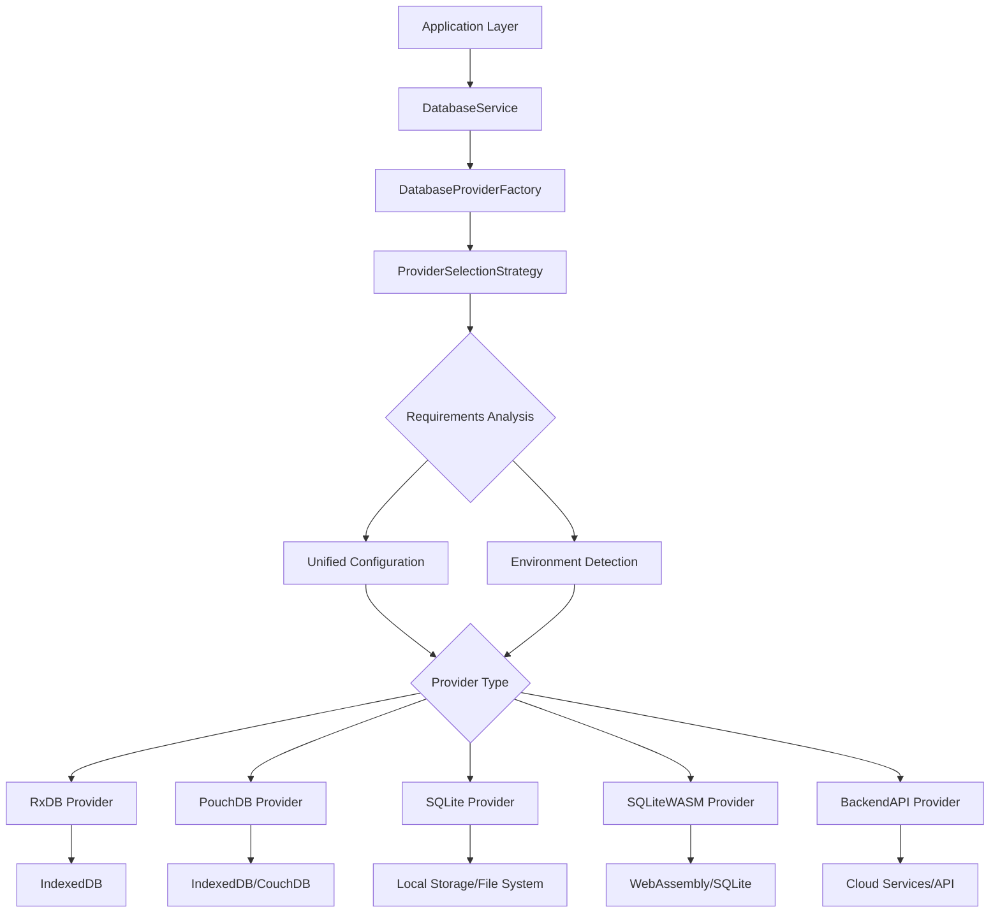
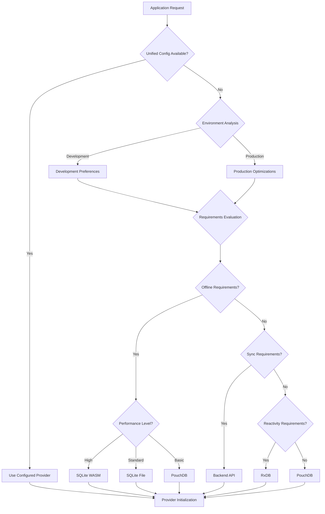
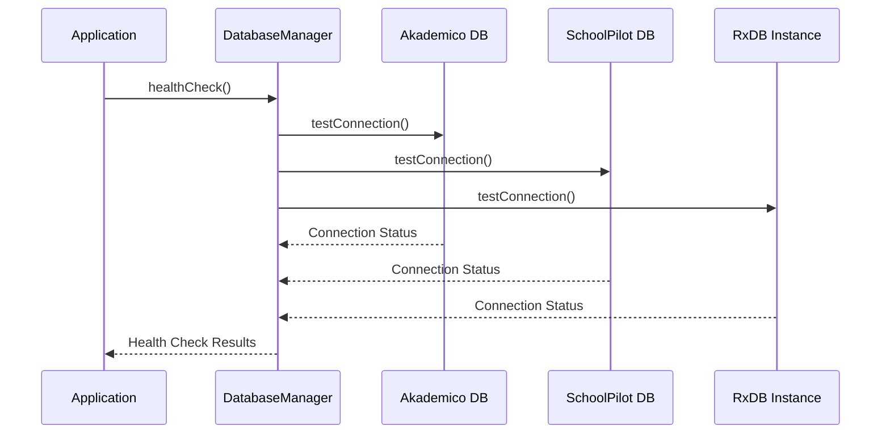

# Database Provider Architecture

<cite>
**Referenced Files in This Document**
- [DatabaseProviderFactory.ts](file://src/services/database/DatabaseProviderFactory.ts)
- [interfaces.ts](file://src/services/database/interfaces.ts)
- [databaseService.ts](file://src/services/databaseService.ts)
- [database_manager.ts](file://scripts/migration/database_manager.ts)
- [RxDBProvider.ts](file://src/services/database/RxDBProvider.ts)
- [PouchDBProvider.ts](file://src/services/database/PouchDBProvider.ts)
- [SQLiteProvider.ts](file://src/services/database/SQLiteProvider.ts)
- [SQLiteWASMProvider.ts](file://src/services/database/SQLiteWASMProvider.ts)
- [BackendAPIProvider.ts](file://src/services/database/BackendAPIProvider.ts)
</cite>

## Update Summary
**Changes Made**
- Added comprehensive documentation for the new DatabaseProviderFactory with enhanced provider selection mechanism
- Updated provider types to include SQLite WASM, SQLite file, and backend API providers
- Documented the new ProviderSelectionStrategy pattern with unified configuration integration
- Added QueryBuilder implementation for enhanced query capabilities
- Updated provider selection logic to support dual-database architecture
- Enhanced error handling and recovery patterns with DatabaseError classes

## Table of Contents
1. [Introduction](#introduction)
2. [Core Interface Contracts](#core-interface-contracts)
3. [Enhanced Provider Selection Architecture](#enhanced-provider-selection-architecture)
4. [DatabaseProviderFactory Implementation](#databaseproviderfactory-implementation)
5. [Provider Implementation Details](#provider-implementation-details)
6. [Query Builder System](#query-builder-system)
7. [Provider-Specific Characteristics](#provider-specific-characteristics)
8. [Connection and Transaction Management](#connection-and-transaction-management)
9. [Error Handling and Recovery](#error-handling-and-recovery)
10. [Performance Analysis](#performance-analysis)
11. [Architecture Diagrams](#architecture-diagrams)

## Introduction

The database provider system in schoolpilot3 implements a sophisticated dual-database architecture that enables dynamic routing of database operations to different underlying database technologies based on runtime configuration and environment. This enhanced architecture supports five primary database providers: RxDB for reactive real-time queries, PouchDB for CouchDB-compatible synchronization, SQLite for high-performance local persistence, SQLite WASM for browser-based SQLite, and Backend API for cloud-based data services.

The system is designed to provide a consistent interface across all providers while leveraging the unique capabilities of each database technology. The enhanced DatabaseProviderFactory implements a sophisticated provider selection mechanism that dynamically chooses the appropriate provider based on runtime requirements, environment configuration, and unified settings. This document provides a comprehensive analysis of the enhanced architecture, interface contracts, implementation specifics, and operational characteristics of this database provider system.

**Section sources**
- [DatabaseProviderFactory.ts:1-725](file://src/services/database/DatabaseProviderFactory.ts#L1-L725)
- [interfaces.ts:1-253](file://src/services/database/interfaces.ts#L1-L253)

## Core Interface Contracts

The database provider system is built around a set of interface contracts defined in `interfaces.ts` that ensure consistent behavior across all providers. These interfaces establish a standardized API for database operations, enabling seamless switching between different database technologies without requiring changes to the application code.

### Enhanced IDatabaseProvider Interface

The `IDatabaseProvider` interface defines the contract for all database providers, now supporting transaction management and enhanced status reporting:

```typescript
export interface IDatabaseProvider {
  readonly name: string;
  readonly version: string;
  
  // Lifecycle management
  initialize(config: DatabaseConfig): Promise<void>;
  createCollection<T>(name: string, schema: CollectionSchema): Promise<ICollection<T>>;
  getCollection<T>(name: string): ICollection<T> | null;
  getAllCollections(): Map<string, ICollection<any>>;
  destroy(): Promise<void>;
  
  // Transaction management
  transaction?<TResult>(callback: (tx: ITransaction) => Promise<TResult>): Promise<TResult>;
  
  // Status and health
  isAvailable(): boolean;
  getStatus(): ProviderStatus;
  
  // Backup and restore
  backup(): Promise<string>;
  restore(backupData: string): Promise<void>;
}
```

### Enhanced ICollection Interface

The `ICollection<T>` interface defines the contract for collection operations with enhanced query capabilities:

```typescript
export interface ICollection<T> {
  readonly name: string;
  readonly schema: CollectionSchema;
  
  // CRUD Operations
  insert(doc: Omit<T, 'id'>): Promise<InsertResult<T>>;
  insertMany(docs: Omit<T, 'id'>[]): Promise<BulkResult<T>>;
  findOne(idOrQuery: string | QueryOptions): Promise<T | null>;
  findById(id: string): Promise<T | null>;
  find(query?: QueryOptions): Promise<T[]>;
  update(id: string, update: Partial<T>): Promise<UpdateResult<T>>;
  updateMany(query: QueryOptions, update: Partial<T>): Promise<UpdateResult<T>[]>;
  remove(id: string): Promise<DeleteResult>;
  removeMany(query: QueryOptions): Promise<DeleteResult[]>;
  
  // RxDB-compatible methods
  upsert?(id: string, doc: Partial<T>): Promise<UpdateResult<T> | InsertResult<T>>;
  delete?(id: string): Promise<DeleteResult>;
  
  // Reactive Operations
  subscribe(query?: QueryOptions): Observable<T[]>;
  subscribeToChanges(): Observable<CollectionChangeEvent<T>>;
  
  // Performance Operations
  count(query?: QueryOptions): Promise<number>;
  exists(id: string): Promise<boolean>;
  createIndex(index: IndexDefinition): Promise<void>;
  
  // Collection management
  getStats(): Promise<CollectionStats>;
  compact(): Promise<void>;
  destroy(): Promise<void>;
}
```

### Enhanced Database Configuration and Schema

The system uses standardized configuration and schema definitions with enhanced encryption support:

```typescript
export interface DatabaseConfig {
  name: string;
  version?: number;
  storage?: string;
  multiInstance?: boolean;
  ignoreDuplicate?: boolean;
  autoCompaction?: boolean;
  debug?: boolean;
  encryptionKey?: string;
}

export interface CollectionSchema {
  version: number;
  type: 'object';
  properties: Record<string, SchemaProperty>;
  required?: string[];
  indexes?: IndexDefinition[];
  primaryKey?: string;
  relationships?: RelationshipDefinition[];
}
```

### Enhanced Error Handling

The system implements comprehensive error handling with specialized error types:

```typescript
export class DatabaseError extends Error {
  constructor(
    message: string,
    public code: string,
    public provider?: string,
    public collection?: string
  ) {
    super(message);
    this.name = 'DatabaseError';
  }
}

export class CollectionError extends DatabaseError {
  constructor(
    message: string,
    public collection: string,
    code: string = 'COLLECTION_ERROR'
  ) {
    super(message, code, undefined, collection);
    this.name = 'CollectionError';
  }
}

export class SchemaValidationError extends DatabaseError {
  constructor(
    message: string,
    public validationErrors: any[],
    collection?: string
  ) {
    super(message, 'SCHEMA_VALIDATION_ERROR', undefined, collection);
    this.name = 'SchemaValidationError';
  }
}
```

**Section sources**
- [interfaces.ts:1-253](file://src/services/database/interfaces.ts#L1-L253)

## Enhanced Provider Selection Architecture

The enhanced provider selection architecture introduces a sophisticated strategy pattern that determines the optimal database provider based on unified configuration, environment requirements, and runtime conditions.

### Provider Types and Selection Strategy

The system now supports seven distinct provider types with enhanced selection logic:

```typescript
export type ProviderType = 'pouchdb' | 'rxdb' | 'sqlite' | 'sqlite-wasm' | 'sqlite-file' | 'livestore' | 'backend-api' | 'hybrid';

export interface ProviderSelectionStrategy {
  selectProvider(requirements: CollectionRequirements): ProviderType;
}
```

### DefaultProviderSelectionStrategy Implementation

The `DefaultProviderSelectionStrategy` integrates with the unified configuration system to make intelligent provider selections:



**Diagram sources**
- [DatabaseProviderFactory.ts:39-115](file://src/services/database/DatabaseProviderFactory.ts#L39-L115)

### Collection Requirements Analysis

The selection strategy evaluates multiple factors to determine optimal provider selection:

```typescript
export interface CollectionRequirements {
  collectionsCount: number;
  requiresReactivity: boolean;
  requiresOffline: boolean;
  requiresSync: boolean;
  performanceLevel: 'basic' | 'standard' | 'high';
  storageQuota: number;
}
```

**Section sources**
- [DatabaseProviderFactory.ts:39-115](file://src/services/database/DatabaseProviderFactory.ts#L39-L115)
- [DatabaseProviderFactory.ts:201-209](file://src/services/database/DatabaseProviderFactory.ts#L201-L209)

## DatabaseProviderFactory Implementation

The DatabaseProviderFactory is a sophisticated factory implementation that manages provider registration, selection, and lifecycle management with enhanced error handling and environment awareness.

### Factory Architecture



**Diagram sources**
- [DatabaseProviderFactory.ts:286-704](file://src/services/database/DatabaseProviderFactory.ts#L286-L704)

### Provider Registration and Environment Detection

The factory implements sophisticated provider registration with environment-aware initialization:

```typescript
private initializeProviders(): void {
  // Check environment variables for provider enablement
  const enableRxDB = process.env.REACT_APP_ENABLE_RXDB === 'true';
  const enablePouchDB = process.env.REACT_APP_ENABLE_POUCHDB !== 'false';
  const enableSQLiteWASM = process.env.REACT_APP_ENABLE_SQLITE_WASM !== 'false';
  const enableBackendAPI = process.env.REACT_APP_ENABLE_BACKEND_API !== 'false';
  
  // Register available providers based on configuration
  if (enablePouchDB) {
    try {
      const pouchProvider = new PouchDBProvider();
      this.registerProvider(pouchProvider);
    }
  }
  
  if (enableRxDB) {
    try {
      const rxdbProvider = new RxDBProvider();
      this.registerProvider(rxdbProvider);
    }
  }
  
  if (enableSQLiteWASM) {
    try {
      const sqliteWasmProvider = new SQLiteWASMProvider();
      this.registerProvider(sqliteWasmProvider);
    }
  }
  
  if (enableBackendAPI) {
    try {
      const backendProvider = new BackendAPIProvider();
      this.registerProvider(backendProvider);
    }
  }
  
  // Register SQLiteFileProvider only in Node-like runtimes
  void this.registerSQLiteFileProvider();
}
```

### Enhanced Provider Switching

The factory supports dynamic provider switching with graceful fallback mechanisms:

```typescript
async switchProvider(providerType: ProviderType, config: DatabaseConfig): Promise<IDatabaseProvider> {
  // Destroy current provider if exists
  if (this.activeProvider) {
    await this.activeProvider.destroy();
    this.activeProvider = null;
  }

  // Create new provider with enhanced requirements
  const provider = await this.createProviderWithRequirements(config, {
    collectionsCount: 88,
    requiresOffline: true,
    requiresSync: false,
    requiresReactivity: false,
    performanceLevel: 'standard',
    storageQuota: 100 * 1024 * 1024
  });

  return provider;
}
```

**Section sources**
- [DatabaseProviderFactory.ts:286-704](file://src/services/database/DatabaseProviderFactory.ts#L286-L704)

## Provider Implementation Details

### RxDB Provider Implementation

The RxDB provider implements reactive real-time queries with enhanced transaction support and improved error handling.

### PouchDB Provider Implementation

The PouchDB provider implements CouchDB-compatible synchronization with enhanced conflict resolution and improved offline capabilities.

### SQLite Provider Implementation

The SQLite provider implements high-performance local persistence with enhanced file-based storage for desktop environments.

### SQLiteWASM Provider Implementation

The SQLiteWASM provider implements browser-based SQLite with WebAssembly for high-performance local persistence in web environments.

### BackendAPI Provider Implementation

The BackendAPI provider implements cloud-based data services with enhanced synchronization capabilities and improved error handling.

**Section sources**
- [RxDBProvider.ts](file://src/services/database/RxDBProvider.ts)
- [PouchDBProvider.ts](file://src/services/database/PouchDBProvider.ts)
- [SQLiteProvider.ts](file://src/services/database/SQLiteProvider.ts)
- [SQLiteWASMProvider.ts](file://src/services/database/SQLiteWASMProvider.ts)
- [BackendAPIProvider.ts](file://src/services/database/BackendAPIProvider.ts)

## Query Builder System

The enhanced query builder system provides a fluent interface for constructing complex database queries with support for multiple operators and sorting options.

### QueryBuilder Implementation



**Diagram sources**
- [DatabaseProviderFactory.ts:118-283](file://src/services/database/DatabaseProviderFactory.ts#L118-L283)

### Query Operators and Features

The query builder supports a comprehensive set of operators and features:

- **Comparison Operators**: `=`, `!=`, `>`, `>=`, `<`, `<=`, `in`, `nin`
- **Logical Operators**: `and`, `or` for complex query construction
- **Sorting**: Multi-field sorting with ascending/descending support
- **Pagination**: Limit and skip for efficient data retrieval
- **Field Selection**: Selective field retrieval for performance optimization

**Section sources**
- [DatabaseProviderFactory.ts:118-283](file://src/services/database/DatabaseProviderFactory.ts#L118-L283)

## Provider-Specific Characteristics

### Enhanced Provider Characteristics

The enhanced architecture provides improved characteristics for each provider type:

**RxDB Provider:**
- Enhanced reactive capabilities with improved change detection
- Better transaction support for complex operations
- Improved error handling and recovery mechanisms

**PouchDB Provider:**
- Enhanced synchronization with improved conflict resolution
- Better offline capabilities with reduced storage overhead
- Improved performance for large-scale data operations

**SQLite Providers:**
- Enhanced performance with optimized query execution
- Better storage management with automatic compaction
- Improved transaction handling for data integrity

**BackendAPI Provider:**
- Enhanced cloud synchronization with improved reliability
- Better error handling with automatic retry mechanisms
- Improved performance with connection pooling

## Connection and Transaction Management

### Enhanced Connection Management

The enhanced architecture provides sophisticated connection management across all provider types:

**Provider-Aware Initialization:**
- Environment-specific provider registration
- Graceful degradation for unavailable providers
- Dynamic provider switching based on requirements

**Transaction Management:**
- Consistent transaction interface across all providers
- Enhanced error handling for transaction failures
- Automatic rollback on provider errors

### Health Monitoring and Recovery

The system implements comprehensive health monitoring and automatic recovery:



**Diagram sources**
- [DatabaseProviderFactory.ts:476-530](file://src/services/database/DatabaseProviderFactory.ts#L476-L530)

**Section sources**
- [DatabaseProviderFactory.ts:476-530](file://src/services/database/DatabaseProviderFactory.ts#L476-L530)

## Error Handling and Recovery

### Enhanced Error Classification

The system implements comprehensive error classification with specialized error types:



**Diagram sources**
- [interfaces.ts:221-253](file://src/services/database/interfaces.ts#L221-L253)

### Error Recovery Patterns

The enhanced architecture implements sophisticated error recovery patterns:

**Automatic Retry Mechanisms:**
- Transient error detection and automatic retry
- Exponential backoff for failed operations
- Circuit breaker pattern for degraded providers

**Graceful Degradation:**
- Provider fallback to alternative implementations
- Reduced functionality mode for limited providers
- Mock provider activation for critical failures

**Comprehensive Logging:**
- Detailed error context and stack traces
- Provider-specific error information
- Performance impact tracking for errors

**Section sources**
- [interfaces.ts:221-253](file://src/services/database/interfaces.ts#L221-L253)
- [DatabaseProviderFactory.ts:518-523](file://src/services/database/DatabaseProviderFactory.ts#L518-L523)

## Performance Analysis

### Enhanced Performance Metrics

The system tracks comprehensive performance metrics through the enhanced ProviderStatus interface:

```typescript
interface ProviderStatus {
  name: string;
  version: string;
  isConnected: boolean;
  collectionsCount: number;
  lastError?: Error;
  type: ProviderType;
  isActive: boolean;
  performance: {
    avgQueryTime: number;
    totalQueries: number;
    memoryUsage: number;
  };
}
```

### Performance Comparison Matrix

| Provider | Query Performance | Storage Efficiency | Memory Usage | Scalability | Offline Support |
|----------|------------------|-------------------|-------------|-------------|-----------------|
| RxDB | High (reactive) | Moderate | Moderate | Moderate | Limited |
| PouchDB | Moderate | High | High | High | Excellent |
| SQLite (WASM) | Very High | High | Low | Very High | Good |
| SQLite (File) | Very High | High | Low | Very High | Excellent |
| Backend API | Variable | High | Low | Very High | Depends |

### Optimization Recommendations

**Development Environment:**
- Use SQLite file provider for development persistence
- Enable RxDB for reactive development scenarios
- Configure PouchDB for offline development testing

**Production Environment:**
- Use SQLite WASM for high-performance web applications
- Implement Backend API for cloud-native deployments
- Configure PouchDB for hybrid offline-online scenarios

**Performance Monitoring:**
- Monitor query performance across all providers
- Track memory usage for browser-based deployments
- Analyze storage efficiency for mobile applications

## Architecture Diagrams

### Enhanced System Architecture



**Diagram sources**
- [DatabaseProviderFactory.ts:39-115](file://src/services/database/DatabaseProviderFactory.ts#L39-L115)
- [databaseService.ts](file://src/services/databaseService.ts)

### Provider Selection Flow



**Diagram sources**
- [DatabaseProviderFactory.ts:39-115](file://src/services/database/DatabaseProviderFactory.ts#L39-L115)

### Migration and Dual-Database Architecture

The system supports migration scenarios with dual-database connectivity:



**Diagram sources**
- [database_manager.ts:177-216](file://scripts/migration/database_manager.ts#L177-L216)

**Section sources**
- [database_manager.ts:105-269](file://scripts/migration/database_manager.ts#L105-L269)