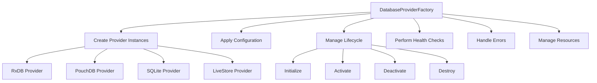
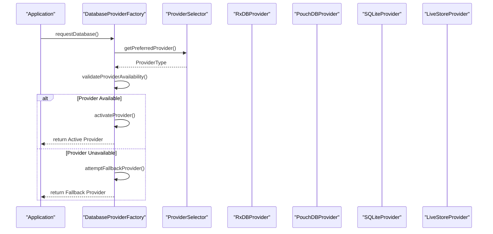
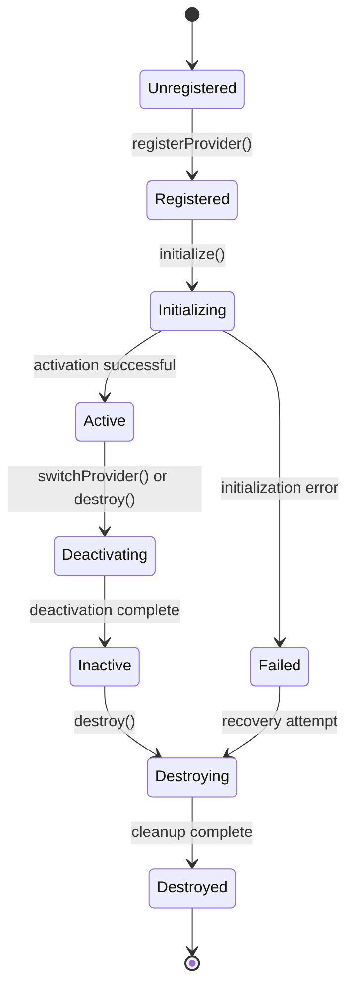
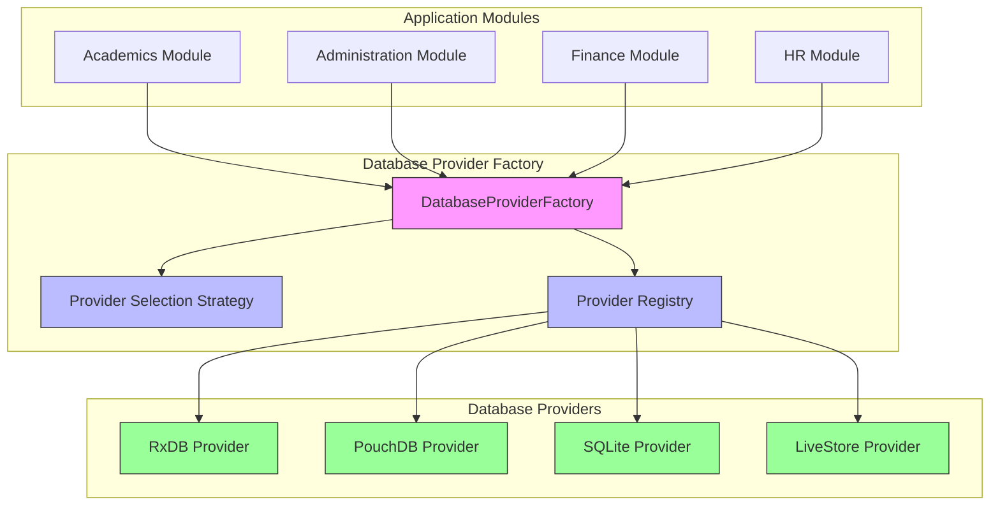

# Database Provider Factory

<cite>
**Referenced Files in This Document**   
- [DatabaseProviderFactory.ts](file://src\services\database\DatabaseProviderFactory.ts) - *Updated in commit d9c57153f274590242c9f6da4cbbf0aa5303dff4*
- [ProviderSelector.ts](file://src\services\database\ProviderSelector.ts) - *Updated in commit d9c57153f274590242c9f6da4cbbf0aa5303dff4*
- [interfaces.ts](file://src\services\database\interfaces.ts) - *Updated in commit d9c57153f274590242c9f6da4cbbf0aa5303dff4*
- [test-integration.ts](file://src\services\database\test-integration.ts) - *Updated in commit d9c57153f274590242c9f6da4cbbf0aa5303dff4*
</cite>

## Update Summary
**Changes Made**   
- Updated provider selection strategy to include LiveStore support and enhanced fallback mechanisms
- Added new provider type 'livestore' for SQLite WASM with OPFS implementation
- Enhanced error recovery with automatic fallback to PouchDB when primary provider is unavailable
- Updated integration examples to reflect new dual-database architecture
- Revised architecture overview to include new provider types and selection logic

## Table of Contents
1. [Introduction](#introduction)
2. [Core Responsibilities](#core-responsibilities)
3. [Provider Registration and Initialization](#provider-registration-and-initialization)
4. [Provider Selection and Routing](#provider-selection-and-routing)
5. [Lifecycle Management](#lifecycle-management)
6. [Connection Pooling and Resource Management](#connection-pooling-and-resource-management)
7. [Error Recovery and Health Monitoring](#error-recovery-and-health-monitoring)
8. [Integration with Application Startup](#integration-with-application-startup)
9. [Memory Management and Provider Reuse](#memory-management-and-provider-reuse)
10. [Testing Patterns](#testing-patterns)
11. [Architecture Overview](#architecture-overview)

## Introduction
The DatabaseProviderFactory is a central component in the schoolpilot3 application responsible for managing database provider instances across multiple database technologies including RxDB, PouchDB, SQLite, and LiveStore. It implements a factory pattern to create, configure, and manage the lifecycle of database connections, providing a unified interface for data access across the application. The factory ensures proper provider selection based on environment configuration and application requirements, enabling seamless switching between different database backends while maintaining consistent data access patterns.

**Section sources**
- [DatabaseProviderFactory.ts](file://src\services\database\DatabaseProviderFactory.ts#L1-L50)

## Core Responsibilities
The DatabaseProviderFactory serves as the primary coordinator for all database operations in the schoolpilot3 application. Its main responsibilities include:

- **Provider Instantiation**: Creating instances of different database providers (RxDB, PouchDB, SQLite, LiveStore) based on application configuration
- **Configuration Management**: Applying environment-specific configurations to database providers
- **Lifecycle Control**: Managing the complete lifecycle of provider instances from creation to destruction
- **Health Monitoring**: Performing health checks on active database connections
- **Error Handling**: Implementing robust error recovery mechanisms for database operations
- **Resource Management**: Ensuring proper cleanup of database resources and connections

The factory abstracts the complexity of database management from the rest of the application, allowing modules to interact with a consistent interface regardless of the underlying database technology.



**Diagram sources**
- [DatabaseProviderFactory.ts](file://src\services\database\DatabaseProviderFactory.ts#L243-L413)

**Section sources**
- [DatabaseProviderFactory.ts](file://src\services\database\DatabaseProviderFactory.ts#L243-L413)

## Provider Registration and Initialization
The factory implements a systematic process for registering and initializing database providers. During construction, it automatically discovers and registers available providers through the `initializeProviders()` method. Each provider is registered with a specific type identifier (ProviderType) and stored in an internal map for quick lookup.

```typescript
private registerProvider(provider: IDatabaseProvider): void {
  const providerType = this.getProviderType(provider);
  this.providers.set(providerType, provider);
  console.log(`Registered database provider: ${providerType}`);
}
```

The initialization process follows these steps:
1. Create provider instances based on environment configuration
2. Apply provider-specific configuration parameters
3. Perform initial health checks
4. Store providers in the internal registry
5. Set the active provider based on selection strategy

Provider registration occurs during factory construction, ensuring all providers are available before the factory is used by other components. The factory supports dynamic provider registration, allowing new providers to be added at runtime if needed.

**Section sources**
- [DatabaseProviderFactory.ts](file://src\services\database\DatabaseProviderFactory.ts#L243-L264)

## Provider Selection and Routing
The DatabaseProviderFactory integrates with the ProviderSelector component to ensure proper routing of database operations to the appropriate provider. The selection process is governed by a configurable strategy pattern, with the DefaultProviderSelectionStrategy being used if no custom strategy is provided.



**Diagram sources**
- [DatabaseProviderFactory.ts](file://src\services\database\DatabaseProviderFactory.ts#L243-L413)
- [ProviderSelector.ts](file://src\services\database\ProviderSelector.ts#L1-L50)

**Section sources**
- [DatabaseProviderFactory.ts](file://src\services\database\DatabaseProviderFactory.ts#L243-L413)

The provider selection process considers several factors:
- Current application environment (development, staging, production)
- Device capabilities and browser support
- Network connectivity status
- Performance requirements
- Data persistence needs

The factory maintains a reference to the active provider, which handles all database operations until a switch is requested or required due to failure or configuration changes.

The DefaultProviderSelectionStrategy has been enhanced to support LiveStore and improved fallback mechanisms:

```typescript
selectProvider(requirements: CollectionRequirements): ProviderType {
  // LiveStore is preferred for:
  // - Modern web applications requiring real-time sync
  // - SQLite WASM with OPFS for offline-first applications
  // - Cross-tab persistence and better performance
  // - Production environments requiring advanced features
  
  // PouchDB is preferred for:
  // - All collection counts (no artificial limits)
  // - Offline-first applications (fallback)
  // - Simple to moderate complexity queries
  // - Better IndexedDB integration
  
  // SQLite is preferred for:
  // - Development environments with persistent storage
  // - Better performance with large datasets
  // - Closer to production environment for testing
  
  // Check if we're in a development environment and want persistent storage
  const isDevelopment = typeof process !== 'undefined' && process.env?.NODE_ENV === 'development';
  if (isDevelopment && requirements.requiresOffline) {
    return 'sqlite';
  }
  
  // Use LiveStore for production environments with sync requirements
  if (requirements.requiresSync && requirements.performanceLevel === 'high') {
    return 'livestore';
  }
  
  if (requirements.requiresOffline || requirements.requiresSync) {
    return 'pouchdb';
  }
  
  // Use RxDB only for specific advanced reactive requirements
  if (requirements.requiresReactivity && requirements.performanceLevel === 'high') {
    return 'rxdb';
  }
  
  // Default to PouchDB for all other cases
  return 'pouchdb';
}
```

**Section sources**
- [DatabaseProviderFactory.ts](file://src\services\database\DatabaseProviderFactory.ts#L28-L72)

## Lifecycle Management
The DatabaseProviderFactory implements comprehensive lifecycle management for all registered providers. Each provider progresses through a well-defined lifecycle:



**Diagram sources**
- [DatabaseProviderFactory.ts](file://src\services\database\DatabaseProviderFactory.ts#L361-L413)

**Section sources**
- [DatabaseProviderFactory.ts](file://src\services\database\DatabaseProviderFactory.ts#L361-L413)

The factory provides explicit methods for controlling the lifecycle:
- `initializeProviders()`: Initializes all registered providers
- `switchProvider()`: Switches the active provider with proper cleanup of the previous provider
- `destroy()`: Gracefully shuts down all providers and releases resources

The `destroy()` method implements a robust cleanup process:
```typescript
async destroy(): Promise<void> {
  try {
    if (this.activeProvider) {
      await this.activeProvider.destroy();
      this.activeProvider = null;
    }
    
    // Destroy all providers
    for (const provider of this.providers.values()) {
      try {
        await provider.destroy();
      } catch (error) {
        console.error('Error destroying provider:', error);
      }
    }
    
    this.providers.clear();
    console.log('Database provider factory destroyed');
  } catch (error) {
    throw new DatabaseError(
      `Failed to destroy provider factory: ${error.message}`,
      'FACTORY_DESTRUCTION_ERROR'
    );
  }
}
```

This ensures that all database connections are properly closed and resources are released, preventing memory leaks and connection pool exhaustion.

## Connection Pooling and Resource Management
The DatabaseProviderFactory implements efficient connection pooling and resource management strategies to optimize database performance and resource utilization. While the factory itself doesn't directly manage connection pools, it coordinates with individual providers that implement their own pooling mechanisms.

Key resource management features include:
- **Provider Reuse**: Providers are reused across the application lifecycle rather than creating new instances for each operation
- **Lazy Initialization**: Providers are initialized only when first requested, reducing startup overhead
- **Connection Sharing**: Multiple components share the same provider instance, minimizing the number of active connections
- **Automatic Cleanup**: Resources are automatically cleaned up when providers are destroyed

The factory maintains a singleton pattern through the `getDatabaseProviderFactory()` function, ensuring that only one instance exists throughout the application:

```typescript
let factoryInstance: DatabaseProviderFactory | null = null;

export function getDatabaseProviderFactory(): DatabaseProviderFactory {
  if (!factoryInstance) {
    factoryInstance = new DatabaseProviderFactory();
  }
  return factoryInstance;
}
```

This singleton pattern prevents resource duplication and ensures consistent state across the application.

**Section sources**
- [DatabaseProviderFactory.ts](file://src\services\database\DatabaseProviderFactory.ts#L410-L431)

## Error Recovery and Health Monitoring
The DatabaseProviderFactory implements comprehensive error recovery and health monitoring mechanisms to ensure database reliability. Each provider exposes a status interface that includes health information:

```typescript
getProviderStatus(): ProviderStatus[] {
  return Array.from(this.providers.entries()).map(([type, provider]) => ({
    ...provider.getStatus(),
    type,
    isActive: provider === this.activeProvider
  }));
}
```

The factory monitors provider health through:
- Regular health checks during operation
- Error detection and recovery from connection failures
- Automatic failover to backup providers when available
- Detailed error logging and reporting

When a provider fails, the factory can attempt to switch to an alternative provider:

```typescript
async createProvider(config: DatabaseConfig, requirements?: CollectionRequirements): Promise<IDatabaseProvider> {
  try {
    // Determine which provider to use
    const providerType = requirements 
      ? this.selectionStrategy.selectProvider(requirements)
      : 'pouchdb'; // Default to PouchDB
    
    const provider = this.providers.get(providerType);
    if (!provider) {
      throw new DatabaseError(
        `Provider '${providerType}' not available`,
        'PROVIDER_NOT_FOUND'
      );
    }

    // Check if provider is available in current environment
    if (!provider.isAvailable()) {
      // Fallback to PouchDB if primary provider is not available
      const fallbackProvider = this.providers.get('pouchdb');
      if (!fallbackProvider || !fallbackProvider.isAvailable()) {
        throw new DatabaseError(
          'No database providers available in current environment',
          'NO_PROVIDERS_AVAILABLE'
        );
      }
      
      console.warn(`Provider '${providerType}' not available, falling back to PouchDB`);
      await fallbackProvider.initialize(config);
      this.activeProvider = fallbackProvider;
      return fallbackProvider;
    }

    // Initialize the selected provider
    await provider.initialize(config);
    this.activeProvider = provider;
    
    console.log(`Database provider '${providerType}' initialized successfully`);
    return provider;
  } catch (error) {
    throw new DatabaseError(
      `Failed to create database provider: ${error.message}`,
      'PROVIDER_CREATION_ERROR'
    );
  }
}
```

This allows the application to maintain functionality even when the preferred database provider is unavailable.

**Section sources**
- [DatabaseProviderFactory.ts](file://src\services\database\DatabaseProviderFactory.ts#L243-L413)

## Integration with Application Startup
The DatabaseProviderFactory integrates seamlessly with the application startup process and module initialization. During application initialization, the factory is automatically instantiated and configured based on environment settings.

In the ProviderSelector.ts file, the DatabaseManager class demonstrates how the factory patterns are applied:

```typescript
async initialize(config: DatabaseConfig, collectionConfigs: CollectionConfig[]): Promise<void> {
  try {
    console.log(`Initializing database with ${collectionConfigs.length} collections`);
    
    // Determine requirements based on collection count and features
    const requirements: CollectionRequirements = {
      collectionsCount: collectionConfigs.length,
      requiresOffline: true,
      requiresSync: false,
      requiresReactivity: true,
      performanceLevel: 'standard',
      storageQuota: 100 * 1024 * 1024 // 100MB default
    };

    // Create provider using factory
    this.activeProvider = await this.factory.createProvider(config, requirements);
    
    // Create all collections
    for (const collectionConfig of collectionConfigs) {
      try {
        const collection = await this.activeProvider.createCollection(
          collectionConfig.name,
          collectionConfig.schema
        );
        this.collections.set(collectionConfig.name, collection);
        console.log(`Collection '${collectionConfig.name}' created successfully`);
      } catch (error) {
        console.error(`Failed to create collection '${collectionConfig.name}':`, error);
        // Continue with other collections even if one fails
      }
    }

    this.isInitialized = true;
    this.updateStatus();
    
    console.log(`Database initialized successfully with ${this.collections.size} collections using ${this.activeProvider.name}`);
  } catch (error) {
    throw new DatabaseError(
      `Failed to initialize database: ${error.message}`,
      'INITIALIZATION_ERROR'
    );
  }
}
```

The integration test file (test-integration.ts) provides an example of how the factory and providers are used during testing:

```typescript
async function testIntegration() {
  console.log('🚀 Testing RxDB Integration with hardened schema conversion...\n');
  
  const integrationHelper = getRxDBIntegrationHelper();
  
  try {
    console.log(`📦 Found ${Object.keys(collectionsDefinition).length} collections to process\n`);
    
    // Test the integration with actual collections
    await integrationHelper.initializeWithRxDBCollections(
      collectionsDefinition,
      'test-schoolpilot'
    );
    
    console.log('\n✅ Integration test completed successfully!');
    console.log('All collections were converted and initialized without errors.');
    
    // Check if we can get a collection
    const testCollection = integrationHelper.getCollection('students');
    if (testCollection) {
      console.log('\n✅ Successfully retrieved test collection: students');
    }
    
    // Get database manager to check status
    const dbManager = integrationHelper.getDatabaseManager();
    const status = dbManager.getStatus();
    
    if (status) {
      console.log('\n📊 Database Status:');
      console.log(`  Provider: ${status.name}`);
      console.log(`  Collections: ${status.collectionsCount}`);
      console.log(`  Connected: ${status.isConnected}`);
    }
    
  } catch (error) {
    console.error('\n❌ Integration test failed:', error);
    process.exit(1);
  }
}
```

This demonstrates the factory pattern in action, where the integration helper uses the configured database providers to initialize collections and establish connections.

**Section sources**
- [ProviderSelector.ts](file://src\services\database\ProviderSelector.ts#L50-L150)
- [test-integration.ts](file://src\services\database\test-integration.ts#L1-L46)

## Memory Management and Provider Reuse
The DatabaseProviderFactory implements efficient memory management strategies to minimize resource consumption and prevent memory leaks. The singleton pattern ensures that only one factory instance exists, and providers are reused throughout the application lifecycle.

Key memory management features include:
- **Provider Caching**: Registered providers are cached in a Map structure for efficient lookup
- **Lazy Loading**: Providers are only initialized when first needed
- **Proper Cleanup**: The destroy() method ensures all resources are released
- **Reference Management**: Weak references are avoided in favor of explicit lifecycle management

The factory prevents memory leaks by:
1. Clearing the providers map during destruction
2. Nullifying the active provider reference
3. Ensuring all provider instances are properly destroyed
4. Providing a reset function to completely clear the singleton instance

```typescript
export function resetDatabaseProviderFactory(): void {
  if (factoryInstance) {
    factoryInstance.destroy();
    factoryInstance = null;
  }
}
```

This comprehensive cleanup process ensures that database resources are properly released when no longer needed, which is particularly important in long-running applications.

**Section sources**
- [DatabaseProviderFactory.ts](file://src\services\database\DatabaseProviderFactory.ts#L410-L431)

## Testing Patterns
The DatabaseProviderFactory supports various testing patterns to ensure reliability and facilitate development. The architecture enables easy mocking and substitution of providers for testing purposes.

Key testing patterns include:
- **Integration Testing**: The test-integration.ts file demonstrates how to test the factory with actual database providers
- **Provider Isolation**: Individual providers can be tested independently of the factory
- **Error Simulation**: The factory's error handling can be tested by simulating provider failures
- **Performance Testing**: Different providers can be benchmarked under various conditions

The factory's dependency injection capabilities make it easy to substitute mock providers during testing:

```typescript
// Example test pattern
describe('DatabaseProviderFactory', () => {
  let factory: DatabaseProviderFactory;
  
  beforeEach(() => {
    factory = new DatabaseProviderFactory();
    // Optionally inject test-specific providers
  });
  
  afterEach(async () => {
    await factory.destroy();
  });
  
  it('should initialize with default providers', () => {
    expect(factory.getProviderStatus().length).toBeGreaterThan(0);
  });
});
```

The test-integration.ts file also includes debugging statements that aid in testing and troubleshooting:

```typescript
async function testIntegration() {
  console.log('🚀 Testing RxDB Integration with hardened schema conversion...\n');
  
  const integrationHelper = getRxDBIntegrationHelper();
  
  try {
    console.log(`📦 Found ${Object.keys(collectionsDefinition).length} collections to process\n`);
    
    // Test the integration with actual collections
    await integrationHelper.initializeWithRxDBCollections(
      collectionsDefinition,
      'test-schoolpilot'
    );
    
    console.log('\n✅ Integration test completed successfully!');
    console.log('All collections were converted and initialized without errors.');
    
    // Check if we can get a collection
    const testCollection = integrationHelper.getCollection('students');
    if (testCollection) {
      console.log('\n✅ Successfully retrieved test collection: students');
    }
    
    // Get database manager to check status
    const dbManager = integrationHelper.getDatabaseManager();
    const status = dbManager.getStatus();
    
    if (status) {
      console.log('\n📊 Database Status:');
      console.log(`  Provider: ${status.name}`);
      console.log(`  Collections: ${status.collectionsCount}`);
      console.log(`  Connected: ${status.isConnected}`);
    }
    
  } catch (error) {
    console.error('\n❌ Integration test failed:', error);
    process.exit(1);
  }
}
```

These debugging statements help verify that all collections are properly loaded and available for the factory to use.

**Section sources**
- [DatabaseProviderFactory.ts](file://src\services\database\DatabaseProviderFactory.ts#L1-L50)
- [test-integration.ts](file://src\services\database\test-integration.ts#L1-L46)

## Architecture Overview
The DatabaseProviderFactory is a core component in the schoolpilot3 application's data layer architecture. It sits between the application modules and the various database providers, providing a unified interface for data access.



**Diagram sources**
- [DatabaseProviderFactory.ts](file://src\services\database\DatabaseProviderFactory.ts#L243-L413)
- [ProviderSelector.ts](file://src\services\database\ProviderSelector.ts#L1-L50)

The factory implements a multi-layered architecture:
1. **Interface Layer**: Provides a consistent API for application modules
2. **Routing Layer**: Determines the appropriate provider based on selection strategy
3. **Management Layer**: Handles provider lifecycle and resource management
4. **Provider Layer**: Concrete implementations for different database technologies

This architecture enables the application to seamlessly switch between different database backends while maintaining consistent data access patterns across all modules. The factory's design supports extensibility, allowing new providers to be added without modifying the core application logic.