# PouchDB Provider Implementation

<cite>
**Referenced Files in This Document**   
- [PouchDBProvider.ts](file://src/services/database/PouchDBProvider.ts)
- [interfaces.ts](file://src/services/database/interfaces.ts)
- [SyncContext.tsx](file://src/contexts/SyncContext.tsx)
- [DataSyncMonitoringService.ts](file://src/services/DataSyncMonitoringService.ts)
- [DataStrategyManager.ts](file://src/services/DataStrategyManager.ts)
- [test-pouchdb-provider.js](file://scripts/test/test-pouchdb-provider.js)
</cite>

## Table of Contents
1. [Introduction](#introduction)
2. [Core Architecture](#core-architecture)
3. [PouchDB Collection Implementation](#pouchdb-collection-implementation)
4. [Database Provider Interface Compliance](#database-provider-interface-compliance)
5. [Synchronization and Conflict Resolution](#synchronization-and-conflict-resolution)
6. [Offline-First Capabilities](#offline-first-capabilities)
7. [Performance Optimization](#performance-optimization)
8. [Usage Examples](#usage-examples)
9. [Integration with SyncContext](#integration-with-synccontext)
10. [Testing and Validation](#testing-and-validation)

## Introduction

The PouchDB Provider implementation in schoolpilot3 provides a robust offline-first data persistence solution with CouchDB-compatible synchronization capabilities. This document details the comprehensive architecture, functionality, and integration points of the PouchDBProvider, which enables seamless data access and synchronization across various network conditions.

The provider serves as a critical component in the application's dual-database architecture, offering local data storage with automatic synchronization to remote endpoints when connectivity is available. It implements the IDatabaseProvider interface, ensuring consistent API usage across different database providers in the system.

**Section sources**
- [PouchDBProvider.ts](file://src/services/database/PouchDBProvider.ts)

## Core Architecture

The PouchDBProvider follows a layered architecture that separates concerns between database operations, collection management, and synchronization logic. The core components include:

- **PouchDBProvider**: The main class implementing the IDatabaseProvider interface
- **PouchDBCollection**: A wrapper class that provides a consistent API for collection operations
- **RxJS Observables**: For reactive data access and change notifications
- **PouchDB with Find Plugin**: For local storage and complex querying capabilities

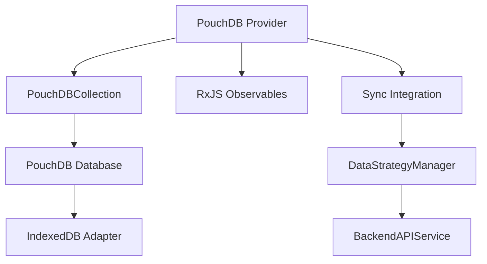

**Diagram sources**
- [PouchDBProvider.ts](file://src/services/database/PouchDBProvider.ts#L0-L659)

**Section sources**
- [PouchDBProvider.ts](file://src/services/database/PouchDBProvider.ts#L0-L659)

## PouchDB Collection Implementation

### Collection Class Structure

The PouchDBCollection class implements the ICollection interface, providing a comprehensive set of operations for data manipulation. It encapsulates a PouchDB database instance and provides a clean API for CRUD operations, queries, and reactive data access.

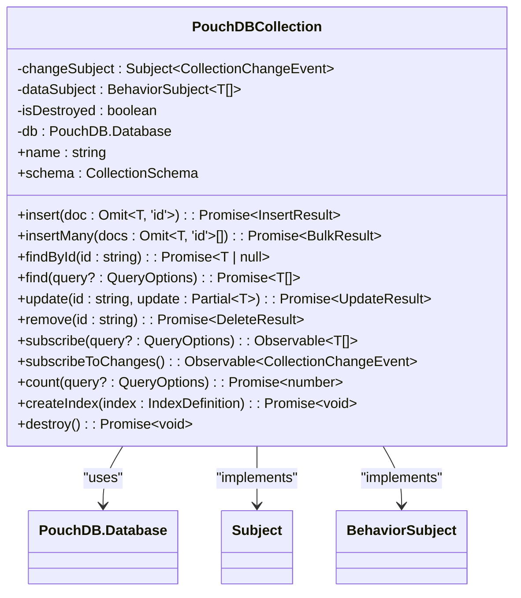

**Diagram sources**
- [PouchDBProvider.ts](file://src/services/database/PouchDBProvider.ts#L20-L199)

**Section sources**
- [PouchDBProvider.ts](file://src/services/database/PouchDBProvider.ts#L20-L199)

### Data Transformation

The collection implementation includes bidirectional data transformation methods to convert between PouchDB's document format and the application's data model:

- **transformDoc**: Converts PouchDB documents to application format by extracting the ID from _id and removing revision metadata
- **transformToPouch**: Converts application objects to PouchDB format by setting _id from id and removing the id property

These transformations ensure that the application code works with a clean data model while PouchDB handles the underlying document storage requirements.

### Change Detection and Reactivity

The PouchDBCollection implements a robust change detection system using PouchDB's changes feed:

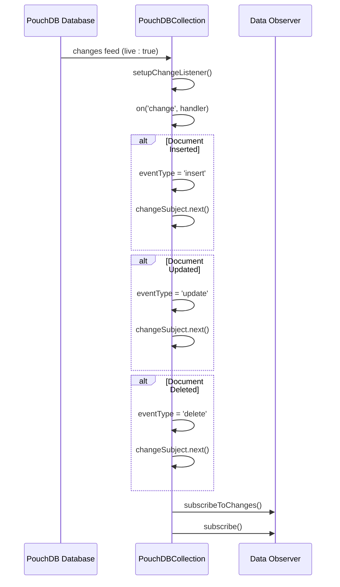

**Diagram sources**
- [PouchDBProvider.ts](file://src/services/database/PouchDBProvider.ts#L45-L75)

**Section sources**
- [PouchDBProvider.ts](file://src/services/database/PouchDBProvider.ts#L45-L75)

## Database Provider Interface Compliance

### IDatabaseProvider Implementation

The PouchDBProvider class implements the IDatabaseProvider interface, ensuring consistency with other database providers in the system. This interface-based design allows for provider interchangeability and supports the application's dual-database architecture.

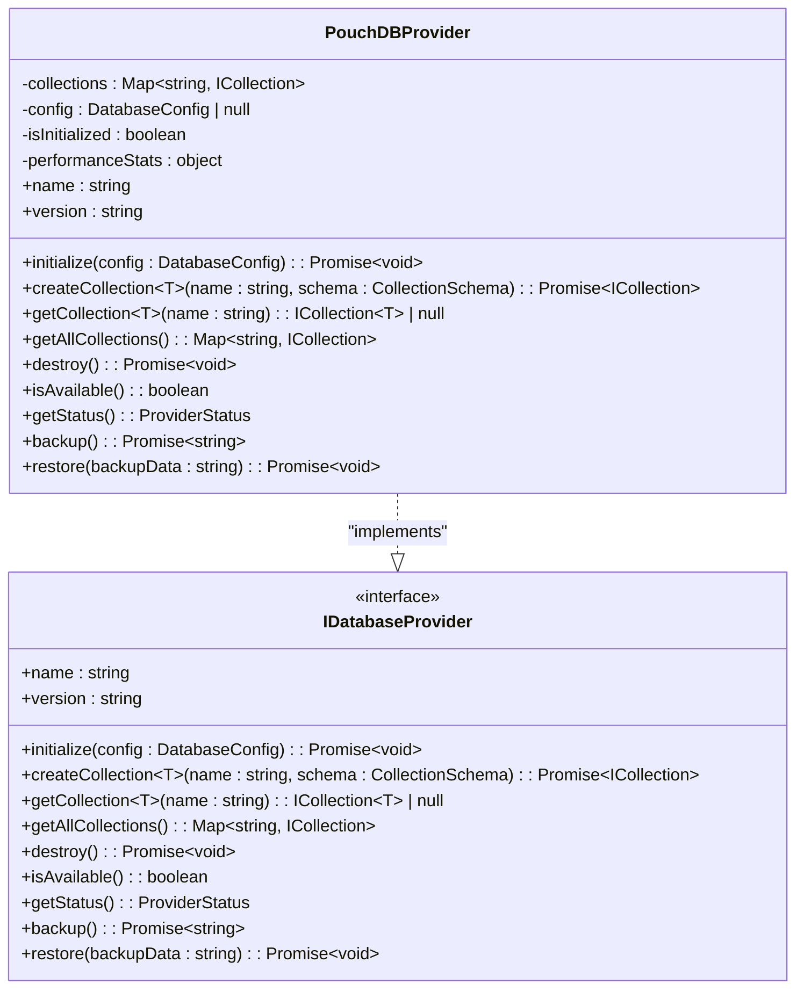

**Diagram sources**
- [PouchDBProvider.ts](file://src/services/database/PouchDBProvider.ts#L400-L659)
- [interfaces.ts](file://src/services/database/interfaces.ts#L150-L199)

**Section sources**
- [PouchDBProvider.ts](file://src/services/database/PouchDBProvider.ts#L400-L659)
- [interfaces.ts](file://src/services/database/interfaces.ts#L150-L199)

### Lifecycle Management

The provider implements a comprehensive lifecycle management system:

1. **Initialization**: Configures PouchDB defaults and sets up the provider
2. **Collection Creation**: Creates PouchDB instances for each collection with IndexedDB adapter
3. **Destruction**: Properly cleans up all collections and resources

The initialize method configures PouchDB with auto-compaction enabled by default and limits revision history to 10 versions to optimize storage usage.

### Collection Management

The provider maintains a Map of collections, allowing for efficient access and management:

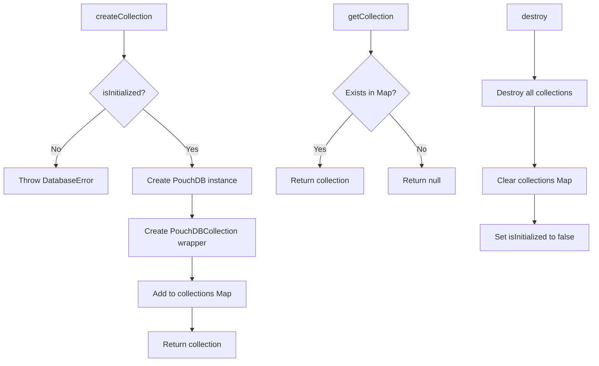

**Diagram sources**
- [PouchDBProvider.ts](file://src/services/database/PouchDBProvider.ts#L420-L490)

**Section sources**
- [PouchDBProvider.ts](file://src/services/database/PouchDBProvider.ts#L420-L490)

## Synchronization and Conflict Resolution

### Synchronization Architecture

The PouchDBProvider integrates with a sophisticated synchronization system that manages data flow between local and remote databases. This system is coordinated through the DataStrategyManager and DataSyncMonitoringService.

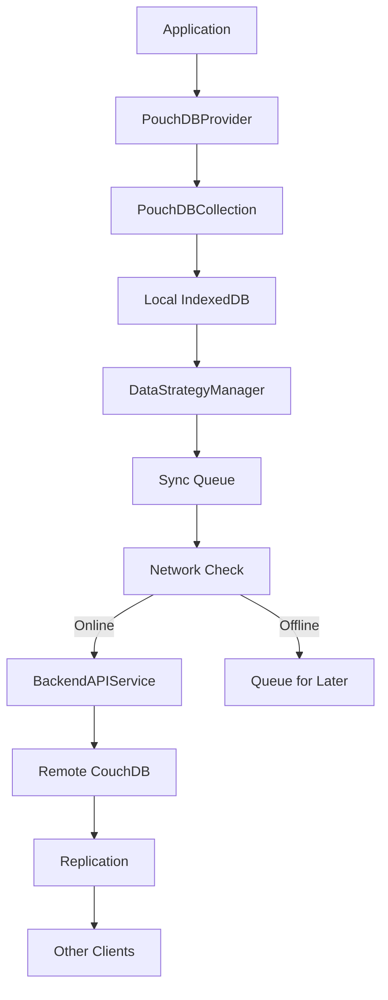

**Diagram sources**
- [DataStrategyManager.ts](file://src/services/DataStrategyManager.ts#L0-L574)
- [DataSyncMonitoringService.ts](file://src/services/DataSyncMonitoringService.ts#L0-L483)

**Section sources**
- [DataStrategyManager.ts](file://src/services/DataStrategyManager.ts#L0-L574)
- [DataSyncMonitoringService.ts](file://src/services/DataSyncMonitoringService.ts#L0-L483)

### Conflict Resolution Strategies

The system implements multiple conflict resolution strategies to handle data inconsistencies that may arise during synchronization:

- **Server Wins**: Remote data overwrites local changes
- **Client Wins**: Local data overwrites remote changes
- **Merge**: Combines data from both sources intelligently
- **Manual**: User intervention required to resolve conflicts

The merge strategy implemented in DataSyncMonitoringService follows these rules:
- Prefer remote data for most fields
- Preserve local creation timestamp if it exists
- Use the latest update timestamp from either source

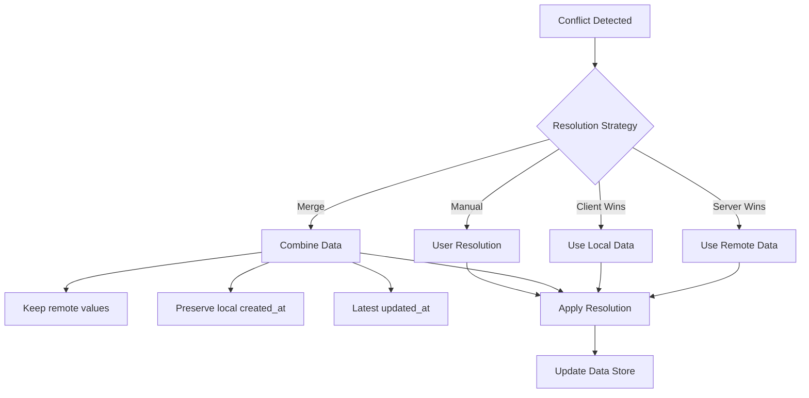

**Diagram sources**
- [DataSyncMonitoringService.ts](file://src/services/DataSyncMonitoringService.ts#L292-L339)

**Section sources**
- [DataSyncMonitoringService.ts](file://src/services/DataSyncMonitoringService.ts#L292-L339)

### Replication Configuration

The replication process is managed by the DataStrategyManager, which determines the appropriate execution plan based on the current strategy and network conditions:

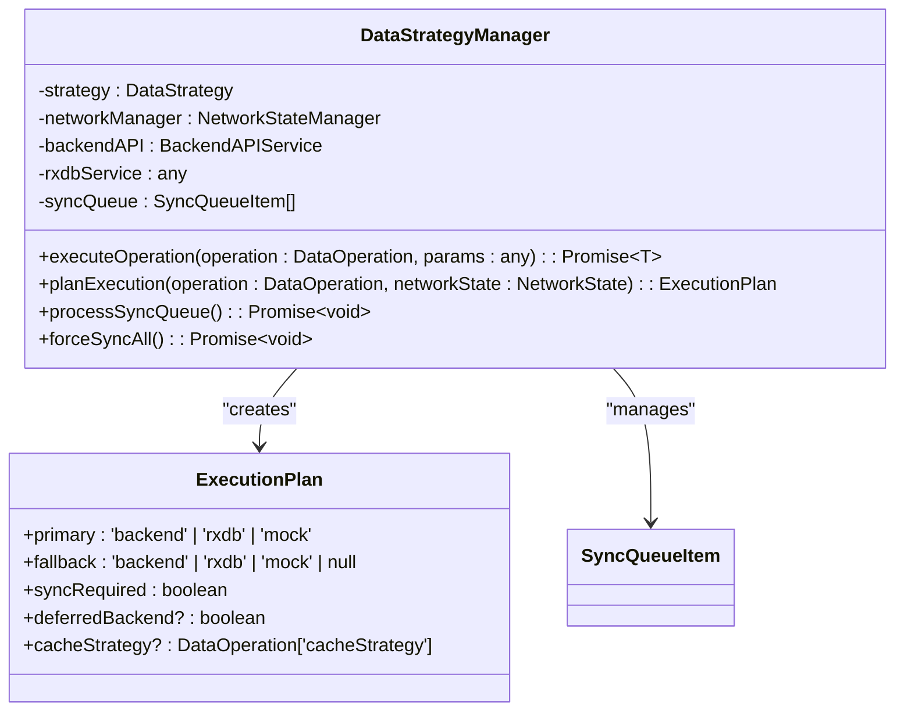

**Diagram sources**
- [DataStrategyManager.ts](file://src/services/DataStrategyManager.ts#L0-L574)

**Section sources**
- [DataStrategyManager.ts](file://src/services/DataStrategyManager.ts#L0-L574)

## Offline-First Capabilities

### Offline Operation Flow

The PouchDBProvider enables robust offline-first functionality, allowing users to continue working even when network connectivity is unavailable:

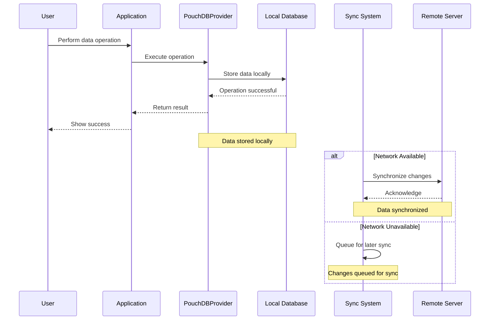

**Diagram sources**
- [PouchDBProvider.ts](file://src/services/database/PouchDBProvider.ts)
- [DataStrategyManager.ts](file://src/services/DataStrategyManager.ts)

**Section sources**
- [PouchDBProvider.ts](file://src/services/database/PouchDBProvider.ts)
- [DataStrategyManager.ts](file://src/services/DataStrategyManager.ts)

### Data Privacy and Filtered Replication

The system supports filtered replication to ensure data privacy and compliance with access controls:

- **Collection-level filtering**: Only sync collections that the user has permission to access
- **Document-level filtering**: Apply access control rules to individual documents
- **Field-level filtering**: Exclude sensitive fields from synchronization

The DataStrategyManager's planExecution method determines which operations require backend synchronization based on the operation type, user permissions, and data sensitivity.

### Incremental Replication

The synchronization system implements incremental replication to optimize bandwidth usage and performance:

- Only changed documents are synchronized
- Revision tracking ensures data consistency
- Batch processing reduces the number of network requests
- Conflict detection and resolution handles concurrent modifications

The sync queue in DataStrategyManager manages pending operations, prioritizing them based on importance and ensuring they are processed efficiently when connectivity is restored.

## Performance Optimization

### Query Performance

The PouchDBProvider includes several performance optimization features:

- **Indexing**: Support for creating indexes on frequently queried fields
- **Caching**: In-memory caching of frequently accessed data
- **Batch operations**: Efficient bulk insert, update, and delete operations
- **Query optimization**: Use of PouchDB-Find for complex queries

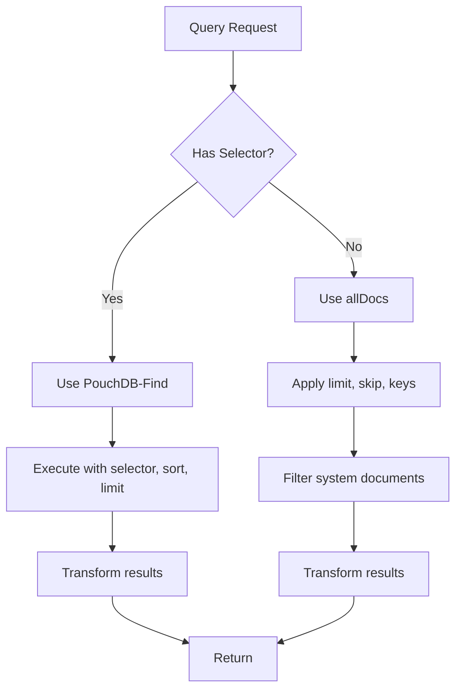

**Diagram sources**
- [PouchDBProvider.ts](file://src/services/database/PouchDBProvider.ts#L200-L250)

**Section sources**
- [PouchDBProvider.ts](file://src/services/database/PouchDBProvider.ts#L200-L250)

### Memory Management

The provider implements several memory management techniques:

- **Auto-compaction**: Enabled by default to reduce database size
- **Revision limit**: Limited to 10 versions to prevent excessive storage
- **Resource cleanup**: Proper destruction of collections and observables
- **Connection pooling**: Reuse of database connections when possible

The destroy method ensures proper cleanup of all resources, including completing observables and destroying the underlying PouchDB instances.

### Sync Performance Optimization

The synchronization system includes several performance optimizations:

- **Batched operations**: Grouping multiple changes into single requests
- **Prioritized queue**: Processing high-priority operations first
- **Connection reuse**: Maintaining persistent connections when possible
- **Error handling**: Retry logic with exponential backoff

The DataStrategyManager's syncInterval and batchSize configuration options allow fine-tuning of synchronization performance based on network conditions and application requirements.

## Usage Examples

### Basic CRUD Operations

The PouchDBProvider supports standard CRUD operations through a consistent API:

```typescript
// Initialize the provider
const provider = new PouchDBProvider();
await provider.initialize({
  name: 'schoolpilot',
  autoCompaction: true
});

// Create a collection
const studentSchema = {
  version: 1,
  type: 'object',
  properties: {
    id: { type: 'string' },
    name: { type: 'string' },
    age: { type: 'number' },
    grade: { type: 'string' }
  },
  required: ['id', 'name']
};

const students = await provider.createCollection('students', studentSchema);

// Insert a document
const result = await students.insert({
  name: 'John Doe',
  age: 15,
  grade: '9'
});

// Find documents
const allStudents = await students.find();
const ninthGraders = await students.find({
  selector: { grade: '9' }
});

// Update a document
await students.update(result.id, { age: 16 });

// Remove a document
await students.remove(result.id);
```

**Section sources**
- [PouchDBProvider.ts](file://src/services/database/PouchDBProvider.ts)
- [test-pouchdb-provider.js](file://scripts/test/test-pouchdb-provider.js)

### Reactive Data Access

The provider supports reactive programming patterns using RxJS observables:

```typescript
// Subscribe to all changes in a collection
const subscription = students.subscribeToChanges().subscribe(
  (change) => {
    console.log(`Document ${change.id} was ${change.type}`);
    console.log('New data:', change.doc);
  },
  (error) => {
    console.error('Error in change stream:', error);
  }
);

// Subscribe to query results
const gradeSub = students.subscribe({
  selector: { grade: '10' }
}).subscribe(
  (students) => {
    console.log(`Found ${students.length} tenth graders`);
    // Update UI with new data
  }
);

// Clean up subscriptions
// subscription.unsubscribe();
// gradeSub.unsubscribe();
```

**Section sources**
- [PouchDBProvider.ts](file://src/services/database/PouchDBProvider.ts)

### Mobile and Offline Scenarios

The provider excels in mobile and offline scenarios:

```typescript
// Check if provider is available (IndexedDB support)
if (!provider.isAvailable()) {
  console.warn('PouchDB not available in this environment');
  // Fallback to alternative storage
}

// Handle network changes
window.addEventListener('online', () => {
  console.log('Network connected - syncing data');
  // Sync system will automatically process queued operations
});

window.addEventListener('offline', () => {
  console.log('Network disconnected - working offline');
  // All operations continue to work locally
});

// Monitor sync status
const syncStatus = provider.getStatus();
console.log(`Connected: ${syncStatus.isConnected}`);
console.log(`Collections: ${syncStatus.collectionsCount}`);
```

**Section sources**
- [PouchDBProvider.ts](file://src/services/database/PouchDBProvider.ts)
- [SyncContext.tsx](file://src/contexts/SyncContext.tsx)

## Integration with SyncContext

### Sync Status Monitoring

The PouchDBProvider integrates with the SyncContext to provide real-time synchronization status to the user interface:

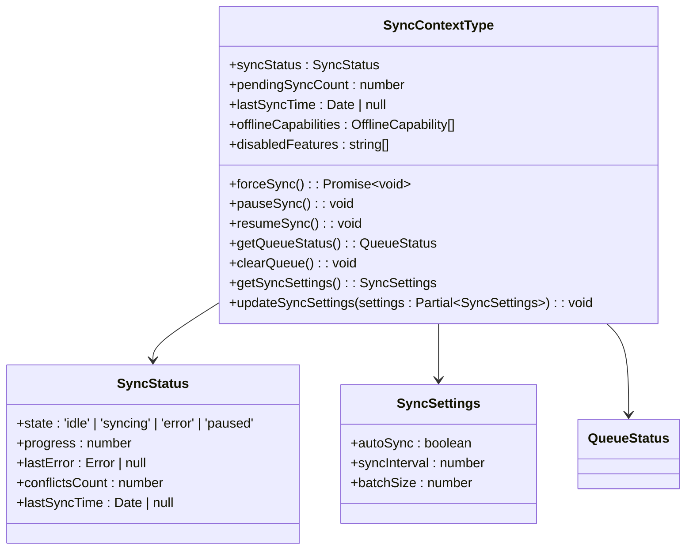

**Diagram sources**
- [SyncContext.tsx](file://src/contexts/SyncContext.tsx#L0-L198)

**Section sources**
- [SyncContext.tsx](file://src/contexts/SyncContext.tsx#L0-L198)

### User Interface Integration

The SyncContext provides a clean API for components to interact with the synchronization system:

```typescript
// In a React component
import { useSync } from '../contexts/SyncContext';

function SyncStatusIndicator() {
  const { 
    syncStatus, 
    pendingSyncCount, 
    forceSync,
    pauseSync,
    resumeSync,
    getSyncSettings,
    updateSyncSettings
  } = useSync();
  
  return (
    <div>
      <div>Status: {syncStatus.state}</div>
      <div>Progress: {syncStatus.progress}%</div>
      <div>Pending: {pendingSyncCount} changes</div>
      
      {syncStatus.state === 'idle' && (
        <button onClick={() => forceSync()}>
          Sync Now
        </button>
      )}
      
      {syncStatus.state === 'syncing' && (
        <button onClick={() => pauseSync()}>
          Pause Sync
        </button>
      )}
      
      {syncStatus.state === 'paused' && (
        <button onClick={() => resumeSync()}>
          Resume Sync
        </button>
      )}
    </div>
  );
}
```

**Section sources**
- [SyncContext.tsx](file://src/contexts/SyncContext.tsx)

### Conflict Resolution Interface

The synchronization system provides a comprehensive conflict resolution interface:

```typescript
// Access unresolved conflicts
const unresolvedConflicts = globalDataSyncMonitoringService.getUnresolvedConflicts();

// Resolve a conflict
await globalDataSyncMonitoringService.resolveConflict(conflictId, {
  strategy: 'merge',
  resolvedBy: currentUser.id,
  notes: 'Merged latest grade information'
});

// Clear resolved conflicts
globalDataSyncMonitoringService.clearResolvedConflicts();
```

**Section sources**
- [DataSyncMonitoringService.ts](file://src/services/DataSyncMonitoringService.ts)
- [SyncContext.tsx](file://src/contexts/SyncContext.tsx)

## Testing and Validation

### Unit Testing

The PouchDBProvider includes comprehensive test coverage to ensure reliability:

```javascript
// test-pouchdb-provider.js
async function testPouchDBProvider() {
  // Test provider creation
  const provider = new PouchDBProvider();
  console.log(`Provider created: ${provider.name} v${provider.version}`);
  
  // Test availability
  const isAvailable = provider.isAvailable();
  console.log(`Provider available: ${isAvailable}`);
  
  // Test initialization
  await provider.initialize({
    name: 'test-db',
    autoCompaction: true
  });
  
  // Test collection creation and operations
  const collection = await provider.createCollection('test_collection', testSchema);
  const insertResult = await collection.insert({ name: 'Test User', age: 25 });
  const doc = await collection.findById(insertResult.id);
  
  // Test backup and restore
  const backup = await provider.backup();
  await provider.destroy();
  
  console.log('All tests passed successfully!');
}
```

**Section sources**
- [test-pouchdb-provider.js](file://scripts/test/test-pouchdb-provider.js)

### Integration Testing

The system includes integration tests to verify the end-to-end synchronization workflow:

- **Offline operation**: Verify data can be created and modified offline
- **Sync triggering**: Test automatic and manual synchronization
- **Conflict resolution**: Validate conflict detection and resolution
- **Error recovery**: Test behavior during network failures and retries

The test suite ensures that the PouchDBProvider works correctly in various scenarios, including edge cases like concurrent modifications and network interruptions.

### Performance Testing

The implementation includes performance monitoring capabilities:

- **Query timing**: Track average query execution time
- **Memory usage**: Monitor database size and memory consumption
- **Sync throughput**: Measure data transfer rates
- **Conflict rates**: Track frequency of synchronization conflicts

These metrics are exposed through the provider's status and performance monitoring services, allowing for continuous optimization of the synchronization system.