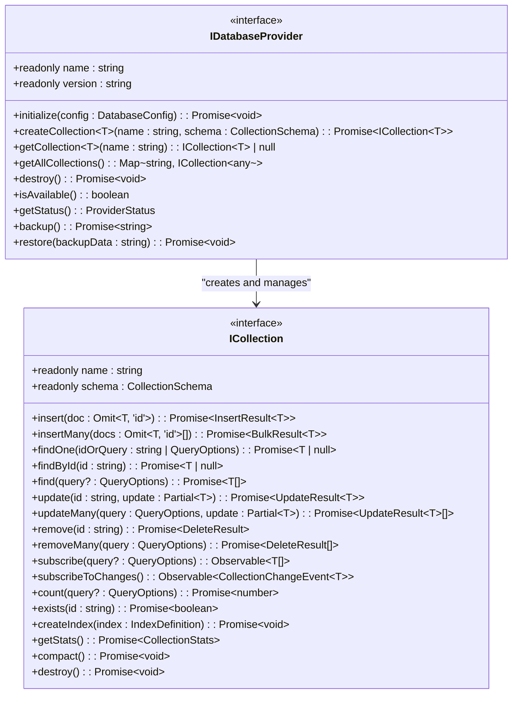
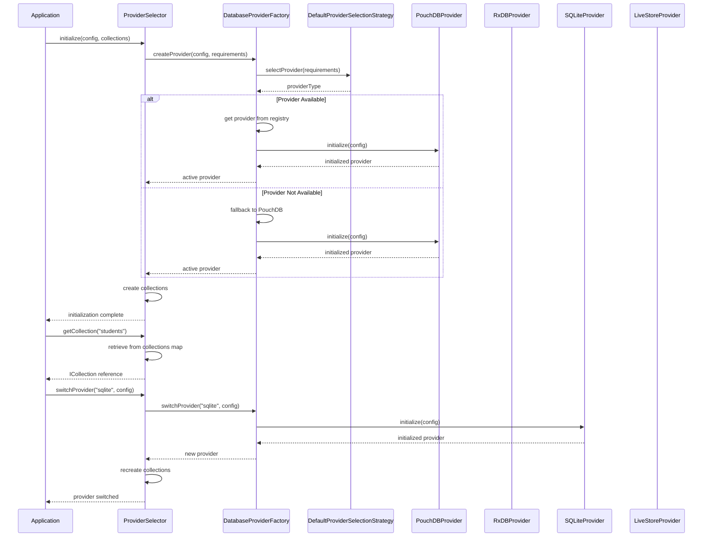
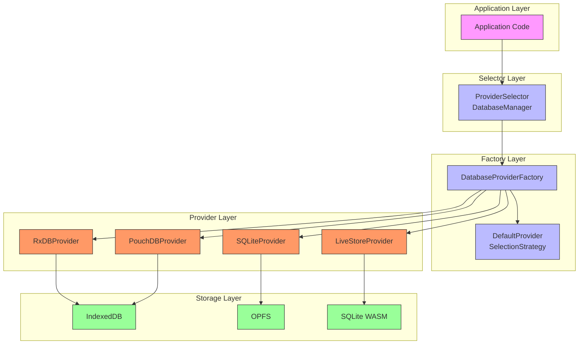

# Provider Interfaces and Contracts

<cite>
**Referenced Files in This Document**   
- [interfaces.ts](file://src/services/database/interfaces.ts)
- [ProviderSelector.ts](file://src/services/database/ProviderSelector.ts)
- [DatabaseProviderFactory.ts](file://src/services/database/DatabaseProviderFactory.ts)
- [RxDBProvider.ts](file://src/services/database/RxDBProvider.ts)
- [PouchDBProvider.ts](file://src/services/database/PouchDBProvider.ts)
- [SQLiteProvider.ts](file://src/services/database/SQLiteProvider.ts)
- [LiveStoreProvider.ts](file://src/services/database/LiveStoreProvider.ts)
</cite>

## Table of Contents
1. [Introduction](#introduction)
2. [Core Database Provider Interface](#core-database-provider-interface)
3. [Collection Interface](#collection-interface)
4. [Auxiliary Interfaces and Types](#auxiliary-interfaces-and-types)
5. [Provider Selection and Polymorphism](#provider-selection-and-polymorphism)
6. [Concrete Provider Implementations](#concrete-provider-implementations)
7. [Type Safety and Testing Benefits](#type-safety-and-testing-benefits)
8. [Architecture Overview](#architecture-overview)

## Introduction
The schoolpilot3 system implements a robust database abstraction layer through well-defined interfaces and contracts that standardize database operations across multiple provider technologies. This documentation details the interface contracts that enable consistent CRUD operations, querying, transactions, and connection management regardless of the underlying database technology. The architecture supports multiple database providers including RxDB, PouchDB, SQLite, and LiveStore (SQLite WASM), allowing the system to adapt to different environments and requirements while maintaining a consistent API for data operations.

**Section sources**
- [interfaces.ts](file://src/services/database/interfaces.ts#L0-L243)

## Core Database Provider Interface

The `IDatabaseProvider` interface serves as the foundation for all database provider implementations in the schoolpilot3 system. This interface standardizes the lifecycle management, collection operations, and health monitoring across all database technologies. By defining a consistent contract, the interface enables polymorphic behavior where different database implementations can be used interchangeably without changing the application code that consumes them.

The interface includes several key method groups:

**Lifecycle Management**
- `initialize(config: DatabaseConfig)`: Initializes the provider with configuration options including database name, version, storage type, and performance settings
- `destroy()`: Properly shuts down the provider and releases resources
- `isAvailable()`: Checks if the provider is available in the current environment (browser vs. Node.js)

**Collection Management**
- `createCollection<T>(name: string, schema: CollectionSchema)`: Creates a new collection with the specified schema
- `getCollection<T>(name: string)`: Retrieves a reference to an existing collection
- `getAllCollections()`: Returns a map of all available collections

**Backup and Restore**
- `backup()`: Creates a backup of the entire database
- `restore(backupData: string)`: Restores the database from a backup

**Status and Health**
- `getStatus()`: Returns detailed status information about the provider



**Diagram sources**
- [interfaces.ts](file://src/services/database/interfaces.ts#L170-L188)
- [interfaces.ts](file://src/services/database/interfaces.ts#L135-L167)

**Section sources**
- [interfaces.ts](file://src/services/database/interfaces.ts#L170-L188)

## Collection Interface

The `ICollection<T>` interface defines the contract for collection-level operations, providing a standardized API for CRUD operations, querying, and reactive data access. This interface is implemented by all provider-specific collection classes, ensuring consistent behavior across different database technologies.

### CRUD Operations
The interface provides comprehensive CRUD (Create, Read, Update, Delete) operations with detailed return types that include metadata about the operation results:

- **Insert Operations**
  - `insert(doc: Omit<T, 'id'>)`: Creates a new document and returns an `InsertResult<T>` containing the generated ID, revision, and the inserted document
  - `insertMany(docs: Omit<T, 'id'>[])`: Inserts multiple documents and returns a `BulkResult<T>` with individual results and any errors

- **Read Operations**
  - `findOne(idOrQuery: string | QueryOptions)`: Enhanced method that accepts either a document ID or query options
  - `findById(id: string)`: Convenience method for finding by ID
  - `find(query?: QueryOptions)`: Returns multiple documents matching the query

- **Update Operations**
  - `update(id: string, update: Partial<T>)`: Updates a document by ID and returns an `UpdateResult<T>`
  - `updateMany(query: QueryOptions, update: Partial<T>)`: Updates multiple documents matching the query

- **Delete Operations**
  - `remove(id: string)`: Removes a document by ID
  - `removeMany(query: QueryOptions)`: Removes multiple documents matching the query

### Reactive Operations
The interface supports reactive programming patterns through RxJS observables:

- `subscribe(query?: QueryOptions)`: Returns an Observable that emits the current results and subsequent changes
- `subscribeToChanges()`: Returns an Observable that emits change events (insert, update, delete)

### Performance and Management Operations
Additional methods support performance optimization and collection management:

- `count(query?: QueryOptions)`: Returns the number of documents matching the query
- `exists(id: string)`: Checks if a document exists
- `createIndex(index: IndexDefinition)`: Creates an index for improved query performance
- `getStats()`: Returns statistics about the collection
- `compact()`: Compacts the collection to optimize storage
- `destroy()`: Destroys the collection

```mermaid
classDiagram
class ICollection~T~ {
<<interface>>
+readonly name : string
+readonly schema : CollectionSchema
+insert(doc : Omit~T, 'id'~) : Promise~InsertResult~T~~
+insertMany(docs : Omit~T, 'id'~[]) : Promise~BulkResult~T~~
+findOne(idOrQuery : string | QueryOptions) : Promise~T | null~
+findById(id : string) : Promise~T | null~
+find(query? : QueryOptions) : Promise~T[]~
+update(id : string, update : Partial~T~) : Promise~UpdateResult~T~~
+updateMany(query : QueryOptions, update : Partial~T~) : Promise~UpdateResult~T~[]~
+remove(id : string) : Promise~DeleteResult~
+removeMany(query : QueryOptions) : Promise~DeleteResult[]~
+upsert?(id : string, doc : Partial~T~) : Promise~UpdateResult~T~ | InsertResult~T~~
+delete?(id : string) : Promise~DeleteResult~
+subscribe(query? : QueryOptions) : Observable~T[]~
+subscribeToChanges() : Observable~CollectionChangeEvent~T~~
+count(query? : QueryOptions) : Promise~number~
+exists(id : string) : Promise~boolean~
+createIndex(index : IndexDefinition) : Promise~void~
+getStats() : Promise~CollectionStats~
+compact() : Promise~void~
+destroy() : Promise~void~
}
class InsertResult~T~ {
+id : string
+rev? : string
+doc : T
+ok? : boolean
}
class UpdateResult~T~ {
+id : string
+rev? : string
+doc? : T
+ok? : boolean
}
class DeleteResult {
+id : string
+rev? : string
+ok? : boolean
+deleted? : boolean
}
class BulkResult~T~ {
+docs : InsertResult~T~[]
+errors : { id : string; error : string; reason : string }[]
}
class CollectionChangeEvent~T~ {
+type : 'insert' | 'update' | 'delete'
+doc : T
+oldDoc? : T
+id : string
}
ICollection~T~ --> InsertResult~T~ : "returns"
ICollection~T~ --> BulkResult~T~ : "returns"
ICollection~T~ --> UpdateResult~T~ : "returns"
ICollection~T~ --> DeleteResult : "returns"
ICollection~T~ --> CollectionChangeEvent~T~ : "emits"
```

**Diagram sources**
- [interfaces.ts](file://src/services/database/interfaces.ts#L135-L167)

**Section sources**
- [interfaces.ts](file://src/services/database/interfaces.ts#L135-L167)

## Auxiliary Interfaces and Types

The database abstraction layer includes several auxiliary interfaces and types that support the core provider and collection interfaces. These contracts ensure type safety and provide additional functionality for database operations.

### Configuration and Schema Interfaces
- `DatabaseConfig`: Defines configuration options for database initialization including name, version, storage type, and performance settings
- `CollectionSchema`: Specifies the schema for a collection with properties, indexes, relationships, and validation rules
- `SchemaProperty`: Defines the structure of individual schema properties with type, format, validation, and other metadata
- `IndexDefinition`: Describes database indexes with fields, uniqueness, and other index properties
- `RelationshipDefinition`: Defines relationships between collections (one-to-one, one-to-many, many-to-many)

### Query and Result Interfaces
- `QueryOptions`: Provides flexible querying capabilities with selector, sorting, pagination, and field selection options
- `InsertResult<T>`: Standardized result type for insert operations containing the inserted document and metadata
- `UpdateResult<T>`: Standardized result type for update operations
- `DeleteResult`: Standardized result type for delete operations
- `BulkResult<T>`: Result type for bulk operations that includes individual results and any errors

### Status and Statistics Interfaces
- `ProviderStatus`: Contains comprehensive status information about a database provider including connection status, performance metrics, and error information
- `CollectionStats`: Provides statistics about a collection including document count, index count, and storage size

### Error Handling Interfaces
- `DatabaseError`: Custom error type for database-related errors with error codes and messages
- `CollectionError`: Custom error type for collection-specific errors

```mermaid
classDiagram
class DatabaseConfig {
+name : string
+version? : number
+storage? : string
+multiInstance? : boolean
+ignoreDuplicate? : boolean
+autoCompaction? : boolean
+debug? : boolean
}
class CollectionSchema {
+version : number
+type : 'object'
+properties : Record~string, SchemaProperty~
+required? : string[]
+indexes? : IndexDefinition[]
+primaryKey? : string
+relationships? : RelationshipDefinition[]
}
class SchemaProperty {
+type : string
+format? : string
+enum? : any[]
+items? : SchemaProperty
+properties? : Record~string, SchemaProperty~
+validation? : ValidationRule[]
+maxLength? : number
+minimum? : number
+maximum? : number
+multipleOf? : number
+ref? : string
+default? : any
}
class IndexDefinition {
+name : string
+fields : string[]
+unique? : boolean
+sparse? : boolean
+background? : boolean
+partialFilterExpression? : Record~string, any~
}
class RelationshipDefinition {
+type : 'one-to-one' | 'one-to-many' | 'many-to-many'
+target : string
+foreignKey : string
+localKey? : string
}
class QueryOptions {
+selector? : Record~string, any~
+sort? : string | Record[]string, 'asc' | 'desc'~~
+limit? : number
+skip? : number
+fields? : string[]
+include_docs? : boolean
+startkey? : any
+endkey? : any
+key? : any
+keys? : any[]
}
class ProviderStatus {
+name : string
+version : string
+isConnected : boolean
+collectionsCount : number
+lastError? : Error
+performance : {
avgQueryTime : number
totalQueries : number
memoryUsage : number
}
}
class CollectionStats {
+name : string
+documentCount : number
+indexCount : number
+storageSize : number
+lastModified : Date
}
class DatabaseError {
+message : string
+code : string
+stack? : string
}
class CollectionError {
+message : string
+collectionName : string
+code : string
}
class CollectionRequirements {
+collectionsCount : number
+requiresReactivity : boolean
+requiresOffline : boolean
+requiresSync : boolean
+performanceLevel : 'basic' | 'standard' | 'high'
+storageQuota : number
}
IDatabaseProvider --> DatabaseConfig : "uses"
IDatabaseProvider --> CollectionSchema : "uses"
ICollection --> QueryOptions : "uses"
ICollection --> CollectionStats : "returns"
IDatabaseProvider --> ProviderStatus : "returns"
DatabaseError --> Error : "extends"
CollectionError --> DatabaseError : "extends"
```

**Diagram sources**
- [interfaces.ts](file://src/services/database/interfaces.ts#L10-L133)

**Section sources**
- [interfaces.ts](file://src/services/database/interfaces.ts#L10-L133)

## Provider Selection and Polymorphism

The schoolpilot3 system implements a sophisticated provider selection mechanism through the `DatabaseProviderFactory` and `ProviderSelector` classes, enabling polymorphic behavior and dynamic provider switching based on environmental requirements.

### DatabaseProviderFactory
The `DatabaseProviderFactory` class implements the factory pattern to create and manage database provider instances. It maintains a registry of available providers and selects the appropriate provider based on system requirements and environmental constraints.

Key features of the factory:
- **Provider Registration**: Automatically registers all available providers (PouchDB, RxDB, SQLite, LiveStore)
- **Selection Strategy**: Uses a pluggable strategy pattern with `DefaultProviderSelectionStrategy` to determine the optimal provider
- **Environment Awareness**: Considers factors like development vs. production environment, offline requirements, and performance needs
- **Fallback Mechanism**: Implements graceful degradation by falling back to PouchDB if the preferred provider is unavailable

The selection logic prioritizes providers based on requirements:
- **Development Environment**: Prefers SQLite for persistent storage
- **Production with Sync Requirements**: Prefers LiveStore for high-performance SQLite WASM with OPFS
- **Offline-First Applications**: Prefers PouchDB for reliable IndexedDB integration
- **High-Performance Reactive Requirements**: Prefers RxDB for advanced reactive capabilities



**Diagram sources**
- [DatabaseProviderFactory.ts](file://src/services/database/DatabaseProviderFactory.ts#L243-L408)
- [ProviderSelector.ts](file://src/services/database/ProviderSelector.ts#L71-L117)

**Section sources**
- [DatabaseProviderFactory.ts](file://src/services/database/DatabaseProviderFactory.ts#L243-L408)
- [ProviderSelector.ts](file://src/services/database/ProviderSelector.ts#L71-L155)

## Concrete Provider Implementations

The schoolpilot3 system includes multiple concrete implementations of the `IDatabaseProvider` interface, each tailored to a specific database technology while adhering to the same contract.

### RxDBProvider
The `RxDBProvider` implements the interface using RxDB, a reactive database for JavaScript applications. It provides advanced reactive capabilities through RxJS observables and integrates with PouchDB for storage.

Key implementation details:
- Uses RxDB collections with reactive change listeners
- Transforms RxDB documents to application format
- Implements all CRUD operations with proper error handling
- Supports reactive queries through RxJS observables
- Integrates RxDB plugins for validation, migration, and leader election

### PouchDBProvider
The `PouchDBProvider` implements the interface using PouchDB directly, providing a lightweight and reliable solution for browser-based storage.

Key implementation details:
- Uses PouchDB's built-in change tracking for reactive operations
- Transforms PouchDB documents (removing _id and _rev fields)
- Implements bulk operations with proper error handling per document
- Supports complex queries through PouchDB-Find plugin
- Handles document conflicts and versioning

### SQLiteProvider
The `SQLiteProvider` implements the interface using SQLite with OPFS (Origin Private File System) for high-performance, persistent storage.

Key implementation details:
- Delegates to SQLiteOPFSService for actual database operations
- Provides a clean interface abstraction over SQLite operations
- Supports backup and restore operations
- Implements proper initialization and destruction lifecycle
- Includes environment checks for availability

### LiveStoreProvider
The `LiveStoreProvider` implements the interface using SQLite WASM, enabling high-performance SQL operations in the browser.

Key implementation details:
- Uses sqlite3InitModule for WASM-based SQLite
- Creates SQL tables based on collection schemas
- Implements proper indexing for performance
- Supports reactive data subscriptions
- Includes comprehensive error handling and validation

```mermaid
classDiagram
class IDatabaseProvider {
<<interface>>
+readonly name : string
+readonly version : string
+initialize(config : DatabaseConfig) : Promise~void~
+createCollection~T~(name : string, schema : CollectionSchema) : Promise~ICollection~T~~
+getCollection~T~(name : string) : ICollection~T~ | null
+getAllCollections() : Map~string, ICollection~any~~
+destroy() : Promise~void~
+isAvailable() : boolean
+getStatus() : ProviderStatus
+backup() : Promise~string~
+restore(backupData : string) : Promise~void~
}
class RxDBProvider {
+readonly name : string
+readonly version : string
+initialize(config : DatabaseConfig) : Promise~void~
+createCollection~T~(name : string, schema : CollectionSchema) : Promise~ICollection~T~~
+getCollection~T~(name : string) : ICollection~T~ | null
+getAllCollections() : Map~string, ICollection~any~~
+destroy() : Promise~void~
+isAvailable() : boolean
+getStatus() : ProviderStatus
+backup() : Promise~string~
+restore(backupData : string) : Promise~void~
}
class PouchDBProvider {
+readonly name : string
+readonly version : string
+initialize(config : DatabaseConfig) : Promise~void~
+createCollection~T~(name : string, schema : CollectionSchema) : Promise~ICollection~T~~
+getCollection~T~(name : string) : ICollection~T~ | null
+getAllCollections() : Map~string, ICollection~any~~
+destroy() : Promise~void~
+isAvailable() : boolean
+getStatus() : ProviderStatus
+backup() : Promise~string~
+restore(backupData : string) : Promise~void~
}
class SQLiteProvider {
+readonly name : string
+readonly version : string
+initialize(config : DatabaseConfig) : Promise~void~
+createCollection~T~(name : string, schema : CollectionSchema) : Promise~ICollection~T~~
+getCollection~T~(name : string) : ICollection~T~ | null
+getAllCollections() : Map~string, ICollection~any~~
+destroy() : Promise~void~
+isAvailable() : boolean
+getStatus() : ProviderStatus
+backup() : Promise~string~
+restore(backupData : string) : Promise~void~
}
class LiveStoreProvider {
+readonly name : string
+readonly version : string
+initialize(config : DatabaseConfig) : Promise~void~
+createCollection~T~(name : string, schema : CollectionSchema) : Promise~ICollection~T~~
+getCollection~T~(name : string) : ICollection~T~ | null
+getAllCollections() : Map~string, ICollection~any~~
+destroy() : Promise~void~
+isAvailable() : boolean
+getStatus() : ProviderStatus
+backup() : Promise~string~
+restore(backupData : string) : Promise~void~
}
IDatabaseProvider <|-- RxDBProvider
IDatabaseProvider <|-- PouchDBProvider
IDatabaseProvider <|-- SQLiteProvider
IDatabaseProvider <|-- LiveStoreProvider
class RxDBCollection~T~ {
+readonly name : string
+readonly schema : CollectionSchema
+insert(doc : Omit~T, 'id'~) : Promise~InsertResult~T~~
+insertMany(docs : Omit~T, 'id'~[]) : Promise~BulkResult~T~~
+findOne(idOrQuery : string | QueryOptions) : Promise~T | null~
+findById(id : string) : Promise~T | null~
+find(query? : QueryOptions) : Promise~T[]~
+update(id : string, update : Partial~T~) : Promise~UpdateResult~T~~
+updateMany(query : QueryOptions, update : Partial~T~) : Promise~UpdateResult~T~[]~
+remove(id : string) : Promise~DeleteResult~
+removeMany(query : QueryOptions) : Promise~DeleteResult[]~
+subscribe(query? : QueryOptions) : Observable~T[]~
+subscribeToChanges() : Observable~CollectionChangeEvent~T~~
+count(query? : QueryOptions) : Promise~number~
+exists(id : string) : Promise~boolean~
+createIndex(index : IndexDefinition) : Promise~void~
+getStats() : Promise~CollectionStats~
+compact() : Promise~void~
+destroy() : Promise~void~
}
class PouchDBCollection~T~ {
+readonly name : string
+readonly schema : CollectionSchema
+insert(doc : Omit~T, 'id'~) : Promise~InsertResult~T~~
+insertMany(docs : Omit~T, 'id'~[]) : Promise~BulkResult~T~~
+findOne(idOrQuery : string | QueryOptions) : Promise~T | null~
+findById(id : string) : Promise~T | null~
+find(query? : QueryOptions) : Promise~T[]~
+update(id : string, update : Partial~T~) : Promise~UpdateResult~T~~
+updateMany(query : QueryOptions, update : Partial~T~) : Promise~UpdateResult~T~[]~
+remove(id : string) : Promise~DeleteResult~
+removeMany(query : QueryOptions) : Promise~DeleteResult[]~
+subscribe(query? : QueryOptions) : Observable~T[]~
+subscribeToChanges() : Observable~CollectionChangeEvent~T~~
+count(query? : QueryOptions) : Promise~number~
+exists(id : string) : Promise~boolean~
+createIndex(index : IndexDefinition) : Promise~void~
+getStats() : Promise~CollectionStats~
+compact() : Promise~void~
+destroy() : Promise~void~
}
class SQLiteCollectionWrapper~T~ {
+readonly name : string
+readonly schema : CollectionSchema
+insert(doc : Omit~T, 'id'~) : Promise~InsertResult~T~~
+insertMany(docs : Omit~T, 'id'~[]) : Promise~BulkResult~T~~
+findOne(idOrQuery : string | QueryOptions) : Promise~T | null~
+findById(id : string) : Promise~T | null~
+find(query? : QueryOptions) : Promise~T[]~
+update(id : string, update : Partial~T~) : Promise~UpdateResult~T~~
+updateMany(query : QueryOptions, update : Partial~T~) : Promise~UpdateResult~T~[]~
+remove(id : string) : Promise~DeleteResult~
+removeMany(query : QueryOptions) : Promise~DeleteResult[]~
+subscribe(query? : QueryOptions) : Observable~T[]~
+subscribeToChanges() : Observable~CollectionChangeEvent~T~~
+count(query? : QueryOptions) : Promise~number~
+exists(id : string) : Promise~boolean~
+createIndex(index : IndexDefinition) : Promise~void~
+getStats() : Promise~CollectionStats~
+compact() : Promise~void~
+destroy() : Promise~void~
}
ICollection <|-- RxDBCollection
ICollection <|-- PouchDBCollection
ICollection <|-- SQLiteCollectionWrapper
```



**Diagram sources**
- [RxDBProvider.ts](file://src/services/database/RxDBProvider.ts#L0-L199)
- [PouchDBProvider.ts](file://src/services/database/PouchDBProvider.ts#L0-L199)
- [SQLiteProvider.ts](file://src/services/database/SQLiteProvider.ts#L0-L103)
- [LiveStoreProvider.ts](file://src/services/database/LiveStoreProvider.ts#L0-L199)

**Section sources**
- [RxDBProvider.ts](file://src/services/database/RxDBProvider.ts#L0-L199)
- [PouchDBProvider.ts](file://src/services/database/PouchDBProvider.ts#L0-L199)
- [SQLiteProvider.ts](file://src/services/database/SQLiteProvider.ts#L0-L103)
- [LiveStoreProvider.ts](file://src/services/database/LiveStoreProvider.ts#L0-L199)

## Type Safety and Testing Benefits

The interface-based architecture of the schoolpilot3 database system provides significant benefits in terms of type safety and testability, leveraging TypeScript's strong typing system to enhance code quality and maintainability.

### Type Safety Benefits
The use of generic interfaces with TypeScript provides several type safety advantages:

**Generic Type Parameters**
- The `ICollection<T>` interface uses generic type parameters to ensure type safety for collection operations
- Operations like `insert()`, `find()`, and `update()` maintain the type of the underlying data model
- This prevents type mismatches and ensures compile-time type checking

**Omit and Partial Utility Types**
- The interface uses TypeScript's `Omit<T, 'id'>` for insert operations, ensuring that IDs are not provided by the caller (they are generated by the system)
- `Partial<T>` is used for update operations, allowing partial updates while maintaining type safety
- These utility types prevent common errors like trying to update immutable fields

**Strict Return Types**
- Each operation returns a well-defined result type with appropriate metadata
- `InsertResult<T>`, `UpdateResult<T>`, and `BulkResult<T>` provide detailed information about operation outcomes
- This enables proper error handling and success verification

### Testing Benefits
The interface contracts enable effective testing strategies:

**Mock Provider Implementation**
- The interface contracts allow for easy creation of mock providers for testing
- Mock implementations can simulate different scenarios (success, failure, network errors)
- This enables comprehensive unit testing without requiring actual database connections

**Dependency Injection**
- The provider selection system supports dependency injection
- Test environments can inject mock providers or different implementations
- This enables testing of provider-specific behaviors

**Integration Testing**
- The consistent interface allows for integration tests that work across all providers
- Test suites can be run against multiple providers to ensure consistent behavior
- This verifies that all implementations correctly adhere to the contract

**Example: Mock Provider for Testing**
```typescript
class MockDatabaseProvider implements IDatabaseProvider {
  readonly name = 'mock';
  readonly version = '1.0.0';
  
  private collections = new Map<string, MockCollection<any>>();
  
  async initialize(config: DatabaseConfig): Promise<void> {
    // Mock initialization
  }
  
  async createCollection<T>(name: string, schema: CollectionSchema): Promise<ICollection<T>> {
    const collection = new MockCollection<T>(name, schema);
    this.collections.set(name, collection);
    return collection;
  }
  
  getCollection<T>(name: string): ICollection<T> | null {
    return this.collections.get(name) as ICollection<T> | null;
  }
  
  // Other methods implemented with mock behavior
}
```

**Section sources**
- [interfaces.ts](file://src/services/database/interfaces.ts#L0-L243)

## Architecture Overview

The database provider architecture in schoolpilot3 follows a layered design that separates concerns and enables flexibility in database technology selection. The system is built around interfaces that define contracts for database operations, with concrete implementations for different database technologies.

The architecture consists of several key components:

**Interface Layer**
- Defines the contracts for database operations through `IDatabaseProvider` and `ICollection<T>` interfaces
- Ensures consistent API across different database technologies
- Provides type safety through TypeScript generics

**Factory Layer**
- `DatabaseProviderFactory` creates and manages provider instances
- Implements provider selection logic based on requirements and environment
- Supports pluggable selection strategies

**Provider Layer**
- Concrete implementations for different database technologies (RxDB, PouchDB, SQLite, LiveStore)
- Each provider adheres to the same interface contract
- Can be selected dynamically based on application needs

**Selector Layer**
- `ProviderSelector` (DatabaseManager) orchestrates the database operations
- Manages collection lifecycle and provider switching
- Provides a unified interface to the application

**Application Layer**
- Application code interacts with the database through the provider interfaces
- No direct dependency on specific database technologies
- Can work with any provider that implements the contract



**Diagram sources**
- [ProviderSelector.ts](file://src/services/database/ProviderSelector.ts#L0-L199)
- [DatabaseProviderFactory.ts](file://src/services/database/DatabaseProviderFactory.ts#L0-L199)
- [interfaces.ts](file://src/services/database/interfaces.ts#L0-L243)

**Section sources**
- [ProviderSelector.ts](file://src/services/database/ProviderSelector.ts#L0-L199)
- [DatabaseProviderFactory.ts](file://src/services/database/DatabaseProviderFactory.ts#L0-L199)
- [interfaces.ts](file://src/services/database/interfaces.ts#L0-L243)