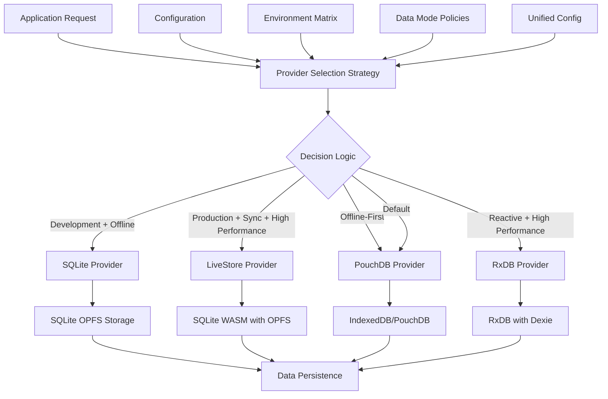
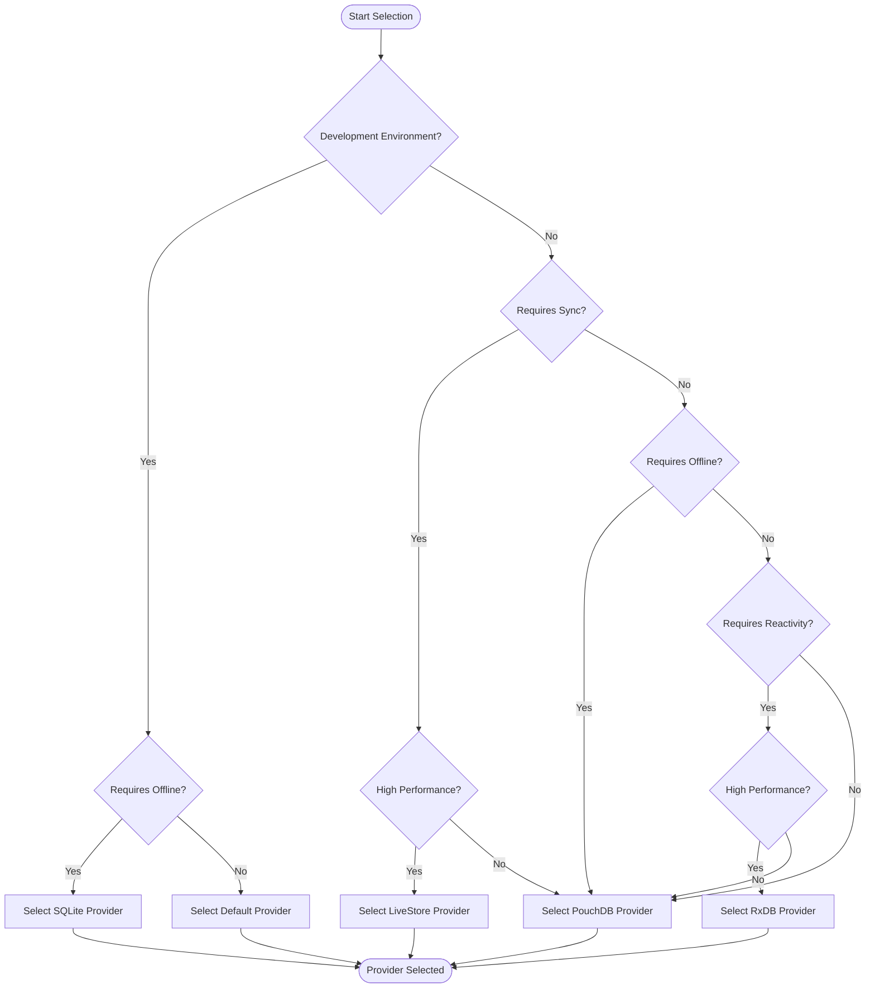
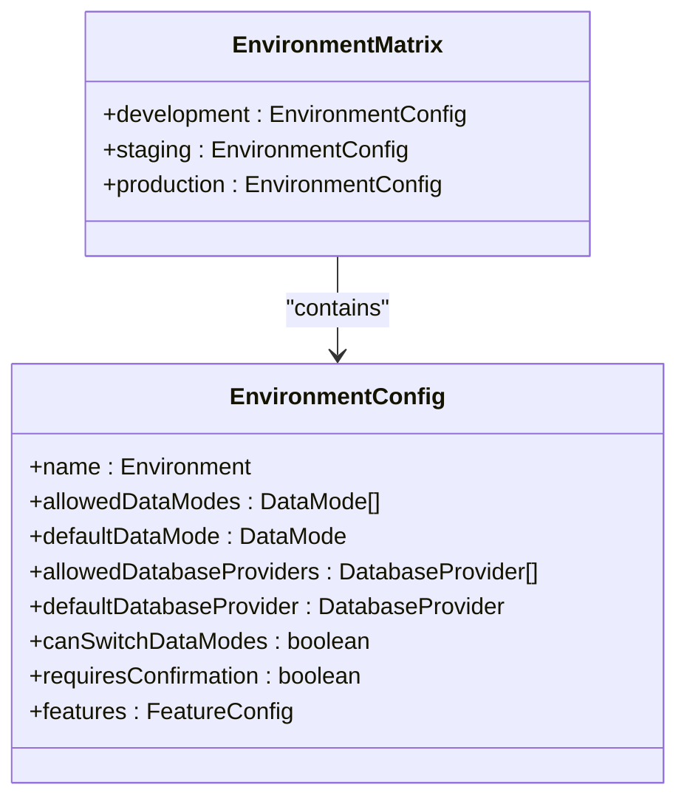
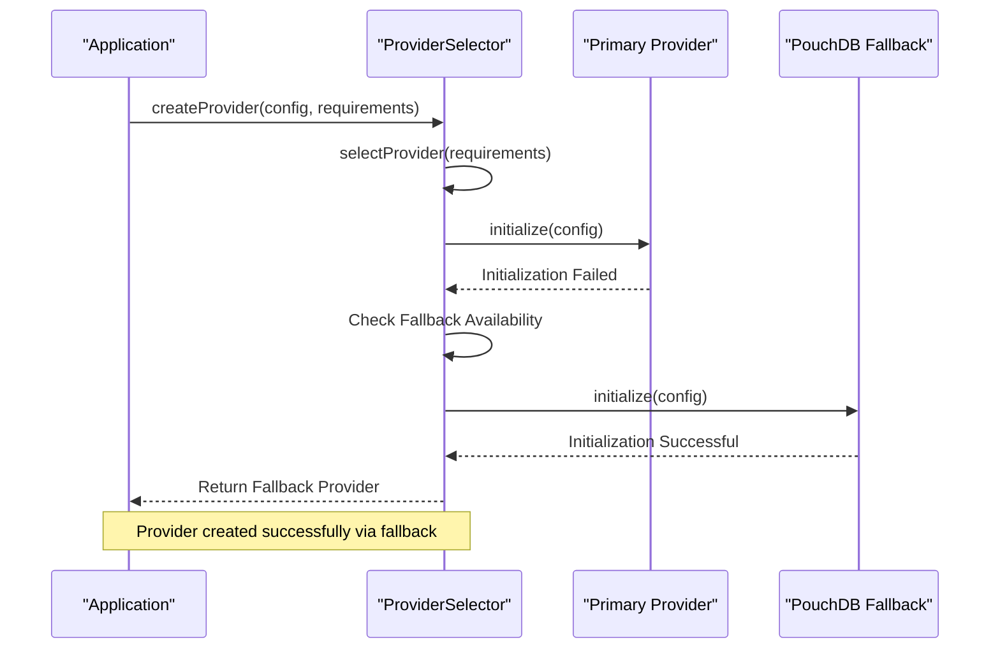
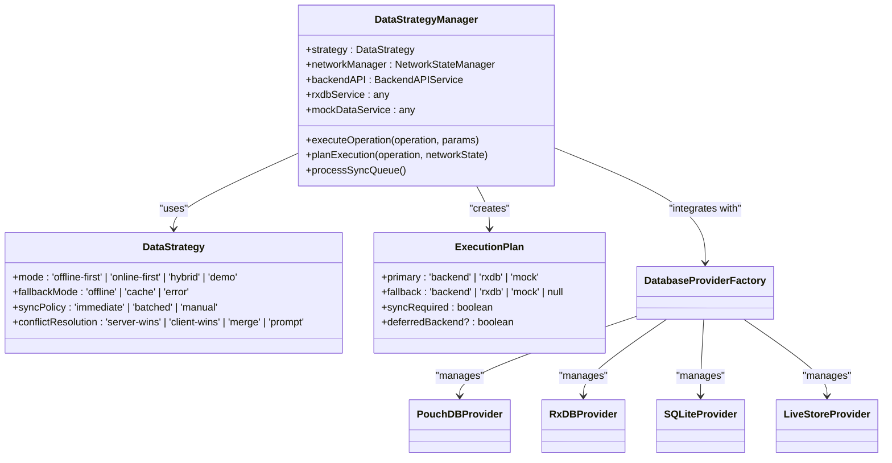
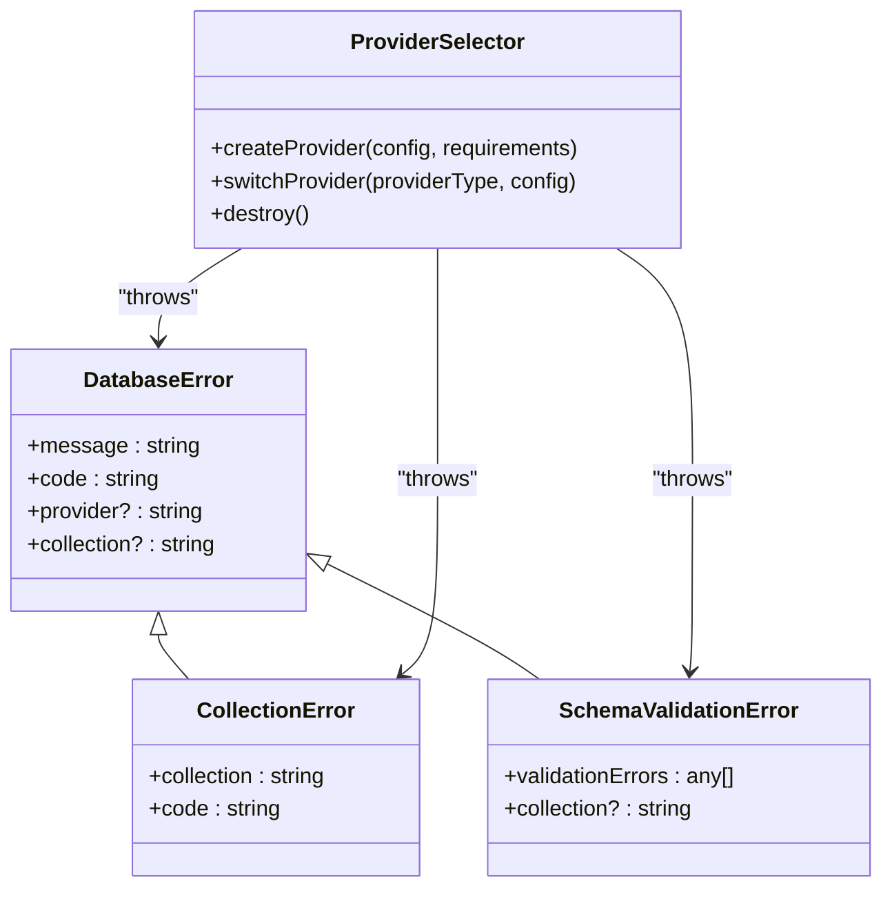

# Provider Selector Mechanism

<cite>
**Referenced Files in This Document**   
- [ProviderSelector.ts](file://src\services\database\ProviderSelector.ts) - *Updated in recent commit*
- [DatabaseProviderFactory.ts](file://src\services\database\DatabaseProviderFactory.ts) - *Updated in recent commit*
- [interfaces.ts](file://src\services\database\interfaces.ts)
- [PouchDBProvider.ts](file://src\services\database\PouchDBProvider.ts)
- [RxDBProvider.ts](file://src\services\database\RxDBProvider.ts)
- [SQLiteProvider.ts](file://src\services\database\SQLiteProvider.ts)
- [LiveStoreProvider.ts](file://src\services\database\LiveStoreProvider.ts)
- [dataModePolicies.ts](file://src\config\dataModePolicies.ts)
- [environmentMatrix.ts](file://src\config\environmentMatrix.ts)
- [unifiedConfig.ts](file://src\config\unifiedConfig.ts)
- [DataStrategyManager.ts](file://src\services\DataStrategyManager.ts)
</cite>

## Update Summary
**Changes Made**   
- Updated decision-making logic to reflect enhanced provider selection strategy in ProviderSelector.ts
- Added clarification on LiveStore provider usage and conditions
- Updated configuration-driven selection section to include environment-specific provider availability
- Enhanced fallback mechanisms description with updated error handling
- Added specific details about provider type determination in the selection process
- Updated architecture overview diagram to reflect current provider selection priorities

## Table of Contents
1. [Introduction](#introduction)
2. [Architecture Overview](#architecture-overview)
3. [Decision-Making Logic](#decision-making-logic)
4. [Configuration-Driven Selection](#configuration-driven-selection)
5. [Fallback Mechanisms](#fallback-mechanisms)
6. [Integration with DataStrategyManager](#integration-with-datastrategymanager)
7. [Error Handling and Monitoring](#error-handling-and-monitoring)
8. [Conclusion](#conclusion)

## Introduction
The Provider Selector mechanism in schoolpilot3's database architecture is a sophisticated routing system that dynamically selects the appropriate database provider (RxDB, PouchDB, SQLite, or LiveStore) based on runtime configuration, environment variables, and data mode policies. This system enables the application to adapt to different environments and operational requirements by intelligently routing database operations to the most suitable provider. The mechanism evaluates multiple factors including offline capability, performance requirements, synchronization needs, and environmental constraints to make optimal provider selection decisions.

**Section sources**
- [DatabaseProviderFactory.ts](file://src\services\database\DatabaseProviderFactory.ts#L0-L431)

## Architecture Overview



**Diagram sources**
- [DatabaseProviderFactory.ts](file://src\services\database\DatabaseProviderFactory.ts#L0-L431)
- [environmentMatrix.ts](file://src\config\environmentMatrix.ts#L0-L148)
- [dataModePolicies.ts](file://src\config\dataModePolicies.ts#L0-L189)

## Decision-Making Logic

The Provider Selector mechanism employs a comprehensive decision-making process that evaluates multiple criteria to determine the optimal database provider for a given context. The core logic is implemented in the `DefaultProviderSelectionStrategy` class, which analyzes collection requirements and environmental factors.

### Selection Criteria

The selection process evaluates the following key factors:

**Collection Requirements**
- `collectionsCount`: Number of collections needed
- `requiresOffline`: Whether offline capability is required
- `requiresSync`: Whether synchronization with backend is needed
- `requiresReactivity`: Whether reactive data updates are required
- `performanceLevel`: Required performance level (basic, standard, high)
- `storageQuota`: Required storage capacity

**Environmental Factors**
- Current environment (development, staging, production)
- Available database providers in the environment
- Data mode (demo, production)
- Feature flags and capabilities

### Decision Flow



**Diagram sources**
- [DatabaseProviderFactory.ts](file://src\services\database\DatabaseProviderFactory.ts#L28-L72)

**Section sources**
- [DatabaseProviderFactory.ts](file://src\services\database\DatabaseProviderFactory.ts#L28-L72)

## Configuration-Driven Selection

The Provider Selector mechanism is heavily influenced by configuration settings from multiple sources, including unified configuration, environment matrix, and data mode policies.

### Unified Configuration Integration

The unified configuration system provides a centralized way to manage application settings that influence provider selection. Key configuration elements include:

**Unified Configuration Structure**
```typescript
interface UnifiedAppConfig {
  environment: Environment;
  dataMode: DataMode;
  database: {
    provider: DatabaseProvider;
    allowedProviders: DatabaseProvider[];
    autoDetect: boolean;
    connectionString?: string;
    options: Record<string, any>;
  };
  features: {
    enableOfflineMode: boolean;
    enableRealTimeSync: boolean;
    enhancedDataLayer: boolean;
  };
}
```

The unified configuration is loaded from localStorage with URL parameter overrides, allowing for flexible configuration management across different deployment scenarios.

**Section sources**
- [unifiedConfig.ts](file://src\config\unifiedConfig.ts#L0-L799)

### Environment Matrix Configuration

The environment matrix defines provider availability and default settings for different environments:



**Diagram sources**
- [environmentMatrix.ts](file://src\config\environmentMatrix.ts#L0-L148)

The environment matrix specifies:
- **Development**: Allows all providers (rxdb, pouchdb, sqlite, memory) with sqlite as default
- **Staging**: Allows rxdb and pouchdb with rxdb as default
- **Production**: Only allows rxdb with rxdb as default

This ensures appropriate provider availability based on the deployment environment, with production environments having stricter constraints for stability and security.

**Section sources**
- [environmentMatrix.ts](file://src\config\environmentMatrix.ts#L0-L148)

### Data Mode Policies

Data mode policies govern how the application behaves in different operational modes (demo vs. production):

```mermaid
stateDiagram-v2
[*] --> CurrentMode
CurrentMode --> ValidateSwitch : "switchDataMode()"
ValidateSwitch --> CheckEnvironment : "validateDataMode()"
CheckEnvironment --> IsValid{"Valid for Environment?"}
IsValid --> |No| ReturnError : "Invalid mode"
IsValid --> |Yes| CheckSwitchAllowed : "canSwitchDataModes()"
CheckSwitchAllowed --> IsAllowed{"Switching Allowed?"}
IsAllowed --> |No| ReturnError
IsAllowed --> |Yes| StoreMode : "storeDataMode()"
StoreMode --> UpdateConfig : "updateConfig()"
UpdateConfig --> NotifyListeners : "notifyListeners()"
NotifyListeners --> Complete : "Return success"
```

**Diagram sources**
- [dataModePolicies.ts](file://src\config\dataModePolicies.ts#L0-L189)

The data mode policies ensure that mode switching is only allowed when appropriate, with additional confirmation required for production and staging environments to prevent accidental changes.

**Section sources**
- [dataModePolicies.ts](file://src\config\dataModePolicies.ts#L0-L189)

## Fallback Mechanisms

The Provider Selector mechanism includes robust fallback mechanisms to handle provider initialization failures and ensure application continuity.

### Initialization Fallback Process

When a provider fails to initialize, the system automatically falls back to an available alternative:



**Diagram sources**
- [DatabaseProviderFactory.ts](file://src\services\database\DatabaseProviderFactory.ts#L286-L316)

### Fallback Logic Implementation

The fallback mechanism is implemented in the `createProvider` method of the `DatabaseProviderFactory` class:

```typescript
async createProvider(config: DatabaseConfig, requirements?: CollectionRequirements): Promise<IDatabaseProvider> {
  try {
    // Determine which provider to use
    const providerType = requirements 
      ? this.selectionStrategy.selectProvider(requirements)
      : 'pouchdb'; // Default to PouchDB
    
    const provider = this.providers.get(providerType);
    if (!provider) {
      throw new DatabaseError(`Provider '${providerType}' not available`, 'PROVIDER_NOT_FOUND');
    }

    // Check if provider is available in current environment
    if (!provider.isAvailable()) {
      // Fallback to PouchDB if primary provider is not available
      const fallbackProvider = this.providers.get('pouchdb');
      if (!fallbackProvider || !fallbackProvider.isAvailable()) {
        throw new DatabaseError('No database providers available', 'NO_PROVIDERS_AVAILABLE');
      }
      
      console.warn(`Provider '${providerType}' not available, falling back to PouchDB`);
      await fallbackProvider.initialize(config);
      this.activeProvider = fallbackProvider;
      return fallbackProvider;
    }

    // Initialize the selected provider
    await provider.initialize(config);
    this.activeProvider = provider;
    
    console.log(`Database provider '${providerType}' initialized successfully`);
    return provider;
  } catch (error) {
    throw new DatabaseError(`Failed to create database provider: ${error.message}`, 'PROVIDER_CREATION_ERROR');
  }
}
```

The fallback mechanism follows these principles:
1. Attempt to initialize the selected provider based on requirements
2. If the provider is not available in the current environment, fall back to PouchDB
3. If PouchDB is also unavailable, throw an error indicating no providers are available
4. Log warnings when fallbacks occur for monitoring and debugging

**Section sources**
- [DatabaseProviderFactory.ts](file://src\services\database\DatabaseProviderFactory.ts#L286-L316)

## Integration with DataStrategyManager

The Provider Selector mechanism works in conjunction with the DataStrategyManager to support hybrid data modes and intelligent operation routing.

### Hybrid Data Mode Support

The integration enables hybrid data modes where different operations can use different providers based on their requirements:



**Diagram sources**
- [DataStrategyManager.ts](file://src\services\DataStrategyManager.ts#L0-L573)
- [DatabaseProviderFactory.ts](file://src\services\database\DatabaseProviderFactory.ts#L0-L431)

### Operation Routing Logic

The DataStrategyManager uses the following logic to route operations:

**Offline-First Strategy**
- Primary: RxDB (local storage)
- Fallback: Backend (when available)
- Sync Required: Yes (for write operations)
- Cache Strategy: cache-first

**Online-First Strategy**
- Primary: Backend (when available)
- Fallback: RxDB (when offline)
- Sync Required: No
- Cache Strategy: network-first

**Hybrid Strategy**
- Read Operations: RxDB (local cache)
- Write Operations: Backend (when available), RxDB (when offline)
- Sync Required: Deferred for offline writes
- Cache Strategy: cache-first for reads, network-first for writes

This integration allows the application to support multiple data access patterns while leveraging the Provider Selector to ensure the appropriate provider is used for each operation.

**Section sources**
- [DataStrategyManager.ts](file://src\services\DataStrategyManager.ts#L0-L573)

## Error Handling and Monitoring

The Provider Selector mechanism includes comprehensive error handling and monitoring capabilities to ensure reliability and provide insights into provider routing decisions.

### Error Handling Implementation

The system uses a structured error handling approach with specific error types:



**Diagram sources**
- [interfaces.ts](file://src\services\database\interfaces.ts#L0-L242)

The error handling system includes:
- **DatabaseError**: Base error type for database-related errors
- **CollectionError**: Specific to collection operations
- **SchemaValidationError**: For schema validation failures
- Comprehensive try-catch blocks in provider initialization
- Fallback mechanisms for provider availability issues
- Detailed error codes for troubleshooting

### Monitoring and Logging

The system provides extensive logging and monitoring capabilities:

**Provider Status Monitoring**
```typescript
getProviderStatus(): ProviderStatus[] {
  return Array.from(this.providers.entries()).map(([type, provider]) => ({
    ...provider.getStatus(),
    type,
    isActive: provider === this.activeProvider
  }));
}
```

**Logging Implementation**
- Provider registration: "Registered database provider: {providerType}"
- Provider initialization: "Database provider '{providerType}' initialized successfully"
- Fallback events: "Provider '{providerType}' not available, falling back to PouchDB"
- Error conditions: Detailed error messages with error codes

**Performance Monitoring**
The system tracks provider performance metrics including:
- Average query time
- Total queries executed
- Memory usage
- Connection status
- Collection counts

These metrics are available through the `getProviderStatus()` method and can be used for monitoring and optimization.

**Section sources**
- [DatabaseProviderFactory.ts](file://src\services\database\DatabaseProviderFactory.ts#L380-L400)
- [interfaces.ts](file://src\services\database\interfaces.ts#L0-L242)

## Conclusion

The Provider Selector mechanism in schoolpilot3's database architecture represents a sophisticated and flexible approach to database provider management. By dynamically routing database operations to the most appropriate provider based on runtime configuration, environment variables, and data mode policies, the system ensures optimal performance, reliability, and user experience across different deployment scenarios.

Key strengths of the mechanism include:
- **Adaptive Selection**: Intelligent provider selection based on multiple criteria including offline capability, performance requirements, and synchronization needs
- **Configuration-Driven**: Comprehensive integration with unified configuration, environment matrix, and data mode policies
- **Robust Fallback**: Reliable fallback mechanisms that ensure application continuity when primary providers are unavailable
- **Hybrid Support**: Seamless integration with DataStrategyManager to support hybrid data modes and intelligent operation routing
- **Comprehensive Monitoring**: Detailed error handling, logging, and performance monitoring capabilities

This architecture enables schoolpilot3 to operate effectively in diverse environments, from development with SQLite for persistent storage to production with RxDB for high-performance, real-time applications. The system's flexibility and resilience make it well-suited for educational applications with varying requirements for data access, synchronization, and offline capabilities.