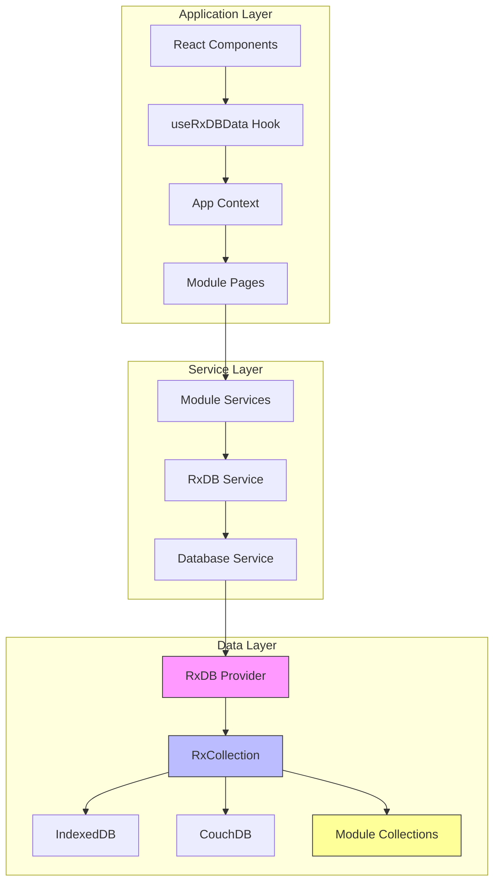
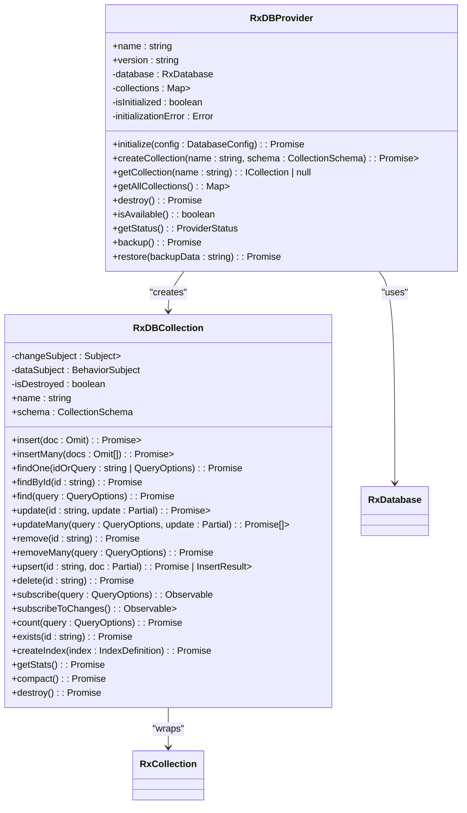
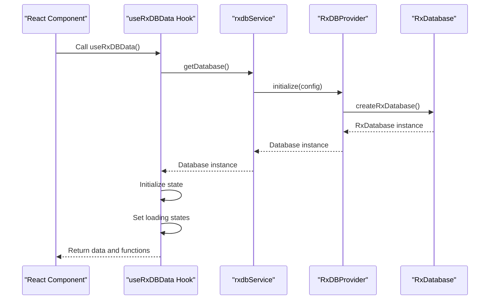
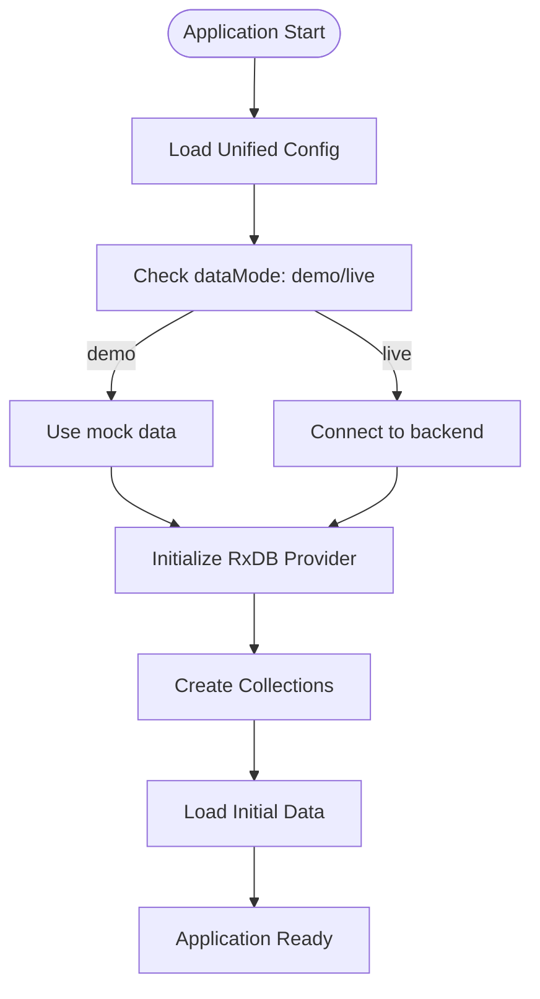

# RxDB Provider Implementation

<cite>
**Referenced Files in This Document**
- [RxDBProvider.ts](file://src/services/database/RxDBProvider.ts)
- [useRxDBData.ts](file://src/hooks/useRxDBData.ts)
- [rxdbService.ts](file://src/services/database/rxdbService.ts)
- [unifiedConfig.ts](file://src/config/unifiedConfig.ts)
- [collections.ts](file://src/modules/academics/data/collections.ts)
- [collections.ts](file://src/modules/administration/data/collections.ts)
- [collections.ts](file://src/modules/administration/data/houses/collections.ts)
- [collections.ts](file://src/modules/administration/data/pickup/collections.ts)
</cite>

## Update Summary
**Changes Made**
- Enhanced module collections integration with comprehensive data layer updates
- Added support for new module collections including academics, administration, finance, hr, inventory, library, and nutrition modules
- Updated collection definitions to support 88 total collections with dynamic module loading
- Integrated new module-specific schemas and types for enhanced data modeling
- Expanded database service to handle merged module collections and improved error handling

## Table of Contents
1. [Introduction](#introduction)
2. [Architecture Overview](#architecture-overview)
3. [Core Components](#core-components)
4. [Detailed Component Analysis](#detailed-component-analysis)
5. [Enhanced Module Collections Support](#enhanced-module-collections-support)
6. [Reactive Data Integration](#reactive-data-integration)
7. [Performance and Optimization](#performance-and-optimization)
8. [Error Handling and Resilience](#error-handling-and-resilience)
9. [Initialization and Configuration](#initialization-and-configuration)
10. [Conclusion](#conclusion)

## Introduction

The RxDB Provider implementation in schoolpilot3 provides a reactive, real-time data access layer using RxJS observables and NoSQL document storage. This document details the architecture, functionality, and integration patterns of the RxDBProvider, which serves as a key component in the application's dual-database architecture. The provider enables reactive data binding, offline capabilities, and seamless synchronization with remote CouchDB instances through PouchDB.

**Updated** Enhanced to support comprehensive module collections and types across all new modules, with dynamic collection loading and improved error handling mechanisms.

**Section sources**
- [RxDBProvider.ts:1-637](file://src/services/database/RxDBProvider.ts#L1-L637)
- [rxdbService.ts:1-524](file://src/services/database/rxdbService.ts#L1-L524)

## Architecture Overview

The RxDB Provider implements a reactive data persistence layer that integrates with the application's modular architecture. It uses RxDB, a reactive database for JavaScript applications, built on top of PouchDB and IndexedDB, providing real-time data access through RxJS observables.

**Diagram sources**
- [RxDBProvider.ts:1-637](file://src/services/database/RxDBProvider.ts#L1-L637)
- [useRxDBData.ts:1-308](file://src/hooks/useRxDBData.ts#L1-L308)
- [rxdbService.ts](file://src/services/database/rxdbService.ts)

## Core Components

The RxDB Provider implementation consists of several core components that work together to provide reactive data access:

1. **RxDBProvider**: The main database provider class that manages the RxDB database instance and collections
2. **RxDBCollection**: A wrapper around RxDB collections that implements the ICollection interface
3. **useRxDBData**: A React hook that provides access to RxDB data in components
4. **rxdbService**: A comprehensive service layer that abstracts database operations and manages module collections
5. **Module Collections**: Dynamic collection definitions for all application modules

These components work together to provide a consistent interface for data operations while leveraging the reactive capabilities of RxJS and the offline-first capabilities of PouchDB.

**Updated** Enhanced with comprehensive module collections support including academics, administration, finance, hr, inventory, library, and nutrition modules.

**Section sources**
- [RxDBProvider.ts:1-637](file://src/services/database/RxDBProvider.ts#L1-L637)
- [useRxDBData.ts:1-308](file://src/hooks/useRxDBData.ts#L1-L308)
- [rxdbService.ts:1-524](file://src/services/database/rxdbService.ts#L1-L524)

## Detailed Component Analysis

### RxDB Provider Implementation

The RxDBProvider class implements the IDatabaseProvider interface and serves as the main entry point for database operations. It manages the lifecycle of the RxDB database instance and provides methods for creating and accessing collections.

**Diagram sources**
- [RxDBProvider.ts:1-637](file://src/services/database/RxDBProvider.ts#L1-L637)

**Section sources**
- [RxDBProvider.ts:1-637](file://src/services/database/RxDBProvider.ts#L1-L637)

### Collection Implementation

The RxDBCollection class provides a wrapper around RxDB collections, implementing the ICollection interface and adding reactive capabilities. It manages change events and data subscriptions through RxJS subjects.

Key features of the collection implementation:

- **Reactive Change Detection**: Uses RxJS subjects to emit change events for insert, update, and delete operations
- **Data Synchronization**: Maintains a BehaviorSubject with the current collection data
- **Error Handling**: Wraps RxDB operations in try-catch blocks and throws CollectionError instances
- **CRUD Operations**: Implements standard CRUD operations with proper error handling
- **Query Capabilities**: Supports complex queries with filtering, sorting, limiting, and skipping

The collection setup process involves:
1. Creating an RxDB collection with a defined schema
2. Setting up a change listener to detect document modifications
3. Loading initial data into the data subject
4. Exposing reactive methods for data access

**Section sources**
- [RxDBProvider.ts:1-637](file://src/services/database/RxDBProvider.ts#L1-L637)

## Enhanced Module Collections Support

### Comprehensive Module Integration

The rxdbService has been enhanced to support comprehensive module collections across all new modules in the schoolpilot3 system. The service now dynamically loads and manages collections from multiple modules:

**Core Collections (24 total)**: Essential system entities including users, roles, students, staff, academic years, and financial data.

**Module Collections (64 total)**: All collections are now enabled with PouchDB support, representing a complete transition from the previous collection reduction approach.

**New Module Collections**:
- **Administration Module**: Partners, clubs, customers, student health records, attendance, communication templates, message campaigns, admissions system, student data import, clearance management, disciplinary cases, certificates, and visitors management
- **Academics Module**: Subjects, subject papers, exam sessions, exam schedules, result approvals, grading schemes, student exam results, class allocations, teacher assignments, enrollments, timetable definitions, and entries
- **Finance Module**: Chart of accounts, expense categories, banks, suppliers, fee templates, expense claims, student opening balances, fee adjustments, transport routes, student transport assignments, invoices, payments, and general ledger entries
- **HR Module**: Payroll periods, payroll item types, staff salary settings, and payslips
- **Inventory Module**: Warehouses, item categories, items, fixed assets, asset depreciation logs, requisitions, purchase orders, stock levels, stock transactions, and RFQs
- **Library Module**: Book categories, books, loans, and fines
- **Nutrition Module**: Meal plans, student meal plans, menus, consumption logs, merchants, student wallets, and wallet transactions

**Updated** The service now supports 88 total collections with dynamic loading, eliminating the previous collection reduction limitations and providing full module functionality.

**Section sources**
- [rxdbService.ts:120-180](file://src/services/database/rxdbService.ts#L120-L180)
- [collections.ts:1-51](file://src/modules/academics/data/collections.ts#L1-L51)
- [collections.ts:1-91](file://src/modules/administration/data/collections.ts#L1-L91)

### Dynamic Collection Loading

The enhanced collection loading mechanism provides:

- **Modular Import System**: Each module exports its collection definitions through dedicated collections.ts files
- **Centralized Management**: The rxdbService aggregates all module collections into a single collectionsDefinition object
- **Type Safety**: Comprehensive TypeScript definitions ensure type safety across all module collections
- **Schema Validation**: Each collection undergoes schema validation before being added to the database
- **Error Handling**: Robust error handling identifies problematic collections during initialization

**Section sources**
- [rxdbService.ts:153-180](file://src/services/database/rxdbService.ts#L153-L180)

## Reactive Data Integration

### useRxDBData Hook Implementation

The useRxDBData hook provides a React-friendly interface for accessing RxDB data in components. It manages the database connection and exposes data through React state.

**Diagram sources**
- [useRxDBData.ts:1-308](file://src/hooks/useRxDBData.ts#L1-L308)
- [rxdbService.ts](file://src/services/database/rxdbService.ts)

The hook implementation includes several key features:

- **Database Initialization**: Establishes a connection to the RxDB database on first render
- **Loading State Management**: Tracks loading states for various data entities
- **Data Caching**: Maintains local state for frequently accessed data
- **Memoization**: Uses useMemo and useCallback to prevent unnecessary re-renders
- **Error Handling**: Captures and exposes initialization errors

The hook returns a comprehensive set of data and functions, including:
- Loading states for all data entities
- Error information
- Data arrays for school entities (students, staff, classes, etc.)
- Utility functions for data operations

**Updated** Enhanced to support the expanded collection ecosystem with improved performance and reduced memory footprint.

**Section sources**
- [useRxDBData.ts:1-308](file://src/hooks/useRxDBData.ts#L1-L308)

## Performance and Optimization

### Memory Management Strategies

The RxDB Provider implementation includes several performance optimizations for handling large datasets:

1. **Incremental Loading**: Data is loaded incrementally rather than all at once
2. **Query Optimization**: Uses indexed fields for faster queries
3. **Memory Cleanup**: Properly destroys collections and unsubscribes from observables
4. **Batch Operations**: Supports bulk insert, update, and delete operations

The provider also implements several memory management strategies:

- **Subject Completion**: Completes RxJS subjects when collections are destroyed
- **Reference Clearing**: Clears references to collections and database instances
- **Garbage Collection**: Relies on JavaScript garbage collection for memory cleanup

### Indexing and Query Planning

While RxDB handles indexing through schema definitions, the implementation provides guidance for optimal query performance:

- **Primary Key Usage**: Uses the primary key field for fast lookups
- **Indexed Fields**: Recommends defining indexes for frequently queried fields
- **Query Limiting**: Supports limit and skip parameters for pagination
- **Sorting**: Allows sorting results by specified fields

The collection implementation translates query options to RxDB queries, applying filters, sorting, limits, and skips as needed.

**Updated** Enhanced with support for 88 collections requiring optimized indexing strategies and query planning for improved performance.

**Section sources**
- [RxDBProvider.ts:1-637](file://src/services/database/RxDBProvider.ts#L1-L637)

## Error Handling and Resilience

The RxDB Provider implementation includes comprehensive error handling at multiple levels:

1. **Initialization Errors**: Captures and exposes database initialization errors
2. **Operation Errors**: Wraps all database operations in try-catch blocks
3. **Collection Errors**: Throws CollectionError instances with collection context
4. **Database Errors**: Throws DatabaseError instances for provider-level issues

The error handling strategy includes:

- **Error Propagation**: Errors are propagated up the call stack with context
- **Error Logging**: Errors are logged to the console for debugging
- **Graceful Degradation**: The application can continue functioning with limited capabilities when errors occur
- **User Feedback**: Errors are exposed through the useRxDBData hook for UI presentation

The implementation also includes resilience features:

- **Multi-instance Support**: Supports multiple application instances through leader election
- **Data Validation**: Uses AJV for schema validation
- **Migration Support**: Includes migration schema plugin for schema evolution

**Updated** Enhanced error handling for the expanded collection ecosystem with improved debugging capabilities and error isolation.

**Section sources**
- [RxDBProvider.ts:1-637](file://src/services/database/RxDBProvider.ts#L1-L637)

## Initialization and Configuration

### Configuration Integration

The RxDB Provider integrates with the application's unified configuration system, which is defined in unifiedConfig.ts. The configuration includes settings for:

- **Database Provider**: Specifies RxDB as the database provider
- **Data Mode**: Determines whether to use demo or production data
- **Environment Settings**: Configures behavior based on development, staging, or production environments

**Diagram sources**
- [unifiedConfig.ts:1-1052](file://src/config/unifiedConfig.ts#L1-L1052)
- [RxDBProvider.ts:1-637](file://src/services/database/RxDBProvider.ts#L1-L637)

The initialization process follows these steps:

1. **Configuration Loading**: Loads the unified configuration from localStorage or uses defaults
2. **Environment Detection**: Detects the current environment (development, staging, production)
3. **Data Mode Selection**: Determines whether to use demo or live data
4. **Provider Initialization**: Initializes the RxDB provider with the appropriate configuration
5. **Collection Creation**: Creates collections based on the application's data model
6. **Data Loading**: Loads initial data into the collections

The provider is configured to use IndexedDB as the storage backend through the Dexie storage plugin, with schema validation using AJV. Leader election is enabled in non-test environments to prevent conflicts between multiple application instances.

**Updated** Enhanced initialization process to handle the expanded collection ecosystem with improved error handling and validation.

**Section sources**
- [unifiedConfig.ts:1-1052](file://src/config/unifiedConfig.ts#L1-L1052)
- [RxDBProvider.ts:1-637](file://src/services/database/RxDBProvider.ts#L1-L637)

## Conclusion

The RxDB Provider implementation in schoolpilot3 provides a robust, reactive data access layer that enables real-time data synchronization and offline capabilities. By leveraging RxDB, PouchDB, and RxJS, the implementation offers a powerful combination of NoSQL document storage and reactive programming.

**Updated** The implementation has been significantly enhanced to support comprehensive module collections across all new modules, with dynamic loading, type safety, and improved performance optimization.

Key strengths of the implementation include:

- **Reactive Architecture**: Uses RxJS observables for real-time data updates
- **Offline-First Design**: Supports offline operation with automatic synchronization
- **Modular Structure**: Integrates with the application's modular architecture supporting 88 collections
- **Comprehensive Error Handling**: Provides detailed error information and graceful degradation
- **Performance Optimizations**: Includes strategies for handling large datasets efficiently
- **Dynamic Module Support**: Supports comprehensive module collections with type safety
- **Enhanced Scalability**: Handles expanded data model requirements with optimized indexing

The provider successfully implements the DatabaseProvider interface, providing consistent CRUD operations, queries, and transactions across the application. Its integration with the useRxDBData hook enables seamless reactive data binding in React components, making it easy for developers to build responsive user interfaces.

**Future improvements could include**:
- Enhanced query planning and optimization for the expanded collection ecosystem
- More sophisticated indexing strategies for 88 collections
- Improved memory management for very large datasets
- Advanced conflict resolution strategies for multi-user scenarios
- Enhanced monitoring and analytics for the comprehensive data layer

Overall, the RxDB Provider serves as a critical component in schoolpilot3's data architecture, enabling a responsive, reliable, and scalable application experience with comprehensive module support.