# Hybrid Data Layer Architecture

<cite>
**Referenced Files in This Document**
- [dataLayerConfig.ts](file://src/config/dataLayerConfig.ts)
- [unifiedConfig.ts](file://src/config/unifiedConfig.ts)
- [dataModePolicies.ts](file://src/config/dataModePolicies.ts)
- [DataServiceFactory.ts](file://src/services/DataServiceFactory.ts)
- [DatabaseProviderFactory.ts](file://src/services/database/DatabaseProviderFactory.ts)
- [ProviderSelector.ts](file://src/services/database/ProviderSelector.ts)
- [interfaces.ts](file://src/services/database/interfaces.ts)
- [databaseService.ts](file://src/services/databaseService.ts)
- [useDatabaseProvider.ts](file://src/hooks/useDatabaseProvider.ts)
- [dataModeManager.ts](file://src/services/dataModeManager.ts)
- [rxdbService.ts](file://src/services/rxdbService.ts)
- [HybridProvider.ts](file://src/services/database/HybridProvider.ts)
- [HealthChecker.ts](file://src/services/database/monitoring/HealthChecker.ts)
- [FieldLevelEncryption.ts](file://src/services/database/monitoring/FieldLevelEncryption.ts)
- [index.ts](file://src/services/database/monitoring/index.ts)
</cite>

## Update Summary
**Changes Made**
- Added comprehensive documentation for the new HybridProvider system with backend API integration
- Enhanced monitoring components documentation including health checking, field-level encryption, and circuit breakers
- Updated provider selection strategy with unified configuration integration
- Added detailed documentation for sync infrastructure and offline-first architecture
- Expanded performance monitoring and error reporting capabilities

## Table of Contents
1. [Introduction](#introduction)
2. [Architecture Overview](#architecture-overview)
3. [Core Components](#core-components)
4. [Data Layer Configuration](#data-layer-configuration)
5. [Provider Management](#provider-management)
6. [Database Service Integration](#database-service-integration)
7. [Data Mode Management](#data-mode-management)
8. [Hybrid Architecture Implementation](#hybrid-architecture-implementation)
9. [Enhanced Monitoring Components](#enhanced-monitoring-components)
10. [Performance Considerations](#performance-considerations)
11. [Troubleshooting Guide](#troubleshooting-guide)
12. [Conclusion](#conclusion)

## Introduction

The Hybrid Data Layer Architecture represents a sophisticated multi-tier database solution designed for educational management systems. This architecture seamlessly integrates multiple database providers including SQLite, PouchDB, RxDB, LiveStore, and the new HybridProvider system, enabling applications to operate across different environments from development to production while maintaining data consistency, performance, and security.

The system supports three primary operational modes: development (SQLite file-based), demo (SQLite WASM with OPFS), and production (LiveStore with enhanced capabilities and hybrid backend integration). This flexibility allows developers to test and deploy applications with optimal database configurations for each environment.

**Updated** Added comprehensive hybrid provider system with backend API integration, enhanced monitoring components, and field-level encryption capabilities.

## Architecture Overview

The hybrid data layer architecture follows a layered approach with clear separation of concerns between configuration management, provider selection, and service integration. The new architecture introduces a hybrid provider that combines local caching with backend API synchronization for offline-first applications.

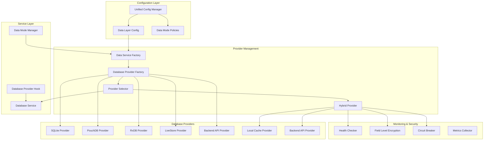

**Diagram sources**
- [unifiedConfig.ts:646-800](file://src/config/unifiedConfig.ts#L646-L800)
- [dataLayerConfig.ts:55-235](file://src/config/dataLayerConfig.ts#L55-L235)
- [DataServiceFactory.ts:19-159](file://src/services/DataServiceFactory.ts#L19-L159)
- [DatabaseProviderFactory.ts:286-725](file://src/services/database/DatabaseProviderFactory.ts#L286-L725)
- [HybridProvider.ts:326-608](file://src/services/database/HybridProvider.ts#L326-L608)

## Core Components

### Unified Configuration System

The Unified Configuration Manager serves as the central hub for managing all application configuration aspects including environment detection, database provider selection, and feature flag management. The system now includes enhanced monitoring and security configuration options.

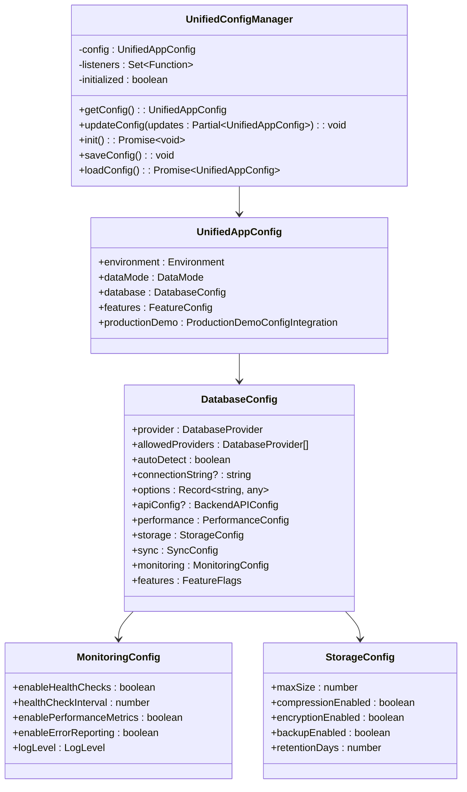

**Diagram sources**
- [unifiedConfig.ts:646-800](file://src/config/unifiedConfig.ts#L646-L800)
- [unifiedConfig.ts:215-304](file://src/config/unifiedConfig.ts#L215-L304)
- [unifiedConfig.ts:147-197](file://src/config/unifiedConfig.ts#L147-L197)

**Section sources**
- [unifiedConfig.ts:646-800](file://src/config/unifiedConfig.ts#L646-L800)
- [unifiedConfig.ts:215-304](file://src/config/unifiedConfig.ts#L215-L304)

### Data Service Factory

The Data Service Factory implements the factory pattern to create appropriate database services based on environment requirements and user configuration preferences. The factory now supports the new HybridProvider system and enhanced configuration options.

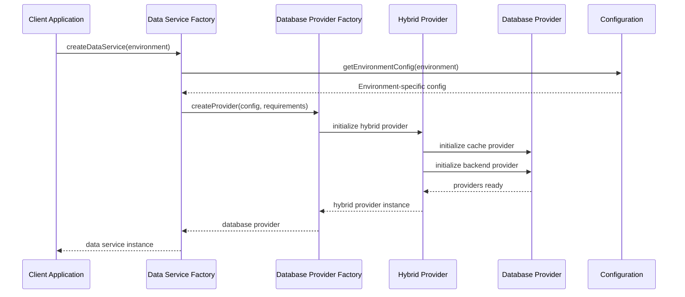

**Diagram sources**
- [DataServiceFactory.ts:37-151](file://src/services/DataServiceFactory.ts#L37-L151)
- [DatabaseProviderFactory.ts:476-530](file://src/services/database/DatabaseProviderFactory.ts#L476-L530)
- [HybridProvider.ts:345-434](file://src/services/database/HybridProvider.ts#L345-L434)

**Section sources**
- [DataServiceFactory.ts:19-159](file://src/services/DataServiceFactory.ts#L19-L159)
- [DatabaseProviderFactory.ts:286-725](file://src/services/database/DatabaseProviderFactory.ts#L286-L725)

## Data Layer Configuration

The data layer configuration system provides comprehensive support for multiple database providers with environment-specific optimizations and backend integrations. The system now includes enhanced configuration options for the hybrid provider system.

### Provider Configuration Options

The system supports seven primary database providers with distinct characteristics optimized for different use cases:

| Provider | Storage Type | Environment | Use Case | Features |
|----------|--------------|-------------|----------|----------|
| SQLite | File-based | Development | Local development with easy inspection | Fast, reliable, file-based storage |
| SQLite-WASM | WebAssembly | Demo/Production | Browser-based applications | Cross-platform, OPFS support |
| PouchDB | Document Store | Multi-environment | Offline-first applications | Sync capabilities, replication |
| RxDB | Reactive | Production | Real-time applications | Reactive queries, real-time updates |
| LiveStore | Optimized | Production | High-performance applications | Advanced caching, performance optimization |
| Backend-API | Remote | Production | Cloud-connected applications | API integration, remote sync |
| Hybrid | Combined | Production | Offline-first with cloud sync | Local cache + backend API |

**Updated** Added Hybrid provider with combined local cache and backend API capabilities.

**Section sources**
- [dataLayerConfig.ts:55-235](file://src/config/dataLayerConfig.ts#L55-L235)

### Backend Integration Support

The architecture includes comprehensive backend integration capabilities supporting multiple external systems with enhanced security and monitoring:

- **ERPNext Integration**: Enterprise Resource Planning system integration with field-level encryption
- **CouchDB Sync**: Distributed database synchronization with health monitoring
- **PostgreSQL via ElectricSQL**: Reactive real-time sync with circuit breaker protection
- **Custom API Integration**: RESTful API connectivity with offline queue support
- **Hybrid Backend Integration**: Local-first architecture with cloud synchronization

**Updated** Enhanced backend integration with hybrid provider system and comprehensive monitoring.

**Section sources**
- [dataLayerConfig.ts:159-234](file://src/config/dataLayerConfig.ts#L159-L234)

## Provider Management

The provider management system implements sophisticated selection logic and lifecycle management for database providers, including the new HybridProvider system.

### Provider Selection Strategy

The DefaultProviderSelectionStrategy implements intelligent provider selection based on environment, requirements, and configuration preferences, now integrated with unified configuration:

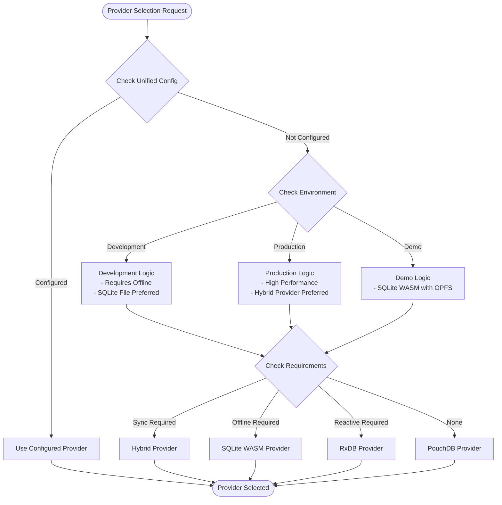

**Diagram sources**
- [DatabaseProviderFactory.ts:39-115](file://src/services/database/DatabaseProviderFactory.ts#L39-L115)

**Section sources**
- [DatabaseProviderFactory.ts:39-115](file://src/services/database/DatabaseProviderFactory.ts#L39-L115)

### Database Manager Architecture

The Database Manager orchestrates multiple database providers with comprehensive collection management, status monitoring, and the new HybridProvider system:

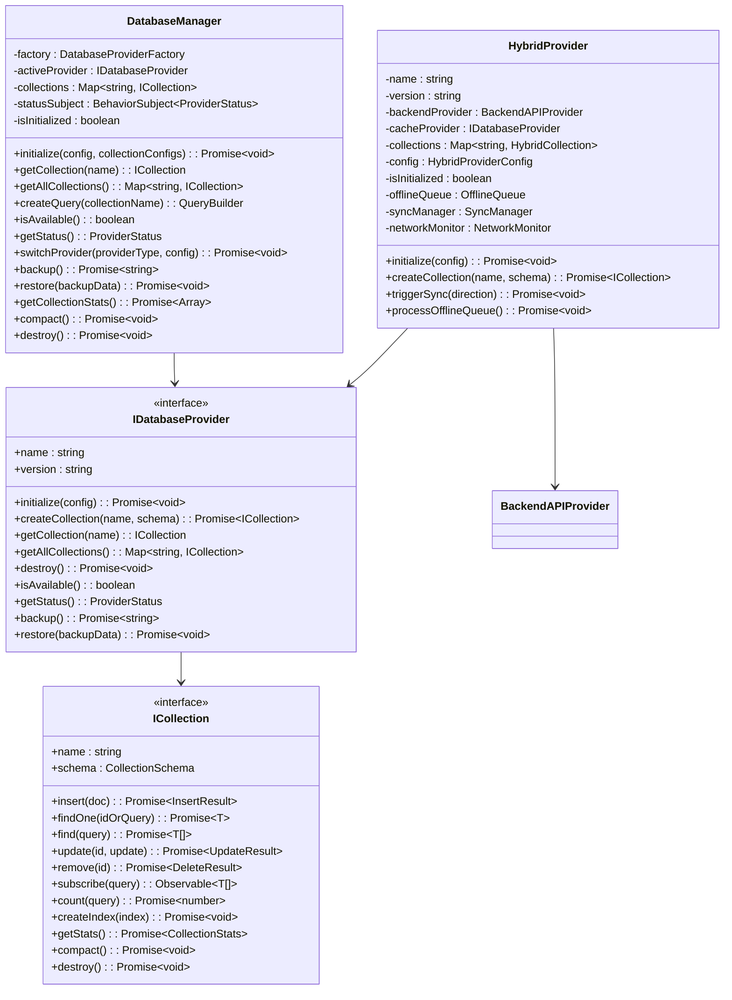

**Diagram sources**
- [ProviderSelector.ts:31-242](file://src/services/database/ProviderSelector.ts#L31-L242)
- [interfaces.ts:177-218](file://src/services/database/interfaces.ts#L177-L218)
- [HybridProvider.ts:326-608](file://src/services/database/HybridProvider.ts#L326-L608)

**Section sources**
- [ProviderSelector.ts:31-242](file://src/services/database/ProviderSelector.ts#L31-L242)
- [interfaces.ts:177-218](file://src/services/database/interfaces.ts#L177-L218)

## Database Service Integration

The database service integration provides a unified interface that abstracts the underlying database provider differences while maintaining type safety, performance, and the new hybrid provider capabilities.

### Service Abstraction Layer

The database service implements a comprehensive abstraction layer that maintains compatibility with existing RxDB-based code while supporting multiple database providers including the new HybridProvider system:

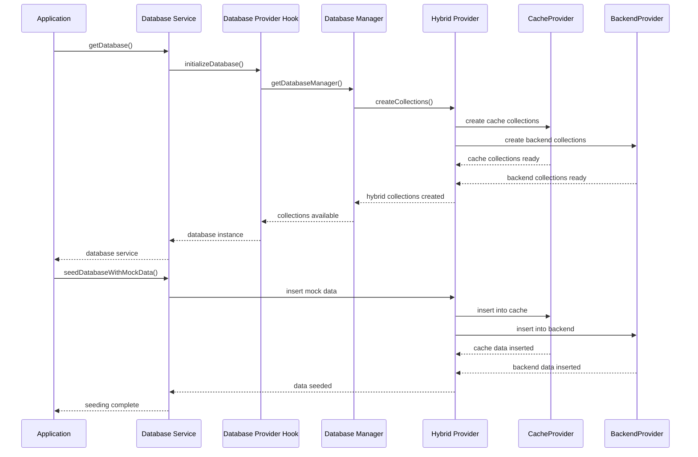

**Diagram sources**
- [databaseService.ts:97-141](file://src/services/databaseService.ts#L97-L141)
- [useDatabaseProvider.ts:67-102](file://src/hooks/useDatabaseProvider.ts#L67-L102)
- [HybridProvider.ts:436-476](file://src/services/database/HybridProvider.ts#L436-L476)

**Section sources**
- [databaseService.ts:97-141](file://src/services/databaseService.ts#L97-L141)
- [useDatabaseProvider.ts:67-102](file://src/hooks/useDatabaseProvider.ts#L67-L102)

### Collection Management System

The system manages 88 collections across multiple domains including academics, administration, finance, HR, inventory, library, and nutrition modules. Each collection maintains type safety and schema validation while supporting reactive queries, real-time updates, and the new hybrid provider capabilities.

**Section sources**
- [rxdbService.ts:117-166](file://src/services/rxdbService.ts#L117-L166)

## Data Mode Management

The data mode management system provides comprehensive control over database modes including development, demo, and production environments with seamless transitions, data preservation capabilities, and the new hybrid provider support.

### Data Mode Switching Logic

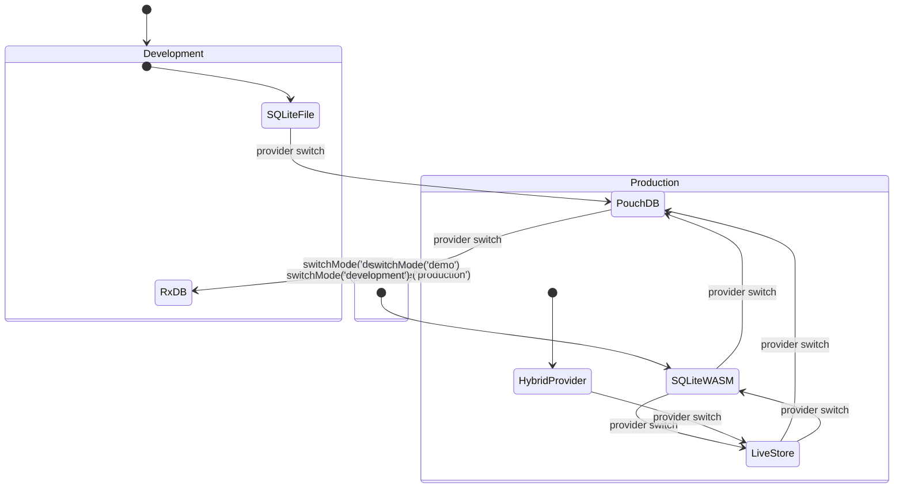

**Diagram sources**
- [dataModePolicies.ts:106-162](file://src/config/dataModePolicies.ts#L106-L162)
- [dataModeManager.ts:93-170](file://src/services/dataModeManager.ts#L93-L170)

**Section sources**
- [dataModePolicies.ts:106-162](file://src/config/dataModePolicies.ts#L106-L162)
- [dataModeManager.ts:93-170](file://src/services/dataModeManager.ts#L93-L170)

### Mode Transition Management

The DataModeManager handles complex mode transitions with support for data backup, provider switching, configuration validation, and the new hybrid provider system:

| Operation | Description | Safety Measures |
|-----------|-------------|-----------------|
| Provider Switching | Change database provider without data loss | Automatic backup, rollback capability |
| Data Preservation | Maintain existing data during mode changes | Selective data clearing, backup verification |
| Configuration Validation | Validate new configuration before activation | Pre-flight checks, error rollback |
| Performance Optimization | Optimize for target environment | Environment-specific tuning, resource allocation |
| Hybrid Provider Support | Seamless transition to hybrid architecture | Provider compatibility checks, migration assistance |

**Updated** Enhanced with hybrid provider support and comprehensive migration assistance.

**Section sources**
- [dataModeManager.ts:172-253](file://src/services/dataModeManager.ts#L172-L253)

## Hybrid Architecture Implementation

The hybrid architecture implementation combines multiple database technologies to achieve optimal performance across different operational scenarios, with the new HybridProvider system leading the implementation.

### Multi-Provider Support

The system implements comprehensive multi-provider support with automatic failover, performance optimization, and the new HybridProvider system:

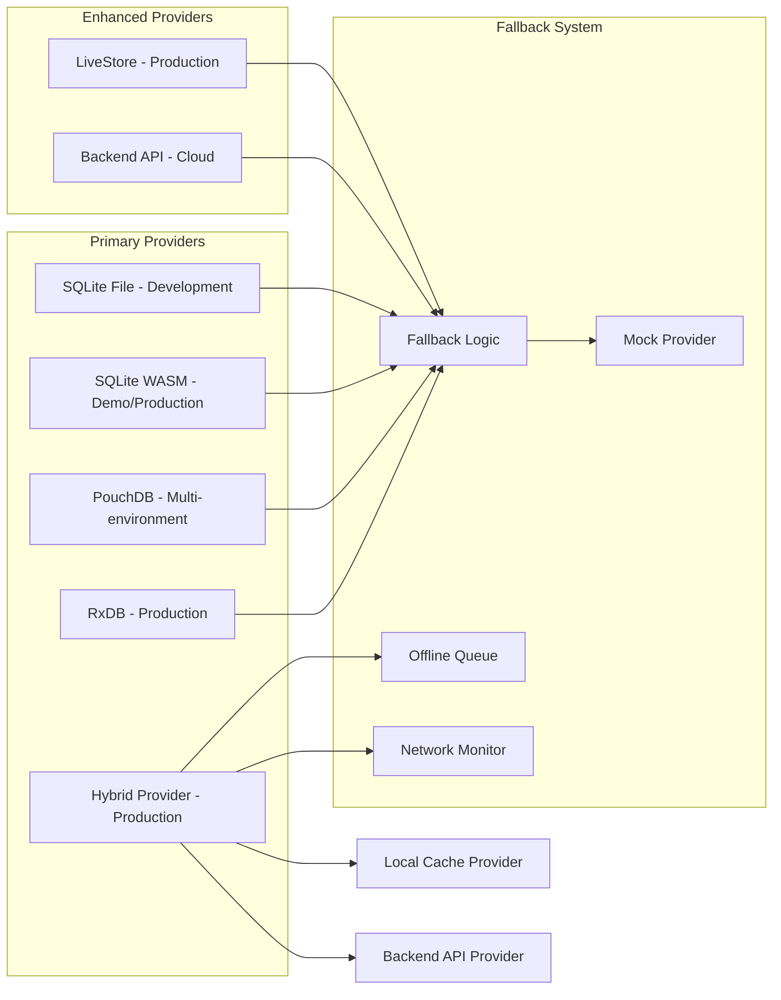

**Diagram sources**
- [DatabaseProviderFactory.ts:379-474](file://src/services/database/DatabaseProviderFactory.ts#L379-L474)
- [DatabaseProviderFactory.ts:518-523](file://src/services/database/DatabaseProviderFactory.ts#L518-L523)
- [HybridProvider.ts:326-608](file://src/services/database/HybridProvider.ts#L326-L608)

### Performance Optimization Strategies

The hybrid architecture implements several performance optimization strategies including the new HybridProvider system:

- **Environment-Specific Tuning**: Different optimization profiles for development, demo, and production
- **Resource Management**: Dynamic resource allocation based on provider capabilities
- **Caching Strategies**: Multi-level caching with intelligent invalidation
- **Connection Pooling**: Efficient connection management across providers
- **Background Processing**: Asynchronous operations to maintain UI responsiveness
- **Offline-First Architecture**: Local caching with automatic synchronization
- **Network-Aware Operations**: Intelligent handling of connectivity changes

**Updated** Enhanced with offline-first architecture and network-aware operations.

**Section sources**
- [DatabaseProviderFactory.ts:379-474](file://src/services/database/DatabaseProviderFactory.ts#L379-L474)

## Enhanced Monitoring Components

The hybrid data layer architecture incorporates comprehensive monitoring and security components to ensure reliability, performance, and data protection across all operational scenarios.

### Health Monitoring System

The HealthChecker system provides comprehensive health monitoring for database providers, storage, network, and sync operations:

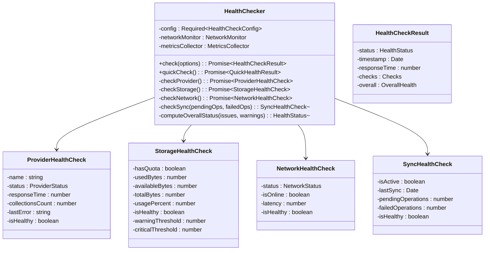

**Diagram sources**
- [HealthChecker.ts:83-302](file://src/services/database/monitoring/HealthChecker.ts#L83-L302)

### Field-Level Encryption System

The FieldLevelEncryption system provides transparent encryption and decryption of sensitive fields in database documents using Web Crypto API:

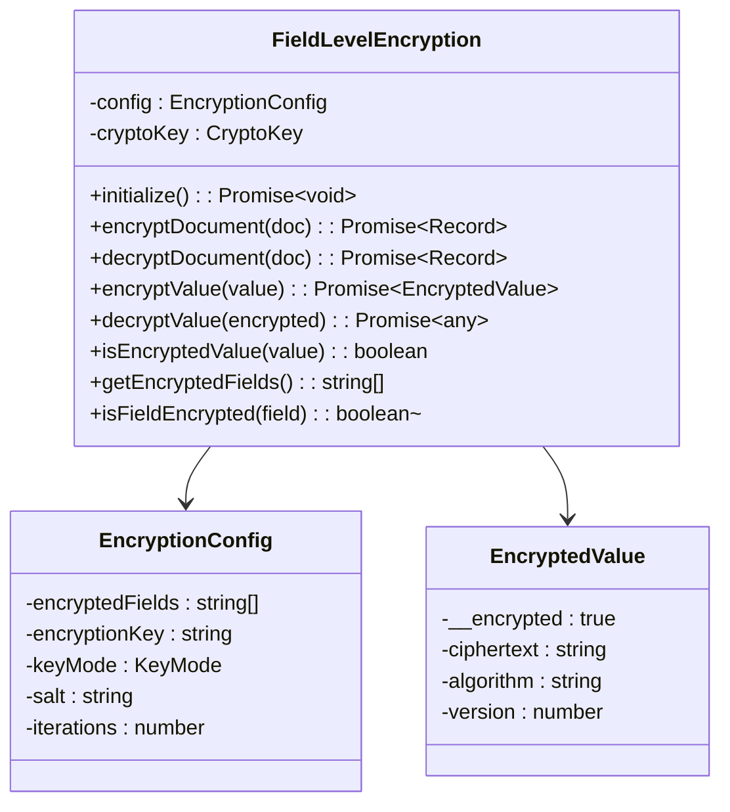

**Diagram sources**
- [FieldLevelEncryption.ts:66-315](file://src/services/database/monitoring/FieldLevelEncryption.ts#L66-L315)

### Circuit Breaker Pattern

The circuit breaker pattern provides fault tolerance and resilience for database operations:

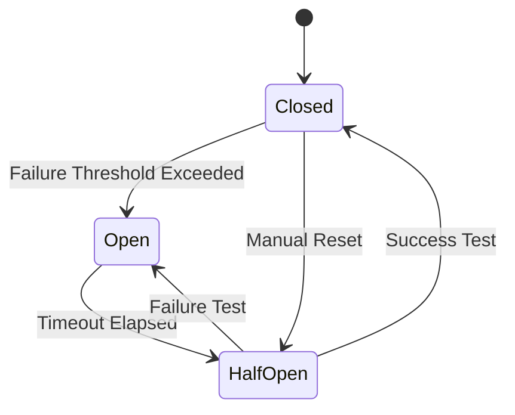

**Diagram sources**
- [HealthChecker.ts:146-164](file://src/services/database/monitoring/HealthChecker.ts#L146-L164)

### Monitoring Component Integration

The monitoring components work together to provide comprehensive observability:

| Component | Purpose | Integration Points |
|-----------|---------|-------------------|
| HealthChecker | Provider health monitoring | All database providers |
| FieldLevelEncryption | Data security | All collection operations |
| CircuitBreaker | Fault tolerance | Critical operations |
| MetricsCollector | Performance tracking | Query operations |
| StructuredLogger | Logging | All system operations |
| OfflineQueue | Offline support | Hybrid provider operations |

**Updated** Added comprehensive monitoring and security components with health checking, field-level encryption, and circuit breaker patterns.

**Section sources**
- [HealthChecker.ts:83-302](file://src/services/database/monitoring/HealthChecker.ts#L83-L302)
- [FieldLevelEncryption.ts:66-315](file://src/services/database/monitoring/FieldLevelEncryption.ts#L66-L315)
- [index.ts:1-38](file://src/services/database/monitoring/index.ts#L1-L38)

## Performance Considerations

The hybrid data layer architecture incorporates comprehensive performance optimization strategies tailored to different operational scenarios, including the new hybrid provider system and monitoring components.

### Memory Management

The system implements sophisticated memory management with environment-specific optimizations:

- **Development Mode**: Lower memory footprint with simplified indexing
- **Demo Mode**: Balanced memory usage with enhanced caching
- **Production Mode**: High-performance memory management with aggressive caching
- **Hybrid Mode**: Optimized memory usage with local cache management

### Query Optimization

Multiple query optimization strategies are employed:

- **Index Management**: Automatic index creation and maintenance
- **Query Planning**: Intelligent query execution plan selection
- **Result Caching**: Smart caching of frequently accessed data
- **Batch Operations**: Efficient bulk data operations
- **Offline Queue Processing**: Background sync operations

### Scalability Features

The architecture supports horizontal and vertical scaling:

- **Provider Scaling**: Ability to scale individual providers independently
- **Load Balancing**: Distribution of operations across multiple providers
- **Data Partitioning**: Logical partitioning of data for improved performance
- **Connection Management**: Efficient connection pooling and reuse
- **Network-Aware Scaling**: Automatic adjustment based on connectivity

### Security and Compliance

The hybrid architecture includes comprehensive security measures:

- **Field-Level Encryption**: Transparent encryption of sensitive data
- **Access Control**: Provider-specific authentication and authorization
- **Audit Logging**: Complete audit trail of all database operations
- **Data Retention**: Automated cleanup of expired data
- **Backup and Recovery**: Comprehensive backup and disaster recovery

**Updated** Enhanced with field-level encryption, comprehensive security measures, and audit logging capabilities.

## Troubleshooting Guide

Common issues and their resolution strategies:

### Provider Initialization Failures

**Symptoms**: Database provider fails to initialize
**Causes**: 
- Missing dependencies
- Environment restrictions
- Configuration errors
- Browser compatibility issues
- Hybrid provider setup failures

**Solutions**:
1. Verify provider availability in current environment
2. Check configuration parameters
3. Review browser compatibility requirements
4. Enable appropriate environment variables
5. Validate hybrid provider dependencies

### Data Migration Issues

**Symptoms**: Data not migrating between modes
**Causes**:
- Schema incompatibilities
- Provider limitations
- Data corruption
- Permission issues
- Hybrid provider sync failures

**Solutions**:
1. Validate schema compatibility
2. Check provider capabilities
3. Review migration logs
4. Implement manual migration steps
5. Verify hybrid provider sync status

### Performance Degradation

**Symptoms**: Slow query performance or memory issues
**Causes**:
- Insufficient indexing
- Large result sets
- Memory leaks
- Inefficient queries
- Hybrid provider cache issues

**Solutions**:
1. Implement proper indexing
2. Optimize query patterns
3. Monitor memory usage
4. Review query execution plans
5. Check hybrid provider cache configuration

### Monitoring and Health Issues

**Symptoms**: Health monitoring failures or security breaches
**Causes**:
- Health checker configuration errors
- Encryption key issues
- Circuit breaker activation
- Network connectivity problems
- Performance metric collection failures

**Solutions**:
1. Verify health checker configuration
2. Check encryption key validity
3. Review circuit breaker status
4. Test network connectivity
5. Validate performance metrics collection

**Updated** Added troubleshooting guidance for hybrid provider system, monitoring components, and security features.

**Section sources**
- [DatabaseProviderFactory.ts:518-523](file://src/services/database/DatabaseProviderFactory.ts#L518-L523)
- [dataModeManager.ts:145-161](file://src/services/dataModeManager.ts#L145-L161)
- [HealthChecker.ts:101-164](file://src/services/database/monitoring/HealthChecker.ts#L101-L164)
- [FieldLevelEncryption.ts:119-156](file://src/services/database/monitoring/FieldLevelEncryption.ts#L119-L156)

## Conclusion

The Hybrid Data Layer Architecture represents a comprehensive solution for modern educational management systems requiring flexibility, performance, reliability, and security across multiple environments. The architecture successfully balances the need for development agility with production robustness through intelligent provider selection, comprehensive configuration management, seamless data mode transitions, and the new hybrid provider system.

Key strengths of the architecture include:

- **Multi-Provider Support**: Seamless operation across SQLite, PouchDB, RxDB, LiveStore, and HybridProvider
- **Environment Flexibility**: Optimized configurations for development, demo, and production
- **Data Consistency**: Robust mechanisms for data migration, synchronization, and backup
- **Performance Optimization**: Environment-specific tuning, resource management, and caching strategies
- **Security Enhancement**: Field-level encryption, access control, and audit logging
- **Monitoring Excellence**: Comprehensive health checking, metrics collection, and alerting
- **Offline-First Architecture**: Reliable offline operations with automatic synchronization
- **Fault Tolerance**: Circuit breaker patterns and graceful degradation
- **Extensibility**: Modular design supporting future database provider additions

The system provides a solid foundation for educational institutions requiring scalable, reliable, secure, and performant data management solutions while maintaining the flexibility to adapt to evolving requirements and technology landscapes. The new hybrid provider system, enhanced monitoring components, and comprehensive security features make it suitable for enterprise-grade deployments with strict compliance and performance requirements.

**Updated** Enhanced conclusion reflecting the comprehensive hybrid provider system, monitoring components, and security features that distinguish this architecture from traditional database solutions.