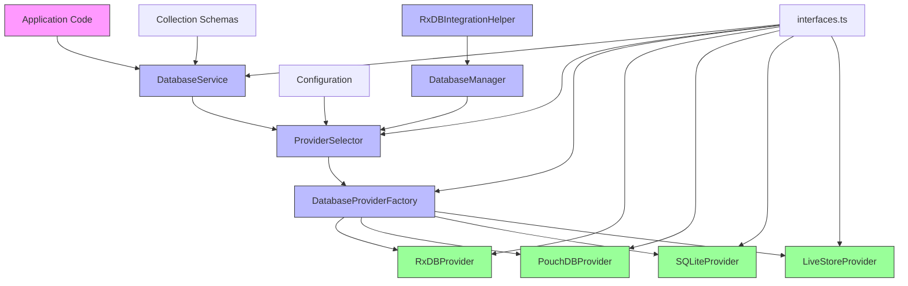
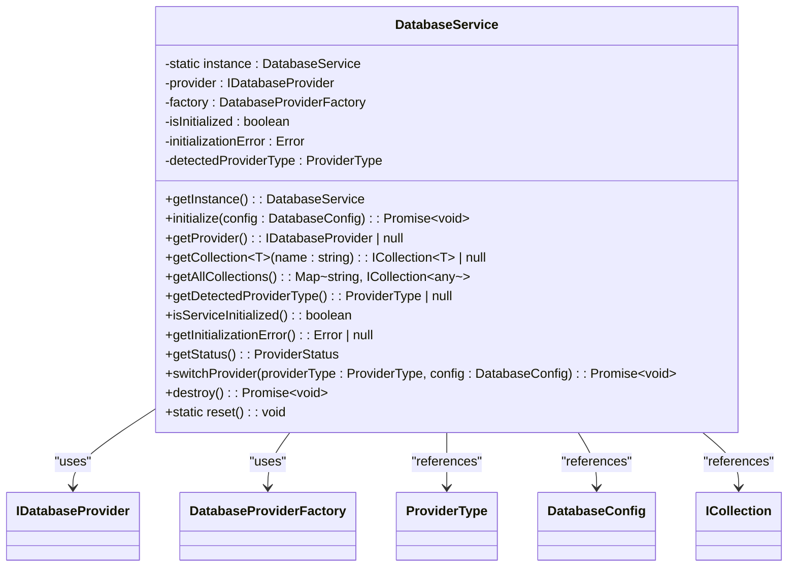
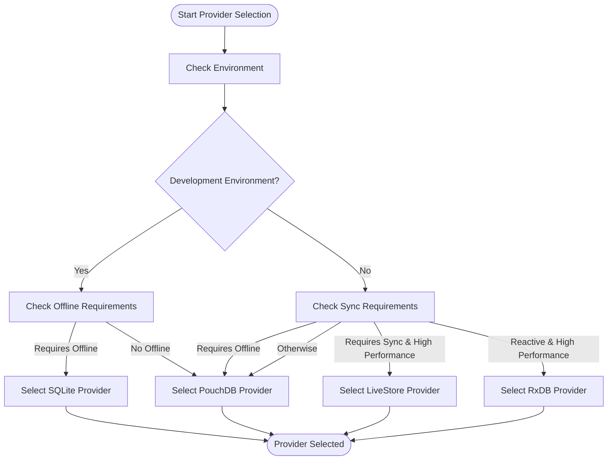
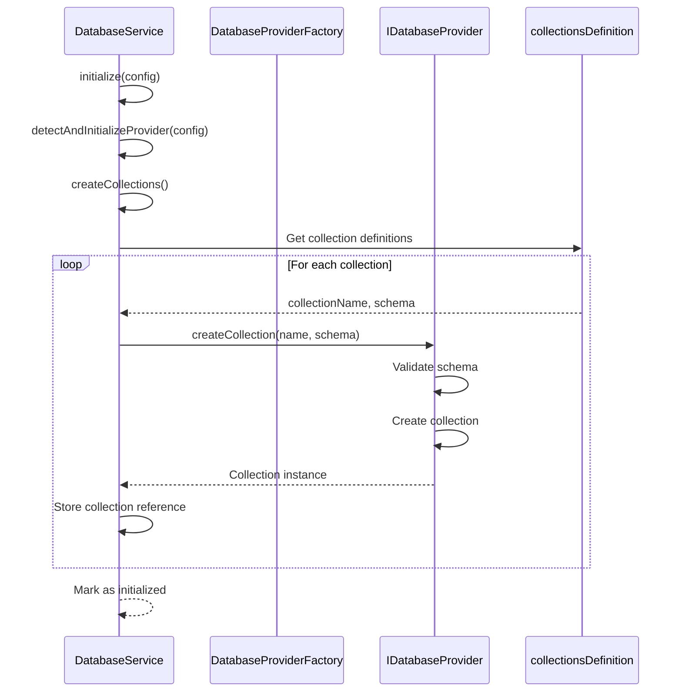
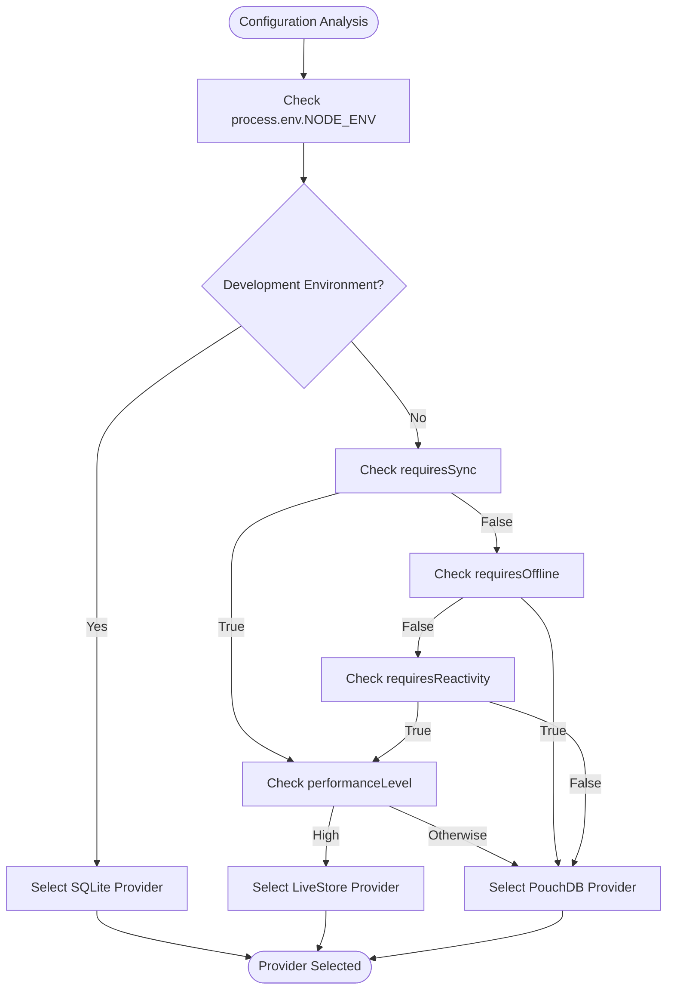
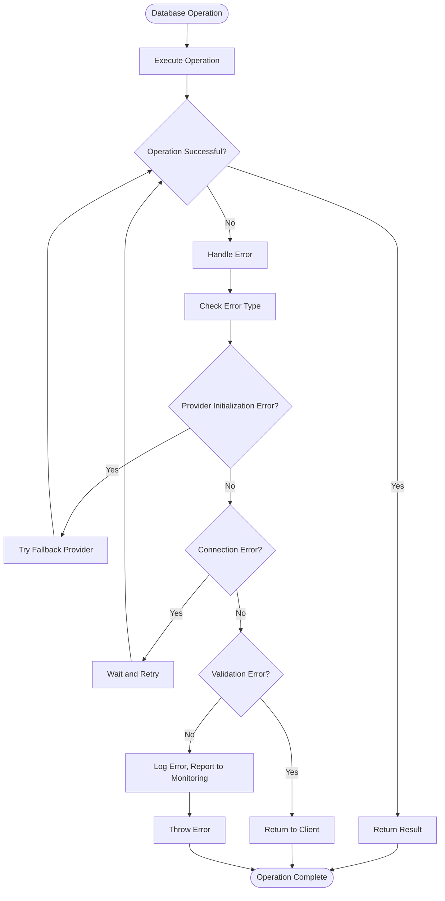

# Database Abstraction Layer

<cite>
**Referenced Files in This Document**   
- [databaseService.ts](file://src\services\database\databaseService.ts) - *Updated in recent commit*
- [ProviderSelector.ts](file://src\services\database\ProviderSelector.ts) - *Updated in recent commit*
- [DatabaseProviderFactory.ts](file://src\services\database\DatabaseProviderFactory.ts) - *Enhanced provider selection logic*
- [interfaces.ts](file://src\services\database\interfaces.ts) - *Updated interface definitions*
- [rxdbService.ts](file://src\services\rxdbService.ts) - *Integration with new provider system*
</cite>

## Update Summary
**Changes Made**   
- Updated Provider Selection Strategy section to reflect enhanced provider selection logic
- Added new section on DatabaseManager and RxDBIntegrationHelper
- Updated Core Architecture diagram to include new components
- Enhanced Connection Management and Initialization section with new initialization flow
- Updated Configuration-Driven Provider Selection with new strategy implementation
- Added new section on Dual-Database Architecture Integration

## Table of Contents
1. [Introduction](#introduction)
2. [Core Architecture](#core-architecture)
3. [DatabaseService: Primary Entry Point](#databaseservice-primary-entry-point)
4. [Provider Selection Strategy](#provider-selection-strategy)
5. [Common Interfaces and Contracts](#common-interfaces-and-contracts)
6. [Connection Management and Initialization](#connection-management-and-initialization)
7. [Query Execution and Data Operations](#query-execution-and-data-operations)
8. [Schema Synchronization and Collection Management](#schema-synchronization-and-collection-management)
9. [Configuration-Driven Provider Selection](#configuration-driven-provider-selection)
10. [Error Handling and Failover](#error-handling-and-failover)
11. [Dual-Database Architecture Integration](#dual-database-architecture-integration)

## Introduction
The Database Abstraction Layer in schoolpilot3 provides a unified interface for database operations across multiple storage technologies. This layer enables seamless switching between different database providers while maintaining consistent data access patterns throughout the application. The architecture supports multiple database technologies including RxDB, PouchDB, SQLite, and LiveStore, allowing the system to adapt to different environments and requirements.

The abstraction layer is designed with flexibility, reliability, and performance in mind, implementing a sophisticated provider selection strategy that automatically detects the optimal database technology based on environmental constraints and application requirements. Recent updates have enhanced the provider selection mechanism and introduced a dual-database architecture for improved integration with existing systems. This document provides a comprehensive analysis of the database abstraction layer, detailing its components, architecture, and operational principles.

## Core Architecture



**Diagram sources**
- [databaseService.ts](file://src\services\database\databaseService.ts#L1-L308)
- [ProviderSelector.ts](file://src\services\database\ProviderSelector.ts#L1-L450)
- [DatabaseProviderFactory.ts](file://src\services\database\DatabaseProviderFactory.ts#L1-L437)
- [ProviderSelector.ts](file://src\services\database\ProviderSelector.ts#L1-L450) - *Added DatabaseManager and RxDBIntegrationHelper*

**Section sources**
- [databaseService.ts](file://src\services\database\databaseService.ts#L1-L308)
- [ProviderSelector.ts](file://src\services\database\ProviderSelector.ts#L1-L450)
- [DatabaseProviderFactory.ts](file://src\services\database\DatabaseProviderFactory.ts#L1-L437)

## DatabaseService: Primary Entry Point

The DatabaseService class serves as the primary entry point for all database operations in the schoolpilot3 application. Implemented as a singleton, it provides a consistent interface for database interactions while abstracting the underlying provider implementation details.

The service follows a dynamic provider detection strategy, attempting to initialize providers in order of preference (RxDB first, then PouchDB). This approach ensures optimal performance while maintaining compatibility across different environments.



**Section sources**
- [databaseService.ts](file://src\services\database\databaseService.ts#L1-L308)

## Provider Selection Strategy

The provider selection strategy in schoolpilot3 has been enhanced through updates to the DatabaseProviderFactory and ProviderSelector classes. The system now uses a more sophisticated priority-based approach that evaluates multiple factors when selecting the optimal database provider.

The DefaultProviderSelectionStrategy evaluates several factors:
- Development vs. production environment
- Offline capability requirements
- Synchronization needs
- Performance requirements
- Storage quota constraints



**Diagram sources**
- [DatabaseProviderFactory.ts](file://src\services\database\DatabaseProviderFactory.ts#L1-L437)

**Section sources**
- [DatabaseProviderFactory.ts](file://src\services\database\DatabaseProviderFactory.ts#L71-L148)

## Common Interfaces and Contracts

The database abstraction layer defines a comprehensive set of interfaces in interfaces.ts that ensure consistency across different database technologies. These interfaces establish contracts for database operations, enabling seamless provider switching without requiring changes to application code.

The core interfaces include:
- IDatabaseProvider: Defines the contract for database providers
- ICollection: Specifies collection operations and reactive capabilities
- DatabaseConfig: Standardizes database configuration parameters
- CollectionSchema: Defines schema structure for collections
- ProviderStatus: Standardizes provider status reporting

```mermaid
classDiagram
class IDatabaseProvider {
<<interface>>
+name : string
+version : string
+initialize(config : DatabaseConfig) : Promise~void~
+createCollection~T~(name : string, schema : CollectionSchema) : Promise~ICollection~T~~
+getCollection~T~(name : string) : ICollection~T~ | null
+getAllCollections() : Map~string, ICollection~any~~
+destroy() : Promise~void~
+isAvailable() : boolean
+getStatus() : ProviderStatus
+backup() : Promise~string~
+restore(backupData : string) : Promise~void~
}
class ICollection~T~ {
<<interface>>
+name : string
+schema : CollectionSchema
+insert(doc : Omit~T, 'id'~) : Promise~InsertResult~T~~
+insertMany(docs : Omit~T, 'id'~[]) : Promise~BulkResult~T~~
+findOne(idOrQuery : string | QueryOptions) : Promise~T | null~
+findById(id : string) : Promise~T | null~
+find(query? : QueryOptions) : Promise~T[]~
+update(id : string, update : Partial~T~) : Promise~UpdateResult~T~~
+updateMany(query : QueryOptions, update : Partial~T~) : Promise~UpdateResult~T~[]~
+remove(id : string) : Promise~DeleteResult~
+removeMany(query : QueryOptions) : Promise~DeleteResult[]~
+subscribe(query? : QueryOptions) : Observable~T[]~
+subscribeToChanges() : Observable~CollectionChangeEvent~T~~
+count(query? : QueryOptions) : Promise~number~
+exists(id : string) : Promise~boolean~
+createIndex(index : IndexDefinition) : Promise~void~
+getStats() : Promise~CollectionStats~
+compact() : Promise~void~
+destroy() : Promise~void~
}
class DatabaseConfig {
+name : string
+version? : number
+storage? : string
+multiInstance? : boolean
+ignoreDuplicate? : boolean
+autoCompaction? : boolean
+debug? : boolean
}
class CollectionSchema {
+version : number
+type : 'object'
+properties : Record~string, SchemaProperty~
+required? : string[]
+indexes? : IndexDefinition[]
+primaryKey? : string
+relationships? : RelationshipDefinition[]
}
class ProviderStatus {
+name : string
+version : string
+isConnected : boolean
+collectionsCount : number
+lastError? : Error
+performance : PerformanceMetrics
}
class PerformanceMetrics {
+avgQueryTime : number
+totalQueries : number
+memoryUsage : number
}
IDatabaseProvider <|-- RxDBProvider
IDatabaseProvider <|-- PouchDBProvider
IDatabaseProvider <|-- SQLiteProvider
IDatabaseProvider <|-- LiveStoreProvider
ICollection <|-- RxDBCollection
ICollection <|-- PouchDBCollection
ICollection <|-- SQLiteCollection
ICollection <|-- LiveStoreCollection
```



**Diagram sources**
- [interfaces.ts](file://src\services\database\interfaces.ts#L1-L243)

**Section sources**
- [interfaces.ts](file://src\services\database\interfaces.ts#L1-L243)

## Connection Management and Initialization

The database abstraction layer implements a sophisticated connection management system that handles provider initialization, health monitoring, and failover scenarios. The initialization process follows a well-defined sequence to ensure reliable database connectivity.

The DatabaseService performs provider detection by checking environmental capabilities such as IndexedDB availability, cryptographic functions, and window context. This allows the system to adapt to different execution environments including browsers, testing environments, and potential future server-side rendering scenarios.

```mermaid
sequenceDiagram
participant App as Application
participant DBService as DatabaseService
participant Factory as DatabaseProviderFactory
participant Provider as IDatabaseProvider
App->>DBService : initialize(config)
DBService->>DBService : Check if already initialized
DBService->>DBService : detectAndInitializeProvider(config)
loop For each provider type
DBService->>DBService : checkProviderAvailability(type)
alt Provider available
DBService->>Factory : createProvider(config, type)
Factory->>Provider : initialize(config)
Provider-->>Factory : Success
Factory-->>DBService : Provider instance
DBService->>DBService : createCollections()
DBService-->>App : Initialization complete
break Success
else Error
DBService->>DBService : Log warning, try next provider
end
end
alt All providers failed
DBService-->>App : Throw DatabaseError
end
```

**Diagram sources**
- [databaseService.ts](file://src\services\database\databaseService.ts#L1-L308)

**Section sources**
- [databaseService.ts](file://src\services\database\databaseService.ts#L73-L150)

## Query Execution and Data Operations

The database abstraction layer provides a comprehensive set of data operations through the ICollection interface. These operations are standardized across all provider implementations, ensuring consistent behavior regardless of the underlying database technology.

The QueryBuilder class implements a fluent interface for constructing complex queries with support for filtering, sorting, pagination, and field selection. This abstraction allows developers to write database-agnostic queries that work across different providers.

```mermaid
classDiagram
class QueryBuilder~T~ {
-collectionName : string
-query : any
-sortOptions : any[]
-limitValue : number
-skipValue : number
-fieldsValue : string[]
+where(field : keyof T, operator : string, value : any) : QueryBuilder~T~
+and(conditions : {field : keyof T, operator : string, value : any}[]) : QueryBuilder~T~
+or(conditions : {field : keyof T, operator : string, value : any}[]) : QueryBuilder~T~
+sort(field : keyof T, direction : 'asc' | 'desc') : QueryBuilder~T~
+limit(count : number) : QueryBuilder~T~
+skip(count : number) : QueryBuilder~T~
+select(fields : (keyof T)[]) : QueryBuilder~T~
+build() : any
+execute(collection : ICollection~T~) : Promise~T[]~
+executeOne(collection : ICollection~T~) : Promise~T | null~
+count(collection : ICollection~T~) : Promise~number~
+subscribe(collection : ICollection~T~) : Observable~T[]~
}
class DatabaseService {
+createQuery~T~(collectionName : string) : QueryBuilder~T~
}
DatabaseService --> QueryBuilder : "creates"
QueryBuilder --> ICollection : "executes against"
```

**Diagram sources**
- [DatabaseProviderFactory.ts](file://src\services\database\DatabaseProviderFactory.ts#L150-L300)

**Section sources**
- [DatabaseProviderFactory.ts](file://src\services\database\DatabaseProviderFactory.ts#L150-L300)

## Schema Synchronization and Collection Management

The database abstraction layer handles schema synchronization through a centralized collection management system. The DatabaseService creates collections based on definitions from the rxdbService module, ensuring consistency across different providers.

Collection schemas are defined using a standardized format that includes versioning, property definitions, required fields, indexes, and primary keys. This approach enables seamless schema evolution and migration across different database technologies.



**Diagram sources**
- [databaseService.ts](file://src\services\database\databaseService.ts#L1-L308)
- [rxdbService.ts](file://src\services\rxdbService.ts#L1-L507)

**Section sources**
- [databaseService.ts](file://src\services\database\databaseService.ts#L180-L250)
- [rxdbService.ts](file://src\services\rxdbService.ts#L113-L162)

## Configuration-Driven Provider Selection

The provider selection process is driven by both runtime environment detection and configuration parameters. The system evaluates multiple factors to determine the optimal provider for the current context, including development mode, offline requirements, synchronization needs, and performance characteristics.

Configuration options in DatabaseConfig influence provider behavior, allowing fine-tuning of database operations for specific use cases. The multiInstance parameter, for example, controls whether multiple browser tabs can access the database simultaneously.



**Diagram sources**
- [DatabaseProviderFactory.ts](file://src\services\database\DatabaseProviderFactory.ts#L71-L148)

**Section sources**
- [DatabaseProviderFactory.ts](file://src\services\database\DatabaseProviderFactory.ts#L71-L148)

## Error Handling and Failover

The database abstraction layer implements comprehensive error handling and failover mechanisms to ensure application resilience. The system uses custom error classes like DatabaseError, CollectionError, and SchemaValidationError to provide detailed error information while maintaining a consistent error handling interface.

Failover strategies include automatic provider fallback, connection retry mechanisms, and graceful degradation of functionality when database operations fail. The status monitoring system provides real-time feedback on provider health and connectivity.



**Diagram sources**
- [databaseService.ts](file://src\services\database\databaseService.ts#L1-L308)
- [interfaces.ts](file://src\services\database\interfaces.ts#L1-L243)

**Section sources**
- [databaseService.ts](file://src\services\database\databaseService.ts#L150-L308)
- [interfaces.ts](file://src\services\database\interfaces.ts#L180-L220)

## Dual-Database Architecture Integration

The recent updates have introduced a dual-database architecture through the DatabaseManager and RxDBIntegrationHelper classes, enabling seamless integration between the new abstraction layer and existing RxDB-based code.

The DatabaseManager class orchestrates the dual-database architecture, managing the active provider and collections while providing status monitoring and lifecycle management. It works in conjunction with the RxDBIntegrationHelper to ensure compatibility with existing code that relies on RxDB collections.

```mermaid
classDiagram
class DatabaseManager {
-private factory : DatabaseProviderFactory
-private activeProvider : IDatabaseProvider
-private collections : Map~string, ICollection~any~~
-private statusSubject : BehaviorSubject~ProviderStatus | null~
-private isInitialized : boolean
+initialize(config : DatabaseConfig, collectionConfigs : CollectionConfig[]) : Promise~void~
+getCollection~T~(name : string) : ICollection~T~ | null
+getAllCollections() : Map~string, ICollection~any~~
+createQuery~T~(collectionName : string) : QueryBuilder~T~
+isAvailable() : boolean
+getStatus() : ProviderStatus | null
+subscribeToStatus() : Observable~ProviderStatus | null~
+switchProvider(providerType : ProviderType, config : DatabaseConfig) : Promise~void~
+backup() : Promise~string~
+restore(backupData : string) : Promise~void~
+getCollectionStats() : Promise~{ name : string; stats : any }[]~
+compact() : Promise~void~
+destroy() : Promise~void~
}
class RxDBIntegrationHelper {
-private databaseManager : DatabaseManager
+initializeWithRxDBCollections(collectionsDefinition : Record~string, any~, databaseName : string) : Promise~void~
+getDatabaseManager() : DatabaseManager
+isInitialized() : boolean
+getCollection~T~(name : string) : ICollection~T~ | null
}
DatabaseManager --> DatabaseProviderFactory : "uses"
DatabaseManager --> IDatabaseProvider : "manages"
DatabaseManager --> ICollection : "contains"
RxDBIntegrationHelper --> DatabaseManager : "wraps"
```

**Diagram sources**
- [ProviderSelector.ts](file://src\services\database\ProviderSelector.ts#L1-L450)

**Section sources**
- [ProviderSelector.ts](file://src\services\database\ProviderSelector.ts#L1-L450)
- [rxdbService.ts](file://src\services\rxdbService.ts#L1-L507)