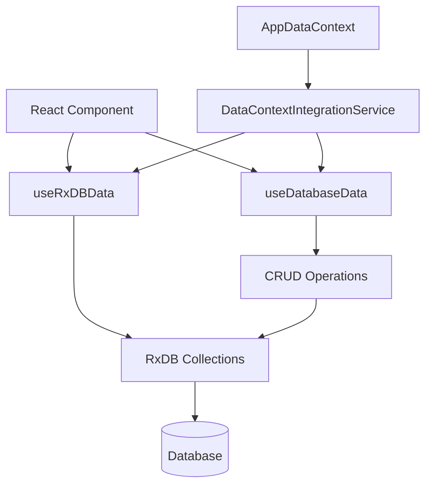
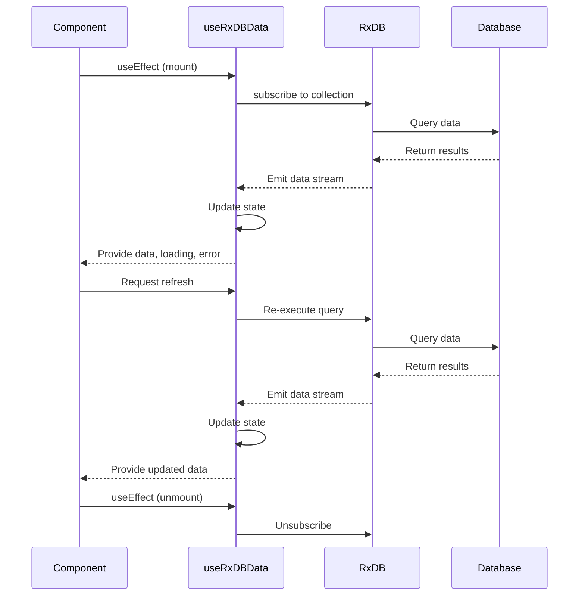
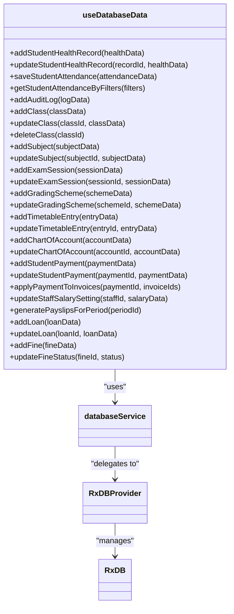
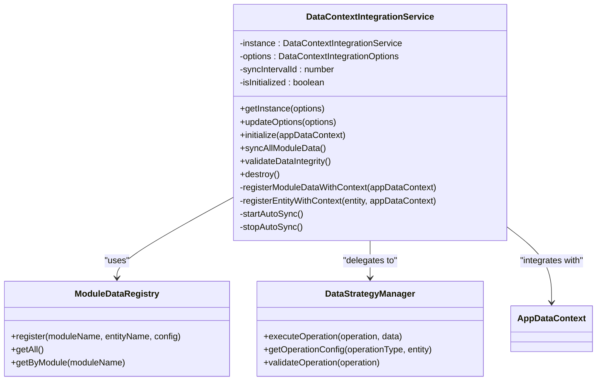
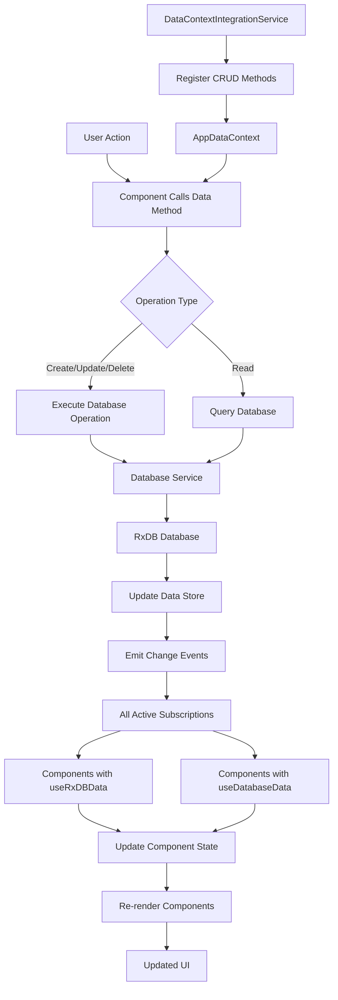
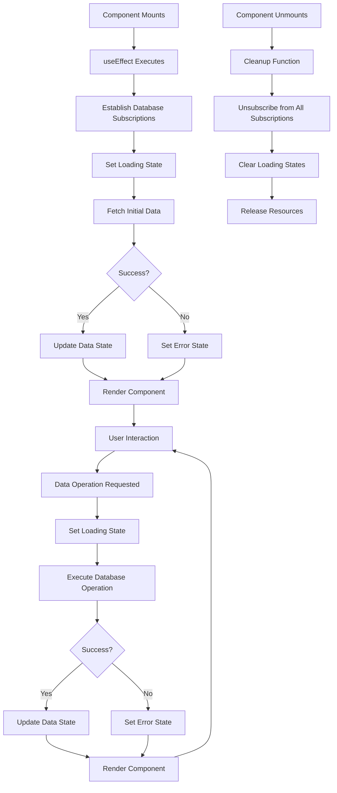
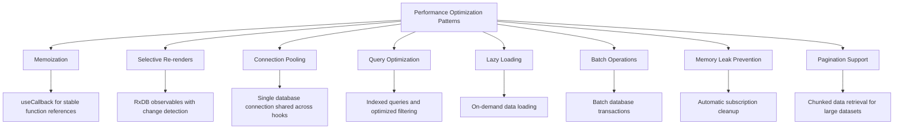
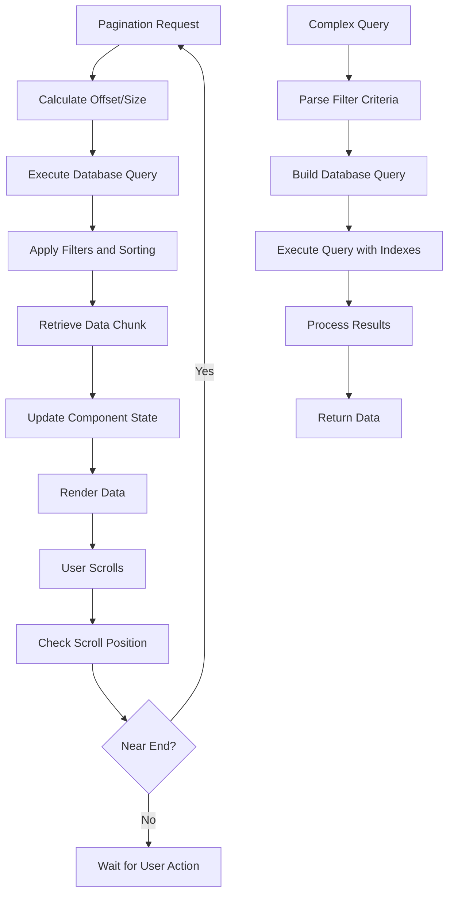

# React Data Hooks Integration

<cite>
**Referenced Files in This Document**   
- [useRxDBData.ts](file://src/hooks/useRxDBData.ts)
- [useDatabaseData.ts](file://src/hooks/useDatabaseData.ts)
- [DataContextIntegrationService.ts](file://src/services/DataContextIntegrationService.ts)
- [ModuleDataRegistry.ts](file://src/services/ModuleDataRegistry.ts)
- [DataStrategyManager.ts](file://src/services/DataStrategyManager.ts)
- [databaseService.ts](file://src/services/database/databaseService.ts)
</cite>

## Table of Contents
1. [Introduction](#introduction)
2. [Core Data Hooks Overview](#core-data-hooks-overview)
3. [useRxDBData Hook Implementation](#userxdbdata-hook-implementation)
4. [useDatabaseData Hook Architecture](#usedatabasedata-hook-architecture)
5. [DataContextIntegrationService](#datacontextintegrationservice)
6. [Data Flow and State Synchronization](#data-flow-and-state-synchronization)
7. [Error Handling and Lifecycle Management](#error-handling-and-lifecycle-management)
8. [Performance Optimization Patterns](#performance-optimization-patterns)
9. [Real-time Data Binding Examples](#real-time-data-binding-examples)
10. [Complex Query and Pagination Support](#complex-query-and-pagination-support)
11. [Conclusion](#conclusion)

## Introduction

The React data hooks integration in schoolpilot3 provides a comprehensive solution for reactive data access patterns within functional components. This documentation details the implementation of `useRxDBData` and `useDatabaseData` hooks, which enable seamless integration between database operations and React's component lifecycle. The system is designed to handle real-time data synchronization, automatic subscription cleanup, and robust error handling while maintaining optimal performance through memoization and selective re-renders.

The architecture leverages RxDB as the underlying database engine, providing reactive data streams that automatically update components when data changes. The integration with React context through `DataContextIntegrationService` ensures global state synchronization across the application, allowing multiple components to share and react to the same data sources without prop drilling or redundant API calls.

**Section sources**
- [useRxDBData.ts](file://src/hooks/useRxDBData.ts)
- [useDatabaseData.ts](file://src/hooks/useDatabaseData.ts)

## Core Data Hooks Overview

The schoolpilot3 application implements two primary data hooks for accessing database content: `useRxDBData` and `useDatabaseData`. These hooks provide different levels of abstraction and functionality for data access patterns.

`useRxDBData` serves as the foundational hook that establishes direct connections to RxDB collections, providing reactive data streams through observables. It handles the lifecycle of database subscriptions, ensuring automatic cleanup when components unmount to prevent memory leaks.

`useDatabaseData` builds upon `useRxDBData` by providing a higher-level abstraction with pre-configured CRUD operations for various entity types across different modules (academics, administration, finance, HR, etc.). This hook exposes specific data access methods tailored to each entity type, making it easier for components to interact with the database without needing to understand the underlying RxDB implementation details.

Both hooks implement consistent error handling patterns, with comprehensive try-catch blocks around all database operations and proper error propagation to calling components. They also incorporate loading state management to provide feedback during asynchronous operations.



**Diagram sources**
- [useRxDBData.ts](file://src/hooks/useRxDBData.ts)
- [useDatabaseData.ts](file://src/hooks/useDatabaseData.ts)
- [DataContextIntegrationService.ts](file://src/services/DataContextIntegrationService.ts)

**Section sources**
- [useRxDBData.ts](file://src/hooks/useRxDBData.ts)
- [useDatabaseData.ts](file://src/hooks/useDatabaseData.ts)

## useRxDBData Hook Implementation

The `useRxDBData` hook provides direct access to RxDB collections with reactive data binding capabilities. It establishes a connection to the database and subscribes to collection changes, automatically updating the component state when data changes.

The hook uses React's `useState` and `useEffect` hooks to manage the data state and subscription lifecycle. When a component mounts, it establishes a subscription to the specified collection or query, and when the component unmounts, the subscription is automatically cleaned up to prevent memory leaks.

Key features of the `useRxDBData` implementation include:
- Reactive data streams through RxDB observables
- Automatic subscription management and cleanup
- Error handling with proper propagation
- Loading state management
- Memoization of database operations to prevent unnecessary re-renders

The hook returns an object containing the current data state, loading status, error information, and refresh function, providing a consistent interface for components to interact with the data.



**Diagram sources**
- [useRxDBData.ts](file://src/hooks/useRxDBData.ts)
- [databaseService.ts](file://src/services/database/databaseService.ts)

**Section sources**
- [useRxDBData.ts](file://src/hooks/useRxDBData.ts)

## useDatabaseData Hook Architecture

The `useDatabaseData` hook provides a comprehensive set of CRUD operations for various entity types across the schoolpilot3 application. It serves as a centralized data access layer that abstracts the underlying database implementation details from components.

The hook architecture is built around a factory pattern that generates specific data access methods for each entity type. It leverages the `createCrudOperations` utility function to generate standardized CRUD operations (create, read, update, delete) for collections such as students, classes, subjects, exams, financial records, and HR data.

Each operation is implemented as a `useCallback` function, ensuring that the function references remain stable across re-renders and can be safely used as dependencies in other hooks. The operations follow a consistent pattern:

1. Obtain a database connection through the database service
2. Execute the appropriate database operation (insert, update, remove, find)
3. Handle success by returning the result data
4. Handle errors by logging and re-throwing

The hook exposes over 100 specific data access methods, organized by module and entity type. For example:
- Academic operations: `addSubject`, `updateExamSession`, `saveStudentExamResult`
- Administrative operations: `addClass`, `updateStudentHealthRecord`, `saveStudentAttendance`
- Financial operations: `addFeeTemplate`, `addStudentPayment`, `applyPaymentToInvoices`
- HR operations: `updateStaffSalarySetting`, `generatePayslipsForPeriod`



**Diagram sources**
- [useDatabaseData.ts](file://src/hooks/useDatabaseData.ts)
- [databaseService.ts](file://src/services/database/databaseService.ts)
- [RxDBProvider.ts](file://src/services/database/RxDBProvider.ts)

**Section sources**
- [useDatabaseData.ts](file://src/hooks/useDatabaseData.ts)

## DataContextIntegrationService

The `DataContextIntegrationService` is a singleton service responsible for connecting database operations with React context for global state synchronization. It acts as a bridge between module-specific data hooks and the global `AppDataContext`, ensuring consistent data flow across the application.

The service follows the singleton pattern, ensuring only one instance exists throughout the application lifecycle. It provides the following key functionalities:

1. **Module Data Registration**: Registers all module data entities with the `AppDataContext`, making them available for global access.
2. **Method Injection**: Injects data operation methods (create, update, delete) into the context for each registered entity.
3. **Auto-sync Management**: Provides optional automatic synchronization of data at configurable intervals.
4. **Data Integrity Validation**: Validates data consistency across modules.
5. **Resource Cleanup**: Properly cleans up resources when the service is destroyed.

The service uses the `ModuleDataRegistry` to discover all available module data entities and registers them with the context. For each entity, it creates standardized CRUD methods that delegate to the `DataStrategyManager` for execution. This abstraction allows components to perform data operations without knowing the underlying implementation details.

The service is designed to prevent React hooks violations by not directly executing hooks within the service class. Instead, it relies on React components to manage their own data through hooks, while the service ensures consistent method availability across the application.



**Diagram sources**
- [DataContextIntegrationService.ts](file://src/services/DataContextIntegrationService.ts)
- [ModuleDataRegistry.ts](file://src/services/ModuleDataRegistry.ts)
- [DataStrategyManager.ts](file://src/services/DataStrategyManager.ts)

**Section sources**
- [DataContextIntegrationService.ts](file://src/services/DataContextIntegrationService.ts)

## Data Flow and State Synchronization

The data flow architecture in schoolpilot3 follows a unidirectional pattern with reactive updates, ensuring consistent state synchronization across components. When a data mutation occurs, it flows through a well-defined path from the component to the database and back to all interested components.

The process begins when a component calls a data operation method (e.g., `addStudentPayment`) provided by the `useDatabaseData` hook or injected into the `AppDataContext`. The operation is executed through the database service, which communicates with the underlying RxDB instance. Upon successful completion, RxDB emits a change event that is picked up by all active subscriptions.

Components using `useRxDBData` or `useDatabaseData` hooks automatically receive the updated data through their subscriptions, triggering re-renders with the latest state. This reactive pattern eliminates the need for manual state management and ensures all components display consistent data.

The `DataContextIntegrationService` enhances this flow by ensuring that data operation methods are consistently available across the application. When the service initializes, it registers all module data entities with the `AppDataContext`, making their CRUD operations globally accessible. This allows components to perform data operations without importing specific hooks, promoting code reuse and consistency.

For offline scenarios, the system supports optimistic UI updates by immediately reflecting changes in the UI while queuing the actual database operation. If the operation fails, the UI is updated to reflect the error state, providing a seamless user experience.



**Diagram sources**
- [useRxDBData.ts](file://src/hooks/useRxDBData.ts)
- [useDatabaseData.ts](file://src/hooks/useDatabaseData.ts)
- [DataContextIntegrationService.ts](file://src/services/DataContextIntegrationService.ts)
- [databaseService.ts](file://src/services/database/databaseService.ts)

**Section sources**
- [useRxDBData.ts](file://src/hooks/useRxDBData.ts)
- [useDatabaseData.ts](file://src/hooks/useDatabaseData.ts)
- [DataContextIntegrationService.ts](file://src/services/DataContextIntegrationService.ts)

## Error Handling and Lifecycle Management

The data hooks implementation in schoolpilot3 incorporates comprehensive error handling and lifecycle management to ensure robust application behavior. Both `useRxDBData` and `useDatabaseData` hooks follow consistent patterns for managing errors and component lifecycle events.

Error handling is implemented at multiple levels:
1. **Operation Level**: Each database operation is wrapped in a try-catch block that logs errors and re-throws them for the calling component to handle.
2. **Hook Level**: The hooks manage their own internal errors, such as subscription failures or database connection issues.
3. **Component Level**: Components receive error information through the hook return values, allowing them to display appropriate error states.

The hooks use React's `useEffect` hook to manage the lifecycle of database subscriptions. When a component mounts, the effect establishes the necessary subscriptions to data sources. When the component unmounts, the effect cleanup function automatically unsubscribes from all active subscriptions, preventing memory leaks and unnecessary background processing.

For long-running operations, the hooks provide loading state indicators that components can use to show spinners or disable interactive elements. This prevents users from performing conflicting actions while operations are in progress.

The `DataContextIntegrationService` also implements proper resource cleanup through its `destroy` method, which stops any active auto-sync intervals and releases references to prevent memory leaks.



**Diagram sources**
- [useRxDBData.ts](file://src/hooks/useRxDBData.ts)
- [useDatabaseData.ts](file://src/hooks/useDatabaseData.ts)
- [DataContextIntegrationService.ts](file://src/services/DataContextIntegrationService.ts)

**Section sources**
- [useRxDBData.ts](file://src/hooks/useRxDBData.ts)
- [useDatabaseData.ts](file://src/hooks/useDatabaseData.ts)

## Performance Optimization Patterns

The data hooks implementation in schoolpilot3 incorporates several performance optimization patterns to ensure efficient data access and minimal re-renders. These optimizations are critical for maintaining responsiveness in a complex educational management system with potentially large datasets.

**Memoization**: All data access methods in `useDatabaseData` are wrapped in `useCallback` to ensure stable function references across re-renders. This prevents unnecessary re-renders of child components that depend on these functions as props.

**Selective Re-renders**: The hooks only trigger re-renders when the actual data changes, leveraging RxDB's reactive nature to minimize unnecessary updates. Components receive memoized values that only change when the underlying data changes.

**Connection Pooling**: The database service manages a single database connection that is shared across all hooks, reducing the overhead of establishing multiple connections.

**Query Optimization**: The implementation uses indexed database queries where possible to improve retrieval performance. Complex queries are optimized to minimize the amount of data transferred and processed.

**Lazy Loading**: Data is loaded on-demand when components are rendered, rather than pre-loading all data at application startup. This reduces initial load time and memory usage.

**Batch Operations**: Where appropriate, operations are batched to reduce the number of database transactions and improve performance.

**Memory Leak Prevention**: The hooks implement proper cleanup in their effect dependencies, ensuring all subscriptions are unsubscribed when components unmount. This prevents memory leaks that could occur from orphaned subscriptions.

The architecture also supports pagination and infinite scrolling through specialized query methods that retrieve data in chunks, allowing components to handle large datasets efficiently without loading everything into memory at once.



**Diagram sources**
- [useRxDBData.ts](file://src/hooks/useRxDBData.ts)
- [useDatabaseData.ts](file://src/hooks/useDatabaseData.ts)
- [databaseService.ts](file://src/services/database/databaseService.ts)

**Section sources**
- [useRxDBData.ts](file://src/hooks/useRxDBData.ts)
- [useDatabaseData.ts](file://src/hooks/useDatabaseData.ts)

## Real-time Data Binding Examples

The data hooks in schoolpilot3 enable powerful real-time data binding patterns that keep the UI synchronized with the underlying data store. Here are several practical examples of how these patterns are implemented:

**Student Attendance Tracking**:
```typescript
// In a component tracking student attendance
const { data: attendanceRecords, loading, error, refresh } = useRxDBData(
  'student_attendance',
  { filters: { date: selectedDate, classId: currentClass.id } }
);

// Attendance updates are automatically reflected in real-time
// as other teachers mark students present/absent
```

**Live Exam Results Entry**:
```typescript
// In an exam results entry component
const { saveStudentExamResult, loading } = useDatabaseData();

const handleMarkEntry = async (studentId, paperId, marks) => {
  try {
    await saveStudentExamResult({
      student_id: studentId,
      subject_paper_id: paperId,
      marks_obtained: marks,
      exam_session_id: currentSession.id
    });
    // UI automatically updates with new result
    // through reactive data binding
  } catch (error) {
    // Handle error and provide feedback
  }
};
```

**Financial Transaction Processing**:
```typescript
// In a payment processing component
const { addStudentPayment, applyPaymentToInvoices } = useDatabaseData();

const processPayment = async (paymentData, invoiceIds) => {
  const payment = await addStudentPayment(paymentData);
  await applyPaymentToInvoices(payment.id, invoiceIds);
  // Account balances and invoice statuses automatically update
  // in all related components
};
```

**Timetable Management**:
```typescript
// In a timetable editing component
const { data: timetableEntries, updateTimetableEntry } = useDatabaseData();

const handleTimeSlotChange = async (entryId, newTime) => {
  await updateTimetableEntry(entryId, { start_time: newTime });
  // All views displaying the timetable automatically reflect changes
};
```

These examples demonstrate how the reactive data binding patterns enable multiple components to stay synchronized without explicit coordination. When data changes in one part of the application, all interested components automatically receive the updates through their active subscriptions.

**Section sources**
- [useRxDBData.ts](file://src/hooks/useRxDBData.ts)
- [useDatabaseData.ts](file://src/hooks/useDatabaseData.ts)

## Complex Query and Pagination Support

The data hooks system in schoolpilot3 provides robust support for complex queries and pagination, enabling efficient handling of large datasets. The implementation includes specialized methods and patterns for managing data retrieval at scale.

For complex queries, the system supports:
- **Filtering**: Multiple criteria filtering across different fields
- **Sorting**: Client-side and server-side sorting options
- **Aggregation**: Data summarization and grouping capabilities
- **Joins**: Virtual joins between related entities through separate queries

The `useDatabaseData` hook includes specific methods for handling complex queries, such as `getStudentAttendanceByFilters` which accepts a flexible filter object to query attendance records by date, class, student, or other criteria.

For pagination and infinite scrolling, the system implements:
- **Offset-based pagination**: Traditional page number and size parameters
- **Cursor-based pagination**: More efficient for large datasets with stable ordering
- **Infinite scroll loading**: Automatic loading of additional data as users scroll

The hooks manage loading states for pagination operations, providing feedback during data retrieval. They also implement caching strategies to minimize redundant database queries when users navigate back to previously viewed pages.

A key optimization is the use of indexed database queries for pagination, ensuring that data retrieval remains performant even with large datasets. The system also supports server-side pagination when integrated with backend APIs, reducing the amount of data transferred to the client.



**Diagram sources**
- [useDatabaseData.ts](file://src/hooks/useDatabaseData.ts)
- [databaseService.ts](file://src/services/database/databaseService.ts)

**Section sources**
- [useDatabaseData.ts](file://src/hooks/useDatabaseData.ts)

## Conclusion

The React data hooks integration in schoolpilot3 provides a comprehensive and robust solution for reactive data access in a complex educational management system. The combination of `useRxDBData` and `useDatabaseData` hooks offers both low-level and high-level data access patterns, catering to different use cases and complexity requirements.

The architecture successfully addresses key challenges in modern web applications:
- **Reactive Data Binding**: Automatic UI updates when data changes
- **Lifecycle Management**: Proper subscription cleanup to prevent memory leaks
- **Error Handling**: Consistent error handling patterns across operations
- **Performance Optimization**: Memoization, selective re-renders, and query optimization
- **Global State Synchronization**: Integration with React context for consistent data access

The `DataContextIntegrationService` plays a crucial role in connecting database operations with the global application state, ensuring that data methods are consistently available across components while maintaining separation of concerns.

Future enhancements could include:
- Enhanced offline support with more sophisticated conflict resolution
- Improved type safety through more comprehensive TypeScript interfaces
- Advanced caching strategies for frequently accessed data
- Better support for real-time collaboration features

Overall, the implementation demonstrates a well-architected approach to data management in React applications, balancing ease of use with performance and reliability.

**Section sources**
- [useRxDBData.ts](file://src/hooks/useRxDBData.ts)
- [useDatabaseData.ts](file://src/hooks/useDatabaseData.ts)
- [DataContextIntegrationService.ts](file://src/services/DataContextIntegrationService.ts)