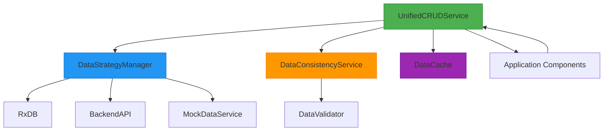
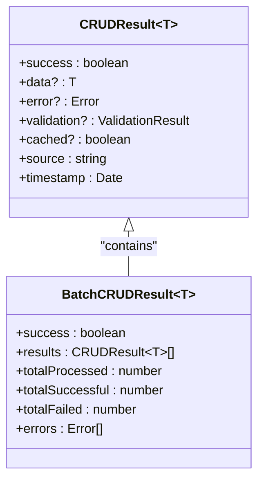
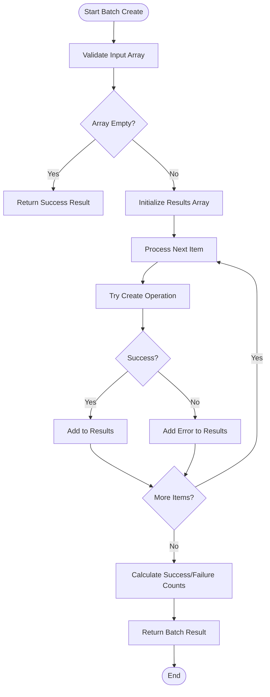
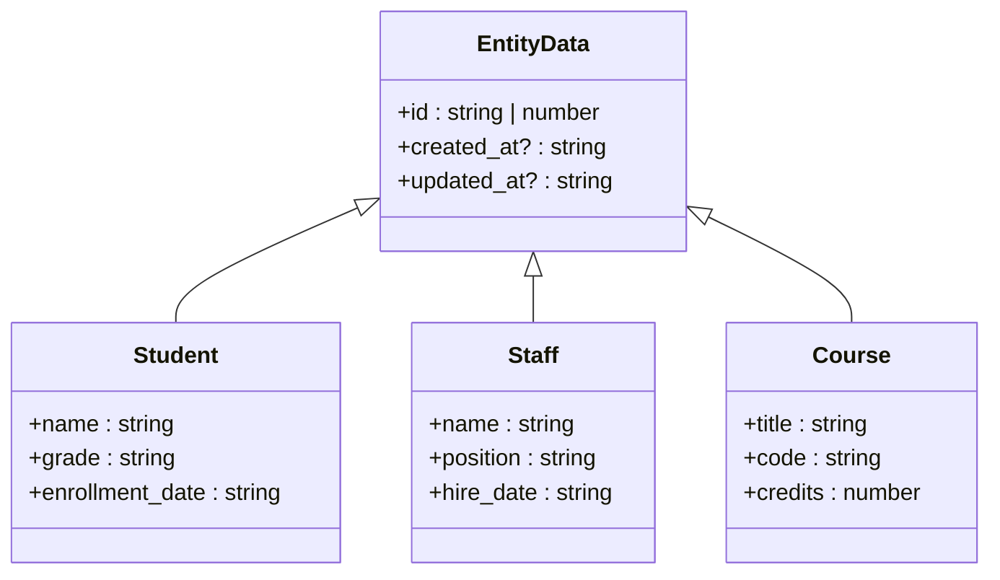
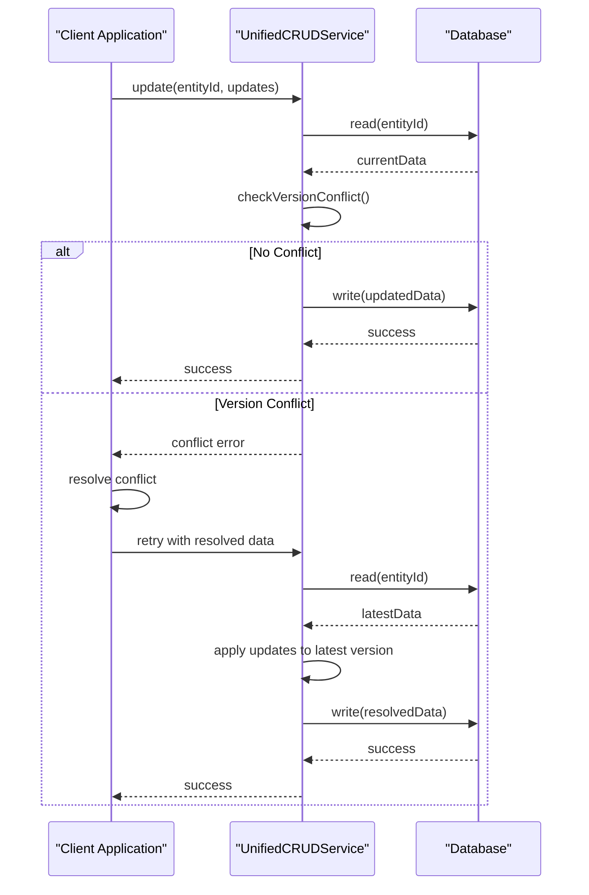
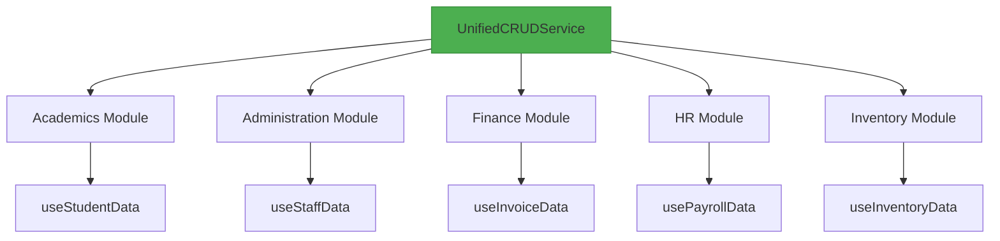
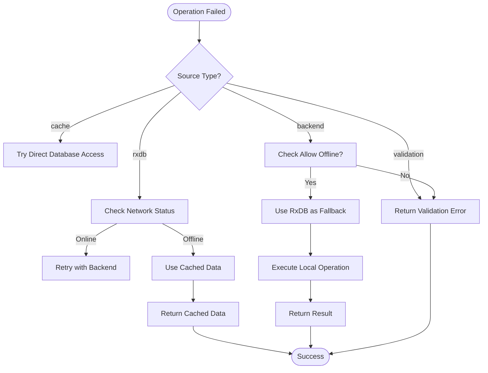

# Unified CRUD Service

<cite>
**Referenced Files in This Document**   
- [UnifiedCRUDService.ts](file://src/services/UnifiedCRUDService.ts)
- [DataStrategyManager.ts](file://src/services/DataStrategyManager.ts)
- [DataConsistencyService.ts](file://src/services/DataConsistencyService.ts)
- [useDataHookFactory.ts](file://src/hooks/useDataHookFactory.ts)
- [EntityData](file://src/hooks/useDataHookFactory.ts#L14-L19)
</cite>

## Table of Contents
1. [Introduction](#introduction)
2. [Core Architecture](#core-architecture)
3. [Method Signatures and Parameters](#method-signatures-and-parameters)
4. [Response Normalization](#response-normalization)
5. [Transaction and Batch Operations](#transaction-and-batch-operations)
6. [Complex Data Operations](#complex-data-operations)
7. [Type Safety and Generics](#type-safety-and-generics)
8. [Concurrency Control](#concurrency-control)
9. [Integration with Data Models](#integration-with-data-models)
10. [Error Handling and Recovery](#error-handling-and-recovery)

## Introduction

The UnifiedCRUDService provides a standardized interface for Create, Read, Update, and Delete (CRUD) operations across multiple database backends in the schoolpilot3 application. This service abstracts the complexity of interacting with different data sources including RxDB (client-side database), backend APIs, and mock data services. The service ensures consistent behavior regardless of the underlying data storage mechanism, providing a unified API for all modules in the application.

The service is designed with offline-first capabilities, intelligent caching, validation, and synchronization strategies. It integrates with the DataStrategyManager to determine the optimal data access path based on network conditions, user preferences, and operation requirements. This architecture enables seamless operation in both online and offline scenarios, making it suitable for educational environments with varying connectivity.

**Section sources**
- [UnifiedCRUDService.ts](file://src/services/UnifiedCRUDService.ts#L1-L688)

## Core Architecture

The UnifiedCRUDService follows a layered architecture that separates concerns between data access, validation, caching, and strategy management. The service acts as a facade that coordinates between different components to provide a consistent CRUD interface.



**Diagram sources**
- [UnifiedCRUDService.ts](file://src/services/UnifiedCRUDService.ts#L1-L688)
- [DataStrategyManager.ts](file://src/services/DataStrategyManager.ts#L1-L573)
- [DataConsistencyService.ts](file://src/services/DataConsistencyService.ts#L1-L468)

**Section sources**
- [UnifiedCRUDService.ts](file://src/services/UnifiedCRUDService.ts#L1-L688)
- [DataStrategyManager.ts](file://src/services/DataStrategyManager.ts#L1-L573)

## Method Signatures and Parameters

### CRUD Operations Interface

The UnifiedCRUDService provides a comprehensive set of methods for data manipulation with consistent parameter patterns across all operations.

#### Operation Options
```typescript
export interface CRUDOptions {
  validate?: boolean;
  cache?: boolean;
  sync?: boolean;
  priority?: 'low' | 'normal' | 'high' | 'critical';
  timeout?: number;
  retries?: number;
}
```

#### Query Options
```typescript
export interface QueryOptions {
  filters?: Record<string, any>;
  sort?: { field: string; direction: 'asc' | 'desc' }[];
  limit?: number;
  offset?: number;
  include?: string[];
}
```

#### Entity Data Structure
```typescript
export interface EntityData {
  id: number | string;
  created_at?: string;
  updated_at?: string;
  [key: string]: any;
}
```

### Create Operation
```typescript
async create<T extends EntityData>(
  entityName: string,
  data: Partial<T>,
  options: CRUDOptions = {}
): Promise<CRUDResult<T>>
```

- **entityName**: The name of the entity collection (e.g., "students", "staff")
- **data**: Partial entity data to create (ID is auto-generated if not provided)
- **options**: Configuration for validation, caching, and synchronization

### Read Operation
```typescript
async read<T extends EntityData>(
  entityName: string,
  id: string | number,
  options: CRUDOptions = {}
): Promise<CRUDResult<T>>
```

- **id**: Unique identifier of the entity to retrieve
- Returns the entity if found, otherwise returns a failure result

### Query Operation
```typescript
async query<T extends EntityData>(
  entityName: string,
  queryOptions: QueryOptions = {},
  options: CRUDOptions = {}
): Promise<CRUDResult<T[]>>
```

- **queryOptions**: Filtering, sorting, and pagination parameters
- Supports complex queries with multiple filter conditions and sorting criteria

### Update Operation
```typescript
async update<T extends EntityData>(
  entityName: string,
  id: string | number,
  updates: Partial<T>,
  options: CRUDOptions = {}
): Promise<CRUDResult<T>>
```

- **updates**: Partial entity data containing only the fields to update
- Automatically preserves existing fields not included in the update

### Delete Operation
```typescript
async delete<T extends EntityData>(
  entityName: string,
  id: string | number,
  options: CRUDOptions = {}
): Promise<CRUDResult<boolean>>
```

- Returns boolean success status and performs referential integrity checks

**Section sources**
- [UnifiedCRUDService.ts](file://src/services/UnifiedCRUDService.ts#L8-L110)

## Response Normalization

The UnifiedCRUDService normalizes responses from different database providers into a consistent format, ensuring predictable behavior across all data operations.

### Standard Response Structure
```typescript
export interface CRUDResult<T> {
  success: boolean;
  data?: T;
  error?: Error;
  validation?: ValidationResult;
  cached?: boolean;
  source: 'mock' | 'rxdb' | 'backend' | 'cache' | 'validation' | 'error';
  timestamp: Date;
}
```

### Source Tracking
The service tracks the source of each response, which is valuable for debugging and performance monitoring:

- **mock**: Data from mock service (development/testing)
- **rxdb**: Data from client-side RxDB database
- **backend**: Data from remote backend API
- **cache**: Data from local cache (retrieved without database access)
- **validation**: Response from validation process
- **error**: Response containing an error condition

### Batch Operation Response
```typescript
export interface BatchCRUDResult<T> {
  success: boolean;
  results: CRUDResult<T>[];
  totalProcessed: number;
  totalSuccessful: number;
  totalFailed: number;
  errors: Error[];
}
```

The batch response provides comprehensive statistics about the operation, including individual results for each item and aggregate success/failure counts.



**Diagram sources**
- [UnifiedCRUDService.ts](file://src/services/UnifiedCRUDService.ts#L25-L42)

**Section sources**
- [UnifiedCRUDService.ts](file://src/services/UnifiedCRUDService.ts#L25-L42)

## Transaction and Batch Operations

The UnifiedCRUDService provides robust support for batch operations and transaction-like behavior, ensuring data consistency during complex operations.

### Batch Create Operation
```typescript
async batchCreate<T extends EntityData>(
  entityName: string,
  items: Partial<T>[],
  options: CRUDOptions = {}
): Promise<BatchCRUDResult<T>>
```

The batch create operation processes multiple items sequentially, with individual error handling for each item. This approach ensures that partial failures do not prevent successful creation of other items.

### Error Isolation Strategy
The service implements an error isolation strategy where failures in one operation do not affect others in a batch:



**Diagram sources**
- [UnifiedCRUDService.ts](file://src/services/UnifiedCRUDService.ts#L550-L570)

**Section sources**
- [UnifiedCRUDService.ts](file://src/services/UnifiedCRUDService.ts#L550-L570)

## Complex Data Operations

The UnifiedCRUDService supports advanced data manipulation patterns beyond basic CRUD operations.

### Complex Upsert Pattern
The service implements a sophisticated upsert pattern that combines create and update operations:

```typescript
async upsert<T extends EntityData>(
  entityName: string,
  data: T,
  options: CRUDOptions = {}
): Promise<CRUDResult<T>> {
  if (data.id) {
    // Attempt update first
    const result = await this.update(entityName, data.id, data, options);
    if (result.success) {
      return result;
    }
    // If update fails because entity doesn't exist, create it
    if (result.error?.message.includes('not found')) {
      return this.create(entityName, data, options);
    }
    return result;
  } else {
    // No ID provided, create new entity
    return this.create(entityName, data, options);
  }
}
```

### Conditional Updates
The service supports conditional updates based on business rules and validation:

```typescript
async conditionalUpdate<T extends EntityData>(
  entityName: string,
  id: string | number,
  updates: Partial<T>,
  condition: (current: T) => boolean,
  options: CRUDOptions = {}
): Promise<CRUDResult<T>> {
  // Read current entity
  const readResult = await this.read<T>(entityName, id, { cache: false });
  if (!readResult.success || !readResult.data) {
    return {
      success: false,
      error: new Error(`Entity not found: ${id}`),
      source: 'error',
      timestamp: new Date()
    };
  }

  // Check condition
  if (!condition(readResult.data)) {
    return {
      success: false,
      error: new Error('Update condition not met'),
      source: 'validation',
      timestamp: new Date()
    };
  }

  // Apply update
  return this.update(entityName, id, updates, options);
}
```

### Soft Delete Implementation
The service implements soft delete functionality that preserves data while marking it as inactive:

```typescript
async softDelete<T extends EntityData>(
  entityName: string,
  id: string | number,
  options: CRUDOptions = {}
): Promise<CRUDResult<T>> {
  const updates = {
    deleted_at: new Date().toISOString(),
    is_active: false
  };
  
  return this.update<T>(entityName, id, updates as Partial<T>, options);
}
```

**Section sources**
- [UnifiedCRUDService.ts](file://src/services/UnifiedCRUDService.ts#L300-L450)

## Type Safety and Generics

The UnifiedCRUDService leverages TypeScript generics to provide type safety across all operations.

### Generic Type Parameters
The service uses generics to maintain type information throughout the operation pipeline:

```typescript
class UnifiedCRUDService {
  async create<T extends EntityData>(
    entityName: string,
    data: Partial<T>,
    options: CRUDOptions = {}
  ): Promise<CRUDResult<T>> { /* implementation */ }
  
  async read<T extends EntityData>(
    entityName: string,
    id: string | number,
    options: CRUDOptions = {}
  ): Promise<CRUDResult<T>> { /* implementation */ }
  
  async query<T extends EntityData>(
    entityName: string,
    queryOptions: QueryOptions = {},
    options: CRUDOptions = {}
  ): Promise<CRUDResult<T[]>> { /* implementation */ }
}
```

### Entity Data Interface
The base entity interface ensures consistent structure across all entities:

```typescript
export interface EntityData {
  id: number | string;
  created_at?: string;
  updated_at?: string;
  [key: string]: any;
}
```

This interface is extended by specific entity types in various modules, maintaining the core properties while adding entity-specific fields.



**Diagram sources**
- [useDataHookFactory.ts](file://src/hooks/useDataHookFactory.ts#L14-L19)
- [UnifiedCRUDService.ts](file://src/services/UnifiedCRUDService.ts#L14-L19)

**Section sources**
- [useDataHookFactory.ts](file://src/hooks/useDataHookFactory.ts#L14-L19)
- [UnifiedCRUDService.ts](file://src/services/UnifiedCRUDService.ts#L14-L19)

## Concurrency Control

The UnifiedCRUDService implements optimistic concurrency control to handle conflicts during write operations.

### Version-Based Conflict Detection
The service uses timestamp-based versioning for conflict detection:

```typescript
async update<T extends EntityData>(
  entityName: string,
  id: string | number,
  updates: Partial<T>,
  options: CRUDOptions = {}
): Promise<CRUDResult<T>> {
  // Get existing entity for validation
  const existing = await this.read<T>(entityName, id, { cache: false });
  if (!existing.success || !existing.data) {
    return {
      success: false,
      error: new Error(`Entity ${entityName} with ID ${id} not found`),
      source: 'error',
      timestamp: new Date()
    };
  }

  // Check for concurrent modifications
  if (updates.updated_at && existing.data.updated_at && 
      updates.updated_at < existing.data.updated_at) {
    return {
      success: false,
      error: new Error('Conflict: Entity has been modified by another user'),
      source: 'validation',
      timestamp: new Date()
    };
  }

  // Prepare updated entity with new timestamp
  const updatedEntity = {
    ...existing.data,
    ...updates,
    updated_at: new Date().toISOString()
  } as T;
  
  // Continue with update operation...
}
```

### Conflict Resolution Workflow


**Diagram sources**
- [UnifiedCRUDService.ts](file://src/services/UnifiedCRUDService.ts#L300-L350)

**Section sources**
- [UnifiedCRUDService.ts](file://src/services/UnifiedCRUDService.ts#L300-L350)

## Integration with Data Models

The UnifiedCRUDService integrates seamlessly with the application's data models through the useDataHookFactory and module-specific data services.

### Hook Factory Integration
The service is consumed through standardized data hooks that provide a consistent interface across all modules:

```typescript
export function createDataHook<T extends EntityData>(
  config: DataHookConfig<T>
): () => DataHookResult<T> {
  // Implementation uses UnifiedCRUDService internally
  return function useDataHook(): DataHookResult<T> {
    // Hook implementation
  };
}
```

### Module-Specific Data Services
Each module uses the UnifiedCRUDService to implement its data operations:



**Diagram sources**
- [useDataHookFactory.ts](file://src/hooks/useDataHookFactory.ts#L1-L499)
- [UnifiedCRUDService.ts](file://src/services/UnifiedCRUDService.ts#L1-L688)

**Section sources**
- [useDataHookFactory.ts](file://src/hooks/useDataHookFactory.ts#L1-L499)

## Error Handling and Recovery

The UnifiedCRUDService implements comprehensive error handling and recovery mechanisms to ensure robust operation.

### Error Classification
The service categorizes errors into different types for appropriate handling:

```typescript
export interface CRUDResult<T> {
  success: boolean;
  data?: T;
  error?: Error;
  validation?: ValidationResult;
  cached?: boolean;
  source: 'mock' | 'rxdb' | 'backend' | 'cache' | 'validation' | 'error';
  timestamp: Date;
}
```

### Recovery Strategies
The service implements multiple recovery strategies based on error type:



**Diagram sources**
- [UnifiedCRUDService.ts](file://src/services/UnifiedCRUDService.ts#L100-L500)

**Section sources**
- [UnifiedCRUDService.ts](file://src/services/UnifiedCRUDService.ts#L100-L500)