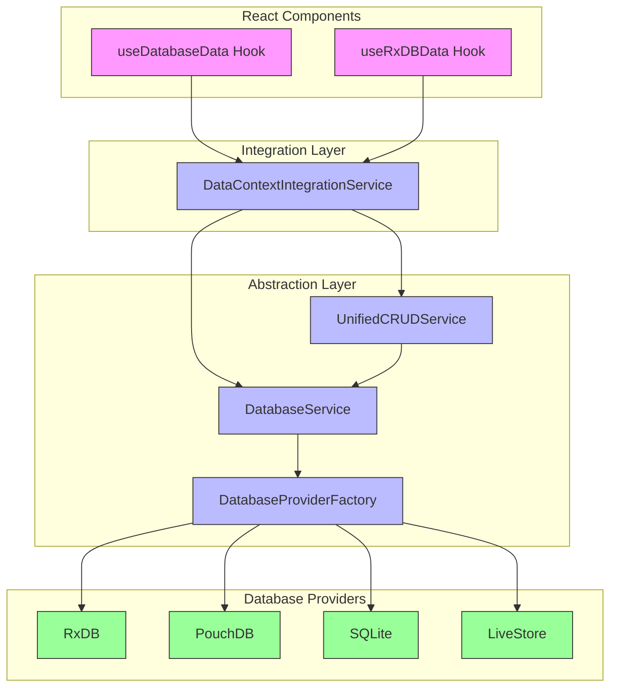
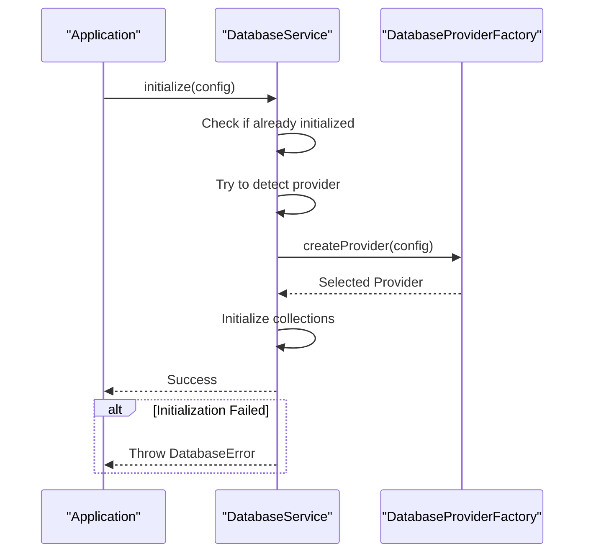
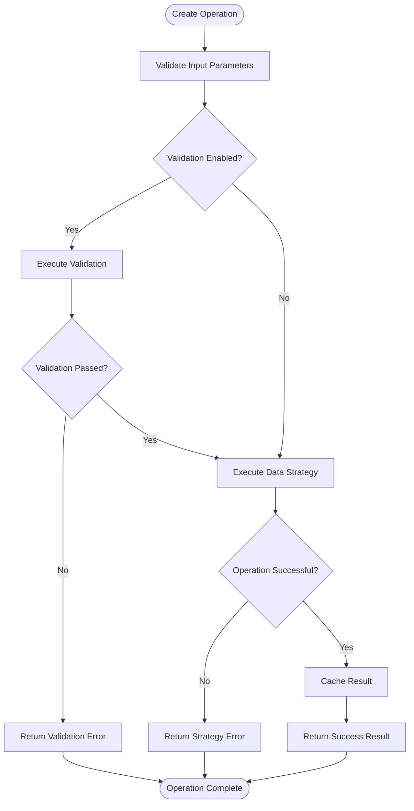
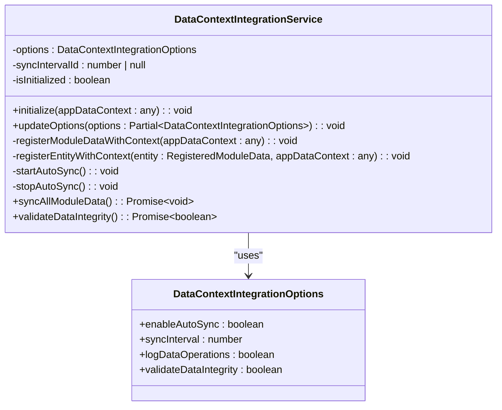

# Unified Data Access Layer

<cite>
**Referenced Files in This Document**   
- [databaseService.ts](file://src\services\database\databaseService.ts) - *Updated with new provider detection logic*
- [DatabaseProviderFactory.ts](file://src\services\database\DatabaseProviderFactory.ts) - *Added provider selection strategy and factory pattern*
- [useDatabaseData.ts](file://src\hooks\useDatabaseData.ts) - *Updated to use new database service architecture*
- [UnifiedCRUDService.ts](file://src\services\UnifiedCRUDService.ts)
- [useRxDBData.ts](file://src\hooks\useRxDBData.ts)
- [DataContextIntegrationService.ts](file://src\services\DataContextIntegrationService.ts)
- [interfaces.ts](file://src\services\database\interfaces.ts) - *Enhanced with new provider types and requirements*
</cite>

## Update Summary
**Changes Made**   
- Updated database abstraction layer to reflect new provider factory and selection mechanism
- Enhanced provider detection and initialization process with priority-based selection
- Added support for multiple provider types including RxDB, PouchDB, SQLite, and LiveStore
- Updated reactive data binding hooks to work with new database service architecture
- Improved error handling and fallback mechanisms for provider initialization
- Added comprehensive provider selection strategy based on collection requirements

## Table of Contents
1. [Introduction](#introduction)
2. [Core Architecture](#core-architecture)
3. [Database Abstraction Layer](#database-abstraction-layer)
4. [Provider Selection Strategy](#provider-selection-strategy)
5. [Unified CRUD Operations](#unified-crud-operations)
6. [Reactive Data Binding](#reactive-data-binding)
7. [Context Integration](#context-integration)
8. [Error Handling and Validation](#error-handling-and-validation)
9. [Performance and Caching](#performance-and-caching)
10. [Conclusion](#conclusion)

## Introduction

The Unified Data Access Layer in schoolpilot3 provides a consistent interface for data operations across multiple database technologies. This architecture enables seamless integration between different data storage solutions while maintaining a uniform API for application components. The system supports RxDB, PouchDB, SQLite, and LiveStore through an abstraction layer that normalizes responses and operations.

**Section sources**
- [databaseService.ts](file://src\services\database\databaseService.ts#L0-L30)
- [UnifiedCRUDService.ts](file://src\services\UnifiedCRUDService.ts#L0-L30)

## Core Architecture

The unified data access layer follows a multi-tier architecture with clear separation of concerns. At its foundation is the database abstraction layer, which provides a consistent interface to various database technologies. Above this, the CRUD operations layer standardizes data manipulation, while the reactive data binding layer connects to React components through hooks.



**Diagram sources**
- [databaseService.ts](file://src\services\database\databaseService.ts#L0-L30)
- [DatabaseProviderFactory.ts](file://src\services\database\DatabaseProviderFactory.ts#L0-L30)
- [UnifiedCRUDService.ts](file://src\services\UnifiedCRUDService.ts#L0-L30)
- [useDatabaseData.ts](file://src\hooks\useDatabaseData.ts#L0-L30)
- [useRxDBData.ts](file://src\hooks\useRxDBData.ts#L0-L30)
- [DataContextIntegrationService.ts](file://src\services\DataContextIntegrationService.ts#L0-L30)

## Database Abstraction Layer

The database abstraction layer is implemented through the DatabaseService class, which provides dynamic provider detection and initialization. This service automatically detects and uses the best available database provider, with a priority order of RxDB followed by PouchDB.

### Provider Detection and Initialization

The DatabaseService implements a singleton pattern and attempts to initialize providers in order of priority. It first checks for RxDB availability by verifying the presence of IndexedDB and crypto.randomUUID, then falls back to PouchDB if RxDB is unavailable.



**Diagram sources**
- [databaseService.ts](file://src\services\database\databaseService.ts#L50-L150)
- [DatabaseProviderFactory.ts](file://src\services\database\DatabaseProviderFactory.ts#L200-L300)

### Collection Management

The database service creates collections based on RxDB definitions, transforming schema definitions into provider-specific formats. This ensures consistent data structures across different database technologies.

```typescript
private async createCollections(): Promise<void> {
  if (!this.provider) {
    throw new DatabaseError('Provider not initialized', 'PROVIDER_NOT_INITIALIZED');
  }

  for (const [collectionName, collectionDef] of Object.entries(collectionsDefinition)) {
    const schema: CollectionSchema = {
      version: collectionDef.schema.version,
      properties: collectionDef.schema.properties,
      required: collectionDef.schema.required || [],
      primaryKey: collectionDef.schema.primaryKey || 'id',
      indexes: collectionDef.schema.indexes?.map(idx => ({
        name: Array.isArray(idx) ? idx.join('_') : idx,
        fields: Array.isArray(idx) ? idx : [idx]
      })) || []
    };

    await this.provider.createCollection(collectionName, schema);
  }
}
```

**Section sources**
- [databaseService.ts](file://src\services\database\databaseService.ts#L150-L200)

## Provider Selection Strategy

The enhanced database architecture introduces a sophisticated provider selection strategy that determines the optimal database provider based on collection requirements and environment conditions.

### Default Provider Selection Strategy

The DefaultProviderSelectionStrategy class implements a comprehensive algorithm for selecting the most appropriate provider:

```typescript
export class DefaultProviderSelectionStrategy implements ProviderSelectionStrategy {
  selectProvider(requirements: CollectionRequirements): ProviderType {
    // Enhanced provider selection strategy with LiveStore support
    
    // LiveStore is preferred for:
    // - Modern web applications requiring real-time sync
    // - SQLite WASM with OPFS for offline-first applications
    // - Cross-tab persistence and better performance
    // - Production environments requiring advanced features
    
    // PouchDB is preferred for:
    // - All collection counts (no artificial limits)
    // - Offline-first applications (fallback)
    // - Simple to moderate complexity queries
    // - Better IndexedDB integration
    
    // SQLite is preferred for:
    // - Development environments with persistent storage
    // - Better performance with large datasets
    // - Closer to production environment for testing
    
    // Check if we're in a development environment and want persistent storage
    const isDevelopment = typeof process !== 'undefined' && process.env?.NODE_ENV === 'development';
    if (isDevelopment && requirements.requiresOffline) {
      return 'sqlite';
    }
    
    // Use LiveStore for production environments with sync requirements
    if (requirements.requiresSync && requirements.performanceLevel === 'high') {
      return 'livestore';
    }
    
    if (requirements.requiresOffline || requirements.requiresSync) {
      return 'pouchdb';
    }
    
    // Use RxDB only for specific advanced reactive requirements
    if (requirements.requiresReactivity && requirements.performanceLevel === 'high') {
      return 'rxdb';
    }
    
    // Default to PouchDB for all other cases
    return 'pouchdb';
  }
}
```

**Section sources**
- [DatabaseProviderFactory.ts](file://src\services\database\DatabaseProviderFactory.ts#L20-L100)

### Provider Factory Implementation

The DatabaseProviderFactory class manages the creation and lifecycle of database providers:

```typescript
export class DatabaseProviderFactory implements IDatabaseProviderFactory {
  private providers = new Map<ProviderType, IDatabaseProvider>();
  private activeProvider: IDatabaseProvider | null = null;
  private selectionStrategy: ProviderSelectionStrategy;

  constructor(selectionStrategy?: ProviderSelectionStrategy) {
    this.selectionStrategy = selectionStrategy || new DefaultProviderSelectionStrategy();
    this.initializeProviders();
  }

  private initializeProviders(): void {
    // Register available providers
    this.registerProvider(new PouchDBProvider());
    this.registerProvider(new RxDBProvider());
    this.registerProvider(new SQLiteProvider());
    this.registerProvider(new SQLiteWASMProvider());
    
    console.log('Database providers initialized:', Array.from(this.providers.keys()));
  }

  async createProvider(config: DatabaseConfig, requirements?: CollectionRequirements): Promise<IDatabaseProvider> {
    try {
      // Determine which provider to use
      const providerType = requirements 
        ? this.selectionStrategy.selectProvider(requirements)
        : 'pouchdb'; // Default to PouchDB
      
      const provider = this.providers.get(providerType);
      if (!provider) {
        throw new DatabaseError(
          `Provider '${providerType}' not available`,
          'PROVIDER_NOT_FOUND'
        );
      }

      // Check if provider is available in current environment
      if (!provider.isAvailable()) {
        // Fallback to PouchDB if primary provider is not available
        const fallbackProvider = this.providers.get('pouchdb');
        if (!fallbackProvider || !fallbackProvider.isAvailable()) {
          throw new DatabaseError(
            'No database providers available in current environment',
            'NO_PROVIDERS_AVAILABLE'
          );
        }
        
        console.warn(`Provider '${providerType}' not available, falling back to PouchDB`);
        await fallbackProvider.initialize(config);
        this.activeProvider = fallbackProvider;
        return fallbackProvider;
      }

      // Initialize the selected provider
      await provider.initialize(config);
      this.activeProvider = provider;
      
      console.log(`Database provider '${providerType}' initialized successfully`);
      return provider;
    } catch (error) {
      throw new DatabaseError(
        `Failed to create database provider: ${error.message}`,
        'PROVIDER_CREATION_ERROR'
      );
    }
  }
}
```

**Section sources**
- [DatabaseProviderFactory.ts](file://src\services\database\DatabaseProviderFactory.ts#L100-L300)

## Unified CRUD Operations

The UnifiedCRUDService provides a consistent interface for Create, Read, Update, and Delete operations across different data sources. It supports multiple operation modes including mock data, RxDB, and backend operations with built-in caching.

### CRUD Interface

The service defines a comprehensive interface for CRUD operations with various options for validation, caching, and synchronization.

```typescript
export interface CRUDOptions {
  validate?: boolean;
  cache?: boolean;
  sync?: boolean;
  priority?: 'low' | 'normal' | 'high' | 'critical';
  timeout?: number;
  retries?: number;
}

export interface CRUDResult<T> {
  success: boolean;
  data?: T;
  error?: Error;
  validation?: ValidationResult;
  cached?: boolean;
  source: 'mock' | 'rxdb' | 'backend' | 'cache' | 'validation' | 'error';
  timestamp: Date;
}
```

### Operation Execution

The create operation demonstrates the comprehensive workflow including validation, strategy execution, and caching:



**Diagram sources**
- [UnifiedCRUDService.ts](file://src\services\UnifiedCRUDService.ts#L200-L300)

### Caching Mechanism

The DataCache class implements an in-memory cache with time-to-live (TTL) functionality, providing efficient data retrieval and automatic expiration.

```typescript
export class DataCache {
  private cache = new Map<string, CacheEntry<any>>();
  private defaultTTL = 5 * 60 * 1000; // 5 minutes

  set<T>(key: string, data: T, entityName: string, source: string, ttl?: number): void {
    const entry: CacheEntry<T> = {
      data,
      timestamp: new Date(),
      ttl: ttl || this.defaultTTL,
      source,
      entityName,
      key
    };
    this.cache.set(key, entry);
  }

  get<T>(key: string): T | null {
    const entry = this.cache.get(key);
    if (!entry) return null;

    // Check if expired
    if (Date.now() - entry.timestamp.getTime() > entry.ttl) {
      this.cache.delete(key);
      return null;
    }

    return entry.data as T;
  }
}
```

**Section sources**
- [UnifiedCRUDService.ts](file://src\services\UnifiedCRUDService.ts#L50-L150)

## Reactive Data Binding

The reactive data binding layer connects the database abstraction to React components through custom hooks, enabling automatic updates when data changes.

### useRxDBData Hook

The useRxDBData hook provides reactive access to database data with loading states and error handling:

```typescript
export const useRxDBData = (): Partial<AppDataContextType> => {
  const [dbInstance, setDbInstance] = useState<SchoolDatabase | null>(null);
  const [loading, setLoading] = useState<AppDataLoadingStates>(createInitialLoadingStates());
  const [initializationError, setInitializationError] = useState<Error | null>(null);
  
  useEffect(() => {
    let isMounted = true;
    let subscription: Subscription | null = null;
    
    const initializeDatabase = async () => {
      try {
        const db = await getDatabase();
        if (isMounted) {
          setDbInstance(db);
          setInitializationError(null);
          setLoading(prev => ({ ...prev, all: false }));
        }
      } catch (error: any) {
        if (isMounted) {
          setInitializationError(error);
          setLoading(prev => ({ ...prev, all: false }));
        }
      }
    };
    
    initializeDatabase();
    
    return () => {
      isMounted = false;
      if (subscription) {
        subscription.unsubscribe();
      }
    };
  }, []);
  
  return useMemo(() => ({
    loading,
    initializationError,
    isRxDBModeActive: true,
    isUsingRxDBDummyData,
    schoolDetails,
    users,
    students,
    staff,
    classes,
    subjects
  }), [loading, initializationError, isUsingRxDBDummyData, schoolDetails, users, students, staff, classes, subjects]);
};
```

**Section sources**
- [useRxDBData.ts](file://src\hooks\useRxDBData.ts#L0-L200)

### useDatabaseData Hook

The useDatabaseData hook provides a more comprehensive interface with CRUD operations for various entities:

```typescript
export const useDatabaseData = (mockDataForSeeding: RawInitialData): AppDataContextType => {
  const [loading, setLoading] = useState<AppDataLoadingStates>(createInitialLoadingStates());
  const [initializationError, setInitializationError] = useState<Error | null>(null);
  const [isUsingRxDBDummyData, setIsUsingRxDBDummyData] = useState<boolean | null>(null);
  const [data, setData] = useState<Omit<AppDataContextType, 'loading' | 'rawInitialData' | 'initializationError' | 'isRxDBModeActive' | 'isUsingRxDBDummyData' | 'triggerSeedRxDB' | 'triggerClearRxDB' | 'getStudentDetailsById' | 'getStudentFinancialDetailsById' | 'updateSchoolDetails'| 'addUser' | 'updateUser'| 'deleteUser' | 'addRole'| 'updateRole'|'deleteRole'|'addStudent'|'updateStudent'|'deleteStudent'|'addStaffMember'|'updateStaffMember'|'deleteStaffMember'|'addParentGuardian'|'updateParentGuardian'|'deleteParentGuardian'|'addStudentGuardianRelationship'|'updateStudentGuardianRelationship'|'deleteStudentGuardianRelationship'|'addDepartment'|'updateDepartment'|'deleteDepartment'|'addDesignation'|'updateDesignation'|'deleteDesignation'|'addStudentCategory'|'updateStudentCategory'|'deleteStudentCategory'|'addDormitory'|'updateDormitory'|'deleteDormitory'|'addAcademicYearStructure'|'updateAcademicYearStructure'|'deleteAcademicYearStructure'|'addAcademicPeriodDefinition'|'updateAcademicPeriodDefinition'|'deleteAcademicPeriodDefinition'|'addAcademicYear'|'updateAcademicYear'|'deleteAcademicYear'|'addSchoolPeriod'|'updateSchoolPeriod'|'deleteSchoolPeriod'|'addPartner'|'updatePartner'|'deletePartner'|'addClub'|'updateClub'|'deleteClub'|'addCustomer'|'updateCustomer'|'deleteCustomer'|'addStudentHealthRecord'|'updateStudentHealthRecord'|'saveStudentAttendance'|'getStudentAttendanceByFilters'|'addTemplateComm'|'updateTemplateComm'|'deleteTemplateComm'|'addCampaign'|'updateCampaign'|'deleteCampaign'|'addAuditLog'|'addClass'|'updateClass'|'deleteClass'|'addClassStream'|'updateClassStream'|'deleteClassStream'|'addSubject'|'updateSubject'|'deleteSubject'|'addSubjectPaper'|'updateSubjectPaper'|'deleteSubjectPaper'|'addExamSession'|'updateExamSession'|'deleteExamSession'|'addExamPaperSetting'|'updateExamPaperSetting'|'deleteExamPaperSetting'|'addGradingScheme'|'updateGradingScheme'|'deleteGradingScheme'|'getStudentsForExamEntry'|'getExamPaperSettingsForSession'|'saveStudentExamResult'|'getTimetablePeriodDefs'|'addTimetablePeriodDef'|'updateTimetablePeriodDef'|'deleteTimetablePeriodDef'|'getTimetableEntries'|'addTimetableEntry'|'updateTimetableEntry'|'deleteTimetableEntry'|'addClassSubjectAllocation'|'updateClassSubjectAllocation'|'deleteClassSubjectAllocation'|'addTeacherSubjectAssignment'|'deleteTeacherSubjectAssignment'|'addStudentSubjectEnrollment'|'updateStudentSubjectEnrollment'|'deleteStudentSubjectEnrollment'|'addChartOfAccount'|'updateChartOfAccount'|'deleteChartOfAccount'|'addBank'|'updateBank'|'deleteBank'|'addSupplier'|'updateSupplier'|'deleteSupplier'|'addFeeTemplate'|'updateFeeTemplate'|'deleteFeeTemplate'|'addExpenseClaim'|'updateExpenseClaim'|'deleteExpenseClaim'|'addExpenseCategory'|'updateExpenseCategory'|'deleteExpenseCategory'|'addCustomerInvoice'|'updateCustomerInvoice'|'deleteCustomerInvoice'|'addSupplierInvoice'|'updateSupplierInvoice'|'deleteSupplierInvoice'|'addStudentOpeningBalance'|'updateStudentOpeningBalance'|'deleteStudentOpeningBalance'|'addFeeAdjustment'|'updateFeeAdjustment'|'deleteFeeAdjustment'|'addTransportRoute'|'updateTransportRoute'|'deleteTransportRoute'|'addStudentTransportAssignment'|'updateStudentTransportAssignment'|'deleteStudentTransportAssignment'|'generateStudentInvoices'|'addStudentPayment'|'updateStudentPayment'|'deleteStudentPayment'|'applyPaymentToInvoices'|'addGeneralPayment'|'updateGeneralPayment'|'deleteGeneralPayment'|'addFinancialYear'|'updateFinancialYear'|'deleteFinancialYear'|'addPayrollPeriod'|'updatePayrollPeriod'|'deletePayrollPeriod'|'addPayrollItemType'|'updatePayrollItemType'|'deletePayrollItemType'|'updateStaffSalarySetting'|'generatePayslipsForPeriod'|'addWarehouse'|'updateWarehouse'|'deleteWarehouse'|'addItemCategoryInv'|'updateItemCategoryInv'|'deleteItemCategoryInv'|'addItemInv'|'updateItemInv'|'deleteItemInv'|'addFixedAsset'|'updateFixedAsset'|'deleteFixedAsset'|'addAssetDepreciationLog'|'addRequisition'|'updateRequisition'|'deleteRequisition'|'updateRequisitionStatus'|'addPurchaseOrder'|'updatePurchaseOrder'|'deletePurchaseOrder'|'addStockTransaction'|'addRfq'|'updateRfq'|'deleteRfq'|'addBookCategory'|'updateBookCategory'|'deleteBookCategory'|'addBook'|'updateBook'|'deleteBook'|'addLoan'|'updateLoan'|'addFine'|'updateFineStatus'|'addMealPlan'|'updateMealPlan'|'deleteMealPlan'|'addMenu'|'updateMenu'|'deleteMenu'|'addStudentMealPlan'|'updateStudentMealPlan'|'deleteStudentMealPlan'|'addMealConsumptionLog'|'addMerchant'|'updateMerchant'|'deleteMerchant'|'addWalletTransaction'|'addWorkflow'|'updateWorkflow'|'deleteWorkflow'|'addWorkflowState'|'updateWorkflowState'|'deleteWorkflowState'>>({} as any);
  
  useEffect(() => {
    let isMounted = true;

    const initializeDatabase = async () => {
      try {
        await databaseService.initializeDatabase();
        
        if (isMounted) {
          setIsUsingRxDBDummyData(false);
          setData({
            schoolDetails: null,
            roles: [],
            users: [],
            students: [],
            staff: [],
            classes: [],
            subjects: [],
            // ... other entities initialized as empty arrays
          });
        }
      } catch (error) {
        if (isMounted) {
          setInitializationError(error as Error);
        }
      }
    };

    initializeDatabase();
    
    return () => {
      isMounted = false;
    };
  }, []);
  
  // CRUD operations for various entities
  const createCrudOperations = (collectionName: string, entityName: string) => {
    return {
      add: useCallback(async (data: any) => {
        try {
          const db = await databaseService.getDatabase();
          const dataWithId = { ...data, id: databaseService.generateId() };
          const result = await db[collectionName]?.insert(dataWithId);
          return result?.doc || null;
        } catch (error) {
          console.error(`Error adding ${entityName}:`, error);
          throw error;
        }
      }, []),
      
      update: useCallback(async (id: string, data: any) => {
        try {
          const db = await databaseService.getDatabase();
          const result = await db[collectionName]?.update(id, data);
          return result?.doc || null;
        } catch (error) {
          console.error(`Error updating ${entityName}:`, error);
          throw error;
        }
      }, []),
      
      delete: useCallback(async (id: string) => {
        try {
          const db = await databaseService.getDatabase();
          await db[collectionName]?.remove(id);
          return true;
        } catch (error) {
          console.error(`Error deleting ${entityName}:`, error);
          throw error;
        }
      }, [])
    };
  };
  
  return {
    loading,
    initializationError,
    isUsingRxDBDummyData,
    // ... data entities
    // ... CRUD operations
  };
};
```

**Section sources**
- [useDatabaseData.ts](file://src\hooks\useDatabaseData.ts#L0-L200)

## Context Integration

The DataContextIntegrationService connects data operations with React context for global state management, ensuring consistent data flow between module hooks and the global AppDataContext.

### Service Architecture

The service implements a singleton pattern and provides methods for registering module data with the application context:



**Diagram sources**
- [DataContextIntegrationService.ts](file://src\services\DataContextIntegrationService.ts#L0-L50)

### Entity Registration

The service dynamically creates CRUD methods for each registered entity and adds them to the application context:

```typescript
private registerEntityWithContext(entity: RegisteredModuleData, appDataContext: any): void {
  // Skip if already registered
  if (appDataContext[entity.entityName]) return;
  
  try {
    // Create data operation methods for this entity
    const createMethod = `add${entity.entityName.charAt(0).toUpperCase() + entity.entityName.slice(1, -1)}`;
    const updateMethod = `update${entity.entityName.charAt(0).toUpperCase() + entity.entityName.slice(1, -1)}`;
    const deleteMethod = `delete${entity.entityName.charAt(0).toUpperCase() + entity.entityName.slice(1, -1)}`;
    
    // Add methods to context if they don't exist
    if (!appDataContext[createMethod] && appDataContext.dataStrategyManager) {
      appDataContext[createMethod] = async (item: any) => {
        const operation: DataOperation = {
          type: 'write',
          entity: entity.entityName,
          priority: entity.syncPriority,
          requiresBackend: entity.requiresBackend,
          allowOffline: entity.allowOffline
        };
        return appDataContext.dataStrategyManager.executeOperation(operation, item);
      };
    }
    
    if (!appDataContext[updateMethod] && appDataContext.dataStrategyManager) {
      appDataContext[updateMethod] = async (id: string | number, updates: any) => {
        const operation: DataOperation = {
          type: 'write',
          entity: entity.entityName,
          priority: entity.syncPriority,
          requiresBackend: entity.requiresBackend,
          allowOffline: entity.allowOffline
        };
        return appDataContext.dataStrategyManager.executeOperation(operation, { id, ...updates });
      };
    }
    
    if (!appDataContext[deleteMethod] && appDataContext.dataStrategyManager) {
      appDataContext[deleteMethod] = async (id: string | number) => {
        const operation: DataOperation = {
          type: 'delete',
          entity: entity.entityName,
          priority: entity.syncPriority,
          requiresBackend: entity.requiresBackend,
          allowOffline: entity.allowOffline
        };
        return appDataContext.dataStrategyManager.executeOperation(operation, { id });
      };
    }
  } catch (error) {
    console.error(`[DataContextIntegration] Failed to register entity ${entity.entityName}:`, error);
  }
}
```

**Section sources**
- [DataContextIntegrationService.ts](file://src\services\DataContextIntegrationService.ts#L100-L200)

## Error Handling and Validation

The unified data access layer implements comprehensive error handling and validation to ensure data integrity and provide meaningful feedback to users.

### Error Types

The system defines specific error types for different failure scenarios:

```typescript
export class DatabaseError extends Error {
  constructor(
    message: string,
    public code: string,
    public details?: any
  ) {
    super(message);
    this.name = 'DatabaseError';
  }
}
```

### Validation Process

The CRUD service integrates with the global data consistency service to validate entities before operations:

```typescript
// Validation
let validation: ValidationResult | undefined;
if (opts.validate) {
  validation = await globalDataConsistencyService.validateEntity(
    entityName,
    entity,
    'create'
  );

  if (!validation.isValid) {
    return {
      success: false,
      error: new Error(`Validation failed: ${validation.errors.map(e => e.message).join('; ')}`),
      validation,
      source: 'validation',
      timestamp: new Date()
    };
  }
}
```

**Section sources**
- [UnifiedCRUDService.ts](file://src\services\UnifiedCRUDService.ts#L300-L350)

## Performance and Caching

The unified data access layer includes several performance optimizations to handle large datasets efficiently.

### Query Optimization

The system supports query options for filtering, sorting, and pagination:

```typescript
export interface QueryOptions {
  filters?: Record<string, any>;
  sort?: { field: string; direction: 'asc' | 'desc' }[];
  limit?: number;
  offset?: number;
  include?: string[];
}
```

### Memory Management

The caching system includes TTL-based expiration and entity-specific invalidation:

```typescript
invalidateEntity(entityName: string): void {
  for (const [key, entry] of this.cache.entries()) {
    if (entry.entityName === entityName) {
      this.cache.delete(key);
    }
  }
}

getStats(): { size: number; entities: string[]; oldestEntry: Date | null } {
  const entities = [...new Set([...this.cache.values()].map(e => e.entityName))];
  const timestamps = [...this.cache.values()].map(e => e.timestamp);
  const oldestEntry = timestamps.length > 0 ? new Date(Math.min(...timestamps.map(t => t.getTime()))) : null;

  return {
    size: this.cache.size,
    entities,
    oldestEntry
  };
}
```

**Section sources**
- [UnifiedCRUDService.ts](file://src\services\UnifiedCRUDService.ts#L150-L200)

## Conclusion

The Unified Data Access Layer in schoolpilot3 provides a robust and flexible foundation for data operations across multiple database technologies. By abstracting the differences between RxDB, PouchDB, SQLite, and LiveStore, the system enables consistent data access patterns while maintaining high performance and reliability. The integration with React context and hooks provides seamless reactive data binding, making it easy for components to access and manipulate data. The comprehensive error handling, validation, and caching mechanisms ensure data integrity and optimal performance, even with large datasets.

This architecture supports the application's requirements for offline capability, data synchronization, and global state management, providing a solid foundation for the school management system's various modules and features.