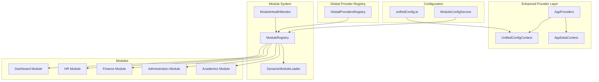
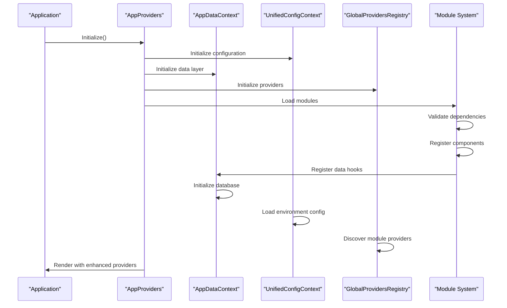
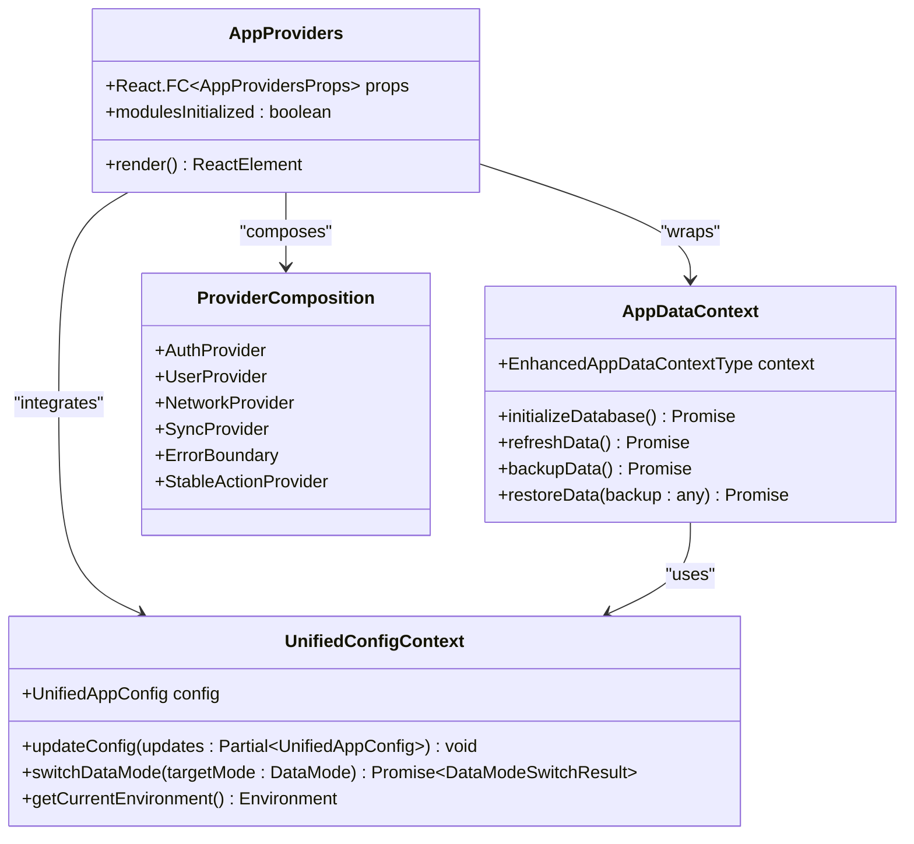
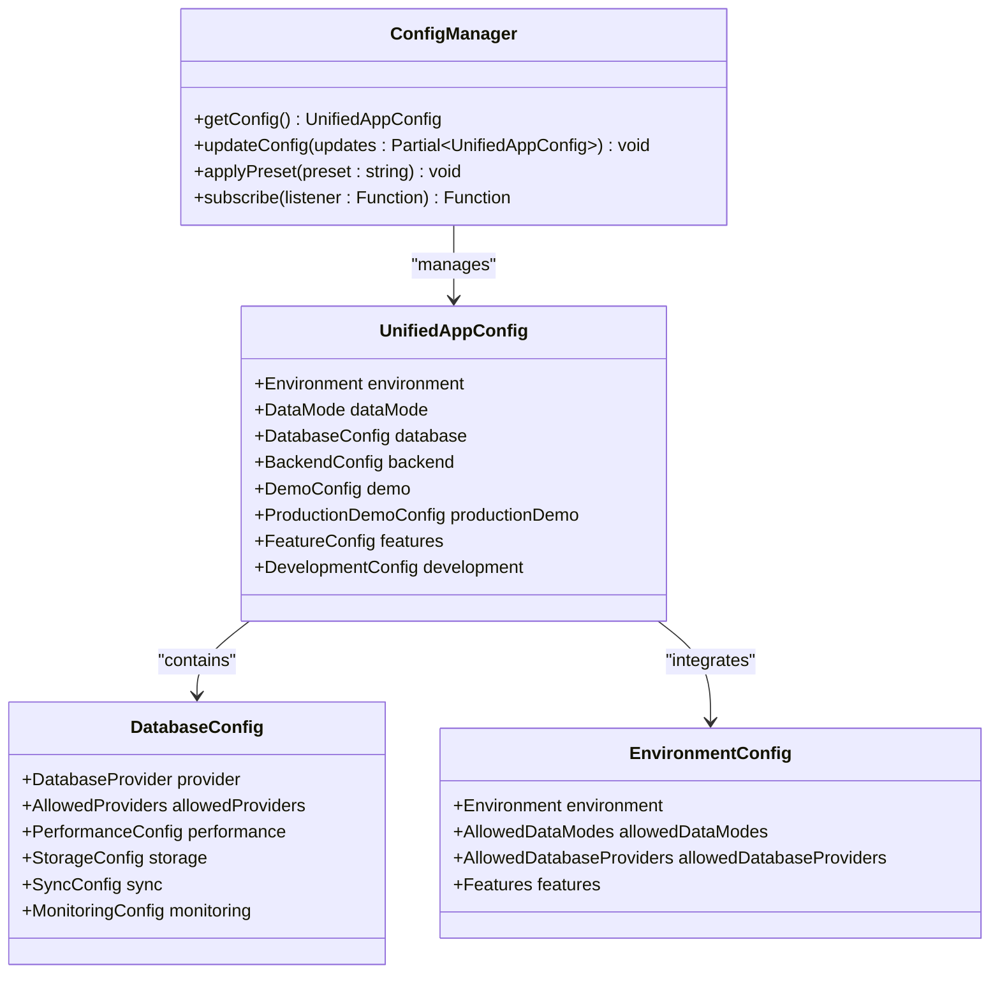
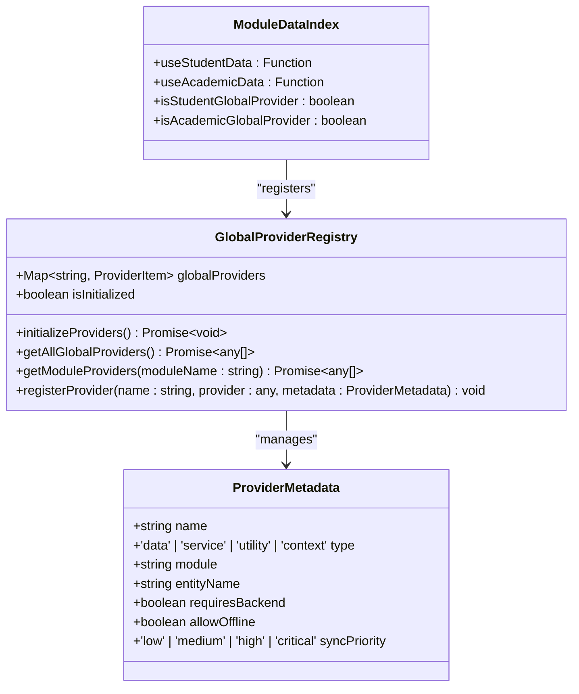
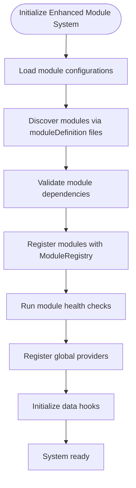
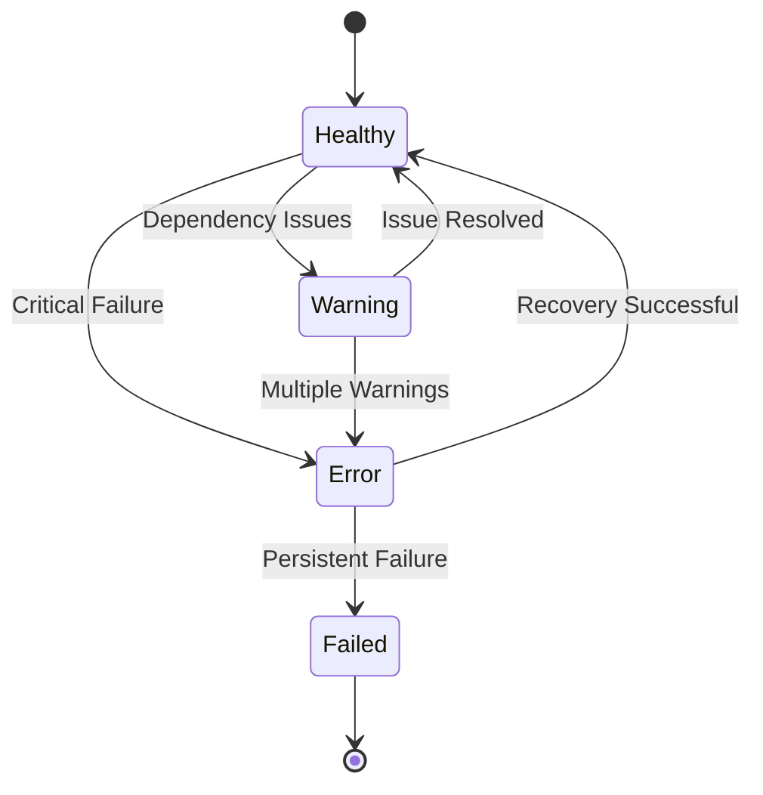
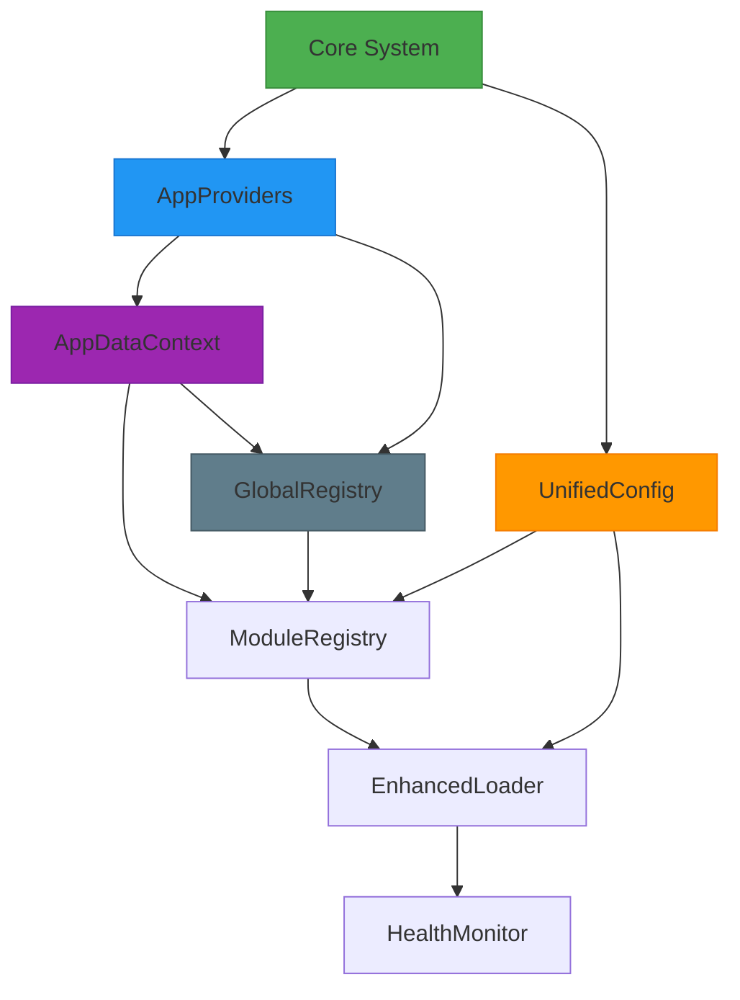

# Modular Architecture

<cite>
**Referenced Files in This Document**
- [AppProviders.tsx](file://src/contexts/AppProviders.tsx)
- [AppDataContext.tsx](file://src/contexts/AppDataContext.tsx)
- [UnifiedConfigContext.tsx](file://src/contexts/UnifiedConfigContext.tsx)
- [unifiedConfig.ts](file://src/config/unifiedConfig.ts)
- [globalProvidersRegistry.ts](file://src/globalProvidersRegistry.ts)
- [moduleDefinition.tsx](file://src/modules/academics/moduleDefinition.tsx)
- [moduleDefinition.tsx](file://src/modules/administration/moduleDefinition.tsx)
- [moduleDefinition.tsx](file://src/modules/finance/moduleDefinition.tsx)
- [moduleDefinition.tsx](file://src/modules/hr/moduleDefinition.tsx)
- [moduleDefinition.tsx](file://src/modules/dashboard/moduleDefinition.tsx)
- [moduleRegistry.ts](file://src/core/moduleRegistry.ts)
- [dynamicModuleLoader.ts](file://src/services/dynamicModuleLoader.ts)
- [enhancedModuleLoader.ts](file://src/services/enhancedModuleLoader.ts)
- [moduleConfigService.ts](file://src/services/moduleConfigService.ts)
- [moduleHealthMonitor.ts](file://src/services/moduleHealthMonitor.ts)
- [ModuleDependencyValidator.ts](file://src/core/services/ModuleDependencyValidator.ts)
- [modules.json](file://src/config/modules.json)
- [moduleOrder.ts](file://src/moduleOrder.ts)
- [app.tsx](file://src/app.tsx)
</cite>

## Update Summary
**Changes Made**
- Added comprehensive documentation for the new AppProviders architecture and provider composition layer
- Updated module registration process documentation to reflect enhanced module system
- Added documentation for the unified configuration framework and GlobalProvidersRegistry
- Enhanced module health monitoring and configuration service documentation
- Updated architecture diagrams to reflect the new provider composition model

## Table of Contents
1. [Introduction](#introduction)
2. [Project Structure](#project-structure)
3. [Core Components](#core-components)
4. [Architecture Overview](#architecture-overview)
5. [Detailed Component Analysis](#detailed-component-analysis)
6. [Enhanced Provider Composition Layer](#enhanced-provider-composition-layer)
7. [Unified Configuration Framework](#unified-configuration-framework)
8. [Global Providers Registry](#global-providers-registry)
9. [Enhanced Module System](#enhanced-module-system)
10. [Dependency Analysis](#dependency-analysis)
11. [Performance Considerations](#performance-considerations)
12. [Troubleshooting Guide](#troubleshooting-guide)
13. [Conclusion](#conclusion)

## Introduction
The schoolpilot3 system implements a sophisticated modular architecture with enhanced provider composition and unified configuration management. This documentation covers the latest evolution of the system, featuring the new AppProviders architecture, enhanced module registration processes, and comprehensive configuration frameworks. The architecture emphasizes dynamic feature loading, independent development, flexible configuration, and robust provider composition through a unified context system.

## Project Structure
The project follows a feature-based modular organization with enhanced provider composition and unified configuration management:

- **src/contexts**: Advanced provider composition layer with AppProviders and AppDataContext
- **src/config**: Unified configuration system with environment separation and production demo capabilities
- **src/globalProvidersRegistry.ts**: Dynamic provider discovery and registration system
- **src/services**: Enhanced module loading, health monitoring, and configuration services
- **src/modules**: Self-contained modules with enhanced definitions and metadata
- **src/components**: Shared UI components with enhanced error handling and performance monitoring

The architecture now features a three-tier provider composition system: application-level providers (AppProviders), data-level providers (AppDataContext), and module-level providers (individual module contexts).

**Diagram sources**
- [AppProviders.tsx](file://src/contexts/AppProviders.tsx)
- [AppDataContext.tsx](file://src/contexts/AppDataContext.tsx)
- [UnifiedConfigContext.tsx](file://src/contexts/UnifiedConfigContext.tsx)
- [globalProvidersRegistry.ts](file://src/globalProvidersRegistry.ts)
- [moduleRegistry.ts](file://src/core/moduleRegistry.ts)
- [dynamicModuleLoader.ts](file://src/services/dynamicModuleLoader.ts)
- [moduleHealthMonitor.ts](file://src/services/moduleHealthMonitor.ts)
- [unifiedConfig.ts](file://src/config/unifiedConfig.ts)
- [moduleConfigService.ts](file://src/services/moduleConfigService.ts)

**Section sources**
- [AppProviders.tsx](file://src/contexts/AppProviders.tsx)
- [AppDataContext.tsx](file://src/contexts/AppDataContext.tsx)
- [UnifiedConfigContext.tsx](file://src/contexts/UnifiedConfigContext.tsx)
- [globalProvidersRegistry.ts](file://src/globalProvidersRegistry.ts)

## Core Components
The enhanced modular architecture builds upon three fundamental layers:

**Enhanced Provider Composition Layer**: The AppProviders component orchestrates application-level React contexts, providing a stable provider contract that reduces nesting depth and establishes consistent provider initialization order. This layer manages authentication, user management, network state, synchronization, and data layer initialization.

**Unified Configuration Framework**: The unified configuration system provides comprehensive environment separation, production demo capabilities, and data mode management. It integrates with environment matrices and production demo systems for complete configuration control.

**Global Providers Registry**: A dynamic discovery system that aggregates all global data providers/types from each module's data/index.ts, enabling true modularity without hardcoded imports or core changes.

**Enhanced Module System**: Improved module registration with health monitoring, configuration services, and dependency validation. The system now includes comprehensive module health tracking and automated dependency resolution.

**Section sources**
- [AppProviders.tsx](file://src/contexts/AppProviders.tsx)
- [unifiedConfig.ts](file://src/config/unifiedConfig.ts)
- [globalProvidersRegistry.ts](file://src/globalProvidersRegistry.ts)
- [enhancedModuleLoader.ts](file://src/services/enhancedModuleLoader.ts)

## Architecture Overview
The enhanced modular architecture follows a layered provider composition pattern with unified configuration management and dynamic module loading:

**Diagram sources**
- [AppProviders.tsx](file://src/contexts/AppProviders.tsx)
- [AppDataContext.tsx](file://src/contexts/AppDataContext.tsx)
- [UnifiedConfigContext.tsx](file://src/contexts/UnifiedConfigContext.tsx)
- [globalProvidersRegistry.ts](file://src/globalProvidersRegistry.ts)
- [dynamicModuleLoader.ts](file://src/services/dynamicModuleLoader.ts)

## Detailed Component Analysis

### Enhanced Provider Composition Layer
The AppProviders component serves as the central orchestrator for all application-level React contexts, implementing a composite provider pattern that reduces nesting complexity and ensures proper initialization order.

**Diagram sources**
- [AppProviders.tsx](file://src/contexts/AppProviders.tsx)
- [AppDataContext.tsx](file://src/contexts/AppDataContext.tsx)
- [UnifiedConfigContext.tsx](file://src/contexts/UnifiedConfigContext.tsx)

**Section sources**
- [AppProviders.tsx](file://src/contexts/AppProviders.tsx)
- [AppDataContext.tsx](file://src/contexts/AppDataContext.tsx)
- [UnifiedConfigContext.tsx](file://src/contexts/UnifiedConfigContext.tsx)

### Unified Configuration Framework
The unified configuration system provides comprehensive environment separation, production demo capabilities, and data mode management through a sophisticated configuration management approach.

**Diagram sources**
- [unifiedConfig.ts](file://src/config/unifiedConfig.ts)

**Section sources**
- [unifiedConfig.ts](file://src/config/unifiedConfig.ts)

### Global Providers Registry
The GlobalProvidersRegistry implements a dynamic discovery system that aggregates all global data providers/types from each module's data/index.ts, enabling true modularity without hardcoded imports.

**Diagram sources**
- [globalProvidersRegistry.ts](file://src/globalProvidersRegistry.ts)

**Section sources**
- [globalProvidersRegistry.ts](file://src/globalProvidersRegistry.ts)

### Enhanced Module System
The enhanced module system provides comprehensive module management with health monitoring, configuration services, and improved registration processes.

**Diagram sources**
- [dynamicModuleLoader.ts](file://src/services/dynamicModuleLoader.ts)
- [moduleHealthMonitor.ts](file://src/services/moduleHealthMonitor.ts)
- [moduleConfigService.ts](file://src/services/moduleConfigService.ts)

**Section sources**
- [dynamicModuleLoader.ts](file://src/services/dynamicModuleLoader.ts)
- [moduleHealthMonitor.ts](file://src/services/moduleHealthMonitor.ts)
- [moduleConfigService.ts](file://src/services/moduleConfigService.ts)

## Enhanced Provider Composition Layer
The AppProviders architecture represents a significant enhancement to the traditional provider pattern, implementing a composite provider that orchestrates multiple application-level contexts with proper initialization sequencing and error handling.

### Provider Composition Strategy
The AppProviders component implements a layered composition strategy where each provider serves a specific purpose in the application lifecycle:

1. **Routing Provider**: Manages application routing with hash-based navigation
2. **Network Provider**: Handles network connectivity and state management
3. **Synchronization Provider**: Manages data synchronization and conflict resolution
4. **Authentication Provider**: Handles user authentication and session management
5. **User Provider**: Manages user context and profile information
6. **Error Boundary**: Provides comprehensive error handling and recovery
7. **Stable Action Provider**: Ensures stable action dispatching across the application

### Data Layer Integration
The AppDataProvider serves as the central data management component, integrating with the UnifiedDatabaseManager to provide consistent data access, loading states, error handling, and toast notifications. It manages database initialization, sync operations, and data refresh capabilities.

### Configuration Integration
The UnifiedConfigContext provides comprehensive configuration management, supporting environment detection, data mode switching, database provider management, and production demo transitions. It offers both programmatic access and reactive updates through subscription patterns.

**Section sources**
- [AppProviders.tsx](file://src/contexts/AppProviders.tsx)
- [AppDataContext.tsx](file://src/contexts/AppDataContext.tsx)
- [UnifiedConfigContext.tsx](file://src/contexts/UnifiedConfigContext.tsx)

## Unified Configuration Framework
The unified configuration system represents a comprehensive approach to application configuration management, integrating environment separation, production demo capabilities, and data mode management into a cohesive framework.

### Configuration Hierarchy
The system implements a multi-layered configuration hierarchy:

1. **Environment Configuration**: Automatically detected environment with appropriate defaults
2. **Database Configuration**: Provider-specific settings with performance tuning
3. **Feature Configuration**: Granular feature flags with per-environment overrides
4. **Development Configuration**: Development-specific settings and debugging options
5. **Runtime Configuration**: Dynamic configuration updates and user preferences

### Environment Management
The unified configuration system supports multiple environments with automatic detection and manual overrides:

- **Development**: Optimized for development with debugging enabled
- **Staging**: Pre-production environment with limited features
- **Production**: Full production environment with security and performance optimizations

### Data Mode Management
The system provides comprehensive data mode management supporting:

- **Demo Mode**: Development and testing with synthetic data
- **Live Mode**: Production data with full functionality
- **Hybrid Mode**: Combination of online and offline capabilities

**Section sources**
- [unifiedConfig.ts](file://src/config/unifiedConfig.ts)
- [UnifiedConfigContext.tsx](file://src/contexts/UnifiedConfigContext.tsx)

## Global Providers Registry
The GlobalProvidersRegistry implements a sophisticated dynamic discovery system that eliminates hardcoded module dependencies and enables true modular architecture through automatic provider registration.

### Provider Discovery Mechanism
The registry uses Vite's import.meta.glob functionality to automatically discover module data providers:

1. **Module Scanning**: Recursively scans all modules for data/index.ts files
2. **Provider Extraction**: Identifies global providers using naming conventions
3. **Metadata Generation**: Creates comprehensive metadata for each provider
4. **Dynamic Registration**: Registers providers in the global registry

### Naming Conventions
The system uses specific naming conventions to identify different types of providers:

- **Global Providers**: `is{ProviderName}GlobalProvider` pattern
- **Data Hooks**: `use{Entity}Data` pattern with optional `use{Entity}DataConfig`
- **Utility Types**: `{TypeName}` pattern for type definitions

### Metadata Management
Each registered provider includes comprehensive metadata:

- **Provider Type**: Data, service, utility, or context
- **Module Association**: Source module identification
- **Entity Mapping**: Database entity name and relationship
- **Capabilities**: Backend requirements, offline support, sync priority
- **Configuration**: Hook-specific configuration options

**Section sources**
- [globalProvidersRegistry.ts](file://src/globalProvidersRegistry.ts)

## Enhanced Module System
The enhanced module system provides comprehensive module management with health monitoring, configuration services, and improved registration processes that support the new provider composition architecture.

### Module Health Monitoring
The ModuleHealthMonitor provides comprehensive health tracking and automated recovery capabilities:

**Diagram sources**
- [moduleHealthMonitor.ts](file://src/services/moduleHealthMonitor.ts)

### Module Configuration Service
The ModuleConfigService provides centralized module configuration management with:

- **Local Storage Persistence**: Configuration stored in browser localStorage
- **Automatic Enablement**: New modules automatically enabled with core modules
- **Dependency Validation**: Comprehensive dependency checking and validation
- **Configuration Migration**: Support for configuration version upgrades

### Enhanced Registration Process
The enhanced registration process includes:

1. **Module Discovery**: Automatic discovery via moduleDefinition files
2. **Dependency Resolution**: Comprehensive dependency graph analysis
3. **Health Validation**: Pre-loading health checks and validation
4. **Provider Registration**: Integration with global providers registry
5. **Component Registration**: Route, navigation, and component registration

**Section sources**
- [enhancedModuleLoader.ts](file://src/services/enhancedModuleLoader.ts)
- [moduleHealthMonitor.ts](file://src/services/moduleHealthMonitor.ts)
- [moduleConfigService.ts](file://src/services/moduleConfigService.ts)

## Dependency Analysis
The enhanced modular architecture maintains a directed acyclic graph (DAG) for module dependencies while adding new relationships through the provider composition layer:

**Diagram sources**
- [AppProviders.tsx](file://src/contexts/AppProviders.tsx)
- [AppDataContext.tsx](file://src/contexts/AppDataContext.tsx)
- [UnifiedConfigContext.tsx](file://src/contexts/UnifiedConfigContext.tsx)
- [globalProvidersRegistry.ts](file://src/globalProvidersRegistry.ts)
- [moduleRegistry.ts](file://src/core/moduleRegistry.ts)
- [dynamicModuleLoader.ts](file://src/services/dynamicModuleLoader.ts)

**Section sources**
- [moduleDefinition.tsx](file://src/modules/academics/moduleDefinition.tsx)
- [moduleDefinition.tsx](file://src/modules/administration/moduleDefinition.tsx)
- [moduleDefinition.tsx](file://src/modules/finance/moduleDefinition.tsx)
- [moduleDefinition.tsx](file://src/modules/hr/moduleDefinition.tsx)
- [moduleDefinition.tsx](file://src/modules/dashboard/moduleDefinition.tsx)

## Performance Considerations
The enhanced modular architecture incorporates several performance optimizations:

1. **Provider Lazy Loading**: AppProviders uses React.lazy for deferred loading of provider components
2. **Configuration Caching**: Unified configuration system caches configuration in localStorage
3. **Health Monitoring**: Real-time module health monitoring with configurable intervals
4. **Provider Optimization**: GlobalProvidersRegistry uses asynchronous initialization to prevent blocking
5. **Memory Management**: Enhanced memory management through data layer optimization
6. **Error Boundaries**: Comprehensive error handling with graceful degradation
7. **Performance Monitoring**: Built-in performance monitoring and benchmarking capabilities

The system includes dedicated performance monitoring components like ModuleLoadingPerformancePanel, ModuleLoadingProgress, and comprehensive performance event management.

**Section sources**
- [AppProviders.tsx](file://src/contexts/AppProviders.tsx)
- [unifiedConfig.ts](file://src/config/unifiedConfig.ts)
- [moduleHealthMonitor.ts](file://src/services/moduleHealthMonitor.ts)

## Troubleshooting Guide
Enhanced troubleshooting capabilities in the modular architecture:

**Provider Initialization Failures**: Handled through AppProviders error boundaries and fallback mechanisms
**Configuration Loading Issues**: Managed through UnifiedConfigContext with automatic fallback to default configurations
**Module Health Problems**: Detected and reported through ModuleHealthMonitor with automated recovery attempts
**Global Provider Registration**: Monitored through GlobalProvidersRegistry with comprehensive error reporting
**Dependency Resolution**: Enhanced validation through ModuleConfigService with detailed dependency analysis

**Section sources**
- [AppProviders.tsx](file://src/contexts/AppProviders.tsx)
- [UnifiedConfigContext.tsx](file://src/contexts/UnifiedConfigContext.tsx)
- [moduleHealthMonitor.ts](file://src/services/moduleHealthMonitor.ts)
- [moduleConfigService.ts](file://src/services/moduleConfigService.ts)

## Conclusion
The enhanced modular architecture of schoolpilot3 represents a significant advancement in enterprise application design, featuring sophisticated provider composition, unified configuration management, and comprehensive health monitoring. The new AppProviders architecture provides a robust foundation for scalable application development through dynamic module loading, strict dependency management, and flexible configuration. The integration of GlobalProvidersRegistry enables true modularity without hardcoded dependencies, while the enhanced module system provides comprehensive health monitoring and automated recovery capabilities. This design supports long-term maintainability, extensibility, and performance optimization while enabling parallel development and selective deployment strategies.